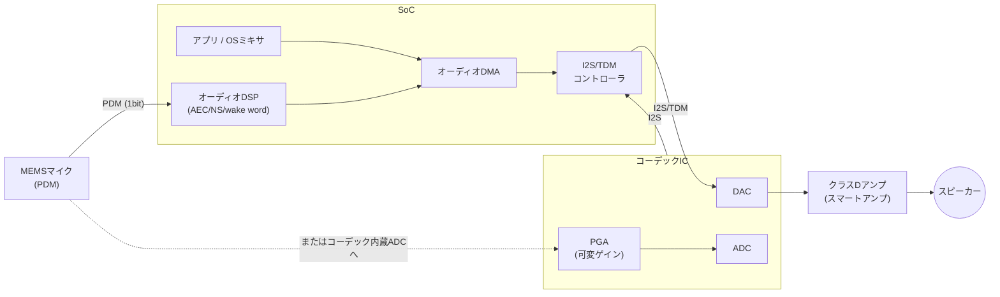
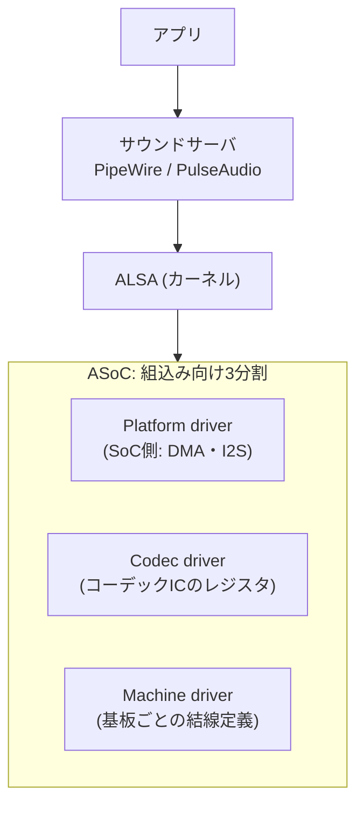

# オーディオサブシステム: 端末の音の出入り (Audio Subsystem: How Devices Produce & Capture Sound)

## 概要 (Overview)

スマートフォンや PC で音が鳴るとき、アプリの書いた PCM サンプルは「OS → DMA → デジタルオーディオバス → コーデック IC → アンプ → スピーカー」という縦の経路を通る。録音はその逆向きである。この経路の中心にいるのが **オーディオコーデック IC (audio codec)** である。ここでの「コーデック」は MP3 のような圧縮アルゴリズムではなく、**ADC/DAC を統合したアナログ⇄デジタル変換チップ**を指す。

本ドキュメントは、この経路を層ごとに分解し、なぜ音は途切れずに鳴り続けるのか（DMA リングバッファ）、SoC とコーデックはどう繋がるのか（I2S/TDM/PDM）、遅延はどこで生まれるのか（バッファリング）をハードウェアの観点から説明する。`../hw-sw-interface/bus-interconnect.md`（バス一般）と `../hw-sw-interface/mmio-dma-interrupts.md`（DMA）の知識が、オーディオという「締切のある連続ストリーム」でどう使われるかの応用編でもある。

## 方法論 (Methodology)

- **再生経路**（アプリ → OS ミキサ → DMA → I2S → DAC → アンプ → スピーカー）と**録音経路**（マイク → ADC/PDM → I2S/PDM → DMA → OS → アプリ）の2本を、1サンプルの旅として通しで追う。
- 各層で「データの形式」「クロックの出どころ」「失敗モード（音切れ・ノイズ・歪み）」を対応づける。
- 用語の多義性（codec の2つの意味、latency の複数の定義）を最初に固定してから議論する。
- OS 側スタックは Linux ALSA/ASoC を基準とし、他 OS は対応関係のみ示す。

## 発見事項 (Findings)

1. **デジタルオーディオは「ソフトリアルタイム処理の最小完全例」である。** DAC は一定レートでサンプルを消費し続けるため、供給が一瞬でも途切れる（アンダーラン）と可聴ノイズになる。DMA リングバッファと周期割り込みはこの締切を守る仕組みそのもの。
2. **レイテンシの支配項は計算でも伝送でもなくバッファである。** 遅延 ≒ バッファに溜まっているサンプル数 ÷ サンプルレート。バッファを小さくすれば低遅延になるが、アンダーラン耐性と消費電力（割り込み頻度）を犠牲にする。
3. **I2S はクロックとデータを分離した「オーディオ専用の同期シリアルバス」である。** 汎用バス (PCIe/AXI) と違いアドレスも調停もなく、決まったレートで流れ続ける。単純さの代償として、クロック品質（ジッタ）が音質に直結する。
4. **サンプルレートの世界には 44.1 kHz 系と 48 kHz 系の2つの家系があり、クロック設計を複雑にしている。** 両対応にはフラクショナル PLL か2系統の発振器が要る。
5. **モバイルは消費電力の都合で「常時聴いている」処理を専用ハードに追い出した。** PDM マイク＋低電力 DSP によるキーワード検出 (wake word) は、アプリケーションプロセッサを起こさずに動く設計になっている。

## アーキテクチャ (Architecture)

### 経路の全体像



- **コーデック IC**: DAC/ADC・可変ゲインアンプ・ミキサ・ヘッドフォンアンプを統合。制御（音量・経路切替）は I2C/SPI のレジスタ書き込み、音声データは I2S という**制御とデータの2線立て**が典型。
- **スマートアンプ**: スピーカー駆動電流・電圧をセンスして DSP モデル（振動板の変位・温度推定）にフィードバックし、破損しない範囲で音圧を稼ぐ。小型端末で標準的。
- **MEMS マイク**: シリコンダイアフラムの容量変化を検出。デジタル出力品は **PDM (1-bit)** で直結できる。

### OS 側スタック（Linux ALSA/ASoC の場合）



ASoC が SoC・コーデック・基板の3者を分離するのは、**同じ SoC が基板ごとに違うコーデックと組まれる**組込みの現実に対応するため。macOS/iOS の CoreAudio、Windows の WASAPI + オーディオドライバも役割分担は同型である。

## 技術詳細 (Technical Details)

### 変換 — デルタシグマ型 ADC/DAC

現代のオーディオ ADC/DAC はほぼ**デルタシグマ (ΔΣ) 変調**型。1〜数 bit の量子化器を数 MHz でオーバーサンプリングし、量子化ノイズを可聴帯域外へ押し出して（ノイズシェーピング）、デシメーションフィルタで 24 bit / 48 kHz 等の PCM に落とす。「1 bit を高速に」の極端形が PDM マイクの出力であり、**PDM とはデシメーション前のΔΣ変調ストリームをそのまま線に出したもの**と理解できる。

### I2S — 信号線3本のオーディオバス

```text
BCLK  ─┐_┌─┐_┌─┐_┌─┐_┌─┐_┌─┐_┌─   ビットクロック (= Fs × スロット数 × ビット幅)
LRCLK ────────┐_______________     ワードセレクト (= Fs, L/Rチャネル切替)
SD    ─[MSB]..[LSB]─[MSB]..[LSB]─  シリアルデータ (LRCLKエッジの1BCLK後からMSB)
```

- **3線**: BCLK（ビットクロック）、LRCLK/WS（どちらのチャネルか）、SD（データ）。加えてコーデックの基準クロック **MCLK**（典型 256×Fs）を別途供給することが多い。
- **フォーマット方言**: 標準 I2S（1 BCLK 遅れ）、Left-Justified、Right-Justified。設定ミスは「鳴るが歪む/チャネルが入れ替わる」形で現れる。
- **TDM**: LRCLK 1周期に3スロット以上を詰める多チャネル拡張（例: 8ch スピーカーアレイ）。
- **PDM**: クロックと 1-bit データの2線。マイク2個を立ち上がり/立ち下がりエッジで多重化できる。
- **SoundWire (MIPI)**: I2S/TDM＋I2C の役割を1つの2線バスに統合し、多デバイス列挙・制御・低電力を備えた後継規格。ノート PC のオーディオで採用が進む。

### クロック — 2つの家系とジッタ

- **44.1 kHz 系**（CD 由来: 44.1/88.2/176.4k）と **48 kHz 系**（映像由来: 48/96/192k）は整数比にならず、MCLK = 256×Fs をどちらの家系にも供給するには**フラクショナル PLL** か2つの水晶が要る。安価な実装が 44.1k 系を 48k にリサンプルして済ませるのはこのため。
- **ジッタ**: DAC の変換タイミングの揺らぎは、信号依存の位相ノイズとして歪みに変換される。ゆえに高品位設計では「クロックは DAC の近くで作り、SoC 側がスレーブになる」構成をとる。
- クロックの生成・分配の一般論は `../hw-sw-interface/clock-power-reset.md`、発振器の物理は `../timekeeping/clocks-time-synchronization.md` を参照。

### DMA リングバッファ — 音が途切れない仕組み

音声ストリームは `../hw-sw-interface/mmio-dma-interrupts.md` のディスクリプタリングの考え方を「時間の締切付き」で使う。

```text
 リングバッファ (例: 4 period × 256 frames)
   ┌────────┬────────┬────────┬────────┐
   │period 0│period 1│period 2│period 3│   DMAが順に読み、末尾で先頭へ戻る
   └────────┴────────┴────────┴────────┘
        ▲ DMA読出位置(hw_ptr)      ▲ アプリ書込位置(appl_ptr)
   period境界ごとに割り込み → アプリを起こして次を書かせる
```

1. DMA コントローラがバッファを一定レートで I2S コントローラへ供給し続ける（CPU 非介在）。
2. **period**（バッファの分割単位）を消費するたびに割り込みが上がり、アプリ/ミキサが追記する。
3. 書き込みが間に合わず DMA が未更新領域に到達すると**アンダーラン (underrun/XRUN)** となる。古いデータの再生またはミュートになり、「プチッ」という可聴ノイズになる。録音側で溢れれば**オーバーラン**。

**遅延とのトレードオフ**がこの構造の本質である。

| バッファ設定 | 遅延 | アンダーラン耐性 | 消費電力 |
|---|---|---|---|
| 小 (例: 2×64 frames @48k ≈ 2.7 ms) | 低 | 弱い（スケジューリング遅延で即破綻） | 高（割り込み頻発） |
| 大 (例: 4×1024 frames ≈ 85 ms) | 高 | 強い | 低（まとめて起きる） |

音楽再生は大バッファ（電池優先）、楽器アプリや通話は小バッファ（対話性優先）と、**用途がバッファサイズを決める**。プロオーディオが専用ドライバ（ASIO 等）や `SCHED_FIFO` を使うのは、この小バッファ運用をスケジューリング側から支えるためである（`../../software/operating-systems/process-thread-scheduling.md`）。

### 信号処理 — AEC・NS と常時オン設計

- **エコーキャンセル (AEC)**: スピーカー出力の参照信号を使ってマイク入力から自端末の再生音を適応フィルタで引く。**再生と録音のサンプルクロックが同一源であること**が前提で、ここでもクロック設計が問われる。
- **ノイズ抑制 (NS)・ビームフォーミング**: 複数マイクの位相差で方向選択性を作る。マイク間の遅延整合が必要で、PDM 直結が好まれる理由の一つ。
- **wake word 検出**: 低電力 DSP（またはコーデック内蔵 DSP）が PDM マイクを常時監視し、検出時だけ AP を起こす。消費電力の階層化（`../../software/operating-systems/power-management.md`）のオーディオ版である。

## セキュリティ考察 (Security Considerations)

- **マイクは常時オンの盗聴器になりうる。** wake word 検出の「常時聴く」ハードウェアパスは、侵害されればそのまま盗聴経路になる。近年の端末が**ハードウェアミュートスイッチ**や、OS より下の層で制御されるマイク使用インジケータを備えるのは、ソフトウェアだけの保証では不十分という判断である。
- **非可聴コマンド注入 — DolphinAttack**: マイクの前段回路の非線形性を突き、超音波に載せた音声コマンドを復調させて音声アシスタントを操作できることが示されている (Zhang et al., CCS 2017)。マイクという「センサの物理特性」が攻撃面になる例。
- **センサの転用**: ジャイロや加速度計が音声振動を拾い低品質マイクとして機能しうることが示されており（Michalevsky et al., USENIX Security 2014 の Gyrophone）、「マイク権限がなければ盗聴不能」とは言えない。
- **スマートアンプの保護モデルはソフトに依存する。** 振動板保護（変位・温度モデル）を迂回してフルパワーを流せば物理破損させられるため、アンプのレジスタ空間はドライバ以外から書けないよう権限分離が要る。これは「デバイスレジスタへの書き込み権限＝物理的な影響力」の一例である。
- **音声経路のデータはプライバシーそのもの。** DMA バッファやDSPメモリに残る録音データの扱い（ゼロ化、アクセス制御）は、`../security/side-channels-tee-secure-boot.md` の TEE 的分離（例: 機密音声処理の隔離実行）と接続する。

## 結論 (Conclusions)

- 端末のオーディオは「コーデック IC を中心に、I2S/PDM で運び、DMA リングバッファで締切を守る」システムであり、汎用 I/O 機構（バス・DMA・割り込み）がリアルタイム制約下でどう使われるかの好例である。
- 遅延・音切れ・消費電力は独立の問題ではなく、すべて**バッファサイズという1つのつまみ**の裏表として現れる。
- クロックは配線図に現れない品質要因で、家系問題（44.1k/48k）・ジッタ・AEC の同期要件という形で設計全体を拘束する。
- マイクを持つ以上、オーディオサブシステムはプライバシー境界であり、ハードウェアレベルの遮断・権限分離・物理特性由来の攻撃（超音波）への考慮が要る。

### 次の接続先 (Related Topics)

- `usb-architecture.md` — USBオーディオの伝送路（アイソクロナス転送とクロックフィードバック）。
- `bluetooth-pairing-protocol.md` — この経路が無線化されたとき（A2DP/LE Audio）に何が変わるか。
- `../hw-sw-interface/mmio-dma-interrupts.md` — DMA リング・割り込み合体の一般論。
- `../hw-sw-interface/clock-power-reset.md` — クロック生成 (PLL) と分配の基礎。
- `../../software/android/graphics-pipeline.md` — 同じ「締切付きストリーム」問題の映像版（vsync とバッファリング）。

## 参考文献 (References)

**一次資料 (Primary — 仕様・公式ドキュメント)**

- Philips Semiconductors (現 NXP). *I2S Bus Specification* (1986, rev. 1996). — [nxp.com I2S](https://www.nxp.com/docs/en/user-manual/UM11732.pdf) — Accessed: 2026-07-05。BCLK/WS/SD のタイミングとフォーマットの規範。
- Linux Kernel Documentation. *ALSA SoC (ASoC) Layer*. — [kernel.org ASoC docs](https://www.kernel.org/doc/html/latest/sound/soc/index.html) — Accessed: 2026-07-05。Platform/Codec/Machine 3分割と PCM/DMA 運用の一次ドキュメント。
- MIPI Alliance. *SoundWire Specification* (概要公開ページ). — [mipi.org/specifications/soundwire](https://www.mipi.org/specifications/soundwire) — Accessed: 2026-07-05。I2S+I2C 統合後継バスの規範元。
- Zhang, G., Yan, C., Ji, X., Zhang, T., Zhang, T., & Xu, W. (2017). DolphinAttack: Inaudible Voice Commands. *Proceedings of ACM CCS 2017*, 103–117. DOI: 10.1145/3133956.3134052。査読付き論文（非可聴コマンド注入の実証）。
- Michalevsky, Y., Boneh, D., & Nakibly, G. (2014). Gyrophone: Recognizing Speech from Gyroscope Signals. *USENIX Security 2014*. — [usenix.org](https://www.usenix.org/conference/usenixsecurity14/technical-sessions/presentation/michalevsky) — Accessed: 2026-07-05。査読付き論文（センサ転用盗聴）。

**二次資料 (Secondary)**

- Analog Devices. *MT-022: ADC Architectures III — Sigma-Delta ADC Basics* (チュートリアル). — [analog.com](https://www.analog.com/media/en/training-seminars/tutorials/MT-022.pdf) — Accessed: 2026-07-05。ΔΣ変調・ノイズシェーピング・デシメーションの技術解説。
- Texas Instruments / Cirrus Logic スマートアンプ製品資料（IV センスとスピーカー保護モデル）. — [ti.com](https://www.ti.com/) / [cirrus.com](https://www.cirrus.com/) — Accessed: 2026-07-05。振動板変位・温度モデルによる保護の実装例。
