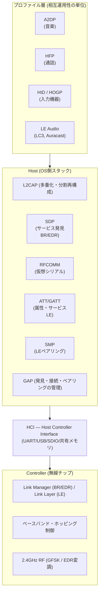
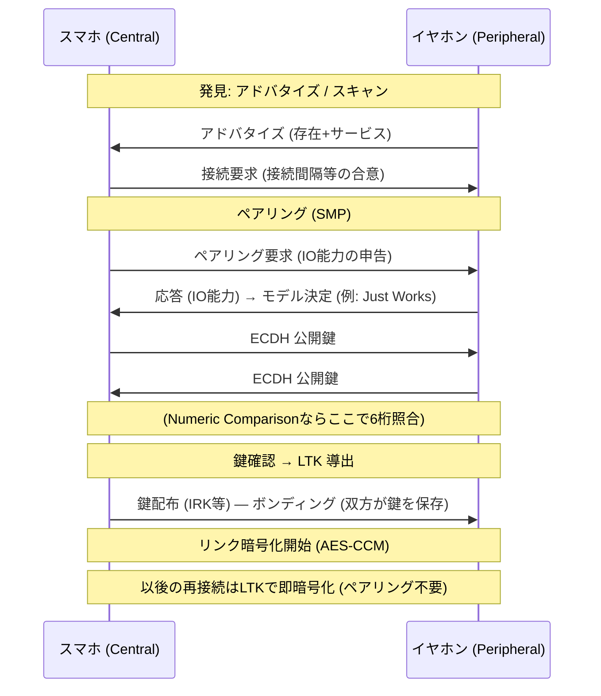

# Bluetoothとペアリング: 無線スタックの解剖 (Bluetooth & Pairing: Anatomy of a Wireless Stack)

## 概要 (Overview)

Bluetooth 機器を「ペアリングして使う」という日常動作の裏では、2.4 GHz の電波物理からプロトコルスタック、楕円曲線暗号による鍵交換までがすべて動いている。Bluetooth は、無線通信システムの構成要素（RF・リンク制御・ホストスタック・セキュリティ・アプリケーションプロファイル）を一通り備えた、身近で完結した教材である。

本ドキュメントは、Bluetooth を下から上へ解剖し、クラシック (BR/EDR) と LE は何が違うのか、「ペアリング待ち」の間に何が起きているのか、なぜ画面の6桁数字を見比べるだけで安全になるのかを説明する。本ディレクトリの `input-devices-hid.md`（コントローラー = HID）と `audio-subsystem.md`（音声 = A2DP/LE Audio）は、いずれも最上層のプロファイルとしてこのスタックの上で合流する。

## 方法論 (Methodology)

- スタックを **RF 物理層 → リンク層 → HCI 境界 → ホストプロトコル (L2CAP/GATT/SMP) → プロファイル** の順に下から積み上げる。
- BR/EDR (クラシック) と LE を混ぜずに、共通点（周波数帯・ブランド・GAP の概念）と相違点（変調・チャネル構成・プロトコル群）を明示的に分けて扱う。
- 「イヤホンをペアリングして音楽を聴く」を1本のシーケンスとして通し、各ステップをスタックの層に対応づける。
- セキュリティはペアリング方式の世代（レガシー → SSP/ECDH → LE Secure Connections）を軸に、既知攻撃（KNOB, BlueBorne 等）と対応づけて評価する。

## 発見事項 (Findings)

1. **Bluetooth は実質2つの別物の無線システムがブランドを共有している。** BR/EDR (クラシック) と LE は変調・チャネル構成・リンク層・接続手順が別物で、共存するのは 2.4 GHz ISM 帯と上位の管理概念だけ。音声はクラシック (A2DP/HFP) から LE Audio へ移行が進行中で、両対応期が長く続いている。
2. **Controller/Host 分離と HCI が実装の形を決めている。** 無線チップ (Controller) と OS 側スタック (Host) は **HCI (Host Controller Interface)** という標準化された境界で分かれ、ペアリングの状態や鍵は Host 側に住む。「チップを変えても OS スタックは同じ」「OS を変えても同じチップが動く」のはこの境界のおかげ。
3. **ペアリングとは「認証付き鍵交換 + 鍵の永続化」である。** ECDH で盗聴に強い鍵を作り、アソシエーションモデル（6桁数字の比較など）で中間者 (MITM) を排除し、ボンディングで鍵を保存する。つまり、3つの別問題の合成として理解できる。
4. **UI の乏しさがセキュリティ強度を直接決める。** 画面もボタンもないイヤホンは Just Works（MITM 保護なし）に落ちるしかない。ペアリング方式は暗号の選択ではなく、**デバイスの入出力能力の関数**である。
5. **2.4 GHz 帯は混雑が前提の設計。** 周波数ホッピングと AFH (Adaptive Frequency Hopping) は Wi-Fi や電子レンジとの共存機構であり、「Bluetooth が時々途切れる」現象の多くはこの帯域共有に由来する。

## アーキテクチャ (Architecture)

### スタック全体像

### BR/EDR と LE の対比

| | BR/EDR (クラシック) | LE (Low Energy) |
|---|---|---|
| チャネル | 79 × 1 MHz | 40 × 2 MHz (37データ + 3アドバタイズ) |
| 変調 | GFSK 1 Mbps、EDR: π/4-DQPSK 2 Mbps / 8DPSK 3 Mbps | GFSK 1 Mbps (LE 2M で 2 Mbps, Coded PHY で長距離) |
| 接続確立 | Inquiry / Page | アドバタイズ → スキャン → 接続要求 |
| 上位プロトコル | SDP, RFCOMM | ATT/GATT, SMP |
| 主な用途 | 音声 (A2DP/HFP)、旧来の周辺機器 | センサ・入力機器 (HOGP)・LE Audio |
| 設計目標 | スループットと音声リンク | 低消費電力・間欠動作 |

LE の本質は「**聴いていない時間を最大化する**」こと。アドバタイズ間隔・接続間隔 (7.5 ms〜4 s) を伸ばすほど電池は持つが応答は遅れる。`input-devices-hid.md` で見た HOGP コントローラーの遅延はこのパラメータ交渉の結果である。

## 技術詳細 (Technical Details)

### RF 物理層 — 混雑した 2.4 GHz を生き抜く

- **2.4 GHz ISM 帯** (2.400–2.4835 GHz) は免許不要ゆえに Wi-Fi・電子レンジ・独自無線がひしめく。Bluetooth の解は**周波数ホッピング (FHSS)**: BR/EDR は 1600 hop/s でチャネルを渡り歩き、干渉を確率的に回避する。
- **AFH**: 接続ごとにチャネルの品質を監視し、Wi-Fi が占有しているチャネルをホッピング系列から外す。Wi-Fi/BT コンボチップではさらにチップ内で送受信タイミングを調停する（コエグジスタンス）。
- **到達距離**は送信電力クラス（Class 1: 100 mW 〜 Class 2: 2.5 mW）とアンテナ設計で決まり、「Bluetooth は 10 m」という通説は Class 2 の目安にすぎない。LE Coded PHY (S=8) は誤り訂正で感度を稼ぎ、レートと引き換えに到達距離を数倍に伸ばす。

### 接続とサービス発見 — 「ペアリング待ち」の中身

LE を例にすると次のようになる。

1. **アドバタイズ**: ペリフェラル（イヤホン等）が3つのアドバタイズチャネルで自分の存在と対応サービスを周期的に放送する。「ペアリングモード」とは多くの場合、これを発見可能な内容で送っている状態。
2. **スキャン・接続**: セントラル（スマホ）が受信し、接続要求を送ってタイミング（接続間隔）とホッピングを合意する。
3. **サービス発見**: GATT でサービス/キャラクタリスティック（BR/EDR なら SDP でサービスレコード）を列挙し、「この相手はオーディオシンクで HID もある」と知る。
4. **ペアリング**（必要なら）→ 暗号化開始 → プロファイル接続。

### ペアリング — 認証付き鍵交換としての理解

ペアリングは3つの独立した問題を解いている。

| 問題 | 解 | 破られると |
|---|---|---|
| 盗聴者に鍵を知られない | **ECDH (P-256) 鍵交換**（SSP / LE Secure Connections） | 受動盗聴で全通信解読 |
| 相手が本物か（MITM 排除） | **アソシエーションモデル**（下表） | 中間者が両側と別々にペアリング |
| 次回から再ペアリング不要 | **ボンディング**（LTK/リンクキーの保存） | 鍵ストア侵害でなりすまし |

アソシエーションモデルは**両デバイスの入出力能力**から自動選択される。

| モデル | 必要な UI | MITM 保護 | 典型例 |
|---|---|---|---|
| Numeric Comparison | 両側に表示+可否ボタン | あり（6桁一致確認 = 交換した公開鍵のコミットメント検証） | スマホ ⇄ PC |
| Passkey Entry | 片側表示・片側入力 | あり | キーボード |
| OOB (Out of Band) | NFC 等の別チャネル | 別チャネル依存 | NFCペアリング |
| **Just Works** | なし | **なし** | 画面のないイヤホン |

6桁数字の照合が有効なのは、これが乱数の表示ではなく**双方が受け取った公開鍵から計算したハッシュの照合**だからである。中間者が鍵をすり替えると数字が一致しなくなる。逆に Just Works はこの検証を省くため、初回ペアリング時の能動的な中間者は原理的に防げない（盗聴のみの受動攻撃には ECDH が依然有効）。

なお歴史的経緯として、(1) BR/EDR の**レガシーペアリング**（PIN ベース、Bluetooth 2.0 まで）は短い PIN が総当たりで割れ、(2) **LE レガシーペアリング**（LE Secure Connections 以前）は一時鍵 TK の空間が小さく盗聴からの鍵復元が実証されている (Ryan, 2013)。現行の SSP / LE Secure Connections はいずれも ECDH ベースで、これらの弱点への応答である。

### プライバシー — アドレスのランダム化

固定の機器アドレスは移動追跡を許すため、LE は **RPA (Resolvable Private Address)** を使う: アドレスを周期的に乱数から生成し直し、ボンディング時に交換した **IRK (Identity Resolving Key)** を持つ相手だけが「同じ機器だ」と解決できる。ペアリングが「追跡耐性の鍵配布」も兼ねている点は見落とされやすい。

### 音声プロファイル — クラシックから LE Audio へ

- **A2DP** (音楽・単方向): コーデックは **SBC が必須**、AAC/aptX/LDAC はオプション。「対応コーデックは双方の交渉で決まる」ため、片側だけ LDAC 対応でも SBC に落ちる。
- **HFP** (通話・双方向): 音声は SCO/eSCO リンクで、CVSD（電話品質）または mSBC（広帯域 16 kHz）。**音楽中に通話が始まると音質が落ちる**のは A2DP→HFP への切替そのもの。
- **LE Audio**: LC3 コーデック（低ビットレートで SBC 超の品質）、Isochronous Channels（CIS: 左右イヤホンを独立ストリームで同期、BIS: **Auracast** 放送オーディオ）、および補聴器対応が設計目標。クラシック音声機構の全面置換であり、`audio-subsystem.md` の端末内経路がここで無線区間に接続する。

無線音声の遅延（数十〜百 ms 超）は、コーデックのフレーム化＋再送のためのバッファリングに由来し、`audio-subsystem.md` で見た「遅延はバッファ」の原則がそのまま無線区間にも成り立つ。

## セキュリティ考察 (Security Considerations)

- **KNOB 攻撃 (2019)**: BR/EDR の暗号鍵長ネゴシエーションを中間者が「1バイト」に引き下げられる仕様上の欠陥 (Antonioli et al., USENIX Security 2019)。総当たりが現実的になる。仕様側は最小鍵長の引き上げ・検証で対応。**「暗号化している」と「十分な強度で暗号化している」は別**という教訓。
- **BlueBorne (2017)**: 各 OS の Bluetooth スタック実装の脆弱性群で、ペアリングなし・クリック無しでのコード実行が示された (Armis)。**スタックは常時電波を聴いている巨大なパーサ**であり、`input-devices-hid.md` の HID ディスクリプタと同様「無線から来るデータは信頼できない入力」として扱う必要がある。
- **Just Works の受容**: UI なしデバイスで MITM 保護は構造的に持てない。実務上の緩和は「初回ペアリングを管理された環境で行う」「ボンディング済み以外の再ペアリング要求を怪しむ」運用側にある。
- **追跡**: RPA 非対応・実装不備の機器は固定アドレスを晒し、所持者の動線追跡を許す。小売・空港での BT/Wi-Fi プローブ追跡は実運用例がある。
- **NIST SP 800-121 Rev.2** が組織向けの包括的なガイド（推奨ペアリングモード、鍵長、リスク評価）として参照できる。

## 結論 (Conclusions)

- Bluetooth は BR/EDR と LE という2系統の無線を、Controller/Host 分離 (HCI) と GAP の管理概念で束ねたシステムであり、無線スタックの標準的な解剖標本として学べる。
- ペアリングは「ECDH 鍵交換 + アソシエーションモデルによる MITM 排除 + ボンディングによる鍵永続化」の合成であり、その強度はデバイスの UI 能力で決まる。6桁照合は公開鍵のコミットメント検証である。
- 音声は A2DP/HFP から LE Audio (LC3, Isochronous Channels) への移行期にあり、コーデック交渉とバッファリングが品質・遅延を決める。
- 攻撃事例 (KNOB, BlueBorne) は「仕様の交渉部分」と「実装のパーサ」が二大攻撃面であることを示す。無線から来るものはすべて信頼できない入力である。
- 本ディレクトリの3文書はここで閉じる: コントローラー (HID) は HOGP として、端末オーディオは LE Audio として、いずれも Bluetooth スタックの最上層に載る。

### 次の接続先 (Related Topics)

- `input-devices-hid.md` — HOGP で運ばれる HID レポートの中身。
- `audio-subsystem.md` — 無線区間の手前、端末内のオーディオ経路。
- `usb-architecture.md` — HCI トランスポートとしての USB、および「挿したら信頼」との信頼モデル対比。
- `../security/side-channels-tee-secure-boot.md` — ボンディング鍵の保管とハードウェア信頼基盤。
- `../../software/networking/tcp-transport-congestion.md` — 再送・輻輳という同型の問題の有線ネットワーク版。
- `../timekeeping/clocks-time-synchronization.md` — ホッピング同期・Isochronous Channel の基礎となる時刻同期。

## 参考文献 (References)

**一次資料 (Primary — 仕様・公式ドキュメント・査読付き論文)**

- Bluetooth SIG. *Bluetooth Core Specification* (v5.4 以降). — [bluetooth.com/specifications/specs/](https://www.bluetooth.com/specifications/specs/) — Accessed: 2026-07-05。RF・リンク層・HCI・L2CAP・SMP・ペアリング手順の規範。
- Bluetooth SIG. *LE Audio 仕様群 (BAP/LC3/Isochronous Channels) と Auracast 解説*. — [bluetooth.com/learn-about-bluetooth/recent-enhancements/le-audio/](https://www.bluetooth.com/learn-about-bluetooth/recent-enhancements/le-audio/) — Accessed: 2026-07-05。
- Antonioli, D., Tippenhauer, N. O., & Rasmussen, K. (2019). The KNOB is Broken: Exploiting Low Entropy in the Encryption Key Negotiation of Bluetooth BR/EDR. *USENIX Security 2019*. — [usenix.org](https://www.usenix.org/conference/usenixsecurity19/presentation/antonioli) — Accessed: 2026-07-05。査読付き論文。
- Ryan, M. (2013). Bluetooth: With Low Energy Comes Low Security. *USENIX WOOT 2013*. — [usenix.org](https://www.usenix.org/conference/woot13/workshop-program/presentation/ryan) — Accessed: 2026-07-05。LE レガシーペアリングの鍵復元の実証（査読付きワークショップ）。
- NIST. *SP 800-121 Rev. 2: Guide to Bluetooth Security* (2022 update). — [csrc.nist.gov](https://csrc.nist.gov/pubs/sp/800/121/r2/upd1/final) — Accessed: 2026-07-05。標準化機関によるセキュリティガイド。

**二次資料 (Secondary)**

- Armis. *BlueBorne Technical White Paper* (2017). — [armis.com/blueborne](https://www.armis.com/blueborne/) — Accessed: 2026-07-05。スタック実装脆弱性群の技術詳細（発見者による白書）。
- Woolley, M. (Bluetooth SIG). *Bluetooth Core Specification 解説シリーズ (developer study guides)*. — [bluetooth.com/bluetooth-resources/](https://www.bluetooth.com/bluetooth-resources/) — Accessed: 2026-07-05。GAP/GATT/PHY の公式技術解説。
