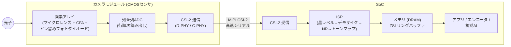

# カメラとイメージセンサ: 光子からピクセルまで (Camera & Image Sensors: From Photons to Pixels)

## 概要 (Overview)

カメラで写真が撮れるとき、光は「レンズ → CMOS イメージセンサ（光子→電子→電圧→デジタル）→ MIPI CSI-2 リンク → ISP (image signal processor) → メモリ → アプリ」という縦の経路を通る。[`display-pipeline.md`](display-pipeline.md) が扱った「データ→光」の逆向き、すなわち**光→データ**の経路であり、同じく「締切のある連続ストリーム」（プレビューは 30〜60 fps で流れ続ける）を DMA と専用ハードウェアで処理する層である。

本ドキュメントは、この経路を層ごとに分解し、画素はどうやって光を数えるのか（ピン留めフォトダイオード）、なぜ動くものが歪むのか（ローリングシャッタ）、色はどこから来るのか（ベイヤー配列とデモザイク）、そしてなぜ ISP は固定機能パイプラインなのかをハードウェアの観点から説明する。`../hw-sw-interface/mmio-dma-interrupts.md`（DMA・割り込み）の応用編であり、`../../software/android/` と `../../software/ios/` のカメラスタック（Camera HAL / AVFoundation）が乗るハードウェア側の基礎にあたる。

## 方法論 (Methodology)

- 1 フレームの旅（光子 → 画素 → 読み出し → CSI-2 伝送 → ISP → メモリ → アプリ）を通しで追い、各層で「データの形式」「時間構造（露光・読み出し順）」「失敗モード（ノイズ・歪み・帯域不足）」を対応づける。
- 用語の混同を最初に固定する：**センサ（光をデジタル値にする）と ISP（デジタル値を画にする）は別のハードウェア**であり、RAW データは「画像」ではなく再構成前の測定値である。
- リンク速度（D-PHY/C-PHY）や ADC 分解能などの数値は、規格上限 (spec) と実装の典型値 (typical) を区別してラベルづけする。
- OS 側スタックは Android Camera2/HAL と iOS AVFoundation の対応関係のみ示し、詳細は `software/` 側に委ねる。

## 発見事項 (Findings)

1. **カメラ経路はディスプレイ経路の鏡像である。** ディスプレイが「メモリを定レートで読み光に変える」のに対し、カメラは「光を定レートでサンプルしメモリへ書く」。どちらも締切付き DMA ストリームであり、バッファリング・アンダーラン/オーバーランの議論（[`audio-subsystem.md`](audio-subsystem.md)、[`display-pipeline.md`](display-pipeline.md)）がそのまま対応する。
2. **ローリングシャッタは列並列読み出しという回路構造の帰結であり、「時間が画像の縦方向に空間化される」現象である。** 行ごとに露光タイミングがずれるため、高速移動体の傾き・プロペラの歪み・PWM 駆動 LED の縞（フリッカバンディング）はすべて同じ一つの原因から生じる。
3. **色の 2/3 はセンサが測っておらず、デモザイクが推定している。** ベイヤー配列 (Bayer CFA) の各画素は R/G/B のうち 1 色しか持たないため、写真は「記録」ではなく初めから「再構成」である。計算写真 (computational photography) はこの延長線上にある。
4. **裏面照射 (BSI) と積層 (stacked) はセンサを「部品」から「システム」に変えた。** 配線層を光路から追い出し (BSI)、さらにロジックや DRAM を画素の直下に積む (stacked) ことで、センサ自身が高速読み出し・前処理・バッファリングを抱え込む方向に進化している。
5. **ISP が固定機能ハードウェアなのは、画素レートが汎用 CPU の処理能力を桁で超えるからである。** 例えば 5,000 万画素 × 30 fps は 15 億画素/秒であり、1 画素あたり数十〜数百演算のパイプラインを電力予算内で回すには専用回路しかない。一方でその硬直性が、マルチフレーム合成 (HDR+) など「メモリと後処理で画質を作る」計算写真へのシフトを生んだ。

## アーキテクチャ (Architecture)

### 経路の全体像

| 層 | 役割 | データの形式 | 主な失敗モード |
|---|---|---|---|
| 画素 | 光子→電子の変換と蓄積 | 電荷（アナログ） | ショットノイズ・飽和（白飛び） |
| 読み出し + ADC | 電荷→電圧→デジタル | RAW 値（10〜14 bit/画素が典型） | 読み出しノイズ・列固定パターンノイズ |
| CSI-2 リンク | シリアル伝送 | RAW パケット（レーン多重） | 帯域不足 → フレームレート制限 |
| ISP | RAW→画像の再構成 | YUV/RGB フレーム | デモザイク偽色・過剰 NR |
| メモリ/アプリ | 保存・エンコード・解析 | JPEG/HEIC・動画・特徴量 | バッファ枯渇 → フレーム落ち |

制御はデータと分離されている：露光時間・ゲイン・フレームレートの設定は I2C/I3C (CCI: camera control interface) のレジスタ書き込みで行い、画像データは CSI-2 で流す。これはオーディオにおける「I2C で制御・I2S でデータ」と同じ2線立てである。

## 技術詳細 (Technical Details)

### 画素の物理 — ピン留めフォトダイオードと相関二重サンプリング

画素の心臓部は**ピン留めフォトダイオード (pinned photodiode, PPD)** である。入射した光子はシリコン中で光電効果により電子正孔対を生み、露光時間のあいだ電子がフォトダイオードに蓄積される。PPD は表面を p+ 層で「ピン留め」して界面の暗電流を抑え、転送ゲートで電荷を**完全転送**できる構造で、元は CCD の残像対策として発明され (Teranishi et al., 1982)、現代の CMOS センサ 4T 画素にそのまま受け継がれた。受光素子の半導体物理は [`../../foundations/physics/quantum-solid-state/optoelectronics.md`](../../foundations/physics/quantum-solid-state/optoelectronics.md) で扱う。

完全転送が重要なのは**相関二重サンプリング (CDS)** を可能にするからである。転送先のフローティングディフュージョンをリセットした直後の電圧と、電荷転送後の電圧の差分を取ることで、リセットノイズ (kTC ノイズ) が相殺され、低照度の数電子レベルの信号が読めるようになる。画素が蓄えられる最大電子数（フルウェル容量）と読み出しノイズの比がダイナミックレンジを決める。

### シャッタ — ローリング vs グローバル

| 方式 | 露光タイミング | 画素構造 | 歪み | 主な用途 |
|---|---|---|---|---|
| ローリングシャッタ | 行ごとに順次露光・順次読み出し | 4T（小さく高感度） | 動体の傾き・こんにゃく現象・LED フリッカ縞 | スマホ・一般カメラの大多数 |
| グローバルシャッタ | 全画素同時露光、画素内に一時記憶 | 5T 以上＋記憶ノード（大きくなる） | なし（時間的に一貫） | 産業・マシンビジョン、一部ハイエンド |

ローリングシャッタの縞（バンディング）は、PWM 調光された LED や蛍光灯の明滅周期と行ごとの露光タイミングが干渉して生じる。人間の目には連続光に見えても、行単位でサンプルするセンサには点滅が縦方向の縞として写る。車載カメラでは LED 信号機が「消えて写る」問題 (LED flicker mitigation) として規格化されるほど本質的な課題である。グローバルシャッタは画素内記憶ノードの分だけ画素が大きく／感度が不利になるため、モバイルでは今もローリングが支配的である。

### 色 — ベイヤー配列とデモザイク

画素は光子の数しか数えられず、波長（色）を区別しない。色は画素の上に載せた**カラーフィルタ配列 (CFA: color filter array)** で作る。標準は Bayer (1976) の特許による **RGGB 配列**で、輝度への寄与が大きい緑を 2 倍配置する。各画素は 1 色分しか測定していないため、フル解像度のカラー画像を得るには近傍画素から残り 2 色を補間する**デモザイク (demosaicing)** が必須であり、エッジ部の偽色・モアレはこの補間の失敗モードである。近年のスマホ用高画素センサは同色 2×2/3×3 をまとめた **Quad Bayer / Tetra-cell** 配列を採り、低照度では 4/9 画素を束ねて（ビニング）感度を稼ぎ、明るい場面では再配列 (remosaic) で高解像度を出す。

### 構造 — 裏面照射と積層

- **表面照射 (FSI)**: 配線層が受光面側にあり、光は配線の隙間を通ってフォトダイオードに届く。画素の微細化とともに開口率が悪化した。
- **裏面照射 (BSI: backside illumination)**: ウエハを裏返して研磨し、配線層の反対側から受光する。光路上の障害物が消え量子効率が向上、2010 年前後からスマホ用センサの標準になった。
- **積層 (stacked)**: BSI の帰結として、画素層の下に別プロセスのロジックチップ（さらに DRAM 層）を貼り合わせられるようになった。列 ADC・高速読み出し回路・一時バッファをセンサ内に持てるため、スローモーション撮影や読み出し高速化（＝ローリングシャッタ歪みの低減）が可能になる。

### 読み出し — 列並列 ADC

CMOS センサの読み出しは**行を選択し、その行の全画素を列ごとの ADC で一斉に変換する**列並列 (column-parallel) 方式が支配的である。列 ADC には、面積が小さく列間の均一性を取りやすい**シングルスロープ型**（ランプ電圧とカウンタの比較）が広く使われ、分解能は **10〜14 bit が典型**である（HDR 合成後の RAW はより深く、CSI-2 v4.0 は RAW28 まで定義する）。行を順に処理するこの構造こそがローリングシャッタの正体であり、読み出しを速くする（積層・ADC 高速化）ほど歪みは減る。

### 伝送 — MIPI CSI-2 over D-PHY / C-PHY

センサと SoC を結ぶデファクト標準は **MIPI CSI-2 (Camera Serial Interface 2)**。物理層は 2 系統ある（数値は各規格の**上限 (spec 値)**）。

| 物理層 | 構成 | 信号方式 | レーンあたり速度（規格上限） |
|---|---|---|---|
| D-PHY | クロックレーン + データレーン（典型 2/4 レーン） | 差動 2 線/レーン | v2.x で 4.5 Gbps、v3.0 で 9 Gbps（短チャネル 11 Gbps） |
| C-PHY | 3 線 1 組の「トリオ」（クロック埋め込み） | 3 相符号、約 2.28 bit/シンボル | 6 Gsps ≈ 13.7 Gbps/トリオ、v3.0 の 18-wirestate 符号（約 3.556 bit/シンボル）で約 17.8 Gbps/トリオ |

C-PHY はクロックをシンボル遷移に埋め込み 3 線で 1 レーン以上の実効帯域を出す設計で、高画素センサで採用が進む。プロトコル層の CSI-2 は RAW8〜RAW28 のピクセルフォーマット、仮想チャネル（1 リンクに複数ストリーム）、そして v4.0 では常時オン低電力カメラ向けの **AOSC (Always-On Sentinel Conduit)** を定義する。オーディオの wake word 検出と同型の「AP を起こさず監視する」設計がカメラにも来ている。

### ISP パイプライン — RAW から画像へ

ISP は RAW ストリームを画像に再構成する固定機能パイプラインで、典型的な段構成は次のとおりである。

1. **黒レベル補正** — 遮光画素の値を引き、ゼロ点を合わせる
2. **欠陥画素補正・レンズシェーディング補正** — 周辺減光と色シェーディングをゲインマップで補正
3. **デモザイク** — CFA からフルカラーへ補間
4. **ノイズリダクション (NR)** — 空間/時間フィルタ。かけすぎは「塗り絵」になる
5. **色変換・ホワイトバランス** — センサ色空間 → 標準色空間
6. **トーンマッピング・ガンマ** — センサのリニア値を表示用の非線形へ圧縮
7. **スケーリング・出力** — プレビュー/録画/静止画それぞれの解像度へ

パイプラインと並走して **3A** が統計値からフィードバック制御を回す：**AE (auto exposure)** は露光時間とゲイン、**AF (auto focus)** はレンズ位置（位相差画素の視差やコントラストから）、**AWB (auto white balance)** は色ゲインを毎フレーム更新する。設定はデータ経路とは別に CCI (I2C) 経由でセンサへ書き戻される。

### 計算写真 — メモリで画質を作る

- **ZSL (zero shutter lag)**: プレビュー中も ISP は全フレームを処理し続け、直近数フレームを**リングバッファ**に保持する。シャッタ押下時は「これから撮る」のではなく「すでに撮れている過去のフレーム」を選ぶため、体感遅延がゼロになる。DMA リングバッファ（`../hw-sw-interface/mmio-dma-interrupts.md`）の応用である。
- **マルチフレーム HDR**: 露光の異なる（または同一露光の）複数フレームを位置合わせして合成し、単一露光では得られないダイナミックレンジと低ノイズを得る。センサ側も 1 フレーム内で露光を変える staggered HDR やデュアルゲイン読み出しで応じており、「1 枚の物理的な露光＝1 枚の写真」という前提はすでに崩れている。

### ソフトウェアとの接点

Android ではセンサ・ISP は Camera HAL が抽象化し、Camera2 API の「リクエストごとに全設定を積んだキャプチャ要求→結果メタデータ」というモデルが 3A・ZSL を前提に設計されている（`../../software/android/`）。iOS では AVFoundation (AVCaptureSession) が同じ層を担い、Apple 自製 ISP と Deep Fusion 等の合成処理が結びつく（`../../software/ios/`）。どちらの OS でも「フレームは締切どおり流れ続け、設定変更は数フレーム遅れて反映される」というハードウェアの時間構造が API の形をそのまま規定している。

## セキュリティ考察 (Security Considerations)

- **カメラはプライバシー境界であり、インジケータ LED は「ソフトが正直であること」に依存してはならない。** 初期の実装ではセンサ動作と LED が独立に制御でき、MacBook (2008 年以前世代) のファームウェアを書き換えて LED を点けずに撮影できることが実証された (Brocker & Checkoway, 2014, iSeeYou)。以後の設計は LED をセンサ電源/ストリームに配線レベルで連動させる方向に進み、さらに物理シャッタ・キルスイッチ（マイクと同様のハードウェア遮断）を備える機器も増えた。「LED が消えていれば撮られていない」の保証強度は世代と実装に依存する。
- **センサは物理チャネル経由で騙せる。** カメラに向けたレーザー/変調光の照射で、ローリングシャッタの行走査と同期した縞や偽パターンを注入し、物体検出を誤らせられることが示されている（Köhler et al., 2021）。プロジェクタや光源で AI の誤認識を誘う攻撃系譜 (GhostImage 等) も含め、視覚 AI・自動運転では「センサ入力＝真実」という前提が成立しない。
- **音響でカメラを揺らす攻撃もある。** 手ぶれ補正 (OIS) や電子式補正が参照する MEMS ジャイロ/加速度計に共振周波数の音波を当てて偽の動きを注入し、意図的なブレで物体検出を破る **Poltergeist** 攻撃が査読付きで報告されている (Ji et al., 2021)。オーディオ編（DolphinAttack・Gyrophone）と同じく、センサの物理特性そのものが攻撃面になる。
- **セキュアカメラパス**: 顔認証 (Face ID・Android の class 3 生体認証) では、センサ→ISP→照合のデータ経路を TEE/セキュアエンクレーブが掌握し、通常 OS からフレームに触れないようにする。これはディスプレイのセキュア UI パスの入力版である（`../security/side-channels-tee-secure-boot.md`）。
- **サプライチェーンとファームウェア**: カメラモジュールは自前のマイコン/ファームウェアを持つ独立部品であり、モジュールベンダ段階での改竄・偽造品は完成品側から検出しにくい。ファームウェア署名検証とセンサの真正性確認（チャレンジレスポンス）が対策として入り始めている。

## 結論 (Conclusions)

- カメラ経路は「センサが光を測り、CSI-2 が運び、ISP が画像に再構成する」3 段のシステムであり、ディスプレイパイプラインの正確な鏡像（光→データ vs データ→光）として理解できる。
- 画質の物理限界は画素で決まり（フルウェル・ノイズ・開口率）、時間構造は読み出し回路で決まり（列並列 ADC → ローリングシャッタ）、最終的な絵作りは ISP と計算写真で決まる。「どの層の制約か」を切り分けることが分析の要である。
- BSI→積層→センサ内 DRAM という進化と、マルチフレーム合成・ZSL という計算写真の進化は同じ方向を向いている：**光学とシリコンの限界をメモリと処理で補う**。
- カメラはプライバシー境界かつ攻撃面である。インジケータのハードウェア連動・TEE パス・物理チャネル攻撃（光・音響）への耐性は、視覚 AI の普及とともに「画質」と並ぶ設計要件になった。

### 次の接続先 (Related Topics)

- [`display-pipeline.md`](display-pipeline.md) — 逆向きの経路（データ→光）。リンク技術 (DSI) は CSI-2 の兄弟規格。
- [`audio-subsystem.md`](audio-subsystem.md) — 同型の「締切付きストリーム」の音声版。常時オン検出 (wake word ↔ AOSC) も対応する。
- `../hw-sw-interface/mmio-dma-interrupts.md` — フレーム転送と ZSL リングバッファの基礎となる DMA・割り込みの一般論。
- `../security/side-channels-tee-secure-boot.md` — セキュアカメラパスを支える TEE 的分離。
- `../../software/android/` / `../../software/ios/` — この上に乗る OS 側カメラスタック (Camera HAL/Camera2, AVFoundation)。

## 参考文献 (References)

**一次資料 (Primary — 仕様・公式ドキュメント・査読付き論文)**

- Teranishi, N., Kohono, A., Ishihara, Y., Oda, E., & Arai, K. (1982). No image lag photodiode structure in the interline CCD image sensor. *IEDM Technical Digest*, 324–327. DOI: 10.1109/IEDM.1982.190285。ピン留めフォトダイオード（完全電荷転送）の原典。
- Bayer, B. E. (1976). *Color imaging array*. US Patent 3,971,065。ベイヤー配列 (RGGB CFA) の原典。
- MIPI Alliance. *MIPI D-PHY Specification*（概要公開ページ）および *D-PHY v3.0 プレスリリース*. — [mipi.org/specifications/d-phy](https://www.mipi.org/specifications/d-phy) / [press release](https://www.mipi.org/press-releases/mipi-d-phy-v3.0-doubles-data-rate-of-physical-layer-interface-while-extending-power-efficiency) — Accessed: 2026-07-06。レーン速度（v2.x 4.5 Gbps → v3.0 9 Gbps、短チャネル 11 Gbps）の規範元。
- MIPI Alliance. *MIPI C-PHY Specification*（概要公開ページ）および *C-PHY v3.0 プレスリリース*. — [mipi.org/specifications/c-phy](https://www.mipi.org/specifications/c-phy) / [press release](https://www.mipi.org/press-releases/c-phy-v3-0-adds-new-encoding-option-to-support-next-generation-of-image-sensor-applications) — Accessed: 2026-07-06。3 相符号 約 2.28 bit/シンボル・6 Gsps ≈ 13.7 Gbps/トリオ、v3.0 18-wirestate（約 3.556 bit/シンボル ≈ 17.8 Gbps/トリオ）の規範元。
- MIPI Alliance. *MIPI CSI-2 v4.0 発表* (2022). — [mipi.org press release](https://www.mipi.org/press-releases/major-update-to-mipi-csi-2-camera-specification-enables-next-generation-of-always-on-low-power-machine-vision-applications) — Accessed: 2026-07-06。RAW28・AOSC（常時オン）・マルチピクセル圧縮の定義元。
- Lyu, T., Yao, S., Nie, K., & Xu, J. (2014). A 12-Bit High-Speed Column-Parallel Two-Step Single-Slope Analog-to-Digital Converter (ADC) for CMOS Image Sensors. *Sensors*, 14(11), 21603–21621. DOI: 10.3390/s141121603。列並列シングルスロープ ADC の構成と典型分解能（査読付き）。
- Brocker, M., & Checkoway, S. (2014). iSeeYou: Disabling the MacBook Webcam Indicator LED. *USENIX Security 2014*. — [usenix.org](https://www.usenix.org/conference/usenixsecurity14/technical-sessions/presentation/brocker) — Accessed: 2026-07-06。査読付き論文（インジケータ LED のファームウェア迂回の実証）。
- Ji, X., Cheng, Y., Zhang, Y., Wang, K., Yan, C., Xu, W., & Fu, K. (2021). Poltergeist: Acoustic Adversarial Machine Learning against Cameras and Computer Vision. *IEEE Symposium on Security and Privacy 2021*, 160–175。査読付き論文（OIS 用慣性センサへの音響注入によるカメラ攻撃）。
- Köhler, S., Lovisotto, G., Birnbach, S., Baker, R., & Martinovic, I. (2021). They See Me Rollin': Inherent Vulnerability of the Rolling Shutter in CMOS Image Sensors. *ACSAC 2021*. — [arxiv.org/abs/2101.10011](https://arxiv.org/abs/2101.10011) — Accessed: 2026-07-06。査読付き論文（ローリングシャッタへの変調光注入）。

**二次資料 (Secondary)**

- Sony Semiconductor Solutions. *Technology — 裏面照射型・積層型 CMOS イメージセンサ解説*. — [sony-semicon.com](https://www.sony-semicon.com/en/technology/) — Accessed: 2026-07-06。BSI・積層・DRAM 積層の技術解説（ベンダ資料であり、性能値はマーケティングを含む点に注意）。
- Arasan Chip Systems. *White Paper: C-PHY vs D-PHY* (2016). — [arasan.com](https://www.arasan.com/wp-content/uploads/2016/12/Whitepaper-CPHY-vs-DPHY-April-2016.pdf) — Accessed: 2026-07-06。両 PHY の設計比較（IP ベンダによる整理）。D-PHY/C-PHY のレーン速度は MIPI 公表値と相互確認した。
- AOSP (source.android.com). *Camera HAL / Camera2 アーキテクチャ*. — [source.android.com/docs/core/camera](https://source.android.com/docs/core/camera) — Accessed: 2026-07-06。リクエストベースのキャプチャモデルと HAL 3 分割の解説。
