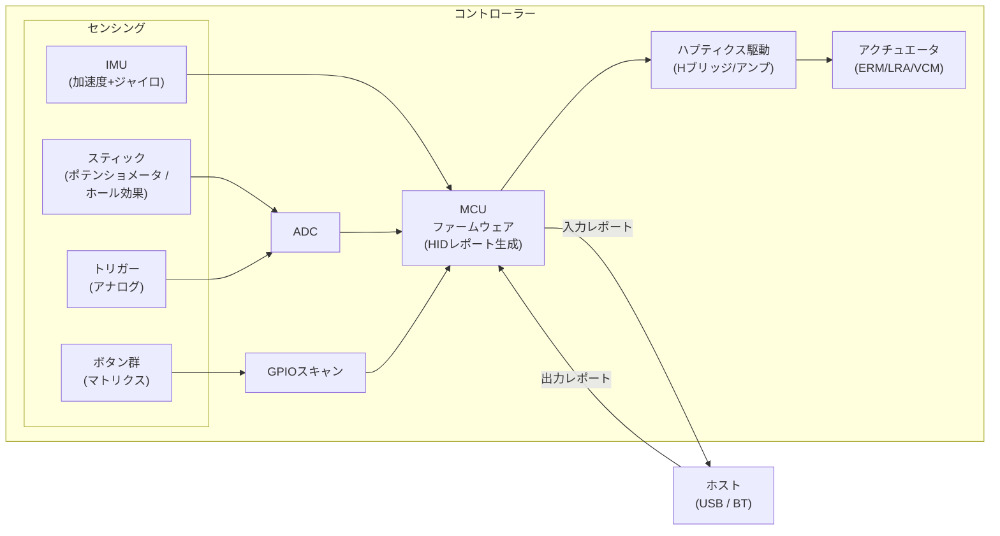
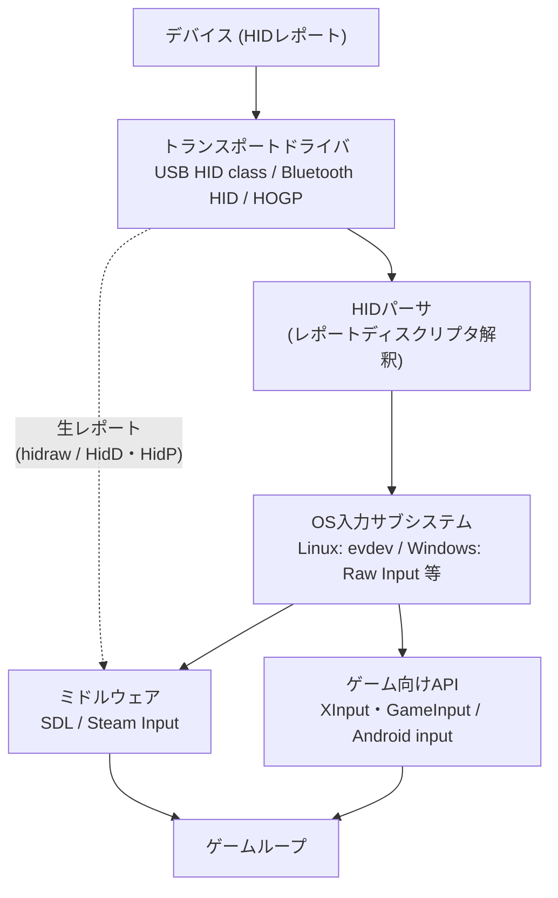
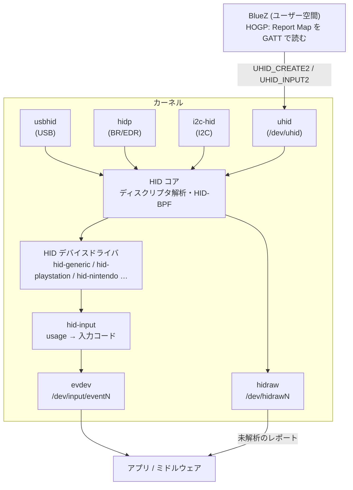

# HIDとゲームコントローラー: 入力デバイスの解剖 (HID & Game Controllers: Anatomy of an Input Device)

## 概要 (Overview)

ゲームコントローラーは、入力デバイス (input device) の技術要素がほぼすべて詰まった格好の題材である。アナログセンシング（スティック・トリガー）、デジタル入力のスキャン（ボタン）、触覚フィードバック（振動）、そしてそれらを OS へ届ける **HID (Human Interface Device)** プロトコルがそろっている。キーボード・マウス・タッチも同じ HID の上に乗るが、それぞれに固有の物理と論点（キーのロールオーバー、光学センサ、静電容量方式のタッチなど）があり、それらは `keyboard-mouse-touch.md` で扱う。

本ドキュメントは、コントローラーを「センサ → ファームウェア → 伝送路 → ホストOS」の一本の経路として解剖し、スティックドリフトはなぜ起きるのか、なぜドライバなしで挿すだけで動くのか、「ポーリングレート 1000Hz」は何を意味するのかをハードウェアの観点から説明する。

## 方法論 (Methodology)

- コントローラーを **入力経路**（センサ → ADC/スキャン → HID レポート → 伝送 → OS 入力サブシステム → ゲーム）と **出力経路**（ゲーム → 出力レポート → アクチュエータ駆動）の2本に分解する。
- 各段について、物理原理・設計上の制約・ソフトウェアから見える振る舞いを対応づける。
- 「ボタンを1回押してから画面に反映されるまで」を1本のレイテンシバジェット (latency budget) として通しで見る。
- 伝送路は USB を基準とし、無線（Bluetooth BR/EDR の HID Profile と LE の HOGP）は差分として扱う（無線層の詳細は `bluetooth-pairing-protocol.md` に委譲）。
- セキュリティは「ホストがデバイスの何を信じているか」を軸に、攻撃面（物理接続・無線リンク・パーサ・入力の真正性）ごとに実際の CVE と修正内容に対応づけて評価する。
- 具体例には、仕様が公開されている部分と Linux ドライバ（`hid-playstation`、`hid-sony`、`net/bluetooth/hidp`）のソースで確認できる部分を使う。ベンダが公開していない値はドライバ実装から読み取れる範囲に限り、その旨を明記する。

## 発見事項 (Findings)

1. **HID の本質は「自己記述型プロトコル」である。** デバイスは自分のデータ形式を**レポートディスクリプタ (report descriptor)** として申告し、ホストはそれを解釈して汎用ドライバだけで扱う。「挿すだけで動く」のはこの仕組みの直接の帰結。ただし、ホスト側でレポートに意味を付ける場所は1つではない。OS の汎用経路（Linux の evdev、Windows の Raw Input など）と並んで、アプリやミドルウェアが生レポートを自分で解釈する経路（hidraw、SDL の HIDAPI ドライバ）があり、ベンダ固有機能は後者でしか使えないことが多い。
2. **スティックドリフトは電気機械的な摩耗問題であり、センシング原理の置き換えで解決されつつある。** 接触式のポテンショメータ (potentiometer) は摺動で摩耗・汚損するが、非接触のホール効果 (Hall effect) / TMR センサは原理的に摺動摩耗がない。
3. **入力遅延はパイプラインの総和であり、ポーリングレートはその1項にすぎない。** センサ読み取り、デバウンス、伝送間隔、OS 処理、ゲームループ、表示までが直列に足し合わさる。
4. **振動は ERM → LRA → ボイスコイルへと「モーター」から「スピーカー」に近づく進化をした。** 立ち上がり時間と再現できる周波数帯域が世代を分ける。
5. **HID はトランスポート非依存で、同じレポートモデルが USB・Bluetooth BR/EDR・BLE に載る。** 一方で実際の主要コントローラーは HID の標準ゲームパッド定義をそのまま使わない。PlayStation 系は「HID の枠内でベンダ固有レポートを使う」方式、Xbox 系は USB では「そもそも HID クラスではない独自プロトコル (XUSB / GIP)」を使う方式で、どちらもホスト側の専用スタックが解釈する。
6. **HID の安全性は「接続されたデバイスの申告を信じる」という信頼モデルの上に成り立っている。** 注入 (BadUSB、CVE-2023-45866)、パーサの脆弱性 (CVE-2017-16533)、入力改変アダプタは、いずれもこの信頼のどこかを突く。CVE-2023-45866 では、HID 仕様が要求していた認証を BlueZ が互換性のために既定で緩めていたことが攻撃経路になった。

## アーキテクチャ (Architecture)

### デバイス側ブロック図



### ホスト側スタック



要点は2つある。1つは**トランスポート層（USB/BT）と HID 層が分離している**こと。HID パーサから上は、レポートがどの物理経路で来たかを知らない。もう1つは、レポートに「意味」を付ける場所が1つではないこと。OS の汎用経路（実線）と並んで、アプリやミドルウェアが生レポートを自分で解釈する経路（点線）がある。詳細は技術詳細の「ホスト側の処理経路」で扱う。

## 技術詳細 (Technical Details)

### アナログスティック — ポテンショメータとその限界

古典的なスティックは軸ごとに**ポテンショメータ**（可変抵抗の分圧回路）を持ち、傾きを電圧に変換して MCU の ADC（典型 8〜12 bit）で読む。

- **ドリフトの機序**: (1) 抵抗皮膜とワイパの**摺動摩耗**、(2) 摩耗粉・埃による接触不良、(3) スプリングのへたりによる中立点のずれ。いずれも「触れて擦る」構造に由来する。
- **ソフト側の緩和**: 中立点キャリブレーション、デッドゾーン (deadzone)、外周の真円度補正。ただし摩耗の進行そのものは止められず、デッドゾーン拡大は操作精度と引き換えになる。
- **非接触センシングへの置換**: **ホール効果センサ**は磁石の位置を磁束密度で読む（ラチオメトリック出力を同じく ADC で読む）ため摺動部がなく、**TMR (Tunnel Magnetoresistance)** はさらに低消費電力・高感度。近年の交換用スティックモジュールや一部純正機はこちらに移行している。ただし方式選定は各社で分かれている。たとえば Switch 2 の Joy-Con 2 について、Nintendo of America の Nate Bihldorff 氏は Nintendo Life の取材に「ホール効果スティックではない」と答えた（2025-04）。新しいスティックは「より大きく、耐久性が高く、動きが滑らか」と紹介されているが、任天堂は採用したセンシング方式を公表しておらず、長期耐久性の独立した検証もない（as of 2026-10）。

### ボタン — マトリクススキャンとデバウンス

ボタンが 20 個前後のゲームコントローラーでは、各ボタンを MCU の GPIO に直接つなぐ構成も一般的である。キーボードのようにスイッチが 100 個を超えるとピンが足りないため、**マトリクススキャン (matrix scanning)**（行を順に駆動し列を読む）で N+M 本のピンに圧縮するのが定石になる。マトリクスでは同時押しで偽の押下が見える**ゴースト (ghosting)** が起きるため、キーごとのダイオードまたは配置設計で回避する。

機械接点は閉じる瞬間に数百 µs〜数 ms **バウンス (chatter/bounce)** するため、**デバウンス**が必須。方式は「一定時間の安定を待つ」（遅延を足す）か「最初のエッジで確定し不応期を置く」（速いが誤検出リスク）かで、**入力遅延に直接影響する設計判断**になる。

### HID レポートディスクリプタ — 「挿すだけで動く」の正体

HID デバイスは列挙時に**レポートディスクリプタ**を渡す。これは「この後送るバイト列のビットフィールドが何を意味するか」を宣言する小さなバイトコードである。

```text
// 例示 (illustrative): ゲームパッドのディスクリプタ断片（意味を注記）
Usage Page (Generic Desktop)     // 意味体系の名前空間
Usage (Game Pad)
Collection (Application)
  Report ID (1)                  // このレポートの先頭に ID 1 が付く
  Usage (X)  Usage (Y)           // スティックX/Y軸
  Logical Minimum (0) Logical Maximum (255)
  Report Size (8) Report Count (2)
  Input (Data, Var, Abs)         // → ID の後の2バイトは X,Y
  Usage Page (Button)
  Usage Minimum (1) Usage Maximum (16)
  Logical Minimum (0) Logical Maximum (1)  // グローバル項目なので必ず上書きする
  Report Size (1) Report Count (16)
  Input (Data, Var, Abs)         // → 続く2バイトはボタン16個のビットマップ
End Collection
```

ホストの HID パーサはこれを解釈し、汎用ドライバが「X軸」「ボタン3」といった**意味 (usage)** 付きの入力イベントに変換する。usage の語彙は HID Usage Tables で標準化されている。

ディスクリプタの項目には、**グローバル項目 (global item)** と**ローカル項目 (local item)** の区別がある。Usage Page・Logical Minimum/Maximum・Report Size/Count・Report ID はグローバル項目で、一度書くと上書きするまで後続のすべての Main 項目 (Input/Output/Feature) に引き継がれる。Usage はローカル項目で、Main 項目ごとにリセットされる。上の例でボタンの直前に Logical Maximum (1) を書き直しているのはこのためで、書き忘れると「1 ビットで 0〜255 を表す」矛盾した宣言になる。手書きのディスクリプタで典型的なバグである。

#### レポートの3種類と Report ID

| 種類 | 向き | 運ばれ方 (USB) | 用途の例 |
|---|---|---|---|
| **Input Report** | デバイス → ホスト | インタラプト IN（周期ポーリング） | ボタン・軸・IMU・バッテリー |
| **Output Report** | ホスト → デバイス | インタラプト OUT、または `SET_REPORT` | 振動、LED、アダプティブトリガーの設定 |
| **Feature Report** | 双方向（要求時のみ） | コントロール転送の `GET_REPORT` / `SET_REPORT` | キャリブレーション値、ファームウェア情報、動作モードの設定 |

1台のデバイスが複数の形式のレポートを持つ場合、ディスクリプタで **Report ID** を宣言し、各レポートの先頭1バイトに ID を付けて区別する。ID を1つも宣言しないデバイスでは、この1バイトは付かない。

周期的な Input Report とは別に、HID クラスはコントロール転送上の**クラスリクエスト**を定義している。

| リクエスト | 内容 |
|---|---|
| `GET_REPORT` / `SET_REPORT` | 指定した種類・ID のレポートを今すぐ読む / 書く。Feature Report の主な経路 |
| `GET_IDLE` / `SET_IDLE` | 値が変わらないときの Input Report の再送間隔。0 なら「変化したときだけ送る」 |
| `GET_PROTOCOL` / `SET_PROTOCOL` | ブートプロトコル（BIOS 向けの固定形式。キーボード・マウスのみ）とレポートプロトコルの切替 |

#### ベンダ固有の拡張 — 2つのパターン

実際の主要コントローラーは、標準の Game Pad usage だけでは表せない機能（IMU、タッチパッド、アダプティブトリガー、LED）を持つ。その扱い方は大きく2パターンに分かれる。

- **HID の枠内でベンダ固有レポートを使う（PlayStation・Nintendo 系）**: HID クラスとして列挙されるので汎用ドライバでも基本操作はできるが、拡張機能はホスト側の専用ドライバ（Linux の `hid-playstation`・`hid-nintendo` 等）がレポートのバイト配置を直接解釈する。たとえば DualSense の Input Report は、USB では ID `0x01`（64 バイト）で全機能を運ぶ。Bluetooth では ID `0x01` が最小限のレポートで、全機能は ID `0x31`（78 バイト）で運ばれ、末尾に CRC32 が付く（Linux `drivers/hid/hid-playstation.c` の定義とコメントによる。このドライバは Sony Interactive Entertainment 自身がカーネルに提供したもので、メーカー由来の実装として最も信頼できる公開資料だが、プロトコル仕様書として公開されたものではない）。
- **そもそも HID クラスではない（Xbox 系）**: Microsoft によれば XInput の伝送プロトコルには XUSB（Xbox 360 世代）、XInputHID、GIP (Game Input Protocol、Xbox One 以降) の3つがあり、Xbox 本体は GIP デバイスのみをサポートする。XUSB と GIP は USB 2.0 上の独自拡張として仕様が公開されており (MS-XUSBI / MS-GIPUSB)、OS の汎用 HID ドライバでは扱えない。Linux では `xpad` や外部ドライバの `xone` がこれを処理する。

「HID だから完全に汎用」ではない点が実務上の落とし穴になる。

### ホスト側の処理経路

ホストに届いたレポートは、OS の汎用経路で「意味」の付いた入力イベントになるか、アプリやミドルウェアが生のまま読んで自分で解釈する。以下、Linux と Windows の汎用経路を見たうえで、両者の違いを吸収するミドルウェアの層を扱う。

#### Linux の HID スタック



- トランスポートと HID コアは分離している。トランスポートドライバ（`usbhid`、`hidp`、`i2c-hid`）は HID デバイスを作って HID コアに登録し、受け取った Input Report を `hid_input_report()` で渡す。カーネル文書は「HID コアは、どのトランスポートドライバが存在するかを決して知らない」と述べ、各デバイスに intr と ctrl の2本のチャネルを要求する。USB のインタラプト転送とコントロール転送、BR/EDR の Interrupt チャネルと Control チャネルという2本立ては、ここで共通の形にそろえられる。
- BLE の HID はユーザー空間を経由する。BR/EDR の HID Profile はカーネルの `hidp` が処理するのに対し、HOGP は BlueZ（ユーザー空間の Bluetooth スタック）が処理する。BlueZ は GATT で Report Map キャラクタリスティック（UUID `0x2A4B`）を読み、`/dev/uhid` に `UHID_CREATE2` を送ってカーネル内に HID デバイスを作る。その後は通知で届いた Input Report を `UHID_INPUT2` でカーネルに渡す（BlueZ `src/shared/hog.c` の `bt_uhid_create()` / `bt_uhid_input()` 呼び出し、`src/shared/uhid.c`）。uhid は「ユーザー空間で HID のトランスポートドライバを実装する」ための仕組みで、HID コアから見れば USB 由来のデバイスと区別がない。
- `hid-input` は、ディスクリプタの usage を evdev の入力コード（`EV_KEY` のボタン、`EV_ABS` の軸）に写像し、`/dev/input/eventN` として公開する。ゲームパッドについては、カーネルの Gamepad 仕様が配置を定めている。フェイスボタンは印字ではなく物理的な位置で `BTN_SOUTH` / `BTN_EAST` / `BTN_NORTH` / `BTN_WEST` と呼ぶ（仕様は「ボタンのラベルにかかわらず、コードはボタンの物理的な位置に従って送られる」と定める）。左右のスティックは `ABS_X`/`ABS_Y` と `ABS_RX`/`ABS_RY` で、十字キーはデジタルの `BTN_DPAD_*` とアナログ軸の `ABS_HAT0X`/`ABS_HAT0Y` のどちらでもよい。Xbox の A と PlayStation の × は、どちらも `BTN_SOUTH` になる。
- hidraw: `hidraw` は、レポートを「HID パーサで解析せず、そのまま」アプリとやり取りする `/dev/hidrawN` を提供する。`read()` で Input Report を受け取り、`write()` で Output Report を送る。番号付きレポートでは先頭1バイトが Report ID になる。ディスクリプタは `HIDIOCGRDESC`、Feature Report は `HIDIOCGFEATURE` / `HIDIOCSFEATURE` で読み書きする。カーネル文書は、アプリが通信方法を正確に知っている場合や、ディスクリプタと実際のレポートが合わない非準拠デバイスに使う経路だと説明している。後述の SDL はこの経路でベンダ固有機能を使う。デバイスノードは udev が作るので、どのユーザーが読めるかも udev の規則で決まる。
- HID-BPF: Linux 6.3 (2023-04) で入った HID-BPF は、eBPF プログラムをデバイスごとに取り付け、ディスクリプタの書き換え（`hid_rdesc_fixup`、probe 時）やイベントの加工・破棄（`hid_device_event`）を行う仕組みである。カーネル文書は、従来の quirk 修正には「カーネルパッチと、それをリリースまで運ぶ手間」が必要だったことを動機に挙げ、例としてジョイスティックのデッドゾーンをカーネル内で処理し、ノイズでユーザー空間を起こさない使い方を示している。ディスクリプタが仕様と合わない製品への対処が、カーネルのリリースを待たず、小さなプログラムの配布で済む道が開けた。

Android の入力パイプライン（evdev から InputReader を経てアプリまで）は、この evdev の上に乗る。詳細は `../../software/android/input-pipeline.md` を参照。

#### Windows の HID スタック

Windows の HID スタックはクラスドライバ `hidclass.sys` を中心に、下にトランスポートのミニドライバ（USB 用の HidUsb など）、上に HID クライアントが乗る構成である。Microsoft はクラスドライバをクライアントと各種トランスポートの間の「接着剤」と説明しており、新しいトランスポートが加わってもクライアントはほぼ変更なしで動く。アプリは `HidD_Xxx` でコレクションの情報を取り、`HidP_Xxx`（HID パーサのルーチン）でレポートを解釈する。

Linux と大きく違うのは、**トップレベルコレクションの usage によってアクセスの方式が決まる**ことである。

| Usage Page / Usage | 種類 | アクセスの方式 |
|---|---|---|
| 0x0001 / 0x0001〜0x0002 | マウス | 排他 |
| 0x0001 / 0x0004〜0x0005 | ゲームコントローラー（Joystick / Game Pad） | 共有 |
| 0x0001 / 0x0006〜0x0007 | キーボード / キーパッド | 排他 |
| 0x000D / 0x0004、0x0005 | タッチスクリーン、高精度タッチパッド (PTP) | 排他 |

Microsoft によれば、入力用の HID クライアントを排他にしているのは、本来の受け手でないクライアントが全体の入力状態を横取りしたり受け取ったりするのを防ぐためで、セキュリティ上の理由から Raw Input Manager (RIM) がこれらのデバイスを排他で開く。任意のアプリがキーボードのレポートを直接読めれば、それだけでキーロガーとして働くので、それを OS の側で塞いでいることになる。ゲームコントローラーは共有なので、複数のアプリが同時に同じレポートを読める。

その上にゲーム向けの API が何層も重なっている。

| API | 対象 | アプリから見える形 |
|---|---|---|
| XInput | XInput 互換コントローラー（XUSB / GIP など） | 固定のレイアウト（スティック2本、アナログトリガー2本、十字キー、ボタン8個、振動モーター2個）。同時に最大4台 |
| DirectInput / Raw Input | HID デバイス一般 | usage に基づく軸・ボタン、または生レポート |
| Windows.Gaming.Input | ゲームパッド等（WinRT） | 種類ごとのクラス |
| GameInput | キーボード・マウス・ゲームパッドを含むすべて | 共通の時間軸にそろえた統一モデル。Microsoft は従来の API（XInput、DirectInput、Raw Input、HID、WinRT）の「機能的な上位集合」と位置づける。Windows 10 19H1 以降と Xbox で利用でき、Xbox One 向け GDK タイトルでは唯一の入力 API |

XInput のレイアウトは固定なので、タッチパッドやジャイロのように構造体にない入力は XInput では届かない。DualSense のジャイロを使いたいゲームは、XInput ではなく HID の経路（Raw Input や `HidD`/`HidP`、あるいは次に述べる SDL）を使う必要がある。

#### ミドルウェア (SDL と Steam Input)

OS の経路だけではコントローラーごとのボタン配置の違いもベンダ固有の機能も吸収しきれない。そこで、その上にミドルウェアの層がある。

- SDL のマッピングデータベース: SDL は OS の汎用経路から来た「ボタン番号・軸番号」を、標準のゲームパッド配置に対応づける文字列を持つ。コミュニティが管理する SDL_GameControllerDB は、1行に1台分を `GUID,名前,a:b1,b:b2,…,dpdown:h0.4,…,platform:…` の形で記録し（`bN` はボタン、`aN` は軸、`hN.M` はハット）、アプリは起動時に `SDL_AddGamepadMappingsFromFile()`（SDL3）で読み込む。同じコントローラーでも OS によって番号が変わるため、`platform:` ごとに別の行になる。
- SDL の HIDAPI ドライバ: SDL は OS の汎用経路を通らず、HID でコントローラーと直接話す独自ドライバ群も持つ（ソースの `src/joystick/hidapi/` に、`SDL_hidapi_ps5.c`・`SDL_hidapi_switch.c`・`SDL_hidapi_xboxone.c`・`SDL_hidapi_gip.c` などがある）。Linux では hidraw がその経路になる。ジャイロ・タッチパッド・LED・振動といったベンダ固有機能は、こちらで使えるようになる。この経路は既定で有効である（`SDL_HINT_JOYSTICK_HIDAPI` の既定値が有効）。つまり SDL はベンダ固有ドライバ（`hid-playstation` など）がカーネルでしている解釈を、ユーザー空間でもう一度実装している。
- Steam Input: Steam はつながったコントローラーを、ゲームに対してエミュレートした Xbox コントローラーとして見せる。Valve の文書によれば、Windows では Steam オーバーレイが XInput・DirectInput・Raw Input・Windows.Gaming.Input といった従来のゲームパッド API をフックし、macOS と Linux ではドライバがエミュレートした入力を提供する。プレイヤーはボタンの割り当てやジャイロのマウス化を Steam 側で設定できる。

経路が複数あるので、同じ1回の押下がゲームに**2回届く**ことがある。Valve は、エミュレーションでは拡張ボタンの一部が重複すると注意している（例: PlayStation のタッチパッドのクリックと Options ボタンが、どちらも XInput の Start になる）。物理的なコントローラーと仮想の Xbox コントローラーを同時に読めば、二重入力にもなる。ゲームはどの経路で読むかを1つに決める必要がある。

| 経路 | アプリが受け取るもの | 配置の標準化 | ベンダ固有機能 |
|---|---|---|---|
| OS の汎用経路（evdev、DirectInput / Raw Input の usage） | usage から写像した軸・ボタン | OS の規約（Linux の Gamepad 仕様など）。実際の番号は機種で揺れる | ドライバが公開した分だけ |
| XInput | 固定の構造体 | 完全に固定 | 使えない |
| 生レポート（hidraw、`HidD`/`HidP`、SDL HIDAPI） | 未解析のバイト列 | なし（アプリやミドルウェアが機種ごとに解釈） | すべて |
| Steam Input | 仮想の Xbox コントローラー | 固定（変換は Steam 側） | Steam の設定で割り当て |

### 無線トランスポート — BR/EDR の HID Profile と HOGP

Bluetooth には HID を運ぶ方式が2つあり、どちらもレポートの中身（ディスクリプタとレポートのバイト列）は USB と同じモデルを使う。違うのは「どう運ぶか」だけである。

| | BR/EDR: HID Profile | LE: HOGP (HID over GATT) |
|---|---|---|
| 主な利用例 | DualShock 4、DualSense、Switch Pro コントローラー、多くの旧来の BT キーボード・マウス | 省電力のキーボード・マウス、Xbox Series コントローラーなどの新しい機器 |
| ディスクリプタの取得 | ペアリング時に SDP のサービスレコードから読む | GATT の Report Map キャラクタリスティックを読む |
| Input Report の送り方 | 割り込みチャネルで送る | Report キャラクタリスティックの通知 (Notification) |
| 間隔を決めるもの | ポーリング・スニフ間隔とデバイスの送信間隔 | 接続間隔 |

BR/EDR の HID Profile は、USB の「コントロール転送」と「インタラプト転送」の役割分担を、2本の **L2CAP チャネル**で再現している。

```text
HID Control チャネル   (PSM 0x0011): GET_REPORT / SET_REPORT / SET_IDLE などの要求と応答
HID Interrupt チャネル (PSM 0x0013): Input / Output Report の本体

各メッセージの先頭1バイトは HIDP ヘッダ = 上位4ビット (トランザクション種別) + 下位4ビット (パラメータ)
  0xA1 = DATA (0xA0) + Input (0x1)   … デバイス → ホストの Input Report
  0xA2 = DATA (0xA0) + Output (0x2)  … ホスト → デバイスの Output Report
  0x4x = GET_REPORT, 0x5x = SET_REPORT, 0x9x = SET_IDLE (Control チャネル)
```

（値は Bluetooth HID Profile 仕様と Linux `net/bluetooth/hidp/hidp.h` の定義による。）DualSense の Bluetooth レポート末尾の CRC32 は、このヘッダ値（入力は `0xA1`、出力は `0xA2`）を先頭に含めて計算される（`hid-playstation.c` の `PS_INPUT_CRC32_SEED` / `PS_OUTPUT_CRC32_SEED`）。

#### タイミングモデル — 誰が送信の機会を決めるか

伝送路の違いは、突き詰めると「デバイスがいつ送ってよいか」を誰が決めるかの違いである。USB だけでなく Bluetooth も、デバイスが好きな時に送れる仕組みではない。

```text
USB (Full-Speed)      |— 1 ms —|— 1 ms —|— 1 ms —|
  ホスト:               IN?      IN?      IN?
  デバイス:              DATA     NAK      DATA      ← 問われたときだけ答える

BR/EDR                |625µs|625µs|625µs|625µs|
  central (ホスト):      送 →        送 →
  peripheral (デバイス):       ← 返        ← 返      ← central から受けた直後のスロットだけ送れる

BLE                   |←— 接続間隔 —→|←— 接続間隔 —→|
  接続イベント:          [C→ ←P]          [C→ ←P C→ ←P]  ← MD ビットで同じイベント内に追加送信
```

| 伝送路 | 送信の機会を決めるもの | 失敗時の再送 |
|---|---|---|
| USB | ホストの IN トークン（`bInterval` ごと） | 次の問い合わせで再送 |
| BR/EDR | central のポーリング。時分割複信 (TDD) で、peripheral は central からのパケットの直後のスロットでのみ送信する | 次に送信の機会が回ってきたときに再送 (ARQ) |
| BLE | 接続イベント（接続間隔ごと）。各イベントは central の送信で始まり、More Data (MD) ビットで延長できる | 同じイベント内か、次のイベントで再送 |
| 独自 2.4 GHz | 製品ごとの独自プロトコル（専用ドングル） | 製品次第 |

BR/EDR のスロットは 625 µs と細かく、central が peripheral に頻繁に送信の機会を与えれば高いレートが出せる。後述する DS4 の約 1 kHz はその例である。BLE は接続イベントの時刻にだけ通信し、それ以外の時間は無線を止められるように設計されている。そのため遅延は「次の接続イベントまでの待ち」で決まる。独自 2.4 GHz 無線は用途に合わせて高レート・低遅延を作り込める反面、暗号化・認証の品質がベンダ次第になる（セキュリティ考察の MouseJack を参照）。

無線で遅延を左右するのは省電力機構である。BR/EDR の**スニフモード (sniff mode)** では、デバイスは決まった間隔でだけ受信窓を開くため、間隔が数十 ms に設定されると、その分だけ入力が待たされる。スニフ間隔の設定は電池の持ちと入力遅延のトレードオフであり、ゲーム用途では遅延側を優先する必要がある。BLE の接続間隔も同じトレードオフ（間隔が長いほど電池が持ち、応答が遅れる）を持つ。

### ポーリングレートと遅延バジェット

USB の HID は**インタラプト転送 (interrupt transfer)** を使い、ホストが `bInterval` で申告された間隔でデバイスを周期的に取りに行く（デバイス側から押し込む仕組みではない）。

| 伝送路 | 間隔を決めるもの | 最小間隔 | 相当レート |
|---|---|---|---|
| USB Full-Speed | `bInterval`（ms 単位、1〜255） | 1 ms | 1000 Hz |
| USB High-Speed | `bInterval`（2^(n−1) × 125 µs） | 125 µs | 8000 Hz |
| Bluetooth BR/EDR (HID Profile) | デバイスの送信間隔と、ホストが設定するポーリング / スニフ間隔 | 1スロット = 625 µs 単位（実装・設定依存） | 例: DS4 は既定で約 1 kHz |
| BLE (HOGP) | 接続間隔 (connection interval) | 従来 7.5 ms（Core 6.2 以降の対応機器同士では 375 µs） | 1イベント1レポートなら ~133 Hz（従来）。1イベントで複数パケットも送れる |

BR/EDR の値は実装差が大きい。Linux の `hid-sony` ドライバの変更記録によれば、DualShock 4 は Bluetooth で最大約 1 kHz で Input Report を送れる。送信間隔はホストからの Output Report 内のフィールドで 1〜62 ms の範囲で設定でき、以前のドライバ設定では約 20.83 Hz に抑えられていた。つまり BR/EDR の HID には BLE のような「7.5 ms の下限」はなく、レートはデバイスとホストの設定で決まる。BLE 側の 7.5 ms の下限は Bluetooth Core 6.2 (2025-11) の Shorter Connection Intervals で 375 µs（125 µs 刻み）まで引き下げられたが、両端のコントローラーが対応している必要がある（as of 2026-10、対応機器は限られる）。

#### ポーリングレートとデバイスの更新レートは別物

ポーリングレートは「ホストが問い合わせる頻度」であって、「デバイスが新しい値を用意する頻度」ではない。USB では、デバイスは問い合わせの時点で新しいデータがなければ **NAK** を返し、そのフレームでは何も届かない。したがって次のことがいえる。

- 1000 Hz でポーリングしても、ファームウェアがセンサを 4 ms ごとにしか読まなければ、実質の更新は 250 Hz になる。
- ポーリングレートの測定ツールが測るのは「OS がレポートを受け取った頻度」である。ボタンを押してから届くまでの遅延（ファームウェア内部のスキャン・デバウンス・処理を含む）は別に測る必要があり、ポーリングレートが高くても遅延が小さいとは限らない。

#### エンドツーエンドの遅延

エンドツーエンドの遅延はおおよそ次のようになる。

```text
センサ読取/スキャン周期 + デバウンス + レポート生成
+ 伝送待ち(平均 = ポーリング間隔/2) + OS入力処理
+ ゲームループ(フレーム同期) + 表示遅延(V-Sync, パネル応答)
```

**「平均 = 間隔/2」の理由**: ボタンを押す瞬間は問い合わせの周期 T と無関係なので、周期内のどの時点になるかは等しい確率で散らばる。待ち時間は 0〜T の一様分布になり、平均は T/2、最悪は T である（250 Hz なら平均 2 ms・最悪 4 ms）。

**周期的な待ちは何段も重なる**: この「次の区切りまで待つ」構造は伝送区間だけでなく、ファームウェアのスキャン周期、伝送の周期、ゲームが入力を読む周期（多くは1フレームに1回。60 Hz なら平均 8.3 ms・最悪 16.7 ms）にもある。各段の周期は互いに同期していないため、待ちは段ごとに足し合わされ、押すたびにばらつく。遅延は1つの値ではなく**分布**として扱う必要がある。

ポーリングを 1000 Hz → 8000 Hz にしても縮むのは「伝送待ち」の項（平均 0.5 ms → 62.5 µs）だけで、**60 Hz ゲームループ（~16.7 ms）や表示側が支配的な環境では体感差は小さい**。

ただし「コントローラー区間は無視できる」とは限らない。第三者測定の Gamepadla は DualSense の有線ボタン遅延を約 7.8 ms と掲載している（同サイトは比較機能を「テスト中」としており、目安の値）。1000 Hz ポーリングの平均待ち 0.5 ms と比べると、コントローラー区間の大半はポーリング以外（スキャン、デバウンス、ファームウェア処理）が占めうる。遅延を語るときは必ずどの区間の話かを特定する必要がある。

**無線のジッター**: 干渉でパケットが失われると、タイミングモデルの表のとおり次の機会に再送される。平均遅延はほとんど変わらなくても、ときどき「1間隔分遅れた入力」が混ざる裾 (tail) が生じ、操作の違和感として現れる。AFH は混雑したチャネルを避けて再送の頻度を下げるが、2.4 GHz の Wi-Fi が混んだ環境では再送はなくならない。

### ハプティクス — ERM から LRA、ボイスコイルへ

| 方式 | 原理 | 立ち上がり | 帯域 | 例 |
|---|---|---|---|---|
| **ERM** (Eccentric Rotating Mass) | 偏心錘付きDCモーター | 遅い（応答 ~50 ms、慣性） | 振幅と周波数が連動し独立制御不可 | 従来型ゲームパッドの「ゴロゴロ」 |
| **LRA** (Linear Resonant Actuator) | バネ質量系を共振周波数(~150–250 Hz)で駆動 | ERM より速い（応答 ~30 ms。オーバードライブ・アクティブブレーキで起動・停止を短縮） | 共振点近傍のみ | スマホのタップ感、精密な「クリック」 |
| **ボイスコイル型 (VCM)** | スピーカーと同構造で広帯域波形を再生 | 速い | 広い（波形をそのまま鳴らせる） | DualSense のハプティクス |

進化の方向は「回す」から「波形を再生する」へ、つまり**モーターからスピーカーへ**の接近である。加えて DualSense のアダプティブトリガーは、トリガー軸にモーターとウォームギヤで可変抵抗を与える**力覚 (force feedback)** で、振動とは別系統になる。

#### 出力経路 — 状態はレポートで、波形は音声で

ホストからデバイスへの指令は、基本的には Output Report として入力と同じ伝送路を逆向きに流れる。

| 伝送路 | Output Report の送り方 |
|---|---|
| USB | インタラプト OUT エンドポイント、または `SET_REPORT`（コントロール転送） |
| BR/EDR | Interrupt チャネルで、HIDP ヘッダ `0xA2` (DATA + Output) のメッセージ |
| BLE (HOGP) | Report キャラクタリスティックへの書き込み |

インタラプト OUT にも `bInterval` があるため、出力側にも入力と同じ「次の区切りまでの待ち」がある。

ただし、すべての出力が Output Report で運べるわけではない。ERM の振動やアダプティブトリガーの設定は「強さ」「抵抗をかける位置と強さ」のような**パラメータ**なので、毎秒数百〜千回程度のレポートに収まる。一方、ボイスコイルのハプティクスは数百 Hz の振動を**波形として再生する**ため、毎秒数千サンプルの連続データが必要になり、状態を通知するレポートの頻度では運べない。

- Sony のエンジニアによる Linux カーネルのコミット (2021) は、DualSense のハプティクスについて「ボイスコイルモーターによるハプティクスは PCM データ（Bluetooth では特別な HID パケット）を必要とする」と説明している。同コミットは、ハプティクスを扱う適切なカーネル API がまだないため、後方互換用の従来型ランブルだけを実装した。
- USB 接続時の DualSense は、HID と並んで4チャネルの USB Audio デバイスとして列挙される（Linux の PipeWire では "Analog Surround 4.0" として現れる）。ハプティクスの波形はこのオーディオストリームで運ばれ、4チャネルのうち後ろの2チャネルが使われると広く報告されている。ただしチャネル割り当ては公式に文書化されておらず、コミュニティの観察による（as of 2026-10）。
- USB Audio はアイソクロナス転送で運ばれる。これは `usb-architecture.md` の「転送タイプは QoS クラス」の具体例で、状態の通知はインタラプト転送（確実に届けて再送する）、波形はアイソクロナス転送（再送しない代わりに帯域と周期を保証する）という使い分けになっている。
- Xbox 系は HID ではないため、振動指令も GIP のメッセージで送られる（上の「ベンダ固有の拡張 — 2つのパターン」を参照）。

## セキュリティ考察 (Security Considerations)

HID の信頼モデルは「接続されたデバイスの申告を信じる」である。ホストは、デバイスが名乗った種類（キーボード、ゲームパッド）とディスクリプタに書かれたデータ形式をそのまま受け入れ、届いたレポートを利用者の操作として扱う。攻撃面はこの信頼のどこを突くかで、次の4つに整理できる。

| 攻撃面 | 突かれる信頼 | 攻撃者の前提 | 事例 |
|---|---|---|---|
| 物理接続 (USB) | 「挿されたキーボードは利用者のもの」 | 物理アクセス | BadUSB 系 |
| 無線リンク | 「つながったキーボードはペアリング済みの正規機器」 | 無線の到達範囲 | CVE-2023-45866、MouseJack |
| ディスクリプタ・レポートのパーサ | 「デバイスの申告は形式どおり」 | 物理アクセス（細工したデバイス） | CVE-2017-16533 |
| 入力の真正性 | 「レポートの中身は人の手の操作」 | 自分の機器（利用者自身が攻撃者） | 入力改変アダプタ |

### 物理接続による注入

HID は入力を注入できる権限そのものである。HID キーボードを名乗る不正 USB デバイス（いわゆる BadUSB 系）は、挿されるとすぐにキー入力を打ち込める。OS は USB の申告内容を基本的に信用するため、対策は物理ポート管理・USB デバイス許可リスト（Linux の USBGuard 等）・新規 HID キーボードの承認 UI などホスト側の運用に寄る。

### 無線リンクでの未認証ペアリング

**CVE-2023-45866**（Marc Newlin / SkySafe、2023-12 公表）は、Bluetooth のホストをだまし、利用者の確認なしに偽のキーボードとペアリングさせてキー入力を注入できる脆弱性である。研究者によれば、悪用される「認証なしのペアリング経路」は Bluetooth 仕様に存在するもので、それが実装のバグによって攻撃者に開かれていた（研究者自身は「プロトコルの問題と実装のバグの両方」と表現している）。注入できるのはキー入力なので、パスワードや生体認証を求められる操作以外は、利用者になりすまして実行できる。

| OS | 攻撃が成立する条件（研究者の報告） | 修正 |
|---|---|---|
| Android | Bluetooth が有効なだけで成立（4.2.2〜14 で確認） | セキュリティパッチレベル 2023-12-05（Android 11〜14。Android セキュリティ情報では System コンポーネントの Critical な権限昇格）。4.2.2〜10 には修正なし |
| Linux (BlueZ) | 端末が discoverable / connectable のとき | 入力プロファイルの `ClassicBondedOnly` の既定値を `true` に変更 |
| macOS / iOS | Bluetooth が有効で、Magic Keyboard がペアリング済みのとき。ロックダウンモードでも防げない | macOS Sonoma 14.2 / iOS 17.2（2023-12-11） |

BlueZ の修正コミット（`25a471a`、`input.conf: Change default of ClassicBondedOnly`）の説明によれば、HID 仕様は「Bluetooth HID ホストは HID デバイスとの相互運用時に Security Mode 4 を使わなければならない」と定めている。BlueZ はボンディング（鍵を保存したペアリング）済みでない機器からの入力接続を拒否する設定を 2020 年の CVE-2020-0556 の対策として既に持っていたが、古い機器との互換性のため既定で無効にしていた。**仕様が要求していたセキュリティを、互換性のために既定で緩めていた**ことが、そのまま攻撃経路になった。ペアリング方式ごとの認証の有無（Just Works が中間者を防げない理由など）は `bluetooth-pairing-protocol.md` を参照。

同じ研究者は、周辺機器の側が保存しているペアリング鍵も攻撃対象になることを示した。**CVE-2024-0230** では Magic Keyboard から Bluetooth のリンクキーを抜き出せた。研究者の報告では、経路は (1) Lightning ポート経由（物理アクセスが必要）、(2) Mac から抜いた直後の未認証の Bluetooth 接続（競合状態に依存し、成功率は約 50%）などである。Apple は「物理アクセスのある攻撃者がペアリング鍵を抜き出し、Bluetooth 通信を監視できる可能性」と説明し、Magic Keyboard ファームウェア 2.0.6 (2024-01-09) で修正した。ワイヤレスキーボードではペアリング用の有線ポートも攻撃面になる。

独自 2.4 GHz 無線の入力機器には、さらに古い前例がある。Bastille の **MouseJack** (2016) は、複数ベンダの非 Bluetooth 系ワイヤレスマウス/キーボードのドングルが暗号化・認証の不備により無線越しのキーストローク注入を許すことを示した。Bluetooth のペアリング済みリンクは暗号化されるのに対し、独自プロトコルの安全性はベンダの実装次第である。ただし CVE-2023-45866 が示すとおり、Bluetooth でも「ペアリング済みの相手とだけ通信する」ことが実装で守られている必要がある。

### HID パーサの脆弱性

レポートディスクリプタはホストにとって信頼できない入力である。ディスクリプタは事実上の小さなバイトコードであり、それを解釈する HID パーサはデバイスが送ってきた任意のバイト列を処理する。解釈のバグはカーネル内の脆弱性になる。たとえば **CVE-2017-16533** は、Linux の `usbhid_parse`（`drivers/hid/usbhid/hid-core.c`）に細工した USB デバイスを接続すると範囲外読み取りでカーネルが落ちうる脆弱性だった（4.13.8 で修正）。

この種のバグを系統的に探しているのが、syzkaller の USB fuzzing である。Raw Gadget（USB Gadget サブシステムへの低レベルインターフェース）と Dummy HCD/UDC（カーネル内で互いにつながった仮想のホスト / デバイスコントローラー）を組み合わせ、実機なしで「任意の USB デバイスが挿された状態」を作り出す。HID は専用の扱いを受けるクラスで、接続用の `syz_usb_connect$hid` があり、ディスクリプタの書き換え (descriptor patching) は HID とプリンタクラスにだけ実装されている。上記の CVE-2017-16533 も、この fuzzing で見つかったバグの一覧に載っている。

デバイス由来のデータ長・値域は必ず検証しなければならない。これは `../hw-sw-interface/mmio-dma-interrupts.md` の「デバイス入力を信頼しない」原則の HID 版である。ベンダ固有ドライバ（`hid-playstation` など）は汎用パーサを通らずレポートのバイト配置を直接読むため、同じ検証を個別に実装する必要がある。

### 入力の真正性

正規のコントローラーがつながっていても、操作が本物とは限らない。ゲーム機はつながったコントローラーが正規品かどうかを確かめている。入力改変アダプタの XIM MATRIX は、Xbox で使うには正規の Xbox コントローラーを本体のポートにつなぐ必要があり、公式ガイドはこれを「本体で動作するために必要な認証用コントローラー」と呼ぶ。つまりアダプタは本物のコントローラーに認証を肩代わりさせ、その上でゲーム機に届く入力レポートを自分で作る。認証の手順は公開されていない (as of 2026-10)。

ここから分かるのは、**機器の認証は「どの機器が送ったか」を保証しても、「レポートの中身が人の操作か」は保証しない**ことである。HID のレポートはただのバイト列なので、経路の途中にある機器はいくらでも書き換えられる。Activision は 2026-02 の Ricochet アンチチートの更新で、Cronus Zen と XIM Matrix を入力改変機器として検出対象に加えた。報道によれば、これらのアダプタは自分の正体を隠せるため、検出は接続された機器の識別だけに頼らず、長期間にわたる入力のタイミング・一貫性・反応のパターンを分析して「人のばらつき」と「機械的な精度」を見分ける。真正性の判定が機器の認証で済まず、入力そのものの統計に移っている例である。報道は、これらの機器が場合によってはアクセシビリティ目的にも使われうることにも触れている。入力の変換・再マップという仕組み自体は正当な用途と共通なので、機器の種類だけでは線を引けない。

### サイドチャネル

入力デバイスはサイドチャネルの発生源にもなる。IMU 内蔵コントローラーの加速度・ジャイロ値は環境振動を拾いうるため、モーションデータへのアクセス権限は音声ほどではないにせよ無害ではない。

## 結論 (Conclusions)

- ゲームコントローラーは「アナログセンシング＋マトリクススキャン＋HID＋ハプティクス」の複合体であり、入力デバイス全般の代表例として理解できる。
- HID のレポートディスクリプタによる自己記述が「ドライバ不要」を実現するが、実際の製品は「HID の枠内でベンダ固有レポートを使う」(PlayStation・Nintendo 系) か「HID ではない独自プロトコルを使う」(Xbox 系の XUSB / GIP) のどちらかで拡張されており、いずれもホスト側の専用スタックが解釈する。その解釈はカーネルのドライバ、OS の API、SDL や Steam Input のようなミドルウェアと何層にも分かれ、同じ押下が複数の経路から見えるため、ゲームは読む経路を1つに決める必要がある。
- スティックドリフトは接触式センシングの構造的問題で、ホール効果/TMR への移行が根本対策。デッドゾーンはあくまで対症療法。
- 入力遅延は直列パイプラインの総和で、ポーリングレートは一項にすぎない。高ポーリング化の効果は他の区間（フレームレート・表示）との相対で決まる。
- HID はトランスポート非依存であり、無線化の本質的な差は伝送区間の遅延と信頼性、そしてリンクのセキュリティに現れる。USB も Bluetooth も「デバイスが送ってよい機会をホスト側が決める」構造で、遅延は周期的な待ちが段ごとに重なった分布として現れる。
- 出力はパラメータなら Output Report で足りるが、ボイスコイルのハプティクスのような波形はレポートの頻度では運べず、DualSense は USB ではオーディオストリーム（アイソクロナス転送）を使う。
- HID のセキュリティ上の弱点は、「デバイスの申告を信じる」信頼モデルから生じる。物理接続とパーサには許可リストと入力検証、無線リンクにはボンディング済み機器だけを受け入れる設定（仕様どおりの Security Mode 4）で対処する。機器の認証は送り手が正規品であることしか保証しないため、入力そのものが人の操作かどうかは振る舞いの分析に頼るしかない。

### 次の接続先 (Related Topics)

- `keyboard-mouse-touch.md` — 同じ HID の上に乗るキーボード・マウス・タッチの物理と、ロールオーバー・光学センサ・Digitizer usage。
- `sensor-hub-mems.md` — コントローラーの IMU を含む MEMS センサの物理、較正とタイムスタンプ、モーションセンサのセキュリティ。
- `usb-architecture.md` — インタラプト転送・bInterval・列挙という有線伝送路の基礎。
- `bluetooth-pairing-protocol.md` — 無線コントローラーの伝送路（BR/EDR の HID Profile と LE の HOGP）とリンク暗号化。
- `../hw-sw-interface/mmio-dma-interrupts.md` — ホスト側で USB/BT コントローラーが割り込み・DMA で動く基盤。
- `../../software/operating-systems/process-thread-scheduling.md` — 入力イベントがゲームスレッドに届くまでのスケジューリング遅延。
- `../../software/android/input-pipeline.md` — モバイル OS の入力パイプラインの実例（evdev からアプリまで）。

## 参考文献 (References)

**一次資料 (Primary — 仕様・公式ドキュメント)**

- USB Implementers Forum. *Device Class Definition for HID 1.11*. — [usb.org/document-library/device-class-definition-hid-111](https://www.usb.org/document-library/device-class-definition-hid-111) — Accessed: 2026-10-10。レポートディスクリプタ（グローバル / ローカル項目）・レポートの3種類・クラスリクエスト (`GET_REPORT`/`SET_IDLE` 等) の規範。
- USB Implementers Forum. *HID Usage Tables 1.7*. — [usb.org/document-library/hid-usage-tables-17](https://www.usb.org/document-library/hid-usage-tables-17) — Accessed: 2026-10-10。Generic Desktop / Game Pad 等 usage の標準語彙。
- USB Implementers Forum. *USB 2.0 Specification*（インタラプト転送・bInterval・NAK）. — [usb.org/document-library/usb-20-specification](https://www.usb.org/document-library/usb-20-specification) — Accessed: 2026-07-05。
- Bluetooth SIG. *Human Interface Device Profile (HID)*. — [bluetooth.com/specifications/specs/](https://www.bluetooth.com/specifications/specs/) — Accessed: 2026-10-10。BR/EDR 上の HID 伝送（L2CAP の Control/Interrupt チャネル、HIDP ヘッダ）の規範。PSM 値は Bluetooth SIG の Assigned Numbers による。
- Bluetooth SIG. *HID over GATT Profile (HOGP) 1.0*. — [bluetooth.com/specifications/specs/](https://www.bluetooth.com/specifications/specs/) — Accessed: 2026-07-05。BLE 上の HID 伝送の規範。
- Bluetooth SIG. *Bluetooth Core 6.2 Feature Overview*（Shorter Connection Intervals）. — [bluetooth.com/bluetooth-core-6-2-feature-overview](https://www.bluetooth.com/bluetooth-core-6-2-feature-overview) — Accessed: 2026-10-10。LE 接続間隔の下限 7.5 ms → 375 µs。SIG 自身が「規範は Core 仕様本体」と注記している解説資料。
- Microsoft. *Interfacing with the different GameInput device types* (Microsoft Game Development Kit). — [learn.microsoft.com](https://learn.microsoft.com/en-us/gaming/gdk/docs/features/common/input/hardware/input-hardware-interfaces) — Accessed: 2026-10-10。XInput の3つの伝送プロトコル (XUSB / XInputHID / GIP) と、本体が GIP のみをサポートする点。
- Microsoft. *[MS-GIPUSB]: Gaming Input Protocol (GIP) USB Extension* / *[MS-XUSBI]: Xbox USB Interface Extension* (2024-09-16 公開). — [learn.microsoft.com Open Specifications](https://learn.microsoft.com/en-us/openspecs/windows_protocols/ms-winprotlp/e168a474-7de2-421c-b460-91adf87692a3) — Accessed: 2026-10-10。Xbox 系コントローラーの USB プロトコル仕様（一覧ページから参照）。
- Linux Kernel Documentation. *HID subsystem / hid-playstation, hid-nintendo drivers*. — [kernel.org HID docs](https://www.kernel.org/doc/html/latest/hid/index.html) — Accessed: 2026-07-05。ベンダ固有レポートをホストがどう扱うかの実装一次資料。
- Colenbrander, R. (Sony Interactive Entertainment). *HID: playstation: add DualSense classic rumble support.* Linux kernel commit 51151098d7ab (2021-02-07). — [github.com/torvalds/linux](https://github.com/torvalds/linux/commit/51151098d7ab832f2a8b8f5c51fe224a9c98fdd5) — Accessed: 2026-10-10。DualSense のボイスコイル型ハプティクスが PCM データ（Bluetooth では特別な HID パケット）を必要とするというメーカー側エンジニアの説明。
- Bluetooth SIG. *Bluetooth Core Specification*（BR/EDR のスロット・TDD・ARQ、LE の接続イベントと MD ビット）. — [bluetooth.com/specifications/specs/](https://www.bluetooth.com/specifications/specs/) — Accessed: 2026-10-10。伝送路ごとのタイミングモデルの規範。
- Linux Kernel Documentation. *HID I/O Transport Drivers* / *UHID - User-space I/O driver support for HID subsystem* / *HIDRAW - Raw Access to USB and Bluetooth Human Interface Devices* / *HID-BPF* / *Linux Gamepad Specification*. — [kernel.org/doc/html/latest/hid/](https://www.kernel.org/doc/html/latest/hid/index.html) / [input/gamepad](https://www.kernel.org/doc/html/latest/input/gamepad.html) — Accessed: 2026-10-17。トランスポートと HID コアの分離、uhid のイベント、hidraw の ioctl、HID-BPF のフック、ゲームパッドの位置ベースの命名。
- Tissoires, B. *[GIT PULL] HID for 6.3* (2023-02-22, LKML). — [lkml.rescloud.iu.edu](https://lkml.rescloud.iu.edu/2302.2/06220.html) — Accessed: 2026-10-17。HID-BPF の基盤が Linux 6.3 で取り込まれたこと。
- BlueZ source. `src/shared/hog.c`（Report Map UUID `0x2A4B`、`bt_uhid_create()` / `bt_uhid_input()` の呼び出し）, `src/shared/uhid.c`（`/dev/uhid` のオープン）. — [github.com/bluez/bluez](https://github.com/bluez/bluez) — Accessed: 2026-10-17。HOGP をユーザー空間で処理し uhid でカーネルに渡す実装。
- Microsoft. *HID Architecture* (Windows drivers). — [learn.microsoft.com](https://learn.microsoft.com/en-us/windows-hardware/drivers/hid/hid-architecture) — Accessed: 2026-10-17。`hidclass.sys`、`HidD_Xxx` / `HidP_Xxx`、トップレベルコレクションごとの排他 / 共有と、RIM が入力デバイスを排他で開く理由。
- Microsoft. *Getting Started With XInput in Windows applications*. — [learn.microsoft.com](https://learn.microsoft.com/en-us/windows/win32/xinput/getting-started-with-xinput) — Accessed: 2026-10-17。最大4台、固定のコントローラーレイアウト。
- Microsoft. *GameInput introduction* (Microsoft Game Development Kit). — [learn.microsoft.com](https://learn.microsoft.com/en-us/gaming/gdk/docs/features/common/input/overviews/input-overview) — Accessed: 2026-10-17。従来の入力 API の機能的な上位集合、共通の時間軸、対応 OS。
- SDL_GameControllerDB (community). *README*. — [github.com/mdqinc/SDL_GameControllerDB](https://github.com/mdqinc/SDL_GameControllerDB) — Accessed: 2026-10-17。マッピング文字列の形式（GUID・名前・`bN`/`aN`/`hN.M`・`platform:`）と読み込み方。コミュニティ管理のデータベース。
- Valve. *Steam Input Gamepad Emulation - Best Practices* (Steamworks Documentation). — [partner.steamgames.com](https://partner.steamgames.com/doc/features/steam_controller/steam_input_gamepad_emulation_bestpractices) — Accessed: 2026-10-17。エミュレートした Xbox コントローラーとしての提示、Windows での API フック、macOS / Linux でのドライバ、拡張ボタンの重複。
- libsdl-org. *SDL source: `src/joystick/hidapi/`* / *SDL_HINT_JOYSTICK_HIDAPI* (SDL3 Wiki). — [github.com/libsdl-org/SDL](https://github.com/libsdl-org/SDL/tree/main/src/joystick/hidapi) / [wiki.libsdl.org](https://wiki.libsdl.org/SDL3/SDL_HINT_JOYSTICK_HIDAPI) — Accessed: 2026-10-17。機種ごとの HIDAPI ドライバと、その既定値。
- Linux kernel source. `drivers/hid/hid-playstation.c`（Copyright Sony Interactive Entertainment）（`DS_INPUT_REPORT_USB`/`DS_INPUT_REPORT_BT`、`PS_INPUT_CRC32_SEED` の定義）, `net/bluetooth/hidp/hidp.h`（`HIDP_TRANS_*`・`HIDP_DATA_RTYPE_*` の定義）. — [github.com/torvalds/linux](https://github.com/torvalds/linux) — Accessed: 2026-10-10。DualSense のレポート ID・サイズ・CRC と HIDP ヘッダ値の実装上の確認。
- Linux kernel patches. *HID: hid-sony: Fix DS4 controller reporting rate issues* (2015) および *HID: sony: Make DS4 bt poll interval adjustable*. — [lkml.iu.edu](https://lkml.iu.edu/hypermail/linux/kernel/1507.3/02465.html) / [git.disroot.org](https://git.disroot.org/kpriv/linux-hardened/commit/77b499e739ed5561e5026fa7140ae53f6c4d1d8e) — Accessed: 2026-10-10。DS4 の Bluetooth レポート間隔（最大約 1 kHz、1〜62 ms で設定可能、旧設定の約 20.83 Hz）。
- MITRE / CVE Program. *CVE-2023-45866*（2023-12-08 公開）, *CVE-2020-0556*（2020-03-12 公開）, *CVE-2017-16533*（2017-11-04 公開）. — [cve.org](https://www.cve.org/CVERecord?id=CVE-2023-45866) — Accessed: 2026-10-17。BlueZ の HID ホストが未認証の HID デバイスからの接続を許す問題と、その前身の BlueZ アクセス制御の問題、`usbhid_parse` の範囲外読み取り。
- BlueZ. *input.conf: Change default of ClassicBondedOnly*. commit 25a471a83e02 (2023-10). — [github.com/bluez/bluez](https://github.com/bluez/bluez/commit/25a471a83e02e1effb15d5a488b3f0085eaeb675) — Accessed: 2026-10-17。`ClassicBondedOnly` の既定値を `true` に変更。HID 仕様が Security Mode 4 を要求する旨の説明。
- Android Open Source Project. *Android Security Bulletin—December 2023*. — [source.android.com](https://source.android.com/docs/security/bulletin/2023-12-01) — Accessed: 2026-10-17。CVE-2023-45866 を System コンポーネントの Critical な権限昇格として、パッチレベル 2023-12-05 で Android 11〜14 を修正。
- Apple. *About the security content of macOS Sonoma 14.2* / *iOS 17.2 and iPadOS 17.2* (2023-12-11). — [support.apple.com/en-us/HT214036](https://support.apple.com/en-us/HT214036) / [support.apple.com/en-us/120877](https://support.apple.com/en-us/120877) — Accessed: 2026-10-17。Bluetooth: キーボードのなりすましによるキー入力注入 (CVE-2023-45866, Marc Newlin of SkySafe)。
- Apple. *About the security content of Magic Keyboard Firmware Update 2.0.6* (2024-01-09). — [support.apple.com/en-us/120303](https://support.apple.com/en-us/120303) — Accessed: 2026-10-17。物理アクセスによるペアリング鍵の抽出 (CVE-2024-0230)。
- Google. *syzkaller: External USB fuzzing for Linux kernel* / *Found Linux kernel USB bugs*. — [github.com/google/syzkaller](https://github.com/google/syzkaller/blob/master/docs/linux/external_fuzzing_usb.md) — Accessed: 2026-10-17。Raw Gadget と Dummy HCD/UDC による USB fuzzing の仕組み、HID 向けの専用サポート、見つかったバグの一覧 (CVE-2017-16533 を含む)。
- XIM Technologies. *XIM MATRIX Guide: Gaming On Xbox*. — [guide.xim.tech](https://guide.xim.tech/Gaming-On-Xbox) — Accessed: 2026-10-17。本体での動作に正規コントローラーを認証用に接続する必要がある点（製品メーカーの公式ガイド）。
- Activision. *RICOCHET Anti-Cheat Update: Call of Duty: Black Ops 7 Season 02* (2026-02). — [callofduty.com](https://www.callofduty.com/blog/2026/02/call-of-duty-black-ops-7-ricochet-anti-cheat-season-02) — Accessed: 2026-10-17。Cronus Zen / XIM Matrix を入力改変機器として検出対象にする方針（当事者の発表）。

**二次資料 (Secondary)**

- Bastille Networks. *MouseJack: Injecting Keystrokes into Wireless Mice* (2016). — [mousejack.com](https://www.mousejack.com/) — Accessed: 2026-07-05。非 Bluetooth 無線入力機器への注入攻撃の実証（研究発表、技術白書付き）。
- Newlin, M. (SkySafe). *CVE-2023-45866* / *CVE-2024-0230* writeups (skysafe/reblog). — [cve-2023-45866](https://github.com/skysafe/reblog/tree/main/cve-2023-45866) / [cve-2024-0230](https://github.com/skysafe/reblog/blob/main/cve-2024-0230/README.md) — Accessed: 2026-10-17。研究者自身による公表。OS ごとの成立条件、報告日 (2023-08) と公表日 (2023-12-06)、鍵抽出の経路。
- Manalang, A. (Gfinity Esports). *Black Ops 7 Season 02 Could Be Bad News for Cronus and XIM Players in Ranked Play* (2026-02-03). — [gfinityesports.com](https://www.gfinityesports.com/article/black-ops-7-season-02-could-be-bad-news-for-cronus-and-xim-players-in-ranked-play) — Accessed: 2026-10-17。検出が機器の識別だけでなく入力のタイミング・一貫性・反応パターンの分析による点の報道。
- Game Rant. *Call of Duty: Black Ops 7 Reveals New Anti-Cheat Update for Season 2* (2026-02-02). — [gamerant.com](https://gamerant.com/call-of-duty-black-ops-7-anti-cheat-update-season-2/) — Accessed: 2026-10-17。Activision の発表の報道。これらの機器がアクセシビリティ目的にも使われうる点への言及。
- Texas Instruments. *Haptic Energy Consumption* (SLOA194A, 2014, rev. 2022-01, アプリケーションノート). — [ti.com](https://www.ti.com/lit/an/sloa194/sloa194.pdf) — Accessed: 2026-10-10。ERM / LRA / ピエゾの応答時間の比較（ERM ~50 ms、LRA ~30 ms、ピエゾ 0.5 ms）と、自動共振による LRA の起動・停止時間の改善の実測。
- Dixon, T. (iFixit). *PlayStation 5 Teardown* (2020-11-05, Steps 12–19: DualSense). — [ifixit.com](https://www.ifixit.com/Teardown/PlayStation+5+Teardown/138280) — Accessed: 2026-10-10。Foster 製ボイスコイルアクチュエータ2基と、モーター＋ウォームギヤによるアダプティブトリガー機構の確認。
- Nintendo Life. *It's Official, Switch 2 Joy-Con Will Not Feature Hall Effect Sticks* (2025-04). — [nintendolife.com](https://www.nintendolife.com/news/2025/04/its-official-switch-2-joy-con-will-not-feature-hall-effect-sticks) — Accessed: 2026-10-10。Nintendo of America の Nate Bihldorff 氏への取材。スティック方式の選定が各社で分かれている例。
- PipeWire issue #2486. *Some non-haptic sound is played through DualSense's haptic feedback*. — [gitlab.freedesktop.org](https://gitlab.freedesktop.org/pipewire/pipewire/-/issues/2486) — Accessed: 2026-10-10。USB 接続の DualSense が4チャネルのオーディオシンクとして現れ、ハプティクス用チャネルの扱いが議論されている例（コミュニティの観察）。
- Gamepadla. *Methodology / controller comparisons*. — [gamepadla.com](https://gamepadla.com/) — Accessed: 2026-10-10。ポーリングレート（OS がレポートを受け取る頻度）と入力遅延（ハードウェア測定）を別の指標として測る第三者測定の例。
