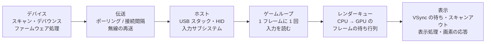

# 入力遅延: 操作から画面までの時間 (Input Latency: From Action to Photon)

## 概要 (Overview)

ボタンを押してから画面が変わるまでの時間（入力遅延、input latency）は、1つの部品の性能ではなく、デバイス、伝送路、OS、ゲームループ、レンダリング、ディスプレイという区間の総和である。「ポーリングレート 8000 Hz」「240 Hz モニタ」「低遅延モード」といった製品の売り文句は、それぞれこの中の1つの区間だけを縮める。

本ドキュメントは入力遅延を区間に分け、各区間で何が待たされているのか、なぜ遅延は1つの値ではなく分布になるのか、どの区間を縮めると効くのか、遅延はどう測るのか、遅延は人の操作にどれだけ効くのかを説明する。最後に、遅延とは逆向きの問題として、入力のタイミングそのものが情報を漏らす攻撃（打鍵のタイミングによるサイドチャネル）を扱う。

デバイスと伝送路の仕組みは `input-devices-hid.md`（HID、ポーリングレート、伝送路ごとのタイミングモデル）と `keyboard-mouse-touch.md` に、表示の仕組みは `display-pipeline.md` に委ね、ここではそれらをつないだ全体の時間を扱う。

## 方法論 (Methodology)

- 入力から画面までを、デバイス、伝送、ホスト、ゲームループ、レンダーキュー、表示の6区間に分け、各区間の遅延が「固定の処理時間」なのか「次の区切りまでの待ち」なのかを区別する。
- 待ちの区間は周期 T の区切りまでの待ちとしてモデル化し、平均と分散を求める。区間ごとの値を足し合わせて全体の分布を見積もる。見積もりは計算であって測定ではないことを明記する。
- 遅延を減らす技術（NVIDIA Reflex、AMD Anti-Lag 2、DXGI のフレーム遅延の設定、VR の late latching）は、ベンダの一次資料で仕組みを確認する。効果の数値はベンダの主張として扱う。
- 測定方法は測定ツールの作者の説明と査読付き論文で確認し、各方法がどの区間を測っているか、分解能はどれだけかを対応づける。
- 人の操作への影響は査読付きの研究を一次資料とする。本文に届かなかった論文は、届いた資料（著者の学位論文、引用している論文、サーベイ）を経由したことを明記する。

## 発見事項 (Findings)

1. **入力遅延は6つの区間の総和で、多くの区間は「次の区切りまでの待ち」である。** デバイスのスキャン、USB のポーリング、ゲームループ、ディスプレイのリフレッシュは、それぞれ独立した周期で動く。押す時刻はどの周期とも無関係なので、各区間の待ちは 0 から周期までに散らばり、全体の遅延は押すたびに変わる分布になる。
2. **全体を支配するのは、周期のいちばん長い区間である。** 60 Hz のゲームループと表示では、2つの区間の待ちだけで平均約 17 ms、標準偏差約 7 ms になり、ポーリングを 1000 Hz から 8000 Hz にして縮む平均 0.44 ms は誤差に埋もれる。NVIDIA の研究 (2019) も、リフレッシュレートが重要なのは主に遅延を減らすからだと結論している。
3. **レンダーキューは、待ちが「積み上がる」区間である。** CPU が GPU より速くフレームを作ると、フレームがキューにたまり、入力は数フレーム前の状態で描かれる。DXGI は既定で 3 フレームまでのキューを許す。NVIDIA Reflex と AMD Anti-Lag 2 は、CPU の作業開始を遅らせてキューを空にすることで、この区間を縮める。
4. **入力を「遅く読む」ほど遅延は縮む。** VR の late latching と非同期タイムワープ、NVIDIA の研究のポストレンダーワープ、Reflex 2 の Frame Warp は、描画が終わった後、表示の直前に最新の入力で画像を補正する。Meta (Oculus) の late latching は、向きの姿勢から表示までの遅延を約 3 ms にした。
5. **遅延の数字は測った区間、測定器の分解能、分布のどの値かを添えて初めて比べられる。** 物理的な操作から OS まで、クリックから画面まで、と測定方法ごとに対象の区間が違い、240 fps のカメラ（4 ms 刻み）では 1 ms 前後の差は見分けられない。
6. **数十 ms の遅延は熟練者の操作成績を下げる。** NVIDIA の研究は 30 ms の遅延が FPS の照準課題に有意な影響を与えることを示し、Ivkovic らは 41 ms という小さな遅延でも照準の成績が下がることを示した。
7. **入力のタイミングは、それ自体が情報を漏らす。** SSH の対話モードでは打鍵ごとにパケットが送られるので、打鍵の間隔からパスワードの探索を約 50 倍速くできる（Song ら、2001）。OpenSSH 9.5 (2023) は、打鍵を 20 ms の固定間隔で送り偽のパケットを混ぜる対策を入れたが、9.5〜9.7 ではこの対策が機能しておらず、9.8 (2024) で修正された。遅延を意図的に足して量子化することが、ここでは防御になる。

## アーキテクチャ (Architecture)

### 6つの区間

| 区間 | 遅延の性質 | 典型的な周期・量 | 詳細 |
|---|---|---|---|
| デバイス | 固定の処理 + スキャン周期の待ち | スキャン数 ms、デバウンス数 ms | `input-devices-hid.md`、`keyboard-mouse-touch.md` |
| 伝送 | ポーリング周期の待ち + 再送 | USB 1 ms / 125 µs、BLE 7.5 ms〜 | `input-devices-hid.md` のタイミングモデル |
| ホスト | 固定の処理 + スケジューリング | 通常は小さい | `../../software/operating-systems/process-thread-scheduling.md` |
| ゲームループ | フレーム周期の待ち | 60 Hz で 16.7 ms | 本ドキュメント |
| レンダーキュー | キューにたまったフレームの数 × フレーム時間 | 0〜数フレーム | 本ドキュメント |
| 表示 | VSync の待ち + スキャンアウト + 表示処理 + 画素の応答 | 60 Hz で 16.7 ms の周期 | `display-pipeline.md` |

NVIDIA はクリックから画面のピクセルが変わるまでを**システム遅延 (system latency)** と呼び、周辺機器の遅延（上の表のデバイスと伝送）、PC の遅延（ホスト、ゲームループ、レンダーキュー）、表示の遅延（スキャンアウト、表示処理、画素の応答）の3つに分けている。NVIDIA のガイドによれば、PC の遅延がシステム遅延の最大の要因になることが多い。

## 技術詳細 (Technical Details)

### 伝送の区間

ポーリングレートは「ホストが問い合わせる頻度」であって、「デバイスが新しい値を用意する頻度」ではない。USB では、デバイスは問い合わせの時点で新しいデータがなければ **NAK** を返し、そのフレームでは何も届かない（ポーリングの仕組みと伝送路ごとの値は `input-devices-hid.md` を参照）。したがって次のことがいえる。

- 1000 Hz でポーリングしても、ファームウェアがセンサを 4 ms ごとにしか読まなければ、実質の更新は 250 Hz になる。
- ポーリングレートの測定ツールが測るのは「OS がレポートを受け取った頻度」である。ボタンを押してから届くまでの遅延（ファームウェア内部のスキャン・デバウンス・処理を含む）は別に測る必要があり、ポーリングレートが高くても遅延が小さいとは限らない。

第三者測定の Gamepadla は DualSense の有線ボタン遅延を約 7.8 ms と掲載している（同サイトは比較機能を「テスト中」としており、目安の値）。1000 Hz ポーリングの平均待ち 0.5 ms と比べると、コントローラー区間の大半はポーリング以外（スキャン、デバウンス、ファームウェア処理）が占めうる。キーボードでは、キーの動き始めから USB パケットまでが 15〜60 ms と、機種による差がさらに大きい（`keyboard-mouse-touch.md`）。

**無線のジッター**: 干渉でパケットが失われると、`input-devices-hid.md` のタイミングモデルの表のとおり、次の送信の機会に再送される。平均遅延はほとんど変わらなくても、ときどき「1 間隔分遅れた入力」が混ざる裾 (tail) が生じ、操作の違和感として現れる。AFH は混雑したチャネルを避けて再送の頻度を下げるが、2.4 GHz の Wi-Fi が混んだ環境では再送はなくならない。IMU のように時間で積分するデータでは、このジッターがそのまま誤差になるので、デバイス側のタイムスタンプが要る（`sensor-hub-mems.md`）。

### 周期的な待ちの積み重なり

**1 段の待ち**: ボタンを押す時刻は問い合わせの周期 T と無関係なので、周期内のどの時点になるかは等しい確率で散らばる。待ち時間は 0〜T の一様分布になり、平均は T/2、最悪は T、分散は T²/12（標準偏差は T/√12 ≒ 0.29T）である。250 Hz なら平均 2 ms・最悪 4 ms になる。

**何段もの待ち**: この「次の区切りまで待つ」構造は、ファームウェアのスキャン周期、伝送の周期、ゲームが入力を読む周期、ディスプレイのリフレッシュ（VSync を有効にした場合）にもある。各段の周期は互いに同期していないので、各段の待ちを独立な確率変数とみなせば、全体の平均は各段の平均の和、分散は各段の分散の和になる（`../../foundations/mathematics/probability-statistics/probability-random-variables.md`）。

具体的な構成で見積もると、どの区間が効くかが分かる（固定の処理時間は除いた、待ちの部分だけの計算による見積もり）。

| 区間 | 周期 (60 Hz 表示) | 平均 | 分散 | 周期 (240 Hz 表示) | 平均 | 分散 |
|---|---|---|---|---|---|---|
| デバイスのスキャン | 4 ms | 2.0 ms | 1.33 ms² | 4 ms | 2.0 ms | 1.33 ms² |
| USB ポーリング (1000 Hz) | 1 ms | 0.5 ms | 0.08 ms² | 1 ms | 0.5 ms | 0.08 ms² |
| ゲームループ | 16.67 ms | 8.33 ms | 23.1 ms² | 4.17 ms | 2.08 ms | 1.45 ms² |
| VSync の待ち | 16.67 ms | 8.33 ms | 23.1 ms² | 4.17 ms | 2.08 ms | 1.45 ms² |
| **合計** | | **19.2 ms** | **47.7 ms²（σ ≒ 6.9 ms）** | | **6.7 ms** | **4.3 ms²（σ ≒ 2.1 ms）** |

60 Hz の構成では、ゲームループと VSync の2段だけで平均の 87%、分散の 97% を占める。この構成でポーリングを 1000 Hz から 8000 Hz にしても、平均は 0.5 ms から 62.5 µs へ約 0.44 ms 縮むだけで、標準偏差 6.9 ms のばらつきに埋もれる。表示とゲームループを 240 Hz にすると、平均は約 3 分の 1、標準偏差も約 3 分の 1 になる。

この見積もりはNVIDIA の研究 (Spjut ら、SIGGRAPH Asia 2019) の結論と整合する。8 人の熟練したeスポーツ選手が FPS の照準課題を、4 つのリフレッシュレート（60 / 120 / 240 / 360 Hz）と 3 つの遅延の範囲で行った結果、遅延の削減は課題の完了時間に明確な効果があったが、リフレッシュレートの増加そのものの効果は比較的小さかった。著者らは、高いリフレッシュレートが重要なのは、主にそれがもたらす遅延の削減のためだと結論している。

### ゲームループの区間

ゲームエンジンは1 フレームに 1 回入力をまとめて処理する設定を持つ。たとえば Unity の Input System は、既定の設定 (Process Events In Dynamic Update) で、毎フレームの `Update` の直前に入力の処理を走らせる。フレームの途中で押されたボタンは、次のフレームの頭まで待たされる。これが上の表の「ゲームループ」の待ちである。

物理演算を固定の周期で回すゲームでは、物理の更新に合わせて入力を読む設定もある。Unity の文書は、入力のコードを `Update` に書く（物理を使わない）場合は Dynamic Update で処理するよう勧め、数フレーム分の小さな入力遅延は許容されうるとも書いている。どのタイミングで入力を読むかは、エンジンの設定で遅延が変わる箇所である。

### レンダーキューの区間

CPU がゲームの処理と描画命令の作成を終えたフレームは、GPU が描くまで**レンダーキュー**で待つ。NVIDIA はCPU が GPU より速くフレームを処理すると、キューがフレームで埋まって待ちが生じると説明している。GPU が律速 (GPU-bound) の状態では、入力は数フレーム前に CPU で処理された状態のまま、キューの長さ分だけ遅れて画面に出る。

この区間は、周期の待ちとは性質が違う。周期の待ちは平均で周期の半分だが、キューの待ちは「キューにたまったフレームの数 × 1 フレームの時間」で、キューが満杯なら毎回その分だけ遅れる。

| 仕組み | 方法 | 出典 |
|---|---|---|
| DXGI の最大フレーム遅延 | `IDXGIDevice1::SetMaximumFrameLatency` で、レンダリングのためにキューに入れてよいフレーム数を設定する。既定値は 3（1〜16）。Microsoft は、この値が「ユーザーの入力への応答と、レンダーキューのフレーム」の間で CPU がどちらを選ぶかを制御するのに使われると説明している | Microsoft Learn |
| 待機可能なスワップチェーン (DXGI 1.3) | システムが新しいフレームを受け取れるまで待ってから、最新のデータで描画してすぐにキューに入れる。待機可能なスワップチェーンの既定のフレーム遅延は 1 で、遅延は最小になるが CPU と GPU の並列性が下がる | Microsoft Learn |
| NVIDIA Reflex（低遅延モード） | GPU への描画作業の投入時刻を動的に調整し、ちょうど間に合う時刻 (just-in-time) に処理されるようにして、GPU のレンダーキューをなくす。ドライバ側で同様のことをする Ultra Low Latency モードより効果が大きいとする | NVIDIA（ベンダの説明） |
| AMD Anti-Lag 2 | ゲームのロジックの中の最適な位置（入力を読む直前）に遅延を入れる。旧版の Anti-Lag はドライバだけで遅延を入れていた。AMD は、ゲームの通常の遅延が 3〜5 フレーム程度なのに対し、1〜2 フレーム程度になると見込んでいる | AMD GPUOpen（ベンダの説明） |

いずれも「CPU を待たせてから、最新の入力で作業を始める」ことで、入力から表示までの間にたまるフレームを減らす。CPU を待たせるとフレームレートが下がりうるので、どこまで待たせるかは CPU と GPU の負荷の釣り合いで決まる。Microsoft も、CPU と GPU の処理がそれぞれ 16.7 ms に収まっても合計が収まらない場合は、フレーム遅延を 2 にすると 60 FPS を出しやすいとしている。

### 表示の区間

NVIDIA は表示の遅延を、スキャンアウト、表示処理、画素の応答の3つに分ける。

- VSync の待ち: ティアリングを防ぐため、描画が終わったフレームを次の垂直同期 (vblank) まで待たせる。NVIDIA はVSync はディスプレイからの背圧を生み、システム全体に波及すると説明している。キューが詰まれば、その分レンダーキューの待ちも増える。
- VRR: G-SYNC や VESA Adaptive-Sync は、リフレッシュの周期を描画の完了に合わせて伸縮させる（`display-pipeline.md`）。NVIDIA はG-SYNC と VSync を組み合わせれば、フレームレートがリフレッシュレートより低い範囲で、ティアリングなしに VSync の遅延もなくせるとしている。
- スキャンアウト: 1 フレームは画面の上から下へ順に送られるので、60 Hz の表示では上端と下端で 16.67 ms の差が出る。表示の遅延を測る第三者のサイト RTINGS は、リフレッシュ周期の中間の値になるよう、光センサを画面の中央に置いて測っている。
- 画素の応答: 液晶の画素が新しい明るさに変わるまでの時間で、残像の原因でもある。RTINGS の入力遅延の測定は、画素が変わり始めた時点で止めるので、応答時間を含まない。どの時点を「表示された」とみなすかで、表示の遅延の値は変わる。

### 入力を遅く読む技術 (late latching とワープ)

レンダーキューと表示の区間には、もう1つの対策がある。描画に使った入力が古いなら、表示の直前に最新の入力で画像を補正すればよい。

- Late latching (Meta / Oculus、2015): パイプライン化された描画系に、入力を遅れて届ける別経路。VR では頭の向き（姿勢）を vsync の 3 ms 前に読み直して向きを補正し、向きの姿勢から表示までの遅延を約 3 ms にした。単純なパイプラインでは約 1 フレーム分の遅延があった。
- 非同期タイムワープ (ATW) (Meta / Oculus、2016): 90 Hz の各スキャンアウトの前に、その時点で最新のアプリのフレームを取り出して補正（タイムワープ）する。アプリの性能に関係なく、向きの遅延を一定の低い値に保つ。
- ポストレンダーワープと遅い入力の読み取り (Kim ら、NVIDIA Research、2020): ゲームのストリーミングのような遅延の大きい条件で、描画後に最新の入力で画像をワープすると、80 ms の遅延の追加による照準成績の低下を最大 80% 取り除けた。
- NVIDIA Reflex 2 の Frame Warp (2025-01 発表): 描画したフレームを、ディスプレイに送る直前に最新のマウス入力で更新する。ワープで見えるようになった部分の穴は、過去のフレームのカメラ・色・深度のデータで埋める。NVIDIA はTHE FINALS（4K、RTX 5070）で、遅延が通常 56 ms、Reflex の低遅延モードで 27 ms、Frame Warp で 14 ms になる（最大 75% の削減）と主張している。as of 2026-10、NVIDIA の製品ページは Frame Warp をまだ「近日提供」としている。

ワープが直せるのは、画像全体を動かせば済む変化（視点の回転）に限られる。ボタンを押して銃を撃つといった、ゲームの状態そのものの変化は次のフレームを描くまで画面に出ない。

### 遅延の測り方

遅延は区間ごとに測り方が違い、どの区間を測ったかを明示しないと数字を比べられない。

| 区間 | 方法 | 例と分解能 |
|---|---|---|
| ボタンの接点 → USB パケット | ロジックアナライザで、ボタンの接点と USB の信号を同時に記録する | Dan Luu のキーボード測定（USB ケーブルを切り開いてロジックアナライザにつなぐ）。Schmid & Wimmer (2021) は、同様の先行手法として、ボタンの接点が閉じてから USB のイベントまでをロジックアナライザで測る方法を紹介している |
| 物理的な操作 → OS がレポートを受け取る | 治具で操作し、PC のプログラムが入力を受け取るまでを計る | Gamepadla の Prometheus 82: Arduino Nano とソレノイドでボタンやスティックを物理的に操作し、500 回繰り返して最小・平均・最大・ジッターを出す（誤差 ±1 ms とされる）。電気的に接点を閉じる GPDL Tester は 2000 回測る |
| ホスト内での到着時刻 | OS のトレース機能で、各段のタイムスタンプを取る | Linux の usbmon は USB の要求の発行 (S) と完了 (C) をマイクロ秒単位のタイムスタンプ付きで記録する。evdev の `input_event` も発生時刻を持ち、使う時計は `EVIOCSCLOCKID` で選べる。Windows では USBPcap と Wireshark で USB の通信を記録できる |
| クリック → 画面の変化（システム遅延） | 入力の検出と画面の明るさの変化を同じ機器で測る | NVIDIA Reflex Latency Analyzer: 対応モニタの専用 USB ポートにマウスをつなぎ、画面上の監視領域（銃口の閃光など）の変化までを測る |
| 操作 → 画面の変化（全体） | 高速カメラ、または光センサ | 240 fps のカメラではフレーム間隔が 4 ms で、それより細かくは分からない。Schmid & Wimmer (2021) の機器は、フォトカプラでボタンの接点を閉じ、フォトレジスタで画面の変化をとらえる。カメラと比べた最大誤差は 2.64 ms 未満 |

NVIDIA のガイドによれば、マウスのポーリングレート 125 Hz は 1000 Hz と比べて平均で最大 3 ms の遅延を加える。この値は本ドキュメントの「平均 = 周期 / 2」による見積もり（125 Hz で平均 4 ms、1000 Hz で 0.5 ms、差は 3.5 ms）とおおむね合う。一方、Schmid & Wimmer は、Reflex の測定は入力イベントがシステムに届いた時点から始まるので、入力デバイス内部の遅延は含まれないと指摘している。NVIDIA は「マウスの遅延」も表示項目に挙げており、両者の説明は食い違っている。測定器が何を起点にしているかは、利用者が確かめる必要がある。

測定で守るべき点は3つある。

- 上の表のどの区間を測ったかを書く。Gamepadla の値（DualSense の有線で約 7.8 ms）は「物理的な操作 → OS」で、画面までの遅延ではない。
- 測定器の分解能は測る量より細かくする。240 fps のカメラ（4 ms 刻み）で 1 ms 前後の差は見分けられない。Dan Luu は精度を過大に見せないよう測定値を 5 ms 単位に丸め、この構成では速いキーボードの裾の遅延は測れないと書いている。光センサを使う場合も、60 Hz の表示では画面の上端と下端で 16.67 ms の差が出るので、センサを置く位置で値が変わる。
- 遅延は分布で報告する。前述のとおり遅延は分布なので、1 回の測定値には意味がない。Schmid & Wimmer は、遅延は変動するので単一の値ではなく分布を測るべきだという Bérard と Blanch の主張を紹介し、繰り返しの測定が必要だとしている。Gamepadla は数百〜数千回の測定から最小・平均・最大・ジッターと分布の図を、Dan Luu はジッターの中央値と 90 パーセンタイルを示している。

### 遅延は操作にどう効くか

| 研究 | 課題 | 主な結果 |
|---|---|---|
| Spjut ら (NVIDIA、SIGGRAPH Asia 2019) | 熟練者の FPS の照準 | 30 ms の遅延が成績に有意な影響。リフレッシュレートの効果は主に遅延の削減による |
| Ivkovic ら (CHI 2015) | 3D シューティングの照準 | 実環境のローカルな遅延は 23〜243 ms の範囲にあり、41 ms という小さな遅延でも成績が下がる。照準の補助による補償で、追跡課題では問題をなくせた（著者の学位論文による） |
| Kim ら (NVIDIA、2020) | 遅延の大きい条件での照準 | 描画後のワープで、80 ms の遅延による低下を最大 80% 取り除ける |
| Claypool と Claypool (CACM 2006) | オンラインゲームの種類ごとの許容値 | 一人称視点のゲームで約 100 ms、三人称視点で約 500 ms、全体を見下ろすゲームで約 1000 ms（サーベイ論文による要約。全体を見下ろすゲームの値は「1000 ms なら確実に安全」という程度の根拠とされる） |
| Jota ら (CHI 2013)、Deber ら (CHI 2015) | タッチスクリーンの操作 | ドラッグでは 25 ms を超えると成績が下がり、遅延の差に気づける最小の量はドラッグで 11 ms、タップで 69 ms（いずれも引用している論文による） |

ネットワーク越しの対戦ゲームの許容値（Claypool）が 100 ms 単位なのに対し、ローカルの照準の研究は数十 ms で影響を見つけている。前者はネットワークの遅延、後者は手元の入力から画面までの遅延で、比べている遅延の種類が違う点に注意が要る。

## セキュリティ考察 (Security Considerations)

### 打鍵のタイミングによるサイドチャネル

入力の内容が暗号化されていても、**いつ**入力したかは漏れうる。Song、Wagner、Tian (USENIX Security 2001) は、SSH の対話モードでは打鍵ごとに別の IP パケットが押した直後に送られることに注目した。打鍵の間隔は指の運び（どのキーからどのキーへ移ったか）で変わるので、ネットワーク上で観測したパケットの間隔から、文字の組（2 打鍵）あたり約 1.2 ビットの情報が漏れる。パスワードのエントロピーは 1 文字あたり 4〜8 ビットしかなく、彼らの攻撃 (Herbivore) は、ランダムな 7〜8 文字のパスワードの全数探索を約 50 倍速くした。

論文が提案した対策は、リンクが動いている間は一定のレート（例: 50 ms ごと）でパケットを送り、送るものがなければ相手が無視するダミーを送ることだった。ランダムな遅延を足す方法は、平均で約 250 ms の遅延がかかるうえ、平均を取れば打ち消せるとして退けている。

OpenSSH は 22 年後の 9.5 (2023-10-04) で、クライアントにこの種の対策を入れた。打鍵を固定の間隔（既定で 20 ms）で送り、打鍵が止まった後もしばらく偽の打鍵のパケットを送る。設定は `ObscureKeystrokeTiming` で、`interval:ミリ秒` で間隔を変えられる。ところが 9.8 (2024-07-01) のリリースノートによれば、9.5〜9.7 では、9.5 以降のサーバーにつないだ場合に、受動的な観測者がどのパケットに本物の打鍵が入っているかをなお見分けられ、対策が効いていなかった (CVE-2024-39894)。`su` や `sudo` でのパスワード入力（エコーなし）の保護も弱まっていた。

この対策は本ドキュメントの見方では「入力に周期的な待ちを足して、時刻を量子化する」ことである。20 ms の周期なら、打鍵の遅延は平均 10 ms 増える。性能のためには遅延を削り、秘密のためには遅延を足すという逆向きの要求が、同じ「周期的な待ち」の上でぶつかる。そして実装の細部（偽のパケットと本物のパケットの区別がつくか）しだいで、対策は簡単に無効になる。

### 遅延の削減と公平性

遅延を減らす技術は対戦ゲームでは有利不利に直結する。ポーリングレート、リフレッシュレート、Reflex のような低遅延モードはいずれも正当な製品の機能だが、キーボードのファームウェアが入力を加工する Snap Tap は、Valve が Counter-Strike 2 で「ハードウェアによる自動化」として締め出した（`keyboard-mouse-touch.md`）。遅延の削減と入力の自動化の境界は、技術ではなくゲームのルールが決める。

## 結論 (Conclusions)

- 入力遅延はデバイス、伝送、ホスト、ゲームループ、レンダーキュー、表示の6区間の総和で、多くの区間は「次の区切りまでの待ち」である。各区間の周期は同期していないので、遅延は押すたびに変わる分布になる。
- 全体の平均と分散を支配するのは周期のいちばん長い区間で、60 Hz の構成ではゲームループと VSync の待ちが分散の大部分を占める。ポーリングレートの引き上げより、リフレッシュレートとフレームレートの引き上げのほうが効く。
- レンダーキューは待ちが積み上がる区間で、DXGI の既定では 3 フレームまでたまりうる。Reflex と Anti-Lag 2 は CPU を待たせてキューを空にし、late latching やワープは表示の直前に最新の入力で画像を補正する。
- 遅延の数字は測った区間、測定器の分解能、分布のどの値かを添えて初めて比べられる。
- 数十 ms の遅延は熟練者の照準成績を下げる一方、ネットワーク越しの許容値は 100 ms 単位で、比べている遅延の種類が違う。
- 入力のタイミングはそれ自体が情報を漏らし、SSH では打鍵を固定の周期にそろえる（遅延を足す）ことが防御になる。その実装の細部しだいで防御は無効になりうる。

### 次の接続先 (Related Topics)

- `input-devices-hid.md` — 伝送路ごとのタイミングモデルとポーリングレート、HID のレポート。
- `keyboard-mouse-touch.md` — キーボードの遅延の測定、8 kHz ポーリング、タッチの遅延、Snap Tap。
- `sensor-hub-mems.md` — 伝送のジッターとデバイス側のタイムスタンプ。
- `display-pipeline.md` — スキャンアウト、vsync とバッファリング、VRR。
- `audio-subsystem.md` — 同じ「バッファと遅延」の問題の音声版。
- `../../software/operating-systems/process-thread-scheduling.md` — 入力イベントがゲームスレッドに届くまでのスケジューリング遅延。
- `../../foundations/mathematics/probability-statistics/probability-random-variables.md` — 独立な確率変数の和の平均と分散。

## 参考文献 (References)

**一次資料 (Primary — 公式ドキュメント・仕様・査読付き論文)**

- NVIDIA. *System Latency Optimization Guide* (2020-10) / *Reflex Latency Analyzer*. — [nvidia.com](https://www.nvidia.com/en-us/geforce/guides/system-latency-optimization-guide/) / [Reflex Latency Analyzer](https://www.nvidia.com/en-us/geforce/news/reflex-latency-analyzer-360hz-g-sync-monitors/) — Accessed: 2026-10-17。システム遅延の定義と分解、125 Hz と 1000 Hz のポーリングの差、Reflex Latency Analyzer の測定方法（ベンダの説明）。
- Linux Kernel Documentation. *usbmon* / *Input subsystem* / `include/uapi/linux/input.h`. — [usbmon](https://www.kernel.org/doc/html/latest/usb/usbmon.html) / [input](https://www.kernel.org/doc/html/latest/input/input.html) / [input.h](https://github.com/torvalds/linux/blob/master/include/uapi/linux/input.h) — Accessed: 2026-10-17。usbmon のマイクロ秒のタイムスタンプと S / C イベント、`input_event` の時刻、`EVIOCSCLOCKID`。
- Schmid, A., & Wimmer, R. (2021). Yet Another Latency Measuring Device. *EHPHCI '21 (CHI 2021 Workshop)*. — [epub.uni-regensburg.de](https://epub.uni-regensburg.de/45570/1/yet-another-latency-measuring-device.pdf) — Accessed: 2026-10-17。光センサによる測定機器と誤差、カメラの時間分解能、画面の上下での遅延差、分布で報告すべきという主張、Reflex の測定範囲への指摘。
- NVIDIA. *NVIDIA Reflex Low Latency Platform* (2020-09-01) / *NVIDIA Reflex 2 With New Frame Warp Technology Reduces Latency In Games By Up To 75%* (2025-01-06) / *GeForce RTX 5090*. — [Reflex](https://www.nvidia.com/en-us/geforce/news/reflex-low-latency-platform/) / [Reflex 2](https://www.nvidia.com/en-us/geforce/news/reflex-2-even-lower-latency-gameplay-with-frame-warp/) / [RTX 5090](https://www.nvidia.com/en-us/geforce/graphics-cards/50-series/rtx-5090/) — Accessed: 2026-10-17。レンダーキューと just-in-time の投入、Frame Warp の仕組みと主張値、「近日提供」の表示（ベンダの説明）。
- AMD. *Integrating AMD Radeon Anti-Lag 2 SDK in your game* (GPUOpen, 2024-09-04, updated 2026-08-27). — [gpuopen.com](https://gpuopen.com/learn/integrating-amd-radeon-anti-lag-2-sdk-in-your-game/) — Accessed: 2026-10-17。Anti-Lag と Anti-Lag 2 の遅延の入れ方、見込みのフレーム遅延（ベンダの説明）。
- Microsoft. *IDXGIDevice1::SetMaximumFrameLatency* / *Reduce latency with DXGI 1.3 swap chains*. — [learn.microsoft.com](https://learn.microsoft.com/en-us/windows/win32/api/dxgi/nf-dxgi-idxgidevice1-setmaximumframelatency) / [DXGI 1.3](https://learn.microsoft.com/en-us/windows/uwp/gaming/reduce-latency-with-dxgi-1-3-swap-chains) — Accessed: 2026-10-17。キューに入れるフレーム数の既定値 3、待機可能なスワップチェーンの既定値 1。
- Unity Technologies. *Input System: InputSettings.UpdateMode* / *Select the input processing mode*. — [docs.unity3d.com](https://docs.unity3d.com/Packages/com.unity.inputsystem@1.8/api/UnityEngine.InputSystem.InputSettings.UpdateMode.html) / [manual](https://docs.unity3d.com/Packages/com.unity.inputsystem@1.18/manual/timing-select-mode.html) — Accessed: 2026-10-17。毎フレームの `Update` の直前の入力処理。
- Binstock, A. (Meta / Oculus). *Optimizing VR Graphics with Late Latching* (2015-03-01) / Beeler, D., & Gosalia, A. *Asynchronous Timewarp on Oculus Rift* (2016-03-25). — [developers.meta.com](https://developers.meta.com/horizon/blog/optimizing-vr-graphics-with-late-latching/) / [ATW](https://developers.meta.com/horizon/blog/asynchronous-timewarp-on-oculus-rift/) — Accessed: 2026-10-17。late latching と約 3 ms の向きの遅延、スキャンアウトごとのタイムワープ。
- Spjut, J., Boudaoud, B., Binaee, K., Kim, J., Majercik, A., McGuire, M., Luebke, D., & Kim, J. (2019). Latency of 30 ms Benefits First Person Targeting Tasks More Than Refresh Rate Above 60 Hz. *SIGGRAPH Asia 2019 Technical Briefs*, 110–113. https://doi.org/10.1145/3355088.3365170
- Kim, J., Knowles, P., Spjut, J., Boudaoud, B., & McGuire, M. (2020). Post-Render Warp with Late Input Sampling Improves Aiming Under High Latency Conditions. *Proc. ACM Comput. Graph. Interact. Tech.*, 3(2). https://doi.org/10.1145/3406187
- Ivkovic, Z., Stavness, I., Gutwin, C., & Sutcliffe, S. (2015). Quantifying and Mitigating the Negative Effects of Local Latencies on Aiming in 3D Shooter Games. *Proc. CHI 2015*, 135–144. https://doi.org/10.1145/2702123.2702432 （本文は参照できず、数値は Ivkovic, Z. (2017) の修士論文 *Characterizing the Effects of Local Latency on Aim Performance in First Person Shooters*, University of Saskatchewan, [harvest.usask.ca](https://harvest.usask.ca/handle/10388/7707) による）
- Claypool, M., & Claypool, K. (2010). Latency Can Kill: Precision and Deadline in Online Games. *ACM MMSys 2010*. — [PDF](https://sites.cs.ucsb.edu/~almeroth/classes/W10.290F/papers/claypool-10.pdf) — Accessed: 2026-10-17。一人称視点のシューティングで約 100 ms の許容値。2006 年の CACM 論文 (*Latency and player actions in online games*) の本文は参照できず、ゲームの種類ごとの値は下記の Raaen & Grønli (2014) による。
- Song, D. X., Wagner, D., & Tian, X. (2001). Timing Analysis of Keystrokes and Timing Attacks on SSH. *10th USENIX Security Symposium*. — [usenix.org](https://www.usenix.org/legacy/events/sec01/full_papers/song/song.pdf) — Accessed: 2026-10-17。
- OpenSSH. *Release notes 9.5* (2023-10-04) / *Release notes 9.8* (2024-07-01) / *ssh_config(5)*. — [openssh.org 9.5](https://www.openssh.org/txt/release-9.5) / [9.8](https://www.openssh.org/txt/release-9.8) / [man.openbsd.org](https://man.openbsd.org/ssh_config#ObscureKeystrokeTiming) — Accessed: 2026-10-17。打鍵のタイミングの難読化と、9.5〜9.7 での不具合 (CVE-2024-39894)。

**二次資料 (Secondary)**

- Gamepadla / cakama3a. *Prometheus 82* / *GPDL*. — [github.com/cakama3a/Prometheus82](https://github.com/cakama3a/Prometheus82) / [GPDL](https://github.com/cakama3a/GPDL) — Accessed: 2026-10-17。物理的な操作治具と電気的な接点の短絡による測定、試行回数と報告する統計量（測定ツールの作者による説明）。
- Luu, D. *Keyboard latency*. — [danluu.com](https://danluu.com/keyboard-latency/) — Accessed: 2026-10-17。ロジックアナライザと 240 fps カメラによる測定、5 ms 単位の丸め、ジッターの中央値と 90 パーセンタイル（公開日は記載なし）。
- USBPcap. — [desowin.org/usbpcap](https://desowin.org/usbpcap/) — Accessed: 2026-10-17。Windows 用のオープンソースの USB スニファ（Wireshark で利用）。
- Gamepadla. *Methodology / controller comparisons*. — [gamepadla.com](https://gamepadla.com/) — Accessed: 2026-10-10。ポーリングレート（OS がレポートを受け取る頻度）と入力遅延（ハードウェア測定）を別の指標として測る第三者測定の例。
- RTINGS. *Input Lag* (test methodology). — [rtings.com](https://www.rtings.com/tv/tests/inputs/input-lag) — Accessed: 2026-10-17。光センサを画面中央に置く理由と、画素の応答時間を含めない測り方（検索結果の抜粋で確認した部分を含む）。
- Raaen, K., & Grønli, T.-M. (2014). Latency Thresholds for Usability in Games: A Survey. *NIK-2014*. — [ntnu.no](https://ntnu.no/ojs/index.php/nikt/article/download/5252/4728/20457) — Accessed: 2026-10-17。Claypool & Claypool (2006) の 100 / 500 / 1000 ms の要約と、その根拠の強さ。
- Nishida, N. et al. (2024). arXiv:2408.02525. — [arxiv.org](https://arxiv.org/pdf/2408.02525) — Accessed: 2026-10-17。Jota ら (2013) のドラッグ 25 ms と、Deber ら (2015) の JND（ドラッグ 11 ms、タップ 69 ms）の要約。
