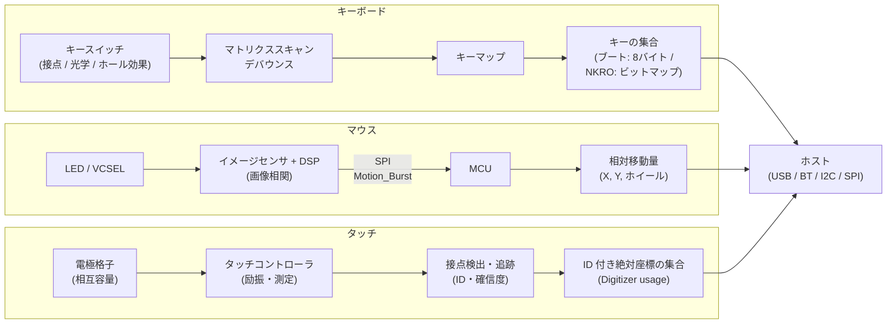

# キーボード・マウス・タッチ: キーとポインタの物理 (Keyboard, Mouse & Touch: The Physics of Keys and Pointers)

## 概要 (Overview)

キーボード、マウス、タッチパネル・タッチパッドは、いずれも HID (Human Interface Device) の上に乗る入力デバイスである。HID のレポートディスクリプタ、伝送路、ホスト側の処理経路は `input-devices-hid.md` で扱った。本ドキュメントはその上で、3つのデバイスそれぞれに固有の部分、つまりセンサの物理と、レポートが何を表すかを扱う。

3つは、レポートが運ぶものの種類がまったく違う。

- **キーボード**: 押されているキーの**集合**。問題は「同時に何個まで正しく伝えられるか」（ロールオーバー）になる。
- **マウス**: 前回からの**相対移動量**。センサは表面を撮影する小さなカメラで、問題は「どれだけ速い動きまで追えるか」と「移動量を画面上の動きにどう変換するか」になる。
- **タッチ**: 画面や面上の**絶対座標の接点の集合**で、各接点が ID を持つ。問題は「複数の指を見分け、意図しない接触（手のひら）をどう除くか」になる。

本ドキュメントは、なぜ古い BIOS では 6 キーまでしか同時押しが効かないのか、マウスの「26000 CPI」は何を意味するのか、タッチパッドの手のひら誤検出は誰が判定しているのかを、センサからホストまで通して説明する。

## 方法論 (Methodology)

- 各デバイスを「センサの物理 → ファームウェア（スキャン・画像処理・接点追跡） → HID レポートの形式 → ホストでの解釈」の順に分解する。
- レポートの形式は USB-IF の *Device Class Definition for HID 1.11* と *HID Usage Tables* を規範とし、OS 側の要件は Microsoft Learn と Linux カーネル文書で確認する。
- センサやスイッチの数値は、ベンダのデータシートを一次資料とし、**仕様値**として扱う。第三者の実測値がある場合は併記し、どちらの値かを明記する。
- 伝送路（USB・Bluetooth）、ポーリングと遅延バジェット、ホスト側の処理経路、HID 全般のセキュリティは `input-devices-hid.md` に委ね、ここでは重複して説明しない。
- セキュリティは、デバイスの物理に由来する攻撃面（音響・電磁波によるサイドチャネル、タッチへの電磁妨害、物理的な盗聴装置）と、ファームウェアによる入力の自動化に絞る。

## 発見事項 (Findings)

1. **3つのデバイスの違いは、レポートが表すデータモデルの違いである。** キーボードはキーの集合、マウスは相対移動量、タッチは ID 付きの絶対座標の集合を送る。ロールオーバー、ポインタの加速、手のひらの除去といった各デバイスに固有の問題は、それぞれのデータモデルから生じる。
2. **「6 キーまで」という同時押しの上限は、BIOS 向けのブートプロトコルに由来する。** ブートキーボードのレポートは 8 バイト固定で、キーコードの枠が 6 つしかない。キーごとに 1 ビットを割り当てるビットマップ形式のレポート（NKRO）は、レポートプロトコルでなければ使えない。
3. **光学マウスのセンサは、表面を毎秒数千枚撮影するカメラである。** ADNS-2610（18×18 画素、最大 1500 fps、400 cpi、12 ips）から PAW3395（最大 26000 cpi、650 ips、50 g）まで、原理は同じ「連続する画像の相関から移動量を求める」処理である。CPI は移動量の目盛りの細かさであって、追従性能そのものではない。
4. **タッチの複数指対応は、相互容量方式によって可能になった。** 行と列の電極ごとに測る自己容量方式では、2 本の指で「ゴースト点」が生じる。交点ごとに測る相互容量方式は真のマルチタッチができるが、測定回数が増える（40×60 の格子で 100 回に対して 2400 回）。
5. **手のひらの除去は、デバイスとホストの分業になっている。** Windows の高精度タッチパッド (Precision Touchpad) の要件では、ファームウェアは接点を隠さずにすべてホストへ送り、各接点に「意図した接触か」の確信度 (Confidence) を付ける。最終的な判定とジェスチャーの処理は OS 側が担う。
6. **キーの検知方式の進歩は、「操作の技量」と「デバイスの機能」の境界を動かした。** ホール効果スイッチによる Rapid Trigger や、2 つのキーの優先度をファームウェアが処理する Snap Tap は、Counter-Strike 2 で Valve が「ハードウェアによる自動化」として 2024-08 に締め出す対象になった。
7. **物理に由来する攻撃面がある。** キーボードの打鍵音から入力を推定する音響サイドチャネル（近くのスマートフォンの録音で 95%）、電磁妨害でタッチパネルに偽の接触を注入する GhostTouch、ケーブルと PC の間に挟むハードウェアキーロガーがその例である。

## アーキテクチャ (Architecture)

### 3つのパイプライン



### データモデルの比較

| | キーボード | マウス | タッチ（タッチパッド・タッチスクリーン） |
|---|---|---|---|
| レポートの中身 | 押されているキーの集合 | 前回からの相対移動量 | ID 付きの絶対座標の集合 |
| HID の主な usage | Keyboard/Keypad ページ (0x07) | Generic Desktop の X / Y / Wheel（Relative） | Digitizer ページ (0x0D) の Contact Identifier・Tip Switch・Confidence |
| 情報が失われる典型 | ロールオーバーの上限、ゴースト | 1 レポートの移動量のあふれ、表面を見失う（リフト・高速移動） | 接点数の上限、ID の取り違え |
| ホストでの主な加工 | キー配列（レイアウト）の適用 | ポインタの加速（Windows のバリスティクス） | 手のひらの除去、ジェスチャー認識 |
| Linux の入力イベント | `EV_KEY` | `EV_REL` | `EV_ABS` の `ABS_MT_*`（マルチタッチプロトコル タイプ B） |

キーボードとタッチは「状態」を、マウスは「変化」を送る。状態を送る方式は、レポートが 1 つ失われても次のレポートで正しい状態に戻る。変化を送る方式は、失われた移動量が戻らない代わりに、センサが自分の絶対位置を知らなくてよい。

## 技術詳細 (Technical Details)

### キーボード

#### キースイッチ — 接点、光学、ホール効果

| 方式 | 検知の原理 | 数値の例 | 特徴 |
|---|---|---|---|
| 機械式接点 | 金属接点の開閉 | Cherry MX2A RED（仕様値）: プリトラベル 2 mm、全行程 4 mm、作動力 45 cN、バウンス時間 5 ms。第三者の実測ではプリトラベル 2.3 mm | 接点のバウンスがあるためデバウンスが必要 |
| 光学式 | キーの動きで赤外光が遮られる・通るのを検知 | Razer（ベンダの主張）: 作動点 1.5 mm、作動時に物理的な接触なし | 接点のバウンスがない |
| ホール効果（磁気式） | キーに付けた磁石の位置を磁束密度で測る | Wooting 80HE（ベンダの主張）: 作動点を 0.1 mm の精度で調整でき、0.1 mm から 4 mm までの段階を選べる | 押し込み量を連続値で読める |

機械式接点のバウンス時間 5 ms は、`input-devices-hid.md` の「ボタン — マトリクススキャンとデバウンス」で述べたデバウンスの設計判断に直結する。安定を待つ方式なら、この時間がそのまま遅延に乗りうる。光学式とホール効果式は接点を持たないため、この項がなくなる。ホール効果式はさらに、押し込み量を「オン・オフ」ではなくアナログ値として読める点が質的に違う。これが後述の Rapid Trigger の前提になる。

#### マトリクスとゴースト

100 個を超えるキーは、行と列の格子（マトリクス）につないで N+M 本のピンでスキャンする（原理は `input-devices-hid.md` を参照）。マトリクスでは、複数のキーを同時に押すと、押していないキーまで押されたように見える**ゴースト (ghosting)** が起きる。電流が押されたスイッチを経由して別の行・列へ回り込むためで、QMK（キーボード用のオープンソースファームウェア）の文書が説明するとおり、各スイッチと行の間にダイオードを入れて電流を一方向に制限すれば防げる。HID 1.11 は、ブートキーボードがゴーストなどで押下の組み合わせを正確に判定できないときは、すべての配列欄で ErrorRollOver を報告しなければならないと定めている（Appendix F.3）。

#### ロールオーバー — ブートプロトコルの 6 キーと NKRO

HID 1.11 の Appendix B.1 は、BIOS でも解釈できる固定形式の**ブートキーボード**のレポートを定めている。

```text
// HID report descriptor (excerpt). Purpose: boot keyboard input report.
// Source: USB-IF, Device Class Definition for HID 1.11, Appendix B.1 (pp. 59-60)
Report Size (1), Report Count (8)
Input (Data, Variable, Absolute)   ; Modifier byte  -> 1 bit per modifier key
Report Count (1), Report Size (8)
Input (Constant)                   ; Reserved byte
Report Count (6), Report Size (8)
Input (Data, Array)                ; 6 keycode slots
```

| バイト | 内容 |
|---|---|
| 0 | 修飾キー（Ctrl・Shift・Alt・GUI の左右、計 8 ビット） |
| 1 | 予約 |
| 2〜7 | キーコード 1〜6 |

修飾キーは 1 キー 1 ビットの**ビットマップ**（Variable）で送るので、8 個すべてを同時に押しても表せる。それ以外のキーは、押されているキーのコードを 6 つの枠に入れる**配列**（Array）で送るので、同時に 6 個までしか表せない。HID 1.11 Appendix C は、押されたキーの数が Report Count を超えたら、すべての配列欄で ErrorRollOver（Keyboard/Keypad ページの usage 0x01）を報告しなければならないと定め、「Appendix B のディスクリプタを使う場合、上限は修飾キー以外で 6 キー」と明記している。これが **6KRO（6 キーロールオーバー）** の出所である。

制限はブートプロトコルの側にあり、HID そのものの制限ではない。レポートプロトコルでは、修飾キーと同じ「1 キー 1 ビット」の形式をすべてのキーに広げたビットマップのレポートを、ディスクリプタで宣言できる。たとえば 104 キーなら 104 ビット、つまり 13 バイトで、何個同時に押しても表せる。これが **NKRO（N キーロールオーバー）** である。

問題は、ブートプロトコルとレポートプロトコルの切り替えにある。HID 1.11 によれば、すべてのデバイスは初期状態ではレポートプロトコルで動き（§7.2.6）、BIOS はキーボードを設定したあとに `SET_PROTOCOL` でブートプロトコルへ切り替える（Appendix F.4）。BIOS はブートの 8 バイト形式しか解釈しないので、NKRO のビットマップをそのまま送るキーボードは BIOS 画面で正しく動かないことがある。QMK の FAQ も、BIOS では NKRO が機能しない場合があり、6KRO モードへ切り替える必要があると案内している。NKRO と 6KRO を切り替える機能を持つキーボードがあるのはこのためである。

#### ホール効果スイッチと Rapid Trigger、Snap Tap

ホール効果スイッチは押し込み量を連続値で読めるので、「どこで作動させるか」をソフトウェアで決められる。Wooting の定義では、**Rapid Trigger** は「キーを押し下げる方向で作動させ、戻す方向でリセットする」機能で、固定の作動点・リセット点ではなく、動きの向きで判定する。指をわずかに戻しただけで離したことになり、再びわずかに押せば作動する。

これをさらに進めたのが、Razer が 2024-07 に発表した **Snap Tap** である。Razer は「2 つの選んだキーのうち、前のキーを離さなくても最新の入力を優先する」機能と説明し、ファームウェアに直接組み込んでいる。FPS の左右移動では、反対方向のキーを押した瞬間に前のキーの入力が消えるので、切り返し（カウンターストレイフ）が人の指の離すタイミングに左右されなくなる。Valve はこれを「ハードウェア支援のカウンターストレイフ」と呼んでいる。

Valve は 2024-08-19、Counter-Strike 2 について「中核となる技量を迂回する（スクリプトやハードウェアによる）自動化はもう認めない」と発表し、1 回のゲーム入力から複数のプレイヤー動作を自動化している疑いのあるプレイヤーは試合から外される可能性があるとした。同日のリリースノートは、Valve 公式サーバーでハードウェア支援のカウンターストレイフを検出し、試合からキックすると記している。発表は Snap Tap を名指しし、試合に入る前に無効にするよう求めている。

キーボードのファームウェアは、押下を HID レポートに変換する過程で任意の処理を挟める。どこまでが「デバイスの性能」で、どこからが「操作の自動化」かは、技術ではなくゲームのルールが決める。この点は `input-devices-hid.md` の「入力の真正性」（入力改変アダプタ）と同じ構造である。

#### キー入力の遅延

第三者の測定（Dan Luu）では、キーが動き始めてから、そのキーに対応する USB パケットがバスに出るまでの時間は、測定したキーボードの間で 15 ms から 60 ms まで、最大 45 ms の差があった。測定はロジックアナライザで USB の信号を見て、240 fps のカメラでキーの動き始めをとらえる方法で行われている。同じ測定は、キーの移動距離だけで 10 ms 程度の遅延が簡単に加わりうること、ほかの大きな遅延の原因はマトリクススキャンとデバウンスであることを指摘している。`input-devices-hid.md` の遅延バジェットでいえば、伝送待ち（1000 Hz で平均 0.5 ms）よりも、デバイス内部の区間のほうが 1〜2 桁大きくなりうる。

### マウス

#### 光学センサ — 表面を撮影するカメラ

光学マウスのセンサは、小さなイメージセンサと DSP を 1 チップにしたものである。Avago の ADNS-2610 のデータシートは、その動作を「連続する表面の画像（フレーム）を光学的に取得し、移動の方向と大きさを数学的に求めることで位置の変化を測る」と説明している。センサは画像取得系 (Image Acquisition System) と DSP からなり、DSP が画像を処理して移動の方向と距離を求める。

| センサ | 画素数 | フレームレート | 分解能 | 最大速度 | 最大加速度 | MCU との接続 |
|---|---|---|---|---|---|---|
| ADNS-2610 (Avago) | 18×18（6 ビット階調） | 最大 1500 fps | 400 cpi | 12 ips | 0.25 g | 2 線式シリアル |
| ADNS-3090 (PixArt) | — | 2000〜6469 fps | 1800 / 3600 cpi | 60 ips | 20 g | SPI |
| PAW3395 (PixArt) | 非公表 | 非公表（自動可変） | 最大 26000 cpi（50 cpi 刻み） | 650 ips（HP モード） | 50 g（HP モード） | SPI（最大 10 MHz） |

（いずれもデータシートの仕様値。PAW3395 は動作モードで値が変わり、LP モードでは 480 ips / 40 g、Office モードでは 200 ips / 10 g。）

画像の相関で移動量を求めるには、連続する 2 枚のフレームに同じ表面の模様が写っている必要がある。1 フレームの間にセンサが視野の大きさ以上に動くと、比べる手がかりがなくなって追従を失う。追える最大速度 (ips) がフレームレートとともに上がっているのはこのためで、ADNS-2610 のデータシートも速度 12 ips と加速度 0.25 g を「フレームレート 1500 fps のとき」の値として示している。

#### CPI、リフトオフ距離、アングルスナップ

**CPI (counts per inch)** は、センサが 1 インチの移動を何カウントとして報告するかを表す。ADNS-2610 の 400 cpi は 1 インチで 400 カウントを意味する。CPI は目盛りの細かさなので、値を上げてもセンサが表面を追う能力は変わらない。同じ手の動きに対してポインタが速く動くようになるだけで、OS やゲーム側の感度設定と掛け合わせて最終的な動きが決まる。

**リフトオフ距離 (LOD)** は、マウスを持ち上げたときに追従を止める高さである。PAW3395 は 1 mm と 2 mm の設定と、手動の較正機能を持つ。持ち上げて置き直す操作の間にポインタが動かないよう、LOD を短くしたい用途がある。

PAW3395 の機能一覧には **アングルスナップ (angle snapping)** もある。手の動きのわずかなぶれを補正して直線に寄せる機能で、データシートは補正の強さを調整できること (angle tunability) も挙げている。直線を引きやすくなる代わりに、意図した細かい斜めの動きも補正の対象になる。

#### LED とレーザー

照明には LED とレーザー（VCSEL、面発光レーザー）がある。Microsoft の特許（US7777722B2、2010）は、レーザーのような鏡面反射を使う照明は表面が光沢のある場合によりよい追跡画像を与え、LED を浅い角度で粗い表面に当てると照度が高くなりやすいと説明している。Avago のエンジニアの解説（2011）も、LED 方式はとても滑らかな面ではうまく追えず、レーザー方式はより多くの面で追えるようになったとしている。一方、レーザー方式のゲーミングマウス（ADNS-9800 搭載機）については、レビューで移動量がわずかに過大になる（正の加速がかかる）問題が指摘された例がある。

#### センサから MCU へ、MCU からホストへ

センサは移動量をレジスタに保持し、マウスの MCU がシリアルで読み出す。ADNS-2610 の `Delta_X` / `Delta_Y` レジスタは 8 ビットの 2 の補数で、読むとクリアされる。つまり「前回読んでからの移動量」である。ADNS-3090 以降は 4 線式の SPI を使い、`Motion_Burst`（0x50）レジスタで移動量などを一度にまとめて読み出せる。

ホストへのレポートも相対値である。HID 1.11 Appendix B.2 のブートマウスのレポートは 3 バイトで、ボタン 3 つ（バイト 0 の下位 3 ビット）と、X・Y の移動量（各 8 ビット、−127〜127、Relative）からなる。Linux カーネルの文書も、相対的な変化は `EV_REL`、絶対位置が分かる場合は `EV_ABS` を使うよう定めている。

8 ビットの移動量は、現在のセンサには狭すぎる。26000 cpi で 650 ips の動きをすると、毎秒の移動量は 26000 × 650 ≒ 1690 万カウントになる。1000 Hz でポーリングすれば 1 レポートあたり約 1 万 7000 カウントで、ブート形式の ±127 には到底収まらない。そのため高 CPI のマウスは、レポートプロトコルのディスクリプタで 16 ビット（±32767）など幅の広い移動量を宣言する必要がある。ポーリングレートを上げると 1 レポートあたりの移動量が小さくなるので、この点でも余裕が生まれる。

#### ホイールの高分解能化

ホイールの 1 ノッチ（クリック）は、Windows では `WHEEL_DELTA` = 120 として扱われる。Microsoft の文書によれば、この 120 という値は、Microsoft やほかのベンダが 1 回転あたりにより多くのメッセージを送るきめ細かいホイールを作れるように選ばれた。デバイスは HID の **Resolution Multiplier**（Generic Desktop の usage 0x48）を使い、1 ノッチを細かく分割して報告できることを申告する。Windows は Vista 以降でこれに対応した。Linux は 5.0 (2019-03) で対応し、`REL_WHEEL` に加えて `REL_WHEEL_HI_RES` を出す。累積値 120 が 1 ノッチに当たり、Windows と同じ数を使っている。

#### ポインタの加速

マウスの移動量が画面上のポインタの移動量にそのまま変換されるとは限らない。Windows は、`WM_MOUSEMOVE` で届くポインタの移動に**ポインタの加速（バリスティクス）**を適用する。速く動かすほど、同じ物理的な移動量でポインタが遠くへ動く。一方、Raw Input の `WM_INPUT` で届くデータにはバリスティクスがかからない。旧来の仕組みでは、移動量がしきい値を超えると 2 倍、さらに超えると最大 4 倍に拡大していた。FPS のように「手の移動量と視点の回転量が常に比例する」ことを求めるゲームが Raw Input を使うのはこのためで、`input-devices-hid.md` の Windows の API の層と合わせて読むとよい。

#### 8 kHz ポーリング

USB Full-Speed のフレームは 1 ms なので、インタラプト転送のポーリングは最大 1000 Hz になる。High-Speed では 125 µs のマイクロフレームを単位にでき、最大 8000 Hz になる（`input-devices-hid.md` のポーリングレートの表を参照）。Razer は 2021-01 に、高速 (High-Speed) の USB マイクロコントローラーを使った 8000 Hz（0.125 ms）の有線マウスを発表し、2023-04 には無線で 8000 Hz を実現したと発表した。Logitech も 2024-10 の G HUB 更新で、PRO X SUPERLIGHT 2 に 8 kHz のレポートレートを追加した。8 kHz が High-Speed を必要とするのは、Full-Speed のインタラプトエンドポイントが 1 ms のフレームあたり 1 回しか転送できないことからの帰結である（Razer の「高速 USB マイクロコントローラー」という説明もこれと整合する）。

`input-devices-hid.md` で見たとおり、ポーリングを 1000 Hz から 8000 Hz にして縮むのは伝送待ちの項（平均 0.5 ms → 62.5 µs）だけである。一方で、ホストが処理するレポートの数は 8 倍になる。レビューの中には、8 kHz を使うには十分な CPU 性能が必要だと勧めるものもある。

### タッチ

#### 投影型静電容量方式 — 自己容量と相互容量

スマートフォンやタッチパッドで使われるのは、ガラスや基板の裏に電極の格子を作り、指が近づいたときの静電容量の変化を測る**投影型静電容量方式 (PCAP)** である。測り方に2種類ある。

| | 自己容量 (self-capacitance) | 相互容量 (mutual capacitance) |
|---|---|---|
| 測るもの | 各電極（行・列）と大地の間の容量 | 送信電極 (TX) と受信電極 (RX) の交点ごとの容量 |
| 複数指 | 1〜2 本まで。2 本ではゴースト点が出る | 交点ごとに測るので真のマルチタッチ |
| 40×60 の格子の測定回数 | 100 回（40 + 60） | 2400 回（40 × 60） |

（3M の技術資料による。）

自己容量方式は、行と列のどちらに指があるかしか分からない。2 本の指が (行 3, 列 5) と (行 7, 列 9) にあると、行 3・7 と列 5・9 が反応するだけなので、(行 3, 列 9) と (行 7, 列 5) にも指があるのと区別できない。これが**ゴースト点**である。相互容量方式は交点を 1 つずつ測るので区別できるが、測定回数が格子の行数と列数の積に増える。GhostTouch の論文によれば、送信電極に 100〜500 kHz の矩形波を加え、1 本ずつ順に駆動して受信電極で測る方式が、ほとんどのスマートフォンで採用されている。この「励振して測る」仕組みが、後述する電磁妨害の攻撃面になる。

#### HID の Digitizer usage

タッチは HID の **Digitizer ページ (0x0D)** で表す。主な usage は次のとおり（HID Usage Tables 1.5）。

| usage | 名前 | 意味 |
|---|---|---|
| 0x04 | Touch Screen | 表示と一体になったデジタイザ |
| 0x05 | Touch Pad | 表示と一体でない、指で指し示すデジタイザ |
| 0x22 | Finger | 1 本の指（接点）のコレクション |
| 0x42 | Tip Switch | 接触しているか |
| 0x47 | Touch Valid（Microsoft の文書では Confidence） | その接触が意図した有効な接触だというデバイスの確信度 |
| 0x51 | Contact Identifier | 接点の ID。検出が続く間は同じ ID を保ち、接点が消えたら別の接点に再利用してよい |
| 0x54 | Contact Count | このレポートに含まれる接点の数 |
| 0x55 | Contact Count Maximum | 同時に検出できる接点の最大数 |
| 0x56 | Scan Time | スキャンの時刻。既定の単位は 100 µs |

**Contact Identifier** が、タッチのデータモデルの核心である。ホストは ID によって「前のレポートの指 A」と「今のレポートの指 A」を対応づけ、ドラッグやピンチを組み立てる。Linux のマルチタッチプロトコルでも、接点を識別できるデバイス向けのタイプ B が標準で、接点ごとに「スロット」(`ABS_MT_SLOT`) を割り当て、`ABS_MT_TRACKING_ID` が −1 になったらスロットが空いたことを表す。匿名の接点を送るタイプ A は廃止され、カーネルのドライバはすべてタイプ B に移行した。HID のタッチデバイスは `hid-multitouch` ドライバが扱う。

#### Windows の高精度タッチパッド — 手のひらの除去は誰が判定するか

Windows は、タッチパッドの HID レポートに厳しい要件を課している（Windows Precision Touchpad、PTP）。

- **コレクション**: Digitizer / Touch Pad（0x0D / 0x05）として現れる。
- **接点の数**: 同時に最低 3、最大 5 の接点に対応する。最大を超える接点を含む入力フレームは、ホストがフレームごと捨てる。
- **必須の usage**: 接点ごとに Contact ID・X・Y・Tip・Confidence、レポートごとに Scan Time と Contact Count。必須の usage は Windows ホストが厳密に検査する。
- **Scan Time**: 100 µs 単位で、2 バイトしかないため一巡して 0 に戻ることを前提にする。
- **性能**: 1 本の接点で 125 Hz 以上のレポートレート、300 DPI 以上の分解能、平均 35 ms 以下のタッチダウン遅延（50 回のタップで測定）。

手のひらの除去についての要件が象徴的である。Microsoft は、高さか幅が 25 mm を超える接点では Confidence をオフにするよう求め、同時に、ファームウェアは処理の中で接点を隠さず、すべての接点をホストへ送ったうえで確信度を示すべきだとしている。つまりデバイスは「これは手のひららしい」という**判定材料**を付けて送るだけで、捨てるかどうかはホストが決める。報道によれば、PTP ではタップとスワイプの判別などのジェスチャー処理も、タッチパッドのベンダのドライバではなく Windows が行う。デバイスとホストの分担を、レポートの形式として固定した設計である。

タッチスクリーンについても、Windows の認定テスト (HLK) は、すべての接点について最低 100 Hz のレポートレートを検証し、平均ではなく接点ごとに最低レートが保たれていることを確かめる。

#### HID over I2C と HID over SPI

ノート PC やタブレットのタッチパッド・タッチスクリーンには、USB ではなく、SoC と基板上で直結する I2C や SPI で HID を運ぶものがある。Microsoft は Windows 8 で、I2C 上の HID のための標準ドライバ `HIDI2C.sys` を用意した。対象は SPB (Simple Peripheral Bus) と GPIO を持つ SoC システムで、キーボード、タッチパッド、タッチスクリーン、センサなどに使われる。

HID over I2C のデバイスは ACPI で記述される。互換 ID (`_CID`) は常に `PNP0C50` で、`_CRS` に I2C バスの情報と GPIO 割り込みを含め、`_DSM` で HID ディスクリプタのアドレスを返す。`input-devices-hid.md` のタイミングモデルと比べると、ここに大きな違いがある。USB ではホストが問い合わせるまでデバイスは送れないが、HID over I2C では**デバイスが GPIO の割り込み線をアサートして**、ホストに読み出しを促す。TI のアプリケーションノートも、USB 上の HID と比べた HID over I2C の利点として、消費電力と設計の簡単さを挙げている。

Linux では `i2c-hid` モジュールが同じ仕組みを扱い、デバイスツリーでは `compatible = "hid-over-i2c"`、HID ディスクリプタのアドレス、割り込み線を記述する。さらに帯域と遅延が必要な場合のために、Microsoft は HID over SPI も定め、標準ドライバ (HIDSPI) を用意している。Microsoft は、I2C より高速で、遅延が小さいことを利点に挙げている。

#### タッチの遅延

タッチスクリーンは、指と画面上の反応を直接見比べられるため、遅延が目立ちやすい。Ng らの研究 (UIST 2012) は、高速カメラと高速プロジェクタを組み合わせて約 1 ms の遅延のタッチシステムを作り、低遅延のタッチ入力を調べた。その研究を引用する後年の論文は、当時の市販のタッチスクリーンの遅延が 50〜200 ms で、利用者に知覚されるものだったとまとめている。同じ論文が引く研究では、遅延の差に気づける最小の量 (JND) はドラッグで 11 ms、タップで 69 ms だった。指でドラッグする操作では、マウスよりも遅延がずっと厳しく見られることになる。

## セキュリティ考察 (Security Considerations)

HID 全般の攻撃面（BadUSB 系の注入、Bluetooth HID の未認証ペアリング、パーサの脆弱性、入力改変アダプタ）は `input-devices-hid.md` で扱った。ここでは、3つのデバイスの物理とファームウェアに由来する攻撃面を扱う。

| 攻撃面 | 例 | 攻撃者の前提 | 主な対策 |
|---|---|---|---|
| 打鍵音 | 音響サイドチャネル | 近くのマイク、またはオンライン会議の音声 | 機密の入力中に打鍵音を録音・送信させない運用 |
| 物理的な盗聴装置 | ハードウェアキーロガー | キーボードとホストの間に装置を挟む物理アクセス | 物理的な点検、デバイス構成の変化の検知 |
| タッチへの電磁妨害 | GhostTouch、WIGHT | 端末の近く（数 cm）か、充電ケーブル | 電磁シールド、電源ノイズのフィルタ |
| 画面に残る跡 | スマッジ攻撃 | 端末を手に入れる | 跡から推測されにくい認証方式 |
| ファームウェアによる自動化 | Snap Tap など | 利用者自身 | ゲーム側のルールと検出 |

### 打鍵音 — 音響サイドチャネル

キーごとに打鍵音が少しずつ違うことを使えば、録音から入力を推定できる。Asonov と Agrawal (IEEE S&P 2004) がこの攻撃を示し、Harrison らの研究 (IEEE EuroS&PW 2023) は深層学習を使って、近くのスマートフォンで録音した打鍵音から 95%、ビデオ会議ソフト Zoom 経由の録音から 93% の精度でキーを分類した。オンライン会議で音声をオンにしたままパスワードを打てば、それだけで攻撃の材料を渡すことになる。

### ハードウェアキーロガー

キーボードとホストの間に挟んで打鍵を記録する装置がある。検出についての発表 (hack.lu 2010) によれば、USB のキーロガーは、追加の USB ハブとして見える、キーボードの申告するデバイスの性質（例: Low-Speed で `bMaxPacketSize0` = 8 だったものが、Full-Speed で 64 になる）が変わる、消費電流が増える、といった痕跡を残すことがある。ホスト側で接続されたデバイスの構成の変化を監視することが、検知の手がかりになる。

### タッチへの電磁妨害

相互容量方式は、送信電極を励振して受信電極の信号を測る。外から同じ帯域の電磁ノイズを入れれば、測定値を偽装できる。

- **GhostTouch** (Wang ら、USENIX Security 2022): 電磁妨害 (EMI) で偽の接触点を注入する攻撃で、論文は静電容量式タッチスクリーンへの初の能動的な非接触攻撃と位置づけている。9 機種のスマートフォンで、最大 40 mm の距離から、0.5 秒未満の遅延で接触を注入した。電話に出る（盗聴）、ボタンを押す、スワイプでロックを解除する、パスワードを入力するといった操作を実演している。電磁シールドの追加が有効な対策とされる。
- **WIGHT** (Jiang ら、IEEE S&P 2022): 充電ケーブルの電源線に同相ノイズを注入し、フィルタをすり抜けて偽の接触を作る。接触の注入、正規の接触位置の改変、正規の接触を認識させないサービス妨害の3種類を示し、スマートフォン 6 機種、タブレット 1 機種、タッチパネル単体 2 種、電源アダプタ 6 種、充電ケーブル 13 種で評価した。公共の充電ポートや出所の分からないケーブルが、タッチの攻撃経路になりうる。

キーボードやマウスと違い、タッチの「入力」は物理的な接触ではなく電気的な測定値なので、測定系に干渉できればボタンを押さずに入力できる。

### 画面に残る跡

タッチスクリーンは、指の脂の跡も残す。Aviv ら (USENIX WOOT 2010) は、Android のパターンロックの跡を撮影し、条件のよい場合で 92% の設定でパターンが部分的に、68% で完全に読み取れることを示した。条件の悪い場合でも、37% で部分的に、14% で完全に読み取れた。

### ファームウェアによる自動化

発見事項で述べたとおり、Snap Tap のような機能は、ファームウェアがキーの入力を加工して HID レポートを作る段階で働く。ホストに届くのは正規のキーボードからの正規のレポートなので、機器の認証では区別できない。Valve の対応が「検出して試合から外す」という振る舞いの側の対策になっているのは、`input-devices-hid.md` の「入力の真正性」で見た入力改変アダプタへの対策と同じ理由による。

## 結論 (Conclusions)

- キーボード、マウス、タッチは同じ HID の上に乗るが、レポートが表すもの（キーの集合、相対移動量、ID 付きの絶対座標の集合）が違い、それぞれに固有の問題もそこから生じる。
- 6 キーのロールオーバーは BIOS 向けのブートプロトコルの 8 バイト形式に由来し、NKRO はレポートプロトコルのビットマップで実現する。BIOS が `SET_PROTOCOL` でブートプロトコルへ切り替えるため、NKRO と互換性の両立には切り替え機能が要る。
- 光学マウスのセンサは表面を撮影するカメラで、追える速度はフレームレートで決まる。CPI は目盛りの細かさであり、高 CPI・高速の移動量はブート形式の 8 ビットに収まらないため、16 ビットの移動量と高いポーリングレートで運ぶ。
- タッチの複数指対応は相互容量方式による交点ごとの測定で実現し、その代償は測定回数の増加である。手のひらの除去は、デバイスが確信度を付けてホストが判定するという分業で、Windows の PTP はこの分担をレポートの形式として固定した。
- ホール効果スイッチと Snap Tap は、ファームウェアが入力を加工できる範囲を広げ、「性能」と「自動化」の境界をゲームのルールの問題にした。
- 物理に由来する攻撃面として、打鍵音、挟み込み型のキーロガー、タッチへの電磁妨害、画面の跡がある。タッチは入力が電気的な測定値であるため、測定系への干渉がそのまま入力の注入になる。

### 次の接続先 (Related Topics)

- `input-devices-hid.md` — HID のレポートディスクリプタ、伝送路、ポーリングと遅延バジェット、ホスト側の処理経路、HID 全般のセキュリティ。
- `usb-architecture.md` — Full-Speed と High-Speed のフレーム、インタラプト転送と bInterval。
- `display-pipeline.md` — タッチの遅延と組み合わさる表示側の遅延。
- `../../software/android/input-pipeline.md` — タッチの evdev イベント（マルチタッチプロトコル タイプ B）がアプリに届くまで。

## 参考文献 (References)

**一次資料 (Primary — 仕様・公式ドキュメント・データシート・査読付き論文)**

- USB Implementers Forum. *Device Class Definition for HID 1.11* (2001-06-27). — [usb.org](https://www.usb.org/sites/default/files/hid1_11.pdf) — Accessed: 2026-10-17。§7.2.6 `SET_PROTOCOL`、Appendix B.1 ブートキーボード（8 バイト）、B.2 ブートマウス（3 バイト）、Appendix C の ErrorRollOver と 6 キーの上限、Appendix F.3・F.4 のブートキーボードと BIOS の要件。
- USB Implementers Forum. *HID Usage Tables 1.5*. — [usb.org](https://usb.org/sites/default/files/hut1_5.pdf) — Accessed: 2026-10-17。Keyboard/Keypad ページの ErrorRollOver (0x01)、Digitizer ページ (0x0D) の usage と定義。
- CHERRY. *MX2A RED Datasheet*. — [cdn.sparkfun.com](https://cdn.sparkfun.com/assets/a/9/b/6/2/MX2A_RED-Datasheet-EN_US.pdf)（SparkFun が掲載するメーカーのデータシート） — Accessed: 2026-10-17。プリトラベル 2 mm、全行程 4 mm、作動力 45 cN、バウンス時間 5 ms（仕様値）。
- Avago Technologies. *ADNS-2610 Optical Mouse Sensor Data Sheet*. — [fab.cba.mit.edu](https://fab.cba.mit.edu/classes/863.09/people/labrune/files/camera/ADNS2610.pdf)（MIT の講義サイトが掲載するデータシート） — Accessed: 2026-10-17。動作原理、18×18 画素、最大 1500 fps、400 cpi、12 ips、`Delta_X` / `Delta_Y` レジスタ。
- PixArt Imaging. *ADNS-3090 Data Sheet*. — [epsglobal.com](https://www.epsglobal.com/Media-Library/EPSGlobal/Products/files/pixart/ADNS-3090.pdf?ext=.pdf)（販売代理店が掲載するデータシート） — Accessed: 2026-10-17。2000〜6469 fps、60 ips / 20 g、SPI と `Motion_Burst` レジスタ。
- PixArt Imaging. *PAW3395DM-T6QU General Product Datasheet*, Version 1.2 (2022-11-15). — [atta.szlcsc.com](https://atta.szlcsc.com/upload/public/pdf/source/20251201/5A54B75DA77586FABF8CEFBD8F21947D.pdf)（販売代理店 LCSC が掲載するデータシート） — Accessed: 2026-10-17。最大 26000 cpi、動作モード別の速度と加速度、リフトの設定、アングルスナップ、SPI。
- Microsoft. *Taking Advantage of High-Definition Mouse Movement* / *MOUSEINPUT structure* / *WM_MOUSEWHEEL message*. — [learn.microsoft.com](https://learn.microsoft.com/en-us/windows/win32/dxtecharts/taking-advantage-of-high-dpi-mouse-movement) / [MOUSEINPUT](https://learn.microsoft.com/en-us/windows/win32/api/winuser/ns-winuser-mouseinput) / [WM_MOUSEWHEEL](https://learn.microsoft.com/en-us/windows/win32/inputdev/wm-mousewheel) — Accessed: 2026-10-17。ポインタの加速（バリスティクス）と Raw Input、旧来のしきい値による最大 4 倍の拡大、`WHEEL_DELTA` = 120 の理由。
- Microsoft. *Enhanced Wheel Support in Windows* (archived). — [learn.microsoft.com](https://learn.microsoft.com/en-us/previous-versions/windows/hardware/design/dn613912(v=vs.85)) — Accessed: 2026-10-17。Windows Vista 以降の高分解能ホイール対応。
- Linux Kernel Documentation. *Input event codes* / *Multi-touch (MT) Protocol*. — [event-codes](https://www.kernel.org/doc/html/latest/input/event-codes.html) / [multi-touch-protocol](https://www.kernel.org/doc/html/latest/input/multi-touch-protocol.html) — Accessed: 2026-10-17。`EV_REL` と `EV_ABS`、`REL_WHEEL_HI_RES` と 1 ノッチ = 120、タイプ A / B、スロットと tracking ID。
- Hutterer, P. *HID: input: use the Resolution Multiplier for high-resolution scrolling*. Linux kernel commit 2dc702c991e3. — [github.com/torvalds/linux](https://github.com/torvalds/linux/commit/2dc702c991e3774af9d7ce410eef410ca9e2357e) — Accessed: 2026-10-17。Resolution Multiplier を使った高分解能スクロールの実装。
- Microsoft. *Windows Precision Touchpad Collection* / *Touchpad input resolution* / *Touchpad latency - touch down*. — [learn.microsoft.com](https://learn.microsoft.com/en-us/windows-hardware/design/component-guidelines/touchpad-windows-precision-touchpad-collection) / [input resolution](https://learn.microsoft.com/en-us/windows-hardware/design/component-guidelines/touchpad-input-resolution) / [latency](https://learn.microsoft.com/en-us/windows-hardware/design/component-guidelines/touchpad-latency---touch-down) — Accessed: 2026-10-17。接点数、必須の usage、Confidence と 25 mm、Scan Time、125 Hz、300 DPI、タッチダウン遅延 35 ms。
- Microsoft. *Supporting Usages in Digitizer Report Descriptors* / Windows HLK touch tests. — [learn.microsoft.com](https://learn.microsoft.com/en-us/windows-hardware/design/component-guidelines/supporting-usages-in-digitizer-report-descriptors) / [HLK](https://learn.microsoft.com/en-us/windows-hardware/test/hlk/testref/23833432-e861-4495-8580-0875c303340d) — Accessed: 2026-10-17。Windows 8 以降のタッチスクリーンの usage と、最低 100 Hz のレポートレート。
- Microsoft. *HID over I2C* / *Plug and Play support and power management* / *HID over SPI*. — [learn.microsoft.com](https://learn.microsoft.com/en-us/windows-hardware/drivers/hid/hid-over-i2c-guide) / [PnP](https://learn.microsoft.com/en-us/windows-hardware/drivers/hid/plug-and-play-support-and-power-management) / [SPI](https://learn.microsoft.com/en-us/windows-hardware/drivers/hid/hid-over-spi) — Accessed: 2026-10-17。`HIDI2C.sys`、`PNP0C50`、`_CRS` と `_DSM`、GPIO 割り込み、HIDSPI。
- Linux Kernel Documentation. *HID over I2C Devices* (devicetree binding). — [kernel.org](https://www.kernel.org/doc/Documentation/devicetree/bindings/input/hid-over-i2c.txt) — Accessed: 2026-10-17。`i2c-hid` と `compatible = "hid-over-i2c"`。
- 3M Touch Systems. *Touch Technology Brief: Projected Capacitive Technology*. — [circuits.mit.edu](https://circuits.mit.edu/_static/S25/labs/rc/3m_capsense.pdf)（MIT の講義サイトが掲載する資料） — Accessed: 2026-10-17。自己容量と相互容量、ゴースト点、40×60 の格子での測定回数。
- Texas Instruments. *Capacitive Touch Sensing* (SLAY048). — [ti.com](https://ti.com/lit/pdf/slay048) — Accessed: 2026-10-17。相互容量方式の仕組み。
- Texas Instruments. *HID over I2C* application report (SLAA569, 2012-11). — [ti.com](https://www.ti.com/lit/pdf/SLAA569) — Accessed: 2026-10-17。USB 上の HID と比べた消費電力と設計の簡単さの利点。
- Microsoft Corporation. *Multi-mode optical navigation*. US Patent US7777722B2 (2010-08-17). — [patents.google.com](https://patents.google.com/patent/US7777722B2/en) — Accessed: 2026-10-17。鏡面反射照明（レーザー）と LED の、表面による向き不向き。
- Razer. *Introducing Snap Tap Mode* (2024-07-09) / *Razer introduces HyperPolling technology* (2021-01-28) / *8000 Hz wireless polling rate* (2023-04-20) / *Razer Huntsman ... new switch technology* (2018-06-28). — [razer.com/newsroom](https://www.razer.com/newsroom/product-news/introducing-snap-tap-mode) / [HyperPolling](https://www.razer.com/newsroom/product-news/razer-introduces-hyperpolling-technology-to-power-the-worlds-fastest-gaming-mouse) / [wireless](https://www.razer.com/newsroom/product-news/razer-8000-hz-wireless-polling-rate) / [optical switch](https://www.razer.com/newsroom/product-news/razer-huntsman-keyboard-delivers-speed-of-light-gaming-performance-with-new-switch-technology) — Accessed: 2026-10-17。ベンダの発表（機能の定義と主張値）。
- Wooting. *What is Wooting's Rapid Trigger for analog keyboards* (2020-03-17) / *Wooting 80HE*. — [wooting.io](https://wooting.io/post/what-is-wootings-rapid-trigger-for-analog-keyboards) / [80HE](https://wooting.io/wooting-80he) — Accessed: 2026-10-17。Rapid Trigger の定義、作動点の設定（ベンダの主張）。
- Logitech. *Logitech G HUB release notes* (2024-10-28). — [support.logi.com](https://support.logi.com/hc/en-us/articles/27373873857943-Logitech-G-HUB) — Accessed: 2026-10-17。PRO X SUPERLIGHT 2 への 8 kHz レポートレートの追加。
- Valve. *Side-stepping Skill* / *Counter-Strike 2 Update* (release notes) (2024-08-19). — [store.steampowered.com](https://store.steampowered.com/news/app/730/view/6909171012611543335) / [release notes](https://store.steampowered.com/news/app/730/view/6909171012611544764) — Accessed: 2026-10-17。ハードウェアによる自動化の禁止と、公式サーバーでの検出・キック。
- Asonov, D., & Agrawal, R. (2004). Keyboard acoustic emanations. *IEEE Symposium on Security and Privacy 2004*, 3–11. https://doi.org/10.1109/SECPRI.2004.1301311
- Harrison, J., Toreini, E., & Mehrnezhad, M. (2023). A Practical Deep Learning-Based Acoustic Side Channel Attack on Keyboards. *2023 IEEE European Symposium on Security and Privacy Workshops (EuroS&PW)*, 270–280. https://doi.org/10.1109/EuroSPW59978.2023.00034 （精度は [arXiv:2308.01074](https://arxiv.org/abs/2308.01074) の要旨による）
- Wang, K., Mitev, R., Yan, C., Ji, X., Sadeghi, A.-R., & Xu, W. (2022). GhostTouch: Targeted Attacks on Touchscreens without Physical Touch. *31st USENIX Security Symposium*. — [usenix.org](https://www.usenix.org/conference/usenixsecurity22/presentation/wang-kai) — Accessed: 2026-10-17。
- Jiang, Y., Ji, X., Wang, K., Yan, C., Mitev, R., Sadeghi, A.-R., & Xu, W. (2022). WIGHT: Wired Ghost Touch Attack on Capacitive Touchscreens. *2022 IEEE Symposium on Security and Privacy*. https://doi.org/10.1109/SP46214.2022.9833740
- Aviv, A. J., Gibson, K., Mossop, E., Blaze, M., & Smith, J. M. (2010). Smudge Attacks on Smartphone Touch Screens. *4th USENIX Workshop on Offensive Technologies (WOOT '10)*. — [usenix.org](https://www.usenix.org/conference/woot10/smudge-attacks-smartphone-touch-screens) — Accessed: 2026-10-17。
- Ng, A., Lepinski, J., Wigdor, D., Sanders, S., & Dietz, P. (2012). Designing for low-latency direct-touch input. *Proc. ACM UIST 2012*, 453–464. https://doi.org/10.1145/2380116.2380174 （本文は参照できず、数値は下記の Nishida らの要約による）

**二次資料 (Secondary)**

- QMK Firmware. *How a Matrix Works* / *FAQ (NKRO)*. — [docs.qmk.fm](https://docs.qmk.fm/how_a_matrix_works) / [github.com/qmk](https://github.com/qmk/qmk_firmware/blob/master/docs/faq_misc.md) — Accessed: 2026-10-17。ゴーストとダイオード、BIOS で NKRO が機能せず 6KRO へ切り替える必要がある場合。オープンソースのファームウェアの文書。
- RTINGS. *Cherry MX Red vs Gateron G Pro Red* (switch measurement). — [rtings.com](https://rtings.com/keyboard-switch/tools/compare/cherry-mx-red-gateron-g-pro-red/42099/42180) — Accessed: 2026-10-17。Cherry MX Red のプリトラベル 2.3 mm、全行程 4.0 mm（第三者の実測値）。
- Luu, D. *Keyboard latency*. — [danluu.com](https://danluu.com/keyboard-latency/) — Accessed: 2026-10-17。キーの動き始めから USB パケットまで 15〜60 ms の第三者測定と方法（公開日は記載なし）。
- Moy, D. (Avago Technologies). *Mouse sensor technology still evolving and here to stay*. eeNews Europe (2011-06-13). — [eenewseurope.com](https://www.eenewseurope.com/en/mouse-sensor-technology-still-evolving-and-here-to-stay) — Accessed: 2026-10-17。LED 方式とレーザー方式の追跡できる面の違い（ベンダのエンジニアによる解説）。
- TechPowerUp. *CM Storm Mizar Review* / *Razer Viper 8K Review*. — [techpowerup.com](https://techpowerup.com/review/cm-storm-mizar/3.html) / [Viper 8K](https://techpowerup.com/review/razer-viper-8k/6.html) — Accessed: 2026-10-17。レーザーセンサ (ADNS-9800) の正の加速の指摘と、8 kHz に必要な CPU 性能についてのレビューの助言。
- Ars Technica (via Slashdot). *It's Time For Laptop Companies To Switch To Precision Touchpad* (2016-10-14). — [tech.slashdot.org](https://tech.slashdot.org/story/16/10/14/162245/its-time-for-laptop-companies-to-switch-to-precision-touchpad) — Accessed: 2026-10-17。PTP ではジェスチャー処理をベンダのドライバではなく Windows が行うという報道。
- Mihailowitsch, F. (cirosec). *Detecting Hardware Keyloggers*. hack.lu 2010 (2010-10-28). — [archive.hack.lu](https://archive.hack.lu/2010/Mihailowitsch-Detecting-Hardware-Keyloggers-slides.pdf) — Accessed: 2026-10-17。ハードウェアキーロガーの痕跡（追加のハブ、デバイスの性質の変化、消費電流）。会議発表で、査読付きではない。
- Nishida, J. et al. (2024). arXiv:2408.02525. — [arxiv.org](https://arxiv.org/pdf/2408.02525) — Accessed: 2026-10-17。Ng ら (2012) を引用した、市販タッチスクリーンの遅延 50〜200 ms と約 1 ms の試作、JND（ドラッグ 11 ms、タップ 69 ms）の要約。
