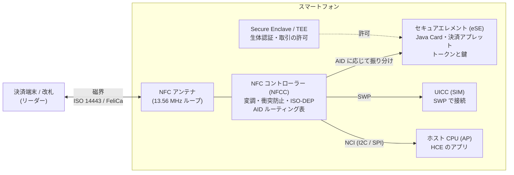
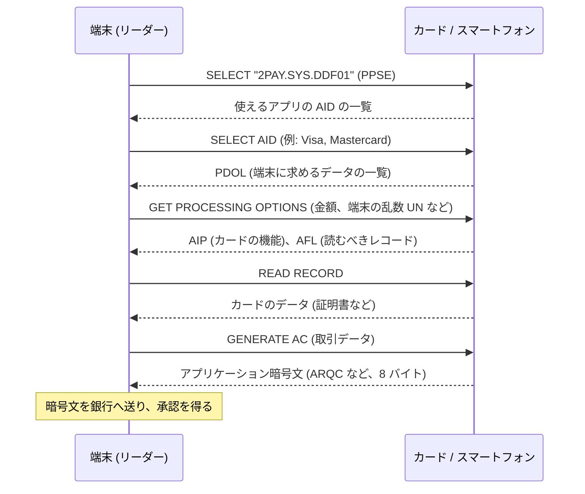

# NFCと非接触決済: 数センチの無線と、その上の暗号 (NFC & Contactless Payments: A Few Centimeters of Radio and the Cryptography on Top)

## 概要 (Overview)

改札にカードをかざす、レジでスマートフォンをかざす、という操作の裏では、13.56 MHz の磁界による数センチの無線通信と、その上で動く決済の暗号プロトコルが働いている。NFC (Near Field Communication) は、Bluetooth や Wi-Fi と同じ無線の周辺機器でありながら、扱う中身の多くがお金と認証であり、セキュリティが本体の層である。

NFC の特徴は、カード側に電池がないことである。リーダーが作る磁界がカードに電力を与え、カードはその磁界の負荷を変えることで返事をする。この物理が通信距離の短さ、通信の遅延、そして盗聴やリレー攻撃の条件を決める。決済のプロトコル (EMV) はこの短距離の通信の上で、取引ごとに一度しか使えない暗号文を作ることで、カードの複製とデータの再利用を防ぐ。スマートフォンでは、決済の鍵をどこに置くか（専用のセキュアエレメントか、ホストの CPU か）が設計の分かれ目になる。

本ドキュメントは、なぜ NFC は数センチしか届かないのか、カードは電池なしでどう返事をするのか、EMV の取引は何を暗号で守っていて何を守っていないのか、スマートフォンの決済の鍵はどこにあるのか、そしてリレー攻撃や PIN の迂回がなぜ可能だったのかを、物理層から決済アプリケーションまで通して説明する。

## 方法論 (Methodology)

- NFC を「磁界による結合と電力の供給 → 変調と符号化 → 衝突防止と伝送プロトコル (ISO-DEP) → アプリケーション (APDU、EMV)」の層に分解し、各層の規格と、その層で守られるもの・守られないものを対応づける。
- ISO/IEC 14443 の規格本文は有償なので、その値を引用している計測機器メーカー (Rohde & Schwarz) のアプリケーションノートと、NFC Forum、Sony、NXP の公式資料を一次資料として使い、その旨を明記する。
- EMV の取引の流れはEMV の仕様を形式検証した査読付き論文 (Basin ら、2021) と EMVCo の公開ページで確認する。EMVCo の仕様書の本文（有償または登録制）は参照していない。
- スマートフォンの構成はApple Platform Security ガイド、Android の開発者向け文書、欧州委員会の決定を一次資料とする。
- 攻撃は査読付き論文とセキュリティベンダの調査報告を一次資料とし、ベンダの反応は確認できた範囲で書く。
- 磁界の距離による減衰は円形ループの軸上の磁界の式から見積もる。見積もりは計算であり測定ではないことを明記する。

## 発見事項 (Findings)

1. **NFC の短い通信距離は磁界の近傍界の物理から来ている。** リーダーとカードのコイルは疎結合の変圧器として働き、ループの軸上の磁界はループの半径を超えると距離の 3 乗に反比例して弱まる。ISO/IEC 14443 は近接型カードの読み取り範囲を 100 mm 程度までとし、リーダーの磁界の強さを 1.5〜7.5 A/m の範囲に定めている。
2. **カードは電池なしで、リーダーの磁界から電力を得て、負荷を変えて返事をする。** カードからリーダーへの信号は負荷変調で、847.5 kHz の側波帯として現れる。リーダーの送信はカードの返事よりはるかに強いので、盗聴はリーダーからの信号なら数 m 先からできる（Hancke、2011）。
3. **EMV の非接触取引は取引ごとに一度しか使えない暗号文で複製と再利用を防ぐ。** カードは取引の内容、取引カウンタ、端末の乱数から、カードと銀行だけが知る鍵で MAC（ARQC）を作る。一方で、暗号文に含まれないデータ（カード取引修飾子 CTQ や AID）は改ざんでき、Visa の非接触カードの PIN 迂回（Basin ら、2021）の原因になった。
4. **スマートフォンの決済は本物のカード番号ではなくトークンで行う。** Apple Pay では、カード発行会社が作った端末専用の番号（Device Account Number）が暗号化されてセキュアエレメントに入り、Apple のサーバーには保存されない。トークンは特定の端末と提示方法に制限される。
5. **決済の鍵を置く場所は、セキュアエレメントからホストの CPU (HCE) へ広がった。** Android は 4.4 から、セキュアエレメントを使わないホストベースのカードエミュレーション (HCE) を持つ。Apple は欧州委員会の決定 (2024-07) を受けて、欧州経済領域で第三者のウォレットに NFC の HCE を無料で開放した。
6. **数センチという距離そのものは、認証にならない。** リレー攻撃はカードとリーダーの間のメッセージを遠くまで中継するだけで成立する。Apple Pay の Express Transit と Visa の組み合わせでは、ロックされた iPhone から £1000 の支払いを中継できた（Radu ら、2022）。2024 年には、被害者のカードの NFC データを中継して ATM から現金を引き出す Android マルウェア NGate が見つかった。
7. **独自の暗号は破られた。** 交通系カードで広く使われた MIFARE Classic の 48 ビットの暗号 Crypto1 は、2008 年にリバースエンジニアリングされ、本物のリーダーとの 1〜2 回の認証から 1 秒未満で鍵を取り出せることが示された。

## アーキテクチャ (Architecture)

### スマートフォンの NFC 決済の構成

NFC コントローラー (NFCC) は、リーダーとの無線の処理をすべて引き受け、届いたコマンドを AID（アプリケーション識別子）に応じて、セキュアエレメント、SIM、ホスト CPU のどれかへ振り分ける。決済の鍵がどこにあるかで、OS が侵害されたときに守られるものが変わる。

### プロトコルの層

| 層 | 規格 | 役割 | 暗号の保護 |
|---|---|---|---|
| 物理（磁界・変調） | ISO/IEC 14443-2（Type A / B）、FeliCa（ISO/IEC 18092） | 電力の供給、ビットの送受信 | なし |
| 衝突防止・起動 | ISO/IEC 14443-3 | 複数のカードから1枚を選ぶ | なし |
| 伝送 | ISO/IEC 14443-4（ISO-DEP） | 半二重のブロック伝送 | なし |
| アプリケーション | ISO/IEC 7816-4 の APDU、EMV | アプリの選択、取引、暗号文の生成 | 取引の暗号文（ARQC）、カードの認証。ただし対象外のデータもある |

下の3層には暗号の保護がない。暗号はアプリケーション層の決済プロトコルだけが担い、その保護の範囲に入らないデータが攻撃の入口になる（セキュリティ考察）。

## 技術詳細 (Technical Details)

### 13.56 MHz の誘導結合

NFC と ISO/IEC 14443 のカードは13.56 MHz（±7 kHz）の誘導結合で通信する。リーダー（ISO/IEC 14443 の用語で PCD）のコイルが作る磁界の中にカード（PICC）のコイルを置くと、両者は疎結合の変圧器になる（相互インダクタンスは `../../foundations/physics/electromagnetism/induction-inductance.md`）。Rohde & Schwarz のアプリケーションノートは、ISO/IEC 14443 の内容として、リーダーの搬送波が変圧器結合で誘起される電圧によってカードに電力を供給すると説明している。カードは電池を持たず、この電力でチップを動かす。

磁界の強さには上限と下限がある。リーダーは変調していない状態で最小 1.5 A/m、最大 7.5 A/m（実効値）の磁界を作らなければならない。下限はカードが動くための電力、上限はカードを壊さないための制限である。

**距離による減衰**: 半径 a の円形ループに電流を流したとき、ループの軸上で距離 r の点の磁界は `H(r) = N·I·a² / (2(a² + r²)^(3/2))` になる（`../../foundations/physics/electromagnetism/current-magnetostatics.md`）。r が a より十分大きいと H は r³ に反比例して弱まる。ループの中心の磁界を 1 とすると（以下は式による計算）、

| 距離 r（ループの半径 a = 3 cm の場合） | 中心に対する磁界の強さ |
|---|---|
| 0（ループの中心） | 1 |
| 3 cm (r = a) | 0.35 |
| 6 cm (r = 2a) | 0.089 |
| 9 cm (r = 3a) | 0.032 |
| 30 cm (r = 10a) | 0.001 |

3 cm から 9 cm に離れるだけで、磁界は約 11 分の 1 になる。カードを動かすには下限 1.5 A/m が要るので、リーダーの出力を少し上げても、電力を届けられる距離はあまり伸びない。TI の資料はISO 14443 の近接型を読み取り範囲 100 mm 程度まで、ISO 15693 の近傍型を 1 m 程度までと説明している。

NFC Forum は 2025 年の NFC Release 15 で、認定された機器とタグの互換性を確かめる動作範囲を、従来の 5 mm から 20 mm に広げた。2025-10 に始まった認証 (Certification Release 15) では、新しい製品は 20 mm の動作空間 (OV20) に適合しなければならない。これは「この範囲で必ず通信できること」を確かめる認証の範囲で、通信できる物理的な最大距離ではない。

### 変調と符号化 (Type A、Type B、FeliCa)

| 方式 | リーダー → カード | カード → リーダー | 速度 | 衝突防止 |
|---|---|---|---|---|
| ISO/IEC 14443 Type A | ASK 100%、変形ミラー符号 | 106 kbit/s では副搬送波の OOK・マンチェスタ符号、212 kbit/s 以上では BPSK | 106 / 212 / 424 / 848 kbit/s | 二分探索（ビット単位） |
| ISO/IEC 14443 Type B | ASK 10%、NRZ 符号 | 副搬送波の BPSK、NRZ-L 符号 | 106 / 212 / 424 / 848 kbit/s | スロット付き ALOHA |
| FeliCa (Sony) | ASK 10%、マンチェスタ符号 | 同左（副搬送波なし） | 212 / 424 kbit/s | タイムスロット |

（Rohde & Schwarz のアプリケーションノートによる ISO/IEC 14443 の要約と、Sony の公開資料。）

カードからリーダーへの返事は**負荷変調**で行う。カードはコイルにつないだ負荷を切り替え、リーダーの磁界からの電力の吸い取り方を変える。リーダーはこれを自分のコイルの電圧のわずかな変化として読む。ISO/IEC 14443 では、この切り替えを 847.5 kHz（13.56 MHz の 16 分の 1）の副搬送波で行うので、信号は搬送波から 847.5 kHz 離れた側波帯に現れ、強い搬送波から分けて取り出しやすくなる。速度は搬送波を分周して作り、106 kbit/s は 13.56 MHz の 128 分の 1 である。

Sony によれば、FeliCa は ISO/IEC 18092 (NFCIP-1) に準拠し、副搬送波を使わない対称な通信なので放射が小さく、847 kbps を超える速度も可能である。Sony は、暗号処理を含むリーダーとカードの処理が約 0.1 秒で終わるとしている。改札のように人の流れを止められない用途では、この速さが設計の前提になる。

NFC Forum はこれらを NFC-A、NFC-B、NFC-F（FeliCa）、NFC-V（ISO 15693）の4つの技術としてまとめ、いずれも同じ 13.56 MHz の搬送波を使うとしている。

### 衝突防止とカードクラッシュ

リーダーの磁界に複数のカードが入ると、全部が同時に返事をしようとする。ISO/IEC 14443-3 の衝突防止は、Type A では UID をビットごとにたどる二分探索、Type B ではスロット付き ALOHA で、1枚を選び出す。衝突防止のあと、ISO/IEC 14443-4 の ISO-DEP（半二重のブロック伝送）で、アプリケーションのコマンド（APDU）をやり取りする。

衝突防止は「1枚を選ぶ」仕組みであって、「利用者が意図した1枚を選ぶ」仕組みではない。ロンドン交通局 (TfL) は非接触決済の導入時 (2014) に、「カードクラッシュ」を避けるために読み取り機には1枚だけをかざすよう呼びかけた。意図しないカードで支払うことを避け、改札が開かないことも避けるためである。

### NFC コントローラーと NCI

スマートフォンの NFC は、NFC コントローラー (NFCC) という専用チップが担う。NFC Forum の **NCI (NFC Controller Interface)** は、デバイスホスト (DH、スマートフォンの CPU) と NFCC の間の論理インターフェースで、NFCC はセキュアエレメントのような NFC 実行環境 (NFCEE) にもつながる。

NXP の PN7160 は、NCI 2.0 に準拠し、I2C か SPI でホストにつながる。リーダー / ライターとしては ISO/IEC 14443 A/B、FeliCa、MIFARE、ISO/IEC 15693 などに対応し、カードエミュレーションとしては NFC Forum の Type 3 と Type 4 に対応する。ただし NXP は、PN7160 では EMVCo の認証は取れないと明記している。決済端末として使うには、EMVCo のレベル 1（物理層と伝送層）の認証に対応した別の製品が要る（NXP の製品情報では PN7220 がこれに当たる）。同じ NFC でも、決済の世界には独自の認証の層がある。

かつての NFC のピアツーピア (P2P) モード（Android Beam など）は縮小しており、NXP は 2024 年以降、NFC リーダー製品の P2P 機能の保守をやめるとしている。

### EMV の非接触取引

非接触決済の国際規格 EMV では、端末とカードが次の順にコマンドをやり取りする（Basin ら (2021) による EMV の仕様の要約）。

- アプリケーション暗号文 (AC): 取引の詳細、カードの機能 (AIP)、取引カウンタ (ATC) に対するブロック暗号ベースの MAC である。鍵は、カードと銀行が共有するマスター鍵と ATC から導いたセッション鍵で、取引ごとに変わる。端末の乱数 (Unpredictable Number) も取引データに含まれる。EMVCo は、取引ごとに一度しか使えないセキュリティコードが不正を防ぐと説明している。
- カーネル: EMV の非接触では、決済ブランドごとに「カーネル」と呼ばれる処理の仕様がある（Book C-2 から C-8）。EMVCo は 2022-10 に、ブランドごとに分かれたカーネルの数を減らすための共通の Kernel 8 (Book C-8) を公開した。C-8 はカードの認証に楕円曲線暗号を使い、安全なチャネルによってリレー攻撃の緩和、盗聴の防止、機微なデータの保護を行う。

暗号文の役割は「この取引のこの金額」に対して「本物のカードが今」応答したことを銀行に示すことである。カードの番号や有効期限を盗み見ても、次の取引の暗号文は作れないので、磁気ストライプのような複製は成り立たない。ただし、暗号文に含まれないデータと、端末の中だけで判断される処理は守られない。これが Basin らの PIN 迂回の原因になった（セキュリティ考察）。

### トークナイゼーション

スマートフォンの決済では、本物のカード番号 (PAN) を使わない。EMVCo の決済トークナイゼーションは、PAN を「EMV 決済トークン」という一意の代替値に置き換える。トークンは特定の加盟店、端末、決済の方法の外では使えないように制限され（トークンドメインの制限）、トークンを発行する事業者 (TSP) は EMVCo の割り当てるコードで世界的に識別される。店頭の非接触決済では、トークンは特定の端末と提示方法に限られ、取引ごとのトークン暗号文が取引データの完全性を守る。

Apple Pay では、カードを登録すると、カード発行会社が端末専用の **Device Account Number** を作り、Apple が読めない形で暗号化して送り、セキュアエレメントに保存する。Apple によれば、この番号は Apple Pay のサーバーにも iCloud のバックアップにも保存されない。店頭の支払いでは、セキュアエレメントがこの番号と、取引ごとの動的なセキュリティコードを端末に渡す。店からカード番号が漏れても、それは本物のカード番号ではなく、別の端末では使えない。

### セキュアエレメントと HCE

| 方式 | 鍵の置き場所 | 取引の処理 | 例 |
|---|---|---|---|
| 内蔵セキュアエレメント (eSE) | 端末の専用チップ | NFC コントローラーからセキュアエレメントへ直接。OS のアプリは関与しない | Apple Pay（Java Card のセキュアエレメント） |
| UICC (SIM) | SIM カード | NFC コントローラーと SIM を SWP（1 本の信号線）でつなぐ | 通信事業者の決済サービス |
| ホストベースのカードエミュレーション (HCE) | ホスト側（鍵はクラウドや TEE と組み合わせて守る） | NFC コントローラーからホストのアプリへ | Android の HCE、iOS の HCE（欧州経済領域） |

- Apple Pay: Apple によれば、セキュアエレメントは Java Card のプラットフォームで動く業界標準の認証済みチップで、Secure Enclave が認証（Face ID など）を管理して許可した取引だけを進め、NFC コントローラーが近距離通信のプロトコルを処理して通信を振り分ける（Secure Enclave は `../security/side-channels-tee-secure-boot.md`）。
- SWP: ETSI TS 102 613 はUICC と非接触フロントエンド (CLF、NFC コントローラー) の間のインターフェースとして SWP を定めている。CLF がマスター、UICC がスレーブで、UICC の接点 C6 をデータのやり取りに使う。
- HCE: Android は 4.4 から、セキュアエレメントを使わないカードエミュレーションとして HCE を持つ。NFC コントローラーは「AID と宛先」の規則の一覧（ルーティング表）を持ち、ホストに振り分けられた AID の APDU は、アプリの `HostApduService` の `processCommandApdu()` に届く。Android の文書はセキュアエレメントを使う方式では「セキュアエレメント自身が端末と通信し、Android のアプリは取引に関与しない」と対比している。

HCE は決済の鍵を専用チップから OS の側へ移す。端末内のセキュアエレメントに頼らずにアプリがカードを載せられるようになる一方、鍵の保護は TEE（Android の StrongBox や KeyMint、`../../software/android/security-model.md`）やトークナイゼーションとの組み合わせに頼ることになる。

### プラットフォームの開放

iPhone の NFC は長く Apple Pay だけが使える状態だった。欧州委員会は 2024-07-11、EU の競争法（EU 機能条約 102 条）に基づき、Apple の確約を法的に拘束力のあるものにした。Apple は欧州経済領域で第三者のウォレットの提供者に、Apple Pay や Apple Wallet を使わずに、iOS 端末の NFC を無料で使えるようにし、端末内のセキュアエレメントに頼らない HCE モードでの NFC の利用を可能にする。確約は 10 年間有効である。

Apple の開発者向け文書によれば、欧州経済領域では iOS 17.4 以降で HCE による非接触取引の API が使える。これとは別に、iOS 18.1 からは、セキュアエレメント、Secure Enclave、Apple のサーバーを使う「NFC & SE Platform」の API が、オーストラリア、ブラジル、カナダ、日本、ニュージーランド、英国、米国で提供され、その後に対象国が広がっている。前者は鍵をホスト側に置く HCE、後者は Apple Pay と同じセキュアエレメントを第三者に開く方式で、仕組みが違う。

### Express モードと予備電力、FeliCa

改札では、認証の操作をしている時間がない。Apple の Express モード（Express Transit）は、指定した交通系カードや決済カードを、Face ID などの認証なしで使えるようにする。さらに iPhone の電池が切れて充電が必要になった後も、一部の Express モードのカードやキーは最大 5 時間使える（予備電力）。Apple によれば、このとき NFC コントローラーは iOS が動いているときと同じ条件で Express Card の取引を行う。利用者が通常の手順で電源を切った場合は使えない。

日本の改札で使われる FeliCa について、Apple は 2016-09 に、日本で販売する iPhone 7 と Apple Watch Series 2 が FeliCa（Type-F）に対応し、Apple Pay で Suica を使えるようにすると発表した。1 台の端末がISO/IEC 14443 の EMV 決済と FeliCa の交通系の両方を扱う。

Express モードは利便性のために「かざすだけで、認証なしに支払える」状態を作る。後述するとおり、この状態はリレー攻撃の標的になった。

### 本人確認と金額の上限

非接触のカードでは、少額なら PIN を求めない。英国では 2021-10-15 から、非接触カードの 1 回の上限が £100 になった（£10 (2007) から段階的に引き上げられた）。累計にも上限がある。一方、UK Finance は、Apple Pay や Google Pay のようなスマートフォンの決済には £100 の固定の上限がないと説明している。スマートフォンが Face ID や指紋で本人を確認するからである。英国の金融行動監視機構 (FCA) は 2026-03-19 から、強固な不正対策を持つ銀行や決済事業者が非接触決済の上限を変えられるようにした。

本人確認を「どこで、誰が行ったか」は、端末に伝えられる情報の一つにすぎない。その情報が暗号で守られていなかったことが、次の攻撃につながった。

## セキュリティ考察 (Security Considerations)

| 攻撃 | 何をするか | 突く性質 | 例 |
|---|---|---|---|
| 盗聴・スキミング | 通信を遠くから聞く、遠くからカードを読む | リーダーの強い送信、規格の想定より長い実際の到達距離 | Hancke (2011) |
| リレー攻撃 | カードとリーダーの通信を遠くまで中継する | 距離は認証されない | Chothia ら (2015)、Radu ら (2022)、NGate (2024) |
| 認証されないデータの改ざん | 暗号文に含まれないフィールドを書き換える | 保護の範囲の穴 | Basin ら (2021) |
| 独自暗号の解読 | カードの鍵を取り出して複製する | 弱い独自の暗号 | MIFARE Classic (2008) |
| NFC スタックの脆弱性 | 細工した NFC のデータで端末を攻撃する | 常に電波を待っているパーサ | Android のセキュリティ情報 (2020-04) |

### 盗聴とスキミングの距離

Hancke (Journal of Computer Security、2011) は、通常の動作範囲が 10 cm 未満とされる高周波 RFID の通信を、実際にどこまで盗聴・スキミングできるかを測った。ISO 14443A のリーダーからカードへの信号（前方チャネル）は、試した 5 m のすべての距離で取り出せたが、カードからリーダーへの信号（後方チャネル）は約 2 m までだった。カードに自分で電力を与えて読み出すスキミングでは、電力を届けられた最大距離は 15〜27 cm で、混雑した場所での攻撃には 15〜20 cm で十分だろうとしている。50 ポンド未満の受信機材で実現できた。

この差は技術詳細の物理で説明できる。前方チャネルはリーダーが自分で強い磁界を出して送る信号なので、遠くでも聞ける。後方チャネルは、カードが磁界の負荷をわずかに変えるだけの信号なので弱い。スキミングでは、攻撃者がカードに電力を届けなければならず、磁界が距離の 3 乗で弱まるので、出力を上げてもあまり伸びない。Hancke 自身が強調するように、要点は具体的な距離ではなく、攻撃者が宣伝された動作範囲を超えてデータを取り出せることである。EMV の暗号文は盗聴されても再利用できないが、カード番号などの暗号化されないデータは読まれる。

### リレー攻撃

リレー攻撃では、攻撃者は2台の機器を使う。1台を被害者のカードやスマートフォンの近くに、もう1台を遠くの決済端末に置き、両者の間でメッセージをそのまま中継する。暗号文は本物のカードが作るので、暗号を破る必要はない。Chothia ら (Financial Cryptography 2015) は、この攻撃で非接触カードから無線でお金を「すり取れる」ことを示し、EMV の仕様の範囲で実装できる対策を提案した。

対策の基本は**距離の上限の確認 (distance bounding)** で、リーダーがカードとのやり取りの往復時間を測り、時間がかかりすぎる（遠すぎる）なら取引を止める。Mastercard の非接触決済にはこの仕組み (RRP、Relay Resistance Protocol) がある。ただし Boureanu ら (ACM CCS 2020) は、往復時間を測るのはリーダーなので、こうしたプロトコルは不正なリーダーに対して簡単に破られると指摘している。EMVCo の Kernel 8 も安全なチャネルによるリレー攻撃の緩和を掲げている。

**Apple Pay の Express Transit と Visa**: Radu ら (IEEE S&P 2022) は、Express Transit を Visa のカードで設定した iPhone では、この機能を利用して Apple Pay のロック画面を迂回でき、ロックされた iPhone から £1000 を支払う中継を実演した。Mastercard を設定した Apple Pay や、Visa を設定した Samsung Pay は影響を受けなかった。研究者は 2020-10 に Apple、2021-05 に Visa に報告したが、研究者のページによれば、両社は問題の深刻さを認めながら、どちらが修正するかで合意に至っていなかった。

**NGate** (ESET、2024-08): 被害者のスマートフォンにインストールさせた Android マルウェアが、被害者の物理的な決済カードの NFC データを中継し、攻撃者はそのデータで ATM から現金を引き出した。チェコの 3 つの銀行の顧客が標的で、正規の銀行サイトを装った短期間のドメインと PWA の仕組みを悪用して配布された。中継には、ダルムシュタット工科大学の学生が研究用に作った NFCGate が使われ、被害者は端末の root 化も不要だった。チェコの警察はプラハで ATM から現金を盗んでいた 22 歳を逮捕した。研究用のツールがそのまま犯罪の部品になった例である。

### 認証されないデータの改ざん

Basin、Sasse、Toro-Pozo (IEEE S&P 2021) は、EMV の仕様を形式的に検証し、Visa の非接触カードで、PIN を知らずに本人確認が必要な金額を支払える攻撃を見つけた。原因は**カード取引修飾子 (CTQ)** というデータが、カードによって端末にも銀行にも認証されないことである。攻撃者は中継の途中で CTQ の 2 つのビットを書き換え、「オンラインの PIN 確認は不要」かつ「本人確認は端末側 (Consumer Device CVM) で済んだ」と端末に思い込ませる。研究者は 200 スイスフランの取引で実演し、2020-04-30 に Visa に報告した。提案した修正は端末側で実装でき、流通しているカードには影響しない。

同じ著者らの Card Brand Mixup 攻撃 (USENIX Security 2021) は、Mastercard の Maestro デビットカードを Visa の取引として使わせ、400 米ドルを超える取引で PIN を迂回した。カードは AID（どのブランドのアプリか）を端末に対して認証しないので、カードのブランドと決済ネットワークの食い違いを作れる。Mastercard はその後、自社のネットワークに防御策を導入した。

いずれも、暗号は破られていない。暗号文の保護の範囲に入っていないデータを書き換えただけである。`input-devices-hid.md` の「HID はデバイスの申告を信じる」という信頼モデルと同じく、EMV の端末もカードの申告の一部を検証せずに信じていた。

### MIFARE Classic の独自暗号の解読

交通系カードなどで広く使われた NXP の MIFARE Classic は、48 ビットの鍵を使う独自のストリーム暗号 Crypto1 で守られていた。Nohl ら (USENIX Security 2008) は、チップの回路の画像解析とプロトコルの解析を組み合わせて暗号を復元し、その強度が 48 ビットの鍵長が示すより低いことを示した。Garcia ら (ESORICS 2008) は、本物のリーダーとの 1〜2 回の認証のやり取りから 1 秒未満で秘密鍵を取り出す攻撃を示し、カードの複製や、カードを以前の状態に戻すことができるとした。論文はロンドンの Oyster カードやオランダの OV-Chipkaart での利用を挙げている。公開されない独自の暗号は、リバースエンジニアリングされれば終わりで、カードは何年も現場に残る（`../../software/security/applied-cryptography.md`）。

### NFC スタックの脆弱性

NFC は、外から届く電波のデータを端末が解釈する入口でもある。Android のセキュリティ情報 (2020-04) は、NFC のコードの脆弱性 (CVE-2020-0072、CVE-2020-0073) を、リモートの攻撃者がコードを実行できうる Critical の問題として修正した。`bluetooth-pairing-protocol.md` の BlueBorne と同じく、無線から来るデータを解釈するパーサは、それ自体が攻撃面になる。

## 結論 (Conclusions)

- NFC の短い通信距離は磁界の近傍界が距離の 3 乗で弱まる物理から来ており、カードは電池なしでリーダーの磁界から電力を得て、負荷変調で返事をする。この物理が盗聴は数 m、スキミングは数十 cm という攻撃の距離も決める。
- 物理層から伝送層までには暗号の保護がなく、決済の安全は EMV のアプリケーション層の暗号文に集中している。取引ごとの暗号文は複製と再利用を防ぐが、その保護の範囲に入らないデータ（CTQ、AID）は改ざんされ、PIN の迂回につながった。
- スマートフォンの決済はトークンと端末専用の番号によって本物のカード番号を店に渡さない。鍵の置き場所は、セキュアエレメントから HCE へ広がり、欧州では規制によって iPhone の NFC も第三者に開かれた。
- 数センチという距離は認証にならない。リレー攻撃は暗号を破らずに距離だけを伸ばす。往復時間による距離の確認は対策になるが、測る側のリーダーを信頼する前提を持つ。Express モードのような利便性のための例外は、リレー攻撃の標的になる。
- 公開されない独自の暗号 (Crypto1) は破られ、現場に長く残った。決済の世界では、公開された規格と形式検証、そして EMVCo の認証という別の層が、安全を支えている。

### 次の接続先 (Related Topics)

- `bluetooth-pairing-protocol.md` — NFC を使う OOB ペアリングと、無線のパーサの脆弱性 (BlueBorne)。
- `input-devices-hid.md` — 「デバイスの申告を信じる」信頼モデルと、入力の真正性。
- `../security/side-channels-tee-secure-boot.md` — Secure Enclave と TEE。
- `../../software/android/security-model.md` — Android の KeyMint と StrongBox。
- `../../software/apis/webauthn-passkeys-specification.md` — NFC で使うセキュリティキー (CTAP)。
- `../../software/security/applied-cryptography.md` — MAC、鍵の派生、独自暗号の危険。
- `../../foundations/physics/electromagnetism/induction-inductance.md` — 相互インダクタンスと誘導結合。
- `../../foundations/physics/electromagnetism/current-magnetostatics.md` — ループ電流の作る磁界。

## 参考文献 (References)

**一次資料 (Primary — 規格・公式ドキュメント・査読付き論文)**

- Rohde & Schwarz. *Measurements on RFID Components according to ISO/IEC 14443* (Application Note 1MA113). — [rohde-schwarz.com](https://scdn.rohde-schwarz.com/ur/pws/dl_downloads/dl_application/application_notes/1ma113/1MA113_3e_meas_on_RFID_components.pdf) — Accessed: 2026-10-17。ISO/IEC 14443 の要約: 13.56 MHz の誘導結合と変圧器結合による電力供給、Hmin 1.5 A/m と Hmax 7.5 A/m、Type A / B の変調と符号化、847.5 kHz の側波帯、速度、衝突防止。計測機器メーカーによる規格の引用。
- Texas Instruments. *RF and RFID Technology and Applications* (tutorial, hosted by DigiKey). — [digikey.com](https://www.digikey.com/en/ptm/t/texas-instruments/rf-rfid-technology-and-applications/tutorial?slide=29) — Accessed: 2026-10-17。ISO 14443 の読み取り範囲 100 mm 程度、ISO 15693 の 1 m 程度。
- Sony. *FeliCa の通信方式* / *FeliCa とは*. — [sony.co.jp/en](https://sony.co.jp/en/Products/felica/about/scheme.html) / [sony.co.jp](https://www.sony.co.jp/Products/felica/about/) — Accessed: 2026-10-17。ASK 10%、マンチェスタ符号、212 / 424 kbps、副搬送波なし、ISO/IEC 18092 準拠、約 0.1 秒の処理。
- NFC Forum. *Technical Committee Glossary* v1.2.00 (2026-01-26) / *NFC Forum Announces NFC Release 15* (2025-06) / *NFC Forum Launches Certification to Support Extended Range* (2025-10). — [glossary](https://nfc-forum.org/uploads/Certification-Files/nfcforum-tc-glossary-1-2-00.pdf) / [Release 15](https://nfc-forum.org/news/2025-06-nfc-forum-announces-nfc-release-15/) / [CR15](https://nfc-forum.org/news/2025-10-nfc-forum-launches-certification-to-support-extended-range-of-contactless-connections/) — Accessed: 2026-10-17。NFC-A/B/F/V、ISO-DEP、NCI と NFCC、動作範囲の 5 mm から 20 mm への拡大 (OV5 → OV20)。
- NXP Semiconductors. *PN7160 NFC Plug and Play Controller*. — [nxp.com](https://nxp.com/products/rfid-nfc/nfc-hf/nfc-readers/nfc-plug-and-play-controller-with-integrated-firmware-and-nci-interface:PN7160) — Accessed: 2026-10-17。NCI 2.0、I2C / SPI、対応する方式、EMVCo 認証の対象外、P2P の保守終了。
- Transport for London. *Contactless payments set to launch on London's Tube, DLR, Overground and trams* (press release, 2014-07). — [tfl.gov.uk](https://www.tfl.gov.uk/info-for/media/press-releases/2014/july/contactless-payments-set-to-launch) — Accessed: 2026-10-17。カードクラッシュの注意喚起。
- EMVCo. *EMV Contactless Chip* / *Contactless* / *EMVCo Publishes EMV Contactless Kernel Specification* (2022-10-05) / *Payment Tokenisation* / *EMV Payment Tokenisation: A Guide to Use Cases* v2.2.1 (2023). — [emvco.com](https://www.emvco.com/emv-technologies/emv-contactless-chip/) / [contactless](https://www.emvco.com/emv-technologies/contactless/) / [Kernel 8](https://www.emvco.com/news/emvco-publishes-emv-contactless-kernel-specification/) / [tokenisation](https://www.emvco.com/emv-technologies/payment-tokenisation/) / [use cases](https://www.emvco.com/wp-content/uploads/2023/03/EMVCo-Payment-Tokenisation-A-Guide-To-Use-Cases-v2.2.1.pdf) — Accessed: 2026-10-17。取引ごとのセキュリティコード、カーネル、Kernel 8 の ECC と安全なチャネル、トークンとドメインの制限。
- Apple. *Apple Platform Security*: *Apple Pay component security* / *Card provisioning security overview* / *Express Cards with power reserve*; *Apple Pay security and privacy overview*; *If your iPhone needs to be charged* (power reserve). — [support.apple.com/guide/security](https://support.apple.com/guide/security/apple-pay-component-security-sec2561eb018/web) / [provisioning](https://support.apple.com/guide/security/card-provisioning-security-overview-sec0f005981a/web) / [express](https://support.apple.com/guide/security/express-cards-with-power-reserve-sec90cd29d1f/web) / [101554](https://support.apple.com/en-us/101554) / [105123](https://support.apple.com/en-us/105123) — Accessed: 2026-10-17。セキュアエレメント、Secure Enclave、NFC コントローラーの役割、Device Account Number、予備電力の最大 5 時間。
- Apple. *HCE-based contactless transactions for apps* / *NFC & SE Platform*; Apple Newsroom. *Apple Pay coming to Japan with iPhone 7* (2016-09-07). — [developer.apple.com HCE](https://developer.apple.com/support/hce-transactions-in-apps/) / [NFC & SE](https://developer.apple.com/support/nfc-se-platform/) / [newsroom](https://www.apple.com/newsroom/2016/09/apple-pay-coming-to-japan-with-iphone-7/) — Accessed: 2026-10-17。iOS 17.4 の HCE（欧州経済領域）と PPSE などの AID、iOS 18.1 の NFC & SE Platform と対象国、FeliCa への対応。
- Android Developers. *Host-based card emulation overview*. — [developer.android.com](https://developer.android.com/develop/connectivity/nfc/hce) — Accessed: 2026-10-17。Android 4.4 以降の HCE、AID のルーティング表、`HostApduService`、セキュアエレメント型との対比。
- European Commission. *Commission accepts commitments by Apple opening access to "tap-and-go" technology on iPhones* (IP/24/3706, 2024-07-11). — [ec.europa.eu](https://ec.europa.eu/commission/presscorner/api/files/document/print/fin/ip_24_3706/IP_24_3706_EN.pdf) — Accessed: 2026-10-17。第三者のウォレットへの NFC の無料開放、HCE、10 年間、欧州経済領域。
- ETSI. *TS 102 613: Smart Cards; UICC - Contactless Front-end (CLF) Interface; Part 1: Physical and data link layer characteristics* (V7.1.0). — [etsi.org](https://www.etsi.org/deliver/etsi_TS/102600_102699/102613/07.01.00_60/ts_102613v070100p.pdf) — Accessed: 2026-10-17。SWP、CLF がマスターで UICC がスレーブ、接点 C6。
- UK Finance. *Contactless limit change FAQs* / *Contactless cards information* (2026-03-12). — [ukfinance.org.uk](https://www.ukfinance.org.uk/contactless-limit-change-faqs) / [information](https://www.ukfinance.org.uk/policy-and-guidance/guidance/contactless-cards-information) — Accessed: 2026-10-17。2021-10-15 からの £100 の上限、過去の上限、スマートフォンの決済に固定の上限がない理由、FCA の 2026-03-19 からの変更。
- Android Open Source Project. *Android Security Bulletin—April 2020*. — [source.android.com](https://source.android.com/docs/security/bulletin/2020-04-01) — Accessed: 2026-10-17。NFC のコードの Critical な脆弱性 (CVE-2020-0072、CVE-2020-0073)。
- Basin, D., Sasse, R., & Toro-Pozo, J. (2021). The EMV Standard: Break, Fix, Verify. *2021 IEEE Symposium on Security and Privacy*, 1766–1781. https://doi.org/10.1109/SP40001.2021.00037 （[arXiv:2006.08249](https://arxiv.org/abs/2006.08249)）。EMV の取引の流れ、アプリケーション暗号文、CTQ の改ざんによる PIN 迂回。
- Basin, D., Sasse, R., & Toro-Pozo, J. (2021). Card Brand Mixup Attack: Bypassing the PIN in non-Visa Cards by Using Them for Visa Transactions. *30th USENIX Security Symposium*, 179–194. — [usenix.org](https://www.usenix.org/conference/usenixsecurity21/presentation/basin) — Accessed: 2026-10-17。
- Radu, A.-I., Chothia, T., Newton, C. J. P., Boureanu, I., & Chen, L. (2022). Practical EMV Relay Protection. *2022 IEEE Symposium on Security and Privacy*, 1737–1756. https://doi.org/10.1109/SP46214.2022.9833642 （実演と報告の経緯は研究者のページ [practical_emv.gitlab.io](https://practical_emv.gitlab.io/) による）
- Chothia, T., Garcia, F. D., de Ruiter, J., van den Breekel, J., & Thompson, M. (2015). Relay Cost Bounding for Contactless EMV Payments. *Financial Cryptography and Data Security 2015*, LNCS 8975, 189–206. https://doi.org/10.1007/978-3-662-47854-7_11
- Boureanu, I., Chothia, T., Debant, A., & Delaune, S. (2020). Security Analysis and Implementation of Relay-Resistant Contactless Payments. *ACM CCS 2020*, 879–898. https://doi.org/10.1145/3372297.3417235
- Hancke, G. P. (2011). Practical eavesdropping and skimming attacks on high-frequency RFID tokens. *Journal of Computer Security*, 19(2), 259–288. https://doi.org/10.3233/JCS-2010-0407
- Garcia, F. D., de Koning Gans, G., Muijrers, R., van Rossum, P., Verdult, R., Wichers Schreur, R., & Jacobs, B. (2008). Dismantling MIFARE Classic. *ESORICS 2008*, LNCS 5283, 97–114. https://doi.org/10.1007/978-3-540-88313-5_7
- Nohl, K., Evans, D., Starbug, & Plötz, H. (2008). Reverse-Engineering a Cryptographic RFID Tag. *17th USENIX Security Symposium*. — [usenix.org](https://static.usenix.org/event/sec08/tech/full_papers/nohl/nohl.pdf) — Accessed: 2026-10-17。
- Klee, S., Roussos, A., Maass, M., & Hollick, M. (2020). NFCGate: Opening the Door for NFC Security Research with a Smartphone-Based Toolkit. *14th USENIX Workshop on Offensive Technologies (WOOT '20)*. — [usenix.org](https://www.usenix.org/conference/woot20/presentation/klee) — Accessed: 2026-10-17。

**二次資料 (Secondary)**

- Stefanko, L., & Osmani, J. (ESET Research). *NGate Android malware relays NFC traffic to steal cash*. WeLiveSecurity (2024-08-22). — [welivesecurity.com](https://www.welivesecurity.com/en/eset-research/ngate-android-malware-relays-nfc-traffic-to-steal-cash/) — Accessed: 2026-10-17。NGate の手口、標的、配布方法、逮捕。セキュリティベンダの調査報告。
- University of Surrey. *Visa and Apple Pay vulnerabilities leave iPhone users open to payment fraud* (2021-09-30). — [surrey.ac.uk](https://www.surrey.ac.uk/news/visa-and-apple-pay-vulnerabilities-leaves-iphone-users-open-payment-fraud) — Accessed: 2026-10-17。Radu ら (2022) の研究の発表と、任意の金額の支払いが可能だった点。
