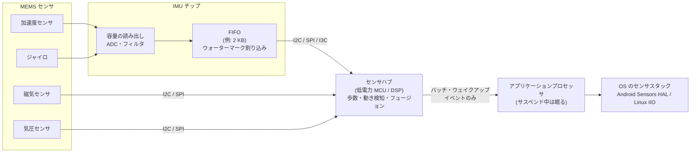

# センサハブとMEMSセンサ: 常時オンの感覚器 (Sensor Hub & MEMS Sensors: Always-On Senses)

## 概要 (Overview)

スマートフォンやゲームコントローラーは、加速度センサ、ジャイロスコープ、磁気センサ、気圧センサといった **MEMS (Micro-Electro-Mechanical Systems)** センサを持つ。画面の向きの切り替え、歩数計、コントローラーを傾けて狙うジャイロエイム、階数の判定は、いずれもこれらのセンサの出力から作られる。

MEMS センサは、シリコンの上に作った小さな機械（ばねで支えた質量）の動きを電気的に読む部品である。読み出した値には、オフセット（バイアス）、ノイズ、温度による変化が乗り、姿勢や位置を求めるために積分すると、その誤差も時間とともに積み上がる。さらに、センサを常に動かしておきたい用途（歩数、動きの検知）では、メインのプロセッサ（アプリケーションプロセッサ、AP）を起こし続けると電池が持たない。そこで、センサの近くの低電力プロセッサ（センサハブ）とセンサ内蔵の FIFO が、データをためて AP の眠りを守る。

本ドキュメントは、MEMS センサがどう動きを測るのか、データシートの数値は何を意味し、積分するとどれだけずれるのか、センサハブはなぜ必要なのか、モーションセンサはなぜ盗聴やフィンガープリンティングに使えるのかを、デバイスの側から説明する。オーディオの wake word 検出 (`audio-subsystem.md`) とカメラの AOSC (`camera-image-sensors.md`) に続く、「AP を起こさずに常時監視する」パターンの3つ目の例でもある。

## 方法論 (Methodology)

- センサを「機械構造（質量・ばね・共振） → 容量などの電気量 → ADC とデジタル処理 → FIFO とバス → センサハブ / AP → OS のセンサスタック」の順に分解する。
- 数値はメーカーのデータシートを一次資料とし、**仕様値**として扱う。IMU は TDK InvenSense ICM-42688-P と Bosch BMI270 の2製品で突き合わせ、条件の違う値は別々に示す。多くの値はデータシート自身が「評価・特性評価から導いた値で、出荷試験はしていない」と注記している点も明記する。
- 誤差の積み上がりは、Woodman (2007) の慣性航法の入門報告で定義を確認し、データシートの値を当てはめて見積もる。見積もりは計算であって測定ではないことを明記する。
- センサフュージョン（相補フィルタ、カルマンフィルタ）の理論は、`../../engineering/robotics/perception-state-estimation.md` と `../../foundations/control-theory/state-space-estimation.md` に委ね、ここではセンサの側から見た入力の性質に絞る。
- OS 側は Android (source.android.com、developer.android.com)、Linux カーネル文書・ソース、Apple の公式発表を一次資料とする。
- セキュリティは査読付き論文と、ベンダ・政府機関のアドバイザリを一次資料とする。

## 発見事項 (Findings)

1. **MEMS の加速度センサとジャイロは、どちらも「ばねで支えた質量」の変位を測る。** 加速度センサは加速度による質量のずれを、ジャイロは振動させた質量に回転で生じるコリオリ力を測る。共振を持つ機械なので、外から共振周波数の音を当てると偽の出力を作れる（WALNUT、Rocking Drones）。
2. **センサの小さな誤差は、積分で大きくなる。** ジャイロのオフセットは角度の誤差として時間に比例して、加速度センサのオフセットは位置の誤差として時間の2乗に比例して増える。データシートの初期オフセット ±20 mg をそのまま2回積分すると、60 秒で約 350 m の位置誤差になる。単体の民生用 IMU で位置を出し続けることはできず、他のセンサとの融合が前提になる。
3. **ヨー（方位）は、加速度と角速度だけでは決まらない。** 重力の向きからはロールとピッチしか分からないため、方位の基準には磁気センサが要る。Android の「ゲーム用回転ベクトル」は磁気センサを使わない代わりに、方位がジャイロと同程度にずれることを仕様として認めている。
4. **電力の問題は、センサではなく AP を起こすことにある。** IMU は 6 軸で 1 mA 前後、気圧センサは 1 Hz で 3.2 µA で動く。Android は、センサハブとハードウェア FIFO にイベントをためる**バッチング**によって、データを集めている間も AP をサスペンドにしておけるとしている。
5. **センサハブは、wake word 検出や AOSC と同じ「低電力で常時監視し、必要なときだけ AP を起こす」設計である。** Apple は 2013 年の M7 で、Android は CHRE（低電力プロセッサ上のナノアプリ）で、これをプラットフォームの機能にした。
6. **ゲームコントローラーの IMU は、HID の別の入力デバイスとして OS に現れる。** Linux の `hid-playstation` は、DualSense の加速度とジャイロを専用の入力デバイスとして公開し、Feature Report で読んだ較正値で単位をそろえ、デバイス側のタイムスタンプを付ける。伝送路のジッターがあるので、タイムスタンプがなければ角速度を正しく積分できない。
7. **モーションセンサは、権限なしで読めた時代が長く、盗聴とフィンガープリンティングの経路になった。** ジャイロで音声を拾う Gyrophone (2014)、工場での較正値から端末を識別する SensorID (2019、iOS 12.2 で修正) を受けて、OS とブラウザはサンプリングレートの上限と許可の手続きを導入した。Android 12 は、マイクのアクセスをオフにするとモーションセンサのレートも必ず制限する。

## アーキテクチャ (Architecture)

### センサから OS まで

ポイントは、データが AP に届く前に2段のためる場所があることである。IMU チップ内の FIFO はバスの読み出し回数を減らし、センサハブはさらに長い時間ためたうえで、歩数の計算や重要な動きの検出のような軽い処理をその場で済ませる。AP が起きるのは、FIFO があふれそうなとき、報告の遅延の上限が来たとき、ウェイクアップ型のセンサがイベントを出したときに限られる。

### 常時監視の3つの例

| | オーディオ | カメラ | モーション |
|---|---|---|---|
| 常時動く部分 | PDM マイク + 低電力 DSP | 低解像度・低フレームレートのセンサ出力 (CSI-2 の AOSC) | IMU + センサハブ |
| 監視する事象 | wake word | 人の存在など | 動き、歩数、持ち上げ |
| AP を起こす条件 | キーワードの検出 | 事象の検出 | 重要な動きの検出、FIFO の水位、遅延の上限 |
| 詳細 | `audio-subsystem.md` | `camera-image-sensors.md` | 本ドキュメント |

3つとも、常時動く部分を専用の低電力ハードウェアに閉じ込め、AP は判定の結果だけを受け取る。消費電力の階層化（`../../software/operating-systems/power-management.md`）を、入力デバイスの側で実装したものといえる。

## 技術詳細 (Technical Details)

### MEMS センサの物理

#### 加速度センサ — ばねで支えた質量のずれ

機械式の加速度センサは、ばねで吊った質量（プルーフマス）と、その変位を読む仕組みからなる。Woodman (2007) は、MEMS の加速度センサをこの「支えられた質量の変位を測る」方式を MEMS の製造技術で作ったものと位置づけている。加速度がかかると、慣性によって質量がばねに逆らってずれ、そのずれを質量と固定電極の間の静電容量の変化として読む。ばね–質量系なので固有振動数（共振周波数）を持ち、この性質は `../../foundations/physics/classical-mechanics/newton-laws-oscillations.md` §4 の単振動・減衰・共振の方程式そのものである。

加速度センサは重力も測る。静止していれば 1 g の重力加速度だけが出力に現れるので、その向きから端末の傾き（ロールとピッチ）が分かる。画面の向きの切り替えは、この重力の向きを見ている。

#### ジャイロスコープ — 振動する質量とコリオリ力

MEMS ジャイロは、回転する座標系で動く物体にかかる**コリオリ力**を使う。Woodman (2007) によれば、速度 v で動く質量 m には `F_c = −2m(ω × v)` の力がかかる。MEMS ジャイロは質量を駆動軸の方向に振動させておき、回転が加わると、それと直交する検出軸の方向に、角速度に比例した二次的な振動が生じる。その振幅を静電容量で読む。

`newton-laws-oscillations.md` が述べるとおり、振動式ジャイロは高 Q の機械共振を精度の源として使う。駆動の振動を大きく保つには共振を使うのが効率的だからである。一方で共振は、外からの振動に敏感だということでもある。セキュリティ考察で扱う音響攻撃は、この性質を突く。

#### 磁気センサと気圧センサ

- **磁気センサ**: 地磁気の向きから方位を求める。方式は製品ごとに違い、AKM の AK09918 はホール素子を使う（測定範囲 ±4912 µT、感度 0.15 µT/LSB）。Bosch の BMM150 は独自の FlipCore 技術を使い、較正前のオフセットは ±40 µT、Bosch のソフトウェアで較正した後は ±2 µT とされる。地磁気は数十 µT しかないので、較正前のオフセットは地磁気そのものと同じ桁になる。基板上の部品も磁場を乱す。NXP のアプリケーションノート (AN4246) は、基板上の永久磁化した部品による**ハードアイアン**（測定値に一定のずれを足す）と、地磁気によって磁化される部品による**ソフトアイアン**（測定値をゆがめる）を区別する。これらの影響を受けた測定値は楕円体の表面に乗るので、端末を回して集めた測定値に楕円体を当てはめて補正する（ハードアイアン 3 個、ソフトアイアン 6 個、地磁気の強さ 1 個の、計 10 個のパラメータ）。
- **気圧センサ**: Bosch の BMP390 は、ピエゾ抵抗型の圧力検出素子と信号処理の ASIC からなる。相対精度は ±3 Pa（高さ ±25 cm 相当）、絶対精度は ±50 Pa で、消費電流は 1 Hz の測定で 3.2 µA である（いずれも仕様値）。相対精度なら建物の 1 階分（数 m）の高さの違いは十分に見分けられる。一方、絶対精度の ±50 Pa は高さにして ±4 m 程度に当たり、天気による気圧の変化はさらに大きいので、気圧だけで絶対的な高度や階数を決めることはできない。

### データシートを読む — 2つの IMU の比較

| 項目 | TDK InvenSense ICM-42688-P | Bosch BMI270 |
|---|---|---|
| 加速度の測定範囲 | ±2 / ±4 / ±8 / ±16 g | ±2 / ±4 / ±8 / ±16 g |
| ジャイロの測定範囲 | ±15.625 〜 ±2000 °/s | ±125 〜 ±2000 °/s |
| 出力データレート (ODR) | ジャイロ 12.5 Hz〜32 kHz、加速度 1.5625 Hz〜32 kHz | ジャイロ 25 Hz〜6.4 kHz、加速度 0.78 Hz〜1.6 kHz |
| 加速度のノイズ密度 | 65〜70 µg/√Hz | 160 µg/√Hz（ノーマルモード、±8 g） |
| ジャイロのノイズ密度 | 0.0028 °/s/√Hz | 0.007 °/s/√Hz（パフォーマンスモード） |
| 加速度のゼロ g オフセット | ±20 mg、温度係数 ±0.15 mg/°C | ±20 mg、温度係数 ±0.25 mg/K |
| ジャイロのゼロレートオフセット (ZRO) | ±0.5 °/s、温度変化 ±0.005 °/s/°C | ±0.5 °/s、温度係数 ±0.015 °/s/K |
| 消費電流（加速度 + ジャイロ） | 0.88 mA（ローノイズモード） | 970 µA（パフォーマンスモード）、685 µA（ノーマルモード） |
| FIFO | 2 KB | 2 KB |
| インターフェース | I3C（SDR 12.5 Mbps）、I2C（1 MHz）、SPI（24 MHz） | I2C、SPI（10 MHz） |

（データシートの仕様値。条件が異なるため、同じ行でも厳密な比較にはならない。ICM-42688-P のほとんどの値は、データシートが「評価・特性評価から導いた値で、出荷試験はしていない」と注記している。出荷試験されているのはノイズ密度などに限られる。）

両製品とも、ゼロ g オフセット ±20 mg、ZRO ±0.5 °/s と、初期オフセットは同じ桁にそろっている。違いが出るのはノイズ密度と温度係数で、温度係数は ICM-42688-P のほうが小さい。

**ノイズ密度**の単位 µg/√Hz は、帯域幅の平方根を掛けると RMS ノイズになることを意味する。たとえば ICM-42688-P の加速度 70 µg/√Hz を 100 Hz の帯域で使えば、RMS ノイズは 70 × √100 = 700 µg、つまり約 0.7 mg になる。帯域を広げるほどノイズは増えるので、ODR を必要以上に上げると精度を損なう。

### 誤差の積み上がり

Woodman (2007) は、IMU の誤差が積分でどう増えるかを次のように整理している。

| 誤差源 | 1回積分（ジャイロ → 角度、加速度 → 速度） | 2回積分（加速度 → 位置） |
|---|---|---|
| 一定のオフセット ε | 角度の誤差 `θ(t) = ε·t`（時間に比例） | 位置の誤差 `s(t) = ε·t²/2`（時間の2乗に比例） |
| ホワイトノイズ | ランダムウォーク。標準偏差は √t に比例（ジャイロでは角度ランダムウォーク ARW、単位 °/√h） | 標準偏差は t^(3/2) に比例 |

データシートの値を当てはめると、規模が見える（以下は計算による見積もり）。

- **ジャイロ**: 較正していない ZRO ±0.5 °/s がそのまま残れば、60 秒で 30° の向きの誤差になる。起動時にオフセットを較正しても、温度が 20 °C 変われば、ICM-42688-P の温度変化 ±0.005 °/s/°C でも 0.1 °/s ずれ、1 分で 6° になる。
- **加速度センサ**: 初期オフセット ±20 mg（約 0.2 m/s²）を2回積分すると、10 秒で約 10 m、60 秒で約 350 m の位置誤差になる。Woodman も、Xsens の IMU による慣性航法の実験で、60 秒後の平均位置誤差が 150 m を超えたと報告している。

オフセットが時間とともにどれだけ揺らぐかは、**アラン分散 (Allan variance)** で評価する。もとは時計の安定度を評価するための時間領域の手法で、アラン偏差を平均時間に対して両対数でプロットすると、ホワイトノイズは傾き −0.5 の直線として、**バイアス不安定性 (bias instability)** は最小値付近の平らな部分として現れる。フィルタの設計で使うノイズのパラメータ（`perception-state-estimation.md` の `Q`, `R`）は、この測定から決める。

### 方位とセンサフュージョン

加速度センサは重力の向きからロールとピッチを与えるが、重力は鉛直軸まわりの回転（ヨー、方位）を変えないので、ヨーは決まらない。NXP のアプリケーションノート (AN4248) は、加速度からロールとピッチを求め、それで磁気センサの値を補正して方位を計算する手順を示している（加速度の測定値がすべて重力によるものと仮定する）。

Android のセンサの種類は、この構造をそのまま反映している。

| 種類 | 入力 | 性質 |
|---|---|---|
| 回転ベクトル (rotation vector) | ジャイロ（主）、加速度、磁気 | 方位が北に結びつく。加速度と磁気だけでは実装できない |
| ゲーム用回転ベクトル (game rotation vector) | ジャイロ、加速度（磁気は使えない） | 方位がジャイロと同程度にずれることを許す |
| 地磁気回転ベクトル (geomagnetic rotation vector) | 加速度、磁気（ジャイロなし） | 低電力でなければならず、ハードウェアで実装する |

Woodman (2007) が指摘するとおり、磁気センサは周囲の磁場の乱れの影響を受ける。ゲーム用回転ベクトルは、磁気センサを使わないことでその影響を避け、代わりに方位のずれを許す設計である。フュージョンのアルゴリズム（相補フィルタ、カルマンフィルタ）は `perception-state-estimation.md` と `state-space-estimation.md` を参照。

### バスと FIFO

#### I2C、SPI、I3C

センサは、I2C か SPI で SoC やセンサハブにつながる。MIPI Alliance の **I3C** (v1.0 は 2016 年、I3C Basic v1.0 は 2018 年) は、複数のセンサの接続と管理を簡単にすることを目的にした規格で、MIPI によれば次の特徴を持つ。

- 2 線式で、**帯域内割り込み (in-band interrupt、IBI)** に対応する。I2C のデバイスは、HID over I2C の GPIO 割り込み（`keyboard-mouse-touch.md`）のように割り込みを別の信号線で伝えるが、I3C ではデバイスが 2 本の線の上で割り込みを伝えられる。
- **動的アドレス割り当て**と、複数のコントローラーに対応する。
- I2C との互換性があり、I3C と I2C のデバイスが同じバスに共存できる。

ICM-42688-P のデータシートは、I3C を「後方互換性を保ちながら I2C を改良するもの」と説明し、SDR で 12.5 Mbps、DDR で 25 Mbps に対応するとしている（I2C は 1 MHz）。センサの数が増えるほど、割り込み線とアドレスの衝突の問題が大きくなるので、I3C の2つの特徴はそこに効く。

#### FIFO とウォーターマーク割り込み

IMU は、測定値をチップ内の FIFO にためられる。ICM-42688-P のデータシートは、2 KB の FIFO が「シリアルバスの通信量を減らし、システムのプロセッサがセンサデータをまとめて読み出してから低電力モードに入れるようにすることで、消費電力を下げる」と説明している。BMI270 の FIFO も 2048 バイトで、FIFO がいっぱいになったときの割り込みと、**ウォーターマーク**（あらかじめ決めた水位）を超えたときの割り込みを出せる。あふれたときの動作も選べ、古いデータを上書きするストリーミングモードと、新しいデータを捨てる FIFO モードがある。

どれだけためられるかを見積もると、加速度とジャイロの 6 軸を 16 ビットずつ（1 サンプル 12 バイト、ヘッダを除く）とすれば、2 KB で約 170 サンプルになり、100 Hz なら約 1.7 秒分に当たる（計算による見積もり）。その間、ホストは眠っていられる。気圧センサ BMP390 も、512 バイトの FIFO とバイト単位のウォーターマーク割り込みを持つ。

### センサハブ — AP を起こさない

#### Android のセンサスタックとバッチング

Android の文書は、センサスタックに**センサハブ**を置くことは任意だとしたうえで、その役割を「SoC がサスペンドにある間に、低電力で低レベルの計算をする」ことと説明している。例として歩数の計算とセンサフュージョンを挙げ、バッチングのためのハードウェア FIFO を実装する場所としても適しているとする。センサハブには、バッチングに十分なメモリと、低電力の Android センサを実装できるだけのごく小さな消費電力が求められる。

**バッチング**は、センサのイベントをセンサハブやハードウェア FIFO にためておくことである。Android の文書によれば、データを集めている間も AP がサスペンドに入れるので、大きな電力の節約になる。アプリはセンサを登録するときに報告の遅延の上限（`max_report_latency`）を指定し、イベントはそれ以上遅らせてはならない。

| | ウェイクアップ型センサ | 非ウェイクアップ型センサ |
|---|---|---|
| SoC がサスペンド中 | SoC を起こしてイベントを届ける | SoC のサスペンドを妨げない |
| FIFO がいっぱい / 遅延の上限 | AP を起こして報告する | 循環バッファとして古いデータを上書きする（サスペンド中は遅延の上限も効かない） |
| 例 | 重要な動き (significant motion)。ウェイクアップ版だけを実装する | 多くの連続センサ |

ウェイクアップ型と非ウェイクアップ型のイベントは、同じ FIFO に混ぜてはならない。**重要な動き (significant motion)** センサは、一度だけ発火するウェイクアップ型のセンサで、「端末が歩いたり乗り物で移動したりし始めた」ことを知らせて AP を起こす。歩数検出器も、ハードウェアで検出できない場合は定義してはならないとされ、低電力で動くことが前提になっている。

Android には、低電力プロセッサ（コンテキストハブ）上でアプリを動かす共通の基盤 **CHRE (Context Hub Runtime Environment)** もある。CHRE 上のアプリは「ナノアプリ」と呼ばれる C / C++ の小さなネイティブアプリで、Android の文書は、常時動作し状況を把握する機能を、電池の持ちに目立った影響を与えずに実現することを目的に挙げている。

#### Apple M7

Apple は 2013-09 の iPhone 5s で、**M7 モーションコプロセッサ**を導入した。発表によれば、M7 は加速度センサ、ジャイロ、コンパスからデータを集めて A7 の仕事を肩代わりし、電力効率を上げる。端末がスリープしている間も動きのデータを測り続け、歩数計などのフィットネスアプリのために電池を節約する。開発者は Core Motion の API でこれを使える。

#### Linux の IIO

Linux では、スマートフォンやノート PC のセンサの多くが **IIO (Industrial I/O)** サブシステムで扱われる。カーネル文書は、IIO の主な目的を ADC や DAC にあたる処理をするデバイスの支援とし、対象に加速度センサ、ジャイロ、IMU、磁気センサ、気圧センサなどを挙げている。設定やチャネルの値は `/sys/bus/iio/devices/iio:deviceX/` の sysfs で読み書きし、連続したデータはトリガに基づいてバッファにため、`/dev/iio:deviceX` から複数のチャネルをまとめて読む。まとめて読むことで CPU の負荷を下げる点は、IMU の FIFO と同じ発想である。

### ゲームコントローラーの IMU

ゲームコントローラーの IMU は、HID レポートに入ってホストに届く（`input-devices-hid.md`）。Linux の `hid-playstation` は、DualSense の IMU を次のように扱う（`drivers/hid/hid-playstation.c`、コミット 58161ead29e5 時点の行番号）。

- **較正**: 接続時に Feature Report `0x05`（41 バイト）を読み出し（90–91 行の定義、1043–1044 行の読み出し）、ジャイロを 1/1024 °/s、加速度を 1/8192 g の単位にそろえる。ドライバが宣言する範囲は ±2048 °/s と ±4 g である（173–176 行）。
- **別の入力デバイス**: ボタンとスティックとは別に、名前の末尾が「Motion Sensors」の入力デバイスを作る（916 行）。`INPUT_PROP_ACCELEROMETER` を立て（920 行）、加速度を `ABS_X/Y/Z`、ジャイロを `ABS_RX/RY/RZ` で報告する。カーネル文書は、加速度の軸と通常の方向の軸を同じイベントノードに混ぜてはならないと定めており、ゲームパッドの軸と IMU の軸はここで分けられる。
- **タイムスタンプ**: レポート内のセンサのタイムスタンプ（0.33 µs 単位）をマイクロ秒に直し、`MSC_TIMESTAMP` として送る（1574・1589 行）。値が一巡して 0 に戻る場合の処理もある。

Nintendo の Joy-Con を扱う `hid-nintendo` では、1 つの IMU レポートに 3 サンプルが入り、Bluetooth の Joy-Con では通常 15 ms ごとにレポートが届く（ドライバのコメントによる。コメント自身が、コミュニティのリバースエンジニアリングに基づく値だと記している）。1 レポートに複数のサンプルを詰めるのは、小さなバッチングである。

タイムスタンプが重要なのは、角速度を積分して角度を出すとき、各サンプルの正確な時間間隔が要るからである。`input-devices-hid.md` で見たとおり、無線の伝送路ではレポートの到着時刻が揺らぐ（ジッター）。到着時刻で積分すると、伝送の揺らぎがそのまま角度の誤差になる。デバイス側で測定時刻を付けておけば、伝送の揺らぎと切り離して積分できる。Steam Input がジャイロをマウス操作に割り当てられるのも（`input-devices-hid.md` のミドルウェアの節）、こうした IMU のデータを使っている。

## セキュリティ考察 (Security Considerations)

モーションセンサは、長いあいだ権限なしで読めるセンサだった。Gyrophone の論文 (2014) は「iOS も Android もジャイロへのアクセスに特別な権限を要求しない」と書き、SensorID の論文 (2019) も、特別な権限なしにネイティブアプリからも JavaScript からも読めると書いている。この「無害そうなセンサ」が、次の攻撃の入口になった。

| 攻撃 | 何をするか | 突く性質 |
|---|---|---|
| Gyrophone | ジャイロで音声を拾う | 機械構造が音で揺れる |
| TouchLogger、ACCessory | 端末の傾きや揺れから画面のキー入力を推定する | 入力の操作が端末を動かす |
| SensorID | 工場での較正値から端末を識別する | 較正値が端末ごとに固有 |
| WALNUT、Rocking Drones | 共振周波数の音を当てて偽の出力を作る | ばね–質量系の共振 |

### 音声の盗聴 — Gyrophone

Michalevsky らの Gyrophone (USENIX Security 2014) は、スマートフォンの MEMS ジャイロが音響信号を測れるほど感度が高いことを示した。拾えるのは 200 Hz 未満のとても低い周波数の情報だが、論文はエイリアシングを利用して 100 Hz より高い音の情報も取り出している。当時のサンプリングレートの上限は、Android 4.4 のアプリで 200 Hz、iOS 7 のアプリで 100 Hz で、ブラウザでは 20〜25 Hz に抑えているものも多かった。それでも、10 人の話者の識別で約 50%、話者に依存する数字の認識で 65%（2 台の端末を組み合わせると 77%）の正解率を得ている。

### 入力の推定 — TouchLogger、ACCessory

画面をタップすると、端末は位置に応じてわずかに傾く。Cai と Chen の TouchLogger (HotSec 2011) は、端末の向きのデータから、数字だけのソフトキーボードで打ったキーの 70% 以上を正しく推定した。Owusu らの ACCessory (HotMobile 2012) は、加速度センサの測定値から、6 文字のパスワードを中央値 4.5 回の試行で取り出せることを示し、加速度センサの読み取りに特別な権限が要らない点を問題として挙げた。

### 端末の識別 — SensorID

Zhang らの SensorID (IEEE S&P 2019) は、工場で行う較正の値が端末ごとに違うことを利用して、端末を識別する指紋を作れることを示した。100 サンプル未満のデータで 1 秒以内に指紋を作れ、指紋は時間がたっても工場出荷状態へのリセット後も変わらない。iPhone 6S では、指紋のエントロピーが約 67 ビットと見積もられた。Google Pixel 2 と Pixel 3 の加速度センサでも識別できた。Apple は iOS 12.2 (2019-03) でこれを CVE-2019-8541 として修正し、セキュリティ情報では「悪意のあるアプリが、インストールをまたいで利用者を追跡できる可能性」と説明している。論文によれば、Apple は著者の提案に沿って ADC の出力にランダムなノイズを加え、Mobile Safari からのモーションセンサへのアクセスも既定で無効にした。

### 共振を突く — WALNUT、Rocking Drones

- **WALNUT** (Trippel ら、IEEE EuroS&P 2017): 静電容量式の MEMS 加速度センサに、共振周波数の音を当てて偽の加速度を注入する。米国の ICS-CERT（現 CISA）は 2017-03 にアラート (ICS-ALERT-17-073-01A) を出し、Bosch、STMicroelectronics、InvenSense、Analog Devices、Murata の 20 機種を挙げた。Bosch、STMicroelectronics、InvenSense、Analog Devices の4社は、ハードウェア設計上の欠陥を確認している。報道によれば、Fitbit に数千歩の偽の歩数を記録させる実演もあった。
- **Rocking Drones** (Son ら、USENIX Security 2015): 15 種類の MEMS ジャイロを調べ、7 種類が可聴域（30 kHz 未満）に共振周波数を持ち、民生用のスピーカーで攻撃できることを示した。脆弱なジャイロを積んだ2機の標的のうち1機は、20 回の試行すべてで制御を失って墜落した。

ドローンや車両の姿勢制御は、IMU を「妨害できない」センサとして信頼する（`../../engineering/aerospace/avionics-gnc.md`）。共振を突く攻撃は、その前提が電磁的な妨害に対してしか成り立たず、音響の経路では破れることを示している。対策としては、共振周波数を可聴域から外す、機械的に音を遮る・振動を減衰させる、複数のセンサの出力を突き合わせる、といった設計の側の手段が考えられる。

### OS とブラウザの対策

| 層 | 対策 | 出典 |
|---|---|---|
| Android 12 以降 | Android 12 を対象とするアプリは、`registerListener()` で 200 Hz、`SensorDirectChannel` で約 50 Hz (`RATE_NORMAL`) に制限。超えるには `HIGH_SAMPLING_RATE_SENSORS` 権限が要る。利用者がマイクのアクセスをオフにすると、権限があってもモーションセンサは必ず制限される | developer.android.com |
| iOS / Safari | iOS 12.2 で Mobile Safari のモーションセンサを既定で無効に。Safari 13 で `DeviceMotionEvent.requestPermission()` による許可の手続きを導入 | SensorID、Apple・WebKit |
| W3C 仕様 | DeviceOrientation 仕様は、データが機微であり、センサのハードウェアの固有の性質を明かしうるとして、安全なコンテキストと利用者の明示的な許可を求める。Generic Sensor API は、センサの値から多くの利用者の入力を推定できるとし、必要以上に細かい値を出さないよう求める | W3C |

Android がマイクの設定とモーションセンサのレートを結びつけているのは、Gyrophone が示した「モーションセンサはマイクの代わりになりうる」という構図を、OS の仕様として認めたものといえる。一方で、レートの上限は低い周波数の音声情報やキー入力の推定までは防げず、較正値による識別はノイズの付加という別の対策を要した。モーションセンサへのアクセスは、音声ほどではないにせよ無害ではない、という `input-devices-hid.md` の結論は、スマートフォンでも同じである。

## 結論 (Conclusions)

- MEMS の加速度センサとジャイロは、ばねで支えた質量の変位を静電容量で読む機械である。共振を持つことが、振動式ジャイロの精度の源であると同時に、音響攻撃の入口にもなる。
- データシートの初期オフセット（±20 mg、±0.5 °/s）は小さく見えるが、積分すると角度は時間に比例して、位置は時間の2乗に比例してずれる。民生用 IMU 単体での位置推定は数十秒で破綻し、方位には磁気センサが、位置には他のセンサとの融合が要る。
- 常時動くセンサの電力は、センサではなく AP を起こすことで決まる。IMU の FIFO とウォーターマーク割り込み、センサハブ、Android のバッチングとウェイクアップ型・非ウェイクアップ型の区別は、いずれも AP をできるだけ眠らせておくための仕組みである。
- センサハブは、wake word 検出、AOSC と並ぶ「低電力で常時監視し、必要なときだけ AP を起こす」設計の3つ目の例で、Apple の M7 と Android の CHRE がこれをプラットフォームの機能にした。
- ゲームコントローラーの IMU は HID の別の入力デバイスとして現れ、較正値とデバイス側のタイムスタンプによって、伝送路のジッターと切り離して積分できるようになっている。
- モーションセンサは権限なしで読めたために、盗聴、入力の推定、端末の識別に使われた。OS とブラウザはレートの上限、許可の手続き、ノイズの付加で対応し、Android はマイクの設定とモーションセンサのレートを結びつけた。

### 次の接続先 (Related Topics)

- `audio-subsystem.md` — wake word 検出による常時監視（オーディオ版）。
- `camera-image-sensors.md` — CSI-2 の AOSC による常時監視（カメラ版）。
- `input-devices-hid.md` — ゲームコントローラーの IMU が乗る HID レポートと、伝送路のジッター。
- `../../engineering/robotics/perception-state-estimation.md` — IMU を高レート側に置くセンサフュージョンと、アラン分散によるノイズパラメータの決定。
- `../../foundations/control-theory/state-space-estimation.md` — カルマンフィルタと、慣性航法と GNSS の統合。
- `../../foundations/physics/classical-mechanics/newton-laws-oscillations.md` — ばね–質量系の共振と、振動式ジャイロの物理。
- `../../engineering/aerospace/avionics-gnc.md` — IMU を軸にした航法と、その信頼の前提。
- `../../software/operating-systems/power-management.md` — 消費電力の階層化とサスペンド。

## 参考文献 (References)

**一次資料 (Primary — データシート・仕様・公式ドキュメント・査読付き論文)**

- TDK InvenSense. *ICM-42688-P Datasheet*, DS-000347 Rev 1.2 (2020-04-19). — [digikey.com](https://mm.digikey.com/Volume0/opasdata/d220001/medias/docus/495/ICM-42688-P_DS_Rev1.2.pdf)（販売代理店が掲載するデータシート） / [製品ページ](https://invensense.tdk.com/products/motion-tracking/6-axis/icm-42688-p/) — Accessed: 2026-10-17。測定範囲、ノイズ密度、ODR、オフセットと温度変化、消費電流、2 KB FIFO、I3C / I2C / SPI。
- Bosch Sensortec. *BMI270 Datasheet*, BST-BMI270-DS000-08, Rev 1.6 (2026-03). — [bosch-sensortec.com](https://www.bosch-sensortec.com/media/boschsensortec/downloads/datasheets/bst-bmi270-ds000.pdf) — Accessed: 2026-10-17。測定範囲、ノイズ、オフセットと温度係数、消費電流、FIFO（2048 バイト、ウォーターマーク割り込み、ストリーミング / FIFO モード）。
- Bosch Sensortec. *BMP390 Datasheet*, BST-BMP390-DS002-07, Rev 1.7 (2021-03). — [bosch-sensortec.com](https://www.bosch-sensortec.com/media/boschsensortec/downloads/datasheets/bst-bmp390-ds002.pdf) — Accessed: 2026-10-17。ピエゾ抵抗型、相対精度 ±3 Pa、絶対精度 ±50 Pa、3.2 µA、512 バイト FIFO。
- Bosch Sensortec. *BMM150 Datasheet*, BST-BMM150-DS001-05, Rev 1.4 (2020-04). — [bosch-sensortec.com](https://www.bosch-sensortec.com/media/boschsensortec/downloads/datasheets/bst-bmm150-ds001.pdf) — Accessed: 2026-10-17。FlipCore 技術、測定範囲、較正前後のオフセット。
- Asahi Kasei Microdevices. *AK09918C Datasheet* (2016-11). — [akm.com](https://www.akm.com/content/dam/documents/products/electronic-compass/ak09918c/ak09918c-en-datasheet.pdf) — Accessed: 2026-10-17。ホール素子による 3 軸電子コンパス。
- Ozyagcilar, T. (NXP / Freescale). *Calibrating an eCompass in the Presence of Hard- and Soft-Iron Interference*, AN4246 Rev 4.0 (2015-11) / *Implementing a Tilt-Compensated eCompass using Accelerometer and Magnetometer Sensors*, AN4248 Rev 4.0 (2015-11). — [nxp.com AN4246](https://www.nxp.com/docs/en/application-note/AN4246.pdf) / [AN4248](https://www.nxp.com/docs/en/application-note/AN4248.pdf) — Accessed: 2026-10-17。ハードアイアンとソフトアイアン、楕円体当てはめ、傾き補正による方位計算。
- MIPI Alliance. *MIPI I3C and I3C Basic*. — [mipi.org](https://www.mipi.org/specifications/i3c-sensor-specification) — Accessed: 2026-10-17。2 線式、帯域内割り込み、動的アドレス、I2C との共存、I3C v1.0 (2016) と I3C Basic v1.0 (2018)。
- Android Open Source Project. *Sensor stack* / *Batching* / *Suspend mode* / *Sensor types* / *Context Hub Runtime Environment (CHRE)*. — [source.android.com](https://source.android.com/docs/core/interaction/sensors/sensor-stack) / [batching](https://source.android.com/docs/core/interaction/sensors/batching) / [suspend](https://source.android.com/docs/core/interaction/sensors/suspend-mode) / [types](https://source.android.com/docs/core/interaction/sensors/sensor-types) / [CHRE](https://source.android.com/docs/core/interaction/contexthub) — Accessed: 2026-10-17。センサハブの役割、バッチングと `max_report_latency`、ウェイクアップ型と非ウェイクアップ型、回転ベクトルの種類、重要な動き、CHRE のナノアプリ。
- Android Developers. *Sensors overview* (Sensor rate-limiting) / *Behavior changes: apps targeting Android 12*. — [developer.android.com](https://developer.android.com/develop/sensors-and-location/sensors/sensors_overview) / [Android 12](https://developer.android.com/about/versions/12/behavior-changes-12) — Accessed: 2026-10-17。200 Hz と `RATE_NORMAL` の上限、`HIGH_SAMPLING_RATE_SENSORS`、マイクの設定との連動。
- Apple. *Apple Announces iPhone 5s* (press release, 2013-09-10). — [apple.com/newsroom](https://www.apple.com/newsroom/2013/09/10Apple-Announces-iPhone-5s-The-Most-Forward-Thinking-Smartphone-in-the-World/) — Accessed: 2026-10-17。M7 モーションコプロセッサと Core Motion。
- Apple. *About the security content of iOS 12.2* (2019-03-25). — [support.apple.com](https://support.apple.com/en-us/HT209599) — Accessed: 2026-10-17。CVE-2019-8541（モーションセンサの較正に関するプライバシーの問題）。
- Apple. *Safari 13 Release Notes* / WebKit. *New WebKit Features in Safari 13*. — [developer.apple.com](https://developer.apple.com/documentation/safari-release-notes/safari-13-release-notes) / [webkit.org](https://webkit.org/blog/9674/new-webkit-features-in-safari-13/) — Accessed: 2026-10-17。`DeviceMotionEvent.requestPermission()`。
- W3C. *DeviceOrientation Event Specification* (Candidate Recommendation Draft, 2025-02-12) / *Generic Sensor API* (Candidate Recommendation Draft, 2026-05-14). — [w3.org/TR/orientation-event](https://www.w3.org/TR/orientation-event/) / [w3.org/TR/generic-sensor](https://www.w3.org/TR/generic-sensor/) — Accessed: 2026-10-17。センサデータの機微性、許可、安全なコンテキスト、値の細かさの制限。
- Linux Kernel Documentation. *Industrial I/O* (intro / core / buffers) / *Input event codes*. — [docs.kernel.org/driver-api/iio](https://docs.kernel.org/driver-api/iio/intro.html) / [event-codes](https://docs.kernel.org/input/event-codes.html) — Accessed: 2026-10-17。IIO の対象と sysfs・バッファ、`INPUT_PROP_ACCELEROMETER` と `MSC_TIMESTAMP`。
- Linux kernel source. `drivers/hid/hid-playstation.c` / `drivers/hid/hid-nintendo.c`（コミット 58161ead29e5 時点）. — [github.com/torvalds/linux](https://github.com/torvalds/linux/blob/master/drivers/hid/hid-playstation.c) — Accessed: 2026-10-17。DualSense の較正 Feature Report、単位と範囲、「Motion Sensors」デバイス、タイムスタンプ。Joy-Con の IMU レポート（コミュニティのリバースエンジニアリングに基づくコメント）。
- CISA (ICS-CERT). *MEMS Accelerometer Hardware Design Flaws (Update A)*, ICS-ALERT-17-073-01A (2017-03-14, rev. 2017-04-11). — [cisa.gov](https://www.cisa.gov/ics/alerts/ICS-ALERT-17-073-01A) — Accessed: 2026-10-17。WALNUT の対象機種とベンダの確認状況。
- Michalevsky, Y., Boneh, D., & Nakibly, G. (2014). Gyrophone: Recognizing Speech from Gyroscope Signals. *23rd USENIX Security Symposium*, 1053–1067. — [usenix.org](https://www.usenix.org/conference/usenixsecurity14/technical-sessions/presentation/michalevsky) — Accessed: 2026-10-17。
- Zhang, J., Beresford, A. R., & Sheret, I. (2019). SensorID: Sensor Calibration Fingerprinting for Smartphones. *2019 IEEE Symposium on Security and Privacy*. https://doi.org/10.1109/SP.2019.00072
- Trippel, T., Weisse, O., Xu, W., Honeyman, P., & Fu, K. (2017). WALNUT: Waging Doubt on the Integrity of MEMS Accelerometers with Acoustic Injection Attacks. *2017 IEEE European Symposium on Security and Privacy*, 3–18. https://doi.org/10.1109/EuroSP.2017.42 （本文は参照できず、数値は CISA のアラートと報道による）
- Son, Y., Shin, H., Kim, D., Park, Y., Noh, J., Choi, K., Choi, J., & Kim, Y. (2015). Rocking Drones with Intentional Sound Noise on Gyroscopic Sensors. *24th USENIX Security Symposium*. — [usenix.org](https://www.usenix.org/conference/usenixsecurity15/technical-sessions/presentation/son) — Accessed: 2026-10-17。
- Cai, L., & Chen, H. (2011). TouchLogger: Inferring Keystrokes on Touch Screen from Smartphone Motion. *6th USENIX Workshop on Hot Topics in Security (HotSec '11)*. — [usenix.org](https://www.usenix.org/conference/hotsec11/touchlogger-inferring-keystrokes-touch-screen-smartphone-motion) — Accessed: 2026-10-17。
- Owusu, E., Han, J., Das, S., Perrig, A., & Zhang, J. (2012). ACCessory: Password Inference using Accelerometers on Smartphones. *HotMobile '12*. — [berkeley.edu](https://ptolemy.berkeley.edu/projects/truststc/pubs/844/HotMobile12-final42-1.pdf) — Accessed: 2026-10-17。

**二次資料 (Secondary)**

- Woodman, O. J. (2007). *An introduction to inertial navigation*. University of Cambridge Computer Laboratory, Technical Report UCAM-CL-TR-696. — [cl.cam.ac.uk](https://www.cl.cam.ac.uk/techreports/UCAM-CL-TR-696.pdf) — Accessed: 2026-10-17。MEMS 加速度センサとジャイロの原理、誤差の積み上がり、アラン分散、Xsens IMU の位置誤差。大学の技術報告（査読なし）。
- BleepingComputer. *Researchers Hack Accelerometers with Sound Waves* (2017-03). — [bleepingcomputer.com](https://www.bleepingcomputer.com/news/hardware/researchers-hack-accelerometers-with-sound-waves) — Accessed: 2026-10-17。WALNUT の実演（Fitbit の偽の歩数など）の報道。
