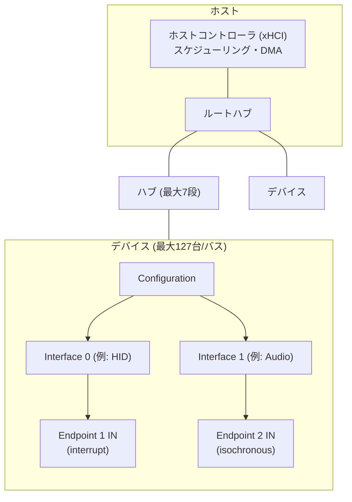

# USBアーキテクチャ: 有線接続の背骨 (USB Architecture: The Wired Backbone)

## 概要 (Overview)

USB (Universal Serial Bus) は、周辺機器接続の事実上の唯一解になった有線インタフェースである。本ディレクトリの題材でいえば、コントローラー (HID) も端末オーディオ (USB Audio) もこの上に載り、`bluetooth-pairing-protocol.md` で見た無線チップすら HCI トランスポートとして USB で SoC に繋がっていることが多い。さらに USB-C 時代には、データに加えて**電力 (USB PD: 最大 240 W)** と**映像 (DisplayPort Alt Mode)** まで1本のコネクタに同居する。

本ドキュメントは、USB を「ホスト中心のポーリング型バス」という設計思想から解剖し、なぜ挿すだけで認識されるのか（列挙とディスクリプタ）、4つの転送タイプは何を保証するのか、USB-C と PD は何を交渉しているのかを説明する。`../hw-sw-interface/bus-interconnect.md`（PCIe 等のチップ間バス）の「筐体の外」版であり、`input-devices-hid.md`・`audio-subsystem.md` が暗黙に前提としていた基盤を説明する。

## 方法論 (Methodology)

- **物理・信号層**（速度世代、配線トポロジ）→ **プロトコル層**（エンドポイント、転送タイプ、スケジューリング）→ **デバイスモデル**（ディスクリプタ、クラス）→ **コネクタ・電力層**（USB-C, PD, Alt Mode）の4層に分けて下から積む。
- 「コントローラーを挿してから使えるまで」の列挙 (enumeration) を1本のシーケンスとして通す。
- 速度世代（USB 1.1/2.0/3.x/USB4）は「速くなった」ではなく**アーキテクチャが変わった点**（共有バス→ポイントツーポイント→トンネリング）に注目して整理する。
- ホストコントローラは現行標準の xHCI を基準にし、`../hw-sw-interface/mmio-dma-interrupts.md` のディスクリプタリングの実例として接続する。

## 発見事項 (Findings)

1. **USB はホスト中心 (host-centric) の非対称設計である。** デバイスはホストに聞かれるまで一切話せない。この非対称性がデバイス側を単純・安価にし（USB の普及の根本理由）、複雑さをホストコントローラと OS に集約した。割り込みも「デバイスからの通知」ではなく「ホストの周期ポーリング」で実現される。
2. **「ユニバーサル」を実現しているのはディスクリプタとデバイスクラスである。** デバイスが自分の構成を標準形式で自己申告し、OS はクラスドライバ (HID, Mass Storage, Audio, CDC…) を割り当てる。`input-devices-hid.md` の HID レポートディスクリプタは、この仕組みの1クラス分にすぎない。
3. **4つの転送タイプは QoS クラスである。** 「確実に届く」(バルク) と「時間どおり届く」(アイソクロナス) は両立せず、用途ごとに保証を選ぶ。USB オーディオが再送なしのアイソクロナスを使うのは、`audio-subsystem.md` の「締切のあるストリーム」の性質そのもの。
4. **USB 3.x で物理層は別物になった。** USB 2.0 までの「全員が聞く共有半二重バス」から、SuperSpeed は送受独立の差動ペアによる実質ポイントツーポイントリンクへ移行し、設計思想は PCIe に近づいた。USB4 はさらに「他プロトコル (DP/PCIe) を運ぶトンネル」になり、もはやバスではなく輸送網である。
5. **USB-C はコネクタとプロトコルの分離である。** 24ピンのコネクタは「ピンという資源」であり、何を流すか（USB/DP/電力の電圧・電流）は CC ラインの交渉 (PD) で動的に決まる。「同じ形の口なのに挙動が違う」問題はこの柔軟性の裏面。

## アーキテクチャ (Architecture)

### トポロジとデバイスモデル



- **階層スター型**: ルートハブからハブを介して最大127デバイス・7段まで。論理的にはすべてホストが直接管理する。
- **デバイスモデルの入れ子**: デバイス → コンフィギュレーション → **インタフェース**（機能の単位。1台で HID+Audio のような**複合デバイス (composite device)** はインタフェースが複数あるだけ）→ **エンドポイント**（転送の終点）。
- **エンドポイント**は方向 (IN=デバイス→ホスト / OUT) と転送タイプを持つ単方向パイプで、USB 通信の実体はすべて「ホストが特定エンドポイントと行うトランザクション」である。

### ホストコントローラ — xHCI はディスクリプタリングの実例

xHCI はコマンドリング・転送リング・イベントリングという**主記憶上のリング構造**で動く: OS が転送記述子 (TRB) をメモリに書き、ドアベルレジスタを1回叩き、コントローラが DMA で読んで実行し、完了をイベントリングに書き戻して割り込む。`../hw-sw-interface/mmio-dma-interrupts.md` で見た「制御情報を DMA に載せ、MMIO は細い通知路に限定する」定石の教科書的実装である。周期転送（後述）の帯域予約とスケジューリングもコントローラの仕事で、ホスト中心設計の複雑さはここに集約されている。

## 技術詳細 (Technical Details)

### 列挙 (Enumeration) — 「挿すだけで動く」の全手順

```text
1. 接続検出   : USB-A系はD+/D-のプルアップ抵抗で接続と速度を検出。
               USB-CはCCピンの終端抵抗(Rp/Rd)で接続・向き・上下流を検出。
2. リセット   : ホストがポートをリセット。デバイスはアドレス0で応答可能に。
3. アドレス付与: SET_ADDRESS で1-127の一意アドレスを割り当て。
4. ディスクリプタ取得: GET_DESCRIPTOR でデバイス/コンフィギュレーション/
               インタフェース/エンドポイント記述子を読む。
               → VID/PID、クラスコード、必要電流(bMaxPower)が判明。
5. 構成選択   : SET_CONFIGURATION。ここで申告電流の供給が確定。
6. ドライバ結合: OSがクラスコード(またはVID/PID)でドライバを選ぶ。
               HIDならさらにレポートディスクリプタを取得(input-devices-hid.md)。
```

全手順が**コントロール転送**（下表）で行われる。デバイスクラスという間接層のおかげで、OS は個々の製品を知らずに「HID である」「オーディオである」ことだけでドライバを結合できる。

### 転送タイプ — 4つの QoS クラス

| タイプ | 保証 | 再送 | 帯域予約 | 主な利用者 |
|---|---|---|---|---|
| **Control** | 確実性 | あり | 10%確保 | 列挙・設定（全デバイス必須） |
| **Interrupt** | 最大遅延（周期ポーリング） | あり | 周期分を予約 | HID、ハブ状態通知 |
| **Bulk** | 確実性のみ（帯域は残り物） | あり | なし | ストレージ、プリンタ |
| **Isochronous** | 帯域と周期 | **なし** | 周期分を予約 | オーディオ、カメラ |

- 時間は**フレーム**（Full-Speed: 1 ms / High-Speed: 125 µs のマイクロフレーム）に刻まれ、Interrupt/Isochronous の周期転送は各フレーム内に予約スロットを持つ（周期転送の合計は FS で帯域の90%、HS で80%まで。残りを Control/Bulk が使う）。`input-devices-hid.md` の「ポーリングレート = bInterval」はこのフレーム構造の直接の帰結。
- **Isochronous が再送しない**のは、音声・映像では「遅れた正しいデータ」より「時間どおりの欠けたデータ」が正しいから。さらに USB オーディオでは、ホストとデバイスのサンプルクロックが独立という `audio-subsystem.md` のクロック問題が再現し、デバイスが「今どれだけ消費したか」を返す**フィードバックエンドポイント**でホスト側の送出レートを微調整する（非同期モード）。

### 速度世代 — 共有バスからトンネルへ

| 世代 | 速度 | アーキテクチャ |
|---|---|---|
| USB 1.1 (LS/FS) | 1.5 / 12 Mbps | 共有・半二重。1組の差動ペア (D+/D-)、NRZI+ビットスタッフィング |
| USB 2.0 (HS) | 480 Mbps | 同上（同じ2線を高速化）。ハブが速度変換 (Transaction Translator) |
| USB 3.x (SS) | 5/10/20 Gbps | **送受独立の差動ペアを追加**（全二重・実質P2P）。8b/10b→128b/132b符号化。2.0と並走する二重バス |
| USB4 | 20/40 Gbps (v2: 80) | **トンネリング**: USB3/DisplayPort/PCIe のトラフィックを1つのリンク上に多重化。Thunderbolt 3 の技術を継承 |

見どころは連続性より断絶にある。USB 2.0→3.0 で「全デバイスが同じ線を聞く放送型」が終わり、リンクは PCIe 的なポイントツーポイントになった（`../hw-sw-interface/bus-interconnect.md` の並列バス→シリアルリンクの流れと同じ力学）。USB4 に至っては USB は「積み荷の一つ」であり、規格名と中身が乖離している。

### USB-C と Power Delivery — ピン資源の交渉

USB-C は上下対称24ピンのコネクタで、以下が同居する。

- **USB 2.0 ペア (D+/D-)** と **SuperSpeed ペア ×4**
- **CC (Configuration Channel) ×2** — 接続検出・ケーブルの向き・役割 (ソース/シンク) の決定、そして PD 通信路
- **VBUS/GND** — 電力。既定は 5 V だが PD で引き上げ
- **SBU ×2** — Alt Mode 用の補助線

**USB PD (Power Delivery)** は CC 線上の低速通信 (BMC 符号化) で電源契約を交渉するプロトコルである。

```text
1. ソースが供給可能な電圧/電流の一覧 (PDO) を広告 (例: 5V3A, 9V3A, 20V5A)
2. シンクが必要なものを要求 (RDO)
3. 合意 → VBUS を契約電圧へ遷移 (Explicit Contract)
```

- PD 3.1 の **EPR (Extended Power Range)** で 28/36/48 V・最大 **240 W** まで拡張された（ノートPC・電動工具級）。5 V 500 mA (USB 2.0 の既定) から2桁の拡張である。48 V を流してよいかはケーブル自身の申告（**eMarker** チップ入りケーブルの電子的な定格申告）にも依存する。
- **ロールの分離**: 電力の向き (Source/Sink) とデータの向き (Host/Device) は独立に交渉・交換できる (Power/Data Role Swap)。「スマホがモニタに給電されながらホストとして振る舞う」はこの分離の産物。
- **Alt Mode**: PD の Vendor Defined Message で合意し、SuperSpeed ペアの一部または全部を他プロトコルに明け渡す。**DisplayPort Alt Mode** が代表（2レーン明け渡しなら USB3 と同居、4レーンなら映像専有）。USB4 では発想が逆転し、ピンを明け渡す代わりに DP/PCIe を**トンネル**として多重化する。

## セキュリティ考察 (Security Considerations)

- **BadUSB — 申告は詐称できる。** 列挙の全情報はデバイスの自己申告であり、ファームウェアを書き換えた USB メモリが「キーボード」を追加申告すれば、挿した直後から入力を注入できる (Nohl & Lell, Black Hat 2014)。複合デバイスが正当に多用される以上「ストレージなのに HID を名乗る」を機械的に弾くのは難しく、対策は新規 HID の承認 UI・USB デバイス許可リスト・ポート物理管理に寄る（`input-devices-hid.md` の HID 注入の根はここ）。
- **DMA 攻撃 — USB4/Thunderbolt は PCIe を外に出した。** PCIe トンネルは外部デバイスにバスマスタ DMA を与えうる。Thunderclap (Markettos et al., NDSS 2019) は IOMMU があっても窓の張り方次第で攻撃可能なことを示した。対策は IOMMU の常時有効化と接続時認可（OS の Kernel DMA Protection 等）。`../hw-sw-interface/mmio-dma-interrupts.md` の IOMMU の議論が「コネクタの外」に拡張された形。
- **列挙パーサは無線スタック同様の攻撃面。** ディスクリプタは信頼できない入力であり、細工したデバイスでホスト側パーサの脆弱性を突くツール (Facedancer 等) は確立している。`bluetooth-pairing-protocol.md` の BlueBorne と同型の「常時リッスンする巨大パーサ」問題の有線版。
- **電力もプロトコルである以上、攻撃面になる。** 公共充電ポートでのデータ線接続 (juice jacking) への古典的対策がデータ線を切った充電専用アダプタなら、PD 時代にはPDコントローラのファームウェア脆弱性や不正な高電圧契約という新しい面が加わる。USB-IF は PD の**暗号認証仕様 (USB Authentication)** を用意しているが、普及は限定的（as of 2026）。
- **信頼モデルの要約**: USB は「挿す = 相当程度信頼する」設計であり、ペアリングのような相互認証を歴史的に持たない。物理アクセスの管理こそが第一の防御線である。

## 結論 (Conclusions)

- USB の設計思想は「複雑さをホストに集約し、デバイスを安価にする」ホスト中心の非対称性であり、列挙・ポーリング・スケジューリングのすべてがその帰結である。
- 相互運用性はディスクリプタ＋デバイスクラスの自己記述で実現され、HID (`input-devices-hid.md`) も USB Audio (`audio-subsystem.md`) もその1クラスにすぎない。
- 転送タイプは QoS の選択であり、「確実に」(Bulk) と「時間どおり」(Isochronous) のトレードオフはオーディオの締切問題と同根。
- USB 3.x/USB4 で物理層は共有バスから PCIe 的リンク、さらにプロトコルトンネルへと変貌し、USB-C/PD はコネクタを「交渉で割り当てるピンと電力の資源」に変えた。
- セキュリティの根本は「自己申告を信じる」「挿したら信頼する」というモデルにあり、BadUSB・DMA 攻撃・パーサ攻撃はすべてこの信頼の隙を突く。これで本ディレクトリは、有線の背骨 (USB)・無線の背骨 (Bluetooth)・その上のデバイス (入力・音声) という構造で閉じる。

### 次の接続先 (Related Topics)

- `input-devices-hid.md` — インタラプト転送と bInterval の利用者としての HID。
- `audio-subsystem.md` — アイソクロナス転送とクロックフィードバックの利用者としての USB オーディオ。
- `bluetooth-pairing-protocol.md` — HCI トランスポートとしての USB、および「ペアリングを持つ無線」との信頼モデル対比。
- `../hw-sw-interface/bus-interconnect.md` — PCIe との設計比較、USB4 がトンネルする対象。
- `../hw-sw-interface/mmio-dma-interrupts.md` — xHCI のリング構造と IOMMU の基礎。

## 参考文献 (References)

**一次資料 (Primary — 仕様・公式ドキュメント・査読付き論文)**

- USB Implementers Forum. *USB 2.0 Specification*. — [usb.org/document-library/usb-20-specification](https://www.usb.org/document-library/usb-20-specification) — Accessed: 2026-07-05。転送タイプ・フレーム・列挙・帯域予約の規範。
- USB Implementers Forum. *USB4 Specification* / *USB 3.2 Specification*. — [usb.org/documents](https://www.usb.org/documents) — Accessed: 2026-07-05。SuperSpeed リンクとトンネリングアーキテクチャの規範。
- USB Implementers Forum. *USB Power Delivery Specification* (Rev 3.1) / *USB Type-C Cable and Connector Specification*. — [usb.org/document-library/usb-power-delivery](https://www.usb.org/document-library/usb-power-delivery) — Accessed: 2026-07-05。PDO/RDO 交渉・EPR (240 W)・CC/eMarker・Alt Mode の規範。
- Intel. *eXtensible Host Controller Interface (xHCI) Specification*, Rev 1.2. — [intel.com xHCI](https://www.intel.com/content/www/us/en/products/docs/io/universal-serial-bus/extensible-host-controler-interface-usb-xhci.html) — Accessed: 2026-07-05。コマンド/転送/イベントリングと TRB の規範。
- Markettos, A. T., Rothwell, C., Gutstein, B. F., Pearce, A., Neumann, P. G., Moore, S. W., & Watson, R. N. M. (2019). Thunderclap: Exploring Vulnerabilities in Operating System IOMMU Protection via DMA from Untrustworthy Peripherals. *NDSS 2019*. DOI: 10.14722/ndss.2019.23194。査読付き論文（周辺機器 DMA 攻撃と IOMMU の限界）。

**二次資料 (Secondary)**

- Nohl, K., & Lell, J. (2014). *BadUSB — On Accessories that Turn Evil*. Black Hat USA 2014. — [srlabs.de/badusb](https://srlabs.de/badusb/) — Accessed: 2026-07-05。ファームウェア書換によるクラス詐称の実証（研究発表）。
- Linux Kernel Documentation. *USB subsystem / gadget API*. — [kernel.org USB docs](https://www.kernel.org/doc/html/latest/driver-api/usb/index.html) — Accessed: 2026-07-05。列挙・クラスドライバ結合のホスト側実装資料。
