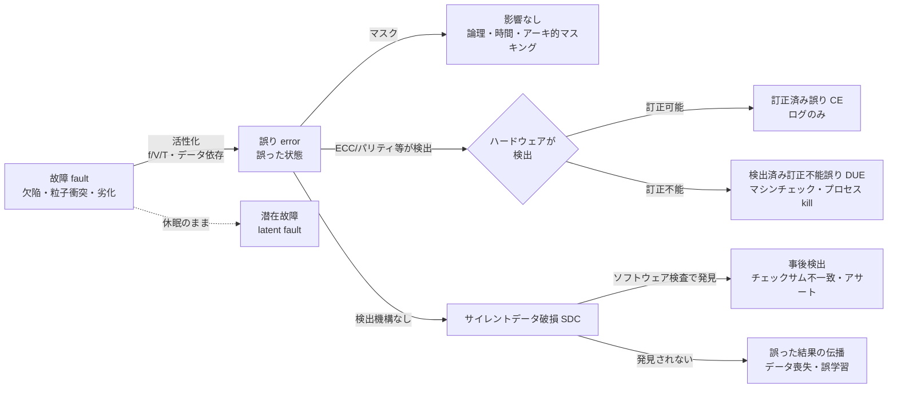
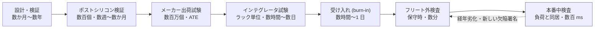
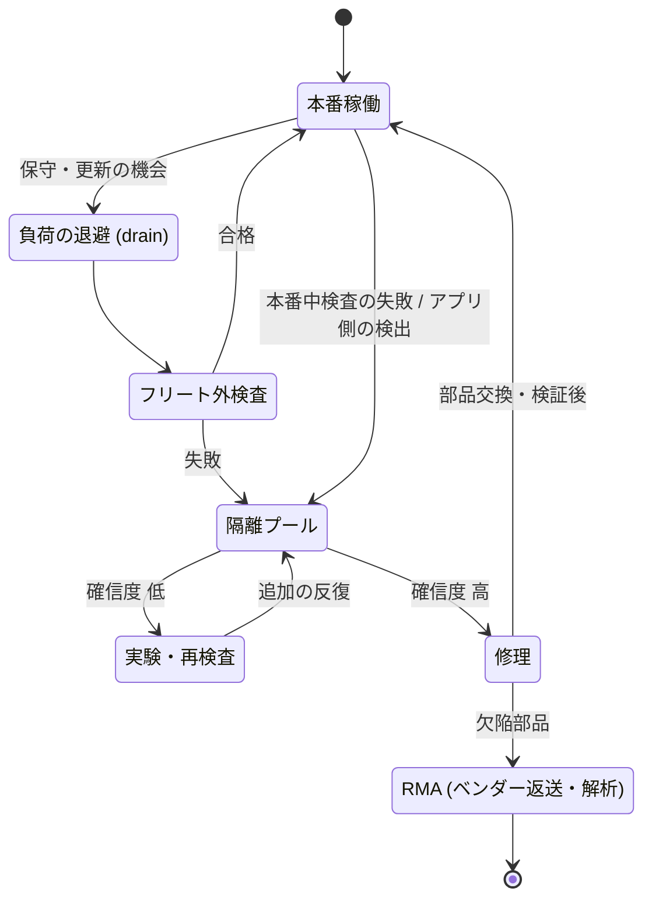

# フリート規模のハードウェア信頼性 (Fleet-Scale Hardware Reliability): サイレントデータ破損を中心に

## 概要 (Overview)

ソフトウェアは、ハードウェアが「正しく計算するか、さもなくば止まる」ことを暗黙に前提している。この前提をフェイルストップ (fail-stop) と呼ぶ。数台の計算機ではこの前提でほぼ困らない。しかし数十万台のサーバや数万基の GPU を抱えるフリート (fleet) では、確率の低い事象が毎日のように起きる。とくに厄介なのが、誤った結果を返しながら何の警告も出さない **サイレントデータ破損 (silent data corruption, SDC)** である。

Daedalus では信頼性に関わる記述が多くの文書に分かれている。DRAM の ECC と Rowhammer は [`../cpu/dram-memory-controllers.md`](../cpu/dram-memory-controllers.md)、NAND の誤り訂正は [`../storage/nand-flash-ftl.md`](../storage/nand-flash-ftl.md)、学習クラスタの中断統計は [`../accelerators/interconnects-scaleout-training.md`](../accelerators/interconnects-scaleout-training.md) と [`../../software/ai/ml-training-systems.md`](../../software/ai/ml-training-systems.md)、故障率の数学は [`../../foundations/mathematics/probability-statistics/reliability-theory.md`](../../foundations/mathematics/probability-statistics/reliability-theory.md) が扱う。本書はそれらを「フリート規模で、ハードウェアの誤りがどの経路でソフトウェアに届き、どこで捕まえられるか」という観点で整理し、特に CPU・アクセラレータの SDC を掘り下げる。

扱う範囲は次の 5 つである。(1) 故障・誤り・障害の用語体系と、検出・訂正・サイレントの区別。(2) 誤りを生む物理機構 (ソフトエラー、摩耗、製造時に検査をすり抜けるマージナル欠陥)。(3) メモリ・CPU・GPU のフィールド実測。(4) 検出と緩和 (フリート検査、冗長化、アルゴリズムベース耐故障、エンドツーエンド検査、隔離と RMA)。(5) 誤り注入が攻撃になる側面。分析深度は Level 3 である。

## 方法論 (Methodology)

- 用語は Avizienis らの依存性分類 (dependability taxonomy) に従い、故障 (fault)・誤り (error)・障害 (failure) を区別する[^avizienis]。フィールド研究ごとに「何を数えたか」(誤りの件数か、故障した部品の数か、ジョブ中断の回数か) が異なるため、数値は必ず定義と対で示す。
- フィールドの数値は運用者自身の一次報告 (Google・Meta・Alibaba Cloud・AMD と米国立研究所・NCSA) を優先し、同じ量を少なくとも 2 つの独立した報告で照合する。報告どうしが食い違う場合は単一の値に丸めず、母集団・期間・定義を添えて範囲で示す。
- 物理機構は JEDEC 規格 (ソフトエラー試験の JESD89B、故障機構の JEP122H) と査読論文を一次資料とする。規格本文は有償または登録制のため、機構の説明は査読論文で裏づける。
- 業界団体の取り組みなど変化の速い情報は 2026-10 時点で確認し (Accessed: 2026-10-12)、「as of 2026-10」と明示する。
- 攻撃の扱いは機構と防御に限り、悪用手順には立ち入らない ([`../security/`](../security/) の分担に従う)。

## 発見事項 (Findings)

1. 「CPU は正しく計算するか止まるか」という前提は、フリート規模では成り立たない。Google は数千台あたり数個の割合で、特定の命令を黙って誤計算するコアを観測し、これを mercurial core と名づけた[^hochschild]。Meta は約 1,000 個に 1 個[^dixit2022]、Alibaba Cloud は 100 万個超の CPU を 32 か月検査して 1 万個あたり 3.61 個[^wang-sosp]と報告している。母集団と検査方法が違うため値は 0.03〜0.1% 程度の幅を持つが、3 社の報告は桁で一致する。
2. SDC の主因は宇宙線ではなく、製造試験をすり抜けた欠陥である。Google・Meta・Alibaba はいずれも、誤りが特定のコア・特定の命令・特定のデータパターンに偏り、繰り返し再現しうることを示した[^hochschild][^dixit2022][^wang-sosp]。ランダムなビット反転を前提とした従来の故障モデルでは、この偏りを説明できない。
3. SDC の発現率は動作条件に強く依存する。周波数・電圧・温度 (f, V, T) で発生率が桁単位で変わり[^hochschild]、Alibaba の測定では 27 個の欠陥 CPU のうち 6 個で発生頻度の対数が温度に対して線形 (つまり温度に対して指数的) に増えた[^wang-sosp]。経年劣化で出荷後数年たってから発症する例もある[^hochschild][^dixit2022]。出荷前検査が一度きりでは足りず、稼働中も繰り返し検査する必要がある。
4. メモリ誤りの主役は宇宙線によるソフトエラーではなく、ハードエラー (恒久故障) である。Google の 2.5 年分の DRAM 実測は、誤りの大半がハードエラーで、DIMM の 8% 超が年に一度以上誤りを出すことを示した[^schroeder]。トロント大学の追跡研究[^hwang]と AMD・米国立研究所の HPC 実測[^sridharan12]も同じ結論である。Facebook (現 Meta) の 14 か月の全フリート解析では、DRAM チップではなくメモリコントローラやチャネルが誤りの過半を占めた[^meza]。
5. 万 GPU 規模の学習では、ハードウェア故障が数時間おきに起き、SDC は 1〜2 週間に 1 回の頻度で起きる。Llama 3 の 54 日間の 419 回の予期しない中断のうち 78% がハードウェア起因で、6 回が SDC だった[^llama3]。Gemini の報告も「1〜2 週間に 1 回」の SDC を見込んでいる[^gemini]。Meta の研究クラスタ解析は 1,024 GPU ジョブの平均故障時間 (MTTF) を 7.9 時間と実測し、16,384 GPU では 1.8 時間と予測した[^kokolis]。
6. 検出は、一度だけ長時間行う検査から、稼働中に常時少しずつ行う検査へ移っている。Meta の比較では、保守時に行うフリート外検査 (Fleetscanner) が全体の 93% を捕捉するがフリート一巡に約 6 か月かかる。一方、本番負荷と同居する数百ミリ秒単位の検査 (Ripple) は、捕捉率 70% に 15 日で達した[^dixit2022]。両者はそれぞれ他方では捕まらない欠陥を捕まえるため、相互に置き換えられない。
7. 誤りを検出する最終手段は、アプリケーション側での検証である。ストレージやネットワークはチェックサムで誤りを検出できるが、計算の正しさを安く確かめる一般的な方法はない[^hochschild]。行列演算に対する ABFT (algorithm-based fault tolerance)[^huang-abraham]、署名後の検証、複製計算の突き合わせのように、対象の数学的構造を利用した検査が実用的な選択肢になる。
8. 誤り注入は攻撃にもなる。RSA-CRT 署名で 1 回の計算誤りが起きると秘密鍵が漏れる[^bdl]。実際に、インターネット上で観測した誤り署名から鍵を復元した例が TLS[^weimer] と SSH[^ryan] で報告されている。ハードウェア誤りの頻度が上がれば、完全性の問題がそのまま機密性の問題になる。

## アーキテクチャ (Architecture)

### 故障から障害までの連鎖と、誤りの結末の分類

Avizienis らの定義では、故障 (fault) は誤りの原因 (欠陥トランジスタ、反転したセル)、誤り (error) はシステム状態のうち正しくない部分、障害 (failure) はサービスが仕様から外れた事象を指す[^avizienis]。故障は活性化されて誤りになり、誤りは伝播して障害になる。障害は上位の部品から見れば新たな故障になる。ハードウェア信頼性の設計とは、この連鎖のどこに検出・訂正を置くかを決めることである。

凡例は次のとおりである。CE (corrected error) は訂正済み、DUE (detected unrecoverable error) は検出されたが訂正できない誤り、SDC は検出されない誤りを指す。可用性の観点では DUE が最も目立つ (ジョブが止まる) が、損害の観点では SDC が最も重い。止まらないぶん誤った結果が下流へ広がり、原因究明に数か月かかることもあるからである[^dixit2021]。Google は症状を「すぐ検出される誤答」「マシンチェック」「手遅れになってから検出される誤答」「検出されない誤答」の 4 段階に分け、この順に危険度が高いとした[^hochschild]。

設計上の基本方針は、SDC を DUE に、DUE を CE に変換することである。ECC・パリティ・チェックサム・複製比較は、いずれも検出されない誤りを検出される誤りに変える仕組みである。これは、[`../../software/distributed-systems/failure-models.md`](../../software/distributed-systems/failure-models.md) が述べる「任意の破損 (Byzantine) を検出可能な crash に変換する」方針のハードウェア版にあたる。

### シリコンのライフサイクルと検査のファネル

欠陥の検出は、設計検証から本番稼働まで何段階にも分かれて行われる。Meta はこれを検査のファネル (silicon testing funnel) として整理した[^dixit2022]。後段ほど台数と構成の組み合わせが増え、SDC が見つかったときの影響も大きくなる。一方で、1 台あたりに使える検査時間は短くなり、根本原因を特定する能力も下がる。

凡例として、青枠は運用者がフリート規模で行う検査を示す。従来は受け入れ時の burn-in で検査を終え、以後は ECC などの RAS (reliability, availability, serviceability) 機能が出す信号に任せていた。SDC はその信号を出さないため、運用者自身が稼働中に検査を続ける段 (F・G) が加わった[^dixit2022]。Alibaba Cloud の実測では、欠陥 CPU の 90.36% が本番投入前の検査で見つかり、残りは定期検査で見つかった[^wang-sosp]。

## 技術詳細 (Technical Details)

### 1. 指標の読み方 — FIT・MTBF・AFR と「何を数えたか」

FIT (failures in time、10⁹ デバイス時間あたりの故障数)、MTBF (平均故障間隔)、AFR (annualized failure rate、年間故障率) の定義とバスタブ曲線、アレニウス則による加速試験は [`reliability-theory.md`](../../foundations/mathematics/probability-statistics/reliability-theory.md) §1・§4 にまとめてある。本節ではフィールド報告を読むときの注意点に絞る。

- 直列系の算術がフリート規模の性質を決める。部品の故障率が一定なら、系全体の故障率は部品数に比例する。単体では AFR 1% の部品でも、10 万個集まれば毎日 3 個近く故障する。同期計算 (学習ジョブ) では 1 個の故障が全体を止めるため、ジョブの MTTF は GPU 数に反比例して縮む[^kokolis]。
- 誤りの件数と故障の数を区別する。恒久故障を持つ 1 個の DIMM は数千件の誤りを出しうる。Sridharan らは、誤りの件数を数える慣行が信頼性について誤った結論を導きうることを示した[^sridharan15]。Meza らの解析でも、マシンあたり誤り件数はべき分布 (パレート分布) に従い、平均値は中央値の約 55 倍だった[^meza]。平均値だけを報告すると、少数の故障部品が全体を代表しているように見えてしまう。
- 分母の単位を揃える。Google は「マシン」、Meta は「シリコンデバイス」、Alibaba は「CPU (プロセッサ)」を分母にしている[^hochschild][^dixit2022][^wang-sosp]。学習クラスタの報告は「ジョブ中断」を数える[^llama3]。1 台のサーバには 2 ソケットの CPU と 8 基の GPU が載るため、単位が違えば同じ現象でも数倍の差が出る。
- 時間依存を見落とさない。SDC の欠陥はバスタブ曲線の初期故障期に収まらず、出荷後に劣化して発症するものがある。Meta は同じ計算を 6 か月間毎日繰り返し、6 か月後に初めて誤りを出したデバイスを報告している[^dixit2022]。

### 2. 誤りを生む物理機構

#### ソフトエラー (soft error)

荷電粒子がトランジスタの拡散層を通過すると電荷が生じ、記憶ノードの値が反転する。デバイスは壊れないため、書き直せば正しい値に戻る。Baumann は地上での主要な発生源を 3 つ挙げた[^baumann]。

| 発生源 | 機構 | 対策の要点 |
|---|---|---|
| α 線 (alpha particle) | パッケージ・はんだ中のウラン・トリウム等の不純物の崩壊 | 低 α 材料、チップ表面の遮蔽 |
| 高エネルギー中性子 | 宇宙線が大気と衝突して生じる 2 次粒子が Si 原子核と反応 | 遮蔽はほぼ不可能。ECC・冗長化で受け止める |
| 熱中性子 + ¹⁰B | BPSG 絶縁膜中のホウ素 10 が熱中性子を吸収し α 線と Li 核を放出 | BPSG の廃止 (180 nm 世代) で大幅に低減[^psu] |

- 中性子束は高度と地磁気緯度に依存する。JESD89B は地上でのソフトエラー率の試験と報告の手順を定め、加速試験の結果を基準地点 (ニューヨーク市の海抜 0 m) での率に換算する[^jesd89]。標高の高い都市のデータセンターや航空機搭載機器では、同じ部品でもソフトエラー率が大きくなる。
- 微細化の影響は部品によって異なる。DRAM はセル容量を一定に保つ設計が続いたためビットあたりのソフトエラー率が下がった。一方、SRAM とラッチ・フリップフロップはビット数の増加と電源電圧の低下で、システム全体の率が下がりにくい[^baumann]。
- 1 個の粒子が隣接する複数ビットを反転させるマルチビットアップセット (multi-bit upset, MBU) が微細化で増えた。SRAM ではビットインタリーブ (論理的に同じ語のビットを物理的に離す配置) を用いて、MBU を語ごとの 1 ビット誤りに分散させ SEC-DED で訂正できるようにする[^baumann]。

#### 摩耗故障 (wear-out) とガードバンド

トランジスタと配線は使用とともに劣化する。主な機構は、エレクトロマイグレーション (electromigration、電流による配線金属原子の移動とボイド形成)、TDDB (time-dependent dielectric breakdown、ゲート絶縁膜の経時破壊)、NBTI (negative bias temperature instability) と HCI (hot carrier injection) によるしきい値電圧のずれである。JEP122H は各機構の活性化エネルギーと加速モデルを整理している[^jep122]。

NBTI や HCI でしきい値電圧が上がるとトランジスタが遅くなり、クリティカルパスのタイミング余裕が減る。設計者は寿命末期の劣化分まで見込んで電圧・周波数にガードバンド (guardband) を積む。しかし DVFS ([`../hw-sw-interface/clock-power-reset.md`](../hw-sw-interface/clock-power-reset.md)) で電圧を限界近くまで下げる最適化は、このガードバンドを削る方向に働く。製造時にぎりぎり合格したパスが劣化で余裕を失うと、特定の命令・データ・温度の組み合わせでだけタイミング違反が起き、誤った値がそのままラッチされる。これが経年発症する SDC の有力な説明の一つである[^hochschild][^dixit2022]。

#### 製造時のマージナル欠陥

[`../semiconductor-manufacturing/semiconductor-fabrication.md`](../semiconductor-manufacturing/semiconductor-fabrication.md) §3 の歩留まりモデルは「致命欠陥があれば不良品」という二値で考える。現実には、出荷試験に合格するが特定条件でだけ誤動作する欠陥 (marginal defect、test escape) が存在する。業界の報告では、SDC の主因はこうした製造時点から存在する欠陥 (time-zero defect) とされる[^ocp-wp]。Google は、微細化と構造の複雑化 (命令とシリコンの組み合わせの専用化) が製造試験の網羅性を相対的に下げていると指摘した[^hochschild]。Alibaba の測定では、新しいマイクロアーキテクチャほど欠陥率が下がるという傾向は見られなかった (9 世代で 1 万個あたり 0.082〜9.29 個)[^wang-sosp]。

### 3. メモリ誤りのフィールド実測

DRAM の ECC の仕組み (SEC-DED、chipkill、DDR5 の on-die ECC) は [`../cpu/dram-memory-controllers.md`](../cpu/dram-memory-controllers.md) §4 が扱う。本節はフィールドで何が観測されたかを整理する。

| 研究 | 母集団・期間 | 主な結論 |
|---|---|---|
| Schroeder et al. (Google, SIGMETRICS 2009)[^schroeder] | Google のサーバ群、2.5 年 | 誤り率は 25,000〜70,000 FIT/Mbit で従来推定より桁違いに高い。DIMM の 8% 超が年 1 回以上誤る。誤りはハードエラーが支配的 |
| Hwang et al. (ASPLOS 2012)[^hwang] | 複数の本番システム、約 300 TB・年 | 誤りの大部分はハードエラー。少数ページの退避 (page retirement) で多くの誤りを隠せる |
| Sridharan & Liberty (AMD, SC12)[^sridharan12] | HPC クラスタ (Jaguar)、11 か月 | 恒久故障が支配的で、大きな多ビット故障もある。chipkill は DRAM 起因のノード障害率を 36 倍超下げた |
| Sridharan et al. (ASPLOS 2015)[^sridharan15] | 米国立研究所の HPC 2 システム | DDR のコマンド・アドレスパリティが信頼性に大きく寄与。将来は SRAM より DRAM の故障が主要な懸念になる |
| Meza et al. (Facebook, DSN 2015)[^meza] | Facebook の全サーバ、14 か月 | 誤りはパレート分布。DRAM チップ以外 (コントローラ・チャネル) の故障が誤りの過半。4 Gb チップは 2 Gb の 1.8 倍の故障率。ワークロード種別で故障率が最大 6.5 倍変わる。ページ退避で誤り率 67% 減 |

ここから引き出せる運用上の結論は次のとおりである。

- 訂正可能誤り (CE) は予兆として使える。ハードエラーが支配的であるため、CE を出した DIMM は将来も誤りを出しやすい。Linux の EDAC・rasdaemon で CE を数え、閾値を超えた DIMM やページを退避する運用は、この統計に根拠を持つ。
- ECC の強さは故障モードに合わせて選ぶ。SEC-DED は 1 ビット誤りしか訂正できないが、フィールドではチップ全体や行・列単位の故障が起きる[^sridharan12]。chipkill (SDDC、single device data correction) はチップ 1 個分の誤りを訂正するため、こうした故障を CE にとどめられる。
- DDR5 の on-die ECC はチップ内部の 128 ビットのデータに 8 ビットのチェックビットを付けた単一ビット訂正 (SEC) であり、セル微細化で増えたチップ内の誤りを吸収するための仕組みである[^jesd79-5]。チップ外 (バス・他チップ) の誤りは守らないため、サーバでは依然として側帯 ECC が要る。DDR5 は内部で誤りを検査・書き戻す ECS (error check and scrub) も規定している[^jesd79-5]。
- パトロールスクラブ (patrol scrubbing) で潜在誤りを訂正する。メモリコントローラがアイドル時に全メモリを読み、1 ビット誤りを訂正して書き戻す。読まれないまま 1 ビット誤りが蓄積して 2 ビット誤り (訂正不能) になる前に訂正するための機構である。Meza らの対象システムの一部でも有効化されていた[^meza]。
- HBM でも同じ問題が規模を変えて現れる。Llama 3 では GPU の HBM3 起因の中断が全体の 17.2% を占めた[^llama3]。NCSA の Delta システム (A100・H100 計 1,056 基、2.5 年) の解析では、H100 のメモリ誤りの GPU あたり平均誤り間隔 (MTBE) が A100 より 3.2 倍短く、容量の増加に誤り回復機構が追いついていないと結論している[^delta]。

### 4. CPU のサイレントデータ破損 (mercurial cores)

#### 3 社の報告の照合

| 運用者・報告 | 母集団 | 定義・分母 | 率 |
|---|---|---|---|
| Google, HotOS 2021[^hochschild] | Google のサーバフリート | マシン | 数千台あたり数個 (正確な率は非公開) |
| Meta, 2021/2022[^dixit2021][^dixit2022] | 数十万台 (18 か月以上 / 約 3 年) | シリコンデバイス | 約 1,000 個に 1 個。欠陥 CPU は数百個 |
| Alibaba Cloud, SOSP 2023[^wang-sosp] | CPU 100 万個超、28 データセンター、32 か月 | プロセッサ | 1 万個あたり 3.61 個 (0.0361%)。世代別に 0.082〜9.29 個 |

3 社は検査ツール・期間・分母が異なるため、数値は 0.03〜0.1% の範囲で示すのが妥当である。Alibaba 自身も、自社の値は Google・Meta の報告と整合し、より精密な推定だと位置づけている[^wang-sosp]。どの報告も、特定ベンダーに限らない業界共通の問題であるとしている[^hochschild][^wang-sosp]。

#### 症状と事例

- Meta の事例では、Spark のデータ処理で `(1.1)^53` が 156.24 ではなく 0 と計算され、ファイルサイズが 0 と判定されて行が欠落した。特定のコアの特定の命令が原因と突き止めるまでに数か月を要した[^dixit2021][^dixit2022]。
- Google は、同じコアで暗号化と復号を行うと元に戻るが他のコアでは復号できない「自己逆変換の」AES 誤計算、ロック意味論の違反、ガベージコレクションによる生存データの消失、文字列の特定ビット位置での反復的な反転などを挙げている[^hochschild]。
- Alibaba の 27 個の欠陥 CPU の詳細解析では、欠陥の生じた機能はベクトル演算器、浮動小数点演算器、整数演算器、キャッシュコヒーレンス、トランザクショナルメモリに集中した。約半数は 1 コアだけに欠陥があり、残りは全コアに影響した[^wang-sosp]。コヒーレンスやトランザクショナルメモリの欠陥は単一スレッドの検査では見つからず、多スレッドの検査が要る。
- 浮動小数点の SDC は仮数部 (fraction) のビット反転として現れやすく、結果の精度がわずかに落ちるだけのことが多い[^wang-sosp]。精度の劣化で異常を判定する検査では見逃しやすい。

#### なぜ再現しにくいか

Meta は SDC の発現を左右する要因を 4 つに整理した[^dixit2022]。データ依存 (3×5 は正しいが 3×4 だけ誤るといった特定のビットパターン)、電気的変動 (f・V・電流)、環境変動 (データセンター内のホットスポットや季節変動による温度)、ライフサイクル変動 (経年劣化) である。Alibaba は温度の効果を定量化し、ある欠陥 CPU では 59°C を超えたときだけ誤りが出ることを確かめた (アイドル時は約 45°C)[^wang-sosp]。隣のコアの負荷で冷却器が温まると誤りが増える、直前に実行した検査の余熱で次の検査が失敗する、といった一見不可解な現象も温度で説明できた。

この性質は運用に 2 つの帰結をもたらす。一つは、検査は条件 (f, V, T) を振って行う必要があり、1 回の合格は将来の正しさを保証しないことである。もう一つは、温度を下げる・周波数を抑えるといった運転条件の調整自体が緩和策になりうることである。Alibaba の Farron は、再現性の高い SDC は優先度づけした検査で捕まえ、再現性の低い SDC は CPU 温度の制御で抑える[^wang-sosp]。

### 5. アクセラレータと大規模学習の故障

学習クラスタの可用性設計 (チェックポイント、goodput) は [`../../software/ai/ml-training-systems.md`](../../software/ai/ml-training-systems.md) §4、ファブリックの故障は [`../accelerators/interconnects-scaleout-training.md`](../accelerators/interconnects-scaleout-training.md) §4 が扱う。本節ではハードウェア部品の内訳と SDC に焦点を当てる。

Llama 3 405B の事前学習 (16,384 基の H100、54 日) で記録された予期しない中断 419 回の主な内訳を示す[^llama3]。

| 部品 | 回数 | 割合 (419 回に対する比) |
|---|---|---|
| GPU の故障 (faulty GPU) | 148 | 35.3% (論文の表は 30.1%) |
| GPU の HBM3 メモリ | 72 | 17.2% |
| ソフトウェアのバグ | 54 | 12.9% |
| ネットワークスイッチ・ケーブル | 35 | 8.4% |
| ホストの計画外保守 | 32 | 7.6% |
| GPU の SRAM | 19 | 4.5% |
| GPU システムプロセッサ (GSP) | 17 | 4.1% |
| サイレントデータ破損 | 6 | 1.4% |
| GPU の熱インタフェース・センサ | 6 | 1.4% |

割合の列は本稿で回数から再計算した。論文の表は「GPU の故障」を 30.1% と記載しているが、148/419 は 35.3% であり、他の行は回数と割合が整合している。そこで本稿は回数を正とした。

- 平均中断間隔の照合。419 回/54 日は約 3.1 時間に 1 回にあたる[^llama3]。Meta の研究クラスタ (A100 で 1.5 億 GPU 時間超、11 か月) から推定した故障率モデルは、16,384 GPU ジョブの MTTF を 1.8 時間と予測し、131,072 GPU では 0.23 時間まで縮むとした[^kokolis]。二つの値の差は、クラスタの成熟度・故障の定義・自動復旧の範囲の違いによるものであり、万 GPU 規模の MTTF は「1〜3 時間」の幅で見積もるのが妥当である。同じ研究は、故障率 (1,000 ノード日あたり 2.34〜6.50 件) の下で 1.2 万 GPU 規模の実効学習時間比 (ETTR) 0.9 を保つには、チェックポイントの書き込みを約 10 秒まで縮める必要があると試算している[^kokolis]。
- 学習時の SDC の頻度。Llama 3 では 54 日で 6 回 (約 9 日に 1 回)[^llama3]、Gemini の報告は「1〜2 週間に 1 回」を見込む[^gemini]。2 つの独立した報告が同じ桁を示している。
- 温度と電力の影響。Llama 3 は、日中の気温上昇が GPU の DVFS に影響し、時刻によってスループットが 1〜2% 変動したと報告した。数万基の GPU が同時に消費電力を変えるため、データセンター全体の電力が数十 MW 単位で揺れることも課題に挙げている[^llama3]。冷却側の設計は [`../../engineering/datacenters/datacenter-cooling.md`](../../engineering/datacenters/datacenter-cooling.md)、電力側は [`../../engineering/datacenters/datacenter-power.md`](../../engineering/datacenters/datacenter-power.md) が扱う。

学習における SDC の検出が難しい理由は、学習アルゴリズム自体が誤りを吸収する性質を持つことにある。NaN・Inf や損失スパイク (loss spike) として表に出れば検出できるが、Ma らの実験では、欠陥ノードの SDC が勾配を最大で真の勾配ノルムの 5.1% 乱しても損失曲線は健全ノードとほぼ同じで、パラメータだけが別の解へずれていった[^ma]。同じ実験で、bfloat16 の行列積に対するチェックサム型 ABFT は誤検出が多く、SDC を安定して検出できなかった[^ma]。He らは、DL アクセラレータの論理部の故障が収束失敗・精度低下・INF/NaN を引き起こすことを大規模な注入実験で示し、軽量な検出と復旧の手法を提案した[^he]。実運用では次の手段を組み合わせる。

- 損失・勾配ノルムの監視と NaN・Inf の検査 (安価だが、検出できるのは目立つ誤りに限られる)
- 決定的リプレイ (deterministic replay) による誤計算の特定と、待機機・アイドル機での SDC スキャナの常時実行 (Gemini)[^gemini]
- 影のデータ並列レプリカによる勾配の突き合わせ (計算コストは増えるが検出力は高い)[^ma]
- 故障ノードを速く特定して隔離するための絞り込み (reductive triage) と高頻度チェックポイント (OCP の推奨)[^ocp-wp]

### 6. 検出と緩和

#### フリート検査 — フリート外と本番中

Meta の 2 方式の比較を次に示す[^dixit2022]。

| 指標 | Fleetscanner (フリート外) | Ripple (本番中) |
|---|---|---|
| 実行の機会 | ファームウェア更新・カーネル更新・プロビジョニング・修理のために負荷を退避した時 | 本番負荷と同居し、常時実行 |
| 1 回の検査時間 | 分単位 | 数百ミリ秒以下 |
| 規模 | 生涯で約 6,800 万回、約 40 億秒 | 毎月約 25 億回、約 1 億秒 |
| 単独でしか捕まらない SDC | 23% | 7% |
| 捕捉率 70% までの期間 | 約 6 か月 | 約 15 日 |

ベンダー側もフリート内検査を支える機能を提供している。Intel の In-Field Scan (IFS) は、製造試験と同種のスキャンパターンをコア単位で実行するハードウェア機能で、Linux カーネルにドライバがある。検査中はそのコアの全スレッドが最大約 200 ミリ秒止まるため、遅延に敏感な負荷は事前に退避する[^ifs]。Alibaba はチップメーカー提供の 633 項目の検査スイートを主に使い、補助的に OpenDCDiag も用いた[^wang-sosp]。

#### 冗長化と比較

- DMR/TMR とロックステップ。2 系統で同じ計算をして比較すれば (dual modular redundancy, DMR) 誤りを検出でき、3 系統の多数決 (triple modular redundancy, TMR) なら訂正もできる。車載 MCU のロックステップコアは DMR を命令単位で行うもので、ISO 26262 の診断網羅率を稼ぐ標準的な手段である ([`../../engineering/automotive/functional-safety-iso26262.md`](../../engineering/automotive/functional-safety-iso26262.md))。航空の冗長飛行計算機は [`../../engineering/aerospace/avionics-gnc.md`](../../engineering/aerospace/avionics-gnc.md) が扱う。データセンターでは計算資源が 2〜3 倍必要になるため全面採用は現実的でなく、Google も検出だけで 2 倍、訂正には 3 倍の仕事が要ると見積もっている[^hochschild]。適用は、鍵生成や金融計算のように誤りの代償が大きい処理に限られる。
- ABFT。Huang と Abraham は、行列積 C = A·B で A に列和の行、B に行和の列を付加すると、積にもチェックサムの行・列が現れることを示した[^huang-abraham]。O(n²) の追加計算で O(n³) の計算を検査でき、1 個の誤り要素を特定・訂正できる。ただし浮動小数点の丸め誤差と区別するには閾値が要り、低精度形式では誤検出と見逃しが増える[^ma]。
- エンドツーエンド検査。署名・暗号の検証、チェックサムの再計算、結果の逆演算 (圧縮した結果を伸長して元と比べる等) は、アプリケーションが自分の出力を確かめる方法である。Alibaba の事例では、欠陥 CPU がチェックサム計算そのものを誤り、アプリケーションが「受信データが破損した」と誤判定して再送を繰り返していた[^wang-sosp]。検査そのものも同じ欠陥ハードウェアで実行されるため、検証は可能なら別のコア・別のマシンで行う。

#### 隔離と RMA の流れ

この図は Meta の運用フローを簡略化したものである[^dixit2022]。要点は、隔離 (quarantine) と根本原因の確定を分けていることにある。疑わしいマシンはまず本番から外し、確信度が低ければ条件を変えて再検査する。欠陥と確定した部品はベンダーに返送 (RMA) し、ベンダーはその欠陥署名を出荷試験に取り込む。Alibaba では、詳細解析した 27 個以外の欠陥 CPU はメーカーに返送され、報告した欠陥はすべてメーカーが確認した[^wang-sosp]。欠陥が 1 コアに限られる場合でも、大手運用者はプロセッサ全体またはマシン全体を外すのが通例である[^wang-sosp]。

### 7. ストレージ側 — 潜在セクタ誤りとビット腐敗

ストレージでは誤りがあることを前提に設計するのが通例である。NAND は LDPC で誤りを常時訂正している ([`../storage/nand-flash-ftl.md`](../storage/nand-flash-ftl.md))。NetApp の 153 万台・41 か月の解析では、チェックサム不一致が 40 万件超記録され、ニアライン級ディスクはエンタープライズ級より 1 桁多く不一致を出した[^bairavasundaram]。ZFS のエンドツーエンドチェックサムは広範なディスク故障に耐えるが、メモリ上の破損には弱く、壊れたデータをアプリケーションに返したりクラッシュしたりしうる[^zfs]。ディスク上のデータだけを守る検査は、本書が扱う CPU・DRAM の誤りまでは守らない。複製・消失訂正符号・スクラビングによるオブジェクトストレージ側の対策は [`../../software/object-storage/object-storage-architecture.md`](../../software/object-storage/object-storage-architecture.md) §3、符号理論は [`../../foundations/mathematics/number-theory-algebra/finite-fields-coding.md`](../../foundations/mathematics/number-theory-algebra/finite-fields-coding.md) が扱う。

### 8. 業界の取り組み (as of 2026-10)

- OCP (Open Compute Project) は 2024 年 1 月、Server Project のもとに Server Component Resilience Workstream を設け、ハードウェア起因の SDC を対象とした。参加企業は Meta・Google・Intel・Arm・AMD・Microsoft・NVIDIA である[^ocp-2024]。研究領域として、スクリーニングの効率化と検出の高速化、ソフトウェアスタックでの検出・訂正、シリコンの SDC 感受性評価、ハードウェアによる検出を挙げた。
- 同年 6 月には、学術研究の公募に寄せられた 19 件から 6 件を選んで資金提供した[^ocp-awards]。
- 2025 年 8 月、上記 7 社の執筆者による白書「Silent Data Corruption in AI」が公開された[^ocp-wp]。白書は、FIT や AVF (architectural vulnerability factor) のようなハードウェアの指標と、精度・損失のような AI の指標が対応しないことを中心課題とした。対策としては、NaN 伝播を抑える勾配クリッピング、発散検出、故障ノードの絞り込みと高頻度チェックポイント、影ノードによる検証、MLPerf に類する耐性ベンチマークの標準化を勧めている。
- 2026-10-12 時点で、この白書より新しい OCP の SDC 関連成果物 (仕様・ベンチマーク) は確認できなかった。

## セキュリティ考察 (Security Considerations)

- 誤り注入攻撃 (fault injection)。攻撃者が誤りを意図的に起こせば、信頼性の問題は安全性の問題になる。Rowhammer は DRAM の干渉誤りを権限昇格に使う ([`../security/side-channels-tee-secure-boot.md`](../security/side-channels-tee-secure-boot.md) §3、[`../cpu/dram-memory-controllers.md`](../cpu/dram-memory-controllers.md) §5)。Plundervolt はソフトウェアから CPU の電圧を下げて SGX エンクレーブ内の乗算や AES に誤りを起こし、鍵を取り出した[^plundervolt]。本書 §2 で述べたように、電圧のガードバンドは信頼性の余裕であると同時に、攻撃に対する余裕でもある。電圧・周波数の制御インタフェースを特権ソフトウェアに開放する設計は、その余裕を攻撃者に渡しうる。
- 暗号計算での SDC。Boneh・DeMillo・Lipton は、RSA-CRT 署名で一方の剰余計算に誤りが 1 回入ると、誤った署名と公開鍵だけから法 N を素因数分解できることを示した[^bdl]。これは攻撃者が誤りを起こす必要すらないことを意味する。Weimer は TLS のサーバ署名を大量に収集し、誤った RSA-CRT 署名を出す機器から秘密鍵を復元できることを実証した[^weimer]。Ryan らは、SSH でも受動的な観測者が誤り署名から RSA ホスト鍵を復元でき、実際に数百の鍵が危殆化していたことを示した[^ryan]。対策は署名後に検証してから送出することであり、主要な暗号ライブラリは既にこの対策を実装している[^weimer]。暗号実装の全体像は [`../../software/security/applied-cryptography.md`](../../software/security/applied-cryptography.md) を参照。Google が報告した、コアによって AES の結果が変わる事例[^hochschild]は、鍵や暗号文が失われる事故が攻撃者なしでも起こりうることを示している。
- 完全性と可用性のトレードオフ。疑わしいハードウェアを早く隔離するほど完全性は守られるが、容量 (可用性) は減る。逆に、閾値を緩めれば容量は保てるが、SDC が見逃される期間が長くなる。攻撃者が誤検知を誘発できる場合 (たとえば温度や負荷を操作して検査を失敗させる)、隔離機構そのものがサービス妨害の手段になりうる。隔離の判断には複数の独立した信号と、確信度に応じた段階的な処置 (図の「実験・再検査」) が要る。
- 検査基盤とテレメトリの信頼。フリート検査の結果・EDAC のログ・RMA 判定は、どのマシンを本番に戻すかを決める入力である。検査基盤が侵害されれば、欠陥マシンを本番に戻したり健全なマシンを大量に隔離したりできる。検査イメージ (IFS のスキャンイメージ等) は署名付きのものを使い、結果は改竄検知のできる経路で集める。
- サプライチェーン。マージナル欠陥は製造ロットやステッピングに偏るため、欠陥署名の情報はベンダーと運用者の間で共有されて初めて出荷試験に反映される[^dixit2022]。一方でその情報は、特定の製品の弱点の一覧にもなる。ハードウェアトロイなど意図的な改竄との区別を含め、来歴の管理は [`../security/`](../security/) のロードマップ (サプライチェーンとハードウェアトロイ) とつながる論点である。

## 結論 (Conclusions)

- フリート規模では、ハードウェアは「正しく動くか止まるか」の二値では扱えない。CPU の SDC は 0.03〜0.1% の部品に存在し (Google・Meta・Alibaba の照合)、万 GPU の学習では SDC が 1〜2 週間に 1 回起きる (Llama 3・Gemini の照合)。いずれも、検出機構を持たない部分に故障が入り込んだ結果である。
- 誤りの主役は、粒子による一時的なビット反転から、製造試験をすり抜けて経年で発症する恒久的・条件依存の欠陥へ移った。メモリではハードエラーの支配がすでに 2009 年以降の実測で確立しており、CPU でも同じ構図が 2021 年以降に明らかになった。
- 対策は、SDC を検出可能な誤りに変換する層を積み重ねることである。ハードウェアの ECC・chipkill・スクラブ、運用者のフリート外・本番中検査と隔離・RMA、アプリケーションの ABFT・検証・複製比較がその層にあたる。単一の層では網羅できないことが Meta の検査比較で定量的に示されている。
- 信頼性の余裕は安全性の余裕でもある。電圧ガードバンドの削減や誤り署名の流出は、攻撃者が誤りを起こしても、誤りを観測するだけでも悪用されうる。

### 次の接続先 (Related Topics)

- [`../../foundations/mathematics/probability-statistics/reliability-theory.md`](../../foundations/mathematics/probability-statistics/reliability-theory.md) — FIT・MTBF・バスタブ曲線・直列系の算術
- [`../cpu/dram-memory-controllers.md`](../cpu/dram-memory-controllers.md) — DRAM の ECC・Rowhammer・EDAC
- [`../accelerators/gpu-simt-architecture.md`](../accelerators/gpu-simt-architecture.md) — GPU と HBM の構造
- [`../accelerators/interconnects-scaleout-training.md`](../accelerators/interconnects-scaleout-training.md) — 学習クラスタのストラグラーと故障
- [`../../software/ai/ml-training-systems.md`](../../software/ai/ml-training-systems.md) — チェックポイントと goodput
- [`../../software/distributed-systems/failure-models.md`](../../software/distributed-systems/failure-models.md) — Byzantine 故障、gray failure、fail-slow
- [`../../software/observability/observability-performance-engineering.md`](../../software/observability/observability-performance-engineering.md) — ステップ時間分布の監視と測定方法論
- [`../../engineering/automotive/functional-safety-iso26262.md`](../../engineering/automotive/functional-safety-iso26262.md) — ロックステップと診断網羅率

## 参考文献 (References)

[^avizienis]: Avizienis, A., Laprie, J.-C., Randell, B., & Landwehr, C. (2004). Basic Concepts and Taxonomy of Dependable and Secure Computing. *IEEE Transactions on Dependable and Secure Computing*, 1(1), 11–33. DOI: 10.1109/TDSC.2004.2

[^hochschild]: Hochschild, P. H., Turner, P., Mogul, J. C., Govindaraju, R., Ranganathan, P., Culler, D. E., & Vahdat, A. (2021). Cores that don't count. *Proc. HotOS '21*, 9–16. DOI: 10.1145/3458336.3465297 — mercurial core の命名、数千台あたり数個、f/V/T 依存、AES の誤計算事例、経年発症。

[^dixit2021]: Dixit, H. D., Pendharkar, S., Beadon, M., Mason, C., Chakravarthy, T., Muthiah, B., & Sankar, S. (2021). Silent Data Corruptions at Scale. arXiv:2102.11245 — 18 か月以上・数十万台の検査で数百個の欠陥 CPU、Spark の事例。

[^dixit2022]: Dixit, H. D., Boyle, L., Vunnam, G., Pendharkar, S., Beadon, M., & Sankar, S. (2022). Detecting silent data corruptions in the wild. arXiv:2203.08989 — 約 1,000 個に 1 個、検査ファネル、Fleetscanner と Ripple の比較 (表 1)、発現要因の 4 分類。

[^wang-sosp]: Wang, S., Zhang, G., Wei, J., Wang, Y., Wu, J., & Luo, Q. (2023). Understanding Silent Data Corruptions in a Large Production CPU Population. *Proc. SOSP '23*, 216–230. DOI: 10.1145/3600006.3613149 — Alibaba Cloud の 100 万個超・32 か月、3.61‱、世代別の率、温度依存、Farron。

[^schroeder]: Schroeder, B., Pinheiro, E., & Weber, W.-D. (2009). DRAM Errors in the Wild: A Large-Scale Field Study. *Proc. SIGMETRICS '09*, 193–204. DOI: 10.1145/1555349.1555372

[^hwang]: Hwang, A. A., Stefanovici, I., & Schroeder, B. (2012). Cosmic Rays Don't Strike Twice: Understanding the Nature of DRAM Errors and the Implications for System Design. *Proc. ASPLOS '12*, 111–122. DOI: 10.1145/2150976.2150989

[^sridharan12]: Sridharan, V., & Liberty, D. (2012). A Study of DRAM Failures in the Field. *Proc. SC '12*. DOI: 10.1109/SC.2012.13 — 恒久故障の支配、chipkill によるノード障害率の 36 倍超の低減。

[^sridharan15]: Sridharan, V., DeBardeleben, N., Blanchard, S., Ferreira, K. B., Stearley, J., Shalf, J., & Gurumurthi, S. (2015). Memory Errors in Modern Systems: The Good, The Bad, and The Ugly. *Proc. ASPLOS '15*, 297–310. DOI: 10.1145/2694344.2694348

[^meza]: Meza, J., Wu, Q., Kumar, S., & Mutlu, O. (2015). Revisiting Memory Errors in Large-Scale Production Data Centers: Analysis and Modeling of New Trends from the Field. *Proc. DSN 2015*, 415–426. DOI: 10.1109/DSN.2015.57

[^llama3]: Grattafiori, A. et al. (2024). The Llama 3 Herd of Models. arXiv:2407.21783 — 表 5 (54 日間・419 回の予期しない中断の内訳)、日内 1〜2% のスループット変動、数十 MW の電力変動。

[^kokolis]: Kokolis, A., Kuchnik, M., Hoffman, J., Kumar, A., Malani, P., Ma, F., DeVito, Z., Sengupta, S., Saladi, K., & Wu, C.-J. (2025). Revisiting Reliability in Large-Scale Machine Learning Research Clusters. arXiv:2410.21680v2 — 1.5 億 A100 GPU 時間、1,024 GPU ジョブの MTTF 7.9 時間、16,384 GPU で 1.8 時間の予測、ETTR モデル。

[^gemini]: Gemini Team, Google (2023). Gemini: A Family of Highly Capable Multimodal Models. arXiv:2312.11805 — 学習基盤の節。SDC が 1〜2 週間に 1 回、決定的リプレイと SDC スキャナ、goodput 85%→97%。

[^delta]: Cui, S., Patke, A., Nguyen, H., Ranjan, A., Chen, Z., Cao, P., Bauer, G., Bode, B., Di Martino, C., Jha, S., Narayanaswami, C., Sow, D., Kalbarczyk, Z. T., & Iyer, R. K. (2025). Story of Two GPUs: Characterizing the Resilience of Hopper H100 and Ampere A100 GPUs. arXiv:2503.11901v4. DOI: 10.1145/3712285.3759821 — NCSA Delta、1,056 基・2.5 年・1,170 万 GPU 時間。

[^ma]: Ma, J., Pei, H., Lausen, L., & Karypis, G. (2025). Understanding Silent Data Corruption in LLM Training. arXiv:2502.12340 — 欠陥ノード 15 台の実測、損失に現れない SDC、ABFT の限界。

[^he]: He, Y., Hutton, M., Chan, S., De Gruijl, R., Govindaraju, R., Patil, N., & Li, Y. (2023). Understanding and Mitigating Hardware Failures in Deep Learning Training Systems. *Proc. ISCA '23*. DOI: 10.1145/3579371.3589105

[^baumann]: Baumann, R. C. (2005). Radiation-Induced Soft Errors in Advanced Semiconductor Technologies. *IEEE Transactions on Device and Materials Reliability*, 5(3), 305–316. DOI: 10.1109/TDMR.2005.853449

[^psu]: [Penn State Breazeale Nuclear Reactor — Testing Neutron-Induced Soft Errors in Semiconductor Memories](https://www.engr.psu.edu/nbg/NeutronInducedSEA.htm) — Accessed: 2026-10-12. — 180 nm 世代での BPSG と ¹⁰B の廃止。

[^jesd89]: JEDEC. (2021). *JESD89B: Measurement and Reporting of Alpha Particle and Terrestrial Cosmic Ray-Induced Soft Errors in Semiconductor Devices*. [jedec.org](https://www.jedec.org/taxonomy/term/2344) — Accessed: 2026-10-12.

[^jep122]: JEDEC. (2016). *JEP122H: Failure Mechanisms and Models for Semiconductor Devices*. [jedec.org](https://www.jedec.org/node/8597) — Accessed: 2026-10-12.

[^jesd79-5]: JEDEC. *JESD79-5: DDR5 SDRAM Standard*. [jedec.org](https://www.jedec.org/standards-documents/docs/jesd79-5c) — Accessed: 2026-10-12. — on-die ECC (128+8 ビットの SEC) と ECS。

[^huang-abraham]: Huang, K.-H., & Abraham, J. A. (1984). Algorithm-Based Fault Tolerance for Matrix Operations. *IEEE Transactions on Computers*, C-33(6), 518–528. DOI: 10.1109/TC.1984.1676475

[^ifs]: [The Linux Kernel documentation — In-Field Scan](https://docs.kernel.org/arch/x86/ifs.html) — Accessed: 2026-10-12.

[^bairavasundaram]: Bairavasundaram, L. N., Goodson, G. R., Schroeder, B., Arpaci-Dusseau, A. C., & Arpaci-Dusseau, R. H. (2008). An Analysis of Data Corruption in the Storage Stack. *Proc. USENIX FAST '08*. [USENIX](https://www.usenix.org/conference/fast-08/analysis-data-corruption-storage-stack) — Accessed: 2026-10-12.

[^zfs]: Zhang, Y., Rajimwale, A., Arpaci-Dusseau, A. C., & Arpaci-Dusseau, R. H. (2010). End-to-end Data Integrity for File Systems: A ZFS Case Study. *Proc. USENIX FAST '10*. [USENIX](https://www.usenix.org/conference/fast-10/end-end-data-integrity-file-systems-zfs-case-study) — Accessed: 2026-10-12.

[^ocp-2024]: [Open Compute Project — Computing's Hidden Menace: The OCP Takes Action Against Silent Data Corruption (SDC)](https://www.opencompute.org/news/computings-hidden-menace-the-ocp-takes-action-against-silent-data-corruption-sdc/) (2024-01-31) — Accessed: 2026-10-12.

[^ocp-awards]: [Open Compute Project — OCP's Server Resilience Initiative: SDC Academic Research Awards Announced](https://www.opencompute.org/news/ocps-server-resilience-initiative-sdc-academic-research-awards-announced/) (2024-06-04) — Accessed: 2026-10-12.

[^ocp-wp]: George, N., Dixit, H. D., Goksu, E., Parthasarathy, B., Huffman, A., Gurumurthi, S., Sridharan, V., Macieira, T., Sinha, A., Minwell, L., Liberty, D., & Chappell, R. (2025). *Silent Data Corruption in AI* (OCP white paper, v1.0, 2025-08-26). [opencompute.org](https://www.opencompute.org/documents/sdc-in-ai-ocp-whitepaper-final-pdf) — Accessed: 2026-10-12.

[^plundervolt]: Murdock, K., Oswald, D., Garcia, F. D., Van Bulck, J., Gruss, D., & Piessens, F. (2020). Plundervolt: Software-based Fault Injection Attacks against Intel SGX. *Proc. IEEE S&P 2020*, 1466–1482. DOI: 10.1109/SP40000.2020.00057

[^bdl]: Boneh, D., DeMillo, R. A., & Lipton, R. J. (1997). On the Importance of Checking Cryptographic Protocols for Faults. *EUROCRYPT '97*, LNCS 1233, 37–51. DOI: 10.1007/3-540-69053-0_4

[^weimer]: Weimer, F. (2015). *Factoring RSA Keys With TLS Perfect Forward Secrecy*. Red Hat technical report. [people.redhat.com](https://people.redhat.com/~fweimer/rsa-crt-leaks.pdf) — Accessed: 2026-10-12.

[^ryan]: Ryan, K., He, K., Sullivan, G. A., & Heninger, N. (2023). Passive SSH Key Compromise via Lattices. *Proc. ACM CCS '23*. DOI: 10.1145/3576915.3616629
