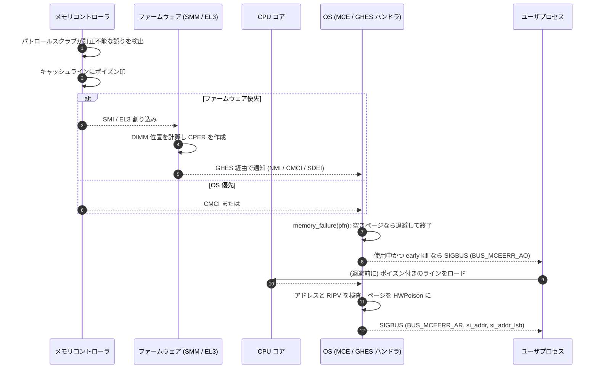
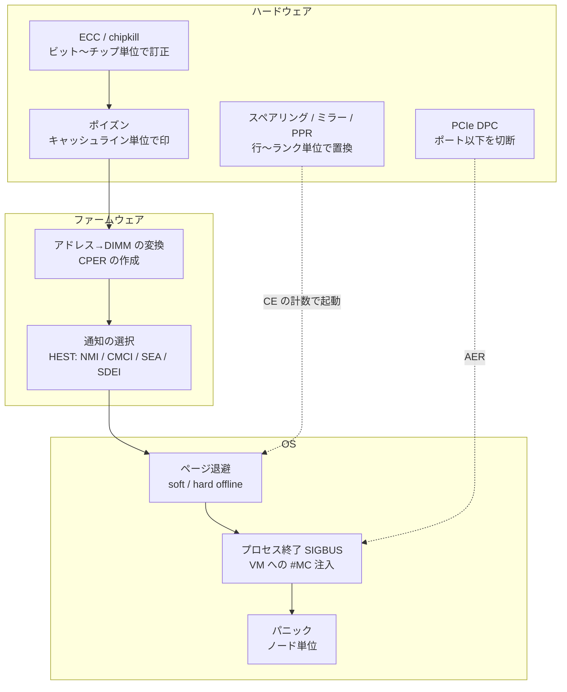

# RAS アーキテクチャとマシンチェック (RAS Architecture & Machine Check): 壊れたデータを封じ込める分担

## 概要 (Overview)

RAS (reliability, availability, serviceability、信頼性・可用性・保守性) は、ハードウェアの誤りを前提にしてシステムを止めずに動かし、壊れた部品を特定して交換するための仕組みの総称である[^linux-ras]。ECC で誤りを訂正する機能がよく知られているが、訂正できる誤りは処理の中心ではない。訂正できない誤りが起きたとき、壊れたデータをどこまで使わせずに済むか、そして影響をキャッシュライン 1 本、ページ 1 枚、プロセス 1 個、仮想マシン 1 台、ノード 1 台のどこで止めるかが設計の中心にある。

本書の中心テーゼは次のとおりである。**RAS の本質は誤りを直すことより、壊れたデータを使わせずに影響範囲を最小の単位に閉じ込めることにある。そしてその単位はハードウェア (検出とポイズン)・ファームウェア (通知と翻訳)・OS (ページ退避とプロセス終了) の分担で決まる。** どれか一層が誤りの位置や文脈を失うと、封じ込めの単位はノード全体 (パニック) まで広がる。

[`fleet-hardware-reliability.md`](fleet-hardware-reliability.md) は、フリートで誤りがどれだけ起きるかという統計と、どの検出機構にも捕まらないサイレントデータ破損 (SDC) を扱った。本書はその手前にある、ハードウェアが誤りを検出できた場合の処理経路を扱う。(1) 誤りの分類 (CE・UCNA・SRAO・SRAR・致命的)、(2) x86 のマシンチェックアーキテクチャ (MCA) と AMD の拡張、(3) Arm の RAS 拡張と SDEI、(4) ファームウェア優先と OS 優先の分担 (APEI・CPER)、(5) メモリの訂正・スクラブ・スペアリング・ミラーリング、(6) Linux の対応 (EDAC・rasdaemon・memory_failure・SIGBUS)、(7) PCIe AER と DPC、(8) CE の嵐への対処、(9) CE を使った予測交換の当否、の順に整理する。分析深度は Level 3 である。

## 方法論 (Methodology)

- レジスタのビット配置や通知の種類は、仕様書 (Intel SDM Vol.3B の Machine-Check Architecture の章、ACPI 6.5 の APEI の章、UEFI 仕様の付録 N) を一次資料とする。Intel SDM は版ごとに章番号が変わるため[^sdm-chapter]、章番号ではなく章名で参照する。仕様の本文を取得できなかった箇所は、仕様を実装した Linux カーネルのヘッダ (`arch/x86/include/asm/mce.h`、`include/acpi/actbl1.h`、`include/linux/cper.h`) で照合した。Linux のソースは 2026-10-24 時点の master を参照した。
- OS の振る舞いは Linux を例にとる。カーネルの文書とソースが一次資料である。他の OS (Windows の WHEA など) は本書の範囲外とする。
- フィールドの統計は運用者・研究機関の査読論文を使う。CE から UE を予測できるかという論点では結論が分かれる報告があるため、母集団と ECC の種類を添えて両論を示す (§10)。
- サーバ製品の機能名 (ADDDC、部分ミラーリング) は OEM の一次文書で確認し、ベンダーごとに名称と実装が違うことを明記する。

## 発見事項 (Findings)

1. **誤りの分類の軸は「訂正できたか」だけではなく、「壊れたデータがまだ使われていないか」と「処理を続けられるか」の 3 つである。** Intel MCA は MCi_STATUS の UC (訂正不能)・PCC (プロセッサ文脈の破壊)・S (#MC で通知した)・AR (対処が必須) の 4 ビットで、CE・UCNA (対処不要)・SRAO (対処は任意)・SRAR (対処が必須)・致命的を区別する[^mce-h][^lkml-ucna]。Arm も CE・DE (遅延誤り)・UE に分け、UE を回復可能性でさらに 4 種に分ける[^arm-neoverse-ras]。
2. **封じ込めの基本部品はポイズン (poison) である。** 訂正できない誤りをハードウェアが見つけても、その場で止めずにデータへ印を付けて先へ渡し、誰かが実際に使おうとした時点で同期的な例外を上げる。AMD はこれを遅延誤り (deferred error) とポイズンのビットで、Intel は UCNA/SRAO と SRAR の組で表す[^mce-h][^lkml-deferred]。これにより、パトロールスクラブが見つけた誤りは読まれる前に退避でき、読まれた誤りは読んだプロセスだけを止められる。
3. **OS が封じ込められる単位は、誤った場所が「誰のメモリか」で決まる。** Linux の memory_failure はユーザ空間の LRU ページとページキャッシュを回復できるが、カーネル内部のオブジェクトの大半は回復できない[^hwpoison]。カーネルが誤りを読んだ場合、例外表で回復可能と印を付けたコピー関数の中でなければパニックになる[^severity-c][^copy-mc]。部分ミラーリングで、カーネルの割り当てだけをミラー化した領域に置く設定 (`kernelcore=mirror`) は、この非対称を補う設計である[^kparams]。
4. **ファームウェア優先 (firmware-first) と OS 優先 (OS-first) は、情報と制御のどちらを重視するかのトレードオフである。** ファームウェアは物理アドレスから DIMM の位置への変換のような基板固有の知識を持つ[^emca]。一方 OS は、どのプロセスがそのページを使っているかを知っている。ACPI の APEI はこの二者をつなぐ契約であり、HEST が誤りの発生源と通知方法 (NMI、CMCI、MCE、SEA、SDEI など 12 種) を、GHES が UEFI CPER 形式の誤り記録を OS に渡す[^actbl1][^cper-h]。
5. **Arm ではファームウェアから OS への通知に SDEI を使う。** EL3 のファームウェアが誤りを受けて CPER を作り、OS がマスクしていても届く SDEI イベントで通知する[^arm-neoverse-ras][^sdei]。x86 の SMI と NMI の組み合わせに相当する経路を、標準化した呼び出し規約として定義したものである。
6. **CE の「嵐」は、それ自体が可用性の問題になる。** 恒久故障を持つ 1 個の DIMM は大量の CE を出し、割り込み処理だけで CPU を消費しうる。Linux は 2023 年に嵐の処理をバンク単位に作り直し、直近の 5 回のポーリングで CE があれば嵐とみなして 1 秒ごとのポーリングに切り替え、30 回続けて CE がなければ終わったとみなす[^storm-patch]。Intel では CE の閾値を上げるだけにして、訂正不能誤りの通知は止めない[^storm-cover]。
7. **CE から UE を予測できるかは、ECC の強さと故障の形に依存する。** Google の実測では、UE の 70〜80% の前に同月か前月の CE があった。一方で CE 後に UE が起きる確率は月 0.1〜2.3% にとどまる[^schroeder]。Intel と ByteDance は、Intel のサーバで単一チップ内の特定のビットパターンが ECC の保証範囲を外れることを示し、CE のビットパターンから UE を予測した[^li-sc22]。逆に chipkill を備えた Cielo では、CE を出す故障が後の UE を予測しなかった[^levy-sc18]。予測交換の効果は普遍ではなく、プラットフォームごとに検証する必要がある。
8. **PCIe も同じ構図をとる。** 訂正可能・非致命的・致命的の 3 段階に分け、致命的誤りではリンクのリセットを省略できない[^aer-howto]。DPC (Downstream Port Containment) は誤りを検出したポートより下のリンクを切り、壊れたトランザクションがその先へ広がるのを止める[^dpc-c]。OS が AER を扱えるのは、ファームウェアが `_OSC` で制御を渡したときに限られる[^aer-howto]。

## アーキテクチャ (Architecture)

### 誤りの分類と通知の経路

次の表は Intel・AMD・Arm の分類と、Linux がそれぞれに与える処置を並べたものである。

| 分類 | Intel MCi_STATUS (UC/PCC/S/AR) | AMD | Arm (ERR\<n\>STATUS) | 通知 | Linux の処置 |
|---|---|---|---|---|---|
| CE (corrected error) | UC=0 | CE | CE | CMCI またはポーリング | 記録と計数。閾値でページをソフトオフライン |
| UCNA (uncorrected no action required) | 1/0/0/0 | 遅延誤り (Deferred=1) | DE (deferred error) | CMCI またはポーリング | 該当ページの退避を試みる |
| SRAO (software recoverable action optional) | 1/0/x/0 (x は 0 か 1) | 遅延誤り | UEO (restartable / latent) | #MC または CMCI | 該当ページの退避。使用中なら early kill の対象 |
| SRAR (software recoverable action required) | 1/0/1/1 | ポイズンの消費 (Poison=1) | UER (recoverable / signaled)、同期外部アボート | #MC (同期) | 読んだプロセスに SIGBUS (BUS_MCEERR_AR) |
| 致命的 (fatal) | PCC=1、またはカーネル内で回復不能 | PCC/TCC など | UEU (unrecoverable)、UC (uncontainable) | #MC、SError | パニック |

Intel の列は SDM の表を引用したカーネルの議論[^lkml-ucna]と `mce.h` のビット定義[^mce-h]による。SRAO と UCNA は IA32_MCG_CAP の MCG_SER_P (ビット 24) が立つプロセッサでだけ報告される[^lkml-ucna]。AMD の遅延誤りは「ハードウェアで訂正できないが、プログラムの流れを直ちには止めない誤り」であり、#MC ではなく MCi_STATUS のポーリングで見える[^lkml-deferred]。Arm の UE の 4 区分 (UC・UEU・UER・UEO) は Neoverse 参照設計の文書による[^arm-neoverse-ras]。

この表は、下に行くほど封じ込めの単位が大きくなる順に並んでいる。CE と UCNA はまだ誰も壊れたデータを使っていないので、ページを退避すれば影響は出ない。SRAR は誰かが使おうとした瞬間なので、使った文脈 (プロセスや仮想マシン) を止める必要がある。致命的誤りは文脈そのものが壊れているので、ノードを止めるしかない。

### ポイズンの一生

凡例は次のとおりである。実線は同期的な処理、破線は非同期の通知を表す。`alt` はファームウェア優先と OS 優先の二つの経路を示す。ステップ 1〜2 の時点で誤りは見つかっているが、まだ誰も使っていない。この間に OS がページを退避できれば、誤りはアプリケーションに一切影響しない。ステップ 9 以降はアプリケーションが壊れたデータを読もうとした場合である。CPU はロードを完了させずに同期的な例外を上げるため、壊れた値はレジスタに入らない。

### 封じ込めの単位と担い手

凡例として、実線の矢印は封じ込めに失敗したときに次の段へ進む順序を、点線は補助的な連携を表す。左上の部品ほど単位が小さく、右下ほど大きい。どの段も前の段から受け取る情報 (誤りの物理アドレス、命令ポインタが有効か、誰の文脈か) に依存しており、情報が欠ければ次の段へ進むしかない。

## 技術詳細 (Technical Details)

### 1. x86 のマシンチェックアーキテクチャ

#### レジスタの構成

Intel SDM の Machine-Check Architecture の章は、グローバルなレジスタと、誤りの発生源ごとのバンク (bank) を定める[^sdm]。Linux の `arch/x86/include/asm/mce.h` が同じビット定義を持つ[^mce-h]。

- **IA32_MCG_CAP**: バンクの数と機能の有無を示す。ビット 10 が CMCI 対応 (MCG_CMCI_P)、ビット 24 がソフトウェアで回復可能な誤りの対応 (MCG_SER_P)、ビット 27 がローカルマシンチェック対応 (MCG_LMCE_P) である[^mce-h]。Intel の Xeon ではビット 26 (MCG_ELOG_P) が、誤りの検出時にファームウェアを呼べることを示す[^emca]。
- **IA32_MCG_STATUS**: #MC が起きたときの全体の状態。RIPV (ビット 0) は保存した命令ポインタから再開できるか、EIPV (ビット 1) は命令ポインタが誤りを起こした命令を指すか、MCIP (ビット 2) はマシンチェックの処理中か、LMCES (ビット 3) はローカルマシンチェックとして通知されたかを示す[^mce-h]。
- **IA32_MCi_CTL / STATUS / ADDR / MISC / CTL2**: バンクごとのレジスタ。STATUS の主なビットは VAL (63、有効)、OVER (62、前の誤りを上書きした)、UC (61)、EN (60)、MISCV (59)、ADDRV (58)、PCC (57)、S (56)、AR (55) である[^mce-h]。ADDR は誤りの物理アドレス、MISC はアドレスの有効な最下位ビットなどを持つ。CTL2 はビット 30 で CMCI を有効にし、ビット 0〜14 で CE の閾値を設定する[^mce-h]。

OVER ビットは重要である。誤りが続けて起きるとバンクの記録は上書きされ、先の誤りの情報は失われる。Linux は、対処が必須の誤りで OVER が立っていればパニックにする ("Action required with lost events")[^severity-c]。どのアドレスが壊れたか確かめられない状態で処理を続けることはできないからである。

#### #MC の配送とローカルマシンチェック

#MC (ベクタ 18) は命令の再実行を前提にしないアボート (abort) 型の例外である[^sdm]。例外の分類は [`../cpu/interrupts-exceptions-traps.md`](../cpu/interrupts-exceptions-traps.md) を参照。従来の Intel のプロセッサは #MC をシステム内のすべての論理プロセッサに一斉に配送していた[^lmce]。Linux の #MC ハンドラはこれに合わせ、全 CPU が集合して 1 個の CPU (monarch) がバンクを調べ、処置を決める。数百の論理プロセッサを持つサーバでは、1 個のポイズンを 1 個のスレッドが読んだだけで全コアが止まる。

ローカルマシンチェック (LMCE) は、一部の誤りを誤りに遭遇した論理プロセッサだけに配送する仕組みである。Linux は 2015 年に対応し、`mce=no_lmce` で従来の一斉配送に戻せる[^lmce]。SRAR のように誤りを読んだスレッドだけが対処すればよい誤りでは、ほかのコアを止める理由がない。LMCE はこの「止める範囲」を CPU の側から絞る機能である。

#### CMCI とポーリング

CE は処理を止める必要がないため、#MC ではなく CMCI (corrected machine check interrupt) という通常の割り込みで知らせるか、OS が定期的にバンクをポーリングして拾う。CMCI はバンクごとの CE の件数が CTL2 の閾値を超えたときに発火する[^mce-h]。Intel では UCNA も CMCI で通知される[^lkml-ucna]。CMCI を止めると UCNA も届かなくなるため、§8 の嵐への対処ではこの点が設計の制約になる。

### 2. Linux の重大度判定

Linux は `arch/x86/kernel/cpu/mce/severity.c` の `severities[]` 表で、バンクの値と例外が起きた文脈 (ユーザかカーネルか、回復可能なカーネル領域か) から処置を決める[^severity-c]。主な行を次に示す (master、2026-10-24 時点。表はおおむね 70〜225 行目にある)。

| メッセージ | 重大度 | 意味 |
|---|---|---|
| Processor context corrupt | PANIC | PCC=1。プロセッサの状態自体が壊れた |
| In kernel and no restart IP | PANIC | カーネル内で RIPV=0。戻る場所がない |
| Corrected error | KEEP | CE。記録だけ |
| Action optional: memory scrubbing error | AO | スクラブが見つけた訂正不能誤り |
| Uncorrected no action required | UCNA | 記録し、ページ退避を試みる |
| Action required: data load error in a user process | AR | ユーザのロード。SIGBUS で終える |
| Action required: data load in error recoverable area of kernel | AR | 例外表で回復可能と印を付けたカーネルのコピー |
| Data load error in SEAM non-root mode | AR | TDX のトラストドメインでのロード |
| Data load in unrecoverable area of kernel | PANIC | 通常のカーネルコードのロード |
| Action required with lost events | PANIC | AR で OVER=1 |

この表は同じ「ポイズンを読んだ」誤りでも、読んだ主体によって処置が変わることを示す。ユーザプロセスなら SIGBUS で済み、カーネルのコピー関数ならエラーを返せる。しかしカーネルの任意の場所で読めばパニックになる。カーネルを回復可能にするため、Linux は `copy_mc_to_user()` / `copy_mc_to_kernel()` を用意している。これは、ソース側の #MC を受けたらコピーを中断してエラーを返すコピー関数である[^copy-mc]。永続メモリ (pmem) や DAX のように、ストレージとして扱うメモリを読む経路がおもな利用者である。

### 3. AMD の拡張

AMD の MCA は Intel と同じ MSR の枠組みを持つが、遅延誤りとポイズンを独自のビットで表す。MCA_STATUS のビット 44 (Deferred) は「訂正できない誤りが生じたが、処理は止まっていない」ことを、ビット 43 (Poison) は「ポイズン付きのデータを使おうとした」ことを示す[^mce-h][^lkml-deferred]。Zen 以降の SMCA (Scalable MCA) はバンクごとに IPID (発生源の識別)・SYND (訂正のシンドローム)・DESTAT/DEADDR (遅延誤り専用の状態とアドレス) を加えた[^mce-h]。Linux は SMCA の機種で、MCA_STATUS に誤りがなければ MCA_DESTAT も調べて遅延誤りを記録する[^lkml-deferred]。AMD の一次資料は *AMD64 Architecture Programmer's Manual Volume 2* の Machine Check Mechanism の章である[^amd-apm]。

### 4. Arm の RAS 拡張と SDEI

Armv8.2 以降の CPU では RAS 拡張が必須である[^arm-neoverse-ras]。RAS 拡張は誤りを記録するノードごとに標準化した誤り記録 (error record) を置く。ERR\<n\>STATUS が誤りの種類と有効なフィールドを、ERR\<n\>ADDR がアドレスを、ERR\<n\>MISC\<m\> が FRU (field replaceable unit、現場交換単位) の識別・CE のカウンタ・タイムスタンプを持つ[^arm-neoverse-ras]。誤りの通知には記録した誤りを非同期に知らせる故障処理割り込み (FHI) と、重大な状態を知らせる割り込みがある[^arm-neoverse-ras]。

Arm の UE の 4 区分は封じ込めの単位をそのまま表している[^arm-neoverse-ras][^tfa-uc]。

- **UC (uncontainable)**: 封じ込めに失敗した。システムの状態を信頼できないため、秩序立った停止を始める。ハンドラは戻らない[^tfa-uc]。
- **UEU (unrecoverable)**: 誤りは封じ込めたが、影響を受けた実行を再開できない。
- **UER (recoverable / signaled)**: 誤りを使おうとした実行を止め、例外として知らせた。ソフトウェアが対処すれば回復できる。x86 の SRAR にあたる。
- **UEO (restartable / latent)**: まだ使われていない誤り。x86 の SRAO にあたる。

非同期の SError は、例外がどの命令に対応するかが不明なため回復が難しい。RAS 拡張は ESB (error synchronization barrier) 命令を加え、例外の境界で未通知の誤りを同期させる[^lkml-esb]。ポイズンを読んだロードは同期外部アボート (synchronous external abort, SEA) として届き、Linux はそれを GHES 経由の memory_failure につなぐ。

SDEI (Software Delegated Exception Interface) は Arm の仕様 DEN0054 で、通常世界 (non-secure) のソフトウェアがファームウェアにイベントハンドラを登録しておく仕組みである[^sdei]。ファームウェアは誤りを非同期例外として受け、登録されたハンドラを非セキュアの例外レベルで実行させる。クライアントが例外をマスクしていてもハンドラは呼ばれる[^sdei]。OS の割り込み禁止区間の最中でも、ファームウェアは誤りを知らせられる。用途の筆頭はファームウェア優先の RAS 通知である[^sdei]。

### 5. ファームウェア優先と OS 優先

#### 分担の選択

Arm の Neoverse 参照設計では、二つの方式をビルド時にどちらか一方だけ選び、既定はファームウェア優先である[^arm-neoverse-ras]。ファームウェア優先では誤りを EL3 で処理し、Secure Partition (Standalone MM) が CPER を作り、SDEI で OS に知らせる。OS 優先 (Arm の用語では kernel-first) では、OS が AEST (Arm Error Source Table) で誤りの発生源を知り、各ノードの割り込みを直接処理する[^arm-neoverse-ras]。

x86 では、Intel の Enhanced MCA Logging (EMCA) がファームウェア優先を担う。誤りが起きるとハードウェアが SMI を発生させる。SMI ハンドラは誤りを前処理し、メモリ上に誤りの記録を作ってから、MCE または CMCI を OS に届ける[^emca]。Intel は動機を次のように説明している。マシンチェックバンクの情報は限られている。物理アドレスから DIMM のシリアル番号とランク・バンク・行・列を求めるには、基板の配線とインタリーブ方式の知識が要る。その知識はプロセッサのハードウェアには実装しにくい[^emca]。

| 観点 | ファームウェア優先 | OS 優先 |
|---|---|---|
| 物理位置の知識 | 基板固有の変換 (DIMM・スロット) を持つ | 物理アドレスまで。DIMM の対応は EDAC ドライバ次第 |
| 文脈の知識 | どのプロセスのページかは知らない | ページの所有者を知り、退避と kill を選べる |
| 遅延 | SMI 中は全コアが止まる。CE が多いと性能が落ちる | 割り込み処理だけ |
| 可視性 | ファームウェアが CE を握りつぶすと OS から見えない | すべての CE を OS が数える |
| OS 間の一貫性 | どの OS でも同じ記録 (CPER) を受け取る | OS ごとに機種別ドライバが要る |

両者の分担は排他ではない。ACPI の HEST は誤りの発生源ごとに FIRMWARE_FIRST フラグ (ビット 0) と GHES_ASSIST フラグ (ビット 2) を持つ[^actbl1]。後者は、ファームウェアが記録を補う一方で、OS 自身もバンクを処理する組み合わせを表す。PCIe の AER では、OS が誤りを処理するには、ファームウェアが ACPI の `_OSC` で制御を渡す必要がある[^aer-howto]。

#### APEI と CPER

ACPI の APEI (ACPI Platform Error Interfaces) は、ACPI 6.5 の第 18 章で次の表を定める[^acpi-apei]。

- **HEST** (Hardware Error Source Table): 誤りの発生源の一覧。種類は IA-32 のマシンチェック、CMC、NMI、PCIe AER (ルートポート・エンドポイント・ブリッジ)、汎用ハードウェア誤り源 (GHES) とその第 2 版 (GHESv2)、IA-32 の遅延誤り、の各型がある[^actbl1]。
- **BERT** (Boot Error Record Table): 前回の起動中に起きた致命的誤りの記録を、次の起動で OS に渡す。
- **ERST** (Error Record Serialization Table): OS が誤りの記録を不揮発の記憶域に保存する。
- **EINJ** (Error Injection Table): 誤りを人為的に注入して、処理経路を検査する。

GHES の通知方法はポーリング (0)、外部割り込み (1)、ローカル割り込み (2)、SCI (3)、NMI (4)、CMCI (5)、MCE (6)、GPIO (7)、SEA (8)、SEI (9)、GSIV (10)、SDEI (11) の 12 種である[^actbl1]。GHESv2 は Read Ack レジスタを加えた。OS が誤りの状態ブロックを処理し終えたらこのレジスタに書き、ファームウェアは確認を受けるまで次の記録で上書きしない[^ghesv2]。これがないと、誤りが立て続けに起きたときに記録が失われる。x86 の OVER ビットと同じ問題を、ファームウェアと OS の境界で解いている。

GHES が運ぶ誤りの記録は、UEFI 仕様の付録 N が定める CPER (Common Platform Error Record) 形式である。記録の先頭は `CPER` という署名で始まり、重大度は回復可能 (0)・致命的 (1)・訂正済み (2)・情報 (3) の 4 段階で表す[^cper-h][^actbl1]。本体は節 (section) の並びで、節の型には汎用プロセッサ、IA32/X64、Arm、プラットフォームメモリ、PCIe、ファームウェア誤り記録の参照、DMAR/IOMMU、CXL のプロトコル誤りとメモリイベントなどがある[^cper-h]。CPER は OS やアーキテクチャに依存しない共通の記録形式であり、ファームウェア優先の構成で OS 間の一貫性を支える。

### 6. メモリの訂正、スクラブ、置換

ECC の符号 (SEC-DED、chipkill、DDR5 の on-die ECC) は [`../cpu/dram-memory-controllers.md`](../cpu/dram-memory-controllers.md) §4 が扱う。ここでは封じ込めの観点で整理する。

- **ECC の強さは封じ込めをどの段で終えるかを決める。** Google の 2.5 年の実測では、chipkill を使うプラットフォームの UE 率は SEC-DED より 4〜10 分の 1 だった[^schroeder]。AMD と米国立研究所の Jaguar の実測では、chipkill は DRAM 起因のノード障害率を 36 倍超下げた[^sridharan12]。前者は UE の件数、後者はノード障害の率を数えており、指標が違う。それでも、チップ単位の故障を CE の段で止めることが UE を大きく減らすという結論は一致する。Sridharan らはさらに、DDR のコマンド・アドレスパリティが chipkill の UE 率と同程度の率で誤りを検出しており、信頼性に大きく寄与していることを示した[^sridharan15]。
- **パトロールスクラブ (patrol scrub)** は、メモリコントローラがアイドル時に全メモリを読み、CE を訂正して書き戻す機能である。読まれないまま 1 ビット誤りが溜まって訂正不能になる前に直す[^lenovo-uefi]。スクラブが訂正不能な誤りを見つけた場合、Linux はそれを AO ("Action optional: memory scrubbing error") として扱い、使われる前にページを退避する[^severity-c]。スクラブは CE を減らすだけでなく、UE を「使われる前に見つかった UE」に変える機能でもある。Linux の EDAC は 6.15 向けに、ACPI RAS2 や CXL を通じてスクラブの周期を OS から変える仕組みを加えた。周期の選択は「信頼性と性能を天秤にかける方針の判断」であるとして、ユーザ空間に委ねている[^edac-scrub]。
- **スペアリング (sparing) と PPR**: ランクスペアリングは走行中のランクで故障を検出するとデータを同じチャネルの予備ランクにコピーして処理を続ける。予備ランクのぶん OS が使える容量は減る[^nec-flags]。Intel Xeon の ADDDC (adaptive double device data correction) は 2 個の DRAM デバイスの故障を訂正でき、Lenovo はランクスペアリングと同等の保護を容量の損失なしに得られるとして、ランクスペアリングを既定で無効にしている[^lenovo-uefi][^nec-flags]。PPR (post package repair) は故障した行を DRAM 内の予備の行に置き換える操作で、恒久的なハード PPR と、高速だが電源を切ると消えるソフト PPR がある[^edac-repair]。6.15 向けの Linux の EDAC は、CXL メモリに対する PPR とスペアリング (キャッシュライン・行・バンク・ランク単位) を sysfs から指示する枠組みを加えた。修理を実行するかどうかは rasdaemon などのユーザ空間が決める[^edac-repair]。
- **ミラーリング (mirroring)** は同じデータを 2 か所に書き、一方が訂正不能でももう一方から読む。全面ミラーは使える容量が半分になる。部分ミラーはプロセッサあたり最大 50% の範囲をミラー化する[^lenovo-uefi]。Linux の `kernelcore=mirror` を指定すると、ミラー化した (信頼性の高い) メモリを移動できない割り当て (カーネル) に、残りを移動可能なページ (主にユーザ) に使う[^kparams]。§2 で見たとおりカーネルのページで UE が起きればパニックだが、ユーザのページなら SIGBUS で済む。ミラーの容量を、パニックに直結する領域にだけ使う配分である。

### 7. Linux の対応

#### 記録と計数: EDAC、rasdaemon、mcelog

EDAC (Error Detection And Correction) は Linux のハードウェア誤りの報告基盤で、2.6.16 で本体に入った (前身は bluesmoke)[^linux-ras]。メモリコントローラごとに `/sys/devices/system/edac/mc/mcX/` を作り、DIMM ごとに `dimm_ce_count` と `dimm_ue_count` を出す。文書は、CE は DIMM が故障し始めた早期の兆候になりうるとしている[^linux-ras]。ユーザ空間で誤りを記録する道具は、旧来の mcelog から rasdaemon に移っている。カーネルの設定項目 `X86_MCELOG_LEGACY` の説明は、`/dev/mcelog` は旧い mcelog デーモンのためのもので、新世代の rasdaemon への移行を検討せよと書いている[^kconfig]。

#### CE の自動退避: Correctable Errors Collector

カーネル内の CEC (Correctable Errors Collector、`drivers/ras/cec.c`) は、CE を出したページ (PFN) を 4 KiB の配列 (512 要素) で数える。件数が閾値に達したページはソフトオフライン (中身を別のページに移して元のページを使わない) にする[^cec]。古い記録は既定で 24 時間ごとに減衰させる。閾値の既定値は 1023 だが、Intel のシステムでは 2 に下げる。ソースのコメントは理由を、CE を出したページを積極的にオフラインにすれば Intel のシステムでは訂正不能誤りを避けられうるからだとしている[^cec]。§10 の Li らの観察 (Intel の ECC では単一チップ内の特定のパターンが訂正できない) と整合する設定である。

#### ページ退避と SIGBUS: memory_failure

`mm/memory-failure.c` の memory_failure は、ハードウェアが報告した物理ページに HWPoison の印を付け、そのページを使うプロセスを終わらせ、以後の割り当てから外す[^hwpoison]。動作は sysctl で選べる[^hwpoison]。

- `vm.memory_failure_recovery=0`: 回復を試みず、すべてのメモリ誤りでパニックにする。
- **late kill** (既定): ページに実際にアクセスしたプロセスにだけ SIGBUS を送る。誤りを扱えないアプリケーションに向く。
- **early kill** (`vm.memory_failure_early_kill=1` またはスレッドごとの `prctl(PR_MCE_KILL)`): 誤りを検出した時点で、そのページを写像している全プロセスに SIGBUS を送る。壊れたオブジェクトを捨てて処理を続けられるアプリケーションと、ゲストに #MC を注入する KVM/QEMU が使う[^hwpoison]。

SIGBUS の si_code は 2 種類ある。BUS_MCEERR_AR は「マシンチェックで消費したハードウェアのメモリ誤り。対処必須」、BUS_MCEERR_AO は「プロセス内で検出したが消費していない誤り。対処は任意」である。`si_addr_lsb` は報告したアドレスの最下位ビットを示し、破損の広がりを表す[^sigaction]。データベースや KVM のように SIGBUS を捕まえるアプリケーションは、この情報を使ってページ 1 枚ぶんのデータだけを捨てるか、ゲストに同じアドレスの #MC を注入できる。仮想化の構成は [`../../software/virtualization/hardware-virtualization-containers.md`](../../software/virtualization/hardware-virtualization-containers.md) を参照。

回復できる範囲には限界がある。文書はすべてのページ型に対応しているわけではなく今後も対応しないこと、カーネル内部のオブジェクトの大半は回復できず、現状回復できるのは LRU ページだけであることを明記している[^hwpoison]。スラブ、ページテーブル、カーネルスタックのポイズンは回復できない。§6 の `kernelcore=mirror` はまさにこの穴を埋めるための構成である。

### 8. PCIe AER と DPC

PCIe の AER (Advanced Error Reporting) は、誤りを 3 段階に分ける[^aer-howto]。

- **訂正可能 (correctable)**: ハードウェアが処理し、インタフェースの機能に影響しない。
- **訂正不能・非致命的 (uncorrectable non-fatal)**: 特定のトランザクションだけが影響を受ける。ドライバはリセットなしで回復できると申告できる。
- **訂正不能・致命的 (uncorrectable fatal)**: リンクそのものを信頼できない。ドライバが回復可能と答えてもリセットは省略できない[^aer-howto]。

Linux の AER ドライバは訂正不能誤りの発生源より上のポートでセカンダリバスリセットを行う。ドライバは `error_detected` などのコールバックで回復処理に参加する[^aer-howto]。訂正可能と非致命的の通知はデバイスと誤りの種類ごとに既定で 5 秒あたり 10 件に間引かれる。致命的誤りと DPC の通知は間引かれない[^aer-howto]。

DPC (Downstream Port Containment) は、訂正不能誤りをポートより下に封じ込める任意の機能である。DPC が起動すると、ハードウェアが下流のリンクを無効にする。Linux の DPC ドライバは配下のデバイスをすべて取り外し、リンクが無効になった後で状態を消してリンクの再訓練を許す[^dpc-c]。壊れたかもしれない TLP がそれ以上上流へ届かないことを、配下のデバイスを失う代償で保証する。メモリのポイズンと同じく、PCIe も TLP の EP (poisoned) ビットで、ペイロードのデータが壊れていることを運ぶ。受け手はこれを誤りとして扱う。たとえば AMD の PCIe-AXI ブリッジは、EP ビットの立った完了パケットを受けると割り込み (SEP) を上げ、AXI 側にはエラー応答 (SLVERR) を返す[^amd-pg055]。規則の本体は PCIe Base Specification のデータポイズニングの規則の節にあるが、会員向けのため本文は確かめていない[^pcie-base]。MMIO・DMA・IOMMU の基本は [`../hw-sw-interface/mmio-dma-interrupts.md`](../hw-sw-interface/mmio-dma-interrupts.md)、バスの構造は [`../hw-sw-interface/bus-interconnect.md`](../hw-sw-interface/bus-interconnect.md) を参照。

### 9. CE の嵐とその抑制

恒久故障を持つ DIMM や、劣化した PCIe リンクは、毎秒数百件の CE を出しうる。CE そのものは無害でも、1 件ごとに割り込みを受けてバンクを読み、記録を書く処理は CPU 時間を使う。ファームウェア優先の構成では 1 件ごとに SMI で全コアが止まりうる[^emca]。こうして、訂正できる誤りが可用性の問題に変わる。

Linux の旧来の対策は CPU 上のすべてのバンクで CMCI を止めてポーリングに切り替えるものだった。Tony Luck はこれを「大きなハンマー」と呼んだ。ほかのバンクの処理が遅れ、Intel が CMCI で通知する UCNA まで遅れるからである[^storm-cover]。2023 年の改修 (2023 年 12 月に tip の ras/core に統合) では、次のようにバンクごとに嵐を追跡する[^storm-patch][^storm-cover]。

- バンクごとに 64 ビットの履歴を持ち、ポーリングのたびに CE があれば 1 を記録する。
- 直近の履歴のうち 5 回 (`STORM_BEGIN_THRESHOLD`) に CE があれば嵐と判定し、その CPU のポーリング間隔を 1 秒にする。履歴はおよそ 1 分強をカバーする。
- 30 回続けて CE がなければ嵐の終わりとみなし、通常のポーリング間隔に戻す。
- Intel では、嵐の間は CMCI を止めずに CE の閾値を上げる。閾値は訂正不能誤りの CMCI に影響しないため、UCNA の通知は保たれる[^storm-cover]。AMD では、該当する CPU とバンクの閾値割り込みを止める案が別途出された[^storm-cover]。

PCIe の側では AER の通知を既定で 5 秒あたり 10 件に間引く[^aer-howto]。嵐の抑制で守るべき原則は共通している。訂正済みの誤りの記録は減らしてよいが、訂正不能な誤りの通知経路は塞がない。

### 10. CE を使った予測交換

CE は恒久故障の兆候であり、CE を数えて DIMM やページを先に外す運用には統計の裏づけがある。フリートの統計 (ハードエラーの支配、パレート分布、ページ退避の効果) は [`fleet-hardware-reliability.md`](fleet-hardware-reliability.md) §3 にまとめた。ここでは、その運用の効果がどこまで一般化できるかを整理する。

- **相関はあるが、絶対確率は低い。** Google の実測では、UE の 70〜80% は同月か前月に CE が先行していた。CE があると UE の確率は 9〜400 倍に上がる。それでも CE 後に UE が起きる絶対確率は月 0.1〜2.3% で、CE だけを根拠に DIMM を交換するのは、停止の損失が交換費用を上回る環境に限られると著者らは結論した[^schroeder]。
- **ECC が弱いと、CE のパターンが予兆になる。** Intel と ByteDance の共同研究は、ByteDance のサーバ群の実測から、Intel の現行サーバプラットフォームでは ECC が弱まっており、単一チップ内のいくつかの誤りビットのパターンを訂正できないことを示した。そのうえで、ECC が保証する範囲に照らして危険な CE を見分ける指標を作り、将来の UE の予測に使った[^li-sc22]。
- **ECC が強いと、CE は予兆にならないことがある。** chipkill を備えた Cielo の 5 年間の分析では、訂正可能なメモリ故障は後の訂正不能故障を予測しなかった。著者らはこれを通説に反する結果としている[^levy-sc18]。
- **評価は精度ではなく費用で行う。** バルセロナ・スーパーコンピューティング・センターは MareNostrum 3 の 2 年分の誤り記録でランダムフォレストの予測器を作った。適合率と再現率だけでは評価に不十分だとして費用便益で評価し、失われる計算時間を最大 57% (年に約 21,000 ノード時間) 減らせると報告した[^boixaderas]。

これらの報告は矛盾していない。CE が UE を予告するのは、CE を出す故障の形が、ECC がいずれ訂正しきれなくなる形 (同じチップ内でビットが広がる) である場合に限られる。chipkill がチップ 1 個の全損まで訂正できれば、CE の段で故障は止まり続ける。予測交換の閾値はプラットフォームの ECC 方式・故障の形・停止の費用を入力にして、運用者が自分のデータで決める必要がある。Linux の CEC が Intel でだけ閾値を 2 に下げるのは[^cec]、この判断をプラットフォームごとに変えた例である。

## セキュリティ考察 (Security Considerations)

- **ECC は Rowhammer の対策として不十分である。** ECCploit は Intel と AMD の ECC 関数を逆解析し、CE の訂正にかかる時間の差を手がかりに、ECC が訂正も検出もできないビット反転の組み合わせを作れることを示した[^eccploit]。誤り訂正の機構そのものがサイドチャネルになり、CE の記録が攻撃の途中経過を映すことにもなる。Rowhammer の機構と規格側の緩和は [`../cpu/dram-memory-controllers.md`](../cpu/dram-memory-controllers.md) §5 と [`../security/side-channels-tee-secure-boot.md`](../security/side-channels-tee-secure-boot.md) を参照。運用上は CE の急増を故障の兆候としてだけでなく、攻撃の兆候としても監視する価値がある。
- **ファームウェア優先は信頼の境界を広げる。** EMCA では誤りのたびに SMM のコードが走り、Arm では EL3 と Secure Partition が CPER を作る[^emca][^arm-neoverse-ras]。OS は自分では検証できない記録をもとにページを退避し、プロセスを終わらせる。SMM や EL3 のコードに欠陥があれば、偽の誤り記録で任意のページを退避させたり、本物の誤りを隠したりできる。誤り処理のファームウェアはセキュアブートの検証対象に含める必要がある ([`../hw-sw-interface/boot-initialization.md`](../hw-sw-interface/boot-initialization.md))。
- **誤り注入インタフェースは特権の入口である。** ACPI の EINJ やカーネルの `hwpoison-inject`・`madvise(MADV_HWPOISON)` は、処理経路を検査するための機能である。どれも root 権限を要し、カーネルの文書は注入インタフェースが安定した ABI ではないと明記している[^hwpoison]。本番機でこれらを使えると、任意のページを壊れたことにしてサービスを止められる。本番では無効にするか、利用を監査する。
- **誤りの記録は情報を漏らしうる。** MCE や EDAC の記録には物理アドレスと DIMM の位置が含まれる。物理アドレスの配置は Rowhammer などの攻撃で重要な情報であり、記録の閲覧は特権ユーザに限る必要がある。
- **封じ込めは TEE にも及ぶ。** Linux の重大度表は TDX のトラストドメイン (SEAM non-root モード) でのポイズン消費を対処必須 (AR) として扱う[^severity-c]。ホストを止めずに該当するゲストだけを止めるという、封じ込めの単位を仮想マシンに合わせた設計である。機密計算の脅威モデルは [`../security/side-channels-tee-secure-boot.md`](../security/side-channels-tee-secure-boot.md) を参照。
- **完全性と可用性の判断は分けて設計する。** `vm.memory_failure_recovery=0` はすべての誤りでパニックにし、完全性を最優先する[^hwpoison]。逆に early kill を使わず late kill に任せると、壊れたページを持つプロセスが動き続ける時間が延びる。どちらを選ぶかは壊れたデータを使ったときの損失 (金融計算や鍵生成) と、ノードを止めたときの損失を比べて決める。

## 結論 (Conclusions)

- RAS の中心は、訂正できない誤りが起きたときに壊れたデータを使わせないことである。x86 の UCNA・SRAO・SRAR、AMD の遅延誤りとポイズン、Arm の UER・UEO は、いずれも「壊れたデータがまだ使われていないか」を区別するための分類であり、ポイズンはその区別を時間方向に延ばす仕組みである。
- 封じ込めの単位 (キャッシュライン・ページ・プロセス・仮想マシン・ノード) は、ハードウェア・ファームウェア・OS の分担で決まる。ハードウェアはポイズンで誤りを印付けし、ファームウェアは基板の知識で誤りを物理位置に翻訳し、OS は誰のメモリかを知ってページ退避と SIGBUS を選ぶ。ファームウェア優先と OS 優先の選択は、位置の知識と文脈の知識のどちらを先に使うかの選択である。
- カーネルのメモリは封じ込めの弱点であり、ポイズンを読めば多くの場合パニックになる。回復可能なコピー関数 (`copy_mc_*`)、LMCE による配送範囲の縮小、部分ミラーリングとの組み合わせ (`kernelcore=mirror`) が、この弱点を個別に補っている。
- CE は予兆としても負荷としても扱う必要がある。嵐の抑制では、訂正不能な誤りの通知経路を塞がないことが設計の制約になる。予測交換の効果は ECC の方式と故障の形に依存し、Google・Intel と ByteDance・Cielo の報告が示すように普遍の閾値はない。

### 次の接続先 (Related Topics)

- [`fleet-hardware-reliability.md`](fleet-hardware-reliability.md) — フリートの誤りの統計、サイレントデータ破損、隔離と RMA
- [`../cpu/dram-memory-controllers.md`](../cpu/dram-memory-controllers.md) — ECC の符号、Rowhammer、EDAC の観測
- [`../cpu/interrupts-exceptions-traps.md`](../cpu/interrupts-exceptions-traps.md) — 例外の分類、アボート、NMI
- [`../hw-sw-interface/boot-initialization.md`](../hw-sw-interface/boot-initialization.md) — UEFI・ACPI・TF-A の起動と、ファームウェアの信頼
- [`../hw-sw-interface/mmio-dma-interrupts.md`](../hw-sw-interface/mmio-dma-interrupts.md) — PCIe、MSI、IOMMU
- [`../hw-sw-interface/bus-interconnect.md`](../hw-sw-interface/bus-interconnect.md) — バスとインターコネクトの構造
- [`../../software/operating-systems/virtual-memory-paging.md`](../../software/operating-systems/virtual-memory-paging.md) — ページの管理と、ページ退避が依存する仕組み
- [`../../software/virtualization/hardware-virtualization-containers.md`](../../software/virtualization/hardware-virtualization-containers.md) — ゲストへの #MC 注入の前提となる仮想化
- [`../../software/distributed-systems/failure-models.md`](../../software/distributed-systems/failure-models.md) — fail-stop と、検出可能な故障への変換

## 参考文献 (References)

[^linux-ras]: [The Linux Kernel documentation — Reliability, Availability and Serviceability (RAS)](https://docs.kernel.org/admin-guide/RAS/main.html) — Accessed: 2026-10-24. — RAS・CE/UE・致命的/非致命的の定義、EDAC の sysfs (`dimm_ce_count` など)、2.6.16 での統合と bluesmoke。

[^sdm-chapter]: [LKML — [PATCH] x86/mce: Update references to the Intel SDM](https://lkml.iu.edu/hypermail/linux/kernel/2312.0/05827.html) (2023-12) — Accessed: 2026-10-24. — Machine-Check Architecture の章が第 15 章から第 16 章へ移ったこと、章番号ではなく節名で参照する提案。

[^sdm]: Intel Corporation. *Intel 64 and IA-32 Architectures Software Developer's Manual, Volume 3B: System Programming Guide, Part 2* — Machine-Check Architecture の章。[intel.com](https://www.intel.com/content/www/us/en/developer/articles/technical/intel-sdm.html) — Accessed: 2026-10-24. (2026-10-09 更新版)

[^mce-h]: Linux kernel source, `arch/x86/include/asm/mce.h` (master, 2026-10-24). [GitHub](https://github.com/torvalds/linux/blob/master/arch/x86/include/asm/mce.h) — Accessed: 2026-10-24. — MCG_CAP・MCG_STATUS・MCi_STATUS (VAL〜AR、AMD の DEFERRED・POISON)・CTL2 (CMCI_EN、閾値マスク 0x7fff)・SMCA の MSR 名。

[^lkml-ucna]: [LKML — [PATCH v3 2/2] x86, mce: support memory error recovery for both UCNA and Deferred error in machine_check_poll](https://lkml.rescloud.iu.edu/1411.0/05463.html) (2014-11) — Accessed: 2026-10-24. — Intel SDM Vol.3B (253669) の UCR 誤りの分類表 (UC/EN/PCC/S/AR と通知経路) の引用、MCG_SER_P の条件。

[^lkml-deferred]: [LKML — Re: [PATCH] x86, MCE: support memory error recovery for both UCNA and Deferred error in machine_check_poll](https://lkml.iu.edu/hypermail/linux/kernel/1410.2/04414.html) (2014-10) および [LKML — [PATCH v2 13/16] x86/mce: Unify AMD DFR handler with MCA Polling](https://lkml.iu.edu/hypermail/linux/kernel/2502.2/02272.html) (2025-02) — Accessed: 2026-10-24. — AMD APM の遅延誤りの定義の引用、SMCA の MCA_DESTAT の確認。

[^amd-apm]: Advanced Micro Devices. *AMD64 Architecture Programmer's Manual, Volume 2: System Programming* (Pub. 24593) — Machine Check Mechanism の章。[amd.com](https://www.amd.com/en/search/documentation/hub.html) — Accessed: 2026-10-24. (本文の該当箇所は未取得のため、定義は [^lkml-deferred] の引用と [^mce-h] で照合した)

[^severity-c]: Linux kernel source, `arch/x86/kernel/cpu/mce/severity.c` (master, 2026-10-24), `severities[]` 表 (おおむね 70〜225 行目). [GitHub](https://github.com/torvalds/linux/blob/master/arch/x86/kernel/cpu/mce/severity.c) — Accessed: 2026-10-24.

[^lmce]: [LKML — [Patch V1 0/3] x86 Local Machine Check Exception (LMCE)](https://lkml.iu.edu/hypermail/linux/kernel/1505.3/04137.html) (2015-05) および [[tip:x86/core] x86/mce: Add infrastructure to support Local MCE](https://lkml.iu.edu/hypermail/linux/kernel/1506.0/04804.html) (2015-06) — Accessed: 2026-10-24. — 従来の一斉配送、単一論理プロセッサへの配送、`mce=no_lmce`。

[^copy-mc]: Williams, D. [PATCH] x86, powerpc: Rename memcpy_mcsafe() to copy_mc_to_{user, kernel}(). [patchwork.kernel.org](https://patchwork.kernel.org/patch/11574071/) — Accessed: 2026-10-24. — #MC を受けうるソースからのコピーと、エラーを返すコピー関数。

[^hwpoison]: [The Linux Kernel documentation — hwpoison](https://docs.kernel.org/mm/hwpoison.html) — Accessed: 2026-10-24. — memory_failure、early/late kill、`vm.memory_failure_recovery`、`PR_MCE_KILL`、回復できるページの範囲、注入インタフェース。

[^sigaction]: [sigaction(2) — Linux manual page](https://man7.org/linux/man-pages/man2/sigaction.2.html) — Accessed: 2026-10-24. — BUS_MCEERR_AR・BUS_MCEERR_AO・`si_addr_lsb` (Linux 2.6.32 以降)。

[^kparams]: Linux kernel source, `Documentation/admin-guide/kernel-parameters.txt` (master, 2026-10-24), `kernelcore=` の `mirror` オプション. [GitHub](https://github.com/torvalds/linux/blob/master/Documentation/admin-guide/kernel-parameters.txt) — Accessed: 2026-10-24.

[^kconfig]: Linux kernel source, `arch/x86/Kconfig` (master, 2026-10-24), `X86_MCELOG_LEGACY` の説明. [GitHub](https://github.com/torvalds/linux/blob/master/arch/x86/Kconfig) — Accessed: 2026-10-24.

[^cec]: Linux kernel source, `drivers/ras/cec.c` (master, 2026-10-24) — 冒頭のコメント (おおむね 15〜61 行目) と `cec_init()`. [GitHub](https://github.com/torvalds/linux/blob/master/drivers/ras/cec.c) — Accessed: 2026-10-24. — 512 要素の配列、閾値の既定値 (COUNT_MASK = 1023)、Intel での閾値 2、24 時間の減衰、`MF_SOFT_OFFLINE`。

[^storm-patch]: Luck, T. [PATCH v9 2/3] x86/mce: Add per-bank CMCI storm mitigation. [LKML](https://lkml.iu.edu/hypermail/linux/kernel/2310.0/04247.html) (2023-10) — Accessed: 2026-10-24. — 64 ビットの履歴、`STORM_BEGIN_THRESHOLD` 5、`STORM_END_POLL_THRESHOLD` (30 回)、1 秒ごとのポーリング。

[^storm-cover]: Luck, T. [PATCH v9 0/3] Handle corrected machine check interrupt storms. [LKML](https://lkml.iu.edu/hypermail/linux/kernel/2310.0/04246.html) (2023-10) および [[tip: ras/core] x86/mce: Remove old CMCI storm mitigation code](https://lkml.rescloud.iu.edu/2312.1/10405.html) (2023-12)、[[RFC PATCH 1/2] x86/mce: Handle AMD threshold interrupt storms](https://lkml.iu.edu/hypermail/linux/kernel/2202.2/02178.html) (2022-02) — Accessed: 2026-10-24.

[^emca]: Intel Corporation. (2018). *MCA Enhancements in Intel Xeon Processors* (Reference Number 329176-002, Revision 1.1, January 2018) — §1.2 Enhanced MCA Logging、表 1-3・1-4 (MCG_ELOG_P = IA32_MCG_CAP[26])、§1.2.4 (誤り時の SMI と前処理)。Linux の実装は `drivers/acpi/acpi_extlog.c`。[LWN — Extended H/W error log driver](https://lwn.net/Articles/570120/) — Accessed: 2026-10-24.

[^arm-neoverse-ras]: [Arm — Neoverse Reference Design: Reliability, Availability, and Serviceability (RAS)](https://neoverse-reference-design.docs.arm.com/en/rd-infra-2024.07.15/features/ras/ras.html) — Accessed: 2026-10-24. — RAS 拡張の必須化 (Armv8.2 以降)、誤り記録、CE/DE/UE と UE の 4 区分、FHI、ファームウェア優先 (HEST・SDEI・Standalone MM) とカーネル優先 (AEST)。

[^tfa-uc]: [Trusted Firmware-A — RAS: Introduce handler for Uncontainable errors](https://git.trustedfirmware.org/plugins/gitiles/TF-A/trusted-firmware-a/+/b56dc2a98cab0ea618cce83b3702814b7fcafd7d%5E%21/include) — Accessed: 2026-10-24.

[^lkml-esb]: [LKML — [PATCH v3 7/8] arm64: exception: handle asynchronous SError interrupt](https://lkml.iu.edu/hypermail/linux/kernel/1703.3/05005.html) (2017-03) — Accessed: 2026-10-24. — Armv8.2 の ESB による Unrecoverable 誤りの同期。

[^sdei]: Arm Limited. *Software Delegated Exception Interface (SDEI)*, ARM DEN 0054 (Revision C). [developer.arm.com](https://developer.arm.com/documentation/den0054/latest) — Accessed: 2026-10-24.

[^actbl1]: Linux kernel source (ACPICA), `include/acpi/actbl1.h` (master, 2026-10-24) — `enum acpi_hest_types`、`enum acpi_hest_notify_types` (0〜11)、`ACPI_HEST_FIRMWARE_FIRST`・`ACPI_HEST_GHES_ASSIST`、`ACPI_HEST_GEN_ERROR_*`. [GitHub](https://github.com/torvalds/linux/blob/master/include/acpi/actbl1.h) — Accessed: 2026-10-24.

[^acpi-apei]: UEFI Forum. *Advanced Configuration and Power Interface (ACPI) Specification, Version 6.5*, Chapter 18: ACPI Platform Error Interfaces (APEI). [uefi.org](https://uefi.org/specs/ACPI/6.5/18_Platform_Error_Interfaces.html) — Accessed: 2026-10-24. (取得時に 403 を返したため、型と値は [^actbl1] で照合した)

[^ghesv2]: [LKML — Re: [PATCH V17 01/11] acpi: apei: read ack upon ghes record consumption](https://lkml.iu.edu/1706.3/04941.html) (2017-06) および [LKML — Re: [REGRESSION] GHES firmware can't be readonly](https://lkml.iu.edu/hypermail/linux/kernel/2511.3/00284.html) (2025-11、ACPI 6.5 の GHESv2 の節の引用) — Accessed: 2026-10-24.

[^cper-h]: Linux kernel source, `include/linux/cper.h` (master, 2026-10-24) — `CPER_SIG_RECORD`、`CPER_SEV_*`、`CPER_SEC_*` (UEFI 2.7 の N.2.1・N.2.2、2.8 の N.2.5 を参照). [GitHub](https://github.com/torvalds/linux/blob/master/include/linux/cper.h) — Accessed: 2026-10-24. 一次資料は UEFI Forum. *Unified Extensible Firmware Interface Specification*, Appendix N: Common Platform Error Record.

[^schroeder]: Schroeder, B., Pinheiro, E., & Weber, W.-D. (2009). DRAM Errors in the Wild: A Large-Scale Field Study. *Proc. SIGMETRICS '09*, 193–204. DOI: 10.1145/1555349.1555372 — chipkill による UE 率の 4〜10 分の 1 への低減、UE の 70〜80% に先行する CE、9〜400 倍、月 0.1〜2.3%。

[^sridharan12]: Sridharan, V., & Liberty, D. (2012). A Study of DRAM Failures in the Field. *Proc. SC '12*. DOI: 10.1109/SC.2012.13

[^sridharan15]: Sridharan, V., DeBardeleben, N., Blanchard, S., Ferreira, K. B., Stearley, J., Shalf, J., & Gurumurthi, S. (2015). Memory Errors in Modern Systems: The Good, The Bad, and The Ugly. *Proc. ASPLOS '15*, 297–310. DOI: 10.1145/2694344.2694348

[^li-sc22]: Li, C., Zhang, Y., Wang, J., Chen, H., Liu, X., Huang, T., Peng, L., Zhou, S., Wang, L., & Ge, S. (2022). From Correctable Memory Errors to Uncorrectable Memory Errors: What Error Bits Tell. *Proc. SC22*. [IEEE Xplore 10046095](https://ieeexplore.ieee.org/document/10046095) — Accessed: 2026-10-24.

[^levy-sc18]: Levy, S., Ferreira, K. B., DeBardeleben, N., Siddiqua, T., Sridharan, V., & Baseman, E. (2018). Lessons Learned from Memory Errors Observed Over the Lifetime of Cielo. *Proc. SC18*. [Sandia National Laboratories](https://www.sandia.gov/ccr/publications/details/lessons-learned-from-memory-errors-observed-over-the-lifetime-of-cielo-2019-03-11) — Accessed: 2026-10-24.

[^boixaderas]: Boixaderas, I., et al. (2020). Cost-Aware Prediction of Uncorrected DRAM Errors in the Field. *Proc. SC20*. [SC20 Proceedings](https://sc20.supercomputing.org/proceedings/tech_paper/tech_paper_pages/pap241.html) — Accessed: 2026-10-24.

[^lenovo-uefi]: [Lenovo Docs — Memory (UEFI settings for Intel Xeon Scalable 1st/2nd Gen)](https://pubs.lenovo.com/uefi_xeon_1st_2nd/memory) — Accessed: 2026-10-24. — 全面ミラー (容量半減)、部分ミラー (プロセッサあたり最大 50%)、ランクスペアリングと ADDDC、パトロールスクラブ。

[^nec-flags]: [SPEC CPU2017 Flag Description for NEC Server Platform](https://spec.org/cpu2017/flags/NEC-Platform-Settings-SPECcpu2017-Flags-V1.2-SKL-A2040e-RevA.html) および [SPEC CPU2006 Flag Description for NEC Server Platform](https://ftp.spec.org/cpu2006/flags/NEC-platform-Settings-V1.2-A2040d-RevB.html) — Accessed: 2026-10-24. — ADDDC (2 デバイスの訂正) とランクスペアリング。

[^edac-scrub]: [The Linux Kernel documentation — EDAC Scrub Control](https://docs.kernel.org/edac/scrub.html) — Accessed: 2026-10-24.

[^edac-repair]: [The Linux Kernel documentation — EDAC Memory Repair Control](https://docs.kernel.org/edac/memory_repair.html) (Written for: 6.15) — Accessed: 2026-10-24.

[^aer-howto]: [The Linux Kernel documentation — The PCI Express Advanced Error Reporting Driver Guide HOWTO](https://docs.kernel.org/PCI/pcieaer-howto.html) — Accessed: 2026-10-24. — 誤りの 3 分類、セカンダリバスリセット、`_OSC`、5 秒あたり 10 件の間引き。

[^dpc-c]: Linux kernel source, `drivers/pci/pcie/dpc.c` (Keith Busch, 2016) — 冒頭のコメント. [GitHub](https://github.com/torvalds/linux/blob/master/drivers/pci/pcie/dpc.c) — Accessed: 2026-10-24.

[^amd-pg055]: AMD. *AXI Bridge for PCI Express Gen3 Subsystem Product Guide (PG055)* — Poison Bit Received on Completion Packet. [docs.amd.com](https://docs.amd.com/r/en-US/pg055-axi-bridge-pcie/Poison-Bit-Received-on-Completion-Packet) — Accessed: 2026-10-24.

[^pcie-base]: PCI-SIG. *PCI Express Base Specification* — Data Poisoning (EP ビット) と Downstream Port Containment の節。[pcisig.com](https://pcisig.com/specifications) — Accessed: 2026-10-24. (会員向けのため本文は未取得)

[^eccploit]: Cojocar, L., Razavi, K., Giuffrida, C., & Bos, H. (2019). Exploiting Correcting Codes: On the Effectiveness of ECC Memory Against Rowhammer Attacks. *Proc. IEEE S&P 2019*. [IEEE Xplore 8835222](https://ieeexplore.ieee.org/document/8835222) — Accessed: 2026-10-24.
