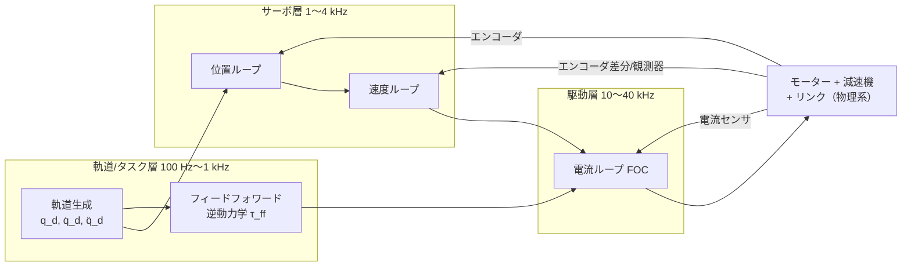

# ロボット制御 (Robot Control Systems)

## 概要 (Overview)

`kinematics-dynamics.md` で運動方程式 `M(q)q̈ + C(q,q̇)q̇ + g(q) = τ` を手に入れた。制御 (control) とは、この方程式に対して「望む運動・望む力学的振る舞いを実現するトルク `τ` を、センサの測定値から実時間で決め続ける」ことである。

本ドキュメントは、ロボット制御を**モデルへの依存度の順**——モデルを使わない PID から、モデルで線形化する計算トルク法、最適化として解く LQR/MPC、そして目標自体を「運動」から「力学的関係」へ置き換えるインピーダンス制御まで——に整理し、それを支えるリアルタイム実行基盤（制御周期・産業用フィールドバス EtherCAT）まで通して扱う。`../aerospace/avionics-gnc.md` の GNC ループ、`../power-generation/plant-control-scada-security.md` のプラント制御と対比しながら読むと、「制御工学の同じ骨格が対象ごとにどう変形するか」が見える。

CLAUDE.md の方針に従い分析深度は Level 3（完全）を既定とし、各主張には標準的教科書（Åström & Murray, Siciliano ほか）と一次文献（Hogan のインピーダンス制御など）を典拠として付す。

## 方法論 (Methodology)

- 制御則を**「必要なモデルの量」を軸に階段状に並べる**: モデル不要 (PID) → 逆動力学モデル (計算トルク) → 線形化モデル + 最適化 (LQR/MPC) → 相互作用モデル (インピーダンス)。各段で「前の段では解けない何が解けるようになるか」を明示する。
- 安定性は厳密な証明ではなく、**何が Lyapunov 関数になるか・どの構造的性質（受動性）に依拠するか**の水準で押さえる。
- 実行基盤（周期・ジッタ・フィールドバス）を制御則と同格に扱う。制御則の性能は「数式」と「それが決められた周期で確実に実行されること」の積だからである。
- 数値（制御周期・同期精度）は代表値・桁感を優先し、規格・仕様書を典拠とする。

## 発見事項 (Findings)

1. **産業用ロボットの大半は、今も単軸 PID + フィードフォワードで動いている。** 高減速比の減速機が反射慣性 `N²·J_m` でリンク間の連成を覆い隠すため、各関節を独立した線形系として扱えてしまう（`kinematics-dynamics.md` 参照）。モデルベース制御が必須になるのは、低減速比 (QDD)・高速動作・力制御の領域である。
2. **フィードフォワードが仕事の大半をし、フィードバックは残差を消す。** 既知の軌道に対しては逆動力学で必要トルクを先に計算して与え（計算トルク法）、フィードバックはモデル誤差と外乱だけを担当させる——この役割分担が高精度と安定性を両立させる定石である[^siciliano]。
3. **LQR は「ゲイン調整を最適化問題に置き換える」発想の転換である。** 二次コスト `∫(xᵀQx + uᵀRu)dt` を最小化する状態フィードバック `u = −Kx` が Riccati 方程式から一意に決まる。多入出力 (MIMO) 系で「どの軸のゲインをいくつにするか」を個別に調整する代わりに、重み `Q, R` という設計意図だけを指定すればよい[^astrom-murray]。
4. **MPC の本質は「制約を明示的に扱えること」である。** 関節トルク上限・可動域・接触力の摩擦錐といった不等式制約の下で、有限ホライズンの最適化を毎周期解き直す (receding horizon)。凸 QP への定式化と数値ソルバの進歩により、脚式ロボットの接触計画すら実時間で解けるようになった——四足ロボットの動的歩行を実現したのは制御理論の新定理ではなく**最適化の計算が周期内に収まるようになったこと**である[^dicarlo-mpc]。
5. **接触するロボットでは、位置制御は原理的に破綻する。** 剛な環境に対する位置制御は、ミリメートル級の位置誤差を巨大な接触力に変換する（環境剛性が高いほど激しく）。解は「位置と力を同時に指定する」ことではなく、**位置と力の関係（機械インピーダンス）を指定する**ことである——Hogan のインピーダンス制御は、ロボットを仮想的なバネ・マス・ダンパ系として振る舞わせる[^hogan]。協働ロボットの「押すと退く」挙動はこの実装である。
6. **制御性能の上限は制御則ではなく実行基盤が決めることが多い。** サンプリング周期は達成可能な閉ループ帯域を直接制限し、ジッタは実効的な位相遅れとして安定余裕を食う。産業用フィールドバス EtherCAT が分散クロックでサブマイクロ秒級の同期を提供するのは、多軸補間の同時性が加工精度そのものだからである[^ethercat]。
7. **安全機能は制御則の外に置く。** STO (safe torque off)・SLS (safely-limited speed) などのドライブ安全機能 (IEC 61800-5-2) は、制御計算機の暴走・侵害からも独立して働くよう、認証された別経路に実装される。「制御ソフトの品質」と「安全」を分離するこの構造は、車載 (`../automotive/functional-safety-iso26262.md`) と同じ設計思想である。

## アーキテクチャ (Architecture)

### カスケード制御構造 (Cascade Control)



- 内側ループほど速く回し、外側からは「理想化された速いアクチュエータ」に見せる。**内外の帯域を 5〜10 倍以上離す**のがカスケード設計の経験則で、これが `robotics-fundamentals.md` の周期階層の理由である。
- フィードフォワード経路（逆動力学）とフィードバック経路（サーボ）が並走し、電流指令で合流する。モデルが正確なほどフィードバック側の負担（＝ゲイン）を下げられ、ノイズ増幅と発振リスクが減る。

### 制御則の階段 — モデル依存度による整理

| 段 | 制御則 | 必要なモデル | 解けるようになる問題 |
|---|---|---|---|
| 1 | 単軸 PID (+ 重力補償) | なし（+ `g(q)`） | 高減速比機の点到達・軌道追従 |
| 2 | 計算トルク法 | 逆動力学 `M, C, g` | 低減速比機・高速軌道の追従 |
| 3 | LQR | 線形化状態空間モデル | MIMO の系統的ゲイン設計、倒立振子系の安定化 |
| 4 | MPC | 予測モデル + 制約 | 制約付き最適化、脚式の接触計画 |
| 5 | インピーダンス制御 | 望む相互作用の力学 | 接触・協調作業、人との物理的共存 |

## 技術詳細 (Technical Details)

### 1. PID 制御と重力補償 (PID & Gravity Compensation)

```
τ = K_p·e + K_i·∫e dt + K_d·ė + g(q)      （e = q_d − q: 関節角誤差）
```

- 比例 `K_p` は仮想バネ、微分 `K_d` は仮想ダンパとして働く。積分項は定常偏差（主に重力・摩擦）を消すが、飽和との組合せでワインドアップ (integrator windup) を起こすため、アンチワインドアップ処理が実装上必須[^astrom-murray]。
- 重力項 `g(q)` だけモデルから補償する「PD + 重力補償」は、受動性（`Ṁ − 2C` の歪対称性）により**大域漸近安定が証明できる**——モデルの一部だけ使う折衷が理論的にも正当化される代表例[^siciliano]。
- 限界: ゲインは動作点周りの応答で調整するため、慣性が配位で大きく変わる（腕を伸ばす/畳む）低減速比機では、全域で良い応答を得られない。

### 2. 計算トルク法 (Computed Torque / Inverse Dynamics Control)

運動方程式そのものを制御則に使い、非線形系を線形系に変換する（フィードバック線形化）:

```
τ = M(q)·(q̈_d + K_d·ė + K_p·e) + C(q,q̇)·q̇ + g(q)
```

- 完全なモデルの下では誤差方程式が `ë + K_d·ė + K_p·e = 0` の線形 2 階 ODE に落ち、極配置で応答を自在に設計できる（[`../../foundations/mathematics/calculus-analysis/ordinary-differential-equations.md`](../../foundations/mathematics/calculus-analysis/ordinary-differential-equations.md) の減衰振動の言語がそのまま使える）。
- 代償は毎周期の逆動力学計算（再帰ニュートン・オイラーで O(n)、1 kHz で実行可能）と、**モデル誤差への感度**。パラメータ同定（動力学のパラメータ線形性を使った最小二乗）が実用上の前提になる。

### 3. 状態空間制御と LQR (State-Space Control & LQR)

線形化した状態方程式 `ẋ = Ax + Bu` に対し、二次コストを最小化する:

```
J = ∫₀^∞ (xᵀQx + uᵀRu) dt   →   u = −Kx,  K は代数 Riccati 方程式の解から
```

- `Q`（状態誤差の重み）と `R`（入力の重み）が唯一の設計変数で、「精度と省エネのトレードオフ」を直接表現する。安定性は保証付き（可制御性の下で）。
- 状態が直接測れない場合は観測器（カルマンフィルタ）と組み合わせる (LQG)。倒立振子としてのバランス制御（セグウェイ型・ヒューマノイドの直立）が典型的な適用先。
- 固有値・可制御性の数学は [`../../foundations/mathematics/linear-algebra/eigenvalues-diagonalization.md`](../../foundations/mathematics/linear-algebra/eigenvalues-diagonalization.md) が土台。`../aerospace/avionics-gnc.md` の飛行制御と同じ道具立てである。

### 4. モデル予測制御 (Model Predictive Control, MPC)

毎制御周期、現在状態から有限ホライズン `N` 手先までの最適化問題を解き、最初の1手だけ適用して繰り返す:

```
min  Σ_{k=0}^{N-1} (x_kᵀQx_k + u_kᵀRu_k) + x_NᵀPx_N
s.t. x_{k+1} = A·x_k + B·u_k          （予測モデル）
     u_min ≤ u_k ≤ u_max              （トルク上限）
     x_k ∈ X                          （可動域・速度制限）
     接触力 ∈ 摩擦錐                   （脚式の場合）
```

- **制約の明示的扱い**が PID/LQR に対する質的優位。飽和を「起きてから対処する」のではなく、最適化が飽和を見越した解を返す。
- 脚式ロボットでは、床反力を決定変数に含む凸 QP として定式化した MPC（数十〜数百 Hz）と、より高周波の全身制御 (whole-body control, WBC) を階層化する構成が確立している[^dicarlo-mpc]。ここでも「外側 MPC・内側 WBC」というカスケード原理が再帰的に現れる。
- 計算コストが本質的制約であり、ソルバ（QP の内点法・ADMM）の実行時間分布——最悪実行時間 (WCET)——がリアルタイム保証の対象になる。この論点は [`../../software/embedded-rtos/realtime-fundamentals.md`](../../software/embedded-rtos/realtime-fundamentals.md) の WCET 解析と直結する。

### 5. 力制御とインピーダンス制御 (Force & Impedance Control)

接触作業では「位置を指定する」ことをやめ、**位置と力の動的関係**を指定する:

```
F = M_d·(ẍ − ẍ_d) + B_d·(ẋ − ẋ_d) + K_d·(x − x_d)
    （ロボットを目標慣性 M_d・粘性 B_d・剛性 K_d の仮想機械系として振る舞わせる）
```

- Hogan の枠組みでは、環境がアドミタンス（力→動き）なら制御器はインピーダンス（動き→力）を提示すべき、という**相互作用の相補性**が出発点になる[^hogan]。
- 実装は2系統ある: トルク源として直接実現する**インピーダンス制御**（QDD・トルクセンサ付き関節向き）と、位置制御器の上に力センサで目標位置を修正する**アドミタンス制御**（高減速比の産業機向き）。ハードウェアの素性（`robotics-fundamentals.md` のバックドライバビリティ）が制御方式の選択を決める好例である。
- 剛性 `K_d` を対角行列で方向別に設定すれば「挿入方向は柔らかく、横方向は硬く」といったタスク座標系での設計ができる（ペグ挿入の定石）。

### 6. リアルタイム実行基盤 (Real-Time Execution & Fieldbus)

- **サンプリング周期と帯域**: 経験則として、閉ループ帯域の 10〜20 倍以上のサンプリングレートを取る。周期 1 ms（1 kHz）のサーボなら閉ループ帯域はせいぜい 50〜100 Hz 程度であり、「制御周期を上げること」はゲインを上げられること＝剛性・応答の向上に直結する。
- **ジッタは位相遅れ**: 周期の揺らぎ・演算完了時刻の揺らぎは平均的に位相遅れとして働き、位相余裕を削る。リアルタイム性の要求は「速いこと」ではなく**「遅くならないことが保証されていること」**である。
- **EtherCAT**: 産業用ロボットで支配的なフィールドバス。標準 Ethernet フレームを各スレーブが通過中に読み書きする (processing on the fly) ことで、100 Mbps でも多数軸を 250 µs〜1 ms 周期で更新できる。**分散クロック (distributed clocks)** 機構により各ドライブの同期精度は 1 µs を大きく下回り、多軸補間の同時性を保証する[^ethercat]。ドライブへの指令は CiA 402 プロファイル（位置/速度/トルクの各運転モードと状態機械）が事実上の標準。
- 車載の Time-Sensitive Networking（[`../automotive/automotive-ethernet-tsn.md`](../automotive/automotive-ethernet-tsn.md)）とは「Ethernet に決定性を足す」という同じ問題への並行解であり、対比して読むと設計空間が見える。

## セキュリティ考察 (Security Considerations)

- **フィールドバスは無防備が既定**: EtherCAT・CiA 402 には認証も暗号化もなく、制御ネットワークに到達した攻撃者はトルク指令を直接注入できる。防御は境界で行う——制御セグメントの物理的分離、情報系との間のゲートウェイ・データダイオード。この構図は [`../power-generation/plant-control-scada-security.md`](../power-generation/plant-control-scada-security.md) の OT セキュリティと同一で、産業ロボットでは IEC 62443 系列が枠組みを与える。
- **安全機能の独立経路**: STO・SS1・SLS (IEC 61800-5-2) は、制御ソフトウェア・ネットワークの侵害からも独立して機能するよう、安全 PLC と安全対応ドライブの間の認証された経路（FSoE: Fail Safe over EtherCAT 等）に実装する。**「制御は騙せても安全は騙せない」構造**を保つことが設計原則。
- **モデル・パラメータの完全性**: 計算トルク法・MPC はモデルパラメータ（質量・ペイロード設定・制約値）に依存する。これらの設定値の改竄は、明示的な攻撃コードなしに危険な挙動（衝突検知の無効化、速度制限の緩和）を引き起こせるため、レシピ・パラメータ類も完全性保護（署名・変更監査）の対象に含める。
- **学習ベース制御の検証問題**: 強化学習ポリシーには古典制御のような安定余裕・証明可能な保証がない。実務は「学習ポリシーの外側に、証明可能な安全層（速度・トルク・ワークスペースの監視と STO への接続）を置く」構成に収斂しつつあり、これは発見事項 7 の「安全機能は制御則の外に置く」原則の再適用である。

## 結論 (Conclusions)

ロボット制御は、**モデルをどれだけ信じるか**の階段——PID（信じない）→ 計算トルク（線形化に使う）→ LQR/MPC（最適化の材料にする)→ インピーダンス（目標自体を力学で書く）——として一望できる。そしてどの段を選ぶかは、制御理論の趣味ではなく、`robotics-fundamentals.md` で見たハードウェアの素性（減速比・センサ構成）と、`kinematics-dynamics.md` で見た運動方程式の構造（連成の強さ・受動性）が決める。制御則・機構・実行基盤は独立に選べる部品ではなく、一体の設計である。

### 続編への橋渡し

- 本ドキュメントは「状態は既知」と仮定してきた。実際にはエンコーダ・IMU・視覚から状態を**推定**する必要があり、カルマンフィルタと SLAM を扱う知覚・状態推定編（ロードマップ優先度高）がこの仮定を外す。
- MPC の節で触れた脚式の接触計画・全身制御は、移動と操作編（同じく優先度高）で ZMP・動歩行とともに深掘りする。

---

## 参考文献 (References)

[^astrom-murray]: Åström, K. J. & Murray, R. M. (2021). *Feedback Systems: An Introduction for Scientists and Engineers* (2nd ed.). Princeton University Press. — PID・状態フィードバック・LQR・安定余裕の標準的典拠。

[^siciliano]: Siciliano, B., Sciavicco, L., Villani, L. & Oriolo, G. (2009). *Robotics: Modelling, Planning and Control*. Springer. — 計算トルク法・PD+重力補償の安定性・力制御。

[^hogan]: Hogan, N. (1985). Impedance Control: An Approach to Manipulation, Parts I–III. *Journal of Dynamic Systems, Measurement, and Control*, 107(1), 1–24. DOI: 10.1115/1.3140702 — インピーダンス制御の原典。

[^dicarlo-mpc]: Di Carlo, J., Wensing, P. M., Katz, B., Bledt, G. & Kim, S. (2018). Dynamic Locomotion in the MIT Cheetah 3 Through Convex Model-Predictive Control. *Proc. IEEE/RSJ IROS*, 1–9. DOI: 10.1109/IROS.2018.8594448 — 凸 MPC による脚式動歩行の代表的実装。

[^ethercat]: EtherCAT Technology Group. *EtherCAT — The Ethernet Fieldbus* (ETG.1000 series specifications). https://www.ethercat.org/ — Accessed: 2026-07-12. — processing on the fly・分散クロックの一次仕様。

その他の標準的典拠:

- Rawlings, J. B., Mayne, D. Q. & Diehl, M. (2017). *Model Predictive Control: Theory, Computation, and Design* (2nd ed.). Nob Hill Publishing. — MPC の理論と実装。
- IEC 61800-5-2:2016. *Adjustable speed electrical power drive systems — Safety requirements — Functional*. — STO/SS1/SLS 等ドライブ安全機能の定義。
- CiA 402 / IEC 61800-7-201. *Drive profile for power drive systems*. — サーボドライブの運転モードと状態機械。
