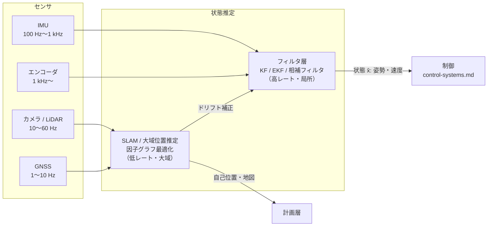

# 知覚と状態推定 (Perception & State Estimation)

## 概要 (Overview)

`control-systems.md` の制御則はすべて「状態 `x` は既知」と仮定していた。実際のロボットが持っているのはノイズを含むセンサ測定値の列だけであり、そこから状態——姿勢・速度・自己位置・周囲の地図——を実時間で再構成する層が**状態推定 (state estimation)** である。制御が「望む未来を作る」層だとすれば、推定は「現在をもっともらしく言い当てる」層であり、両者は同じフィードバックループの両輪をなす。

本ドキュメントは、確率的推定の統一骨格である**ベイズフィルタ (Bayes filter)** を出発点に、カルマンフィルタ (KF) とその非線形拡張 (EKF/UKF)、パーティクルフィルタ、センサフュージョン、そしてオドメトリのドリフトを地図との整合で抑え込む **SLAM (simultaneous localization and mapping)** までを、「どの仮定を置くと何が使えるか」の観点で整理する。数学的前提は [`../../foundations/mathematics/probability-statistics/`](../../foundations/mathematics/probability-statistics/) の確率・推定理論であり、本ドキュメントはその最も直接的な応用先である。

CLAUDE.md の方針に従い分析深度は Level 3（完全）を既定とし、各主張には標準的教科書（Thrun, Barfoot ほか）と一次文献（Kalman の原論文、SLAM サーベイ）を典拠として付す。

## 方法論 (Methodology)

- すべての推定手法を**ベイズフィルタ（予測 → 更新）の近似**として位置づけ、「状態の表現（ガウス分布か粒子か）」と「モデルの扱い（線形化か サンプリングか）」の2軸で分類する。
- センサは `robotics-fundamentals.md` の分類（自己受容/外受容）を引き継ぎ、**誤差の性質**（高周波ノイズか低周波ドリフトか、有界か非有界か）で相補性を説明する。
- SLAM はアルゴリズムの列挙ではなく、**「逐次フィルタから一括最適化（因子グラフ）へ」というパラダイム転換**を軸に整理する[^cadena-slam]。
- 数値（周期・精度）は代表値・桁感を優先する。

## 発見事項 (Findings)

1. **推定はすべて「予測と更新の交互反復」である。** 運動モデルで信念 (belief) を前に進め（予測、不確かさは増える）、測定モデルで補正する（更新、不確かさは減る）——このベイズフィルタの骨格は KF・EKF・UKF・パーティクルフィルタ・SLAM バックエンドまで共通であり、手法の違いは信念の表現と近似の仕方に過ぎない[^thrun]。
2. **カルマンフィルタは線形・ガウスの仮定の下での厳密解であり、その本体はカルマンゲインによる「分散の重み付き平均」である。** 予測と測定を、それぞれの不確かさ（共分散）に反比例する重みで混ぜる——これは [`../../foundations/mathematics/probability-statistics/estimation-hypothesis-testing.md`](../../foundations/mathematics/probability-statistics/estimation-hypothesis-testing.md) の最小分散推定の逐次版である[^kalman]。
3. **非線形への拡張は「どこで線形化するか」の選択である。** EKF はヤコビアン（`kinematics-dynamics.md` と同じ道具）でモデルを線形化し、UKF はシグマ点で分布を輸送し、パーティクルフィルタは分布仮定自体を捨てる。計算コストと歪みへの頑健性のトレードオフが一直線に並ぶ[^thrun]。
4. **センサフュージョンの本質は誤差特性の相補性である。** IMU は高レート・低遅延だが積分でドリフトし（非有界誤差）、視覚・LiDAR・GNSS は低レートだが誤差が有界。**「速いが漂う」センサを「遅いが漂わない」センサで係留する**のがフュージョンの普遍的構図で、姿勢推定の相補フィルタから VIO (visual-inertial odometry) まで同型である。
5. **オドメトリは原理的にドリフトする。増分の積算だからである。** 車輪・脚・視覚のいずれでも、各ステップの小さな誤差が積算され、走行距離に応じて自己位置誤差は非有界に成長する。これを止める唯一の方法が「過去に見た場所を再訪したと認識する」**ループ閉じ込み (loop closure)** であり、この瞬間に問題は逐次推定から大域的な整合問題——SLAM——に変わる。
6. **現代 SLAM は「疎な非線形最小二乗」である。** ポーズと地図点を頂点、測定を辺とする**因子グラフ (factor graph)** 上の最適化として定式化され、問題の疎性（各測定は少数の変数にしか触れない）が大規模化を可能にする[^cadena-slam]。フロントエンド（データ対応付け）とバックエンド（最適化）の分離が標準アーキテクチャである。
7. **脚式ロボットの状態推定は接触が鍵になる。** 浮遊ベースの姿勢・速度は直接測れないため、「接地している足は滑らない」という接触制約を測定として使い、脚キネマティクスと IMU を融合する。接触検知の誤り（滑り・空振り）が推定を汚すため、接触の確からしさ自体も推定対象になる[^bloesch]。

## アーキテクチャ (Architecture)

### 推定と制御のループ



- **二層構成が定石**: 高レートのフィルタ層が制御に状態を供給し続け、低レートの SLAM 層が大域的な補正（ドリフトのリセット）を注入する。制御は 1 kHz の状態を要求し、ループ閉じ込みは数秒に一度しか起きない——時間スケールの分離が層の分離を強制する。
- SLAM の内部はフロントエンド（特徴抽出・データ対応付け・ループ検出）とバックエンド（グラフ最適化）に分かれ、フロントエンドの誤対応が最適化を壊すため、外れ値除去 (robust kernel, RANSAC) が実用上の生命線になる。

### 手法の分類 — 信念の表現 × モデルの扱い

| 手法 | 信念の表現 | 非線形の扱い | 計算量の目安 | 主用途 |
|---|---|---|---|---|
| KF | ガウス（平均+共分散） | 線形のみ | 状態次元の3乗 | 線形系・融合の基本形 |
| EKF | ガウス | ヤコビアンで線形化 | 同上 | VIO・脚式・姿勢推定 |
| UKF | ガウス | シグマ点の輸送 | 同上（点数倍） | 強い非線形・導関数が取りにくい系 |
| パーティクルフィルタ | 粒子集合 | そのまま扱える | 粒子数に線形 | 大域自己位置推定・多峰分布 |
| 因子グラフ最適化 | 全軌跡の MAP | 反復再線形化 | 疎性を利用 | SLAM バックエンド |

## 技術詳細 (Technical Details)

### 1. ベイズフィルタ (Bayes Filter)

状態 `x` の信念 `bel(x_t) = p(x_t | z_{1:t}, u_{1:t})` を、2 ステップで逐次更新する:

```
予測:  bel⁻(x_t) = ∫ p(x_t | u_t, x_{t-1}) · bel(x_{t-1}) dx_{t-1}   （運動モデル）
更新:  bel(x_t)  ∝ p(z_t | x_t) · bel⁻(x_t)                         （測定モデル）
```

- 必要なのは運動モデル `p(x_t|u_t,x_{t-1})` と測定モデル `p(z_t|x_t)` の2つだけ。以降のすべての手法は、この積分と正規化をどう計算可能にするかの近似である[^thrun]。
- マルコフ性（現在の状態が過去を要約する）が前提であり、状態ベクトルの設計とは「何を含めればマルコフ性が成り立つか」を決める作業である（例: IMU バイアスを状態に含めるのはバイアスが時間相関を持つから）。

### 2. カルマンフィルタ (Kalman Filter)

線形状態方程式 `x_t = A·x_{t-1} + B·u_t + w`（`w ~ N(0,Q)`）と線形測定 `z_t = H·x_t + v`（`v ~ N(0,R)`）の下で、ベイズフィルタは閉形式になる:

```
予測:  x̂⁻ = A·x̂ + B·u              P⁻ = A·P·Aᵀ + Q
更新:  K  = P⁻·Hᵀ·(H·P⁻·Hᵀ + R)⁻¹   （カルマンゲイン）
       x̂  = x̂⁻ + K·(z − H·x̂⁻)       P  = (I − K·H)·P⁻
```

- **カルマンゲイン `K` がすべて**: 測定が信頼できる（`R` 小）ほど `K` は大きく測定側に寄り、予測が信頼できる（`P⁻` 小）ほど測定を無視する。フュージョンの「重み付き平均」が行列の形で自動的に決まる[^kalman]。
- 実装上の急所は `Q, R` のチューニング（実測の Allan 分散などから決める）と、共分散 `P` の数値的な対称性・正定値性の維持（平方根フィルタ）——[`../../foundations/mathematics/linear-algebra/matrix-factorizations-numerical.md`](../../foundations/mathematics/linear-algebra/matrix-factorizations-numerical.md) の数値安定性の議論が直接効く。

### 3. 非線形拡張 — EKF・UKF・パーティクルフィルタ

- **EKF**: 非線形モデル `f, h` を現在推定値まわりのヤコビアンで線形化して KF の式を回す。ロボティクスの実装の大半（VIO、脚式、GNSS/INS 統合）は EKF 系である。線形化誤差は推定値が真値から離れるほど大きくなり、**フィルタの過信（共分散の過小評価）→ 発散**が古典的な故障モード。
- **UKF**: 分布を代表するシグマ点を非線形関数にそのまま通し、変換後の点群から平均・共分散を再構成する（unscented 変換）。ヤコビアン不要で、2次精度[^julier-ukf]。
- **パーティクルフィルタ**: 信念を粒子の集合で表す。多峰性（「廊下のどちら側かわからない」）を表現できる唯一の選択肢で、占有格子地図上の大域自己位置推定 (Monte Carlo localization) の標準手法。次元の呪いにより高次元状態には不向き[^thrun]。

### 4. センサフュージョンの定石 (Sensor Fusion Patterns)

| 組合せ | 速いが漂う側 | 遅いが漂わない側 | 代表例 |
|---|---|---|---|
| 姿勢推定 | ジャイロ積分 | 加速度計の重力方向 | 相補フィルタ / Madgwick |
| VIO | IMU 積分 | カメラの特徴点再投影 | スマートフォン AR、ドローン |
| 車輪オドメトリ統合 | エンコーダ積算 | LiDAR スキャンマッチング | AMR の自己位置推定 |
| GNSS/INS | IMU 積分 | GNSS 絶対位置 | 屋外移動ロボット・自動車 |
| 脚式 | IMU 積分 | 接地足の運動学的拘束 | 四足・ヒューマノイド[^bloesch] |

- IMU を高レート側に置く構図が共通で、**IMU の性能（バイアス安定性）が「係留の間隔をどこまで空けられるか」を決める**。トンネル内の GNSS 断、モーションブラー時の視覚断など、「漂わない側」が抜ける時間の長さが要求 IMU グレードを規定する。
- 時刻同期がフュージョンの隠れた前提である。センサ間のタイムスタンプずれは、速度に比例した系統誤差として推定に混入する（[`../timekeeping/clocks-time-synchronization.md`](../timekeeping/clocks-time-synchronization.md) の時刻同期が物理的土台）。

### 5. SLAM (Simultaneous Localization and Mapping)

自己位置は地図があれば求まり、地図は自己位置があれば作れる——両方ないのが SLAM の鶏卵構造である。

- **定式化の変遷**: 初期は EKF-SLAM（地図点を状態ベクトルに含める。計算量が地図点数の2乗で破綻）、次にパーティクル系 (FastSLAM)、現代は**グラフベース**が支配的[^cadena-slam]。
- **因子グラフ**: ロボットの各時刻のポーズ `x_i` と地図要素 `l_j` を変数頂点、オドメトリ・観測・ループ閉じ込みを因子（制約）とし、全測定と最も整合する変数値を求める:

```
X* = argmin_X Σ_k ‖ h_k(X_k) − z_k ‖²_{Σ_k}
     （h_k: 測定予測, z_k: 実測, Σ_k: 測定共分散 — 重み付き非線形最小二乗）
```

  ガウス・ニュートン / Levenberg–Marquardt の反復で解き、ヤコビアンの**疎性**（各因子は 2〜3 変数にしか触れない）により数万変数でも実時間で解ける。GTSAM・g2o・Ceres が標準実装。
- **ループ閉じ込み**: 再訪の認識（外観ベース: bag-of-words、LiDAR: スキャン記述子）が成立した瞬間、蓄積ドリフトがグラフ全体に再分配されて解消する。**誤ったループ閉じ込みは地図を大域的に破壊する**ため、幾何的検証と頑健コスト関数 (robust kernel) で防御する。
- **地図表現**: 占有格子 (occupancy grid、2D 移動ロボットの標準)、点群・特徴点地図（位置推定向き）、TSDF / メッシュ（接触・操作向き）。用途が表現を決め、単一の万能地図は存在しない。

## セキュリティ考察 (Security Considerations)

- **推定は攻撃面である。** 制御はセンサを直接見ず推定値を信じるため、センサへの攻撃は推定を経由して制御に届く。GNSS スプーフィング（偽衛星信号による位置の誘導）は実証済みの脅威であり、LiDAR への赤外パルス注入・カメラへの敵対的パターンも研究レベルで示されている。防御の基本は**フュージョンの冗長性**——単一センサでは推定が動かない構成にし、イノベーション（測定残差）の統計的監視で「あり得ない測定」を棄却する（χ² 検定によるゲーティング）。
- **推定の故障は制御の故障として現れる。** フィルタ発散・誤ったループ閉じ込みは、制御器から見ると「状態の突然のジャンプ」であり、機体の急動作に直結する。共分散の監視（過信の検出）、推定値のレート制限、推定系と独立な安全層（`control-systems.md` の STO/SLS は推定を経由しない関節側の量で動く）が防護壁になる。
- **地図はプライバシーと完全性の対象である。** 稼働環境の 3D 地図は施設情報そのものであり、クラウドへの地図アップロードは情報漏洩経路になる。また永続地図の改竄は、以後のすべての自己位置推定を系統的に歪める——地図データの署名・変更監査は `control-systems.md` のパラメータ完全性と同じ扱いが要る。

## 結論 (Conclusions)

状態推定は、ベイズフィルタという単一の骨格の上に、「**何をガウスと信じ、どこを線形化し、どの誤差を誰に係留させるか**」という近似の選択を積んだ体系である。カルマンゲイン（分散による重み付け）、ヤコビアン（線形化）、疎な最小二乗（SLAM）——使われている数学はすべて [`../../foundations/mathematics/`](../../foundations/mathematics/) で整備済みの道具であり、確率統計シリーズの推定理論が物理システムの中で動いている姿がここにある。

### 続編への橋渡し

状態と地図が手に入ったので、次は「どこへどう動くか」——[`locomotion-manipulation.md`](locomotion-manipulation.md) で、移動（経路計画・脚式歩行）と操作（把持・接触作業）に進む。そこでは本ドキュメントの推定値が計画の入力になり、推定の不確かさが安全余裕の設計に直結する。

---

## 参考文献 (References)

[^thrun]: Thrun, S., Burgard, W. & Fox, D. (2005). *Probabilistic Robotics*. MIT Press. — ベイズフィルタ・KF/EKF/UKF/パーティクルフィルタ・Monte Carlo localization の標準的典拠。

[^kalman]: Kalman, R. E. (1960). A New Approach to Linear Filtering and Prediction Problems. *Journal of Basic Engineering*, 82(1), 35–45. DOI: 10.1115/1.3662552 — カルマンフィルタの原典。

[^julier-ukf]: Julier, S. J. & Uhlmann, J. K. (2004). Unscented Filtering and Nonlinear Estimation. *Proceedings of the IEEE*, 92(3), 401–422. DOI: 10.1109/JPROC.2003.823141 — unscented 変換・UKF の定式化。

[^cadena-slam]: Cadena, C. et al. (2016). Past, Present, and Future of Simultaneous Localization and Mapping: Toward the Robust-Perception Age. *IEEE Transactions on Robotics*, 32(6), 1309–1332. DOI: 10.1109/TRO.2016.2624754 — グラフベース SLAM への収斂を整理した標準サーベイ。

[^bloesch]: Bloesch, M. et al. (2013). State Estimation for Legged Robots: Consistent Fusion of Leg Kinematics and IMU. *Robotics: Science and Systems VIII*. DOI: 10.15607/RSS.2012.VIII.003 — 接触制約を用いた脚式状態推定の代表的定式化。

その他の標準的典拠:

- Barfoot, T. D. (2017). *State Estimation for Robotics*. Cambridge University Press. — SO(3)/SE(3) 上の推定・因子グラフの数学的に厳密な扱い。
- Dellaert, F. & Kaess, M. (2017). Factor Graphs for Robot Perception. *Foundations and Trends in Robotics*, 6(1-2), 1–139. DOI: 10.1561/2300000043 — 因子グラフ定式化と GTSAM の理論的背景。
