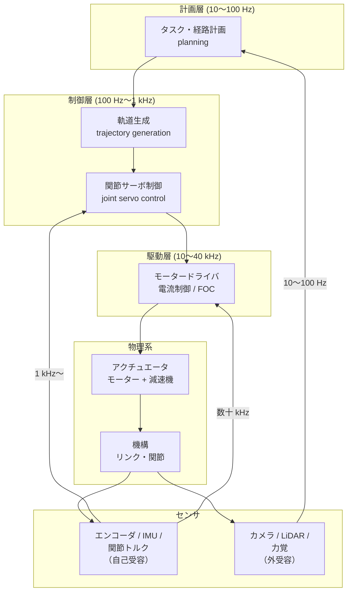

# ロボット工学基礎 (Robotics Fundamentals)

## 概要 (Overview)

ロボット (robot) は、**センシング（知覚）→ 計算（判断）→ アクチュエーション（行動）** のループを物理世界に対して閉じる機械である。ソフトウェアだけのシステムと決定的に違うのは、このループの中に**慣性・摩擦・遅れ・ノイズを持つ物理プラント**が挟まっている点であり、ロボット工学 (robotics) とはこの「物理を挟んだ制御ループ」を意図どおりに・安全に・実時間で回すための学問体系である。

本ドキュメントは、地上ロボット——産業用マニピュレータ (industrial manipulator)、脚式ロボット (legged robot)、自律移動ロボット (AMR)——を対象に、ロボットを構成する要素技術（アクチュエータ・センサ・計算機・制御階層）を「なぜこの部品構成になるのか」の粒度で整理する。後続の `kinematics-dynamics.md`（機構の数学）と `control-systems.md`（制御則）の土台となる、領域の入口である。

CLAUDE.md の方針に従い分析深度は Level 3（完全）を既定とし、各主張には標準的なロボット工学の教科書（Siciliano, Lynch & Park ほか）と安全規格 (ISO 10218, ISO/TS 15066) を典拠として付す。

## 方法論 (Methodology)

- ロボットを **「機構 + アクチュエータ + センサ + 計算機」の4要素**に分解し、各要素を「性能指標」と「支配的なトレードオフ」で押さえる（トルク密度 vs バックドライバビリティ、分解能 vs 周期、汎用性 vs 決定性）。
- 数値は代表機・部品カタログ・教科書の代表値に基づき、**桁感 (order of magnitude) を優先**する。個別製品の精密諸元ではなく、設計判断の理解が目的。
- 制御は本ドキュメントでは**階層と周期**（どの層が何 Hz で回るか）の構造だけを押さえ、制御則の中身は `control-systems.md` に譲る。
- 安全は「事故らないこと」ではなく**規格が定める設計手順**（ISO 10218 / ISO/TS 15066）として扱い、`../automotive/functional-safety-iso26262.md` の機能安全の考え方と接続する。

## 発見事項 (Findings)

1. **ロボットは「実時間制約付きの sense-plan-act ループ」である。** 電流制御は数十 kHz、関節サーボは 1 kHz 前後、経路計画は 10〜100 Hz——周期の異なるループが階層をなし、内側ほど速く・決定的に回る。この階層構造がロボットのソフト/ハード構成（専用ドライバ IC → リアルタイム制御器 → 汎用計算機）をそのまま決める。
2. **アクチュエータ選定は「減速比の2乗」に支配される。** モーター回転子の慣性は減速比 `N` を介して出力側から `N²` 倍に見える（反射慣性, reflected inertia）[^lynch-park]。高減速比はトルク密度を稼ぐ代わりに、外力に従って動く性質（バックドライバビリティ, backdrivability）と衝突時の安全性を失う。産業用（高剛性・高精度）とヒューマノイド（低減速比 QDD）の設計が分岐する根本原因がここにある。
3. **減速機がロボットの精度と価格を決める。** 波動歯車 (strain wave / harmonic drive) はバックラッシ実質ゼロで協働・小型ロボットの標準、サイクロイド (cycloidal, RV) は耐衝撃・高剛性で大型産業用の標準、遊星 (planetary) は高効率・低減速比で脚式に使われる。関節あたりの減速機コストがロボット原価の大きな割合を占める。
4. **センサは自己受容 (proprioceptive) と外受容 (exteroceptive) に大別され、前者が制御を、後者が自律を支える。** エンコーダ・IMU・関節トルクセンサは制御ループの内側で使われるため分解能と遅延が支配的要件になり、カメラ・LiDAR は知覚・計画層で使われるため情報量が支配的要件になる。
5. **エンコーダの実効分解能は減速比で増幅される。** モーター側（減速機の入力側）に付けたエンコーダは出力軸換算で分解能が `N` 倍になるが、減速機のねじれ・バックラッシは見えない。出力側エンコーダを追加する「デュアルエンコーダ」構成が高精度関節の定石で、これは**測るべき状態が「モーターの角度」ではなく「リンクの角度」である**ことの帰結。
6. **協働ロボット (collaborative robot) は安全方式の変更であって別種の機械ではない。** ISO/TS 15066 が定める4方式（監視停止・手動誘導・速度と間隔の監視・動力と力の制限）のうち、いわゆる「コボット」は動力と力の制限 (PFL) を実装したものであり、力覚センシング・低慣性設計・接触検知がその技術的中身である[^iso15066]。
7. **ヒューマノイドの潮流は「アクチュエータの低減速比化 + 制御の学習化」である。** 準直動アクチュエータ (quasi-direct drive, QDD) が電流からのトルク推定（プロプリオセプティブ・アクチュエーション）を可能にし[^wensing-qdd]、モデル予測制御や強化学習と組み合わさって動的な歩行・接触作業を実現している。事例分析はロードマップの `humanoid-robots-analysis` で扱う。

## アーキテクチャ (Architecture)

### ロボットシステムの全体構成



- ループは入れ子であり、**内側のループは外側より 5〜10 倍以上速く**回すのが設計の定石（外側から見て内側が「即応する理想アクチュエータ」に見えるようにする）。
- 駆動層は専用 IC / マイコン（モータードライバ）、制御層はリアルタイム制御器、計画層は汎用計算機（Linux + GPU）と、**周期要件がそのまま計算機の種類に対応**する。層間を繋ぐ産業用フィールドバス（EtherCAT 等）は `control-systems.md` で扱う。

### ロボットの分類

| 分類 | 機構の特徴 | 代表例 | 支配的な技術課題 |
|---|---|---|---|
| 産業用マニピュレータ | 6軸直列リンク、床固定 | 溶接・搬送ロボット | 精度・剛性・サイクルタイム |
| SCARA / パラレルリンク | 水平多関節 / 並列機構 | 電子部品実装、ピッキング | 速度・繰返し精度 |
| 協働ロボット (cobot) | 低慣性・力制限付きアーム | 人と同一空間での組立 | 接触安全 (PFL)・力覚 |
| AMR / AGV | 車輪移動台車 | 倉庫内搬送 | 自己位置推定・経路計画 |
| 脚式・ヒューマノイド | 多接触・浮遊ベース | 四足ロボット、人型 | 動的バランス・高トルク密度 |

- 直列リンク機構は可動域が広い代わりに誤差と慣性が先端へ累積し、パラレル機構は逆に高剛性・高速だが可動域が狭い——**機構トポロジーの選択が精度・速度・可動域のトレードオフを最初に決める**。
- 脚式は「床に固定されていない（浮遊ベース, floating base）」「接触が断続する」の2点で他と質的に異なり、制御問題が一段難しくなる（`control-systems.md` の MPC 節で触れる）。

## 技術詳細 (Technical Details)

### 1. アクチュエータ — モーター (Actuators: Motors)

ロボット関節の主流は**永久磁石同期モーター (PMSM) / ブラシレス DC モーター (BLDC)** である。トルクは磁束と電流の相互作用で生まれ、実用上は次の線形関係で扱える:

```
τ = K_t · i        （τ: トルク, K_t: トルク定数, i: 電流）
```

- この線形性が「**電流を測ればトルクが分かる**」ことを意味し、後述の QDD によるトルク推定の物理的根拠になる。磁気の原理は [`../../foundations/physics/electromagnetism/current-magnetostatics.md`](../../foundations/physics/electromagnetism/current-magnetostatics.md) を参照。
- 駆動はインバータによる**ベクトル制御 (field-oriented control, FOC)** が標準で、電流ループを 10〜40 kHz で回す。EV のトラクションモーターと同じ技術系譜であり（[`../automotive/ev/tesla-battery-powertrain.md`](../automotive/ev/tesla-battery-powertrain.md) 参照）、ロボットはその小型・高応答版といえる。
- ロボット用途で効く性能指標は最高出力よりも**トルク密度 (Nm/kg) と熱的な連続トルク**。関節は低速・高トルク・頻繁な正逆転で使われるため、熱設計（巻線の許容温度）が実効性能を決める。

### 2. アクチュエータ — 減速機 (Actuators: Gear Reducers)

モーターは高速・低トルクが得意で、関節は低速・高トルクを要求する。この変換を担う減速機がロボットの精度・剛性・コストを支配する。

| 方式 | 減速比 (1段) | バックラッシ | 特徴 | 主用途 |
|---|---|---|---|---|
| 波動歯車 (strain wave) | 50〜160 | 実質ゼロ | 小型軽量・高精度、ねじり剛性は低め | 協働・小型多関節の手首 |
| サイクロイド (cycloidal / RV) | 30〜200 | 極小 | 高剛性・耐衝撃 | 大型産業用の基幹軸 |
| 遊星 (planetary) | 3〜10 | 小（数 arcmin） | 高効率・低減速比を段数で調整 | 脚式・QDD・走行系 |
| ボールねじ / 直動 | — | 極小 | 回転→直動変換、高推力 | 直交ロボット、脚の直動関節 |

**反射慣性 (reflected inertia)** — 減速比選定の核心。減速比 `N` の減速機を介すと、モーター回転子の慣性 `J_m` は出力側から:

```
J_reflected = N² · J_m
```

と **2乗で拡大されて**見える[^lynch-park]。`N = 100` なら1万倍である。帰結として:

- **高減速比 (N ≳ 50)**: トルク密度は高いが、出力側慣性が巨大になり、外力への追従（バックドライブ）が実質不可能。衝突時は減速機がトルクを増幅して伝えるため、力制御・接触安全にはセンサの追加が必須。
- **低減速比 (N ≈ 6〜10) = 準直動 (QDD)**: 大径・多極のモーターでトルクを直接稼ぎ、遊星1段のみで減速。バックドライブ可能で、**電流測定だけで出力トルクを推定できる**（プロプリオセプティブ・アクチュエーション）。MIT Cheetah 系の脚式ロボットが確立し[^wensing-qdd]、ヒューマノイドの主流アプローチになった。
- **直列弾性アクチュエータ (series elastic actuator, SEA)**: 減速機と出力の間に既知剛性のバネを挟み、そのたわみからトルクを測る第3の解。力測定は正確だが制御帯域を犠牲にする[^pratt-sea]。

### 3. センサ (Sensors)

| センサ | 測るもの | 分解能・帯域の代表値 | 使われる層 |
|---|---|---|---|
| インクリメンタルエンコーダ | 相対角度（A/B 相 + Z 相） | 数千〜数万 PPR | 駆動・制御層 |
| アブソリュートエンコーダ | 絶対角度（光学/磁気） | 17〜23 bit/回転 | 制御層（原点復帰不要化） |
| IMU（ジャイロ + 加速度計） | 角速度・加速度 | 100 Hz〜1 kHz 出力 | 姿勢推定（脚式・AMR） |
| 関節トルクセンサ | 関節の伝達トルク | ひずみゲージ式 | 力制御・接触検知 |
| 6軸力覚センサ | 手先の力とモーメント | 6成分同時 | 組立・研磨などの接触作業 |
| カメラ / depth / LiDAR | 外界の形状・意味 | 10〜60 fps | 知覚・計画層 |

- **エンコーダの配置**が測定の意味を変える。モーター側エンコーダは分解能が出力軸換算で `N` 倍になるが、減速機のねじれ・バックラッシの「向こう側」を測れない。**出力側エンコーダを併設するデュアルエンコーダ**が高精度関節・協働ロボットの定石で、両者の差分は減速機のたわみ＝伝達トルクの推定にも使える。
- **IMU は積分でドリフトする**（ジャイロのバイアス不安定性）。単体では姿勢を保持できず、エンコーダ・視覚との融合（カルマンフィルタ）が前提になる。融合の理論は [`../../foundations/mathematics/probability-statistics/estimation-hypothesis-testing.md`](../../foundations/mathematics/probability-statistics/estimation-hypothesis-testing.md) の推定理論が土台で、ロードマップの知覚・状態推定編で深掘りする。
- カメラ・イメージセンサの物理は [`../peripherals-connectivity/camera-image-sensors.md`](../peripherals-connectivity/camera-image-sensors.md) を参照。

### 4. 制御ループの階層と周期 (Control Loop Hierarchy)

| 層 | 周期の代表値 | 実行主体 | 決定性の要求 |
|---|---|---|---|
| 電流 (FOC) | 10〜40 kHz | ドライバ IC / MCU | ハードリアルタイム |
| 速度・位置サーボ | 1〜4 kHz | サーボ制御器 | ハードリアルタイム |
| 全身制御・軌道追従 | 100 Hz〜1 kHz | リアルタイム PC / RTOS | ハードリアルタイム |
| 経路・タスク計画 | 10〜100 Hz | 汎用 PC (Linux + GPU) | ソフトリアルタイム |
| 知覚・学習推論 | 10〜60 Hz | GPU / アクセラレータ | ソフトリアルタイム |

- 周期とジッタの要求が層ごとに1桁ずつ違うため、**単一の計算機では成立せず**、役割の異なる計算機をフィールドバスで結合する分散構成が必然になる。この構成は車載 E/E アーキテクチャ（[`../automotive/ee-architecture.md`](../automotive/ee-architecture.md)）のドメイン統合と同型の問題であり、リアルタイム OS 側の議論は [`../../software/embedded-rtos/`](../../software/embedded-rtos/) で扱う。
- 学習ベース制御（強化学習ポリシー）は多くの場合 50〜1000 Hz で推論され、GPU 推論基盤の設計は [`../../software/ml-systems/ml-inference-systems.md`](../../software/ml-systems/ml-inference-systems.md) と地続きである。

### 5. 電源と熱 (Power & Thermal)

- 移動ロボット・ヒューマノイドはリチウムイオン電池駆動が標準で、電池パック設計・熱管理の考え方は EV と共通（[`../automotive/ev/ev-fundamentals.md`](../automotive/ev/ev-fundamentals.md) 参照）。関節モーターの回生エネルギーを母線で共有する設計も EV と同型。
- 実効的な連続稼働時間は「電池容量」ではなく**関節の熱容量**で律速されることが多い。歩行・保持など重力に抗し続けるタスクは電流を流し続けるため、巻線温度が上限に達した関節から性能が落ちる。

## セキュリティ考察 (Security Considerations)

> ロボットの第一のリスクは物理的危害であるため、本節はセキュリティ（悪意）とセーフティ（機能安全）の両方を扱う。

### 機能安全 — 規格の構造

- **ISO 10218-1/-2**（産業用ロボットの安全要求）が製造者側（-1: ロボット本体）と統合者側（-2: システム統合）の要求を定める[^iso10218]。安全関連制御部の性能は ISO 13849-1 のパフォーマンスレベル (PL) / IEC 62061 の SIL で規定され、`../automotive/functional-safety-iso26262.md` の ASIL と同じ「リスクに応じた完全性レベル」の考え方である。
- **ISO/TS 15066**（協働ロボット）は人とロボットの協働を4方式に整理する[^iso15066]:
  1. 安全適合監視停止 (safety-rated monitored stop) — 人が入ると停止
  2. ハンドガイド (hand guiding) — 人が直接誘導
  3. 速度・間隔監視 (speed and separation monitoring) — 距離に応じて減速
  4. 動力・力制限 (power and force limiting, PFL) — 接触しても許容値以下の力に制限
  PFL は身体部位ごとの許容圧力・力の生体力学的閾値を付属書で定めており、「コボット」の力覚センシング・低慣性設計はこの閾値を満たすための実装である。
- **停止カテゴリ (IEC 60204-1)**: カテゴリ0（即時遮断）/ 1（制御停止後に遮断）/ 2（制御停止・動力維持）。ドライブ側の安全機能 STO (safe torque off)・SS1・SLS (safely-limited speed) は IEC 61800-5-2 が定義し、非常停止の実体はこれらの組合せである。

### セキュリティ（悪意への耐性）

- 産業用フィールドバス（EtherCAT 等）は**認証・暗号化を持たない**設計が多く、制御ネットワークへの侵入は直接に物理的危害へ転化しうる。OT ネットワークの分離・境界防御の考え方は [`../power-generation/plant-control-scada-security.md`](../power-generation/plant-control-scada-security.md) の SCADA セキュリティと共通で、車載の ISO/SAE 21434（[`../automotive/cybersecurity-iso21434.md`](../automotive/cybersecurity-iso21434.md)）に相当する枠組みが産業ロボットにも求められつつある。
- 遠隔操作・フリート管理（クラウド接続 AMR）は、安全機能（速度制限・ジオフェンス）を**ネットワーク側から無効化できない構造**にすることが設計原則になる（安全 PLC と情報系の分離）。

## 結論 (Conclusions)

ロボットとは、**周期の異なる制御ループの入れ子**を、**減速比のトレードオフに支配されたアクチュエータ**と**配置が意味を決めるセンサ**で物理世界に閉じたシステムである。設計の分岐点は一貫して「剛性・精度を取るか（高減速比 + 位置制御）、接触・適応を取るか（低減速比/力覚 + 力制御）」にあり、産業用ロボットとヒューマノイドはこの選択の両極にいる。

### 続編への橋渡し

- 機構を数学として扱う言語——同次変換・ヤコビアン・運動方程式——を [`kinematics-dynamics.md`](kinematics-dynamics.md) で整備する。本ドキュメントの「反射慣性」「トルクと電流の線形性」は、そこで運動方程式 `M(q)q̈ + C(q,q̇)q̇ + g(q) = τ` の構造として再登場する。
- その運動方程式を実際に閉ループで回す制御則——PID から MPC・インピーダンス制御まで——を [`control-systems.md`](control-systems.md) で扱う。

---

## 参考文献 (References)

[^lynch-park]: Lynch, K. M. & Park, F. C. (2017). *Modern Robotics: Mechanics, Planning, and Control*. Cambridge University Press. — 反射慣性・アクチュエータ選定・ロボット機構の標準的典拠。

[^wensing-qdd]: Wensing, P. M. et al. (2017). Proprioceptive Actuator Design in the MIT Cheetah: Impact Mitigation and High-Bandwidth Physical Interaction for Dynamic Legged Robots. *IEEE Transactions on Robotics*, 33(3), 509–522. DOI: 10.1109/TRO.2016.2640183 — QDD・プロプリオセプティブ・アクチュエーションの原典。

[^pratt-sea]: Pratt, G. A. & Williamson, M. M. (1995). Series Elastic Actuators. *Proc. IEEE/RSJ IROS*, 399–406. DOI: 10.1109/IROS.1995.525827 — 直列弾性アクチュエータの原典。

[^iso10218]: ISO 10218-1:2011 / ISO 10218-2:2011. *Robots and robotic devices — Safety requirements for industrial robots*. — 産業用ロボット安全要求（2025 年改訂版が発行済み。参照時は最新版を確認のこと）。

[^iso15066]: ISO/TS 15066:2016. *Robots and robotic devices — Collaborative robots*. — 協働運転の4方式と生体力学的閾値。

その他の標準的典拠:

- Siciliano, B., Sciavicco, L., Villani, L. & Oriolo, G. (2009). *Robotics: Modelling, Planning and Control*. Springer. — ロボット工学全般の標準教科書。
- Siciliano, B. & Khatib, O. (Eds.) (2016). *Springer Handbook of Robotics* (2nd ed.). Springer. — 各要素技術のリファレンス。
- Hughes, A. & Drury, B. (2019). *Electric Motors and Drives* (5th ed.). Newnes. — BLDC/PMSM・インバータ駆動の実務的典拠。
