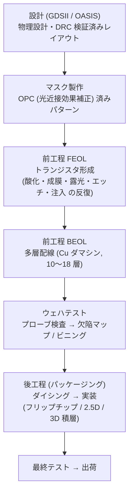

# 半導体製造 (Semiconductor Fabrication): リソグラフィ・プロセスノード・チップレット

## 概要 (Overview)

本リポジトリの計算機システム分析はすべて「チップは存在する」ことを前提にしてきた。本ドキュメントはその前提そのもの——**砂 (シリコン) が数百億トランジスタの論理回路になるまでの製造プロセス**——を扱う。[`../cpu/`](../cpu/README.md) が「なぜこの設計か」を問うたのと同じ姿勢で、「なぜこの作り方か」を問う。

中心テーゼは、**半導体のスケーリングは一本道ではなく「軸の乗り換え」の連続である**、ということ。寸法の縮小 (古典的スケーリング) が物理限界に当たるたびに、産業は別の軸——電圧 (Dennard) → 並列性 (マルチコア) → トランジスタの立体化 (FinFET→GAA) → 露光波長 (DUV→EUV) → パッケージ (モノリシック→チップレット)——へ乗り換えて「実効的なムーアの法則」を延命してきた。[`../storage/nand-flash-ftl.md`](../storage/nand-flash-ftl.md) が示した「平面微細化を捨てて 3D 積層へ」という NAND の転回は、この同じパターンの一例である。

もう一つの柱は**歩留まり (yield) の経済**である。製造は確率過程であり、欠陥はゼロにできない。ダイ面積と歩留まりの指数関数的な関係が、レティクル限界とともに「大きな 1 枚のダイ」を経済的に成立不能にし、チップレット (chiplet) という設計様式を強制した——AMD の Zen 系や HBM を積む AI GPU のパッケージ構造は、設計の趣味ではなく製造経済の帰結である。

本書は (1) 製造フローの全体像、(2) リソグラフィと EUV、(3) プロセスノードの実像 (名前と実寸の乖離、FinFET→GAA)、(4) 歩留まりの数理、(5) チップレットと先端パッケージング、を整理する。分析深度は Level 3。

## 方法論 (Methodology)

- スケーリングの各転回点を「何の物理限界に当たり、どの軸へ逃げたか」で統一的に記述する。個別技術はこの枠組みの中の位置として説明する。
- 解像度・歩留まり・チップレットの経済は、レイリーの式・ポアソン歩留まりモデル・ダイ取得数という**定量モデルから演繹**する。数値そのもの (密度・価格) は変動が速いため、公称値・推定値の別と参照時点を明示する。
- 一次資料は原著論文 (Moore 1965, Dennard 1974, Naffziger et al. 2021) と装置・ファウンドリの公式技術資料を優先し、密度・コスト推定は独立系の分析 (TechInsights, CSET) で三角測量する。
- 製造装置の内部 (エッチング・成膜の各論) は今後の深掘りに委ね、本書は「ソフトウェア/アーキテクチャ側の読者が設計判断を理解するのに必要な製造知識」を軸に選択する。

## 発見事項 (Findings)

1. **チップは「印刷」で作られ、その解像度は物理学の一本の式が支配する。** リソグラフィの最小解像寸法はレイリーの式 CD = k₁·λ/NA (波長 λ、開口数 NA、プロセス係数 k₁) で決まる。過去 40 年の微細化の歴史は、この 3 変数をそれぞれ限界まで搾る歴史——波長を 436→193→13.5 nm へ、NA を液浸で 1.35 へ、k₁ をマルチパターニングで理論限界 0.25 近傍へ——として一本に読める。
2. **EUV は「光源から作り直した」技術であり、その困難さが供給を一社に集中させた。** 波長 13.5 nm の光はレンズを透過せず (あらゆる物質に吸収される)、鏡 (Mo/Si 多層膜、反射率約 70%) だけで光学系を組む。錫 (Sn) の液滴を毎秒約 5 万回レーザーで撃ってプラズマ化する光源、真空中の全反射光学系という構成は 20 年以上の開発を要し、量産装置を作れるのは ASML 一社である——**技術的困難がそのまま地政学的単一障害点になった**。
3. **プロセスノードの名前は寸法ではない。**「5nm」のチップに 5 nm の構造は存在しない (N5 のゲートピッチは約 51 nm、金属ピッチは約 30 nm)。28nm 世代以降、ノード名は物理寸法から切り離されたマーケティング上の世代名であり、実際の比較にはトランジスタ密度 (MTr/mm²) と PPA (性能・電力・面積) を使うほかない。ベンダ間の「同名ノード」も等価ではない。
4. **トランジスタは「電流を止めきる」ために立体化してきた。** 微細化でゲートがチャネルを静電的に支配しきれなくなる (短チャネル効果・リーク) たびに、ゲートがチャネルを囲む面を増やしてきた——平面 (1 面) → FinFET (3 面、Intel 22nm・2011) → GAA ナノシート (4 面・全周、Samsung 3nm・2022 以降)。Dennard スケーリングの終焉 (2000 年代半ば) も本質は同じリーク問題であり、[`../cpu/`](../cpu/README.md) のマルチコア転回・ダークシリコンはこの製造物理の直接の帰結である。
5. **歩留まりはダイ面積の指数関数で崩壊する。** 欠陥がウェハ上にランダムに散る単純モデル (ポアソン) で歩留まり Y = e^(−A·D₀) (A: ダイ面積、D₀: 欠陥密度)。同じ D₀ でも 70 mm² のチップレットと 800 mm² のモノリシック GPU では歩留まりが桁で違い、さらに露光装置のレティクル限界 (約 858 mm²) が単一ダイの物理上限を画す。**大きなチップを作る唯一の方法が「小さく作って繋ぐ」になった**。
6. **チップレットは歩留まり・ノード適合・再利用の三重の裁定取引である。** (a) 小ダイで歩留まりを回復し、(b) スケーリング利得の乏しい回路 (アナログ・I/O) を安価な旧ノードに残し (AMD の IOD が 12/14nm 級に留まった理由)、(c) 同一ダイを製品ラインで使い回す。AMD の実測では 16 コア製品をチップレット化した場合のコストはモノリシック比で半分以下と報告されている (Naffziger et al. 2021)。代償はダイ間接続のエネルギーとレイテンシであり、パッケージ内配線 (インターポーザ・ブリッジ・ハイブリッドボンディング) の進化はこの代償の圧縮競争である。
7. **先端パッケージングが新しいボトルネックである。** HBM を GPU に隣接させる 2.5D 実装 (TSMC CoWoS 等) は AI アクセラレータの必須構造になり、2023 年以降の GPU 供給制約はウェハではなくパッケージング能力が律速となる局面が報じられた。「ムーアの法則の続き」がパッケージ工場で起きている——[`../accelerators/`](../accelerators/README.md) のメモリ帯域の議論は、物理的にはこの実装技術の話である。

## アーキテクチャ (Architecture)

### 製造フローの全体像 — 設計データからパッケージ品まで



- 前工程は数百〜千超の工程ステップ、リードタイムは数ヶ月に及ぶ。同じ「成膜→露光→エッチ」のループを層ごとに数十回繰り返す反復構造であり、1 ステップの欠陥が全層を無駄にするため、**ライン全体が統計的プロセス管理の塊**である。
- FEOL (front end of line) がトランジスタを、BEOL (back end of line) が配線を作る。配線遅延がゲート遅延を上回って久しく、[`../cpu/cache-memory-hierarchy.md`](../cpu/cache-memory-hierarchy.md) が扱う「距離のコスト」は BEOL の物理に根がある。

### スケーリングの軸の乗り換え — 年表

```
 寸法+電圧      1970s–2005   Dennard スケーリング (縮小すれば速く・低電力に)
     │                        └ リーク電流で終焉 → 周波数停滞・マルチコア転回
 並列性        2005–         コア数・SIMD・アクセラレータ (アーキテクチャ側の応答)
 立体化        2011–         FinFET (22nm) → GAA ナノシート (3nm 世代〜)
 露光波長      2019–         DUV 193nm 液浸+マルチパターニング → EUV 13.5nm 量産 (7nm+)
 給電の裏面化   2024–         裏面電源供給 (Intel PowerVia 等): 配線と給電の分離
 パッケージ    2015–         2.5D (CoWoS/HBM) → 3D ハイブリッドボンディング → チップレット標準化 (UCIe)
```

## 技術詳細 (Technical Details)

### 1. リソグラフィ — レイリーの式を搾る 40 年

- **解像度の式**: CD = k₁·λ/NA。焦点深度は NA² に反比例して浅くなるため、NA を上げるほど平坦性・プロセス制御が厳しくなるトレードオフを持つ。
- **DUV の到達点**: ArF エキシマレーザー (193 nm) + 液浸 (投影レンズとウェハ間を水で満たし NA=1.35 を実現)。単回露光の限界を超えるパターンは**マルチパターニング**——LELE (litho-etch を 2 回)、SADP/SAQP (側壁スペーサで 1 本の線から 2 倍・4 倍のピッチ分割)——で刻む。工程数・マスク数・重ね合わせ誤差が急増し、7nm 級を DUV だけで作る試みはコストと歩留まりの壁に当たった (Intel の 10nm 立ち上げ難航はこの局面の代表例)。
- **EUV の構造**: λ=13.5 nm。(a) 光源——真空チャンバ内で直径約 25 µm の錫液滴を毎秒約 5 万発、プリパルス+主パルスの CO₂ レーザーで撃ちプラズマ化、13.5 nm 放射を集光鏡で回収。(b) 光学系——全反射式。Mo/Si 多層膜ミラー (ブラッグ反射、反射率約 70%) を 10 枚前後経由するため、光源出力の数%しかウェハに届かない——**EUV の歴史は光源出力との戦い** (量産成立の目安とされた 250 W への到達が量産開始の前提だった)。(c) レジストとステージ——スループット (毎時 100 枚超) を保ちながらナノメートル級の重ね合わせを維持する精密機械制御。
- **確率論的限界 (stochastics)**: EUV 光子は ArF の約 14 倍のエネルギー (約 92 eV) を持つため、同じ露光量での光子数が桁で減る。光子ショットノイズ・レジスト分子の統計ゆらぎがラインエッジラフネス (LER) や確率的欠陥 (橋絡・断線) として現れ、「**露光量を増やす (遅くなる) か、欠陥を許す (歩留まりが落ちる) か**」という新種のトレードオフを生んだ。微細化の敵が回折 (波動光学) から統計 (光子の粒子性) へ移った転回点である。
- **High-NA EUV**: NA を 0.33 → 0.55 へ。アナモルフィック光学系 (縦横で倍率が異なる) を採り、露光フィールドが半分になる (大ダイは 2 回露光の縫合が要る——チップレット化をさらに後押しする制約)。装置は 2023 年末に初号機が出荷され、2020 年代後半のノードでの量産適用が見込まれる (as of 2026)。装置価格は 1 台 3 億ドル超と報じられ、露光 1 台の価格が中規模工場に匹敵する。
- **計算リソグラフィ**: 描きたい形とマスクの形はもはや一致しない。光近接効果補正 (OPC)・逆リソグラフィ (ILT) がマスクパターンを数値最適化で「歪めて」おき、回折後にウェハ上で意図形状が結像するようにする——**マスクは設計図ではなく、光学系への入力信号**である。この計算自体が GPU クラスタを要する規模になっている。

### 2. プロセスノードの実像 — 名前・密度・トランジスタ構造

- **名前と実寸の乖離**: 「Xnm」がゲート長を指したのは 350nm 時代までで、以降は等価スケーリングの世代名。目安として、公表・推定値ベースで TSMC N7 ≈ 91 MTr/mm²、N5 ≈ 138 MTr/mm²、N3E ≈ 216 MTr/mm² (高密度ロジックセル、TechInsights/WikiChip 推定、参照 2026-07)。世代あたり約 1.6〜1.8 倍で、かつての「2 年で 2 倍」からは減速している。SRAM セルはロジックより先に縮小が止まりつつあり (N3 世代で SRAM 密度がほぼ横ばいと報じられた)、「**キャッシュはもう安くならない**」という制約が [`../cpu/cache-memory-hierarchy.md`](../cpu/cache-memory-hierarchy.md) の設計と 3D 積層キャッシュ (V-Cache) の動機に直結する。
- **FinFET → GAA**: FinFET はチャネルを鰭 (fin) として立て 3 面をゲートで囲む。駆動電流は fin の本数で量子化される (幅の連続調整を失う代償)。GAA ナノシートはチャネルを水平の薄板の積層にして全周を囲み、シート幅で駆動力を連続調整できる自由度を取り戻す。Samsung が 3nm 世代 (2022) で先行し、TSMC は N2 で移行、Intel は RibbonFET として 18A 世代で導入 (量産時期は各社発表ベース、as of 2026)。
- **裏面電源供給 (backside power delivery)**: 従来は信号もの電源も同じ表面配線層を奪い合っていた。電源網をウェハ裏面へ移す (Intel PowerVia、TSMC は A16 世代で導入予定と発表、as of 2026) ことで、表面配線を信号に解放し、IR ドロップも減らす。「配線層の主戦場が裏面に広がる」という、BEOL 側の軸の乗り換えである。
- **設計との共進化 (DTCO)**: セルの高さ (トラック数) 削減、ダミーゲートの共有、パワーレールの細工など、プロセスと標準セル設計を一体で最適化する DTCO (design-technology co-optimization) が世代利得のかなりの部分を占めるようになった。「プロセスの進歩」と「レイアウトの工夫」の境界は溶けている。

### 3. 歩留まりの数理 — 面積の指数関数という暴力

- 最単純モデル (ポアソン): ダイ面積 A、致命欠陥密度 D₀ に対し Y = e^(−A·D₀)。クラスタリングを考慮した Murphy モデル等の補正はあるが、「**面積に対して指数的に痛い**」という構造は変わらない。
- 数値例 (D₀ = 0.1 /cm²、成熟ノードの公表水準に近い値): 70 mm² ダイ → Y ≈ 93%。800 mm² ダイ → Y ≈ 45%。同じウェハから取れる良品面積が半分近く違い、しかも大ダイはウェハ端の取り残し (ネスティング損失) も大きい。
- **緩和策の系譜**: (a) **冗長性**——メモリアレイに予備行/列を置きレーザ/eFuse で置換 (キャッシュ・DRAM・NAND はこれで大面積を成立させている)。(b) **ビニング/ハーベスト**——欠陥コアを無効化して下位 SKU として売る (8 コアダイの 6 コア品、GPU の SM 無効化品)。[`../cpu/`](../cpu/README.md) で見る製品ラインの多くは同一ダイの歩留まり分布である。(c) **チップレット化**——ダイ自体を小さくする (次節)。
- 新ノードの立ち上げは D₀ を下げていく過程そのもの (defect density learning curve) であり、ファウンドリの「量産開始」発表と経済的に成立する歩留まりの間には時差がある。ノード世代の評価は発表時点ではなく D₀ 曲線で読むべきである。

### 4. チップレットと先端パッケージング — 「繋ぐ」技術の階段

- **レティクル限界**: 露光 1 ショットの最大フィールドは約 26×33 mm ≈ 858 mm²。単一ダイはこれを超えられない (High-NA では約半分になる)。データセンタ GPU はこの限界に張り付いており、以降の面積拡大はパッケージ内でしか起きない。
- **AMD 型チップレット (有機基板)**: 計算ダイ (CCD) を先端ノード、I/O ダイを旧ノードで作り、パッケージ基板上の配線で接続。安価だがダイ間帯域・エネルギーは控えめで、プロトコル (Infinity Fabric) で抽象化する。ダイ間リンクの消費エネルギーはオンダイ配線より桁で大きく、[`../hw-sw-interface/bus-interconnect.md`](../hw-sw-interface/bus-interconnect.md) の「距離とエネルギー」の議論がパッケージ内で再演される。
- **2.5D (シリコンインターポーザ / ブリッジ)**: ダイ群を微細配線可能なシリコン中間層 (TSMC CoWoS) や局所ブリッジ (Intel EMIB) の上に並べる。HBM (TSV で積層した DRAM スタック) を GPU の隣に置き数千本のワイド接続を通す構造はこれでしか成立せず、AI アクセラレータの標準形になった。CoWoS の生産能力自体が GPU 供給の律速になった (2023–25 の報道ベース) ことは、**価値の重心が前工程から後工程へ滲み出した**ことの証左である。
- **3D 積層 (ハイブリッドボンディング)**: はんだバンプを捨て、Cu-Cu 直接接合でダイを面接合する。接続ピッチはマイクロバンプの数十 µm から一桁 µm 級へ縮み、AMD 3D V-Cache (SRAM ダイを CPU 上に積層) が量産例。接続密度が上がるほど「ダイ境界」は配線層の一つに近づき、**モノリシックとマルチダイの境界が連続体になる**。制約は熱 (積層下層の放熱) と、テスト済み良品ダイ (KGD: known good die) の保証——1 枚でも不良を積むとスタック全体が死ぬため、歩留まり問題が積層数で累乗される。
- **標準化**: ダイ間インタフェースの標準 UCIe (2022〜) は、異ベンダのチップレットを混載する「チップレット市場」を狙う。ダイが IC 部品の単位になるなら、パッケージは「基板」の再発明である。

### 5. コストの経済 — 装置・ウェハ・設計費

- 参照時点 (2026-07) の代表的な推定・公表値: EUV 露光装置 1 台約 1.5〜2 億ドル、High-NA は 3 億ドル超。最先端ファブの建設費は 200 億ドル級。ウェハ価格は N5 世代で 1 枚 1.6〜1.7 万ドル、N3 世代で 2 万ドル前後との推定が流通する (いずれも独立系推定であり契約価格は非公開)。
- 設計側の固定費も並走して増える (マスクセット数千万ドル級、先端 SoC の設計・検証費は数億ドル規模との推定)。**固定費の巨大化は「大量に売れるチップしか先端ノードを使えない」淘汰圧**であり、少量多品種 (車載・産業) が成熟ノードに残り続ける構造 ([`../../engineering/automotive/`](../../engineering/automotive/README.md) の半導体不足の背景) を作る。
- ムーアの法則の「トランジスタ単価が下がる」という経済面は 28nm 前後で減速し、以降の微細化は「性能・電力は買えるが単価は下がりにくい」取引になった。チップレットが「必要な部分だけ先端ノード」という部分最適を可能にしたのは、この経済への応答である。

## セキュリティ考察 (Security Considerations)

- **サプライチェーンの集中は構造的リスクである。** EUV 露光装置は ASML 一社、最先端ロジックの量産はごく少数のファウンドリに集中する (TSMC が先端の大半を占めるとの推定が一般的、as of 2026)。この集中は輸出管理 (EUV の対中輸出規制等) の政策手段にもなり、地政学リスク・単一障害点 (地震・水・電力) がそのまま計算基盤のリスクになる。[`../security/`](../security/README.md) のロードマップにあるサプライチェーン分析の物理的土台がここにある。
- **製造段階の改竄 (hardware Trojan) は検出が本質的に難しい。** 設計データからマスク・ファブ・OSAT (組立/テスト) まで多数の主体が介在し、ドーパントレベル (不純物注入の極性だけを変え、レイアウトは同一に見せる) のトロイの木馬は光学検査でも摘出困難であることが示されている (Becker et al. 2013)。対策研究 (スプリット製造、論理難読化、ロジックロッキング) はいずれもコストと完全性のトレードオフの途上にある。
- **偽造・再生品 (counterfeit)**: 廃棄品の再マーキング・下位ビンの詐称は、車載・防衛のような長寿命市場で特に深刻。ダイ ID・PUF ([`../security/`](../security/README.md) 候補)・来歴管理が防御側の道具になる。
- **テスト・デバッグ機構は攻撃面である。** スキャンチェーン・JTAG は製造テストに不可欠だが、出荷後に残れば内部状態の読出口になる ([`../hw-sw-interface/boot-initialization.md`](../hw-sw-interface/boot-initialization.md) の debug 認証と接続)。製造性 (DFT) とセキュリティの緊張は設計段階からの管理項目である。
- **マスク・設計データの窃取**: GDSII とマスクは製品そのものであり、ファウンドリ・マスクショップは IP 保護の当事者。マルチプロジェクトウェハや共有ラインでは、テナント間の分離が契約と運用に依存する。

## 結論 (Conclusions)

- 半導体製造の歴史は「寸法縮小」の一本道ではなく、リーク (→立体化・マルチコア)、回折 (→EUV)、光子統計 (→High-NA と確率論的管理)、面積の指数関数 (→チップレット) という**壁ごとの軸の乗り換え**として読むのが正確である。アーキテクチャ側の大転回 (マルチコア・ダークシリコン・3D キャッシュ・チップレット) はすべて製造物理からの強制である。
- ノード名は世代ラベルであり、比較は密度・PPA・D₀ 曲線で行う。SRAM スケーリングの停滞のように、**「何が縮まらなくなったか」が次の設計様式を予告する**。
- 歩留まりの指数則とレティクル限界は「小さく作って高密度に繋ぐ」方向を不可避にし、価値の重心は前工程からパッケージングへ滲み出している。UCIe と ハイブリッドボンディングの成熟次第で、「チップ」の単位そのものがダイからパッケージへ移行する。
- 装置・ファブ・設計費の固定費巨大化は参入障壁と供給集中を再生産し、製造は技術問題であると同時に地政学・セキュリティ問題になった。計算機システムの分析は、この物理と経済の土台を知って初めて閉じる。

### 次の接続先 (Related Topics)

- [`../cpu/README.md`](../cpu/README.md) — Dennard 終焉・マルチコア・キャッシュ設計。本書の物理が強制した側。
- [`../accelerators/README.md`](../accelerators/README.md) — HBM/CoWoS・レティクル限界張り付きの大ダイ。先端パッケージングの最大の顧客。
- [`../storage/nand-flash-ftl.md`](../storage/nand-flash-ftl.md) — 3D 積層という同型の軸乗り換えを先行した媒体。
- [`../security/README.md`](../security/README.md) — サプライチェーン・トロイ・PUF。本書のセキュリティ考察の深掘り先。
- [`../../engineering/automotive/README.md`](../../engineering/automotive/README.md) — 成熟ノードに残る少量多品種の構造と半導体不足。

## 参考文献 (References)

**一次資料 (Primary — 論文)**

- Moore, G. E. (1965). Cramming more components onto integrated circuits. *Electronics*, 38(8). — ムーアの法則の原典 (経済法則としての定式化)。
- Dennard, R. H., et al. (1974). Design of Ion-Implanted MOSFET's with Very Small Physical Dimensions. *IEEE Journal of Solid-State Circuits*, 9(5). DOI: 10.1109/JSSC.1974.1050511 — 定電界スケーリングの原典。
- Naffziger, S., et al. (2021). Pioneering Chiplet Technology and Design for the AMD EPYC™ and Ryzen™ Processor Families. *ISCA '21*. DOI: 10.1109/ISCA52012.2021.00014 — チップレットのコスト・歩留まり実測分析。
- Murphy, B. T. (1964). Cost-size optima of monolithic integrated circuits. *Proceedings of the IEEE*, 52(12). DOI: 10.1109/PROC.1964.3442 — 歩留まりモデルの古典。
- Becker, G. T., Regazzoni, F., Paar, C., & Burleson, W. P. (2013). Stealthy Dopant-Level Hardware Trojans. *CHES 2013*. DOI: 10.1007/978-3-642-40349-1_12 — 検査困難な製造段階トロイの実証。

**二次資料 (Secondary — 規格・公式技術資料・分析)**

- IEEE — [International Roadmap for Devices and Systems (IRDS)](https://irds.ieee.org/) — Accessed: 2026-07-10。業界ロードマップ (More Moore / lithography 各章)。
- ASML — [EUV lithography systems](https://www.asml.com/en/products/euv-lithography-systems) — Accessed: 2026-07-10。EUV/High-NA の光源・光学系の一次情報 (ベンダ資料)。
- UCIe Consortium — [Universal Chiplet Interconnect Express Specification](https://www.uciexpress.org/) — Accessed: 2026-07-10。
- Khan, S. M., & Mann, A. (2020). [AI Chips: What They Are and Why They Matter](https://cset.georgetown.edu/publication/ai-chips-what-they-are-and-why-they-matter/) — CSET. Accessed: 2026-07-10。ウェハコスト・設計費の独立系推定。
- WikiChip — [7 nm / 5 nm lithography process](https://en.wikichip.org/wiki/7_nm_lithography_process) — Accessed: 2026-07-10。密度推定の突合に使用 (三次資料のため数値は「推定」として扱う)。
