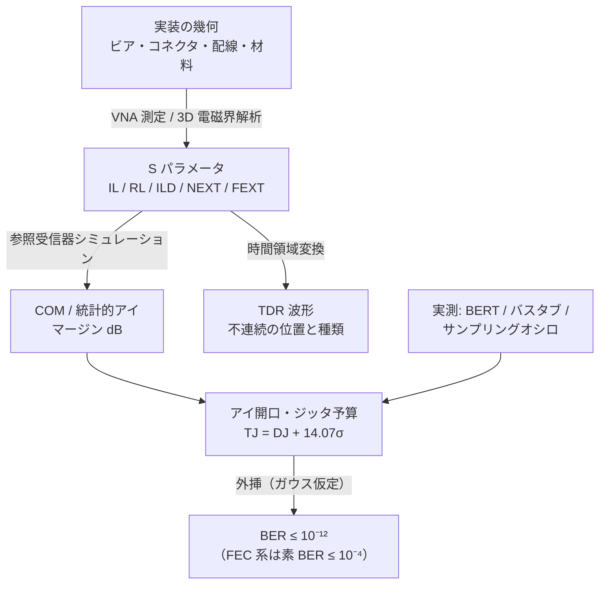

# シグナルインテグリティ工学 (Signal Integrity Engineering)

## 概要 (Overview)

`serdes-link-architecture.md` は送受信器を扱った。本ドキュメントは残りの半分——**リンクが「動く」ことをどう定義し、予算化し、測定し、量産で保証するか**——を扱う。高速リンクの仕様は突き詰めれば **BER (bit error ratio)** という 1 つの数に還元されるが、10⁻¹² の事象は直接測れない。そこで工学は代理量の体系を発達させた: ジッタの統計的分解 (RJ/DJ)、アイダイアグラムとバスタブ曲線、S パラメータによる周波数領域のチャネル予算、そして規格が「参照受信器のシミュレーション」として実行可能になった COM (channel operating margin)。

これは `../../foundations/physics/electromagnetism/transmission-lines-signal-integrity.md` が「測定という設計行為」(TDR と VNA) として予告した領域の本体であり、基板・ビア・コネクタという実装の細部（`../semiconductor-manufacturing/` のパッケージから `../peripherals-connectivity/` のケーブルまで）が、dB と ps の会計としてリンク成立性に集計される様子を読む。分析深度は Level 3。

## 方法論 (Methodology)

- **BER を頂点とする代理量の階層**として全体を組み立てる: BER ← アイ開口 ← ジッタ/ノイズの分解 ← S パラメータ ← 実装の幾何。各代理量について「何を仮定すると上位量に換算できるか」を明示する。
- 時間領域（TDR・アイ・ジッタ）と周波数領域（VNA・S パラメータ・損失）を**同じ情報の 2 つの言語**として往復し、どちらか一方に閉じない。
- 数値は規格の公称値（損失クラス・BER 目標）と教科書の代表値を用いる。実装固有値（特定基板材の Df 等）は桁感に留める。
- 統計的外挿（RJ の σ 倍率、バスタブ）の**前提が成り立たない場合**（非ガウスの裾・有界でない DJ）を必ず併記し、外挿を盲信しない読み方を示す。

## 発見事項 (Findings)

1. **唯一の本物の仕様は BER であり、他のすべては代理量である。** リンクの契約は「BER ≤ 10⁻¹²（FEC 前提の規格では素の BER ≤ ~10⁻⁴）」という形をとる。アイマスク・ジッタ上限・損失クラスは、この確率を**測定可能な時間内に**保証するための代理であり、代理量の合格が BER の合格を意味するのは換算の仮定（ガウス性・独立性・参照受信器）が成り立つ範囲に限られる。SI 工学の事故の多くは、この仮定の破れ（想定外の周期性ノイズ・非ガウス裾）で起きる。
2. **ジッタは分解できるから予算化できる。** 総ジッタを、有界な決定性ジッタ **DJ**（ISI 由来のデータ依存ジッタ、電源・SSC 由来の周期ジッタ、デューティサイクル歪み）と、非有界なランダムジッタ **RJ**（ガウス、σ で特徴づけ）に分ける。BER 10⁻¹² でのアイ閉塞は `TJ = DJ + 2 × 7.03σ ≈ DJ + 14.07·σ(RJ)` と外挿でき[^li]、送信器・チャネル・受信器に **ps 単位の予算**を配分する会計が成立する——`../../foundations/mathematics/probability-statistics/` のガウス分布の裾の議論が、そのまま設計通貨になっている例である。
3. **バスタブ曲線は「BER を測れないので位相で外挿する」ための道具である。** サンプリング位相を掃引して各位相の誤り率を測ると、アイ中央に向かって指数的に落ちる 2 つの壁（浴槽の断面）が得られる。壁の傾きから RJ の σ を推定し、10⁻¹² の開口を外挿する——直接測れば数時間〜数日かかる事象を、分の単位の測定で見積もる統計的圧縮である。
4. **チャネル予算の主役は挿入損失だが、リンクを殺すのはしばしば「滑らかさ」である。** Nyquist 周波数での挿入損失 (insertion loss) がチャネルクラスの見出し数字になる（100G/レーン世代の基板チャネルで数十 dB 級[^802-3]）。しかし損失が予算内でも、**ILD (insertion loss deviation)**——反射・共振による損失カーブの凸凹——が大きいと等化しきれない。イコライザは滑らかな損失の逆関数は作れるが、鋭い谷（共振）の逆関数は作れないからである。
5. **不連続の主犯はビアスタブとコネクタであり、TDR と VNA は同じ真実の 2 つの言語である。** 貫通ビアの未使用部分（スタブ）は 1/4 波長で共振し、特定周波数に損失の谷を掘る——対策のバックドリル（スタブの切削除去）が高速基板の標準工程になった。TDR は時間領域で「どこに・何の不連続があるか」（反射の到達時間と符号）を、VNA/S パラメータは周波数領域で「どれだけ効くか」を示す。foundations が §3（反射係数）で与えた理論の、そのままの実測である。
6. **クロストークは密度の税金であり、コネクタとビア領域で支配的になる。** 近端 (NEXT)・遠端 (FEXT) クロストークは、整然としたストリップラインでは小さく、ピン・ビアが密集する 3 次元構造で跳ね上がる。総和指標 (ICN: integrated crosstalk noise) が損失とともにチャネルクラスを規定し[^802-3]、ピン配置（信号:グラウンド比）・ビアの反平行配置といった**幾何の設計**が対策になる。`../network-hardware/` の高密度スイッチ前面パネルが最前線である。
7. **規格は「マスク」から「実行可能な参照受信器」へ進化した——COM の発明である。** かつての規格は測定波形へのアイマスク適合を求めたが、イコライザが強力になると「受信器が救える波形」を波形単体では判定できなくなった。802.3 の **COM (channel operating margin)** は、S パラメータを入力に**参照送受信器（規定されたイコライザ）のシミュレーション**を回し、マージン (dB) を算出する[^com]——仕様が数表から**アルゴリズム**になった。設計側も IBIS-AMI モデルによる統計的アイシミュレーションで同じ言語を話す。「**コンプライアンス = コードの実行結果**」という転換は、`../../software/` の世界観が物理層の規格文書にまで浸透した徴候として興味深い。
8. **電源インテグリティはシグナルインテグリティの裏面である。** リターン電流は信号電流と同じループを流れ（foundations §1）、電源分配網 (PDN) のインピーダンスは同時スイッチングノイズとして信号に混入し、電源ノイズは発振器を通じてジッタになる。「信号の問題」の相当数が電源とリファレンスプレーンの問題であり、SI/PI を別の担当に分けた組織は境界でバグを産む——`../hw-sw-interface/clock-power-reset.md` の電源・クロック分配が、ここでは ps の精度で信号品質に跳ね返る。

## アーキテクチャ (Architecture)

### 代理量の階層 — BER への換算の連鎖



### 測定器と役割の対応

| 測定器 | 領域 | 測るもの | 主な用途 |
|---|---|---|---|
| VNA (ベクトルネットワークアナライザ) | 周波数 | S パラメータ | チャネル特性・モデル抽出 |
| TDR | 時間 | 反射プロファイル | 不連続の位置特定・インピーダンス実測 |
| サンプリング（等価時間）オシロ | 時間 | アイ・ジッタ分解 | 送信器のコンプライアンス |
| リアルタイムオシロ | 時間 | 単発波形・プロトコル | デバッグ・トレーニング解析 |
| BERT (BER テスタ) | 統計 | 誤り率・バスタブ | 受信器のトレランス試験 |

- 受信器の試験は「わざと汚した信号を規定量注入して誤らないこと」(stressed eye / jitter tolerance) を確認する——`../../software/security/fuzzing-program-analysis.md` のファジングと同じ「敵対的入力への耐性を仕様化する」発想が、物理層では規格化されている。

## 技術詳細 (Technical Details)

### 1. ジッタ予算の会計 (Jitter Budget Accounting)

```
TJ@BER = DJ(δδ) + 2·Q(BER)·σ_RJ
  Q(10⁻¹²) ≈ 7.03  →  TJ ≈ DJ + 14.07·σ_RJ
配分の例（1 UI = 1 シンボル時間を送信器・チャネル・受信器で分け合う）:
  TX ジッタ生成 + チャネル ISI(DDJ) + 電源性 PJ + RX CDR 残留 ≤ アイ開口要求
```

- **DJ の内訳が対策を決める**: データ依存ジッタ (DDJ/ISI) はイコライゼーションで、周期ジッタ (PJ) は電源・SSC・隣接クロックの分離で、デューティサイクル歪み (DCD) は差動対の対称性で、それぞれ削る。分解できない「TJ が大きい」という報告は対策に翻訳できない——分解こそが工学的情報である[^li]。
- 外挿の限界: RJ のガウス仮定は裾で破れうる（まれな電源イベント・温度過渡）。長時間 BERT による確認と、FEC 後の誤り統計の監視（`../../software/observability/` のテール分布の議論と同じ「分布の裾を直接見る」姿勢）が最終防衛線になる。

### 2. S パラメータの読み方 (Reading S-Parameters)

- 差動リンクでは混合モード S パラメータを使う: **SDD21**（差動挿入損失、主役）、**SDD11**（リターンロス、反射）、モード変換（SCD21 等: 差動→コモン、EMI と耐ノイズ性の指標）。
- チャネルクラスの規定は「Nyquist での IL 上限」+「ILD の許容包絡」+「ICN 上限」の組で行われ、**dB の会計**として部品（パッケージ・ビア・基板・コネクタ・ケーブル）に配分される。部品ベンダの提供する S パラメータモデルを縦続接続してバジェットを検算するのが設計フローの背骨である。
- 材料の効き方: 導体損は表皮効果で √f、誘電損は tanδ で f に比例（foundations 参照）。高周波では誘電損が支配するため、低 Df 材への変更が最初の一手になり、**銅箔の表面粗さ**（密着性のための粗化が高周波では損失源）という製造との綱引き（`../semiconductor-manufacturing/`）が続く。ガラス織りの疎密による実効誘電率の揺らぎ（glass weave skew）が差動対の対内スキューを生む——**材料の織り目が 10⁻¹² の誤り率に届く**のがこの分野の縮尺である。

### 3. 実装の定石 (Implementation Practices)

- **ビア**: 使用層以深のスタブはバックドリルで除去、リターンパス用のグラウンドビアを信号ビアに随伴させる（リターン電流の道を切らない——foundations §1 の実装形）。
- **AC 結合コンデンサ・パッケージ**: 実装パッドは局所的な容量性不連続になり、直下プレーンの抜き (void) で補償する。パッケージのボールマップ・ブレークアウトは、しばしばチャネル予算の中で基板より高くつく。
- **コネクタとケーブル**: 高密度コネクタは NEXT の主戦場であり、ピンマップ（信号対をグラウンドで包む）が電気性能を決める。ケーブルは基板より低損失なため、「基板を銅ケーブルで飛ばす」(cabled backplane / flyover) が高速世代の定石になった——`../network-hardware/` の前面パネル直結や `../gpu-accelerators/interconnects-scaleout-training.md` の銅ケーブル NVLink ラックはこの算術の帰結である。

### 4. コンプライアンスと量産 (Compliance & Production)

- コンプライアンス試験は役割分担で構成される: 送信器（規定治具でのアイ・ジッタ測定）、チャネル（S パラメータ / COM 合格）、受信器（ストレス信号でのトレランス）。相互接続性はこの三者の契約が同じ参照点で書かれていることに依存する。
- 量産では全数 BERT は不可能なため、設計マージン（COM の余裕）・製造ばらつき管理（インピーダンスクーポンによる抜取検査）・リンクトレーニングの適応能力（`serdes-link-architecture.md`）の三層で吸収する。フィールドでの縮退（速度低下・FEC 訂正数の増加）はマージン枯渇の前兆であり、テレメトリとして監視する価値がある——物理層にも `../../software/observability/` の「観測の入口」がある。

## セキュリティ考察 (Security Considerations)

- **放射はサイドチャネルである。** 差動伝送はコモンモード放射を抑えるが、モード変換（対内非対称）は EMI 源になり、放射は情報を運びうる（TEMPEST 系の傍受）。SI の品質管理（対称性・リターンパスの完全性）は EMC 適合と情報漏洩耐性を同時に買う——`../hardware-security/side-channels-tee-secure-boot.md` の電磁サイドチャネルの物理側である。
- **テスト・測定インフラは特権的アクセス点である。** コンプライアンス用のテストポイント・プローブパッドは、そのまま攻撃者の盗聴・注入点になる（`serdes-link-architecture.md` のインターポーザ攻撃）。量産品では不要な観測点の除去・無効化が「デバッグ性とのトレードオフ」として設計判断になる——JTAG/デバッグポートの扱い（`../hw-sw-interface/boot-initialization.md`）と同型である。
- **偽造部品はマージンの窃盗である。** 偽造・規格未達のケーブル・コネクタは機能するように見えて予算外の損失・クロストークを持ち込み、まれな誤り・縮退として現れる。部品来歴の管理（`../../software/security/software-supply-chain-security.md`）は、物理層では「dB の会計の完全性」を守る行為に翻訳される。

## 結論 (Conclusions)

シグナルインテグリティ工学は、**測れない仕様 (BER 10⁻¹²) を測れる代理量の階層に分解し、dB と ps の会計として実装の幾何に配賦する**体系である。ジッタの統計的分解、時間と周波数の 2 言語 (TDR/VNA)、損失より恐い「滑らかさ」(ILD)、そして仕様そのものがシミュレーションコードになった COM——いずれも「確率的な物理現象を、部品間の契約に変換する」ための発明である。foundations の伝送線路理論 → 本領域の 2 本（送受信器の機械・検証の会計）→ 各リンク規格の文書、という三層で、リポジトリの物理層の縦串が完成した。

領域として残る深掘り（電源インテグリティ、UCIe/チップレット間リンク、光移行の電気側）は README のロードマップに置く。

---

## 参考文献 (References)

[^li]: Li, M. P. (2007). *Jitter, Noise, and Signal Integrity at High-Speed*. Prentice Hall. — RJ/DJ 分解・バスタブ・BER 外挿の標準的典拠。

[^802-3]: IEEE Std 802.3ck-2022. *100 Gb/s, 200 Gb/s, and 400 Gb/s Electrical Interfaces Based on 100 Gb/s Signaling*. — チャネルクラス（IL/ILD/ICN）と COM 要件の規格一次資料。

[^com]: IEEE Std 802.3 Annex 93A. *Specification of the Channel Operating Margin (COM)*. — 参照受信器シミュレーションとしての規格適合判定の一次資料。

その他の標準的典拠を以下に挙げる。

- Bogatin, E. (2018). *Signal and Power Integrity — Simplified* (3rd ed.). Prentice Hall. — 反射・クロストーク・PDN・実装設計則の工学側主参照。
- Hall, S. H. & Heck, H. L. (2009). *Advanced Signal Integrity for High-Speed Digital Designs*. Wiley. — 損失・表面粗さ・統計的リンク解析の詳細。
- Dally, W. J. & Poulton, J. W. (1998). *Digital Systems Engineering*. Cambridge University Press. — シグナリングとノイズ予算の古典。
- PCI-SIG. *PCI Express Card Electromechanical / Base Specification — 電気的コンプライアンス関連章*. https://pcisig.com/ — Accessed: 2026-07-13.
