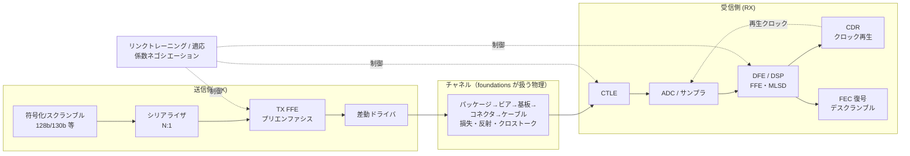

# SerDes リンクアーキテクチャ (SerDes Link Architecture)

## 概要 (Overview)

PCIe も USB も Ethernet もディスプレイリンクも、論理層は互いに似ていないのに、物理層はほぼ同じ機械——**SerDes (serializer/deserializer)**——で動いている。数十本のパラレル配線を捨てて 1 対の差動線に数十 Gbit/s を流し、クロックはデータに埋め込み、送受信器の信号処理でチャネルの損失を打ち消す。この共通機械の構造を理解すれば、`../hw-sw-interface/bus-interconnect.md` (PCIe)・`../peripherals/usb-architecture.md`・`../networking/nic-switch-architecture.md`・`../../engineering/automotive/automotive-ethernet-tsn.md` の物理層仕様は、同じ部品の異なる構成として一望できる。

土台となる物理——なぜ銅線が信号を鈍らせるか（表皮効果・誘電損）、反射と終端、差動伝送——は [`../../foundations/physics/electromagnetism/transmission-lines-signal-integrity.md`](../../foundations/physics/electromagnetism/transmission-lines-signal-integrity.md) が与えた。本ドキュメントはその結論——「**物理の損失は減らせないので、トランジスタ（計算）で波形を修復する**」——を出発点に、シリアル化・符号化・変調 (NRZ/PAM4)・イコライゼーション・クロック再生 (CDR)・リンクトレーニング・FEC という SerDes の全部品を、「何の問題を、何のコストで解くか」で分解する。分析深度は Level 3。

## 方法論 (Methodology)

- 各部品を「解く問題 → 機構 → 支払うコスト」の三点で記述し、規格 (PCIe/802.3) はその部品の**構成例**として扱う。規格の網羅ではなく部品の理解を目的とする。
- 数値は規格書の公称値（データレート・損失バジェット・FEC パラメータ）を用い、実装依存の値は桁感に留める。
- 変調・符号・FEC の選択は SNR とオーバーヘッドの**算術**として示す（PAM4 の −9.5 dB、8b/10b の 25% など）。
- 進化の記述は「チャネル損失の増大に対し、どの部品が順に投入されたか」という一本の時系列で貫く。

## 発見事項 (Findings)

1. **パラレルバスを殺したのはスキューであり、シリアル化の本質は「クロックの廃止」である。** 幅の広い同期バスは、全ビットが同一クロックエッジに揃って到着することを要求するが、配線長差・負荷差によるスキューは周波数とともに相対的に拡大し、共有クロック・共有バスは数百 MHz で限界に達した（PCI → PCIe の転換）。シリアルリンクはクロックを**データの遷移そのものに埋め込み** (embedded clock)、受信側が CDR で再生する——「配線間の整列」という不可能な問題を「1 対の中の遷移密度」という可解な問題に置き換えた。
2. **符号化は「クロック再生と DC バランスのための税金」であり、税率は 25% から 1.5% まで下がった。** 8b/10b（8 bit を 10 bit に写像、ランレングス ≤5・DC バランス保証、オーバーヘッド 25%）[^8b10b]は堅牢だが高価で、64b/66b（2 bit 同期ヘッダ + スクランブル、~3%）、PCIe Gen3 以降の 128b/130b (~1.5%) へと、**保証を弱めてスクランブルの統計的性質に置き換える**方向で軽量化された。安いレーンを多数束ねる時代の算術である。
3. **PAM4 への移行は「Nyquist 周波数の半減」と「SNR −9.5 dB」の交換であり、FEC を前提にして初めて成立する。** 1 シンボルに 2 bit を載せる PAM4 は同一データレートで必要帯域を半分にするが、アイの高さは 1/3（20·log₁₀(1/3) ≈ −9.5 dB）になる。チャネル損失が周波数に対して急峻に増える領域では「帯域半減」の利得が勝つ——これが ~50 Gbit/s/レーンを境に業界が一斉に PAM4 へ移った理由である。代償として素の BER は 10⁻⁴ 級まで悪化し、**FEC がリンクの正式な構成部品**に昇格した[^802-3]。
4. **イコライゼーションは「チャネルの逆関数」を送受信器に分担させる設計問題である。** 送信 FFE（既知の ISI を事前に打ち消すプリ/デエンファシス）、受信 CTLE（高周波を持ち上げるアナログフィルタ、ノイズも持ち上げる）、DFE（判定済みビットで後続 ISI を差し引く帰還フィルタ、ノイズを増幅しないが誤り伝播する）——各段は「どこで・アナログかデジタルか・ノイズをどう扱うか」が異なる。112G/224G 世代では受信器が ADC + DSP 化し、イコライゼーションはデジタル信号処理（FFE/DFE/MLSD）になった——**リンクの性能がプロセス微細化（計算の価格）に直結する**構造が完成している。
5. **CDR のループ帯域は「追従」と「除去」の交換である。** クロック・データ・リカバリはデータ遷移から位相誤差を検出（bang-bang/Alexander 位相検出器が典型）し、PLL/DLL で受信クロックを合わせ込む。ループ帯域を広げれば入力ジッタに追従でき（ジッタトレランス向上）、狭めれば入力ジッタを濾過できる（ジッタ転送の抑制）——両立しないため、規格はジッタ転送・トレランス・生成の3特性を別々に規定する[^razavi]。
6. **リンクは「起動時に交渉し、稼働中も適応し続ける」——物理層にもプロトコルがある。** イコライザ係数は設置されたチャネルごとに違うため、PCIe はトレーニングフェーズで送信 FFE のプリセット交換と微調整を行い、Ethernet はオートネゴシエーションとリンクトレーニングを規定する。温度ドリフトに対する稼働中の適応（DFE 係数・CDR 位相の連続更新）も含め、**物理層は静的な配線ではなく閉ループ制御系**である——`../../engineering/robotics/control-systems.md` の適応制御と同じ骨格が、ここではビット時間 10 ps の世界で回っている。
7. **FEC とリタイマは「損失バジェットの通貨」である。** RS-FEC（802.3 の RS(544,514)、いわゆる KP4）は約 10⁻⁴ の素の BER を 10⁻¹³ 級に引き上げ、そのぶんチャネル損失を許容する——符号化利得を dB に換算してバジェットに繰り入れる会計が成立する。届かない距離はリタイマ（プロトコル認識の全再生中継器）で区間分割する。PCIe Gen5/6 のサーバボードでリタイマが常備品になったことは、「銅の限界」が規格の紙面ではなく製品の BOM に現れた徴候である[^pcie]。

## アーキテクチャ (Architecture)

### リンクの全体構成



### 主要規格の物理層構成（2026 年時点の世代）

| 規格・世代 | レーン速度 | 変調 | 符号化 | FEC | 備考 |
|---|---|---|---|---|---|
| PCIe Gen3–5 | 8/16/32 GT/s | NRZ | 128b/130b | なし（CRC+再送） | Gen5 からリタイマ常用化 |
| PCIe Gen6/7 | 64/128 GT/s | **PAM4** | FLIT ベース | 軽量 FEC + 再送 | レイテンシ制約から軽量 FEC を選択[^pcie] |
| Ethernet 25G 世代 | 25.78 Gb/s | NRZ | 64b/66b | RS-FEC 任意 | |
| Ethernet 100G/レーン | 106.25 Gb/s | PAM4 | 64b/66b 系 | **RS(544,514) 必須** | 802.3ck。224G 世代へ移行中[^802-3] |
| USB4 v2 | 40 Gb/s×2 | PAM3 | 独自 | あり | 3値変調という中間解 |
| DisplayPort 2.x | 20 Gb/s×4 | NRZ | 128b/132b | あり | 表示は誤り耐性が高くバジェット配分が異なる |

- 同じ部品箱（変調・符号・FEC・トレーニング）から、レイテンシ要求（PCIe: FEC 遅延を嫌う）・誤り耐性（表示: 画素誤りは許容）・距離（Ethernet: ケーブル）に応じて異なる構成を選んでいることが表から読める。

## 技術詳細 (Technical Details)

### 1. 変調の算術 — NRZ vs PAM4 (Modulation Arithmetic)

```
データレート R が同じとき:
  NRZ:  シンボルレート R,   Nyquist = R/2,  アイ 1 個
  PAM4: シンボルレート R/2, Nyquist = R/4,  アイ 3 個（高さ 1/3 ≈ −9.5 dB）

損益分岐: チャネル損失の傾きが急（高周波で dB が嵩む）ほど、
「Nyquist 半減で稼ぐ dB」 > 「アイ縮小で失う 9.5 dB」となり PAM4 が勝つ
```

- PAM4 は多値化により**遷移の種類**も増え（レベル間で立ち上がり時間が異なる）、CDR・ジッタ解析が複雑化する。さらなる多値化（PAM6/PAM8）と光への移行が 224G 以降の分岐点であり、`../networking/` の光インターコネクト候補に接続する。

### 2. イコライゼーションの積層 (The Equalization Stack)

- **TX FFE**: 送信波形を FIR フィルタで整形し、主カーソルの前後のシンボルに逆符号の成分を混ぜて既知の ISI を事前打消しする。送信振幅の総量は規定されているため、**エンファシスは「主信号を削って辺縁に配る」ゼロサム**である。
- **CTLE**: 高周波にピーキングを持つアナログ連続時間フィルタ。安価で遅延ゼロだが、信号とノイズ・クロストークを区別せず持ち上げる。
- **DFE**: 直前の判定ビット列に係数を掛けて減算する。**判定済みの値**を使うためノイズ増幅がない一方、誤判定が後続に伝播する（FEC との相性で管理）。第1タップは判定までの時間制約が最も厳しく、投機（両方計算して選ぶ）で解く——`../cpu/branch-prediction-speculation.md` と同じ「待てないなら両方やる」である。
- **ADC-DSP 受信器**: 波形を数十 GS/s で量子化し、FFE/DFE/最尤系列推定 (MLSD) をデジタルで行う。適応が柔軟で PAM4 に適するが、電力は ADC が支配する。SerDes の消費電力指標 (pJ/bit) がスイッチ ASIC の電力予算を左右する時代（`../networking/nic-switch-architecture.md`）の主因である。

### 3. クロック構成と CDR (Clocking & CDR)

- リンク両端のクロック関係には、共通参照クロック (common clock)・独立クロック (SRIS: separate reference independent spread) 等の構成があり、EMI 低減のためのスペクトラム拡散 (SSC: クロックを ~0.5% 周期変調) を CDR が追従できるかがアーキテクチャ選択に直結する。
- CDR は位相検出器（bang-bang が主流: 早い/遅いの 2 値判定）+ ループフィルタ + 位相補間器/VCO の閉ループで、ロック後は**データ遷移がある限り**位相を保つ——符号化のランレングス保証（発見事項 2）はこのための供給契約である[^razavi]。

### 4. リンクトレーニングと FEC (Training & FEC)

- PCIe のトレーニングは、受信側が測定に基づき送信側の FFE プリセット/係数を要求する**双方向ネゴシエーション**であり、リンク幅・速度の縮退（動作しない速度から一段下げる）までを状態機械として規定する。実装バグ・マージン不足の症状が「リンクが Gen4 でしか上がらない」型の障害として現れる理由である。
- RS(544,514)（10 bit シンボル、514 シンボルのデータに 30 シンボルの冗長、~5.4% オーバーヘッド）は 15 シンボルまでの誤りを訂正し、バースト誤り（DFE の誤り伝播と相性が良い）に強い。復号遅延は ~100 ns 級で、Ethernet では許容、PCIe では許容されず軽量 FEC + 再送（FLIT モード）という別解になった[^pcie][^802-3]——**同じ物理問題に、レイテンシ予算が異なる解を強制する**好例である。

## セキュリティ考察 (Security Considerations)

- **高速リンクは既定で平文である。** PCIe/NVLink/Ethernet の物理層に機密性はなく、インターポーザ（リンクに挟む解析治具）による盗聴・改竄は、ゲーム機や TPM への実攻撃で実証されてきた。対策として PCIe/CXL は **IDE (integrity and data encryption)**——リンク/セレクティブストリームの AES-GCM 保護——を規格化し、TEE のデバイス拡張 (TEE Device Interface Security Protocol) と組み合わされる。`../security/side-channels-tee-secure-boot.md` の信頼境界が「チップの縁」から「リンクの向こう」へ拡張される動きであり、`../accelerators/` のアクセラレータ機密計算の土台になる。
- **リタイマ・ケーブルは能動部品でありサプライチェーン面を持つ。** ファームウェアを持つリタイマ・スマートケーブルはリンク上の中間者になれる位置にあり、`../../software/security/software-supply-chain-security.md` の来歴・完全性の議論がボード部品にも適用される。
- **トレーニング・適応の悪用**: リンクネゴシエーションは認証を持たないため、悪意ある終端が縮退（速度・幅の低下）を誘発する可用性攻撃は原理的に排除できない。物理アクセスを前提とする攻撃の常として、防御は筐体・スロットの物理管理と、縮退の監視 (`../../software/observability/`) に置かれる。

## 結論 (Conclusions)

SerDes は「銅線の物理は変えられない」という制約に対し、**計算（イコライゼーション・FEC・適応制御）を注ぎ込んで帯域を買い続ける機械**である。クロックの廃止（埋め込み）、符号税の軽減、PAM4 の SNR 取引、イコライザの ADC-DSP 化、FEC の正式部品化——どの段階も「より汚い波形を、より賢い受信器で読む」方向への一歩であり、その賢さの価格はプロセス微細化 (`../semiconductor-manufacturing/`) が決める。PCIe・USB・Ethernet・車載の物理層仕様は、この一つの部品箱の構成差にすぎない。

### 続編への橋渡し

本ドキュメントは送受信器の側を扱った。リンクが「本当に動く」ことをどう定義し（BER・ジッタ・アイ）、チャネルをどう予算化し（S パラメータ・COM）、どう測るか——設計と量産を繋ぐ検証の工学を [`signal-integrity-engineering.md`](signal-integrity-engineering.md) で扱う。

---

## 参考文献 (References)

[^8b10b]: Widmer, A. X. & Franaszek, P. A. (1983). A DC-Balanced, Partitioned-Block, 8B/10B Transmission Code. *IBM Journal of Research and Development*, 27(5), 440–451. DOI: 10.1147/rd.275.0440 — 8b/10b 符号の原典。

[^802-3]: IEEE Std 802.3ck-2022. *IEEE Standard for Ethernet — 100 Gb/s, 200 Gb/s, and 400 Gb/s Electrical Interfaces Based on 100 Gb/s Signaling*. — 100G/レーン PAM4・RS-FEC・チャネル要件の規格一次資料。

[^pcie]: PCI-SIG. *PCI Express Base Specification, Revision 6.x*（および PCIe 7.0 発表資料）. https://pcisig.com/ — Accessed: 2026-07-13. — PAM4 化・FLIT モード・軽量 FEC・IDE の一次資料。

[^razavi]: Razavi, B. (2021). *Design of CMOS Phase-Locked Loops: From Circuit Level to Architecture Level*. Cambridge University Press. — PLL/CDR・ジッタ特性（転送・トレランス・生成）の標準的典拠。

その他の標準的典拠を以下に挙げる。

- Dally, W. J. & Poulton, J. W. (1998). *Digital Systems Engineering*. Cambridge University Press. — シリアルリンク・シグナリング・タイミングの古典。
- OIF. *Common Electrical I/O (CEI) Implementation Agreements*（CEI-112G / CEI-224G）. https://www.oiforum.com/ — Accessed: 2026-07-13. — 112G/224G 電気インターフェースの業界仕様。
- Bogatin, E. (2018). *Signal and Power Integrity — Simplified* (3rd ed.). Prentice Hall. — チャネル側との接続（foundations 文書と共通の主参照）。
