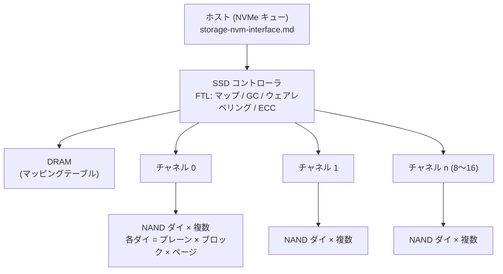

# NAND フラッシュと FTL (NAND Flash & the Flash Translation Layer)

## 概要 (Overview)

[`../hw-sw-interface/storage-nvm-interface.md`](../hw-sw-interface/storage-nvm-interface.md) は NVMe というインタフェースを扱った。本ドキュメントはその下——**NAND フラッシュという媒体の物理と、それをディスクに見せかける計算機 (FTL)**——を扱う。

中心テーゼは、**SSD とは「ディスクのふりをする分散システム」である**、ということ。NAND は (1) 上書きできない (消去してからしか書けない)、(2) 読み書きはページ単位・消去は桁違いに大きいブロック単位、(3) 消すたびに物理的に劣化する、という三重の制約を持つ。ブロックデバイスの単純な契約——「LBA に書けば上書きされる」——はこの物理と根本的に矛盾するため、SSD コントローラ内の **FTL (Flash Translation Layer)** が、アドレス変換・ガベージコレクション (GC)・ウェアレベリングという OS 顔負けの機構で矛盾を隠蔽する。

SSD の「不思議な挙動」——新品では速いのに使い込むと遅くなる、連続書き込みが途中で崖のように失速する、削除したのに空きが増えない、書いた量より多く摩耗する——は、すべてこの隠蔽のコストが漏れ出したものである。上の層 ([`../../software/operating-systems/block-io-stack.md`](../../software/operating-systems/block-io-stack.md)、[`../../software/databases/storage-engines.md`](../../software/databases/storage-engines.md)) の設計判断の多くは、この層を知って初めて「なぜ」が閉じる。

本書は (1) セルの物理と摩耗、(2) 読み・書き・消去の非対称、(3) FTL の三大機構、(4) 書込増幅 (write amplification) の力学、(5) 密度の階段 (SLC→QLC, 3D 積層) と ZNS という「偽装をやめる」動き、を整理する。分析深度は Level 3。

## 方法論 (Methodology)

- すべての挙動をセル物理の三重制約 (上書き不可・単位の非対称・有限摩耗) から演繹する。SSD の性能特性は仕様表ではなく、この制約からの帰結として説明する。
- 書込増幅とオーバープロビジョニングの関係は、GC の会計 (有効ページの引越しコスト) として定量的に導く。
- エラー機構 (摩耗・リテンション・read disturb) は大規模実測研究 (Cai et al., Proc. IEEE 2017) を根拠とする。
- ベンチマークの読み方 (fresh vs steady state, SLC キャッシュ) を明示し、宣伝値と持続値の乖離を構造から説明する。インタフェース (NVMe) と上位層は既存ドキュメントに委ねる。

## 発見事項 (Findings)

1. **NAND のビットは「閉じ込めた電子の量」であり、書き込みとは絶縁体への電子の強制通過である。** セルは浮遊ゲート/電荷トラップに電子を蓄え、その量でしきい値電圧が変わることを読み出す。書き込み (program) と消去はトンネル効果で電子を絶縁膜に**無理やり通す**操作であり、通すたびに膜が傷む——**摩耗 (P/E サイクル制限) は仕様ではなく物理である**。
2. **単位の非対称が全ての起点である。** 読み・書きはページ (数 KB〜16KB) 単位、消去はブロック (数 MB、数百〜千ページ) 単位。しかも書き込みは「消去済みページへの 1 回きり」。この瞬間、「LBA を上書きする」という契約は履行不可能になり、**すべての書き込みは実際には追記**になる——旧データは無効 (invalid) の印を付けて放置し、後で回収する。
3. **FTL は仮想記憶と同型の機構である。** 論理アドレス (LBA) → 物理位置 (どのブロックのどのページ) の対応表を持ち (ページ単位マップで容量の約 0.1%、1TB なら約 1GB——SSD に DRAM が載っている理由)、GC が「まだ有効なページを別ブロックへ引越しさせてから消去」で空きを作る。OS の仮想記憶 ([`../cpu/virtual-memory-mmu.md`](../cpu/virtual-memory-mmu.md))・ログ構造化 FS ([`../../software/operating-systems/filesystems.md`](../../software/operating-systems/filesystems.md)) と同じ設計が、ファームウェアの中でもう一度発明されている。
4. **書込増幅 (WA) は GC の引越し代であり、空き (オーバープロビジョニング) で買い戻す。** ホストが 1 書いたときに NAND へ実際に書かれる量の倍率が WA。消去対象ブロックに有効ページが多いほど引越しが増えるため、WA は**空き容量の逆関数**として振る舞う——予備領域 (OP) を増やす・ディスクを満杯にしない・TRIM で「もう無効」を教える、が全て同じ理由で効く。ランダム小書き込みは有効/無効を混在させ WA を悪化させる最悪パターンである。
5. **SSD の性能は「二相」である。** 新品 (全ブロック消去済み) では追記するだけで速いが、書き潰した後 (steady state) は全ての書き込みが GC を伴い、ランダム書き込み性能が数分の一に落ちうる。さらに TLC/QLC 品は一部を擬似 SLC として使う**書き込みキャッシュ**を持ち、それが尽きると転送率が崖 (cliff) を成す——ベンチマークは「どの相を測ったか」を言わなければ意味を持たない。
6. **密度の階段は「電子の分解能」を切り売りしてきた。** 1 セル 1 ビット (SLC) から 4 ビット (QLC) へ、同じ電荷量を 2 → 16 水準に切り刻むほど、容量単価は下がり、速度・寿命・保持力 (retention) は桁で落ちる (P/E は SLC 10 万回級 → QLC 千回級)。微細化の限界は **3D 積層** (セルを縦に数百層積む) が突破し、平面微細化の中止がむしろセルあたりの信頼性を回復させた——**スケーリングの軸を変えることで物理の壁を迂回した**教科書的事例である。

## アーキテクチャ (Architecture)

### SSD の内部 — 小さな分散システム



- SSD の性能はチャネル × ダイ × プレーンの**並列性**から出る (単一ダイの書き込みは数百 µs と遅い)。深いキューが要る理由 ([`../../software/operating-systems/block-io-stack.md`](../../software/operating-systems/block-io-stack.md) の blk-mq、NVMe の多重キュー) はこの内部並列を埋めるためであり、QD1 のレイテンシと QD256 のスループットは別の物差しである。

### 書き込みの一生 — 追記・無効化・GC

```
 LBA 100 への上書き (3 回):
   ブロック A: [LBA100 v1 ✗][LBA100 v2 ✗][LBA100 v3 ✓][他の有効ページ…]
                └ 旧版は「無効」印で放置 (消せない: 消去はブロック単位)

 GC (空きブロックが減ると起動):
   1. 犠牲ブロックを選ぶ (無効ページが多いものが安い)
   2. 残っている有効ページを別ブロックへコピー (=書込増幅の正体)
   3. ブロックを消去して空きプールへ

 WA ≈ (ホスト書込 + GC コピー) / ホスト書込 —— 犠牲ブロックの有効率が高いほど悪化
```

## 技術詳細 (Technical Details)

### 1. セル物理と誤りの源泉

- **読み出し**: ワード線に基準電圧を掛け、セルが導通するかでしきい値を判定。多値 (TLC=8 水準) ほど判定境界が狭く、電荷のわずかな移動で誤読する。コントローラは境界電圧を動的に調整し (read retry)、強力な **ECC (LDPC)** で誤りを常時訂正している——**「エラーは例外」ではなく「エラーは定常状態」** が NAND の世界観である (Cai et al. 2017)。
- 誤りの主因: (a) **摩耗** (P/E 累積で絶縁膜が傷み電荷が漏れやすくなる)、(b) **リテンション** (時間経過で電荷が抜ける。摩耗したセルほど速く、高温ほど速い——書き込み直後より数ヶ月後の方が誤りが多い)、(c) **read disturb** (読むだけで隣接セルに微弱な書き込みが起きる。読み集中ブロックは書き直しが要る)、(d) **program disturb** (書き込み時の隣接干渉)。DRAM の Rowhammer ([`../cpu/dram-memory-controllers.md`](../cpu/dram-memory-controllers.md)) と同じく、**高密度化は干渉との戦い**である。
- 電源断: 書き込み途中の電源断は書きかけページだけでなく、多値セルでは**同じセルを共有する既存ビットまで**壊しうる (lower page corruption)。エンタープライズ SSD のコンデンサ (power-loss protection) は、機内バッファと進行中の書き込みを着地させるためにある——FLUSH/FUA の意味論の最終的な担保である。

### 2. FTL の三大機構

- **アドレス変換**: ページ単位マップが基本 (ブロック単位・ハイブリッドは安価品)。マップ自体も NAND に永続化が要り、突然の電源断後は復元 (ジャーナル再生と同型) が走る。DRAM レス SSD はホストのメモリを借りる (HMB) か、マップの一部だけをキャッシュして遅くなる。
- **GC**: 犠牲ブロック選択 (greedy = 無効率最大を選ぶ、が基本形) と、ホスト I/O との帯域の取り合い。アイドル時に前倒しする (background GC) と、突然のワークロード変化に弱く、「**昨日まで速かった SSD が今日遅い**」の典型犯になる。
- **ウェアレベリング**: 摩耗をブロック間で均す。動的 (書き込み先の選択) に加え、**静的データの強制引越し** (冷たいデータが居座るブロックも使い回す) まで行う——さもないと OS 領域のような不動データが若いブロックを独占し、残りだけが摩耗する。寿命の指標は TBW (総書込量) / DWPD (1 日あたりのドライブ全体書き換え回数) として仕様化され、SMART の残寿命カウンタで観測できる。

### 3. 書込増幅の会計とホスト側の協力

- OP (オーバープロビジョニング) と WA の関係: 予備が少ないほど犠牲ブロックの有効率が上がり、WA は急峻に悪化する (満杯付近で発散的)。エンタープライズ品が容量の 1〜3 割を予備に取るのは、この曲線の急所を避けるためである。
- **TRIM/Discard** ([`../../software/operating-systems/filesystems.md`](../../software/operating-systems/filesystems.md)): ファイル削除は FS のメタデータ操作であり、FTL からは「まだ有効な LBA」に見え続ける。TRIM はこの認識差を埋める唯一の経路で、無効領域を GC の負担から外す——「削除しても SSD の空きは増えない」問題の答え。
- ホスト側の書き方も WA を直接左右する: 追記型 (LSM-tree, [`../../software/databases/storage-engines.md`](../../software/databases/storage-engines.md)) は FTL と相性が良く、4KB ランダム上書きは最悪。**F2FS** のようなフラッシュ前提 FS は、FS 自体をログ構造化して FTL の仕事を減らす方向の解である。

### 4. 偽装をやめる方向 — ZNS・FDP

- FTL の隠蔽は「ホストの知識 (何が同時に消えるデータか) を捨てて汎用性を買う」取引であり、二重のログ (アプリの LSM-tree の上に FTL のログ) と二重の GC という無駄を生む。
- **ZNS (Zoned Namespaces)**: デバイスを「追記専用ゾーン」の集合としてホストに見せ、配置と回収の判断をホストへ返す (Bjørling et al., ATC '21——「ブロックインタフェース税の回避」)。SMR HDD と同じゾーンモデルで、RocksDB 等の追記型エンジンが直接載る。**FDP (Flexible Data Placement)**: 完全な移譲ではなく「一緒に消えそうなデータのヒント」をホストが渡す穏健な折衷 (NVMe 2.x)。
- 系譜として読む: LFS (1992) → FTL (媒体側での再発明) → ZNS (ホストへの返還)。**「ログはどの層が持つべきか」という一つの問いが 30 年往復している**——層をまたいで同じ構造を二重に持つ無駄 (log-on-log) への感度は、ストレージ設計の普遍的な検査項目である。

### 5. ベンチマークと観測の入口 (Observability)

| 疑問 | 道具 |
|---|---|
| 持続性能 (steady state) はいくらか | `fio` で容量全体を事前書き潰し (precondition) してから測る。SNIA PTS が標準手順 |
| SLC キャッシュの崖はどこか | 容量を超える連続書き込みで転送率の時系列を見る |
| 摩耗・健康状態 | `nvme smart-log` (percentage_used, media errors)、SMART (TBW 消費) |
| WA の実測 | コントローラ統計 (nvme の vendor log)。ホスト書込量と NAND 書込量の比 |
| TRIM は届いているか | `lsblk -D` (discard 対応)、`fstrim -v`、マウントオプション |
| レイテンシのテール | `fio` の p99/p999 (GC 起動時のスパイクが載る)、[`../../software/operating-systems/block-io-stack.md`](../../software/operating-systems/block-io-stack.md) の biolatency |

## セキュリティ考察 (Security Considerations)

- **上書きしても消えない。** FTL の追記構造ゆえ、LBA への上書きは旧データの物理ページを消さない (無効化するだけ)。ファイル単位の「セキュア消去ツール」は SSD では原理的に機能しない。確実な消去は (a) デバイス全体の secure erase / sanitize コマンド (全ブロック消去 or 内部鍵の破棄)、(b) 最初から暗号化して鍵を捨てる (crypto erase) の二択であり、**設計段階で暗号化を選ぶことが唯一の後悔しない道**である。
- **自己暗号化ドライブ (SED) の実装は検証されるまで信用できない。** Meijer & van Gastel (S&P 2019) は市販 SSD の TCG Opal 実装を解析し、パスワードと鍵が結びついていない・デバッグポートから迂回可能といった致命的欠陥を複数製品で発見した (BitLocker が SED に暗号化を委譲していた設定への影響が大きい)。ハードウェア暗号化を使う場合もソフトウェア暗号化 (dm-crypt 等) の併用ないし実装の検証が defensible な構成である。
- **ファームウェアは攻撃面である。** FTL は数十万行級のソフトウェアであり、署名検証のないファームウェア更新経路は永続的なインプラントの温床になる ([`../hw-sw-interface/boot-initialization.md`](../hw-sw-interface/boot-initialization.md) の信頼チェーンの文脈)。また FTL のマッピングはホストから不可視のデータ残存 (回収前の旧版) を常に抱えており、フォレンジクスとアンチフォレンジクスの双方の対象になる。
- **寿命は可用性の攻撃面になりうる**: 書込増幅を意図的に悪化させるワークロード (満杯近くでのランダム小書き込みの強要) は、共有ストレージ環境で隣人の寿命と性能を削る。マルチテナントでは容量・帯域のクォータ ([`../../software/operating-systems/block-io-stack.md`](../../software/operating-systems/block-io-stack.md) の cgroup io) が防御になる。

## 結論 (Conclusions)

- NAND の三重制約 (上書き不可・単位の非対称・有限摩耗) はセル物理の直接の帰結であり、SSD のあらゆる「不思議」——二相性能・SLC 崖・TRIM の必要性・上書きしても消えないこと——はこの制約を FTL が隠蔽するコストとして統一的に説明できる。
- FTL は仮想記憶・ログ構造化 FS・GC 付きランタイムと同型の機構をファームウェアで再発明したものであり、書込増幅はその引越し代、オーバープロビジョニングはその保険料である。ホスト側の協力 (TRIM・追記型ワークロード) が効くのは、隠蔽の下の会計が共有されるからである。
- 密度の階段 (SLC→QLC) と 3D 積層は「電子の分解能を売って容量を買う」取引の連続であり、ECC の常時稼働・リテンションの短縮・電源断保護は、その取引の勘定書である。
- ZNS/FDP は「偽装をやめて知識をホストに返す」方向の再交渉であり、log-on-log の無駄が示す通り、**どの層が何を知っているべきか**という配置問題こそがストレージスタック設計の核心である。

### 次の接続先 (Related Topics)

- [`../hw-sw-interface/storage-nvm-interface.md`](../hw-sw-interface/storage-nvm-interface.md) — 本書の真上。NVMe・FLUSH/FUA・インタフェースとしての FTL。
- [`../../software/operating-systems/block-io-stack.md`](../../software/operating-systems/block-io-stack.md) — キュー・スケジューラ・cgroup。SSD の内部並列を埋める側。
- [`../../software/operating-systems/filesystems.md`](../../software/operating-systems/filesystems.md) — TRIM の発行元。LFS の系譜と F2FS。
- [`../../software/databases/storage-engines.md`](../../software/databases/storage-engines.md) — LSM-tree と WA。FTL との log-on-log 問題の当事者。
- [`../cpu/dram-memory-controllers.md`](../cpu/dram-memory-controllers.md) — 揮発側の対応物。高密度化と干渉・誤りの同型の戦い。

## 参考文献 (References)

**一次資料 (Primary — 論文)**

- Agrawal, N., et al. (2008). Design Tradeoffs for SSD Performance. *USENIX ATC '08*. — SSD 内部構造と並列性の古典的分析。
- Cai, Y., Ghose, S., Haratsch, E. F., Luo, Y., & Mutlu, O. (2017). Error Characterization, Mitigation, and Recovery in Flash-Memory-Based Solid-State Drives. *Proceedings of the IEEE*, 105(9). DOI: 10.1109/JPROC.2017.2713127 — NAND 誤り機構の網羅的実測。
- Bjørling, M., et al. (2021). ZNS: Avoiding the Block Interface Tax for Flash-based SSDs. *USENIX ATC '21*. — ゾーンモデルの設計原典。
- Meijer, C., & van Gastel, B. (2019). Self-Encrypting Deception: Weaknesses in the Encryption of Solid State Drives. *IEEE S&P '19*. DOI: 10.1109/SP.2019.00088 — SED 実装の脆弱性分析。
- Rosenblum, M., & Ousterhout, J. K. (1992). The Design and Implementation of a Log-Structured File System. *ACM TOCS*, 10(1). DOI: 10.1145/146941.146943 — FTL/ZNS の思想的源流。

**二次資料 (Secondary — 規格・解説)**

- NVM Express — [NVMe Base Specification / ZNS Command Set](https://nvmexpress.org/specifications/) — Accessed: 2026-07-05。
- SNIA — [Solid State Storage Performance Test Specification (PTS)](https://www.snia.org/tech_activities/standards/curr_standards/pts) — Accessed: 2026-07-05。steady state 測定の標準手順。
- Arpaci-Dusseau, R. H., & Arpaci-Dusseau, A. C. *Operating Systems: Three Easy Pieces* — Flash-based SSDs の章。 — [OSTEP](https://pages.cs.wisc.edu/~remzi/OSTEP/) — Accessed: 2026-07-05。
