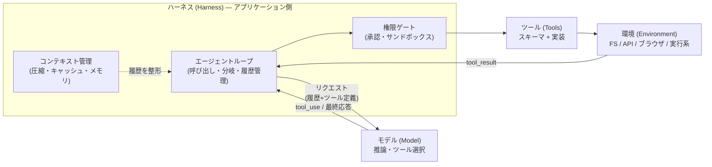
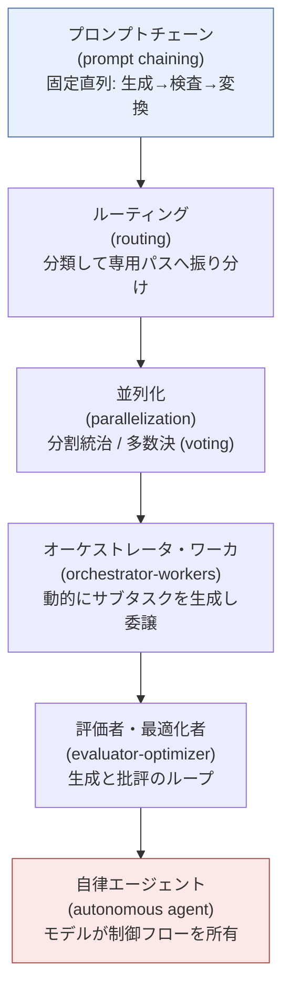

# LLM エージェントアーキテクチャ (LLM Agent Architectures)

## 概要 (Overview)

LLM (Large Language Model) 単体は「テキストを入れるとテキストが出る」純粋関数に近い。それが**エージェント (agent)** になるのは、モデルの出力を**ツール呼び出し (tool use)** として解釈し、実行結果をモデルに戻す**ループ**に組み込まれたときである。この最小定義——「LLM がループの中で自らのプロセスとツール使用を方向付け、タスクの達成方法を自分で制御するシステム」——は Anthropic のエンジニアリング文書での定義に一致し、本ドキュメントでもこれを採用する。

重要な対比は**ワークフロー (workflow) とエージェント**の区別である。ワークフローは LLM とツールを**あらかじめ定義されたコードパス**で編成する（分岐・並列・直列はコードが決める）。エージェントは**モデル自身が制御フローを決める**（次にどのツールを呼ぶか、いつ終わるかをモデルが判断する）。この区別は学術的な分類ではなく、コスト・レイテンシ・予測可能性のトレードオフを決める実務上の第一の設計判断である。

本ドキュメントは、エージェントの設計空間——推論と行動の交互実行 (ReAct)、計画と自己修正、メモリ、マルチエージェント、ツール統合の標準化 (MCP)、評価、セキュリティ——を、原論文と一次実装資料に基づいて整理する。ループそのものの工学（stop_reason の分岐、コンテキスト管理、キャッシュ、エラー処理）は対をなす `agent-loop-engineering.md` に委ねる。

## 方法論 (Methodology)

- **一次資料優先**: 各設計パターンは原論文（ReAct, Toolformer, Reflexion, Voyager, SWE-bench, τ-bench）と、実運用者の一次技術文書（Anthropic のエージェント構築ガイド、MCP 仕様）に遡って記述する。二次的な解説記事は用いない。
- **設計軸による分解**: 「エージェントフレームワーク X の使い方」ではなく、フレームワークに依存しない設計軸——制御フローの所在、ツールサーフェス、メモリ階層、検証ループ、信頼境界——で分析する。フレームワークは軸の実装例として言及するにとどめる。
- **ベンダー資料の扱い**: LLM ベンダーの文書は自社製品のマーケティングでもあるため、仕様（API の形）と主張（性能・信頼性）を区別する。性能主張は独立ベンチマーク（SWE-bench 等の公開リーダーボード）と突き合わせる。
- **急速に動く分野への対応**: 数値（ベンチマークスコア等）は特定時点のものと明記し、構造的な知見（同じ問題は同じ解に至る型）を優先して記録する。アクセス日は 2026-08-08。

## 発見事項 (Findings)

1. **能力はモデルから、信頼性はハーネスから来る。** エージェントの性能は「モデルの賢さ × ハーネス（ループ・ツール・コンテキスト管理を担う骨組み）の質」の積である。同一モデルでも、ツール定義の質・コンテキストの与え方・検証ループの有無でタスク成功率は大きく変わる。SWE-bench の同一モデル・異なるスキャフォールド (scaffold) 間のスコア差がこれを直接示す。エージェント設計とは実質的にハーネス設計である。

2. **「動く最小の構成」から始めるのが一貫した実務知である。** Anthropic のガイドは「単一の LLM 呼び出しで足りるなら、ワークフローもエージェントも使うな」と明言する。エージェントはコスト（トークン）・レイテンシ・誤りの複利という代償を持つ。タスクが (a) 多段で事前に完全指定できず、(b) 誤りを検出・回復でき、(c) 結果が代償に見合うときにのみエージェント化する。この判断基準はワークフローパターン（後述）の選択にも先立つ。

3. **ReAct の「推論と行動の交互実行」は創始パターンであり、現在はモデル内部に吸収されつつある。** ReAct (Yao et al., 2023) は思考 (thought) → 行動 (action) → 観測 (observation) の交互出力をプロンプトで誘導し、推論のみ (chain-of-thought) や行動のみより高い性能を示した。現代のモデルではこの構造が API レベルで内在化している——拡張思考 (extended thinking) が thought を、ネイティブなツール使用が action/observation を担い、プロンプトで形式を強制する必要はなくなった。パターンは死んでいない。プロンプト技法からモデル・API の機能へと**層を降りた**のである。

4. **自己修正は外部からの検証可能な信号があるときに機能する。純粋な自己批判は当てにならない。** Reflexion (Shinn et al., 2023) の改善は、テスト実行結果やゲームの報酬といった**外部フィードバック**を言語化して次試行に持ち込むことから来る。検証器なしにモデルが自分の出力を再読して直す「自己反省」は、誤りを検出できないまま自信だけ強化することがある。実務上の帰結は明確で、エージェントには採点器——ユニットテスト、型検査、リンター、シミュレータ——を先に用意する。コードエージェントが他分野より先行した理由の大半は、検証信号が安価で確定的だからである。

5. **ツール統合の標準化 (MCP) は N×M 問題を N+M に変えた。** MCP (Model Context Protocol) 以前、N 個のアプリケーションと M 個のツール提供元の統合は N×M 通りの個別実装だった。MCP はツール・リソース・プロンプトの公開方法を JSON-RPC ベースで標準化し、どのクライアント（エージェントハーネス）からもどのサーバ（ツール提供元）へも同じプロトコルで接続できるようにした。これは LSP (Language Server Protocol) がエディタ×言語で行った標準化と同型である。

6. **マルチエージェントの実利はコンテキスト分離であり、役割の擬人化ではない。** サブエージェントに「アーキテクト」「レビュワー」と名付けること自体に効果はない。効果があるのは、(a) 読み込み中心の作業を別コンテキストに隔離し、要約だけを親に返すことで親のコンテキストを保護する、(b) 独立な部分作業を並列化する、(c) 検証を新鮮なコンテキストで行う（自分の作業履歴に汚染されない採点者）、という**コンテキストウィンドウの経済**である。一方で委譲には毎回コンテキスト再確立のコストがかかるため、数回のツール呼び出しで済む作業の委譲は純損失になる。

7. **評価がボトルネックである。単発正解率だけでなく一貫性を測る必要がある。** τ-bench (Yao et al., 2024) は同一タスクを k 回試行して全回成功する確率 pass^k を提案し、エージェントの成功率が試行間で大きくばらつくこと（pass^1 は高くても pass^8 は急落する）を示した。運用に置くエージェントに必要なのは「8 回やれば 1 回できる」ではなく「8 回やって 8 回できる」であり、この差はベンチマークの見出しスコアには表れない。

## アーキテクチャ (Architecture)

### エージェントの解剖学

どのエージェントシステムも、実装の見た目によらず次の 4 部品に分解できる。



- **モデル**: 推論とツール選択を行う。ハーネスから見れば「履歴とツール定義を入れると、テキストかツール呼び出し要求が出る」ステートレスな関数。
- **ツール**: モデルに提示されるスキーマ（名前・説明・入力の JSON Schema）と、ハーネス側の実装の対。スキーマの記述の質がツール選択の精度を直接決める。
- **ハーネス**: ループを回し、履歴を管理し、権限を裁定する。モデルは賢さを、ハーネスは信頼性と安全性を担う。
- **環境**: ツールが作用する外界。エージェントの能力上限は、環境がどこまで観測・操作可能かで決まる。

### ワークフローからエージェントへの連続体

制御フローの所在を軸にすると、設計空間は離散パターンの連続体として整理できる。Anthropic のガイドが示す 5 つのワークフローパターンと自律エージェントを、コード制御の強い順に並べる。



上に行くほど予測可能で安価、下に行くほど柔軟で高価。設計判断は「このタスクの分岐構造を事前に書き切れるか」の一点に集約される。書き切れるならワークフロー（コードが制御を持つ方が速く・安く・デバッグ可能）、書き切れない——探索の深さや順序がタスクごとに変わる——ならエージェントに進む。

### メモリ階層

エージェントのメモリは、アクセス速度と寿命で階層化される。CPU のメモリ階層と同様、どの層に何を置くかが設計の中心問題になる。

| 層 | 実体 | 寿命 | 例 |
|----|------|------|-----|
| 作業記憶 | コンテキストウィンドウ | 1 セッション（圧縮で減衰） | 会話履歴、直近のツール結果 |
| エピソード記憶 | セッション要約・圧縮ブロック | セッション〜再開まで | compaction の要約、チェックポイント |
| 手続き記憶 | 指示ファイル・スキル | 永続（明示的に編集） | システムプロンプト、`CLAUDE.md` 型ファイル、スキルライブラリ |
| 長期記憶 | 外部ストア（ファイル/DB/ベクトル） | 永続 | メモリディレクトリ、ナレッジベース |

Voyager (Wang et al., 2023) の「スキルライブラリ」——成功した手続きをコードとして保存し再利用する——は手続き記憶の初期の実証であり、現在の「スキル」（タスク別の指示・スクリプト束を必要時に読み込む方式）の直系の祖先にあたる。

## 技術詳細 (Technical Details)

### 1. ReAct とその系譜 — 推論・行動・観測のインターリーブ

ReAct 以前の 2 つの極は、(a) chain-of-thought: 推論だけで外界と接触せず、幻覚 (hallucination) を自己増幅しうる、(b) 行動のみ: 計画なしに行動を並べ、複数ステップの依存を扱えない、だった。ReAct は両者を交互に挟む。

```text
Thought: この質問には Apple Remote の元々の対応機器を調べる必要がある
Action: search("Apple Remote")
Observation: Apple Remote は Front Row ソフトウェアを操作するために…
Thought: Front Row を操作できる他の機器を調べればよい
Action: search("Front Row software")
Observation: …
```

**Purpose**: 推論が次の行動を導き、観測が次の推論を接地 (grounding) する。この相互接地が、推論のみ・行動のみの双方の失敗様式を抑える（HotpotQA・ALFWorld 等での実証は Yao et al., 2023）。

Toolformer (Schick et al., 2023) は同時期に「ツールを呼ぶべき位置と引数を自己教師あり学習でモデルに教え込める」ことを示し、ツール使用がプロンプト技法ではなく**学習で獲得される能力**である方向を開いた。現在の API ネイティブなツール使用——モデルが構造化された `tool_use` ブロックを出力し、学習段階でツール呼び出しを訓練されている——は両者の合流点にある。歴史的パターンを知る価値は考古学ではなく、**フレームワークが提供する「ReAct エージェント」抽象が現代のモデルには冗長な場合がある**ことを見抜けるようになる点にある。

### 2. ツール使用の機構

ツール使用の API 契約は各社ほぼ共通の形に収斂した。

1. リクエストにツール定義（名前・説明・入力 JSON Schema）の配列を添付する
2. モデルは応答として `tool_use` ブロック（ツール名 + 引数 + 呼び出し ID）を返し、停止理由 (stop_reason) が `tool_use` になる
3. ハーネスがツールを実行し、呼び出し ID に対応付けた `tool_result` をユーザターンとして履歴に追加して再送する
4. モデルがツールを呼ばなくなる（`end_turn`）まで繰り返す

設計上の要点は次のとおりである。

- **ツール説明はモデルへの API ドキュメントである。** 何をするかだけでなく、**いつ使うべきか・いつ使うべきでないか**を書く。ツール選択の誤りの多くは実装ではなく説明文の欠陥に起因する。
- **並列ツール呼び出し**: 1 応答に複数の `tool_use` が含まれうる。独立な呼び出しは並列実行し、全結果を 1 つのユーザターンで返す。結果を複数ターンに分割して返すと、モデルは並列呼び出しを避ける方向に暗黙に条件付けられる。
- **エラーも情報である。** ツール失敗は例外で握りつぶさず、エラーフラグ付きの `tool_result` として返す。モデルはエラーメッセージを読んで接近方法を変える。回復可能性の設計はツール側の責務である。
- **スキーマ厳格化**: strict モード（スキーマ検証をデコード時に強制する）は引数の形式エラーを排除するが、スキーマ表現力に制約が付く。形式が壊れると後続が全損する自動化パイプラインでは厳格化の価値が高い。

### 3. 計画・自己修正・検証ループ

Reflexion (Shinn et al., 2023) の構造は 3 役に分解される: 行動者 (actor) が試行し、評価者 (evaluator) が外部信号（テスト結果等）で採点し、自己反省 (self-reflection) モジュールが失敗を言語化してエピソード記憶に積み、次試行のコンテキストに与える。勾配更新なしに「言語的強化 (verbal reinforcement)」で試行間改善を得る。

実務への写像は次のとおりである。

- **評価者を先に作る。** エージェントタスクの成功率は、検証信号の質にほぼ律速される。テストが虚偽合格する環境では、自己修正ループは誤った状態に収束する。
- **生成と検証の分離。** 自分の作業履歴を持つコンテキストは自己弁護に傾く。検証は履歴を持たない新鮮なコンテキスト（サブエージェント）で行うほうが偽陰性・偽陽性ともに減る。これは発見事項 4（外部信号の優位）のコンテキスト版である。
- **テスト時計算 (test-time compute) との関係**: 試行回数 k を増やすと少なくとも 1 回成功する確率 (pass@k) は上がるが、**どれが成功か選べなければ意味がない**。選別器（検証器・多数決・採点モデル）の精度が、テスト時計算のスケーリングを実際の成功率に変換する係数になる。

### 4. マルチエージェント構成

支配的パターンは**オーケストレータ・ワーカ (orchestrator-workers)** である。親エージェントがタスクを分解し、サブエージェントに委譲し、報告を統合する。設計規律は次の 3 点に集約される。

- **委譲の単位は「自己完結した仕事の記述」。** サブエージェントは親の会話履歴を見ない。パス・制約・期待する報告形式をタスク文に全部含める。曖昧な委譲は、往復の再説明でコンテキスト経済の利得を食い潰す。
- **返すのは要約であって生データではない。** サブエージェントの価値は「大量に読んで少なく返す」圧縮にある。生のファイル内容を親に返送するなら、親が直接読むのと変わらない。
- **委譲しない判断を明示する。** 数回のツール呼び出しで済む作業、逐次依存の強い作業は直接やる。並列化可能で独立、かつ読み込み量が多い作業だけを委譲する。

通信トポロジは親子の星形が基本で、任意のエージェント間通信（メッシュ）は デバッグ困難性が急増するわりに利得の実証が乏しい。共有状態はファイルシステム経由（成果物をファイルに書き、パスを報告する）が、会話経由より堅牢である。

### 5. MCP — ツール統合の標準プロトコル

MCP はクライアント（ハーネス）とサーバ（ツール提供元）の間の JSON-RPC 2.0 ベースのプロトコルで、サーバは 3 種のプリミティブを公開する。

| プリミティブ | 方向 | 内容 |
|--------------|------|------|
| tools | モデルが呼ぶ | 関数（スキーマ + 実行） |
| resources | アプリが読む | URI で識別されるデータ（ファイル、DB スキーマ等） |
| prompts | ユーザが選ぶ | テンプレート化された指示 |

トランスポートは stdio（ローカル子プロセス）と Streamable HTTP（リモート）が定義される。能力交渉 (capability negotiation) により、クライアント・サーバは初期化時に対応機能を交換する。

アーキテクチャ上の含意: ツールカタログが外部化されると、ハーネスは**ツール集合が動的**である前提で設計する必要が生じる（起動時に列挙し、多数なら検索・遅延読み込みで文脈に載せる）。同時に、サーバは第三者コードであるから、**ツール定義・ツール結果はいずれも信頼境界の外**にある（セキュリティ考察参照）。

### 6. 評価 (Evaluation)

| ベンチマーク | 対象 | 測り方 | 特筆点 |
|--------------|------|--------|--------|
| SWE-bench / SWE-bench Verified | 実 GitHub issue の修正 | 隠しテストの合否 | Verified は人手検証済み 500 問のサブセット。スコアはモデル×スキャフォールドの積で決まり、モデル単独の能力ではない |
| τ-bench | ツール + ポリシー準拠の対話（航空・小売） | pass^k（k 回全成功） | 一貫性の測定。ドメインポリシー文書への準拠を要求し、「規則に従う」能力を測る |
| Terminal-Bench 等の端末系 | シェル環境での多段作業 | タスク完了判定 | 環境の状態を持つ評価。再現性の担保が難しい |

評価設計の原則は次のとおりである。

- **見出しスコアではなく失敗の分布を読む。** 同じ 60% でも「40% は同じ種類の失敗」と「一様にばらつく」ではとるべき対策が違う。
- **能力評価と回帰評価を分ける。** ベンチマークは前者。運用では自ドメインのタスクから小さく確定的な回帰スイートを作り、ハーネス変更のたびに回す方が効く。
- **汚染 (contamination) を疑う。** 公開ベンチマークは学習データに漏れる。時系列で新設された問題（例: 提出日でフィルタしたもの）との乖離をチェックする。

## セキュリティ考察 (Security Considerations)

エージェントのセキュリティは通常のアプリケーションと質的に異なる。**命令とデータの境界が言語モデルの中で溶ける**からである。

- **プロンプトインジェクション (prompt injection)**: 外部由来のテキスト（Web ページ、メール、ツール結果、ドキュメント）に埋め込まれた指示をモデルが実行してしまう問題。とくに**間接プロンプトインジェクション (indirect prompt injection)**（Greshake et al., 2023）は、攻撃者がエージェントの読む先にペイロードを置くだけで成立する。根本対策は未確立であり、**発生を前提に被害を限定する設計**が現実解である。
- **危険な三点セット (lethal trifecta)**: (1) 非公開データへのアクセス、(2) 信頼できないコンテンツへの曝露、(3) 外部への送信経路——の 3 つが同一エージェントに揃うと、インジェクション 1 つでデータ流出が完成する。設計時にこの 3 つが揃っていないか点検し、揃うなら少なくとも 1 つを外す（送信先をアローリストにする、非公開データを別セッションに隔離する等）。
- **最小権限とゲーティング**: ツールは読み取り系と変更系を分離し、変更系・不可逆系（送信、削除、決済）は human-in-the-loop の承認ゲートを通す。bash のような万能ツールは強力だが、ハーネスから見ると中身が不透明な文字列であり、粒度の細かい権限裁定ができない——権限設計上は専用ツールへの分解が優る（詳細は `agent-loop-engineering.md`）。
- **サンドボックス**: エージェントの実行環境はコンテナ等で隔離し、ファイルシステム・ネットワークのアクセス範囲を環境側で制約する。モデルへの指示（「〜するな」）は防御にならない。**制約は環境とハーネスで強制する**。
- **信頼境界の明示**: MCP サーバのツール定義・ツール結果、Web 取得内容、リポジトリ内の指示ファイルはすべて信頼境界の外にあり、そこに書かれた指示に従う義務はない。ハーネスは出所メタデータを保ち、外部由来の指示がタスクを乗っ取ろうとする兆候をユーザに供覧できる形にする。

## 結論 (Conclusions)

1. エージェントとは「モデルが制御フローを持つループ」であり、その設計は**ハーネス設計**である。能力はモデルが運ぶが、信頼性・安全性・経済性はループ・ツール・コンテキスト・権限の設計で決まる。
2. 設計空間は「制御フローの所在」を軸にした連続体で捉えるのがよい。事前に分岐を書き切れるならワークフロー、書き切れないならエージェント。**単純な側から始めて、測定できる利得があるときだけ複雑側へ動く**。
3. 歴史的パターン（ReAct、Reflexion、スキルライブラリ）は、プロンプト技法 → API 機能 → モデル内在能力へと層を降りながら生き続けている。フレームワークの抽象がどの層の代替物かを見極めることが、過剰な骨組みを避ける鍵である。
4. 自己修正は外部検証信号の存在下でのみ信頼できる。**エージェントより先に採点器を作る**のが、コード以外のドメインにエージェントを広げるときの最重要投資である。
5. セキュリティは付加機能ではなく構成の問題である。危険な三点セットの分解、最小権限、環境による強制、信頼境界の明示——これらはループ実装（`agent-loop-engineering.md`）の要求仕様になる。

## 参考文献 (References)

- Yao, S. et al. (2023). ReAct: Synergizing Reasoning and Acting in Language Models. *ICLR 2023*. arXiv:2210.03629
- Schick, T. et al. (2023). Toolformer: Language Models Can Teach Themselves to Use Tools. *NeurIPS 2023*. arXiv:2302.04761
- Shinn, N. et al. (2023). Reflexion: Language Agents with Verbal Reinforcement Learning. *NeurIPS 2023*. arXiv:2303.11366
- Wang, G. et al. (2023). Voyager: An Open-Ended Embodied Agent with Large Language Models. *TMLR 2024*. arXiv:2305.16291
- Jimenez, C. E. et al. (2024). SWE-bench: Can Language Models Resolve Real-World GitHub Issues? *ICLR 2024*. arXiv:2310.06770
- Yao, S. et al. (2024). τ-bench: A Benchmark for Tool-Agent-User Interaction in Real-World Domains. arXiv:2406.12045
- Greshake, K. et al. (2023). Not what you've signed up for: Compromising Real-World LLM-Integrated Applications with Indirect Prompt Injection. *AISec 2023*. arXiv:2302.12173
- [Building effective agents](https://www.anthropic.com/research/building-effective-agents) — Anthropic Engineering. Accessed: 2026-08-08
- [Model Context Protocol Specification](https://modelcontextprotocol.io/specification) — Accessed: 2026-08-08
- [The lethal trifecta for AI agents](https://simonwillison.net/2025/Jun/16/the-lethal-trifecta/) — Simon Willison. Accessed: 2026-08-08
