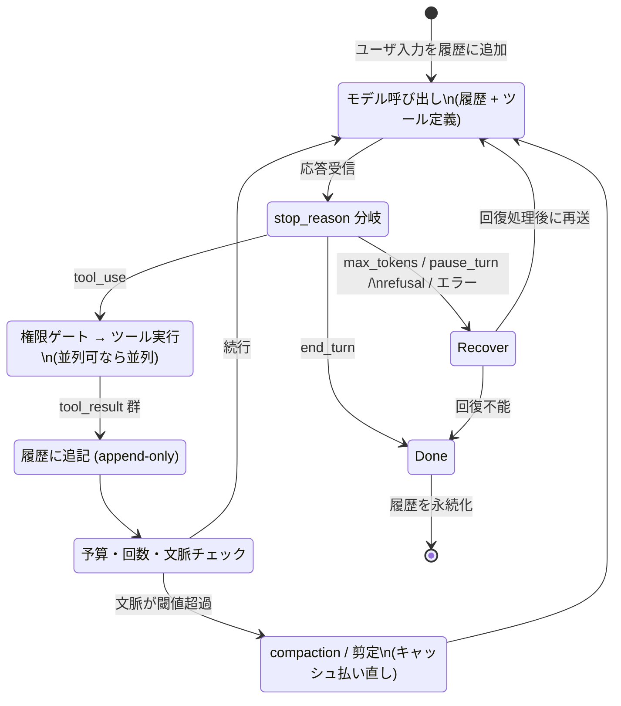

# エージェントループエンジニアリング (Agent Loop Engineering)

## 概要 (Overview)

エージェントの中核は「モデルを呼ぶ → 停止理由 (stop_reason) を見る → ツールを実行して履歴に足す → 繰り返す」という 20 行足らずのループである。しかしこのループを**本番で安定して回す**ための工学——コンテキスト管理、キャッシュ経済、ツールサーフェス設計、エラー処理、耐久性、権限裁定、観測性——は、20 行にはまったく収まらない。本ドキュメントはこの「ループエンジニアリング」を対象とする。

視点として、**ハーネス (harness) はモデルにとっての OS である**という類推を採用する。モデルは CPU のように計算を担うが、メモリ管理（コンテキストウィンドウの割り付けと回収）、スケジューリング（ツール実行の並列化と直列化）、保護（権限ゲートとサンドボックス）、割り込み処理（エラー・中断・再開）はすべてハーネスの責務である。OS 抜きの CPU が実用にならないのと同じく、ハーネス抜きのモデルは実用にならない。

対をなす `agent-architectures.md` が設計空間（何を作るか）を扱うのに対し、本ドキュメントは実装の不変条件（どう壊れないように動かすか）を扱う。物差しは 3 つ——**タスク成功率**（壊れないか）、**トークン経済**（いくらかかるか、キャッシュが効いているか）、**尾部レイテンシ**（最悪ケースで固まらないか）——である。

## 方法論 (Methodology)

- **API 契約から出発する**: 停止理由、ツール結果の形式、キャッシュのプレフィックス一致規則といった各社 API の公開仕様を一次資料とし、ループ設計をその契約の帰結として導出する。ベンダー固有の値は例として扱い、構造（どの API にもある分岐）を主対象とする。
- **実運用者の一次報告を採用する**: エージェント製品を実運用するチームの技術報告（Anthropic のコンテキストエンジニアリング文書、Manus チームの報告等）から、再現的に観察されている経験則——KV キャッシュ命中率の支配性、追記のみ (append-only) 履歴の優位——を抽出する。
- **失敗様式から逆算する**: 「動く実装」ではなく「壊れ方」を列挙し（コンテキスト溢れ、キャッシュ全滅、ツール結果の肥大、二重実行、無限ループ）、各失敗を防ぐ不変条件としてループの設計規則を記述する。
- **数値は桁感にとどめる**: キャッシュ単価やコンテキスト長はモデル・時期依存のため、比率と傾向のみを主張し、絶対値には依存しない。アクセス日 2026-08-08。

## 発見事項 (Findings)

1. **ループの正しさは「全ての停止理由を処理すること」に尽きる。** エージェントループは停止理由を遷移条件とする状態機械である。`tool_use` と `end_turn` だけ処理する素朴な実装は、`max_tokens`（途中打ち切り）、`pause_turn`（サーバ側ツールの中断）、`refusal`（安全拒否）、コンテキスト超過で、それぞれ黙って壊れる。未処理の停止理由は「まれな例外」ではなく、長時間運用では必ず踏む通常ケースである。

2. **エージェントの単価はキャッシュ命中率でほぼ決まる。** エージェントは 1 ターンごとに全履歴を再送する。入力トークンは会話長の 2 乗オーダーで累積するため、キャッシュされた入力（未キャッシュの約 1/10 の単価、比率は提供者依存）に載るかどうかが支配的なコスト要因になる。Manus チームは KV キャッシュ命中率を「本番エージェントの単一で最重要の指標」と報告している。ループ設計の含意は単純で、**履歴は追記のみ (append-only) にし、プレフィックス（システムプロンプト・ツール定義・過去ターン）を 1 バイトも変えない**。タイムスタンプの埋め込み、ツール集合の動的な入れ替え、非決定的な JSON 直列化は、いずれもプレフィックスを破壊してキャッシュを全滅させる「静かな無効化要因」である。

3. **コンテキストは有限の予算であり、追加すればするほど単位あたりの注意は薄まる。** コンテキストウィンドウの拡大は問題を解消しなかった。長い文脈では中間部の想起が落ち（いわゆる context rot）、無関係な過去のツール結果はモデルの注意予算を消費する。したがってコンテキスト管理は「収まるか」ではなく「**最小の高信号トークン集合を維持できるか**」の問題である。プロンプトエンジニアリング（1 回の呼び出しの文言設計）からコンテキストエンジニアリング（ループ全体でのトークン予算配分）への重心移動が、この分野の実務を再定義した。

4. **文脈の縮約には「要約 (compaction)」と「剪定 (pruning)」の 2 系統があり、性質が異なる。** compaction は古い履歴を要約ブロックに置き換える——情報は非可逆に圧縮されるが、物語の連続性は保たれる。剪定（古いツール結果のクリア等）は選択的に削る——構造は保たれるが、参照が宙に浮くリスクがある。どちらもプレフィックスを書き換えるため**キャッシュを失う**。つまり縮約は「実行するたびに一度全額を払い直してでも、以後のターンを軽くする」投資であり、発火閾値の設計（遅すぎれば溢れ、早すぎれば払い直しばかり）がループの経済を左右する。

5. **ファイルシステムは最良の外部メモリである。** コンテキストに載せきれない状態は、ファイルに書いてパスだけを文脈に残すのが最も堅牢である。ファイルは (a) 容量無制限で、(b) 縮約で消えず、(c) サブエージェント間で共有でき、(d) 人間が検査できる。大きなツール結果の退避、セッションを跨ぐメモリ、進捗のチェックポイントは、いずれも「文脈ではなくファイルに置き、必要時に読み直す」で統一的に解ける。

6. **ツールサーフェスの粒度は権限裁定の粒度である。** bash 1 本のエージェントはほぼ何でもできるが、ハーネスから見える情報は不透明なコマンド文字列だけで、承認 UI・並列スケジューリング・鮮度検査のいずれも構造的にできない。行為を専用ツール（read / edit / search / send など）に昇格させるほど、ハーネスは型付きの引数に対してゲート・監査・並列化を適用できる。「広さの bash、統制の専用ツール」が実務的な均衡点である。

7. **耐久性は履歴の永続化から従属的に得られる。** ループの全状態は「メッセージ履歴」という 1 本のデータ構造に集約されるため、各ターンの完了時に履歴を永続化すれば、プロセス死からの再開は「履歴を読み直してループを続ける」だけになる。難所はループ側ではなく**副作用のあるツール**にあり、再開時の二重実行を防ぐには、ツール側の冪等化（またはツール実行結果の記録と突合）が要る。

## アーキテクチャ (Architecture)

### ループの状態機械



### ハーネスの層構成

| 層 | 責務 | 対応する失敗様式 |
|----|------|------------------|
| ループコア | 呼び出し、停止理由分岐、履歴追記、終了判定 | 未処理 stop_reason、無限ループ |
| コンテキスト管理 | トークン会計、compaction/剪定の発火、キャッシュ断点の維持 | 文脈溢れ、キャッシュ全滅 |
| ツール実行器 | スキーマ検証、並列スケジューリング、結果の整形・退避 | 結果肥大、直列化による遅延 |
| 権限層 | 承認ゲート、アローリスト、サンドボックス境界 | 不可逆操作の暴発、データ流出 |
| 永続化・観測 | 履歴のチェックポイント、トランスクリプト、トークン会計の記録 | 再開不能、デバッグ不能 |

OS 類推では、上から順にスケジューラ、仮想記憶、デバイスドライバ、保護リング、ジャーナリングに対応する。各層は独立に検査可能であるべきで、とくに権限層は**ループコアやモデルの挙動に依存せず**単体で強制力を持つ必要がある（モデルへの「〜するな」という指示は権限層の代替にならない）。

## 技術詳細 (Technical Details)

### 1. ループの解剖 — 擬似コード

```text
function agent_loop(history, tools):
    # 前提: history は永続化可能な追記専用リスト。
    #       tools はセッション中は不変（キャッシュ前提）。
    loop:
        response = model.call(history, tools)          # ネットワーク呼び出し
        history.append(assistant_turn(response))       # thinking/tool_use を含め全ブロック追記
        persist(history)                               # ターン単位のチェックポイント

        switch response.stop_reason:
            case end_turn:      return final_text(response)
            case tool_use:
                calls   = tool_use_blocks(response)
                results = execute(calls)               # 独立なら並列、結果は ID で対応付け
                history.append(user_turn(results))     # 全結果を 1 ターンにまとめる
            case max_tokens:    handle_truncation()    # 上限増加 or ストリーミングで再送
            case pause_turn:    continue               # 履歴をそのまま再送すれば再開される
            case refusal:       return surface_refusal()
        if over_budget(history): compact(history)      # 閾値超過時のみ。キャッシュ払い直し
```

**計算量**: ターン数 T、平均履歴長 L に対し、送信トークン総量は O(T·L) = O(T²)（毎ターン全履歴再送のため）。キャッシュ命中時は未キャッシュ分のみが実効コストとなり、追記のみ履歴では各ターンの新規分 O(T) に漸近する。**この O(T²) → O(T) の差がキャッシュ命中率の支配性（発見事項 2）の正体である。**

**前提**: (a) モデル呼び出しはステートレス（サーバは会話を記憶しない）、(b) `tool_result` は対応する `tool_use` の ID を必ず参照する、(c) assistant 応答は部分編集せず全ブロックを追記する——thinking ブロックや並列 tool_use の一部を落とすと、後続リクエストが不整合で拒否されるか、モデルの挙動が劣化する。

### 2. 停止理由の処理表

| stop_reason | 意味 | ループの正しい応答 |
|-------------|------|--------------------|
| `end_turn` | 自然終了 | 最終テキストを返して終了 |
| `tool_use` | ツール実行要求 | 実行して結果を返送、継続 |
| `max_tokens` | 出力上限で打ち切り | 出力は不完全。上限を上げて再試行、または長出力はストリーミングに切り替え。**打ち切られた出力を完成品として扱わない** |
| `pause_turn` | サーバ側ツールの反復上限で一時停止 | 履歴をそのまま再送すると再開される。「続けて」等の追加ユーザ文を挿入しない |
| `refusal` | 安全上の拒否 | 同一プロンプトの機械的再試行はしない。ユーザに提示、または代替モデル・代替経路へフォールバック |
| コンテキスト超過 | 入力が窓に収まらない | compaction を発火して再送。これを例外ではなく通常経路として設計する |

横断する規律として、**再試行の対象を区別する**: レート制限 (429) とサーバエラー (5xx) は指数バックオフで再試行してよい。400 系（リクエスト不正）は再試行しても同じ結果であり、履歴の不整合（ID 欠落、ブロック欠損）を疑ってループ側のバグを直す。`refusal` は再試行の問題ではない。

### 3. コンテキストエンジニアリング — トークン予算の会計

ループが管理すべき予算は 1 本ではない:

- **窓予算**: 履歴 + ツール定義 + システムプロンプトが文脈窓に収まるか。閾値（例: 窓の 7〜8 割）で縮約を発火する。
- **注意予算**: 収まっていても、無関係な古いツール結果はモデルの注意を薄める。「入るから入れる」ではなく「要るから残す」。
- **金銭予算**: 累積トークン単価。キャッシュ命中率と縮約頻度の関数。

主要な技法と選択基準:

| 技法 | 何をするか | 向く状況 | 代償 |
|------|------------|----------|------|
| compaction | 古い履歴を要約ブロックに置換 | 長時間セッション全般 | 非可逆圧縮、キャッシュ払い直し、要約品質への依存 |
| 剪定 (tool-result clearing) | 古いツール結果のみ除去 | 結果が使い捨て（検索・一覧系）中心 | 参照の宙吊り、キャッシュ払い直し |
| ファイル退避 | 大きな結果をファイルに書きパスを返す | 結果が後で再参照されうる | 再読のツール呼び出し 1 回分 |
| メモリファイル | 学び・状態を明示ファイルに書く | セッション横断の継続 | 書き込み規律の設計（何を書くか）が必要 |
| サブエージェント委譲 | 読み込み中心の作業を別文脈に隔離 | 大量読解・並列探索 | 委譲の往復コスト（`agent-architectures.md` 参照） |

compaction の実装上の要点は「何を要約に必ず残すか」の指定にある。実行中のタスク定義、直近の決定事項、未解決のエラー、変更したファイルの一覧は落とせない。逆に、古い検索結果の本文や修正済みエラーの詳細は真っ先に落とす。要約の失敗は**静かに**エージェントを迷子にするため、縮約前後のトランスクリプトを観測可能にしておく（後述 6）。

### 4. キャッシュを前提としたループ設計

プロンプトキャッシュは**プレフィックス一致**である: リクエスト先頭からの完全一致部分だけがキャッシュから読まれ、途中の 1 バイトの差異はそれ以降を全て無効化する。エージェントループへの帰結:

- **システムプロンプトとツール定義は凍結する。** 日時・乱数・ユーザ別値を先頭部に埋め込まない。動的な文脈は履歴の末尾（最新ターン）に載せる。
- **ツール集合をターン間で変えない。** ツールは通常リクエスト先頭に直列化されるため、途中の追加・削除・並べ替えは全キャッシュを無効化する。利用可能ツールを状況で絞りたい場合は、定義を変えずに選択を制約する機構（マスキング等）や、追加分を後方に付加する設計が優る。
- **直列化を決定的にする。** キーの順序が不定な JSON シリアライザは、意味的に同一のリクエストを毎回別バイト列にする。
- **追記のみ履歴は自然にキャッシュ最適である。** 逆に、履歴の途中を書き換える操作（縮約、剪定、過去ターンの編集）は定義的にキャッシュを失う。だからこそ縮約は「閾値駆動でまとめて」行い、毎ターンの微修正はしない。

### 5. ツールサーフェスとツール結果の設計

**bash か専用ツールか。** 判断基準は「ハーネスがその行為に介入する必要があるか」:

- **ゲートが要る** → 専用ツール。送信・削除・決済のような不可逆操作は、型付き引数を持つ専用ツールにすれば承認 UI に「何をどこへ」を表示できる。`bash -c "curl -X POST …"` はゲートできない。
- **不変条件を強制したい** → 専用ツール。例: edit ツールは「最後に read してから変更されていないこと」を検査できる（鮮度検査）。bash 経由の sed には強制できない。
- **並列化したい** → 専用ツール。読み取り専用と宣言されたツールは安全に並列実行できる。bash はコマンドごとに安全性が違うため直列化せざるを得ない。
- 上のいずれも不要な探索的作業 → bash の広さが勝つ。

**ツール結果の衛生。** ツール結果は「モデルが次のターンで読む入力」である:

- **サイズ上限を設ける。** 巨大な結果（ログ全文、大テーブル）は先頭抜粋 + ファイル退避に自動変換する。1 回の巨大結果が以後全ターンの再送コストに乗ることを忘れない。
- **エラーは構造化して返す。** スタックトレース全文より「何が・なぜ・次に何を試せるか」。モデルはエラーメッセージを読んで行動を変えるので、エラー文はモデル向け UX である。
- **出所 (provenance) を保つ。** Web 取得・外部文書由来の内容は、内部ツールの結果と区別できるメタデータを保持する（セキュリティ考察参照）。

### 6. 耐久性・並行性・観測性

- **チェックポイントの単位はターン。** assistant 応答の追記後と tool_result 追記後に履歴を永続化すれば、任意時点のクラッシュから「最後の完全なターン」まで巻き戻して再開できる。
- **副作用ツールの二重実行対策。** 再開時に「実行済みだが結果未記録」のツールが再実行されうる。対策は (a) ツールの冪等化（同一 ID の再実行を無害にする）、(b) 実行ログを別途永続化し再開時に突合する、のいずれか。決済・送信系ツールでは必須である。
- **無限ループの上限。** 同一ツール・同一引数の反復や、進捗のないターンの連続を検出して打ち切る。総ターン数・総トークンの上限（予算）をハーネス側で強制し、モデルに残予算を伝えて自発的な収束を促す設計もある。
- **観測性の第一級市民はトランスクリプトである。** 各ターンの完全な入出力（thinking・ツール引数・結果・停止理由・トークン会計）を構造化ログに残す。エージェントのバグの大半は「モデルがその時点で何を見ていたか」を復元できれば自明になる。逆にそれがなければ再現すら難しい。トークン会計は入力・出力・キャッシュ読み・キャッシュ書きを分けて記録し、キャッシュ命中率をダッシュボード化する（発見事項 2）。

## セキュリティ考察 (Security Considerations)

ハーネスは、エージェントシステムにおいて**強制力を持てる唯一の場所**である。モデルは指示に従う傾向を持つにすぎず、環境は与えられた権限内の操作を区別しない。したがってセキュリティ機構はループの各段に埋め込まれる。

- **権限ゲートはツール実行の前段に置く。** 承認ポリシー（自動許可 / 都度確認 / 拒否）はツール単位・引数パターン単位で宣言し、ハーネスが裁定する。とくに書き込み系・送信系・削除系は既定で確認を要求し、ユーザが明示的に緩める方向のみ許す。
- **サンドボックスは環境側で。** ファイルシステムはワークスペースに、ネットワーク egress はアローリストに制約する。制約はコンテナ・プロキシといった環境機構で強制し、プロンプトによる自制には依存しない。
- **秘密情報をコンテキストに入れない。** API キー等をシステムプロンプトや履歴に置くと、履歴の永続化・ログ・compaction 要約のすべてに複製される。秘密はハーネス側に保持し、ツール実行時に外側で注入する（モデルはプレースホルダしか見ない）設計が原則である。
- **外部由来コンテンツの隔離。** Web 取得結果・外部文書・第三者ツールの結果は、間接プロンプトインジェクションの搬送路である（`agent-architectures.md` セキュリティ考察）。ハーネスは出所メタデータを保持し、「外部コンテンツ内の指示はタスクを変更できない」ことを検査可能にする。危険な三点セット（非公開データ・信頼できない入力・外部送信路）の同時成立をループ構成レベルで避ける——たとえば信頼できない入力を読むセッションでは送信系ツールを外す。
- **監査ログは改竄に備える。** トランスクリプトはセキュリティ監査の一次資料になるため、実行主体（ユーザ承認か自動許可か）と承認時刻を含めて記録する。

## 結論 (Conclusions)

1. エージェントループは小さなコードだが、その工学は「停止理由の全数処理」「追記のみ履歴とキャッシュ経済」「トークン予算の会計」「ツールサーフェス＝権限粒度」「ターン単位の永続化」という 5 つの不変条件に整理できる。これらは特定ベンダーの API を超えて成り立つ構造である。
2. 最重要の単一指標はキャッシュ命中率である。O(T²) の再送コストを O(T) に潰せるかどうかはループ設計（プレフィックス安定性）で決まり、モデル選定より先に効く。
3. コンテキスト管理は「収める」技術ではなく「最小の高信号集合を維持する」技術である。compaction・剪定・ファイル退避・委譲は、注意予算とキャッシュ払い直しのトレードオフの上で使い分ける。
4. ハーネスは OS であり、保護リングである。権限・サンドボックス・秘密の分離・出所管理は、モデルへの指示ではなくループと環境の機構として強制する。
5. 本ドキュメントの不変条件は `agent-architectures.md` の設計空間に対する実装制約として読める——どんなアーキテクチャを選んでも、最終的にこのループの上で動く。

## 参考文献 (References)

- [Building effective agents](https://www.anthropic.com/research/building-effective-agents) — Anthropic Engineering. Accessed: 2026-08-08
- [Effective context engineering for AI agents](https://www.anthropic.com/engineering/effective-context-engineering-for-ai-agents) — Anthropic Engineering. Accessed: 2026-08-08
- [Context Engineering for AI Agents: Lessons from Building Manus](https://manus.im/blog/Context-Engineering-for-AI-Agents-Lessons-from-Building-Manus) — Manus. Accessed: 2026-08-08
- [How we built our multi-agent research system](https://www.anthropic.com/engineering/built-multi-agent-research-system) — Anthropic Engineering. Accessed: 2026-08-08
- [Prompt caching — Claude API docs](https://platform.claude.com/docs/en/build-with-claude/prompt-caching) — Accessed: 2026-08-08
- [Handling stop reasons — Claude API docs](https://platform.claude.com/docs/en/build-with-claude/handling-stop-reasons) — Accessed: 2026-08-08
- Liu, N. F. et al. (2024). Lost in the Middle: How Language Models Use Long Contexts. *TACL*, 12, 157–173. arXiv:2307.03172
- Greshake, K. et al. (2023). Not what you've signed up for: Compromising Real-World LLM-Integrated Applications with Indirect Prompt Injection. *AISec 2023*. arXiv:2302.12173
