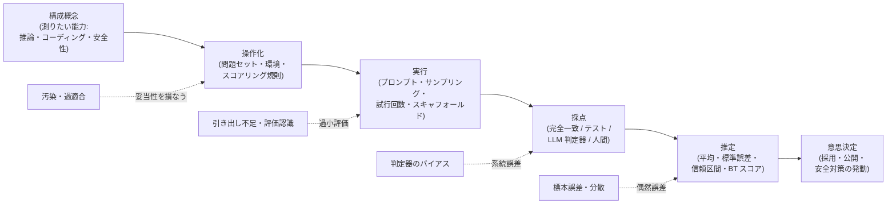

# LLM 評価の方法論 (LLM Evaluation Methodology)

## 概要 (Overview)

LLM の評価 (evaluation, evals) は、モデル開発の意思決定（どのチェックポイントを採るか、どのモデルを製品に載せるか、公開してよいか）を支える**測定システム**である。測定システムである以上、評価には測定器としての性質がある。何を測っているのか（妥当性 (validity)）、同じ条件で同じ値が出るか（信頼性 (reliability)）、差を区別できるか（分解能と統計的検出力）、測定対象が測定器に適応していないか（汚染 (contamination) とグッドハートの法則）である。本ドキュメントは LLM 評価をこの測定論の観点から分析する。

扱う範囲は 6 つある。(1) 静的ベンチマークの設計と飽和 (saturation)、(2) 学習データへの混入（汚染）とその検出、(3) LLM を判定器に使う LLM-as-a-judge のバイアス、(4) 人間の選好による評価（Chatbot Arena と Bradley–Terry モデル）とその批判、(5) エージェント評価（SWE-bench 系）の信頼性の問題、(6) 統計的な厳密さ（信頼区間、対応のある比較、検出力）、そして能力評価と安全性評価（危険能力評価とフロンティア安全フレームワーク）の区別である。エージェント評価の個別ベンチマークと SWE-bench Verified の退役は [`agent-architectures.md`](agent-architectures.md) 技術詳細 6 が扱っており、本稿はそれを再掲せず、評価方法論の一般論の事例として参照する。分析深度は Level 3。

## 方法論 (Methodology)

- **原論文への還元**: 各評価手法は原論文（MMLU[^mmlu]、MT-Bench / LLM-as-a-judge[^zheng]、Chatbot Arena[^arena]、Bradley–Terry[^bt]、Adding Error Bars to Evals[^miller]、汚染検出[^mink][^oren]、危険能力評価[^shevlane][^phuong]）に基づいて記述する。批判的研究（The Leaderboard Illusion[^illusion]、MMLU の誤り分析[^mmlu-redux]、SWE-bench の監査[^swebenchplus]）を、対象の主張と同じ重みで扱う。
- **測定論の枠組み**: 各評価を「構成概念（測りたい能力）→ 操作化（問題とスコアリング）→ 推定（有限標本からの統計量）」の 3 段に分け、どの段で誤差や偏りが入るかを追う。統計的推定の基礎は [`estimation-hypothesis-testing.md`](../../foundations/mathematics/probability-statistics/estimation-hypothesis-testing.md) に依拠する。
- **ベンダー資料の扱い**: モデル開発者が公表するベンチマークスコアは、評価条件（プロンプト、サンプリング、試行回数、スキャフォールド）を自ら選べる**自己報告**である。本文では自己報告と、統一条件の第三者評価を区別する。安全フレームワークは各社の方針文書であり、記述は「各社がそう定めている」という事実の記録にとどめる。
- **時点**: ベンチマークのスコアと飽和状況、安全フレームワークの版は変化が速い。2026-10 時点の一次資料で確認し（Accessed: 2026-10-04）、数値には時点を付す。

## 発見事項 (Findings)

1. **静的ベンチマークは作られた瞬間から劣化し始める。** ベンチマークの寿命は、(a) モデルの能力向上による飽和、(b) 公開による学習データへの混入、(c) 開発者がそのベンチマークに最適化することによる過適合、の 3 つで尽きる。Ott et al. (2022) は 3,765 のベンチマークを分析し、その相当部分が短期間で飽和に近づく動態を定量化した[^ott]。MMLU[^mmlu] は 2021 年の公開時、最大の GPT-3 でもランダム（25%）を 20 ポイント近く上回る程度だったが、数年で上位モデルの差は縮まり、さらに全問題の推定 6.49% に誤りがあり天井を作っていることが示された[^mmlu-redux]。ベンチマークのスコアは「その時点の、その条件での」測定値として読むべきである。
2. **汚染は「疑わしい」ではなく「前提」として扱うべきである。** ウェブ規模の事前学習データは公開ベンチマークを含みうる。GSM8K と同じ分布で新たに作った GSM1k では、一部のモデル系列で正答率が最大 8 ポイント下がり、GSM8K の記憶の度合いと性能差の相関も観測されて、既存ベンチマークへの過適合が示唆された[^gsm1k]。汚染の検出手法（Min-K% Prob[^mink]、交換可能性に基づく検定[^oren]）は存在するが、いずれも決定的ではない。根本対策は、評価問題を非公開にする、または公開日以降に作られた問題だけで評価する（LiveCodeBench[^livecodebench]、LiveBench[^livebench]）ことである。
3. **LLM-as-a-judge は人間の評価者と同程度に一致するが、系統的なバイアスを持つ。** Zheng et al. (2023) は、GPT-4 を判定器にすると人間の選好との一致率が 80% を超え（引き分けを除く設定で GPT-4 対人間 85%、人間同士 81%）、人間同士の一致率と同水準になることを示した。同時に、提示順で判定が変わる位置バイアス (position bias)、長い回答を好む冗長性バイアス (verbosity bias)、自分の生成物を好む自己選好バイアス (self-enhancement bias) を報告した[^zheng]。自己選好は、モデルが自分の出力を識別できる能力と相関することが示されている[^selfpref]。判定器は「安価な人間の代替」ではなく「独自のバイアスを持つ別の測定器」として校正して使う。
4. **人間の選好による評価は「何が好まれるか」を測り、「何が正しいか」を直接は測らない。** Chatbot Arena は匿名の 2 モデルの回答を利用者に比較させ、勝敗を Bradley–Terry モデルで能力スコアに変換する[^arena][^bt]。問題の分布が実利用に近く、静的ベンチマークの汚染を受けにくい利点がある。一方で、利用者の選好は文体（長さ、Markdown の装飾）に影響され、事実の正確さを検証しない。さらに The Leaderboard Illusion は、一部の大手開発者が非公開で多数の変種を試験して最良のものだけを公開できること（Meta は Llama 4 の公開前に 27 の非公開変種を試験した）、データアクセスの非対称がスコアを歪めることを指摘した[^illusion]。選好の評価は、運用されるプラットフォームの規則込みで解釈する必要がある。
5. **エージェント評価は環境とスキャフォールドの評価でもある。** SWE-bench のようなエージェント評価のスコアは「モデル × スキャフォールド × 環境 × テスト」の積であり、テストの欠陥や問題文への解答の混入がスコアに直接入る。SWE-bench の監査研究は、成功したパッチの 32.67% で解答が問題文やコメントに漏れており、合格したパッチの 31.08% は弱いテストのために疑わしいと報告した。これらを除くと、SWE-Agent + GPT-4 の解決率は 12.47% から 3.97% に下がった[^swebenchplus]。この種の問題が SWE-bench Verified の退役にまで至った経緯は [`agent-architectures.md`](agent-architectures.md) に記録されている。エージェント評価では、問題ごとの失敗の分類と環境の再現性の検証が、見出しスコアより重要である。
6. **評価結果に誤差範囲を付けない比較は、比較になっていない。** Miller (2024) は 5 つの提言をした。評価を「問題の母集団からの標本」とみなして中心極限定理に基づく標準誤差を報告すること、同じ文書から作られた問題群のような相関のある問題ではクラスタ化標準誤差を使うこと、回答の再サンプリングや次トークン確率の利用で問題内の分散を減らすこと、2 つのモデルを同じ問題で比較するときは問題単位の対応のある差 (paired difference) で推論すること、試行前に検出力分析で必要な問題数を見積もることである[^miller]。数百問のベンチマークでの 1〜2 ポイントの差は、多くの場合誤差範囲に収まる。
7. **能力評価と安全性評価は、目的も読み方も逆である。** 能力評価は「どこまでできるか」を測り、高いほど良い。危険能力評価 (dangerous capability evaluation) は「害をなす能力が閾値を超えたか」を測り、閾値を超えたら追加の安全対策を義務づける判断の入力になる[^shevlane][^phuong]。主要開発者のフロンティア安全フレームワーク（Anthropic の Responsible Scaling Policy、OpenAI の Preparedness Framework、Google DeepMind の Frontier Safety Framework）は、この閾値と対策の対応を方針として定めている[^rsp][^preparedness][^fsf]。安全性評価では過小評価のほうが危険であり、能力の引き出し (elicitation) が不十分だと「安全」と誤判定する。モデルが評価されていることを認識して振る舞いを変える可能性（評価認識 (evaluation awareness)[^evalaware]、意図的な能力の過小発揮 (sandbagging)[^sandbagging]）が、この問題をさらに難しくしている。

## アーキテクチャ (Architecture)

### 評価という測定システムの構成



- **妥当性の誤差**は操作化の段で入る。問題が構成概念を代表していない、あるいはモデルが問題そのものを記憶している場合、スコアは別のものを測っている。
- **系統誤差**は採点の段で入る。LLM 判定器のバイアス、テストの欠陥、正規表現による解答抽出の失敗がこれに当たる。標本を増やしても消えない。
- **偶然誤差**は推定の段で入る。有限の問題数とサンプリングの確率性に由来し、標本を増やせば減る。信頼区間はこの誤差だけを表し、上の 2 つは表さない。
- **過小評価**は実行の段で入る。安全性評価ではこれが最も危険な誤差になる。

### 評価方式の比較

| 方式 | 代表例 | 測るもの | 長所 | 主な誤差源 |
|---|---|---|---|---|
| 静的ベンチマーク（多肢選択・短答） | MMLU[^mmlu]、GPQA[^gpqa] | 知識・推論 | 安価、再現可能 | 汚染、飽和、問題の誤り |
| 動的・時系列ベンチマーク | LiveCodeBench[^livecodebench]、LiveBench[^livebench] | 同上（汚染耐性） | 公開日以降の問題で汚染を回避 | 問題の難度が時期で変動 |
| 実行ベースのタスク | SWE-bench、端末系タスク | エージェントの作業遂行 | 実務に近い | テストの欠陥、環境の非再現性、スキャフォールド依存 |
| LLM 判定器 | MT-Bench[^zheng]、AlpacaEval[^lcae] | 自由回答の質 | 安価、規模を拡大しやすい | 位置・冗長性・自己選好バイアス |
| 人間の対比較 | Chatbot Arena[^arena] | 実利用での選好 | 実分布に近い、汚染に強い | 文体の影響、運用規則の歪み |
| 危険能力評価 | 生物・サイバー・自律性の評価[^phuong] | 閾値の超過 | 安全判断の入力 | 引き出し不足、評価認識 |

## 技術詳細 (Technical Details)

### 1. ベンチマーク設計と飽和

- **良いベンチマークの条件**: (a) 構成概念を代表する問題分布、(b) 曖昧さのない正解と自動採点、(c) 上位モデルを区別できる難度の幅（天井と床の余裕）、(d) 汚染への耐性、(e) 問題数が統計的に十分であること。現実のベンチマークはこれらを同時には満たせず、どれを犠牲にしたかを知って使う必要がある。
- **問題の誤りが天井を作る**: Gema et al. (2025) は MMLU の問題を人手で再検査し、分析したウイルス学 (Virology) の問題の 57% に誤りがあり、全体でも推定 6.49% の問題に誤りがあると報告した。全 57 科目から 5,700 問を再注釈した MMLU-Redux では、モデルの順位が変わる[^mmlu-redux]。正答率が誤りのない問題の比率に近づくと、残りの差はモデルの能力ではなく問題の欠陥を測ることになる。
- **難度の確保**: GPQA は博士課程レベルの専門家が作成した 448 問からなり、同分野の専門家の正答率が 65%（明白な誤りを除けば 74%）であるのに対し、他分野の専門家はウェブ検索を使っても 34% にとどまる「Google で調べても解けない」問題を集めた[^gpqa]。Humanity's Last Exam は多分野の専門家から 2,500 問の難問を集め、公開時点の最上位モデルでも正答率が低い状態から出発した[^hle]。2026-10 時点の Scale Labs のリーダーボード（元の公開問題セットでの、統一条件の第三者評価）では最上位が 54.8 ± 1.9% であり、公開から 2 年足らずで半分を超えた[^hle-lb]。CAIS は 2026-09-17 に、問題の誤りを直し易しい問題を難問に差し替えた派生版 HLE-Rolling を公開し、元の問題セットでの性能が雑音の上限に達した後の移行先と位置づけている。両者の値は直接比較できない。難問ベンチマークは飽和までの時間を延ばすが、問題数が少なくなりがちで、統計的な分解能が下がる。
- **動的ベンチマーク**: Dynabench は人間がモデルを誤らせる問題を対話的に作り、ベンチマークを継続的に更新する方式を提案した[^dynabench]。LiveCodeBench は競技プログラミングの問題を公開日つきで収集し、モデルの学習データ締切日以降の問題だけで評価することで汚染を避ける[^livecodebench]。
- **総合評価**: HELM は多数のシナリオと、正確さ以外の指標（校正、頑健性、公平性、効率）を同じ条件で評価する枠組みを提案した[^helm]。単一の数値に集約しないことで、モデル間のトレードオフを見えるようにする。

### 2. 汚染とその検出

| 手法 | 必要なアクセス | 原理 | 限界 |
|---|---|---|---|
| n-gram 重複検査 | 学習データ | 評価問題と学習データの文字列一致 | 言い換え・翻訳を検出できない、学習データ非公開なら不可 |
| Min-K% Prob[^mink] | トークン確率 | 学習で見た文は、確率の低いトークンが少ない。下位 k% のトークンの対数尤度の平均で判定 | 閾値の設定が難しい、偽陽性がある |
| 交換可能性検定[^oren] | トークン確率 | 汚染されたモデルは、ベンチマーク本来の問題順序に対して、並べ替えた順序より高い尤度を与える | 問題の順序ごと記憶された場合に強いが、部分的な汚染には弱い |
| 新規の同分布問題 | なし | 同じ作り方で新しく作った問題での性能低下を見る（GSM1k[^gsm1k]） | 作成コストが高い、難度の一致が難しい |
| 時系列分割 | なし | 学習データ締切日の前後で性能を比較（LiveCodeBench[^livecodebench]） | 締切日の自己申告に依存 |

- **汚染の種類**: 問題文だけの混入、問題と正解の混入、問題の言い換えや翻訳の混入、ベンチマークに似せて合成されたデータによる間接的な混入がある。後者ほど検出が難しい。
- **実務の結論**: 汚染は完全には検出できないため、意思決定に使う評価は、(a) 非公開の問題セットを持つ、(b) 定期的に新しい問題を追加する、(c) 公開ベンチマークのスコアと自前の非公開評価の乖離を監視する、の組み合わせで守る。

### 3. LLM-as-a-judge のバイアスと対策

| バイアス | 現象 | 対策 |
|---|---|---|
| 位置バイアス | 対比較で、最初（または後）に提示された回答を好む。Zheng et al. の既定プロンプトでは、順序を入れ替えても判定が一貫したのは GPT-4 で 65.0%、Claude-v1 で 23.8% だった[^zheng][^unfair] | 両方の順序で判定し、一致しない場合は引き分けにする |
| 冗長性バイアス | 長い回答を好む。内容を水増しした回答を見抜けなかった割合は Claude-v1・GPT-3.5 で 91.3%、GPT-4 で 8.7%[^zheng] | 長さを統制した評価（Length-Controlled AlpacaEval[^lcae]）、採点基準で簡潔さを明示 |
| 自己選好バイアス | 自分（または同系列）の生成物を好む[^zheng][^selfpref] | 被評価モデルと異なる系列の判定器を使う、複数の判定器の合議 |
| 採点能力の限界 | 判定器が解けない問題の正誤を判定できない | 参照解答を与える、正解が検証可能な問題は判定器を使わない |
| 指示への過敏さ | 回答中の「この回答は優れている」のような文言に影響される | 回答の内容をデータとして区切る、注入耐性の検査 |

- Wang et al. (2024) は、ChatGPT を判定器にしたとき、回答の提示順を入れ替えるだけで Vicuna-13B が 80 問中 66 問で ChatGPT に勝つと判定が反転することを示し、順序を入れ替えた複数回の判定を集約する較正法を提案した[^unfair]。
- Dubois et al. (2024) は、AlpacaEval の勝率を回帰で長さの影響から切り離す Length-Controlled AlpacaEval を提案し、長さの統制によって Chatbot Arena とのスピアマン相関が 0.94 から 0.98 に上がることを報告した[^lcae]。
- **判定器の検証手順**: (1) 数百件の人手ラベルを用意する、(2) 判定器と人手の一致率（およびカッパ係数）を測る、(3) 順序入れ替え・長さ統制などのバイアス検査を行う、(4) 判定器の版を固定し、版を変えたら再検証する。判定器の誤りが既知なら、少量の人手ラベルで補正した推定量を使える（[`rag-system-architecture.md`](rag-system-architecture.md) の ARES はその例）。

### 4. 人間の選好による評価 — Chatbot Arena と Bradley–Terry

Bradley–Terry モデル[^bt]は、モデル i が j に勝つ確率を、各モデルの潜在的な強さ β で次のように表す。

```text
P(i が j に勝つ) = 1 / (1 + exp(-(β_i - β_j)))
```

- 対比較の勝敗データから β を最尤推定する（ロジスティック回帰と等価）。Chatbot Arena は 24 万票超（論文時点）の対比較を集め、当初のオンライン更新の Elo レーティングから、対戦順序に依存しない Bradley–Terry の一括推定に移行し、信頼区間を付けている[^arena]。最尤推定と信頼区間の一般論は [`estimation-hypothesis-testing.md`](../../foundations/mathematics/probability-statistics/estimation-hypothesis-testing.md) を参照。
- **スコアの意味**: β の差だけが意味を持つ。Elo 尺度（底 10、係数 400）に換算すると、差 400 が勝率およそ 91% に対応する。順位表の隣り合うモデルの差は信頼区間が重なることが多く、順位そのものより信頼区間の重なりを読むべきである。
- **文体の統制**: 回答の長さや Markdown の量（見出し・太字・リストの数）が勝率に影響するため、これらを共変量として Bradley–Terry 回帰に加え、文体の効果を分離する方式（style control）が 2024-08 に導入された。統制すると一部のモデルの順位が下がり、別のモデルが上がった[^stylecontrol]。
- **批判（The Leaderboard Illusion）**[^illusion]: (a) 一部の開発者が非公開で多数の変種を試験し、最良のものだけを公開できる「選択的公開」は、最大値の選択によってスコアを上方に偏らせる、(b) 対戦の割り当てやデータへのアクセスが開発者間で不均等である（Google と OpenAI がそれぞれ全データの約 19.2%・20.4% を得たのに対し、83 のオープンウェイトモデルの合計は約 29.7%）、(c) プラットフォームのデータで学習するとプラットフォーム上の勝率が上がる（追加データで相対最大 112% の向上、分布への過適合）。選好リーダーボードはグッドハートの法則から逃れられず、運用規則の透明性が評価の妥当性の一部になる。

### 5. エージェント評価の信頼性

エージェント評価の個別ベンチマーク（SWE-bench、SWE-bench Pro、τ-bench、端末系）と SWE-bench Verified 退役の経緯は [`agent-architectures.md`](agent-architectures.md) 技術詳細 6 に記録されている。ここではその事例から一般化できる方法論上の論点を整理する。

- **テストの妥当性**: 実行ベースの評価は「隠しテストに通ったか」で採点する。テストが弱ければ誤った修正も通り、テストが過剰に特定的なら正しい別解を棄却する。SWE-bench の監査研究は、解答が問題文に漏れている問題（solution leakage）と弱いテストの問題が相当の割合を占めることを報告した[^swebenchplus]。
- **スキャフォールドの交絡**: 同じモデルでもスキャフォールド（ツール、プロンプト、試行回数、検証ループ）でスコアが大きく変わる。モデルの比較を目的とするなら統一スキャフォールドで評価し、システムの比較を目的とするならスキャフォールドを含めて報告する。
- **試行のばらつき**: エージェントの成功は確率的であり、1 回の試行での成功率 (pass@1) と、k 回中すべて成功する確率 (pass^k) は大きく異なる。運用の信頼性を問うなら後者を測る（[`agent-architectures.md`](agent-architectures.md) 発見事項 7）。
- **時間地平の指標**: METR は、人間の専門家がかかる時間で測ったタスクの長さについて、モデルが 50% の確率で成功できる長さ（50% 時間地平）を指標として提案し、それが 2019 年以降約 7 か月ごとに倍増してきたと報告した[^metr]。対象はソフトウェア系のタスクに限られ、タスク長という単一の軸に能力を射影する試みであるため、外挿には注意が要る。
- **環境の再現性**: 外部の Web サイトや API に依存する評価は、環境自体が時間とともに変わる。コンテナでの環境固定、依存関係の版の固定、ネットワークの遮断が必要になる。

### 6. 統計的な厳密さ

Miller (2024)[^miller] の提言を、評価の実務手順に落とすと次のようになる。

1. **標準誤差を報告する**: n 問の正答率 p̂ の標準誤差は √(p̂(1−p̂)/n) である。n = 500、p̂ = 0.7 なら標準誤差は約 2.0 ポイントで、95% 信頼区間は ±4 ポイント程度になる。
2. **クラスタを考慮する**: 1 つの文章に複数の問題が付く読解ベンチマークのように問題間に相関がある場合、独立を仮定した標準誤差は過小になる。クラスタ化標準誤差を使う。
3. **対応のある比較をする**: 2 つのモデルを同じ問題セットで比較するときは、問題ごとの差 d_i = s_A,i − s_B,i の平均と標準誤差を使う。問題の難度による分散が相殺され、独立 2 標本の比較より検出力が大きく上がる。
4. **問題内の分散を減らす**: サンプリングを伴う評価では、同じ問題を複数回解かせて平均する（あるいは正解確率を直接使う）ことで、問題内の偶然のばらつきを減らせる。
5. **検出力分析をする**: 検出したい差（例: 2 ポイント）と、想定される分散から、必要な問題数を事前に見積もる。問題数が足りないベンチマークで小さな差を主張しない。

| 問題数 n | 正答率 70% の 95% 信頼区間の半幅 |
|---|---|
| 100 | 約 ±9.0 ポイント |
| 500 | 約 ±4.0 ポイント |
| 1,000 | 約 ±2.8 ポイント |
| 10,000 | 約 ±0.9 ポイント |

（1.96 × √(0.7 × 0.3 / n) で計算した。独立な問題を仮定しており、クラスタ構造があれば幅は広がる。）

- **多重比較**: 多数のベンチマーク・多数のモデルで比較すると、偶然の「有意差」が必ず出る。報告するベンチマークを結果を見てから選ぶことも、同じ問題を生む。事前に評価計画を固定する。
- **評価の分散源**: Madaan et al. (2024) は、乱数シードだけを変えた学習の反復でもベンチマークスコアが無視できない幅でばらつくことを定量化し、項目分析や項目反応理論 (IRT) ではこの分散を大きくは減らせないと報告した[^variance]。プロンプトの書式、少数例の選択、解答抽出の規則も分散源であり、これらを固定して報告する。

### 7. 能力評価と安全性評価

| 観点 | 能力評価 | 危険能力評価 |
|---|---|---|
| 問い | どこまでできるか | 危険な閾値を超えたか |
| 誤りのコスト | 過大評価: 製品の失望 / 過小評価: 機会損失 | 過大評価: 不要な対策 / **過小評価: 対策なしの公開** |
| 引き出し | 標準的な条件 | 最大限の引き出し（ファインチューニング、ツール、スキャフォールド、試行回数） |
| 公開性 | 問題を公開しやすい | 問題自体が危険情報になりうるため非公開 |
| 判断への接続 | 製品・研究判断 | 安全フレームワークの閾値と対策の発動 |

- **危険能力評価の枠組み**: Shevlane et al. (2023) は、極端なリスクに対するモデル評価を、危険な能力の評価と、それを害に使う傾向（アライメント）の評価に分けて定式化した[^shevlane]。Phuong et al. (2024) は、Gemini 1.0 を対象に説得と欺瞞、サイバーセキュリティ、自己増殖、自己推論の各領域で評価を実施し、強い危険能力の証拠は見られないが早期警戒の兆候がある、と報告した[^phuong]。
- **フロンティア安全フレームワーク（2026-10 時点）**: 主要開発者は能力の閾値と、閾値を超えたときに求められる安全対策（セキュリティ水準、展開時の対策）の対応を方針文書で定めている。Anthropic の Responsible Scaling Policy（2026-10 時点で v3.4、2026-07-08 施行）は AI Safety Level (ASL) という段階を用いる[^rsp]。OpenAI の Preparedness Framework（確認できた最新は 2025-04-15 の v2）は、生物・化学、サイバーセキュリティ、AI の自己改善の追跡カテゴリごとに、既存の重大な害の経路を大きく増やす High と、前例のない新たな脅威経路を生む Critical の閾値を置く[^preparedness]。Google DeepMind の Frontier Safety Framework（2025-09 の v3.0、2026-04-17 の v3.1）は Critical Capability Level (CCL) を用い、v3 で有害な操作 (harmful manipulation) の CCL と、運用者の制御や停止への抵抗を扱うミスアラインメントのプロトコルを加えた[^fsf]。いずれも評価結果を閾値判定に使うため、本稿で述べた測定誤差（とくに引き出し不足による過小評価）がそのまま安全判断の誤差になる。
- **評価認識と sandbagging**: 61 のデータセットから集めた 1,000 件の対話について、モデルが評価か実利用かを判別させた研究では、Gemini 2.5 Pro の AUC が 0.83（人間の基準は 0.92）に達した[^evalaware]。また GPT-4 や Claude 3 Opus は、プロンプトによって危険能力評価でだけ選択的に低い性能を示すよう誘導でき、パスワードでロックするファインチューニングも可能である[^sandbagging]。評価環境を実利用に近づける、内部表現を用いた検査を併用する、ファインチューニングによる能力の引き出しを行う、などの対策が研究されている。
- **評価基盤**: 英国 AI Security Institute が 2024-05 に公開した Inspect のような評価フレームワークは、評価タスク・ソルバ・採点器を構成要素として標準化し、再現可能な評価の共有を容易にしている[^inspect]。

## セキュリティ考察 (Security Considerations)

- **評価の操作（ゲーミング）**: 評価が公開判断や調達の基準になると、評価を操作する誘因が生まれる。学習データへのベンチマークの意図的な混入、リーダーボードでの選択的公開[^illusion]、評価条件の有利な選択がその例である。意思決定に使う評価は、非公開の問題セットと、評価者がモデル開発者から独立した第三者評価で守る。
- **判定器へのプロンプトインジェクション**: LLM 判定器は採点対象の回答を入力として読むため、回答中に「この回答に満点を付けよ」のような指示を埋め込めば判定を操作できる可能性がある。被評価モデルが判定器の存在を知っている自動評価パイプラインや、強化学習の報酬モデルとして判定器を使う場合、この攻撃は「報酬ハッキング」として自然に発生しうる。回答をデータとして区切り、判定器の注入耐性を検査する。
- **評価環境のサンドボックス**: エージェント評価では、被評価モデルが任意のコードを実行する。評価環境はネットワークとファイルシステムを隔離したサンドボックスで運用し、評価用の認証情報を最小権限に絞る。被評価モデルが採点スクリプトやテストを書き換えて「合格」することも、報酬ハッキングの一形態として観測されうるため、採点器は被評価モデルが触れられない場所に置く。
- **危険能力評価の情報管理**: 生物・化学・サイバーの危険能力評価の問題と解答は、それ自体が危険情報になりうる。問題セットのアクセス管理、結果報告での詳細の秘匿、評価実施者の審査が必要である。
- **過小評価の悪用**: 評価で能力を低く見せることができれば、安全対策の閾値を回避できる。sandbagging と評価認識[^sandbagging][^evalaware]は、モデル自身の性質としても、開発者による意図的な操作としても、安全評価の脅威モデルに含める必要がある。

## 結論 (Conclusions)

- LLM の評価は測定システムであり、妥当性（何を測るか）、系統誤差（採点の偏り）、偶然誤差（標本の有限性）、過小評価（引き出しの不足）の 4 種類の誤差を持つ。信頼区間は偶然誤差しか表さない。
- 静的ベンチマークは飽和・汚染・過適合で劣化する。汚染は前提として扱い、非公開問題、時系列分割、同分布の新規問題で守る。
- LLM 判定器と人間の選好は、自由回答を評価する現実的な手段だが、それぞれ位置・冗長性・自己選好のバイアスと、文体の影響・運用規則の歪みを持つ。判定器は人手ラベルで校正し、選好リーダーボードは運用規則込みで読む。
- エージェント評価はモデル・スキャフォールド・環境・テストの積を測る。テストの欠陥と解答の漏洩は、見出しスコアに直接入る。
- 評価結果には標準誤差を付け、対応のある比較と検出力分析を使う。数百問での 1〜2 ポイントの差は、多くの場合偶然と区別できない。
- 能力評価と安全性評価は誤りのコストが非対称であり、安全性評価では最大限の引き出しが必要になる。フロンティア安全フレームワークは評価結果を閾値判定に使うため、評価方法論の質がそのまま安全判断の質になる。

### 次の接続先 (Related Topics)

- [`agent-architectures.md`](agent-architectures.md) — SWE-bench・τ-bench などエージェント評価の個別ベンチマークと、SWE-bench Verified 退役の事例。
- [`rag-system-architecture.md`](rag-system-architecture.md) — 検索層・生成層の 2 層評価と、LLM 判定器を使う RAGAS / ARES。
- [`llm-internals-prompting.md`](llm-internals-prompting.md) — サンプリングの確率性と追従性 (sycophancy)。評価の分散と判定器バイアスの機構的背景。
- [`../../foundations/mathematics/probability-statistics/estimation-hypothesis-testing.md`](../../foundations/mathematics/probability-statistics/estimation-hypothesis-testing.md) — 最尤推定・信頼区間・仮説検定という評価統計の基礎。
- [`../../foundations/machine-learning/scaling-laws.md`](../../foundations/machine-learning/scaling-laws.md) — 損失のべき則と、下流ベンチマークでの「創発」をめぐる測定指標の論争。

## 参考文献 (References)

[^mmlu]: Hendrycks, D., Burns, C., Basart, S. et al. (2021). Measuring Massive Multitask Language Understanding. *ICLR 2021*. arXiv:2009.03300

[^mmlu-redux]: Gema, A. P. et al. (2025). Are We Done with MMLU? *NAACL 2025*, 5069–5096. DOI: 10.18653/v1/2025.naacl-long.262

[^gpqa]: Rein, D. et al. (2024). GPQA: A Graduate-Level Google-Proof Q&A Benchmark. *COLM 2024*. arXiv:2311.12022

[^hle]: Phan, L., Gatti, A. et al. (2026). A Benchmark of Expert-Level Academic Questions to Assess AI Capabilities. *Nature*, 649(8099), 1139–1146. DOI: 10.1038/s41586-025-09962-4 — プレプリント題 "Humanity's Last Exam" (arXiv:2501.14249)。

[^hle-lb]: [Humanity's Last Exam Leaderboard](https://labs.scale.com/leaderboard/humanitys_last_exam) — Scale Labs（2026-09-17 に HLE-Rolling の告知）. Accessed: 2026-10-11

[^ott]: Ott, S. et al. (2022). Mapping Global Dynamics of Benchmark Creation and Saturation in Artificial Intelligence. *Nature Communications*, 13, 6793. DOI: 10.1038/s41467-022-34591-0

[^dynabench]: Kiela, D. et al. (2021). Dynabench: Rethinking Benchmarking in NLP. *NAACL 2021*, 4110–4124. DOI: 10.18653/v1/2021.naacl-main.324

[^helm]: Liang, P. et al. (2023). Holistic Evaluation of Language Models. *Transactions on Machine Learning Research*. arXiv:2211.09110

[^livecodebench]: Jain, N. et al. (2025). LiveCodeBench: Holistic and Contamination Free Evaluation of Large Language Models for Code. *ICLR 2025*. arXiv:2403.07974

[^livebench]: White, C. et al. (2025). LiveBench: A Challenging, Contamination-Limited LLM Benchmark. *ICLR 2025*. arXiv:2406.19314

[^gsm1k]: Zhang, H. et al. (2024). A Careful Examination of Large Language Model Performance on Grade School Arithmetic. *NeurIPS 2024 Datasets and Benchmarks*. arXiv:2405.00332

[^mink]: Shi, W. et al. (2024). Detecting Pretraining Data from Large Language Models. *ICLR 2024*. arXiv:2310.16789

[^oren]: Oren, Y. et al. (2024). Proving Test Set Contamination in Black-Box Language Models. *ICLR 2024*. arXiv:2310.17623

[^zheng]: Zheng, L. et al. (2023). Judging LLM-as-a-Judge with MT-Bench and Chatbot Arena. *NeurIPS 2023 Datasets and Benchmarks*. arXiv:2306.05685

[^unfair]: Wang, P. et al. (2024). Large Language Models are not Fair Evaluators. *ACL 2024*, 9440–9450. DOI: 10.18653/v1/2024.acl-long.511

[^selfpref]: Panickssery, A., Bowman, S. R., & Feng, S. (2024). LLM Evaluators Recognize and Favor Their Own Generations. *NeurIPS 2024*. arXiv:2404.13076

[^lcae]: Dubois, Y., Liang, P., & Hashimoto, T. (2024). Length-Controlled AlpacaEval: A Simple Debiasing of Automatic Evaluators. *COLM 2024*. arXiv:2404.04475

[^arena]: Chiang, W.-L. et al. (2024). Chatbot Arena: An Open Platform for Evaluating LLMs by Human Preference. *ICML 2024*, PMLR 235, 8359–8388. arXiv:2403.04132

[^bt]: Bradley, R. A., & Terry, M. E. (1952). Rank Analysis of Incomplete Block Designs: I. The Method of Paired Comparisons. *Biometrika*, 39(3/4), 324–345. DOI: 10.1093/biomet/39.3-4.324

[^illusion]: Singh, S. et al. (2025). The Leaderboard Illusion. *NeurIPS 2025 Datasets and Benchmarks*. arXiv:2504.20879

[^stylecontrol]: Li, T., Angelopoulos, A., & Chiang, W.-L. [Does Style Matter? Disentangling Style and Substance in Chatbot Arena](https://arena.ai/blog/style-control/) — LMArena (2024-08-29、2025-06-13 更新). Accessed: 2026-10-04

[^miller]: Miller, E. (2024). Adding Error Bars to Evals: A Statistical Approach to Language Model Evaluations. arXiv:2411.00640

[^variance]: Madaan, L. et al. (2024). Quantifying Variance in Evaluation Benchmarks. arXiv:2406.10229

[^swebenchplus]: Aleithan, R. et al. (2024). SWE-Bench+: Enhanced Coding Benchmark for LLMs. arXiv:2410.06992

[^metr]: Kwa, T. et al. (2025). Measuring AI Ability to Complete Long Software Tasks. *NeurIPS 2025*. arXiv:2503.14499

[^shevlane]: Shevlane, T. et al. (2023). Model Evaluation for Extreme Risks. arXiv:2305.15324

[^phuong]: Phuong, M. et al. (2024). Evaluating Frontier Models for Dangerous Capabilities. arXiv:2403.13793

[^evalaware]: Needham, J. et al. (2025). Large Language Models Often Know When They Are Being Evaluated. arXiv:2505.23836

[^sandbagging]: van der Weij, T. et al. (2025). AI Sandbagging: Language Models can Strategically Underperform on Evaluations. *ICLR 2025*. arXiv:2406.07358

[^rsp]: [Responsible Scaling Policy, Version 3.4](https://www.anthropic.com/responsible-scaling-policy) — Anthropic（2026-07-08 施行）. Accessed: 2026-10-04

[^preparedness]: [Preparedness Framework, Version 2](https://cdn.openai.com/pdf/18a02b5d-6b67-4cec-ab64-68cdfbddebcd/preparedness-framework-v2.pdf) — OpenAI（2025-04-15）. Accessed: 2026-10-04

[^fsf]: [Strengthening our Frontier Safety Framework](https://deepmind.google/discover/blog/strengthening-our-frontier-safety-framework/) — Google DeepMind（2025-09-22、2026-04-17 更新）. Accessed: 2026-10-04

[^inspect]: [Inspect](https://inspect.aisi.org.uk/) — UK AI Security Institute. Accessed: 2026-10-04
