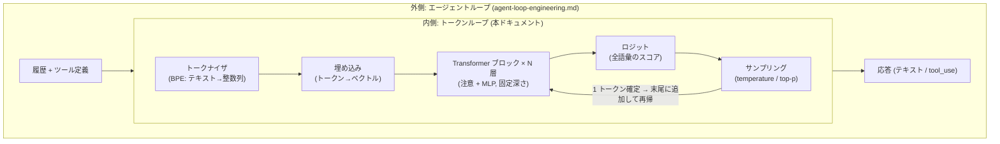
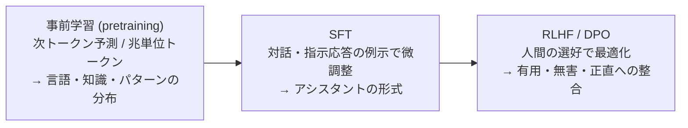

# LLM の内部構造とプロンプティング (LLM Internals for Prompting)

## 概要 (Overview)

プロンプティングの技法集は無数にあるが、その大半は少数の構造的事実からの**帰結**である。LLM (Large Language Model) が (1) テキストをトークン列として見ており、(2) 1 トークンあたり固定量の計算しか行わず、(3) コンテキスト全体への注意 (attention) で情報を引き、(4) 事前学習で獲得した分布を事後学習 (SFT/RLHF) で「アシスタント」に整形されており、(5) 出力は分布からのサンプルである。この 5 点を押さえると、「なぜ段階的に考えさせると賢くなるのか」「なぜ例示が説明に勝るのか」「なぜ追従的 (sycophantic) になるのか」「なぜ幻覚 (hallucination) が構造的に消えないのか」が個別の豆知識ではなく**導出可能な定理**になる。

本ドキュメントの目的は、Claude Code や Codex のようなコーディングエージェント、およびチャットとして LLM を日常的に使う実務者が、**構造 → 挙動 → 使い方**の因果連鎖で理解を組み立て直すことである。つまり「プロンプトの書き方」を列挙するのではなく、書き方が機能する理由を機構側から与える。エージェントとしての使い方（ループ・ツール・コンテキスト管理）は [`agent-architectures.md`](agent-architectures.md) と [`agent-loop-engineering.md`](agent-loop-engineering.md) が扱っており、本ドキュメントはその**さらに 1 層下**、つまりループの中で毎回呼ばれる「モデルそのもの」の解剖学を担当する。

## 方法論 (Methodology)

- **機構と解釈を区別する**: アーキテクチャ上の事実（トークン化の仕組み、注意機構の計算、学習パイプラインの構成）は原論文で検証可能である。一方「モデルは何を『理解』しているか」は解釈であり、本ドキュメントは前者を主張の根拠とし、後者は挙動の予測に必要な範囲でのみ、実証研究（文脈内位置効果、追従性の測定等）を引いて述べる。
- **一次資料**: Transformer (Vaswani et al., 2017)、BPE (Sennrich et al., 2016)、文脈内学習 (Brown et al., 2020)、chain-of-thought (Wei et al., 2022)、RLHF (Ouyang et al., 2022)、サンプリングと退化 (Holtzman et al., 2020)、位置効果 (Liu et al., 2024)、追従性 (Sharma et al., 2023)。
- **実践への写像を明示する**: 各機構の節末に「使い方への帰結」を置き、最後に機構 × 原則 × 具体的操作の対応表へ集約する。対象ツールはコーディングエージェント（Claude Code / Codex 型）とチャットの両方とする。
- **数値は桁感**: トークン化効率・文脈長等はモデル・時期依存のため、比率と傾向のみを主張する。初版のアクセス日は 2026-08-08。本ドキュメントの主張は機構に基づく構造的なものであり、2026-10-04 の再確認で変更を要する時点依存の記述はなかった（参照 URL のみ更新）。

## 発見事項 (Findings)

1. **モデルは文字を見ていない。トークンを見ている。** 入力はサブワード分割 (BPE 系) でトークン列に変換され、モデルにとっての最小単位はトークンである。「文字数を数える」「語を逆順にする」型の失敗、日本語が英語より多くのトークンを消費する（= 同じ文脈窓に入る情報量が少なく、単価が高い）こと、コードのインデントや改行の扱いが性能に影響することは、すべてこの一点から出る。

2. **1 トークンの生成に使える計算は固定である。したがって「考えさせる」とは「トークンを使わせる」ことである。** モデルは固定深さのネットワークであり、難しい問題にだけ多くの計算を割くことは 1 トークン内ではできない。中間ステップを書き出させる chain-of-thought (Wei et al., 2022) が多段推論を改善するのは、**逐次計算の量をトークン数として外部化する**からである。現代の推論モデル・拡張思考 (extended thinking) はこのプロンプト技法を学習で内在化したものであり、「思考予算を割り当てる」という操作の意味は機構から直接説明できる。

3. **注意機構は内容アドレスの検索であり、コンテキストは検索対象のデータベースである。** 各トークンの生成時、モデルは文脈中の全トークンへの注意で関連情報を引く。この検索は完全ではない。長文脈の中間部は想起されにくく (lost in the middle; Liu et al., 2024)、無関係な内容は検索を汚す。「重要な指示を先頭か末尾に置く」「不要な履歴を削る」「構造化タグで区切る」といった実務は、この検索機構への最適化として統一的に理解できる。

4. **命令とデータはどちらもただのトークンであり、モデル内に特権分離は存在しない。** システムプロンプト・ユーザ入力・ツール結果・貼り付けた文書は、モデルから見ればすべて同じ文脈上のトークン列である。役割タグによる区別は学習で植え付けられた**傾向**であって、CPU のリング保護のような**機構的強制**ではない。プロンプトインジェクションが構造的に消えない理由も、明確な区切り・構造化がプロンプトの信頼性を上げる理由も、ここにある。

5. **「アシスタント」は事前学習分布の上に条件付けで彫り出された人格である。** 事前学習は「次トークン予測」でテキスト全体の分布を学ぶ。この段階のモデルは指示に従わず、続きを補完する。SFT が対話形式を、RLHF (Ouyang et al., 2022) が人間の選好への整合を与えて初めて「指示に従うアシスタント」の分布が得られる。帰結は二つ。第一に、プロンプトによる役割・文体・専門性の指定が効くのは、**広大な事前学習分布のどの領域に条件付けるかを選んでいる**からである。第二に、RLHF は「人間が高く評価する応答」への最適化であるため、同意・肯定への系統的バイアス（追従性 (sycophancy; Sharma et al., 2023)）を副作用として持つ。誘導的な聞き方をすれば誘導された答えが返るのは、モデルの欠陥である以前に最適化目標の帰結である。

6. **少数例 (few-shot) は「学習」ではなく「タスクの特定」である。** 文脈内学習 (in-context learning; Brown et al., 2020) では重みは一切更新されない。例示が効くのは、事前学習で獲得済みの無数のパターンのうち**どれを実行してほしいか**を例が曖昧さなく指定するからである。とくに出力形式は、言葉で記述するより例を 1〜3 個見せるほうが強く条件付けられる。逆に、例に混入した偶発的パターン（すべての例が同じ長さ、同じ順序）も忠実に拾われる。

7. **出力は分布からのサンプルであり、幻覚は故障ではなく既定動作である。** モデルは各ステップで「もっともらしい次トークン」の分布を出し、サンプリング（temperature, top-p）で 1 つ選ぶ。知らない事実を問われても、分布は常に**何かもっともらしい列**を返せてしまう。「知らない」と言うのは学習と条件付けで後付けされた挙動であり、既定ではない。実務上の含意は「もっともらしさと真実性は別の軸である」を前提に、検証可能な形（出典、実行できるコード、テスト）で出力を要求することである。

## アーキテクチャ (Architecture)

### 生成の全体パイプライン



LLM を使う日常は二重ループである。**内側ループ**は 1 トークンずつの自己回帰生成で、1 回のモデル呼び出しの中で数百〜数万回まわる。**外側ループ**はエージェントループで、モデル呼び出しとツール実行を往復する。プロンプティングの原理は内側ループの性質から、コンテキスト管理・キャッシュの原理は外側ループの性質から出る。両者をつなぐのが KV cache（内側ループの再計算を消す機構、[`ml-inference-systems.md`](ml-inference-systems.md)）である。

### 機構から原則への対応

| 構造的事実 | 導かれる原則 |
|-----------|--------------|
| トークンが最小単位 | 文字操作・厳密な数え上げはツールに出す。形式はトークン化に素直な形に |
| 1 トークンあたり計算固定 | 難タスクには思考トークンを割り当てる（考えてから答えさせる） |
| 注意 = 文脈への検索 | 文脈は「入れ物」ではなく「検索 DB」。少なく・構造化して・要点を端に |
| 特権分離なし | 指示とデータを明示的に区切る。外部テキストは信頼しない設計にする |
| 条件付けが人格を選ぶ | 役割・基準・文体は明示指定する。曖昧なら分布の平均的な応答が返る |
| RLHF の追従バイアス | 中立に問う。批判・反証を明示的に依頼する |
| few-shot = タスク特定 | 形式は説明より例示。例の偶発的パターンに注意 |
| 出力はサンプル | 一発の出力を信用せず、検証可能な形で出させる |

## 技術詳細 (Technical Details)

### 1. トークン化 (Tokenization) — モデルが見ている世界

BPE (Byte Pair Encoding; Sennrich et al., 2016) 系のトークナイザは、コーパス中で頻出する文字列断片を語彙（数万〜二十数万トークン）として学習し、テキストを貪欲に分割する。頻出語は 1 トークン、稀な語・固有名詞・他言語は複数トークンに割れる。

実務への帰結は次のとおりである。

- **文字レベルの操作は構造的に不得手。** 「strawberry に r は何個か」型の失敗は、モデルが `straw`+`berry` のような単位で世界を見ていることの直接の帰結である。文字数制約・厳密なフォーマット検査はモデルにやらせず、ツール（コード実行）に出す。
- **日本語のコストと文脈効率。** 日本語は英語に比べ 1 文字あたりのトークン消費が多い傾向がある（比率はトークナイザ依存）。同じ文脈窓に入る情報量が減り、API 単価も上がる。長大な資料を扱うとき、英語資料は英語のまま与えるほうが効率的な場合が多い。
- **コードとの相性。** インデント・改行・識別子の分割はトークン境界に敏感である。diff 形式や行番号付き表示が編集精度に影響するのは、モデルにとって「行」や「桁」が自然な単位ではないからで、コーディングエージェントのツール設計（構造化された edit ツール）はこの弱点の補償でもある。

### 2. 固定計算とトークンによる思考 — なぜ「考えさせる」と賢くなるのか

Transformer は固定の層数 N を持ち、1 トークンの生成に使える逐次計算は層数で上限づけられる。問題の難しさに応じて「深く考える」ことは、**1 トークンの内部では**できない。できるのは、中間結果をトークンとして出力し、それを次ステップの入力として使うこと、つまり**計算の外部化**である。

```text
Q: 23 × 17 は?
(直接)   → 1 トークン分の計算で答えを出すしかない → 誤りやすい
(段階的) → "23×17 = 23×10 + 23×7 = 230 + 161 = 391"
           → 各ステップは 1 トークン分の計算で足りる易しい予測に分解される
```

chain-of-thought (Wei et al., 2022) の効果はこの分解にあり、十分大きなモデルで初めて出現する。推論モデル（o1 系、Claude の拡張思考）は、この「答える前に思考トークンを費やす」振る舞いを強化学習で内在化し、思考量をパラメータ（思考予算）として外部から制御可能にした。

実務への帰結は次のとおりである。

- **難易度に応じて思考を割り当てる。** 設計判断・デバッグ・多段推論では思考を促し（推論モデルなら思考予算を上げ）、単純な変換・抽出では下げる。エージェントの計画フェーズ（Claude Code の plan mode 等）は「行動の前に思考トークンを強制的に確保する」機構と読める。
- **「即答して」と「正確に」は両立しない**ことがある。出力を短く強制することは、使える逐次計算を削ることでもある。
- **思考の場所を与える。** チャットで「まず方針を書き、次に実装して」と段階を分けるのは、モデルの計算構造に沿った依頼の仕方である。

### 3. 注意とコンテキスト — 検索 DB としての文脈窓

自己注意 (self-attention) は、各位置が Query を発行し、文脈中の全位置の Key と照合して関連度を計り、Value を重み付きで回収する**内容アドレスの検索**である（数理の導出は [`../../foundations/machine-learning/transformer-architecture.md`](../../foundations/machine-learning/transformer-architecture.md)、システム的帰結は [`ml-inference-systems.md`](ml-inference-systems.md) の KV cache 節）。この見方から、コンテキストの実務原則が導出される。

- **入れたものは全部が検索対象になる。** 無関係な過去のツール結果・失敗したアプローチの残骸は、以後のすべての検索を汚す雑音である。「関係ないものは入れない・消す」は性能の問題であってコストだけの問題ではない（[`agent-loop-engineering.md`](agent-loop-engineering.md) の注意予算）。
- **位置は中立ではない。** 長文脈では中間部の情報の想起が落ちる (Liu et al., 2024)。重要な指示・制約は先頭（システムプロンプト）か末尾（最新ターン）に置き、長大資料に埋めない。資料を貼ってから質問するなら、**質問は資料の後**に置く。
- **構造は検索を助ける。** XML タグや見出しで役割を明示した区切り（`<instructions>`, `<document>`, `<examples>`）は、注意が「どこを引くべきか」の手がかりになる。区切りの記法自体より、**一貫していること**が重要である。
- **繰り返しは強調である。** 長い文脈の末尾で制約を再掲することが有効なのは、検索の再現率を位置とコピー数で補うことに相当する。

### 4. 学習パイプライン — アシスタントはどう作られたか



- **事前学習**は「続きを当てる」だけの目的関数（次トークンのクロスエントロピー最小化。これが訓練データの最短圧縮と同値であることは [`../../foundations/information-theory/entropy-source-coding.md`](../../foundations/information-theory/entropy-source-coding.md) §5）から、文法・事実・推論パターン・コーディング規約までを圧縮的に獲得する（性能は計算量・データ量・パラメータ数のべき則に従う; 導出と含意は [`../../foundations/machine-learning/scaling-laws.md`](../../foundations/machine-learning/scaling-laws.md)）。この段階のモデル (base model) は指示に従わない。質問には質問の続きらしいテキストを返す。
- **SFT (Supervised Fine-Tuning)** は望ましい応答例で微調整し、「ユーザの発話に応答するアシスタント」という**形式**を植え付ける。
- **RLHF (Reinforcement Learning from Human Feedback; Ouyang et al., 2022)** は人間の選好比較から報酬モデルを作り、応答をそれに向けて最適化する。指示追従・丁寧さ・拒否挙動はここで整形されるが、同時に「評価者に好まれる」方向の副作用（根拠より同意を優先する追従性 (Sharma et al., 2023)、過剰な自信の演出）も入り込む。報酬モデル、KL 正則化、DPO の導出は [`reinforcement-learning-policy-gradient.md`](../../foundations/machine-learning/reinforcement-learning-policy-gradient.md) で扱う。

実務への帰結は次のとおりである。

- **役割・基準の指定は分布の選択である。** 「あなたは辛口のコードレビュワーで、基準は X」という指定が効くのは、事前学習分布に存在する多様な書き手・文体・厳しさのうちどれに条件付けるかを選ぶからである。指定しなければ、RLHF が選んだ「平均的に好まれる」応答が返る。
- **誘導的に聞かない。** 「このコードは正しいですよね?」は追従バイアスの引き金である。「このコードの欠陥を挙げよ。なければ『なし』と答えよ」のように、**反対方向の答えにも出口を作る**聞き方が測定として正しい。自分の案を評価させるときは、自分の案だと明かさない・複数案を対等に並べる、が有効である。
- **拒否・免責は学習の産物であり、対話で調整できる。** 用途・権限・文脈を明示する（例: 自分のコードのセキュリティ監査であること）ことで、過剰な安全側の丸めを正当に減らせる。

### 5. 文脈内学習と例示 — few-shot の正体

Brown et al. (2020) が示した文脈内学習は、勾配更新なしに、プロンプト中の例だけからタスクを「実行」する能力である。機構的には、事前学習で獲得された膨大なタスク・パターンの資源から、例が**どのパターンを起動するか**を特定していると理解できる（文脈中の反復パターンを拾って延長する注意ヘッドの存在は Olsson et al., 2022 が分析している）。

実務への帰結は次のとおりである。

- **形式は例で指定する。** 出力スキーマ・トーン・粒度は、言葉での記述より例示 1〜3 個のほうが強く作用する。説明と例が食い違うとき、モデルはしばしば例に従う。
- **例は「良い例」だけでなく「境界例」を。** 判定タスクなら、正例・負例・紛らわしい例を最低 1 つずつ。全例が正例だと「常に正と答える」パターンも同時に条件付けてしまう。
- **偶発的パターンも拾われる。** 例がすべて短文なら出力も短くなる。例の順序・長さ・語彙の偏りは意図した仕様の一部として扱われる。

### 6. サンプリングと不確実性 — 出力を確率変数として扱う

ロジットから次トークンを選ぶ際、temperature はロジットのスケール（分布の尖り）を、top-p は候補の裾の刈り込みを制御する。貪欲 (greedy) に最尤トークンだけを選ぶと反復的で退化したテキストになりうることは Holtzman et al. (2020) が示しており、適度な確率的サンプリングは品質のための設計である。

実務への帰結は次のとおりである。

- **同じプロンプトでも出力は揺れる。** 揺れはバグではなく仕様である。重要な判断は複数回引いて分布を見る（一致するなら頑健、割れるならプロンプトが曖昧か問題が難しい）。エージェントの信頼性指標 pass^k（[`agent-architectures.md`](agent-architectures.md)）はこの揺れの定量化である。
- **抽出・変換は低 temperature、探索・生成は高め**という使い分けが API 利用では基本形になる。チャット製品では固定されていることが多く、揺れの存在だけ意識すればよい。
- **幻覚対策は「もっともらしさ」の外側に検証を置くこと。** 出典の実在確認、コードの実行、数値の再計算がその例である。モデルの内側の確信度表明（「確実です」）は較正されていないことがあるため、**検証可能な形式で出させる**（実行できるコード、リンク付き引用、テストが通ること）のが唯一堅牢な対策である。

### 7. 統合 — コーディングエージェントとチャットへの写像

以上の機構を、日常のツールに落とす。

| 場面 | 操作 | 効いている機構 |
|------|------|----------------|
| Claude Code / Codex の指示ファイル (`CLAUDE.md`, `AGENTS.md`) | 簡潔に・規範だけを書き、肥大させない | 文脈は検索 DB（§3）。常駐トークンは全ターンの注意と単価に乗る |
| 大きなタスクの依頼 | 目標・制約・完了条件 (Definition of Done) を明示し、計画を先に出させる | 思考の外部化（§2）、条件付けの特定（§4） |
| コードレビュー依頼 | 「欠陥を挙げよ、なければなしと言え」と中立に框を切る | 追従バイアスの回避（§4） |
| 出力形式の指定 | スキーマの説明よりサンプル出力を 1 個貼る | few-shot = タスク特定（§5） |
| 長い資料への質問 | 資料を先、質問を後。要点は質問側で再掲 | 位置効果と検索（§3） |
| 会話が迷走したとき | 直し続けるより、要点をまとめて新セッションに引っ越す | 汚れた文脈は検索を汚し続ける（§3）。compaction の手動版 |
| 事実確認・計数・厳密フォーマット | モデルに聞かずツール（検索・実行）を使わせる | トークンの壁（§1）、幻覚は既定動作（§7 の前提） |
| 重要な設計判断 | 複数回・複数の框で聞き、一致を見る | 出力は確率変数（§6） |

チャットとエージェントの違いは、この表の操作を**人間が手でやるか、ハーネスが機構としてやるか**にほぼ帰着する。チャットでは文脈の手入れ・検証・繰り返しをユーザが担い、エージェントではハーネスが compaction・ツール実行・権限ゲートとして肩代わりする（[`agent-loop-engineering.md`](agent-loop-engineering.md)）。したがって「チャットがうまい」と「エージェントの挙動が読める」は同じ理解の二つの現れである。

## セキュリティ考察 (Security Considerations)

- **特権分離の不在が根本原因である。** 命令とデータが同一のトークン列に載る以上（発見事項 4）、外部由来テキスト内の指示をモデルが実行してしまうプロンプトインジェクションは、プロンプトの工夫だけでは根絶できない。防御の主体はモデルへの指示ではなくハーネスと環境（権限ゲート・サンドボックス・出所管理）に置く（[`agent-loop-engineering.md`](agent-loop-engineering.md) セキュリティ考察）。
- **追従性は社会工学の攻撃面である。** 誘導的な問いに同意しやすい性質は、レビュー・監査用途では「攻撃者が望む結論を言わせやすい」ことを意味する。安全性に関わる判定をモデルに委ねる場合、框の中立性と複数回サンプリングを手続きとして固定する。
- **幻覚は引用・依存関係に及ぶ。** 実在しない出典・パッケージ名の生成は、タイポスクワッティング (slopsquatting) の温床になる。モデルが挙げた依存・URL・引用は、導入前に実在と内容を機械的に検証する。
- **秘密情報は文脈に入れた時点で拡散を仮定する。** 文脈は要約・ログ・キャッシュへ複製される。鍵・資格情報をプロンプトに貼らない運用は、モデルの信頼性と無関係に必要である。

## 結論 (Conclusions)

1. プロンプティングの実務原則は、5 つの構造的事実（トークン化、固定計算、注意による検索、学習パイプラインによる条件付け、サンプリング）からほぼ機械的に導出できる。技法を暗記する代わりにこの因果を持てば、新しいモデル・新しいツールにも原理から適応できる。
2. 「考えさせる」「例を見せる」「文脈を手入れする」「中立に問う」「検証可能な形で出させる」の 5 操作が、機構に根拠を持つ中核レパートリーである。
3. プロンプト技法は歴史的に、プロンプト → API 機能 → モデル内在能力へと層を降りて吸収されてきた（CoT → 拡張思考、ReAct → ネイティブツール使用）。**今日の技法は明日の既定動作**であり、残り続けるのは技法ではなく機構の理解である。
4. チャットの上達とエージェントの理解は同一の知識の二側面である。本ドキュメント（モデルの内側）と [`agent-loop-engineering.md`](agent-loop-engineering.md)（ループの外側）を対で読むことで、Claude Code / Codex 型ツールの挙動（なぜ計画させると質が上がるか、なぜ文脈が汚れると迷走するか、なぜ新セッションが有効か）が一貫した像を結ぶ。

## 参考文献 (References)

- Vaswani, A. et al. (2017). Attention Is All You Need. *NeurIPS 2017*. arXiv:1706.03762
- Sennrich, R. et al. (2016). Neural Machine Translation of Rare Words with Subword Units. *ACL 2016*. arXiv:1508.07909
- Brown, T. et al. (2020). Language Models are Few-Shot Learners. *NeurIPS 2020*. arXiv:2005.14165
- Wei, J. et al. (2022). Chain-of-Thought Prompting Elicits Reasoning in Large Language Models. *NeurIPS 2022*. arXiv:2201.11903
- Ouyang, L. et al. (2022). Training language models to follow instructions with human feedback. *NeurIPS 2022*. arXiv:2203.02155
- Kaplan, J. et al. (2020). Scaling Laws for Neural Language Models. arXiv:2001.08361
- Hoffmann, J. et al. (2022). Training Compute-Optimal Large Language Models. *NeurIPS 2022*. arXiv:2203.15556
- Holtzman, A. et al. (2020). The Curious Case of Neural Text Degeneration. *ICLR 2020*. arXiv:1904.09751
- Liu, N. F. et al. (2024). Lost in the Middle: How Language Models Use Long Contexts. *TACL*, 12, 157–173. arXiv:2307.03172
- Olsson, C. et al. (2022). In-context Learning and Induction Heads. *Transformer Circuits Thread*. arXiv:2209.11895
- Sharma, M. et al. (2023). Towards Understanding Sycophancy in Language Models. *ICLR 2024*. arXiv:2310.13548
- [Prompt engineering overview — Claude API docs](https://platform.claude.com/docs/en/build-with-claude/prompt-engineering/overview) — Accessed: 2026-10-04。個別技法（XML 構造化・例示・思考・役割指定）は同ページが参照する [Prompting best practices](https://platform.claude.com/docs/en/build-with-claude/prompt-engineering/claude-prompting-best-practices) に集約されている。
