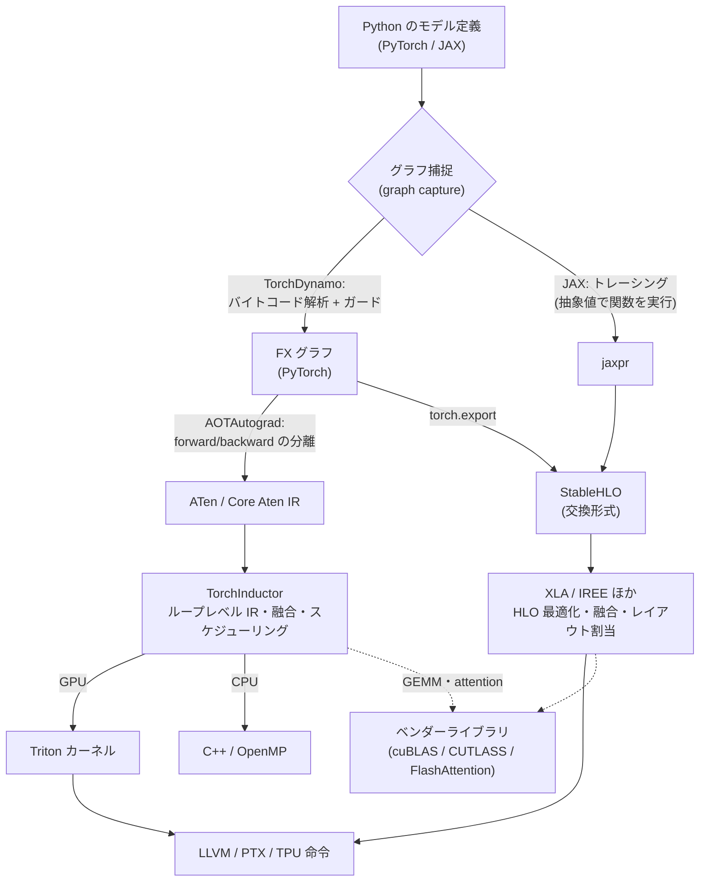
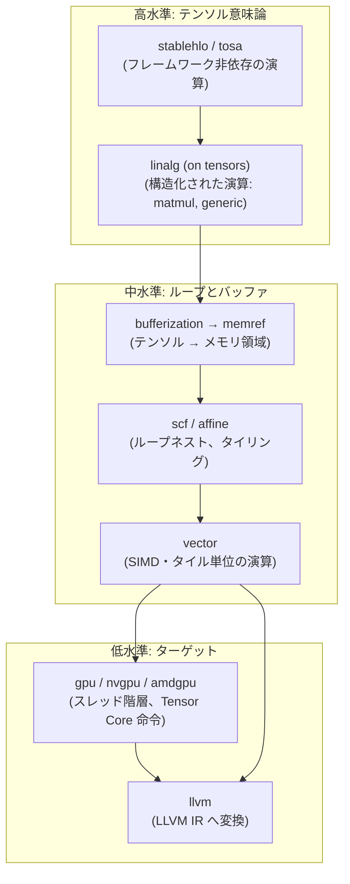

# ML コンパイラ (ML Compilers)

## 概要 (Overview)

[`ml-inference-systems.md`](ml-inference-systems.md) は「ML コンパイラの中核はカーネル融合 (kernel fusion) の自動化にある」と述べて筆を置いた。本ドキュメントはその続きとして、**モデルの記述（Python のプログラム）がアクセラレータ上の機械語になるまで**の変換系を分析する。対象は 3 段である。(1) **グラフ捕捉 (graph capture)**: 動的言語で書かれたモデルから、最適化可能な静的な計算グラフをどう取り出すか（TorchDynamo、JAX のトレーシング）。(2) **グラフレベル最適化 (graph-level optimization)**: 演算子の融合、データレイアウトの選択、共通部分式除去 (CSE) をどう決めるか（XLA、TorchInductor）。(3) **カーネル生成 (kernel generation)**: 融合後の演算をどうタイルに分割し、メモリ階層に載せ、スレッドに割り付けるか（Triton、TVM/Ansor、Halide の思想）。この 3 段を貫く共通基盤として、MLIR の方言 (dialect) スタックと StableHLO という交換形式を扱う。

通奏低音は 2 つある。第一に、ML コンパイラの最適化の大半は FLOPs ではなく**メモリトラフィックの削減**である。これは [`gpu-simt-architecture.md`](../../hardware/accelerators/gpu-simt-architecture.md) の roofline 分析で「多くの演算は帯域律速である」と示されたことのソフトウェア側の帰結である。第二に、ML コンパイラは**投機する JIT** である。TorchDynamo のガード (guard) と再コンパイルは、[`managed-runtimes-gc-jit.md`](../compilers-runtimes/managed-runtimes-gc-jit.md) の hidden class・インラインキャッシュ・deoptimization と同じ構造を、テンソルの形状 (shape) と dtype について持つ。分析深度は Level 3。

## 方法論 (Methodology)

- **原論文と公式ドキュメントへの還元**: 各システムは原論文（PyTorch 2 / TorchInductor[^pt2]、Triton[^triton]、TVM[^tvm]、Ansor[^ansor]、Halide[^halide]、MLIR[^mlir]、JAX[^jax]、TASO[^taso]）と、OpenXLA・PyTorch・JAX の公式ドキュメントに基づいて機構を再構成する。性能数値は原論文の自己報告であり、ハードウェア・モデル集合・比較対象の版が論文ごとに異なることを明記する。
- **段階による分解**: フレームワーク単位ではなく「捕捉 → グラフ最適化 → カーネル生成 → 実行」という変換段ごとに設計選択を比較する。同じ段で各システムが何を選んだかを並べると、設計空間の軸（静的か動的か、手書きか探索か、汎用 IR か専用 IR か）が見える。
- **ハードウェアとの結合**: 性能の上限は [`gpu-simt-architecture.md`](../../hardware/accelerators/gpu-simt-architecture.md)（SM・共有メモリ・Tensor Core・roofline）と [`tpu-systolic-arrays.md`](../../hardware/accelerators/tpu-systolic-arrays.md)（シストリックアレイと「コンパイラという前提」）を基準系とする。roofline の原典は Williams et al. (2009)[^roofline]。
- **時点依存の情報**: PyTorch・Triton・OpenXLA は四半期単位で変わる。版と既定値は 2026-10 時点の公式ドキュメントで確認し（Accessed: 2026-10-04）、本文では「2026-10 時点」と明示する。機構（ガード、融合、タイリング）の説明は版に依存しない構造的知見を優先する。

## 発見事項 (Findings)

1. **最難関はコード生成ではなくグラフ捕捉である。** ML コンパイラの歴史は「Python のモデルからどうやってグラフを取り出すか」の試行錯誤の歴史だった。TensorFlow 1.x の静的グラフは使いにくく、TorchScript（`torch.jit.trace` / `script`）は Python の部分集合しか扱えず、利用者にコード書き換えを強いた。PyTorch 2 の TorchDynamo は、CPython のフレーム評価 API (PEP 523) にフックし、**バイトコード実行の直前に**テンソル演算列を FX グラフとして抽出する[^pt2]。扱えない Python 構文に出会うと、その箇所でグラフを切り（グラフブレーク (graph break)）、そこは通常の Python 実行に戻す。この「部分的に捕捉し、残りは逃がす」設計が、既存コードを書き換えずにコンパイラを適用する道を開いた。原論文は、TorchInductor が NVIDIA A100 上の 180 超の実モデルで eager 実行に対し推論 2.27 倍・学習 1.41 倍（幾何平均）の高速化を得たと報告している（2024 年の自己報告、比較対象は当時の版）[^pt2]。
2. **捕捉したグラフは投機であり、ガードがその保険である。** Dynamo はグラフとともに「入力テンソルの形状・dtype・デバイス、参照したグローバル変数の値」などの前提条件をガードとして記録し、次回呼び出し時にガードが成立すればキャッシュ済みのコンパイル結果を再利用し、失敗すれば再コンパイルする[^pt2][^pt-dynamic]。これは JIT の投機的最適化と deoptimization の構図そのものであり、ガードが頻繁に外れると**再コンパイルの嵐**が起きる。PyTorch は関数ごとの再コンパイル回数に上限（2026-10 時点の既定値は `torch._dynamo.config.recompile_limit = 8`）を設け、上限を超えた関数はコンパイルを諦めて以後 eager 実行に落とす[^pt-recompile][^dynamo-config]。
3. **融合の本質は「中間テンソルを HBM に書かない」ことである。** 要素ごと演算 (element-wise) や縮約 (reduction) の連鎖を 1 カーネルにまとめると、中間結果はレジスタや共有メモリに留まり、HBM の往復が消える。帯域律速の領域では、これがほぼそのまま速度向上になる。XLA の融合[^xla]、TorchInductor のループレベル融合[^pt2]は、いずれもこの原理の自動化である。一方で GEMM と attention のような演算強度の高いカーネルは、2026-10 時点でもベンダーライブラリ（cuBLAS/CUTLASS）や専用実装（FlashAttention）に委ねる構成が主流で、コンパイラは「その周囲を融合する」役に回ることが多い。
4. **Triton は「スレッド」ではなく「ブロック」を書かせることで、生産性と性能の交点を動かした。** CUDA はスレッド単位の SIMT プログラムを書かせ、共有メモリの管理・メモリ合体 (coalescing)・Tensor Core への割り付けを人に任せる。Triton はプログラムの単位を**タイル（ブロック）**にし、ブロック内のスレッド割り付け・共有メモリ配置・ベクトル化をコンパイラに任せる[^triton]。この抽象化の水準が、TorchInductor が GPU 向けに Triton カーネルを生成するという構成を可能にした[^pt2]。人手で書く CUDA と自動生成の間に「中間の書き手」を置いたことが Triton の功績である。
5. **アルゴリズムとスケジュールの分離 (Halide) が、自動チューニングの探索空間を定義した。** Halide は「何を計算するか（アルゴリズム）」と「どの順序・どの粒度・どこに置いて計算するか（スケジュール）」を別々に記述させた[^halide]。分離されたスケジュールは**探索可能な空間**になる。TVM はこの思想をテンソル演算に持ち込み[^tvm]、AutoTVM は人手のテンプレートの中を学習済みコストモデルで探索し[^autotvm]、Ansor はテンプレートそのものを自動生成して探索空間を広げ、当時の最先端に対し Intel CPU・ARM CPU・NVIDIA GPU で最大 3.8 倍・2.6 倍・1.7 倍の改善を報告した（「最大」値であり平均ではない）[^ansor]。手書きカーネルとの差を「探索」で埋めるという方向は、Triton の autotune（ブロックサイズ等の候補を実測で選ぶ）にも小規模な形で受け継がれている。
6. **MLIR は「IR を 1 つに決める」のをやめ、「IR を作る基盤」を標準化した。** 従来のコンパイラは単一の中間表現 (IR) に全段を押し込めた。MLIR は方言 (dialect) という単位で IR を拡張可能にし、高水準のテンソル演算から低水準のループ・メモリ操作・ハードウェア固有命令までを、段階的な**下降 (lowering)** の連鎖として表現させる[^mlir]。StableHLO（フレームワークとコンパイラの間の交換形式）、Triton の内部 IR、IREE はいずれも MLIR 上に構築されており、ML コンパイラ群は「別々の製品」から「共通基盤上の方言の組み合わせ」へと収束しつつある。
7. **コンパイル時間は性能の一部である。** 大規模モデルのコンパイルには数十秒から数分かかり、ガード失敗による再コンパイル、オートチューニングの実測、分散学習の全ランクでのコンパイルが重なると、起動時間とテールレイテンシに直接効く。推論サービングでは事前コンパイル (AOT) とキャッシュ、学習では「最初の数ステップを犠牲にして以後を速くする」償却が設計判断になる。動的形状をどこまで許すかは、この**コンパイル時間 × 実行時性能 × 汎用性**の三者択一である（技術詳細 6）。

## アーキテクチャ (Architecture)

### ML コンパイラの変換段



- **捕捉段**は動的言語の世界から静的なグラフを切り出す。PyTorch はバイトコード解析（TorchDynamo）、JAX は抽象値によるトレーシングという、正反対の方法でこれを行う（技術詳細 1）。
- **グラフ最適化段**は演算子のグラフ上で融合・レイアウト・CSE・定数畳み込みを行う。XLA は HLO 上で、TorchInductor は自前のループレベル IR 上で行う。
- **カーネル生成段**はタイリングとメモリ階層への配置を決めて、Triton・LLVM IR・C++ などを出力する。GEMM のような演算強度の高い演算は、多くの場合ライブラリ呼び出しのまま残る（破線）。
- **StableHLO** はフレームワークとコンパイラの間の「狭い腰 (narrow waist)」であり、JAX・PyTorch・TensorFlow のいずれからも出力でき、XLA・IREE などが入力として受け取る[^stablehlo]。

### 設計空間の比較

| システム | 捕捉方式 | グラフ IR | カーネル生成 | 最適化の決め方 | 動的形状 |
|---|---|---|---|---|---|
| TorchDynamo + Inductor | バイトコード解析 + ガード、グラフブレーク可 | FX → Inductor IR | Triton (GPU)、C++/OpenMP (CPU) | ヒューリスティクス + autotune | シンボリック形状で対応[^pt-dynamic] |
| JAX + XLA | トレーシング（`jit`） | jaxpr → StableHLO → HLO | XLA バックエンド (LLVM、TPU) | ヒューリスティクス + コストモデル | 原則静的、形状多相 (shape polymorphism) は export 用[^jax-export] |
| TVM (+ Ansor) | フレームワークからのインポート | Relay / Relax → TensorIR | LLVM / CUDA / 多数のターゲット | 探索 + 学習済みコストモデル | Relax で対応 |
| Triton（単体） | 人が書く Python DSL | Triton IR (MLIR 方言) | PTX / AMDGPU | 人 + autotune | カーネル引数として扱う |
| Halide | 人が書く DSL | Halide IR | LLVM 等 | 人がスケジュールを書く（自動スケジューラあり） | 対象外（画像処理） |

縦に読むと、各段で「人が決めるか、ヒューリスティクスか、探索か」の選択が異なる。TorchInductor はヒューリスティクス寄りでコンパイル時間を抑え、TVM/Ansor は探索寄りで性能を取りに行く。この差は技術詳細 6 のトレードオフに直結する。

## 技術詳細 (Technical Details)

### 1. グラフ捕捉 — バイトコード解析とトレーシング

**TorchDynamo**: CPython 3.6 以降、フレーム評価関数を差し替える API (PEP 523) がある。Dynamo はこれを使って Python 関数の実行直前にバイトコードを記号的に解釈し、テンソル演算を FX グラフに記録する[^pt2]。

- **ガード**: 記号実行の過程で依存した前提（テンソルの形状・stride・dtype・`requires_grad`、Python オブジェクトの型や値）を記録する。次回呼び出しでガードを評価し、成立すればキャッシュを使う。ガード評価のコストは呼び出しごとにかかるため、ガードの数と種類も性能に効く[^pt-dynamic]。
- **グラフブレーク**: データ依存の制御フロー（`if x.sum() > 0:`）、未対応の組み込み関数、外部ライブラリ呼び出しに出会うと、そこまでをグラフとしてコンパイルし、問題の箇所は Python で実行し、その後を新しいグラフとして再開する[^pt-graphbreak]。グラフブレークは正しさを保つが、融合の機会を断ち切り、グラフ間で CPU と GPU の同期を生むことがある。性能調査の第一歩はグラフブレークの数と位置の把握である。
- **AOTAutograd**: 捕捉した forward グラフから backward グラフを事前に導出し、両者を一緒に最適化する。これにより backward 側の融合や、forward で保存する中間値の選択（再計算との交換、[`ml-training-systems.md`](ml-training-systems.md) の activation recomputation と同じ取引）をコンパイラが決められる[^pt2]。

**JAX のトレーシング**: `jax.jit` は関数を具体値ではなく**抽象値**（形状と dtype だけを持つ tracer）で一度実行し、通過した演算を jaxpr として記録する[^jax][^jax-jit]。

- Python の制御フローはトレース時に評価されるため、tracer の値に依存する `if` は書けない（`lax.cond` / `lax.while_loop` などの構造化制御フローを使う）。この制約と引き換えに、捕捉は完全で、グラフブレークは存在しない。
- 形状やハッシュ可能な引数は `static_argnums` で静的とみなせ、値ごとに別のコンパイル結果がキャッシュされる[^jax-jit]。

両者の差は「**利用者のコードに合わせるか、利用者にコードを合わせさせるか**」である。Dynamo は任意の Python を受け入れて部分的に捕捉し、JAX は関数型の規律を求めて完全に捕捉する。前者は既存資産への適用性で、後者は変換（`grad`、`vmap`、`pmap`/`shard_map`）の合成可能性で優れる。

### 2. グラフレベル最適化 — 融合・レイアウト・CSE

- **融合 (fusion)**: XLA はターゲット非依存のパス（CSE、ターゲット非依存の融合、バッファ解析）に加え、GPU バックエンドが GPU のプログラミングモデルに有利な融合を追加で行う二段構えを取る[^xla]。TorchInductor は演算をループネストとして表現し、同じ反復空間を持つループを融合する。融合の制約は 2 つある。(a) 融合後のカーネルがレジスタ・共有メモリに収まること（収まらないとスピルして逆効果になる）、(b) 融合が再計算を伴う場合（1 つの中間値を複数の消費者が使う）、再計算コストが HBM 往復より安いこと。
- **代数的書き換え**: TASO は演算子グラフの等価な書き換え規則を自動生成し、コストモデルで最良のグラフを探索した[^taso]。現行の実用コンパイラは、手書きの書き換え規則（転置の畳み込み、連続 reshape の消去など）を中心にしている。
- **レイアウト割当 (layout assignment)**: 同じテンソルでも NCHW と NHWC、行優先と列優先、Tensor Core やシストリックアレイが要求するタイル化されたレイアウトで性能が大きく変わる。XLA はレイアウトをグラフ全体で割り当て、変換のコストを最小化する[^xla]。TPU ではこの割当が性能をほぼ決める（[`tpu-systolic-arrays.md`](../../hardware/accelerators/tpu-systolic-arrays.md) 技術詳細 3）。
- **CSE・定数畳み込み・不要コード除去**: 古典的なコンパイラ最適化はグラフ IR 上でもそのまま有効で、とくに AOTAutograd が forward/backward をまとめた後のグラフでは重複計算の除去が効く。
- **メモリ計画**: 中間テンソルの生存区間を解析してバッファを再利用する。推論の静的グラフでは、ピークメモリを事前に確定できることがコンパイルの大きな利点になる。

### 3. Triton — ブロック単位のプログラミングモデル

Triton のカーネルは「1 つのプログラムインスタンスが 1 つの出力タイルを担当する」形で書く[^triton]。

```python
# Language: Python (Triton DSL). Purpose: illustrative fused add+ReLU kernel
# showing the block-level model. Pseudocode-level sketch, not from a source file.
import triton
import triton.language as tl

@triton.jit
def add_relu(x_ptr, b_ptr, y_ptr, n, BLOCK: tl.constexpr):
    pid = tl.program_id(0)                  # one program instance per tile
    offs = pid * BLOCK + tl.arange(0, BLOCK)  # a vector of BLOCK indices
    mask = offs < n                         # guard the ragged tail
    x = tl.load(x_ptr + offs, mask=mask)
    b = tl.load(b_ptr + offs, mask=mask)
    tl.store(y_ptr + offs, tl.maximum(x + b, 0.0), mask=mask)  # no HBM round-trip for x+b
```

- 書き手が決めるのは**タイルの形と、タイル間の反復**だけである。タイル内の要素をどのスレッド・どのワープに割り付けるか、共有メモリをどう使うか、ベクトルロードをどう発行するかはコンパイラが決める。行列積では `tl.dot` がタイル同士の積を表し、コンパイラが Tensor Core 命令へ下降する。
- Triton は 2.0 でバックエンドを MLIR ベースに書き直した。内部では Triton IR (TTIR) からレイアウト情報付きの TritonGPU IR (TTGIR) へ MLIR 方言として段階的に下降し、LLVM IR を経て PTX（NVIDIA）や AMDGPU のコードを生成する[^triton-repo]。
- `@triton.autotune` はブロックサイズ・ワープ数・パイプライン段数の候補を実測で比較し、入力形状ごとに最良の構成を選ぶ。探索空間は Ansor より桁違いに狭いが、そのぶんコンパイル時間は短い。
- 抽象化の代償として、ワープ特殊化 (warp specialization) や非同期コピーの細かい制御といった最新 GPU の機能を最大限使うには限界がある。そのため 2026-10 時点でも、最高性能の GEMM・attention カーネルは CUTLASS/CuTe や手書き CUDA で書かれることが多い。

### 4. TVM / Ansor と Halide — 探索としての最適化

**Halide のアルゴリズム/スケジュール分離**[^halide]: ぼかしフィルタを「各画素は近傍の平均」というアルゴリズムで書き、スケジュールで「タイル分割して、タイル内で水平パスを計算してから垂直パスを計算し、SIMD 化して、外側ループを並列化する」と指定する。同じアルゴリズムに異なるスケジュールを与えれば、局所性 (locality)・並列性 (parallelism)・再計算 (recomputation) の配分が変わる。Halide の原論文はこの三者の緊張を明示的に定式化した。

**TVM**[^tvm]: Halide の分離をテンソル演算に持ち込み、グラフレベル（Relay、後継の Relax）と演算子レベル（テンソル式、後継の TensorIR）の 2 層で最適化する。多様なハードウェアターゲット（CPU、GPU、モバイル、FPGA 系アクセラレータ）への移植性が設計目標である。

**AutoTVM → Ansor → MetaSchedule**: AutoTVM は人が書いたスケジュールテンプレートのパラメータ（タイルサイズ等）を、勾配ブースティング木などの学習済みコストモデルで絞り込みながら実測する[^autotvm]。Ansor はテンプレートを不要にし、計算定義から階層的に探索空間を自動生成して、進化的探索とコストモデルで探索する[^ansor]。MetaSchedule はスケジュールを確率的プログラムとして表現し、探索空間の記述を統一した（原論文はエンドツーエンドで 48% の高速化を報告）[^metaschedule]。

探索ベースの最適化は、新しいハードウェアや珍しい演算に対して人手の調整なしに高性能を得られる。ただし探索に数十分から数時間かかることがあり、モデルや形状が変わるたびに再探索が要る。この探索コストのため、学習の内側ループのように形状が頻繁に変わる用途より、エッジ推論のように「一度探索して長く使う」用途で強みを発揮してきた。

### 5. MLIR の方言スタック

MLIR[^mlir] では、1 つのモジュールの中に複数の方言の演算が共存でき、パスが方言から方言へ段階的に下降させる。



- 各方言は「ある抽象化水準で守るべき不変条件」を表す。`linalg` の段階ではタイリングや融合が演算の意味に基づいて安全に行え、`memref` の段階ではバッファの割り付けと再利用が、`gpu` の段階ではスレッド階層への写像が扱える。
- 段階的な下降の利点は、**最適化をそれに最適な抽象化水準で行える**ことである。融合はテンソル水準で、ベクトル化はベクトル水準で、レジスタ割り付けは LLVM で行う。単一 IR のコンパイラでは、高水準の情報が下降の途中で失われ、後段で復元できない。
- 2026-10 時点で、StableHLO は OpenXLA プロジェクトの交換形式として、5 年間の後方互換性と 2 年間の前方互換性（新機能を使わない場合）を保証している[^stablehlo][^stablehlo-compat]。これにより、フレームワークが出力したモデルを後から別のコンパイラで処理する、という分業が可能になった。

### 6. コンパイル時間と実行時性能、動的形状

| 戦略 | コンパイル時間 | 実行時性能 | 適用場面 |
|---|---|---|---|
| eager 実行（コンパイルなし） | ゼロ | 基準（カーネル起動と HBM 往復が多い） | 研究・デバッグ |
| JIT + ヒューリスティクス（Inductor 既定） | 秒〜分 | 融合ぶん高速 | 学習・一般的な推論 |
| JIT + autotune（`max-autotune` 等） | 分〜数十分 | さらに高速 | 長時間の学習・固定形状の推論 |
| 探索ベース (Ansor/MetaSchedule) | 数十分〜時間 | ターゲット特化で高速 | エッジ推論・新規ハードウェア |
| AOT コンパイル + キャッシュ | 事前に支払い | JIT と同等 | 推論サービング（起動時間の SLO） |

**動的形状 (dynamic shapes)**: LLM の推論では系列長とバッチサイズが毎回変わる。形状ごとに別々にコンパイルすると再コンパイルが止まらず、最も汎用的な単一カーネルにすると形状特化の最適化を失う。設計選択肢は次のとおりである。

- **シンボリック形状**: PyTorch は形状を記号 (SymInt) として扱い、「s0 は 2 以上」のような制約をガードとして記録する。初回は静的形状でコンパイルし、形状が変わって再コンパイルが起きた次元を自動的に動的とみなす (automatic dynamic)。`torch._dynamo.mark_dynamic` で事前に指定することもできる[^pt-dynamic]。0 と 1 は特殊化される（ブロードキャストの意味が変わるため）。
- **バケット化 (bucketing) とパディング**: 系列長を 2 のべき乗などに丸め、少数の形状だけをコンパイルする。無駄な計算と引き換えにコンパイル回数を有界にする。TPU/XLA の静的形状要求の下では標準的な手法である。
- **境界つき動的形状**: 最大値の上限だけを静的に与え、実際の長さは実行時に渡す。メモリ計画は上限で行える。
- **CUDA Graphs との緊張**: [`ml-inference-systems.md`](ml-inference-systems.md) の CUDA Graphs は起動列を固定形状で録画する。そのため推論ランタイムは、バッチサイズのバケットごとに CUDA Graph を録画する方式を採ることが多い。

### 7. 2026-10 時点の実装状況

| 項目 | 2026-10 時点の状態 | 出典 |
|---|---|---|
| PyTorch 最新安定版 | 2.14.1（2026-09-30 リリース） | [^pt-release] |
| Triton 最新版 | 3.8.0（2026-08-28 リリース） | [^triton-release] |
| Dynamo の再コンパイル上限 | `recompile_limit = 8`（旧名 `cache_size_limit` は別名として残存）、`automatic_dynamic_shapes` は既定で有効 | [^dynamo-config] |
| StableHLO の互換性保証 | 後方 5 年・前方 2 年 | [^stablehlo-compat] |
| TorchInductor の出力 | GPU は Triton、CPU は C++/OpenMP | [^pt2] |

- 版番号と既定値は四半期単位で変わる。本表は本文の機構が「どの実装で既定になったか」を確認するための時点記録として扱う。

## セキュリティ考察 (Security Considerations)

- **コンパイラはサプライチェーンの一部である。** 2022 年 12 月 25〜30 日、PyTorch nightly が依存する `torchtriton` パッケージと同名の悪意あるパッケージが PyPI に登録され、PyPI が PyTorch の nightly インデックスより優先される依存関係混同 (dependency confusion) により、pip で nightly を導入した Linux 環境で `import triton` 時に悪意あるバイナリが実行された。このバイナリはシステム情報、`/etc/passwd`、`~/.ssh/*`、ホームディレクトリの先頭 1,000 ファイルなどを収集し、DNS クエリ経由で外部に送信した。PyTorch は依存を `pytorch-triton` に改名し、PyPI にダミーの `torchtriton` を登録して対処した[^torchtriton]。ML コンパイラは GPU ドライバ・LLVM・Triton など多数のネイティブ依存を持ち、しかも JIT 時に生成したコードを実行する。[`software-supply-chain-security.md`](../security/software-supply-chain-security.md) の出所検証（ロックファイル、ハッシュ固定、私設インデックスの優先順位）は、ML 開発環境でこそ徹底すべきである。
- **コンパイル済み成果物とキャッシュは実行可能物として扱う。** Inductor や Triton はコンパイル結果（生成コード・バイナリ）をディスクにキャッシュする。共有ファイルシステム上のキャッシュディレクトリを他者が書き換えられれば、次回実行時に任意コードが走る。キャッシュの所有権・権限の管理、マルチテナント環境でのキャッシュ分離が要る。同様に、`torch.export` やシリアライズしたモデルの読み込みは、pickle 系の任意コード実行の系譜に連なる（[`ml-training-systems.md`](ml-training-systems.md) セキュリティ考察）。
- **最適化は数値的な意味を変えうる。** 融合による演算順序の変更、低精度の累積、fast-math 的な書き換えは結果を変える。浮動小数点の非結合性により、コンパイルの有無やバックエンドの違いで出力が一致しないことは仕様の範囲内である。しかし安全性が重要な推論（分類の閾値判定など）では、コンパイル前後の数値差を許容誤差として検証し、回帰テストに組み込む必要がある。コンパイラのバグによる誤計算は、例外ではなく静かな精度劣化として現れるため発見が遅れる。
- **マルチテナント GPU 上での JIT**: 共有 GPU 上で利用者が任意の Triton カーネルを JIT コンパイル・実行できる環境は、利用者に GPU 上の任意コード実行を与えることと同義である。GPU のメモリ分離・サイドチャネル（[`gpu-simt-architecture.md`](../../hardware/accelerators/gpu-simt-architecture.md) セキュリティ考察）を前提に、テナント間の分離境界をプロセスや VM の単位で引く。
- **可用性**: 再コンパイルの嵐やオートチューニングの暴走は、入力形状を操作できる外部利用者によって誘発されうる。推論サービングでは受け付ける形状の範囲を制限し、バケット化と再コンパイル上限で計算資源を保護する。

## 結論 (Conclusions)

- ML コンパイラは捕捉・グラフ最適化・カーネル生成の 3 段からなり、最難関は最初の捕捉である。TorchDynamo はバイトコード解析とガードで任意の Python を部分的に捕捉し、JAX はトレーシングで関数型のコードを完全に捕捉する。この差は、既存コードへの適用性と変換の合成可能性の交換である。
- 捕捉されたグラフはガードつきの投機であり、ML コンパイラは形状と dtype について投機する JIT である。再コンパイルの管理と動的形状の扱いは、マネージドランタイムの deoptimization と同じ工学的問題に帰着する。
- 最適化の主目的はメモリトラフィックの削減である。融合は中間テンソルの HBM 往復を消し、レイアウト割当とタイリングはデータをメモリ階層の上位に留める。roofline の帯域律速領域で、これが速度向上の大半を生む。
- カーネル生成では、Triton がブロック単位の抽象化で「人が書く」と「自動生成」の中間を作り、Halide のアルゴリズム/スケジュール分離に始まる系譜（TVM、AutoTVM、Ansor、MetaSchedule）が「探索による最適化」を確立した。2026-10 時点でも、最高性能の GEMM・attention は専用ライブラリや手書きカーネルが担い、コンパイラはその周囲の融合と結合を受け持つ分業が続いている。
- MLIR は IR を作る基盤を標準化し、StableHLO はフレームワークとコンパイラの間の狭い腰になった。ML コンパイラ群は共通基盤上の方言の組み合わせへ収束しつつある。
- コンパイル時間・実行時性能・汎用性（動的形状）は三者択一であり、学習・推論・エッジのどこに置くかで最適点が変わる。

### 次の接続先 (Related Topics)

- [`ml-inference-systems.md`](ml-inference-systems.md) — カーネル融合・CUDA Graphs・FlashAttention が使われる推論ランタイムの全体像。
- [`ml-training-systems.md`](ml-training-systems.md) — AOTAutograd の再計算判断と、Inductor による計算・通信の重畳が効く学習基盤。
- [`../../hardware/accelerators/gpu-simt-architecture.md`](../../hardware/accelerators/gpu-simt-architecture.md) — タイリングが前提とする SM・共有メモリ・Tensor Core と roofline。
- [`../../hardware/accelerators/tpu-systolic-arrays.md`](../../hardware/accelerators/tpu-systolic-arrays.md) — 静的形状と XLA を前提とするシストリックアレイ。
- [`../compilers-runtimes/compiler-middle-end-ir-optimization.md`](../compilers-runtimes/compiler-middle-end-ir-optimization.md) — SSA・CSE・ループ変換・LLVM/MLIR のパス構造。グラフレベル最適化が汎用コンパイラの中盤から受け継いだ道具立て。
- [`../compilers-runtimes/compiler-backend-code-generation.md`](../compilers-runtimes/compiler-backend-code-generation.md) — 命令選択・レジスタ割り当て・命令スケジューリング。カーネル生成の最終段（PTX 以降）が依拠する一般論。
- [`../compilers-runtimes/managed-runtimes-gc-jit.md`](../compilers-runtimes/managed-runtimes-gc-jit.md) — ガード・投機・deoptimization という JIT の共通構造。
- [`../compilers-runtimes/webassembly-portable-binary-sandbox.md`](../compilers-runtimes/webassembly-portable-binary-sandbox.md) — 「検証済みの移植可能な中間形式 + ホストでの最終コンパイル」という、StableHLO と同型の分業。
- [`../../hardware/cpu/simd-vector.md`](../../hardware/cpu/simd-vector.md) — CPU バックエンドのベクトル化の対象。

## 参考文献 (References)

[^pt2]: Ansel, J., Yang, E., He, H., Gimelshein, N., Jain, A. et al. (2024). PyTorch 2: Faster Machine Learning Through Dynamic Python Bytecode Transformation and Graph Compilation. *ASPLOS '24*, Vol. 2, 929–947. DOI: 10.1145/3620665.3640366 — TorchDynamo・AOTAutograd・TorchInductor の原典。

[^triton]: Tillet, P., Kung, H. T., & Cox, D. (2019). Triton: An Intermediate Language and Compiler for Tiled Neural Network Computations. *MAPL 2019*, 10–19. DOI: 10.1145/3315508.3329973 — タイル単位のプログラミングモデルの原典。

[^triton-repo]: [triton-lang/triton (GitHub)](https://github.com/triton-lang/triton) — Accessed: 2026-10-04

[^tvm]: Chen, T. et al. (2018). TVM: An Automated End-to-End Optimizing Compiler for Deep Learning. *OSDI '18*, 578–594. — グラフ・演算子の 2 層最適化と多ターゲット対応の原典。

[^autotvm]: Chen, T. et al. (2018). Learning to Optimize Tensor Programs. *NeurIPS 2018*. arXiv:1805.08166 — 学習済みコストモデルによるテンプレート探索 (AutoTVM)。

[^ansor]: Zheng, L. et al. (2020). Ansor: Generating High-Performance Tensor Programs for Deep Learning. *OSDI '20*, 863–879. — テンプレート不要の探索空間生成。

[^metaschedule]: Shao, J. et al. (2022). Tensor Program Optimization with Probabilistic Programs. *NeurIPS 2022*. arXiv:2205.13603 — MetaSchedule。

[^halide]: Ragan-Kelley, J. et al. (2013). Halide: A Language and Compiler for Optimizing Parallelism, Locality, and Recomputation in Image Processing Pipelines. *PLDI '13*, 519–530. DOI: 10.1145/2491956.2462176 — アルゴリズム/スケジュール分離の原典。

[^mlir]: Lattner, C. et al. (2021). MLIR: Scaling Compiler Infrastructure for Domain Specific Computation. *CGO 2021*, 2–14. DOI: 10.1109/CGO51591.2021.9370308 — 方言による拡張可能 IR の原典。

[^jax]: Frostig, R., Johnson, M. J., & Leary, C. (2018). Compiling Machine Learning Programs via High-Level Tracing. *SysML 2018*. — JAX のトレーシングと XLA へのコンパイル。

[^taso]: Jia, Z. et al. (2019). TASO: Optimizing Deep Learning Computation with Automatic Generation of Graph Substitutions. *SOSP '19*, 47–62. DOI: 10.1145/3341301.3359630 — グラフ書き換え規則の自動生成。

[^roofline]: Williams, S., Waterman, A., & Patterson, D. (2009). Roofline: An Insightful Visual Performance Model for Multicore Architectures. *Communications of the ACM*, 52(4), 65–76. DOI: 10.1145/1498765.1498785

[^xla]: [XLA architecture (OpenXLA)](https://openxla.org/xla/architecture) — Accessed: 2026-10-04

[^stablehlo]: [StableHLO (OpenXLA)](https://openxla.org/stablehlo) — Accessed: 2026-10-04

[^stablehlo-compat]: [StableHLO Compatibility (OpenXLA)](https://openxla.org/stablehlo/compatibility) — Accessed: 2026-10-04

[^pt-dynamic]: [Dynamic Shapes — PyTorch documentation](https://docs.pytorch.org/docs/main/user_guide/torch_compiler/torch.compiler_dynamic_shapes.html) — Accessed: 2026-10-04

[^pt-recompile]: [Recompilation — PyTorch documentation](https://docs.pytorch.org/docs/main/user_guide/torch_compiler/compile/programming_model.recompilation.html) — Accessed: 2026-10-04

[^pt-graphbreak]: [Working with Graph Breaks — PyTorch documentation](https://docs.pytorch.org/docs/main/user_guide/torch_compiler/compile/programming_model.graph_breaks_index.html) — Accessed: 2026-10-04

[^dynamo-config]: PyTorch source, `torch/_dynamo/config.py`（`recompile_limit`、`automatic_dynamic_shapes` の定義）— [GitHub](https://github.com/pytorch/pytorch/blob/main/torch/_dynamo/config.py). Accessed: 2026-10-04

[^pt-release]: [PyTorch Releases (GitHub)](https://github.com/pytorch/pytorch/releases) — Accessed: 2026-10-04

[^triton-release]: [Triton Releases (GitHub)](https://github.com/triton-lang/triton/releases) / [triton (PyPI)](https://pypi.org/project/triton/) — Accessed: 2026-10-04

[^jax-jit]: [Just-in-time compilation — JAX documentation](https://docs.jax.dev/en/latest/jit-compilation.html) — Accessed: 2026-10-04

[^jax-export]: [Shape polymorphism — JAX documentation](https://docs.jax.dev/en/latest/export/shape_poly.html) — Accessed: 2026-10-04

[^torchtriton]: [Compromised PyTorch-nightly dependency chain between December 25th and December 30th, 2022](https://pytorch.org/blog/compromised-nightly-dependency/) — PyTorch Blog (2022-12-31). Accessed: 2026-10-04
