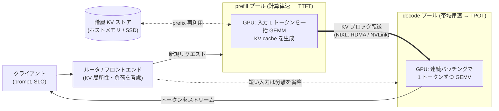

# ML 推論システム (ML Inference Systems) — GPU 実行モデルとサービング

## 概要 (Overview)

学習済みモデルは静的な**データフローグラフ (dataflow graph)** であり、数学的には行列積の列にすぎない。しかし、それを本番サービスとして**提供 (serving)** することは、まったく別種の問題である。すなわち、レイテンシ SLO (Service Level Objective) の制約下で行う**スケジューリング・メモリ管理・バッチング**というシステム問題であり、その構造は OS のプロセススケジューラや仮想記憶の設計と驚くほど相似形をなす。

とりわけ LLM (Large Language Model) の自己回帰 (autoregressive) 生成は、「1リクエストが可変長で、1トークンずつ逐次生成され、途中で終わるかもしれない」という、従来のバッチ推論の前提を全て壊すワークロードである。本ドキュメントは、対をなすハードウェア側の分析 [`../../hardware/accelerators/gpu-simt-architecture.md`](../../hardware/accelerators/gpu-simt-architecture.md)（SIMT 実行、メモリ階層、Tensor Core、roofline）を前提に、その**上に立つソフトウェア層**として、CUDA 実行モデルの使い方、KV cache 管理、バッチング戦略、attention カーネル、量子化、投機的実行、そして推論ランタイムの設計空間を整理する。

サービングを支配する指標は3つある。**TTFT (Time To First Token)**（リクエスト受理から最初のトークンまで）、**TPOT / ITL (Time Per Output Token / Inter-Token Latency)**（トークン間隔）、そして**グッドプット (goodput)**（SLO を満たしたリクエストのスループット）である。生スループット (raw throughput) を最大化しても、SLO 違反のリクエストはユーザにとって無価値であり、goodput こそが最適化の真の目的関数になる。

## 方法論 (Methodology)

- ハードウェアの詳細（SM 構成、warp スケジューリング、HBM 帯域、Tensor Core、roofline モデルの導出）は [`../../hardware/accelerators/gpu-simt-architecture.md`](../../hardware/accelerators/gpu-simt-architecture.md) に委ね、本ドキュメントは**ソフトウェアから見た GPU**（ホスト・デバイス間の非同期パイプライン、カーネル起動、メモリ確保）に限定する。
- LLM 推論を **prefill（入力処理）と decode（逐次生成）の二相**に分解し、各機構が「どちらの相の、どの律速を解くか」で位置づける。演算強度 (arithmetic intensity) を共通の物差しとする。
- 数値は桁感 (order of magnitude) にとどめ、世代・モデル・実装依存であることを常に明記する。絶対値のベンチマークは提示せず、**式と比率**で議論する。
- サービング機構を OS の古典機構（仮想記憶、プリエンプティブスケジューリング、投機的実行）との**アナロジー**で読み解く。これは修辞ではなく、実際に vLLM・Orca・speculative decoding の原論文が明示的に採用した設計の系譜である。
- 評価軸は終始 **goodput**。個々の最適化がスループットを上げても TTFT/TPOT の分布を悪化させるなら、それはサービングとしては改悪でありうる。
- **時点の明示**: ランタイムの機能・版数（vLLM / SGLang / TensorRT-LLM / llama.cpp）は数週間単位で変わるため、「2026-10 時点」と明記し、各プロジェクトのリリースノートと公式ドキュメント（Accessed: 2026-10-04）で確認した事実のみを記す。構造的な議論（律速の非対称、仮想記憶との同型性）は版数に依存しない。
- **理論的背景**: attention と KV cache の会計（パラメータ・FLOPs・KV 容量の式）は [`../../foundations/machine-learning/transformer-architecture.md`](../../foundations/machine-learning/transformer-architecture.md) の §7、待ち行列としてのスケジューラ（到着率・サービス率・リトルの法則）は [`../../foundations/mathematics/probability-statistics/markov-chains-queueing.md`](../../foundations/mathematics/probability-statistics/markov-chains-queueing.md) を前提とする。

## 発見事項 (Findings)

1. **LLM 推論は prefill と decode で計算特性が正反対であり、この非対称性がサービング設計空間の全てを駆動する。** prefill は入力全トークンを一括処理する**計算律速 (compute-bound)** の GEMM であり、decode は1トークンずつの**メモリ帯域律速 (memory-bound)** の GEMV である。decode の演算強度はバッチなしで概ね O(1) FLOP/byte（重み1バイトを読んで数演算）であり、roofline の左端に張り付く（[`../../hardware/accelerators/gpu-simt-architecture.md`](../../hardware/accelerators/gpu-simt-architecture.md) の roofline 議論参照）。バッチング・量子化・投機的デコーディングは、いずれもこの「decode で演算器が遊んでいる」事実への異なる応答である。

2. **KV cache がボトルネックの主役であり、その管理は仮想記憶の再発明に行き着いた。** attention は過去全トークンの Key/Value を参照するため、それをキャッシュすると容量はシーケンス長×バッチサイズに比例して成長する。連続確保では断片化 (fragmentation) で実効容量が大きく損なわれ、vLLM の **PagedAttention** は KV cache を固定長ブロックに分割し、OS のページング ([`../../hardware/cpu/virtual-memory-mmu.md`](../../hardware/cpu/virtual-memory-mmu.md)) と同型の「論理ブロック→物理ブロック」間接参照で断片化をほぼ消した。同じ問題は同じ解に至る。

3. **連続バッチング (continuous batching) は decode のメモリ帯域浪費をスループットに変換する、サービング側最大の発明である。** 1回の重み読み出し（帯域コスト）を B 系列で共有すれば、演算強度は約 B 倍になる。Orca が導入した**反復レベルスケジューリング (iteration-level scheduling)** は、リクエスト単位ではなくトークン生成1反復単位でバッチを組み替え、静的バッチングの「最長系列を全員で待つ」バブルを消した。

4. **カーネル起動オーバヘッドと小カーネルの氾濫が、CUDA Graphs とカーネル融合 (kernel fusion) を必然にする。** decode の1反復は数百〜数千の小カーネルの列になり、1回あたり数 µs〜十数 µs 程度（桁感）の起動コストと CPU 側のディスパッチがボトルネック化する。CUDA Graphs は起動列を一括再生して償却し、融合は隣接する要素毎演算 (element-wise) を1カーネルにまとめて中間結果の HBM 往復自体を消す。後者はあらゆる ML コンパイラの中核最適化である。

5. **FlashAttention は「アルゴリズムをメモリ階層に合わせて再設計する」ことの模範例である。** 素朴な attention は N×N のスコア行列を HBM に実体化し、O(N²) のメモリトラフィックを発生させる。FlashAttention はタイリング (tiling) とオンライン softmax により全計算をオンチップ SRAM（shared memory）内で完結させ、**数学的に同一の結果を、HBM アクセス量だけ削減して**得る。FLOPs は減らないのに速くなる。これは律速がメモリであることの直接の証明でもある。

6. **量子化 (quantization) の主たる利得は、decode においては演算ではなく帯域である。** weight-only の INT8/INT4 量子化は重み読み出しバイト数を 1/2〜1/4 にし、帯域律速の decode をほぼその比率で速くする。活性値 (activation) の量子化は外れ値 (outlier) のため格段に難しく、FP8 のようなハードウェア支援フォーマットが計算律速の prefill 側の利得を担う。「量子化=計算が速くなる」という直感は decode では的を外している。

## アーキテクチャ (Architecture)

### サービングスタックの層構成

推論サービスは、リクエストルーティングから GPU カーネルまでの層構造をなす。各層が異なる時間スケール（ms → µs → ns）の判断を担う。

```
        リクエスト (prompt, SLO, priority)
              │
  ┌───────────▼────────────────────────────┐
  │ Request Router / Frontend               │  ms オーダ
  │  - 認証・レート制限・モデル選択          │  複数レプリカへの振り分け
  │  - (分離構成では prefill/decode 振替)    │
  ├───────────▼────────────────────────────┤
  │ Scheduler / Batcher                      │  反復 (iteration) ごと
  │  - 連続バッチングの組成                  │  admission control
  │  - KV ブロックの割当/プリエンプション    │  (メモリ残量を見て受理)
  ├───────────▼────────────────────────────┤
  │ Model Runtime (vLLM / TRT-LLM / ...)     │  µs〜ms
  │  - モデルグラフ実行・CUDA Graphs 再生    │
  │  - KV cache ページテーブル管理           │
  ├───────────▼────────────────────────────┤
  │ Kernels (GEMM / FlashAttention / 融合)   │  µs
  │  - cuBLAS / CUTLASS / 手書き・自動生成   │
  ├───────────▼────────────────────────────┤
  │ GPU (SM, Tensor Core, HBM)               │  ns〜µs
  │  → ../../hardware/accelerators/      │
  │    gpu-simt-architecture.md              │
  └─────────────────────────────────────────┘
```

OS とのアナロジーで言えば、Scheduler/Batcher がプロセススケジューラ、KV ブロック管理が仮想記憶、Runtime がプロセス実行環境に対応する。以降の技術詳細は、主にこの Scheduler と Runtime の層を掘る。

### prefill / decode の二相構造

自己回帰生成は明確に2つの相からなる。

```
  入力: "The quick brown fox" → 生成: "jumps" "over" ...

  ── prefill 相 ──────────────────  ── decode 相 ─────────────────
  入力 L トークンを一括処理           1トークンずつ逐次生成
  行列×行列 (GEMM):                  行列×ベクトル (GEMV):
    [L × d] · [d × d]                  [1 × d] · [d × d]
  演算強度: 高 (L に比例して向上)      演算強度: ~O(1) FLOP/byte
  → 計算律速 (Tensor Core が飽和)     → 帯域律速 (重み読出しが支配)
  → TTFT を決める                     → TPOT/ITL を決める
```

decode の1ステップは「全パラメータ + KV cache を HBM から1回読み、各バイトに対し高々数 FLOP」であり、バッチサイズ1では GPU の演算器は roofline 上ほとんど遊ぶ。この非対称が、以降の全機構（バッチングで decode の演算強度を稼ぐ、量子化で読むバイトを減らす、投機で余った演算を使う、そして両相を別 GPU に分離する）の存在理由である。

### 分離サービング (prefill/decode disaggregation) のデータフロー

二相の非対称を物理配置まで押し進めたのが分離サービングである。2026-10 時点では vLLM（NIXL / Mooncake 等の KV コネクタ）、SGLang（PD 分離）、TensorRT-LLM（`trtllm-serve` のコンテキスト／生成サーバ分離）がいずれもこの構成を実装し、NVIDIA Dynamo のような上位オーケストレータが KV 局所性を考慮したルーティングを担う（各公式ドキュメント、技術詳細 §3 参照）。



凡例: 実線は要求・応答の流れ、太線は KV cache の GPU 間転送（分離構成で新たに生じる帯域コスト）、点線は条件付きの経路（短い要求のバイパス、prefix cache の退避・再利用）を表す。prefill プールと decode プールを独立にスケールできることが TTFT と TPOT の SLO を分けて満たす根拠であり、その代価が太線の転送帯域とルータの判断である。

## 技術詳細 (Technical Details)

### 1. CUDA 実行モデル — ソフトウェア側から

ホスト (CPU) とデバイス (GPU) は非同期に走る。ホストは**ストリーム (stream)** にカーネル起動・メモリコピーを投入し、GPU が順に消化する。同一ストリーム内は順序保証、別ストリーム間は並行しうる（コピーと計算のオーバラップの基本形）。

```
ホスト・デバイス非同期パイプライン (host-device async pipeline):

  CPU (host):   launch(k1) launch(k2) launch(k3) ... ──┐ 起動は非同期に先行
                                                        ▼
  Stream 0:     [── k1 ──][── k2 ──][─ k3 ─] ...        GPU は投入順に消化
  Stream 1:     [H2D copy ────][── k4 ──]               別ストリームは並行しうる
                     ↑ コピーと計算のオーバラップ

  健全な状態: CPU が常に GPU の先を走り、GPU に切れ目がない
  病的な状態: 小カーネル多数 + 同期 (sync) 頻発 → GPU が起動待ちで空転
```

- **カーネル起動オーバヘッド**: 起動1回あたり µs オーダ（桁感、世代・ドライバ依存）。数 ms かかる大 GEMM では無視できるが、decode の小カーネル（1トークン分の layernorm、活性化、residual 加算…）では起動コストが実行時間に匹敵し、GPU が「仕事を待つ」時間が生じる。CPU 側のディスパッチスループット自体が律速になることもある。
- **CUDA Graphs**: カーネル起動の列を一度**グラフとして記録 (capture)** し、以後は1回の起動でグラフ全体を再生する。decode は毎反復ほぼ同じカーネル列を実行するため相性がよく、起動オーバヘッドを反復全体で償却する。制約は「形状が固定であること」で、可変バッチと併用するにはバッチサイズ別にグラフを持つ等の工夫が要る。
- **カーネル融合 (kernel fusion)**: 起動回数を減らすだけでなく、より本質的には**中間結果の HBM 往復を消す**。`y = relu(x + b)` を2カーネルで実行すると中間の `x + b` を HBM に書いて読み直すが、融合すればレジスタ内で完結する。帯域律速の世界では、これは演算最適化ではなくメモリトラフィック最適化である。ML コンパイラ (XLA / TVM / Triton 系) の中核はこの融合の自動化にある。

### 2. KV cache — 何を、なぜ、どれだけ持つか

attention は各生成ステップで**過去全トークンの Key/Value ベクトル**を参照する。これを毎回再計算すると生成が O(L²) の再計算になるため、一度計算した K, V を層ごとに保持する。これが **KV cache** である。decode が「軽い」のは、この再計算を容量と引き換えに消しているからにほかならない。

容量は次式で決まる（Multi-Head Attention の場合）。

```
KV cache サイズ [bytes]
  = layers × kv_heads × head_dim × 2 × seq_len × batch × dtype_bytes
                                   ↑K と V の2つ
```

重みと違い、KV cache は **seq_len × batch に比例して実行時に成長する**。長文脈・大バッチでは重みそのものより大きくなりうる（比率はモデル構成依存）。GQA/MQA (Grouped/Multi-Query Attention) が `kv_heads` を減らすのは、まさにこの項を圧縮するモデル側の対策である。

**断片化問題と PagedAttention**: 素朴な実装は「リクエストの最大長ぶんを連続領域で確保」する。しかし実際の生成長は事前に分からず、(a) 予約したが使わない内部断片化、(b) 可変長の確保・解放が繰り返された後の外部断片化、の両方で実効容量が大きく失われる。vLLM の **PagedAttention** (Kwon et al., 2023) は KV cache を固定長ブロック（例: 16 トークン分）に分割し、リクエストごとの**ブロックテーブル (block table)**（実質ページテーブル）で論理位置→物理ブロックを引く。

- 内部断片化は高々1ブロック未満、外部断片化は消滅する。これは [`../../hardware/cpu/virtual-memory-mmu.md`](../../hardware/cpu/virtual-memory-mmu.md) のページングが連続物理メモリの断片化を解いたのと**同一の構図を1段上の層で反復した**ものである。
- 副産物として、ブロック単位の**共有**が可能になる。同一プロンプトの並列サンプリングやシステムプロンプトの prefix caching は、copy-on-write 相当の参照カウントで KV ブロックを共有する。これも仮想記憶の語彙そのままである。
- メモリ逼迫時はリクエスト単位で**プリエンプション**（ブロックを解放して後で再計算、またはホストメモリへスワップ）し、スケジューラの admission control と連動する。

### 3. バッチング進化 — static → dynamic → continuous

```
静的バッチング (static): リクエスト4本を束ね、全員の完了を待つ
  req A ██████████░░░░░░░░░░ (早く終了 → 以降バブル)
  req B ████████████████████
  req C ████████░░░░░░░░░░░░ (バブル)
  req D ██████████████░░░░░░ (バブル)
        └── 最長の B が終わるまで A/C/D の座席は空転 ──┘
  新リクエスト E は次のバッチ組成まで待機 (TTFT 悪化)

連続バッチング (continuous / iteration-level):
  反復ごとにバッチを組み替える
  t:      1  2  3  4  5  6  7  8  9 ...
  req A   █  █  █  █  ✓
  req B   █  █  █  █  █  █  █  █  █
  req C   █  █  █  ✓
  req D   █  █  █  █  █  █  ✓
  req E            █  █  █  █  █  █   ← C の終了枠へ即座に参加
  req F               █  █  █  █  █   ← A の終了枠へ即座に参加
        バブルなし: 終了したスロットは次反復で新リクエストが埋める
```

- **静的バッチング (static batching)**: バッチ推論（画像分類等）の流儀。固定形状で組み、全系列の完了を待つ。生成長が可変な LLM では、最長系列が全員を人質に取り、終了済みスロットは**バブル**（無駄な padding 計算と占有）になる。
- **動的バッチング (dynamic batching)**: 到着待ち時間 or バッチサイズ閾値で締め切って組む（Triton Inference Server 等の古典）。組成の柔軟性は上がるが、実行単位は依然「リクエストの完走」であり、生成途中の離脱・参加はできない。
- **連続バッチング (continuous batching)**: Orca (Yu et al., 2022) の**反復レベルスケジューリング**。スケジューラはトークン生成1反復ごとに呼ばれ、終了したリクエストを外し、待ち行列から新規を加える。decode は帯域律速なので、バッチに系列を足しても（重み読み出しを共有するため）反復時間はほとんど伸びず、**遊んでいた演算器がそのままスループットに変わる**。KV cache 容量がバッチサイズの上限を決めるため、PagedAttention による容量効率化と表裏一体である。
```
// 例示 (illustrative)。連続バッチングのスケジューラの概念フロー。実コードではない。
loop every iteration:                       // トークン生成1反復ごとに呼ばれる
    batch.remove(finished_requests)         // EOS / 長さ上限に達した系列を外す
    while waiting_queue.not_empty():
        req = waiting_queue.peek()
        if kv_allocator.can_allocate(req):  // KV ブロック残量が admission を決める
            batch.add(req); kv_allocator.allocate(req)
        else:
            break                           // 容量不足 → 受理せず (or 既存を preempt)
    run_one_iteration(batch)                // prefill 新規 + decode 継続を1反復実行
// バッチサイズの上限は演算器ではなく KV cache 容量が決めることが多い。
// PagedAttention の容量効率化が、そのまま同時実行数=スループットに直結する。
```

- **prefill/decode 干渉と分離サービング (disaggregated serving)**: 連続バッチングの残る問題は、計算律速の prefill（1回で数百 ms もありうる）が同じ GPU 上の decode 反復を遅延させ、他リクエストの ITL にスパイクを与えることである。緩和として prefill を分割して decode 反復に混ぜる **chunked prefill**（Sarathi-Serve; Agrawal et al., 2024 の stall-free スケジューリング）があり、さらに進んで **prefill 専用 GPU と decode 専用 GPU を分離**し、KV cache を相互接続経由で転送する構成 (prefill-decode disaggregation) がある。DistServe (Zhong et al., 2024) は goodput を目的関数に置き、二相を別 GPU に割り当てて各相の並列化戦略を個別に最適化することで、同一 SLO 下でより多くのリクエストを捌けることを示した。TTFT と TPOT の SLO を独立にスケールできる代わりに、KV 転送帯域とルーティングが新たな設計変数になる。
- **2026-10 時点の実装状況**: 分離は研究段階を過ぎ、主要ランタイムの標準機能になった。KV 転送は NVIDIA の NIXL (NVIDIA Inference Xfer Library) が複数ランタイムに共通する転送層として採用され、vLLM の KV コネクタ（NIXL / Mooncake）、TensorRT-LLM の `cache_transceiver_config: backend: NIXL`、Dynamo のルータがこれを使う。SGLang v0.5.21（2026-10-02）では PD インスタンスが再起動なしに prefill/decode の役割を切り替えられるようになり、Dynamo v1.5.0（2026-09-21）は短い要求を decode に直送する条件付きバイパスを持つ。つまり「常に分離」ではなく、**要求ごとに分離するか否かを判断する**方向へ進んでいる。この判断は短い入力では KV 転送のコストが prefill 干渉の回避益を上回るという、上記トレードオフの直接の帰結である。

### 4. attention カーネル — FlashAttention

素朴な attention 実装は `S = QKᵀ` (N×N)、`P = softmax(S)`、`O = PV` を段階的に実行し、N×N 行列を HBM に書いて読み戻す。シーケンス長 N に対しメモリトラフィックが O(N²) で成長し、帯域律速になる。

**FlashAttention** (Dao et al., 2022) は **IO-aware** アルゴリズムである。Q, K, V をタイルに分割して shared memory (SRAM) に載せ、**オンライン softmax**（部分最大値と正規化項を走査しながら更新する数値安定な逐次計算）を使って、N×N 行列を一切実体化せずに最終出力 O を得る。

- FLOPs はむしろ微増するが、HBM トラフィックが O(N²) → O(N²/M)（M は SRAM に載るタイル規模）に減り、実行時間は大きく短縮される。「**計算量ではなくメモリアクセス量を最適化する**」という、GPU 時代のアルゴリズム設計の教科書的事例。
- 副次効果として N×N を持たないためメモリ使用量が O(N) になり、長文脈が実用化した。decode 専用には、長い KV を複数ブロックに割って並列処理する FlashDecoding 系の変種が続く。
- これは [`../../hardware/cpu/simd-vector.md`](../../hardware/cpu/simd-vector.md) で見た「実効性能は帯域で頭打ちになる」原則への、アルゴリズム側からの回答であり、メモリ階層の詳細は対の GPU ドキュメントに依る。

### 5. 量子化 — 推論のための数値表現

- **weight-only 量子化 (INT8 / INT4)**: 重みだけを低ビット化し、演算は FP16/BF16 に逆量子化 (dequantize) して行う。**GPTQ**（二次情報を使う逐次丸め）や **AWQ**（活性値分布から重要チャネルを保護する）はこのクラスの代表。decode は重み読み出し帯域が律速なので、読むバイトが 1/2〜1/4 になれば TPOT がほぼ比例して改善する。演算形式が FP16 のままでも、である。
- **活性値量子化の困難**: LLM の活性値には少数チャネルに極端な**外れ値 (outlier)** が現れ、一様なスケールで量子化すると精度が崩壊する。SmoothQuant のように外れ値の大きさを重み側へ「移す」変換や、外れ値チャネルだけ高精度で扱う混合精度が必要になる。weight-only が先に普及したのはこの難易度差による。
- **FP8**: 近年の GPU 世代がハードウェアサポートする浮動小数フォーマット (E4M3/E5M2)。整数と違い動的レンジを指数部で持つため活性値にも適用しやすく、計算律速の prefill で Tensor Core スループットを引き上げる。Tensor Core の形式サポートは対の GPU ドキュメント参照。
- **FP4（ブロックスケーリング形式）**: さらに 1 段下の 4 ビット浮動小数 E2M1（表現範囲はおよそ ±6）は、単独では動的レンジが足りないため、小ブロックごとに共有スケールを持たせて使う。OCP の **MXFP4** は 32 要素ごとに 2 の冪のスケール (E8M0) を 1 つ持ち、NVIDIA Blackwell 世代の **NVFP4** は 16 要素ごとに FP8 (E4M3) スケールを持ち、さらにテンソル単位の FP32 スケールを重ねる 2 段構成である。ブロックを細かくし、スケールを 2 の冪に限らないことで局所的なレンジに追従しやすくしている（NVIDIA は FP16 比で約 3.5 倍、FP8 比で約 1.8 倍のメモリ削減と主張する; ベンダ主張値）。2026-10 時点で vLLM v0.30.0 は SM100/103 で NVFP4 の重み 4 ビット・活性値 16 ビット (W4A16) カーネルを既定に採用し、KV cache 自体も FP8 / MXFP8 で格納するモデル対応が進んでいる。KV cache の低精度化は、重みと同じく decode の読み出しバイトを減らす帯域対策である。
- まとめると: **decode の利得は帯域（weight-only で十分）、prefill の利得は演算（FP8 等の計算形式が必要）**。どの相が律速かで打ち手が変わる。精度への影響はモデル・タスク依存であり、量子化は常に精度評価とセットで導入する。

### 6. 投機的デコーディング (speculative decoding)

decode では演算器が余っている（発見事項 1）。**投機的デコーディング** (Leviathan et al., 2023) はこの余剰演算をレイテンシ短縮に転用する。

- **draft-verify 構造**: 小さな**ドラフトモデル (draft model)** が k トークンを安価に先読み生成し、本体モデルが k+1 トークン分を**1回の並列フォワード**で検証する。棄却サンプリングにより、出力分布は本体モデル単独と**数学的に同一**に保たれる。これが単なる近似手法との決定的な違いである。
- 検証の1フォワードは k 系列分をまとめて処理するため、演算量は増えるが（帯域律速の decode では）所要時間は1トークン分とほぼ変わらない。受理された分だけ「1反復で複数トークン」が進む。CPU の投機的実行が「空いたパイプラインで先の命令を走らせ、外れたら捨てる」のと同じ賭けの構造である。
- 利得は**受理率 (acceptance rate)** に全面依存する。ドラフトと本体の分布が近い（定型文・コード等）ほど伸び、乖離すると検証コストとドラフトコストだけ払って進まない。ドラフトモデルの別建てを嫌い、本体の一部層や追加ヘッドで下書きする自己投機 (self-speculative / Medusa 系) の変種が続く。本体の隠れ状態 (hidden states) を入力に取る軽量ドラフタ **EAGLE** 系 (Li et al., 2024)、学習時から複数トークン予測ヘッドを持つモデルの **MTP (Multi-Token Prediction)** ヘッド流用、ドラフトモデル不要の n-gram（プロンプトや履歴の一致から先読み）も実用化している。
- **2026-10 時点の対応状況**: 投機は主要ランタイムの標準機能になった。vLLM v0.30.0 は EAGLE3 / MTP / DFlash / DSpark 系をパイプライン並列下でも動かし、オンラインの受理率推定で検証長を適応的に変える。llama.cpp の `llama-server` も `--spec-type` で draft モデル、EAGLE-3、MTP、DFlash、各種 n-gram 方式を選べる。受理率に応じて投機の深さを動的に調整する機構が入ってきたことは、次項の「負荷・受理率依存」という性質への実装側の応答である。
- なお投機はレイテンシ（TPOT）を買う技術であり、システム全体のスループットはむしろ下がりうる。大バッチで演算器が既に埋まっている高負荷時には利得が消えるため、負荷に応じて有効/無効を切り替えるのが実務的である。

### 7. 推論ランタイムの設計空間

| | vLLM | SGLang | TensorRT-LLM | llama.cpp | ONNX Runtime |
|---|---|---|---|---|---|
| 版数（2026-10-04 時点） | v0.30.0（2026-09-22） | v0.5.21（2026-10-02） | 安定版 v1.2.1（2026-04-20）、v1.3.0 は RC 系列 | 日次ビルド (b11382 等) | — |
| 主対象ハード | NVIDIA 中心 + AMD ROCm / Intel XPU / CPU | NVIDIA + AMD (MI355X 等) | NVIDIA 専用 | CPU / Apple Silicon / 民生 GPU | CPU / GPU / NPU 横断 |
| バッチング | 連続バッチング（本家） | 連続バッチング + 低オーバヘッドスケジューラ | 連続バッチング (in-flight batching) | `llama-server` で連続バッチング（既定有効）+ 並列スロット | 動的バッチング（サーバ併用時） |
| KV 管理 | PagedAttention（本家）+ prefix caching + 階層 KV（ホスト退避） | RadixAttention（基数木による prefix 共有）+ HiCache | ページド KV cache + KV 再利用 | 全スロット共有の統合 KV バッファ (`--kv-unified`)、KV 量子化 (`-ctk`) | 実装/EP 依存 |
| 分離サービング | KV コネクタ (NIXL / Mooncake) | PD 分離（役割の動的切替） | コンテキスト／生成サーバ分離 (NIXL) | 対象外（単一ノード） | 対象外 |
| 量子化 | GPTQ/AWQ/FP8/NVFP4 等を取込み | FP8 / MXFP4 / NVFP4 等 | INT8/FP8/INT4/NVFP4（専用最適化） | GGUF 独自形式 (k-quants 等) が中核 | INT8 (静的/動的) が中心 |
| 最適化の主軸 | スケジューラとメモリ管理 | prefix 共有と構造化生成 | カーネル最適化・グラフコンパイル | 移植性と省メモリ | フォーマット互換と EP 抽象 |
| 典型ニッチ | OSS の高スループットサービング | prefix 共有の多いエージェント・RL 系ワークロード | NVIDIA 上の最高性能追求 | ローカル/エッジ実行 | 既存 ML 資産の汎用デプロイ |

設計思想の対比として読む: vLLM は「スケジューリングとメモリ管理」というシステム層の発明で勝ち、SGLang は「prefix を基数木で共有する」KV 再利用の発明で勝ち (Zheng et al., 2024)、TensorRT-LLM は「ハードに密着したカーネルとコンパイル」で勝ち、llama.cpp は「量子化フォーマットと依存ゼロの移植性」で勝つ。どの層に賭けるかがそのままプロダクトの性格になっている。ただし 2026-10 時点では、連続バッチング・ページド KV・投機的デコーディング・FP8/FP4 量子化・分離サービングが上位ランタイムの共通装備になり、差は機能の有無から「新モデル対応の速さ」と「特定ハード上のカーネル品質」へ移っている（版数と機能は各リリースノート、Accessed: 2026-10-04。各プロジェクトは週単位で変化する）。

## セキュリティ考察 (Security Considerations)

推論サービスは「秘密（プロンプト・重み）を抱えた共有インフラ」であり、性能最適化のための**共有**がそのまま攻撃面になる。守る側の観点で整理する。

- **マルチテナントのサイドチャネル**: 連続バッチングは複数ユーザのリクエストを同一 GPU・同一反復に同居させる。あるユーザの生成速度 (ITL) は同居バッチの負荷に依存するため、**タイミング観測から他テナントの活動量やプロンプト長の性質が漏れうる**。さらに prefix caching / KV ブロック共有をテナント間で有効にすると、「キャッシュヒットで TTFT が速い」ことが**他人のプロンプト前綴りの推測手段**になる。これは CPU キャッシュの Flush+Reload と同型の、共有キャッシュ由来のチャネルである。緩和は共有範囲のテナント内限定、タイミング粒度の制限、テナント間のバッチ分離だが、いずれもスループットと引き換えになる。
- **モデル抽出と出力の悪用 (model extraction)**: API 経由の大量クエリでモデルの挙動を蒸留・複製する攻撃。logits や対数確率の詳細な露出は抽出を容易にするため、公開 API では出力情報の粒度・レート制限・異常クエリ検知が防御の基本線になる。
- **GPU メモリの残留データ**: GPU メモリの確保・解放はゼロクリアを保証しない。テナント切替や障害後のリカバリ時に、前テナントの KV cache・活性値・重み断片が残留しうる。マルチテナント基盤では**テナント境界でのメモリスクラブ (scrubbing)**、あるいは GPU 単位の専有割当（MIG 等のパーティショニング含む）を境界とすべきである。
- **秘匿推論 (confidential inference)**: プロンプトと重みの機密性をインフラ事業者からも守る要件には、TEE (Trusted Execution Environment) を GPU まで拡張する**機密計算 (confidential computing)** 構成（CPU TEE と GPU 間の暗号化・アテステーション）が登場している。性能コストと信頼根 (root of trust) の検証がまだ発展途上の領域であり、脅威モデル（誰から何を守るか）の明確化が先決である。
- **サプライチェーン — 重みは信頼できない成果物**: モデル重みは事実上「実行可能物」として扱うべきである。Python の pickle 形式（PyTorch の旧来 checkpoint）は**デシリアライズ時に任意コード実行**を許す設計であり、出所不明の重みのロードは任意コード実行と等価。緩和は、テンソルデータのみを格納しコード実行経路を持たない **safetensors** 等の安全なフォーマットへの統一、重みのハッシュ/署名検証、ロード環境のサンドボックス化である。トークナイザやカスタムコード (`trust_remote_code`) も同じ境界で扱う。
- 全体として、対策の多くは古典的な原則（共有の最小化、境界でのゼロ化、成果物の署名検証）の GPU/ML への適用であり、新奇なのは攻撃面（KV cache、logits、重みフォーマット）の方である。

## 結論 (Conclusions)

- LLM 推論は「静的グラフの評価」ではなく、**SLO 制約下のスケジューリング・メモリ管理・バッチング問題**である。支配的指標は TTFT / TPOT / goodput であり、生スループットは目的関数として不十分。
- 全ての機構は **prefill（計算律速）/ decode（帯域律速）の非対称**から導出できる。連続バッチングは decode の遊休演算をスループットへ、投機的デコーディングはレイテンシへ、weight-only 量子化は読み出しバイト削減へ、と余剰・不足の変換先が異なるだけである。
- サービングシステムの発明は OS の古典の再演である。PagedAttention は仮想記憶、連続バッチングとプリエンプションはプロセススケジューラ、speculative decoding は投機的実行。**メモリ階層と共有資源の管理という問題構造が同じなら、解も同じ形に収束する。**
- FlashAttention とカーネル融合が示すのは、GPU 時代の最適化の第一言語が FLOPs ではなく**メモリトラフィック**だということである。ハードウェア側の roofline（対ドキュメント）とソフトウェア側のアルゴリズム設計は、この一点で接続される。
- セキュリティは性能の裏面である。バッチ共有・KV 共有・キャッシュという高速化機構がそのまま観測チャネルになり、重みという「データ」が実行可能物として供給網リスクを持ち込む。共有の最小化と成果物検証という古典的原則が、そのまま防御の基本構成になる。

### 次の接続先 (Related Topics)

- [`../../hardware/accelerators/gpu-simt-architecture.md`](../../hardware/accelerators/gpu-simt-architecture.md) — 本ドキュメントの前提。SIMT 実行モデル、GPU メモリ階層、Tensor Core、roofline モデル。ここでの「帯域律速」の議論は全てこのハードウェア特性に根ざす。
- [`../../hardware/cpu/virtual-memory-mmu.md`](../../hardware/cpu/virtual-memory-mmu.md) — ページング・ページテーブル・断片化。PagedAttention はこの機構の1段上の層での反復。
- [`../../hardware/cpu/simd-vector.md`](../../hardware/cpu/simd-vector.md) — データ並列とメモリ帯域律速の原型。SIMD → SIMT → サービングと、同じ律速が層を跨いで現れる。
- [`../operating-systems/`](../operating-systems/) — スケジューリングと admission control。連続バッチングは反復粒度のプリエンプティブスケジューラとして読める。
- [`../../foundations/machine-learning/transformer-architecture.md`](../../foundations/machine-learning/transformer-architecture.md) — attention の導出と KV cache 容量・FLOPs の会計。本ドキュメントの KV cache 式と GQA/MQA の効果はここから出る。
- [`../../foundations/mathematics/probability-statistics/markov-chains-queueing.md`](../../foundations/mathematics/probability-statistics/markov-chains-queueing.md) — 待ち行列とリトルの法則。admission control と同時実行数（KV 容量が上限）・レイテンシの関係を定量化する道具。
- [`ml-training-systems.md`](ml-training-systems.md) — 学習側の並列化・低精度演算。FP8/FP4 形式と通信の議論は推論と共有される。
- [`../distributed-systems/`](../distributed-systems/) — 分離サービング (prefill/decode disaggregation) やレプリカ間ルーティングが持ち込む、複製・負荷分散・部分故障の問題系。

## 参考文献 (References)

**一次資料 (Primary — 論文)**

- Kwon, W., Li, Z., Zhuang, S., Sheng, Y., Zheng, L., Yu, C. H., Gonzalez, J. E., Zhang, H., & Stoica, I. (2023). Efficient Memory Management for Large Language Model Serving with PagedAttention. *SOSP '23*. DOI: 10.1145/3600006.3613165 — vLLM / PagedAttention の原典。KV cache 断片化の定量化とページング適用。
- Yu, G.-I., Jeong, J. S., Kim, G.-W., Kim, S., & Chun, B.-G. (2022). Orca: A Distributed Serving System for Transformer-Based Generative Models. *OSDI '22*, 521–538. — 反復レベルスケジューリング（連続バッチング）の原典。
- Dao, T., Fu, D. Y., Ermon, S., Rudra, A., & Ré, C. (2022). FlashAttention: Fast and Memory-Efficient Exact Attention with IO-Awareness. *NeurIPS 2022*. — IO-aware attention。タイリングとオンライン softmax による HBM トラフィック削減。
- Leviathan, Y., Kalman, M., & Matias, Y. (2023). Fast Inference from Transformers via Speculative Decoding. *ICML 2023*. — 投機的デコーディングの原典。棄却サンプリングによる分布保存の証明。
- Pope, R., Douglas, S., Chowdhery, A., Devlin, J., Bradbury, J., Levskaya, A., Heek, J., Xiao, K., Agrawal, S., & Dean, J. (2023). Efficiently Scaling Transformer Inference. *MLSys 2023*. — 推論の演算強度分析と分割戦略。prefill/decode 律速の定式化。
- Zhong, Y., Liu, S., Chen, J., Hu, J., Zhu, Y., Liu, X., Jin, X., & Zhang, H. (2024). DistServe: Disaggregating Prefill and Decoding for Goodput-optimized Large Language Model Serving. *OSDI '24*. arXiv:2401.09670 — prefill/decode 分離と goodput 最適化の原典。
- Agrawal, A., Kedia, N., Panwar, A., Mohan, J., Kwatra, N., Gulavani, B. S., Tumanov, A., & Ramjee, R. (2024). Taming Throughput-Latency Tradeoff in LLM Inference with Sarathi-Serve. *OSDI '24*. — chunked prefill と stall-free スケジューリング。
- Zheng, L., Yin, L., Xie, Z., Sun, C., Huang, J., Yu, C. H., Cao, S., Kozyrakis, C., Stoica, I., Gonzalez, J. E., Barrett, C., & Sheng, Y. (2024). SGLang: Efficient Execution of Structured Language Model Programs. *NeurIPS 2024*. arXiv:2312.07104 — RadixAttention による prefix 共有。
- Li, Y., Wei, F., Zhang, C., & Zhang, H. (2024). EAGLE: Speculative Sampling Requires Rethinking Feature Uncertainty. *ICML 2024*. arXiv:2401.15077 — 隠れ状態を入力とするドラフタ。
- Rouhani, B. D., Zhao, R., More, A., Hall, M., Khodamoradi, A., et al. (2023). Microscaling Data Formats for Deep Learning. arXiv:2310.10537 — OCP MX 形式（ブロック単位の共有スケール + 狭幅浮動小数）の提案と評価。

**二次資料 (Secondary)**

- [vLLM Documentation](https://docs.vllm.ai/) — Accessed: 2026-10-04。PagedAttention・連続バッチング・prefix caching の実装解説。
- [NVIDIA CUDA C++ Programming Guide](https://docs.nvidia.com/cuda/cuda-c-programming-guide/) — Accessed: 2026-10-04。ストリーム・CUDA Graphs・非同期実行モデルの一次的リファレンス（ベンダ資料）。
- [safetensors (Hugging Face)](https://github.com/huggingface/safetensors) — Accessed: 2026-10-04。pickle デシリアライズリスクの排除を目的とした重みフォーマット。
- [vLLM v0.30.0 Release Notes](https://github.com/vllm-project/vllm/releases/tag/v0.30.0) — Accessed: 2026-10-04。Model Runner V2、投機的デコーディング（EAGLE3/MTP/DFlash/DSpark、適応的検証）、NVFP4 W4A16 既定化、KV コネクタ。
- [SGLang v0.5.21 Release Notes](https://github.com/sgl-project/sglang/releases/tag/v0.5.21) — Accessed: 2026-10-04。PD インスタンスの役割動的切替、prefix cache の Rust コア化。
- [TensorRT-LLM Disaggregated Serving](https://nvidia.github.io/TensorRT-LLM/features/disagg-serving.html) — Accessed: 2026-10-04。NIXL による KV 転送、`trtllm-serve` の構成。版数は [Releases](https://github.com/NVIDIA/TensorRT-LLM/releases) で確認。
- [NVIDIA Dynamo v1.5.0 Release Notes](https://github.com/ai-dynamo/dynamo/releases/tag/v1.5.0) — Accessed: 2026-10-04。ルータの選択ポリシー、条件付き分離バイパス、階層 KV インデックス。
- [llama.cpp: Speculative Decoding](https://github.com/ggml-org/llama.cpp/blob/master/docs/speculative.md) / [llama-server README](https://github.com/ggml-org/llama.cpp/blob/master/tools/server/README.md) — Accessed: 2026-10-04。`--spec-type`、連続バッチング既定有効、`--kv-unified`。
- [Introducing NVFP4 for Efficient and Accurate Low-Precision Inference](https://developer.nvidia.com/blog/introducing-nvfp4-for-efficient-and-accurate-low-precision-inference/) — NVIDIA Technical Blog (2025-06-24). Accessed: 2026-10-04。NVFP4 と MXFP4 のブロック構成（ベンダ資料）。
