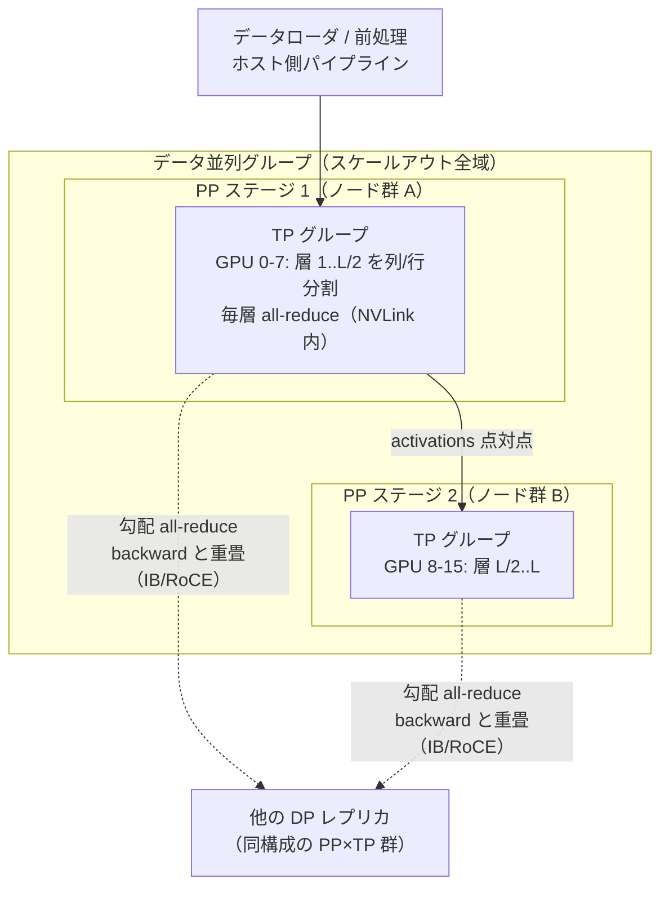

# ML 学習システム (ML Training Systems)

## 概要 (Overview)

[`ml-inference-systems.md`](ml-inference-systems.md) が扱った推論は「1 リクエストを速く・安く」の世界だった。学習 (training) は逆で、**数千〜数万アクセラレータを 1 つの同期計算として数週間〜数ヶ月回し続ける**世界である。支配する制約も入れ替わる: 推論の主敵がメモリ帯域と動的バッチングだったのに対し、学習の主敵は**メモリ容量**（モデル状態が 1 チップに載らない）、**通信と同期**（毎ステップ全員で勾配を揃える）、そして**故障**（万台規模では数時間ごとに何かが壊れる）である。

本ドキュメントは、大規模学習システムを 4 つの問いに分解する: (1) 載らないモデルをどう**切って配る**か（データ/テンソル/パイプライン並列と ZeRO/FSDP）、(2) 通信をどう**計算の影に隠す**か、(3) 数値をどう**壊さず削る**か（混合精度）、(4) 故障とどう**共存する**か（チェックポイントと可用性）。ハードウェア側の対（チップは [`../../hardware/accelerators/`](../../hardware/accelerators/)、配管は [`interconnects-scaleout-training.md`](../../hardware/accelerators/interconnects-scaleout-training.md)）と対で読む、AI スタックのソフトウェア側最上層である。理論側の前提である 1 層あたりのパラメータ数 12Ld²・学習計算量 6ND の会計は [`transformer-architecture.md`](../../foundations/machine-learning/transformer-architecture.md)、計算予算とモデル規模の配分は [`scaling-laws.md`](../../foundations/machine-learning/scaling-laws.md) が扱い、本書はそれを実時間とクラスタ規模に落とす側にあたる。分析深度は Level 3。

## 方法論 (Methodology)

- すべての並列化戦略を「**何を分割するか（データ / 層内の行列 / 層の列）× 何を通信するか（勾配 / activations）**」の 2 軸に還元し、通信量の第一原理計算で比較する。フレームワーク名は実装例として従属的に扱う。
- メモリは**バイト数の会計**として厳密に扱う（パラメータあたり何バイトが、どの瞬間に、どこに存在するか）。「大きいから切る」ではなく「この項がこの係数で寄与するからこの分割が要る」を導く。
- 効率は **MFU (model FLOPs utilization)**（理論ピーク FLOPs に対するモデル演算の実効比率）を共通指標とし、公開された実測値（PaLM・Llama 3 等の一次報告）に紐づける[^palm][^llama3]。
- 故障・運用の数値は一次報告（Llama 3 の中断統計）を用い、逸話ではなく設計入力として扱う。故障率・可用性の基礎概念は [`reliability-theory.md`](../../foundations/mathematics/probability-statistics/reliability-theory.md) に依拠する。
- フレームワーク・数値形式の現況は変化が速いため、一次資料（リリースノート・技術報告）で確認し、本文では時点を明示する。初版は 2026-10-04 に確認し、版番号・通信バックエンド・FSDP の位置づけは 2026-11-28 に再確認した。

## 発見事項 (Findings)

1. **最初に溢れるのは計算ではなくメモリであり、犯人は optimizer である。** Adam + 混合精度の標準構成では、パラメータあたり**約 16 バイト**のモデル状態（FP16/BF16 のパラメータ (2B) と勾配 (2B)、FP32 のマスターパラメータ (4B)・モーメント (4B)・分散 (4B)）を保持する[^zero]。10B パラメータで 160 GB、これだけで単一チップの HBM を超える。さらに activations（系列長 × バッチ × 隠れ次元 × 層数に比例）が乗る。**学習システム設計はこのバイト会計から始まる。**
2. **ZeRO/FSDP の洞察は「複製をやめて分割し、必要なときだけ集める」である。** 素朴なデータ並列は全チップにモデル状態の完全な複製を持つ。ZeRO は optimizer 状態 (Stage 1)・勾配 (2)・パラメータ (3) を段階的にチップ間で分割し、パラメータは各層の計算直前に all-gather で一時復元する[^zero]。PyTorch はこれを FSDP として実装し[^fsdp]、2026-11 時点では DTensor による per-parameter 分割へ作り直した FSDP2 (`fully_shard`) を推奨し、旧 FSDP1 を deprecated と位置づけている[^fsdp2]。メモリは台数分の 1 に近づき、通信は定数倍（Stage 3 で素朴 DP の約 1.5 倍）しか増えない。つまり**容量を通信で買う**取引であり、[`interconnects-scaleout-training.md`](../../hardware/accelerators/interconnects-scaleout-training.md) の帯域があって初めて成立する。
3. **3D 並列は「通信の性質をインターコネクト階層に合わせて配置する」設計である。** テンソル並列（層内の行列を分割、**毎層** activations を all-reduce。Megatron の列/行分割は 1 層あたり前後 2 回）[^megatron]は超高帯域のスケールアップ領域にしか置けない。パイプライン並列はステージ境界の activations を点対点で送るだけで安いが、**バブル**（パイプラインの充填・排出で遊ぶ時間、比率 ≈ (p−1)/(m+p−1)、p: ステージ数、m: マイクロバッチ数）を払う[^gpipe]。データ並列はステップ末の勾配 all-reduce のみで、重畳可能。この 3 つの直積が「TP はノード内・PP は近接ノード・DP は全域」という標準配置に落ちる。
4. **重畳 (overlap) がスループットの生死を分ける。** 逆伝播は出力側の層から勾配を確定させるため、確定した層からバケット単位で all-reduce を発行すれば通信は計算の影に隠れる（PyTorch DDP の勾配バケッティング[^ddp]）。逆に TP の all-reduce は次の計算の入力依存なので隠せない。つまり「**隠せる通信は無料、隠せない通信が課金される**」。MFU が 30〜50% 台に留まる主因は、この隠せない通信とパイプラインバブル、そしてカーネル間の隙間である（公開実測値: PaLM 540B が 46.2%[^palm]、Llama 3 405B が 16K GPU で BF16 MFU 38〜43%[^llama3]、MegaScale が 12,288 GPU 上の 175B モデルで 55.2%[^megascale]。いずれも 2022〜2024 年の各社自己報告で、モデル構成・ハードウェアが異なるため横並びの比較はできない）。
5. **混合精度は数値解析の応用工学である。** BF16/FP16 で計算・保存しつつ FP32 のマスターパラメータに累積する構成は、丸め誤差の蓄積（小さい勾配 × 多数回の加算）への防御であり、FP16 では勾配のアンダーフローを防ぐ**損失スケーリング**が要る[^amp]。縮約の順序で結果が変わる浮動小数点の非結合性（[`matrix-factorizations-numerical.md`](../../foundations/mathematics/linear-algebra/matrix-factorizations-numerical.md)）は、並列縮約と再現性の緊張として学習システムに現れる。FP8（E4M3/E5M2 の 2 形式[^fp8]）以降はスケーリング係数の動的管理がランタイムの仕事になり、数値形式とシステムの共進化（[`tpu-systolic-arrays.md`](../../hardware/accelerators/tpu-systolic-arrays.md)・[`gpu-simt-architecture.md`](../../hardware/accelerators/gpu-simt-architecture.md)）が続く。2026-10 時点の到達点は次のとおりである。DeepSeek-V3（671B MoE）はブロック単位の細粒度スケーリングによる FP8 混合精度学習を大規模で実証した[^deepseek-v3]。スケール係数をブロック（32 要素）ごとに共有する MX 形式 (MXFP8/MXFP4) が OCP で標準化された[^mx]。NVIDIA は NVFP4 で 12B モデルを 10T トークン学習し、FP8 ベースラインに近い精度（MMLU-Pro 62.58% 対 62.62%）を報告している[^nvfp4]。ただし 4 bit 学習はランダム Hadamard 変換・確率的丸め・一部層の高精度維持といった補助策を前提とした単一ベンダの実証段階にあり、FP8 のような既定構成にはまだ至っていない。
6. **activations は「保存する」ものから「作り直す」ものになった。** 逆伝播に必要な中間出力を全部保持すると容量が爆発するため、チェックポイント地点だけ保存して逆伝播時に区間を再計算する **activation recomputation** が標準になった[^recompute]。全層を再計算すると forward をもう一度走らせるため計算は約 1/3 増えるが、メモリは桁で削れる。さらに attention の softmax 周辺など「メモリが大きく計算が軽い」部分だけを再計算する選択的再計算は、再計算のオーバーヘッドを大幅に削る[^korthikanti]。これは「FLOPs は余っていてバイトが足りない」時代を象徴する取引である。
7. **万台規模の学習は可用性エンジニアリングである。** Llama 3 は 16,384 GPU・54 日で 419 回の予期しない中断（78% がハードウェア起因）を報告し、それでも 90% 超の実効稼働時間を達成した[^llama3]。鍵は高頻度・非同期のチェックポイント（GPU から先に退避しバックグラウンドで永続化）、故障の自動検知・切り分け・予備への再スケジュール、そして**goodput**（やり直しに消えなかった有効計算の比率）という指標で全体を管理することにある。チェックポイントをホスト/ピアのメモリに置いて復旧を速める手法（Gemini[^gemini]）や、フレームワーク側の非同期保存[^dcp]・プロセスグループのその場再構成（PyTorch 2.14 で c10d の第一級機能化[^pt214]）が、この方向の実装である。

## アーキテクチャ (Architecture)

### メモリの会計 — どのバイトが、いつ、どこに

```
パラメータ数 Ψ の Adam + BF16 混合精度、素朴なデータ並列の 1 チップ分:

  モデル状態（常駐, 16Ψ バイト）
    ├ BF16 パラメータ   2Ψ ┐
    ├ BF16 勾配        2Ψ │ ZeRO Stage 3 で分割
    ├ FP32 マスター     4Ψ │ ZeRO Stage 1〜 で分割
    ├ FP32 モーメント m  4Ψ │ ZeRO Stage 1〜 で分割
    └ FP32 分散 v      4Ψ ┘
  activations（ステップ内で増減）
    ∝ バッチ × 系列長 × 隠れ次元 × 層数   → recomputation で削減
  一時バッファ（通信・ワークスペース）
```

### 3D 並列の配置とデータフロー



| 戦略 | 分割対象 | 通信 | 頻度 | 置き場所 |
|---|---|---|---|---|
| データ並列 / ZeRO | データ（+ モデル状態の分割） | 勾配 reduce-scatter / param all-gather | ステップ末（重畳可） | 全域 |
| テンソル並列 | 層内の重み行列 | activations all-reduce | **毎層**（隠せない） | NVLink ドメイン内 |
| パイプライン並列 | 層の列 | 境界 activations 点対点 | マイクロバッチごと | 近接ノード |
| シーケンス/コンテキスト並列 | 系列次元 | attention の交換 | 毎層 | 長系列時に追加[^korthikanti][^ring] |

## 技術詳細 (Technical Details)

### 1. パイプラインのスケジューリング (Pipeline Schedules)

- **GPipe 型**: バッチを m 個のマイクロバッチに割り、全 forward → 全 backward。バブル比率 ≈ `(p−1)/(m+p−1)` で、m を増やすほど薄まるが activations の同時保持が増える[^gpipe]。
- **1F1B**: 定常状態で forward と backward を交互に流し、保持 activations をステージ深さ分に抑える。interleaved 1F1B（1 GPU に複数の不連続ステージを割り当てる）はバブルをさらに削る代わりに通信回数を増やす[^megatron-sc]。これはバブル・メモリ・通信の三すくみの中の点の選択である。
- **バブルの消去**: backward を「入力勾配」と「重み勾配」に分け、後者を空き時間に詰めるスケジュール（Zero Bubble[^zb]）や、forward と backward のチャンクを双方向から流して通信を重ねる DualPipe（DeepSeek-V3[^deepseek-v3]）は、同期学習の意味を保ったままバブルをほぼゼロに近づける。代償は保持 activations の増加とスケジューラの複雑化である。
- パイプラインの本質的な弱点は**負荷の均一性への依存**で、層ごとの計算量が不揃いだと最遅ステージが全体を律速する（[`interconnects-scaleout-training.md`](../../hardware/accelerators/interconnects-scaleout-training.md) のストラグラーと同型の構造が、今度は設計内部に現れる）。

### 2. ZeRO / FSDP の通信パターン (Sharded Data Parallelism)

- Stage 3 / FSDP の 1 ステップ: 各層の forward 直前に**その層のパラメータだけ** all-gather → 計算 → 即解放、backward で再度 all-gather + 勾配は reduce-scatter で分割先へ直接縮約。ピークメモリは「最大の 1 層 + 分割されたモデル状態」に落ちる[^zero][^fsdp]。FSDP2 は分割済みパラメータを DTensor として表現し、`recordStream` を避けることで GPU メモリ使用量を低く決定的にした[^fsdp2]。
- 通信量は素朴 DP の約 1.5 倍（all-gather ×2 + reduce-scatter ×1 ≈ 3Ψ vs all-reduce の 2Ψ）で、prefetch（次層の all-gather を先行発行）により大部分を重畳できる。**「メモリを大量に使う複製」を「帯域を少し多く使う分割」に交換する**。この取引の成立条件がインターコネクト帯域であることは、hardware 側 ([`interconnects-scaleout-training.md`](../../hardware/accelerators/interconnects-scaleout-training.md)) の存在理由そのものである。
- CPU/NVMe への offload 系（optimizer 状態の退避）は、さらに容量を階層下位で買う変種であり（ZeRO-Infinity[^zero-inf]）、[`storage-nvm-interface.md`](../../hardware/hw-sw-interface/storage-nvm-interface.md) の帯域が成立条件になる。

### 3. 混合精度と数値の運用 (Mixed Precision in Practice)

- **FP16 + 損失スケーリング**: 勾配の分布が FP16 の正規化数の下限を割るため、損失を定数倍して勾配を表現可能域に持ち上げ、更新前に戻す。オーバーフロー検出時はそのステップを捨ててスケールを下げる動的制御が標準[^amp]。
- **BF16**: 指数部が FP32 と同じため損失スケーリングが不要になり、大規模学習の既定になった。それでも FP32 マスターと FP32 での縮約（少なくとも部分和）は保持される。「計算は低精度・**累積は高精度**」が壊れない構成の不変条件である。
- **再現性との緊張**: 並列縮約の順序非決定性（NCCL のアルゴリズム選択・SHARP のスイッチ内加算）はビット再現性を壊す。PyTorch 自身も、リリース・コミット・プラットフォームをまたぐ完全な再現性は保証しないと明記している[^repro]。デバッグ・規制対応でビット一致が要る場合は決定的なアルゴリズム（`torch.use_deterministic_algorithms`）と縮約順序を強制し、性能を払う。[`fuzzing-program-analysis.md`](../security/fuzzing-program-analysis.md) の「オラクル」の議論と同じく、**何を「同じ」とみなすかが先に決まらないと検証は定義できない**。

### 4. チェックポイントと故障運用 (Checkpointing & Failure Operations)

- チェックポイントの内容はモデル状態一式（≈16Ψ バイト + データローダ位置・RNG 状態）で、分割並列に合わせて**シャーディングされたまま**書く。最適化の定石は二段階化である。GPU → ホストメモリへ同期的に退避（数秒）し、永続ストレージへは非同期に書くことで、学習停止時間を退避時間だけに縮める。
- 復旧時間の会計: 損失 = (チェックポイント間隔の期待損失 ≈ 間隔/2) + 検知 + 再スケジュール + 復元 + ウォームアップ。間隔を詰めるほど前者が減り書き込み負荷が増える。[`realtime-fundamentals.md`](../embedded/realtime-fundamentals.md) の世界と同じく、**期待値ではなく分布**（54 日で 419 回、平均故障間隔 ≈ 3 時間という Llama 3 の実測[^llama3]）から逆算する。部品数に比例して系の故障率が積み上がる直列系の信頼度計算は [`reliability-theory.md`](../../foundations/mathematics/probability-statistics/reliability-theory.md) を参照。
- 「遅くなる故障」（ECC 再試行・温度スロットリング・リンク劣化）は停止しないぶん検出が難しく、全ランクのステップ時間・通信時間の分布監視（[`observability-performance-engineering.md`](../observability/observability-performance-engineering.md)、MegaScale の診断基盤[^megascale]）が実務の主力になる。
- データパイプライン（トークン化・シャッフル・シャーディング）は見落とされがちな律速点で、GPU を遊ばせないための先読み・キャッシュと、中断時に**正確に同じ位置から**再開できる決定的なイテレータ状態の両立が要る。

### 5. 実装ランドスケープ (Implementation Landscape, as of 2026-11)

本書の機構は特定フレームワークに依存しないが、2026-11 時点の主要な実装上の到達点を記録しておく（版番号・通信バックエンド・FSDP は 2026-11-28 に再確認、それ以外の行は 2026-10-04 の確認）。

| 項目 | 2026-11 時点の状態 | 本書の該当箇所 |
|---|---|---|
| PyTorch 最新安定版 | 2.15.0（2026-10-28 リリース）[^pt215] | — |
| シャーディング DP | FSDP2 (`fully_shard`、DTensor ベース) が推奨、FSDP1 は deprecated[^fsdp2] | 発見事項 2・技術詳細 2 |
| 通信バックエンド | 2.14 でプレビュー提供した書き直し版 NCCL バックエンド ("nccl2") が、2.15 で `nccl` プロセスグループの既定になった。旧実装には `TORCH_DIST_USE_NCCL2=0` または `nccl-legacy` で戻せる。集合通信がハングしたときに各ランクの状態をディスクへ書き出すフライトレコーダも加わった[^pt214][^pt215] | 発見事項 4・7 |
| 故障耐性 | c10d にプロセスグループのその場再構成・中断フックを導入（第一級機能化）[^pt214] | 発見事項 7・技術詳細 4 |
| 計算・通信の重畳 | Inductor の collective 再配置 (`simple_overlap`) が既定で有効[^pt214] | 発見事項 4 |
| 低精度 GEMM | NVFP4・スケール付き GEMM を NVGEMM 経由で Inductor が生成、MXFP8/MXFP4 の `scaled_mm` 対応[^pt214] | 発見事項 5 |
| 参照実装 | TorchTitan（FSDP2・TP・PP・CP・Float8 を合成する PyTorch ネイティブの事前学習基盤）[^torchtitan]、Megatron 系（3D 並列の原典実装）[^megatron-sc]、DeepSpeed 系（ZeRO の原典実装）[^zero] | アーキテクチャ |

- 版番号と既定値は四半期単位で変わる。本表は設計判断の根拠ではなく、本文の機構が「どの実装で既定になったか」を確認するための時点記録として扱う。

## セキュリティ考察 (Security Considerations)

- **学習データは最大の攻撃面である。** ウェブ規模のコーパスは誰でも「サプライヤ」になれる供給網であり、データポイズニング（特定トリガーへの挙動の埋め込み）は学習時にしか仕込めず推論時の検査では見つけにくい。期限切れドメインの再取得などで、ウェブ規模データセットの一部を低コストで汚染できることも実証されている[^poisoning]。データソースの来歴・フィルタリングパイプラインの完全性は、[`software-supply-chain-security.md`](../security/software-supply-chain-security.md) の「出所の検証」をデータへ拡張したものである。
- **チェックポイントは実行可能物として扱う。** 復元はデシリアライズであり（pickle 系の任意コード実行の系譜）、加えて重み自体への改竄（バックドア注入）は学習途中のチェックポイント経由が最も検出困難である。保存形式の安全化（safetensors のようなテンソル専用形式[^safetensors]、PyTorch の `torch.load` では `weights_only=True` が現行の既定[^torch-load]）、チェックポイントの署名・完全性検証、アクセス監査が対策の柱になる。
- **クラスタは高価値・長時間・単一目的の標的である。** 数万 GPU 時間の焼却（可用性攻撃）、重みの持ち出し、ジョブへの介入のいずれも被害が巨額になる。[`interconnects-scaleout-training.md`](../../hardware/accelerators/interconnects-scaleout-training.md) で述べたとおりファブリック内の信頼モデルは弱く、境界防御・テナント分離・ストレージ暗号化が前提となる。
- **再現性は監査可能性でもある。** 「このモデルはこのデータとこのコードから、この乱数で作られた」を主張できる決定的学習は、規制・インシデント調査への備えであり、モデル来歴 (provenance) の技術的基盤になる。性能との交換（発見事項 5・技術詳細 3）を、セキュリティ要件として意識的に選ぶ場面が増えている。

## 結論 (Conclusions)

学習システムは「バイトの会計」から始まり「可用性の工学」で終わる。モデル状態 16Ψ バイトという算術が分割（ZeRO・3D 並列）を強制し、分割は通信を生み、通信は隠せるか否かで無料と課金に分かれ、隠せない部分とバブルが MFU の上限を画す。数値形式は削れる限界まで削られ、累積だけが高精度に残る。そして万台規模では故障が常態となり、チェックポイントと goodput が性能指標に昇格する。推論 ([`ml-inference-systems.md`](ml-inference-systems.md)) が「メモリ帯域の経済」だったのに対し、学習は「**容量・帯域・可用性の三元経済**」である。そしてその三つとも、hardware 側の章（チップ・HBM・インターコネクト・光）が供給する物理量の上に立っている。AI スタックの分析が hardware/software の相互参照なしに成立しない理由が、ここに集約されている。

---

## 参考文献 (References)

[^zero]: Rajbhandari, S., Rasley, J., Ruwase, O. & He, Y. (2020). ZeRO: Memory Optimizations Toward Training Trillion Parameter Models. *Proc. SC20*. DOI: 10.1109/SC41405.2020.00024 — 16 バイト/パラメータの会計と 3 段階分割の原典。

[^megatron]: Shoeybi, M. et al. (2019). Megatron-LM: Training Multi-Billion Parameter Language Models Using Model Parallelism. arXiv:1909.08053 — 列/行分割テンソル並列の原典。

[^megatron-sc]: Narayanan, D. et al. (2021). Efficient Large-Scale Language Model Training on GPU Clusters Using Megatron-LM. *Proc. SC21*. DOI: 10.1145/3458817.3476209 — 3D 並列の合成と interleaved 1F1B、MFU 分析。

[^gpipe]: Huang, Y. et al. (2019). GPipe: Efficient Training of Giant Neural Networks using Pipeline Parallelism. *Proc. NeurIPS 2019*. — マイクロバッチとパイプラインバブルの原典。

[^amp]: Micikevicius, P. et al. (2018). Mixed Precision Training. *Proc. ICLR 2018*. arXiv:1710.03740 — FP32 マスター・損失スケーリングの原典。

[^recompute]: Chen, T., Xu, B., Zhang, C. & Guestrin, C. (2016). Training Deep Nets with Sublinear Memory Cost. arXiv:1604.06174 — activation recomputation（gradient checkpointing）の原典。

[^palm]: Chowdhery, A. et al. (2022). PaLM: Scaling Language Modeling with Pathways. arXiv:2204.02311 — MFU の定義と大規模実測（46% 前後）の一次報告。

[^llama3]: Grattafiori, A. et al. (2024). The Llama 3 Herd of Models. arXiv:2407.21783 — 16,384 GPU・54 日・419 中断・約 78% ハードウェア起因、90% 超の実効稼働時間、BF16 MFU 38〜43% の一次報告。

[^fsdp]: Zhao, Y., Gu, A., Varma, R., Luo, L., Huang, C.-C., Xu, M. et al. (2023). PyTorch FSDP: Experiences on Scaling Fully Sharded Data Parallel. *Proceedings of the VLDB Endowment*, 16(12), 3848–3860. DOI: 10.14778/3611540.3611569 — ZeRO-3 型分割の PyTorch 実装と設計上の教訓。

[^fsdp2]: PyTorch. *Getting Started with Fully Sharded Data Parallel (FSDP2)*. https://docs.pytorch.org/tutorials/intermediate/FSDP_tutorial.html — Accessed: 2026-11-28. — DTensor による per-parameter 分割、`recordStream` 回避によるメモリの決定性、「FSDP1 is deprecated」の記載。

[^ddp]: Li, S., Zhao, Y., Varma, R., Salpekar, O. et al. (2020). PyTorch Distributed: Experiences on Accelerating Data Parallel Training. *Proceedings of the VLDB Endowment*, 13(12), 3005–3018. DOI: 10.14778/3415478.3415530 — 勾配バケッティングと backward との重畳。

[^zero-inf]: Rajbhandari, S., Ruwase, O., Rasley, J., Smith, S. & He, Y. (2021). ZeRO-Infinity: Breaking the GPU Memory Wall for Extreme Scale Deep Learning. *Proc. SC21*, 1–14. DOI: 10.1145/3458817.3476205 — CPU/NVMe への offload。

[^korthikanti]: Korthikanti, V., Casper, J., Lym, S. et al. (2022). Reducing Activation Recomputation in Large Transformer Models. arXiv:2205.05198 — シーケンス並列と選択的 activation 再計算。

[^ring]: Liu, H., Zaharia, M. & Abbeel, P. (2023). Ring Attention with Blockwise Transformers for Near-Infinite Context. arXiv:2310.01889 — 系列次元を環状に分割するコンテキスト並列。

[^zb]: Qi, P., Wan, X., Huang, G. et al. (2023). Zero Bubble Pipeline Parallelism. arXiv:2401.10241 — backward の分割によるバブル消去スケジュール。

[^fp8]: Micikevicius, P., Stosic, D., Burgess, N. et al. (2022). FP8 Formats for Deep Learning. arXiv:2209.05433 — E4M3/E5M2 の定義と学習・推論での検証。

[^mx]: Rouhani, B. D., Zhao, R., More, A. et al. (2023). Microscaling Data Formats for Deep Learning. arXiv:2310.10537 — ブロック共有スケールの MX 形式（OCP MX 仕様の背景論文）。

[^deepseek-v3]: DeepSeek-AI (2024). DeepSeek-V3 Technical Report. arXiv:2412.19437 — 671B MoE での細粒度 FP8 混合精度学習と DualPipe。

[^nvfp4]: NVIDIA (2025). Pretraining Large Language Models with NVFP4. arXiv:2509.25149 — 12B・10T トークンの 4 bit 学習、FP8 比の精度（MMLU-Pro 62.58% 対 62.62%）。ベンダ自己報告。

[^megascale]: Jiang, Z. et al. (2024). MegaScale: Scaling Large Language Model Training to More Than 10,000 GPUs. *Proc. USENIX NSDI 2024*. arXiv:2402.15627 — 12,288 GPU・175B で MFU 55.2%、診断・ストラグラー対策の一次報告。

[^gemini]: Wang, Z., Jia, Z., Zheng, S., Zhang, Z., Fu, X., Ng, T. S. E. et al. (2023). GEMINI: Fast Failure Recovery in Distributed Training with In-Memory Checkpoints. *Proc. ACM SOSP 2023*, 364–381. DOI: 10.1145/3600006.3613145 — CPU メモリへのチェックポイントによる高速復旧。

[^dcp]: PyTorch. *Asynchronous Saving with Distributed Checkpoint (DCP)*. https://docs.pytorch.org/tutorials/recipes/distributed_async_checkpoint_recipe.html — Accessed: 2026-10-04. — CPU バッファへの退避と非同期永続化、pinned memory ステージング。

[^pt215]: PyTorch. *PyTorch 2.15 Release Blog* (2026-10-28). https://pytorch.org/blog/pytorch-2-15-release-blog/ — Accessed: 2026-11-28. — 書き直し版 NCCL バックエンドの既定化とロールバック手段、フライトレコーダ、FSDP2 のパラメータ単位の精度指定。リリース日は [torch (PyPI)](https://pypi.org/project/torch/) の 2.15.0 のアップロード日 (2026-10-28) と照合。

[^pt214]: PyTorch. *PyTorch 2.14 Release Blog* (2026-09-02). https://pytorch.org/blog/pytorch-2-14-release-blog/ — Accessed: 2026-10-04. — nccl2 バックエンド、c10d の故障耐性、Inductor の重畳既定化、NVGEMM の NVFP4 対応。

[^torchtitan]: Liang, W., Liu, T., Wright, L. et al. (2024). TorchTitan: One-stop PyTorch native solution for production ready LLM pre-training. arXiv:2410.06511 — FSDP2・TP・PP・CP・Float8 の合成。

[^repro]: PyTorch. *Reproducibility*. https://docs.pytorch.org/docs/2.14/notes/randomness.html — Accessed: 2026-10-04. — 「Completely reproducible results are not guaranteed across PyTorch releases, individual commits, or different platforms」。

[^poisoning]: Carlini, N., Jagielski, M., Choquette-Choo, C. A., Paleka, D., Pearce, W., Anderson, H. et al. (2024). Poisoning Web-Scale Training Datasets is Practical. *Proc. IEEE S&P 2024*, 407–425. DOI: 10.1109/SP54263.2024.00179 — ウェブ規模データセット汚染の実証。

[^safetensors]: Hugging Face. *Safetensors documentation*. https://huggingface.co/docs/safetensors/index — Accessed: 2026-10-04. — pickle を使わないテンソル専用保存形式。

[^torch-load]: PyTorch. *torch.load*. https://docs.pytorch.org/docs/2.14/generated/torch.load.html — Accessed: 2026-10-04. — unpickler 使用の警告と `weights_only=True` 既定。

その他の標準的典拠を挙げる。

- NVIDIA. *NCCL Documentation*. https://docs.nvidia.com/deeplearning/nccl/ — Accessed: 2026-10-04. — 集合通信の実装・重畳の一次資料。
