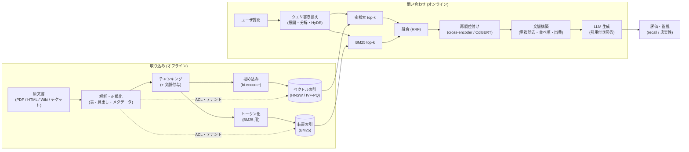
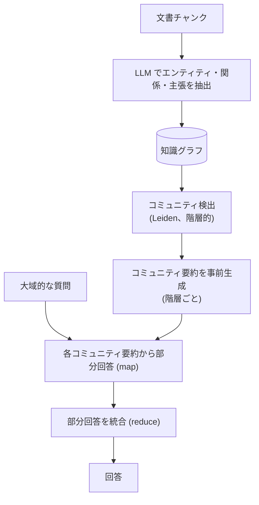

# RAG システムアーキテクチャ (Retrieval-Augmented Generation System Architecture)

## 概要 (Overview)

**検索拡張生成 (retrieval-augmented generation, RAG)** は、LLM が生成する前に外部の文書集合から関連する断片を検索し、それを文脈 (context) に入れて回答させる構成である。原典の Lewis et al. (2020) は、事前学習済みの生成モデル（パラメトリック記憶）と密ベクトル索引（ノンパラメトリック記憶）を組み合わせ、知識集約的なタスクで性能を上げつつ、知識の更新を索引の差し替えで行えることを示した[^lewis]。現在の RAG は原典のような検索器と生成器の同時学習ではなく、既製の埋め込みモデル・検索エンジン・LLM を API で接続する**パイプライン工学**になっている。

本ドキュメントは RAG を「LLM の上に載る情報検索システム」として分析する。中心の問いは 6 つある。(1) 文書をどう切るか（チャンキング）、(2) どう表現し、どう検索するか（埋め込み、BM25 と密検索のハイブリッド、RRF）、(3) 候補をどう並べ直すか（交差エンコーダ、ColBERT の遅延相互作用）、(4) クエリをどう直すか（クエリ書き換え、HyDE）、(5) 長文脈 LLM がある時代に RAG は要るのか、(6) どう評価し、どう壊れ、どう攻撃されるか。索引の内部機構は [`../search/vector-search-ann.md`](../search/vector-search-ann.md)（ANN）と [`../search/inverted-index-fulltext-search.md`](../search/inverted-index-fulltext-search.md)（転置索引・BM25）に委ね、本稿はそれらを部品として組み立てる側に立つ。分析深度は Level 3。

## 方法論 (Methodology)

- **原論文への還元**: 各部品は原論文（RAG[^lewis]、DPR[^dpr]、BM25[^bm25]、RRF[^rrf]、monoBERT[^monobert]、ColBERT[^colbert][^colbertv2]、HyDE[^hyde]、GraphRAG[^graphrag]、RAGAS[^ragas]）に基づいて再構成する。性能数値は各論文の実験条件（データセット、比較対象、時期）付きで引用する。
- **ベンダー資料の扱い**: Anthropic の Contextual Retrieval[^contextual] や Microsoft の GraphRAG 関連ブログのような一次技術文書は、手法の記述としては一次資料だが、効果の数値は自社評価による**主張**である。本文では「自社報告」と明記し、独立評価（BEIR[^beir] 等の公開ベンチマーク）の知見と区別する。
- **パイプラインの段への分解**: RAG を「取り込み (ingestion) → 索引 → 検索 → 再順位付け → 生成 → 評価」の段に分け、各段で失敗がどう生じ、どう次段に伝播するかを追う。失敗分類は Barnett et al. (2024) の 7 つの失敗点[^barnett]を骨格にする。
- **セキュリティ**: 間接プロンプトインジェクション[^greshake]と知識汚染[^poisonedrag]の一次研究、OWASP Top 10 for LLM Applications 2025[^owasp]を基準にする。エージェント側の防御設計は [`agent-architectures.md`](agent-architectures.md) と対で読む。
- **時点**: 長文脈モデルの能力と RAG の製品動向は変化が速いため、2026-10 時点の一次資料で確認し（Accessed: 2026-10-04）、時点依存の主張にはその旨を付す。

## 発見事項 (Findings)

1. **RAG の品質上限は検索が決め、生成はそこから割り引くだけである。** 正解を含む文書が文脈に入らなければ、どれほど強い LLM でも正しく答えられない（あるいは事前学習の記憶で答えて出典と一致しない）。したがって RAG の改善は、まず検索の再現率 (recall) を測り、上げることから始まる。生成側の調整は、検索が十分に良くなった後でしか効かない。[`../search/vector-search-ann.md`](../search/vector-search-ann.md) が述べた「検索品質の上限は埋め込みモデルが決め、ANN はそこから recall 分だけ割り引く」の、もう一段上の写しである。
2. **チャンキングは検索単位と生成単位の不一致を調停する設計である。** 埋め込みは短い一貫した断片ほど意味が鋭くなり、生成は前後の文脈が多いほど正しく解釈できる。この緊張を解く工夫として、小さく検索して大きく渡す (small-to-big / parent document)、チャンクに文書全体の文脈を前置する (Contextual Retrieval[^contextual])、文書全体を埋め込んでからトークン埋め込みを区間ごとに平均する (late chunking[^latechunking]) が生まれた。これらはどれも「断片化で失われた文脈を取り戻す」ための手段である。
3. **語彙検索と密検索は誤りモードが直交し、合成が既定解になった。** DPR は自然文の質問で top-20 検索精度を BM25 より 9〜19 ポイント（絶対値）上回った[^dpr]が、BEIR のゼロショット評価では、学習分布の外で密検索器が BM25 に負けるデータセットが多いことが示された[^beir]。固有名詞・型番・エラーコードには BM25、言い換えや多言語には密検索が強い。両者を順位だけで融合する RRF[^rrf] は、スコアの校正なしで頑健に動くため、ハイブリッド検索の既定の融合法になった。
4. **再順位付けは「再現率の段」と「精度の段」を分離する。** 双方向エンコーダ (bi-encoder) はクエリと文書を独立に埋め込むため事前計算と ANN が使えるが、クエリと文書の語の相互作用を見られない。交差エンコーダ (cross-encoder) は両者を連結して 1 回の forward で関連度を出すため精度が高いが、候補ごとに推論が要る[^monobert]。ColBERT はトークン単位の埋め込みを保持し、検索時に MaxSim で遅延相互作用 (late interaction) を計算して両者の中間を取る[^colbert]。実務の標準形は「BM25 + 密検索で数百件 → RRF → 交差エンコーダで上位数十件 → LLM」の多段構成である。
5. **長文脈は RAG を置き換えず、RAG の設計変数を変える。** 文脈長が 100 万トークン級になっても、(a) 文脈の中ほどの情報が使われにくい「lost in the middle」現象[^lostmiddle]、(b) 公称の文脈長より実効的に使える長さが短いこと[^ruler]、(c) トークン課金とレイテンシ、(d) 文書集合が文脈に収まらない規模とアクセス制御、の 4 点が残る。Li et al. (2024) は、十分な資源があれば長文脈の方が平均性能は一貫して高いが、RAG はコストが大幅に低く、しかも両者の予測はクエリの 63% で一致すると報告した。そこでクエリごとにどちらを使うかを LLM 自身に判定させる混合方式 (Self-Route) を提案し、長文脈と同等の性能のままコストを 65%（Gemini-1.5-Pro）・39%（GPT-4o）削減した[^selfroute]。長文脈は「検索を省く」より「検索の精度要求を緩める（多めに入れてよい）」方向に効く。
6. **GraphRAG は「局所的な質問」ではなく「大域的な質問」のための構成である。** 通常の RAG は「X の仕様は何か」のような答えが少数のチャンクにある質問に強いが、「このコーパス全体の主要なテーマは何か」のような、集合全体の要約を要する質問 (query-focused summarization) には構造的に答えられない。GraphRAG は LLM で文書からエンティティと関係を抽出して知識グラフを作り、コミュニティ検出で階層化し、各コミュニティの要約を事前生成しておくことで大域的な質問に答える[^graphrag]。その代償は索引構築時の大量の LLM 呼び出しであり、適用範囲は質問の型で決めるべきである。
7. **RAG の評価は「検索の評価」と「生成の評価」の 2 層で行う。** 検索層は古典的な情報検索の指標（recall@k、MRR、nDCG[^ndcg]）で測れる。生成層は、回答が取得文脈に支持されているか（忠実性 (faithfulness)・根拠性 (groundedness)）、質問に答えているか（回答関連性）を測る必要があり、RAGAS[^ragas] や ARES[^ares] は LLM を判定器として参照回答なしにこれらを推定する。ただし LLM 判定器自体にバイアスがある（[`llm-evaluation-methodology.md`](llm-evaluation-methodology.md)）ため、少量の人手ラベルによる校正が欠かせない。
8. **RAG は信頼できないテキストを LLM の文脈に流し込む配管である。** 検索された文書に埋め込まれた指示は、間接プロンプトインジェクション (indirect prompt injection) として作用する[^greshake]。また、数百万件の文書を持つ知識ベースに、標的の質問 1 つあたり 5 件の毒文書を注入するだけで、約 90% の攻撃成功率で回答を操作できることが示されている[^poisonedrag]。アクセス制御は検索時に適用しなければならず、生成後のフィルタでは漏洩を防げない。

## アーキテクチャ (Architecture)

### RAG パイプラインの全体像



- **取り込み段**の品質は見落とされやすいが、PDF の表の崩れ、ヘッダ・フッタの混入、見出し階層の喪失は、検索で回復できない欠陥を作る。メタデータ（文書 ID、更新日時、アクセス権、出典 URL）はこの段で付与し、以降すべての段で保持する。
- **検索段**は再現率の確保が目的であり、広めに取る（各系 50〜200 件程度が典型）。融合は順位のみで行う。
- **再順位付け段**は精度の確保が目的であり、計算の重いモデルを少数の候補にだけ適用する。
- **文脈構築段**は、重複の除去、関連度の高いものを文脈の先頭と末尾に置く配置（lost in the middle への対処[^lostmiddle]）、出典の付与を行う。

### 検索器の設計空間

| 方式 | 表現 | 相互作用の時点 | 事前計算 | 長所 | 短所 |
|---|---|---|---|---|---|
| BM25 | 疎な語彙ベクトル | なし（語の一致のみ） | 転置索引 | 固有名詞・型番・未知語に強い、学習不要 | 言い換え・多言語に弱い |
| 学習型疎検索 (SPLADE) | 語彙空間上の重み付き疎ベクトル | なし | 転置索引 | 語の展開を学習、転置索引の資産を流用 | 学習が必要、索引が大きくなる[^splade] |
| 密検索 (DPR 等の bi-encoder) | 単一の密ベクトル | なし（内積のみ） | ANN 索引 | 意味の一致に強い | 学習分布外で劣化しやすい[^beir] |
| 遅延相互作用 (ColBERT) | トークンごとの密ベクトル | 検索時 (MaxSim) | トークン単位の索引 | 精度と速度の中間 | 索引サイズが大きい（圧縮で緩和[^colbertv2]） |
| 交差エンコーダ | 連結入力 | 推論時（全層） | 不可 | 最高精度 | 候補ごとに推論が必要、再順位付け専用 |

上から下へ、相互作用が遅く深くなるほど精度は上がり、事前計算できる部分が減る。RAG の多段構成は、この表を上から順に通過させて、計算量を候補数の減少と釣り合わせる設計である。

## 技術詳細 (Technical Details)

### 1. チャンキング戦略

| 戦略 | 方法 | 長所 | 短所 |
|---|---|---|---|
| 固定長 | N トークンごとに分割、重なり (overlap) を付ける | 単純、予測可能 | 文・節の途中で切れる |
| 再帰的分割 | 段落 → 文 → 語の順に区切り記号で分割し、上限に収める | 構造をある程度保つ | 文書形式ごとの調整が要る |
| 構造ベース | 見出し・節・表・コードブロック単位 | 意味の単位と一致しやすい | 解析器の品質に依存 |
| 意味的分割 | 隣接文の埋め込み類似度が下がる点で分割 | 話題の境界で切れる | 取り込みコストが増える |
| 文脈付与 | 各チャンクの先頭に、文書全体を見た LLM が生成した位置づけの説明を付与 | 断片化で失われた文脈を回復 | 取り込み時に LLM 呼び出しが要る[^contextual] |
| late chunking | 長文脈埋め込みモデルで文書全体をエンコードし、トークン埋め込みをチャンク区間ごとにプーリング | 前後文脈を反映した埋め込み | 長文脈埋め込みモデルが必要[^latechunking] |
| small-to-big | 小さいチャンクで検索し、親の節や前後のチャンクを生成に渡す | 検索の鋭さと生成の文脈を両立 | 文脈量が増える |

- **チャンクサイズの選び方**: 小さいチャンクは埋め込みの意味が鋭くなり検索精度が上がるが、答えに必要な情報が複数のチャンクに分散する。大きいチャンクはその逆である。Chroma の技術報告は、トークン単位の再現率・精度・IoU で分割器を比較し、分割方式の選択だけで再現率が最大 9% 程度変わること、200 トークン程度の小さいチャンクで重なりなしの設定が IoU と精度で有利だったことを報告している（単一コーパス・単一埋め込みモデルでの評価）[^chroma]。最適値はコーパスと質問の型に依存するため、固定の推奨値に頼らず、自コーパスの評価セットで recall@k を測って選ぶ。
- **Contextual Retrieval の例（自社報告）**: Anthropic は、チャンクに文脈説明を前置して埋め込みと BM25 の両方を作ると、top-20 の検索失敗率がベースラインの 5.7% から 3.7%（文脈付き埋め込みのみ、35% 減）、2.9%（文脈付き BM25 併用、49% 減）に下がり、再順位付けを加えると 1.9%（67% 減）になったと報告している[^contextual]。取り込み時の LLM 呼び出しコストは、プロンプトキャッシュで文書本体を共有して抑える前提である。

### 2. 埋め込みモデル

- **学習**: 現代の埋め込みモデルは、質問と関連文書の対を近づけ、無関係な文書を遠ざける対照学習 (contrastive learning) で学習される。DPR はバッチ内の他の正例を負例として使う in-batch negatives と、BM25 で取った紛らわしい負例 (hard negatives) を組み合わせた[^dpr]。
- **選定**: MTEB[^mteb] は検索・分類・クラスタリング等の多数のタスクで埋め込みモデルを比較する標準ベンチマークだが、リーダーボードの順位は自コーパス・自言語での性能を保証しない。とくに日本語や専門領域では、自前の評価セットで候補を比較することが必須である。
- **次元とコスト**: Matryoshka 表現学習[^matryoshka]で学習されたモデルは、ベクトルの先頭の次元だけを使っても機能するため、次元数を精度とメモリの調整つまみとして使える。索引のメモリと距離計算コストは次元に比例するため、[`../search/vector-search-ann.md`](../search/vector-search-ann.md) の量子化と組み合わせてコストを設計する。
- **モデル更新の運用**: 埋め込みモデルを替えると、既存のベクトルとクエリのベクトルが別の空間に属するため、全文書の再埋め込みが必要になる。モデル版をベクトルのメタデータに記録し、新旧索引を並行運用して切り替える。

### 3. ハイブリッド検索と RRF

RRF のスコアは、各検索系 i における文書 d の順位 r_i(d) から次のように計算する[^rrf]。

```text
RRF(d) = Σ_i 1 / (k + r_i(d))      （k は定数、原論文では 60）
```

- 順位だけを使うため、BM25 のスコアと内積のように尺度の異なる系を校正なしで融合できる。k は上位の順位差をどれだけ平らにするかを決め、大きいほど各系の上位が均等に扱われる。
- スコアの線形結合（正規化した BM25 と内積の重み付き和）は、重みを評価セットで調整すれば RRF を上回ることがあるが、クエリ分布が変わると重みの最適値も動く。運用の頑健さを優先するなら RRF、評価基盤が整っていれば線形結合を検討する。
- フィルタ（テナント、日付、文書種別）は両方の検索系で**同一の条件を検索時に**適用する。片方だけに適用すると、融合後に権限外の文書が混入する。

### 4. 再順位付け — 交差エンコーダと遅延相互作用

- **交差エンコーダ**: `[CLS] query [SEP] passage [SEP]` を BERT 系モデルに入力し、関連度を直接出力する。Nogueira & Cho (2019) は BERT による再順位付けで、MS MARCO の当時の最高性能を MRR@10 で相対 27% 更新した[^monobert]。計算量は候補数に比例するため、上位 50〜100 件程度に限定して使う。
- **ColBERT**: クエリと文書をそれぞれトークン単位の埋め込み列に変換し、クエリの各トークンについて文書トークンとの最大類似度を取り、それを合計する（MaxSim）[^colbert]。文書側の埋め込みは事前計算できるため、交差エンコーダより桁違いに速く、単一ベクトルより精度が高い。代償はトークン数ぶんの索引サイズで、ColBERTv2 は残差圧縮でこれを 6〜10 分の 1 に削減した[^colbertv2]。
- **LLM による再順位付け**: LLM に候補一覧を与えて並べ替えさせる方式もあるが、コストとレイテンシが大きく、位置バイアス（提示順の影響）がある。

### 5. クエリ書き換え

- **展開と分解**: 曖昧な質問を具体化する、複合質問を部分質問に分解してそれぞれ検索する、会話履歴の代名詞を解決して単独で意味の通る質問にする（会話型 RAG では必須）。
- **HyDE**: LLM に質問への仮想的な回答文書を生成させ、その文書の埋め込みで検索する[^hyde]。質問と文書の文体の差（短い疑問文と長い説明文）を埋める効果があり、関連ラベルなしのゼロショット検索で有効だった。ただし仮想文書の内容が誤っていると、誤った方向に検索を誘導する。
- **エージェント型検索**: 検索をツールとして LLM に渡し、結果を見て再検索させる構成（[`agent-architectures.md`](agent-architectures.md)）。Self-RAG は検索の要否と取得文書の有用性をモデル自身に判定させる[^selfrag]。柔軟性と引き換えに、呼び出し回数とレイテンシが増え、挙動の予測可能性が下がる。

### 6. 長文脈と RAG のトレードオフ

| 観点 | 長文脈に全部入れる | RAG |
|---|---|---|
| 規模の上限 | 文脈長（〜100 万トークン級）まで | 索引の規模は事実上無制限 |
| コスト | 入力トークンに比例、毎回課金（キャッシュで一部緩和） | 検索 + 少量の文脈 |
| レイテンシ | prefill が長い（[`ml-inference-systems.md`](ml-inference-systems.md)） | 検索の分だけ増えるが prefill は短い |
| 情報の利用 | 文脈中ほどの情報が使われにくい[^lostmiddle]、実効長は公称より短い[^ruler] | 検索漏れがあると答えられない |
| 更新 | 毎回最新を入れられる | 再索引が必要 |
| アクセス制御 | 呼び出し側で文書を選ぶ必要がある | 検索時のフィルタで実装 |

- RULER は、公称で 32K トークン以上を謳う 17 モデルを 13 タスクで評価し、単純な針探し (needle-in-a-haystack) を超える複合タスクでは 32K 長で満足な性能を保てたのが約半数にとどまり、ほぼすべてのモデルが文脈長の増加とともに大きく性能を落とすことを示した（2024 年時点のモデル群）[^ruler]。
- 実務上の結論は、小さく安定した文書集合（1 冊のマニュアル、単一リポジトリ）は長文脈とプロンプトキャッシュで丸ごと入れ、大きく変化する文書集合やアクセス権の異なる文書集合は RAG で絞り込む、という使い分けである。両者は排他ではなく、RAG で数十件を取得して長文脈に入れる構成が増えている。

### 7. GraphRAG



- Edge et al. (2024) は、ポッドキャストの書き起こしやニュース記事のような 100 万トークン規模のコーパスで、大域的な質問に対する回答の網羅性と多様性が、通常の RAG より高いと報告した[^graphrag]。評価は LLM 判定器による対比較である点に注意が要る。
- 索引構築時に全チャンクへ LLM を適用するため、取り込みコストは通常の RAG より桁で大きい。Microsoft はこの問題に対し、事前要約をやめて問い合わせ時に処理を遅延させる LazyGraphRAG を 2024-11 に発表し、索引コストはベクトル RAG と同等（GraphRAG の 0.1%）で、大域的な質問では GraphRAG の Global Search と同等の品質を 700 分の 1 以下の問い合わせコストで得られると自社報告している[^lazygraphrag]。公式リポジトリも索引構築が高価な操作であることを明記している[^graphrag-repo]。
- エンティティの多対多関係をたどる質問（「A 社と取引のある会社の役員は誰か」）では、グラフ検索自体が有効である。ただし抽出の誤りがグラフに固定化されるため、抽出品質の評価が要る。

### 8. 評価

| 層 | 指標 | 測るもの | 必要なラベル |
|---|---|---|---|
| 検索 | recall@k | 正解文書が上位 k 件に入る割合 | 関連文書のラベル |
| 検索 | MRR | 最初の正解の順位の逆数の平均 | 同上 |
| 検索 | nDCG@k | 段階的な関連度を順位で割り引いて合計し、理想順位で正規化[^ndcg] | 段階的関連度 |
| 生成 | 忠実性 / 根拠性 | 回答の各主張が取得文脈に支持される割合 | LLM 判定器（参照回答不要）[^ragas] |
| 生成 | 回答関連性 | 回答が質問に答えているか | LLM 判定器[^ragas] |
| 生成 | 文脈関連性・文脈再現率 | 取得文脈のうち必要な部分の割合、必要情報の網羅 | LLM 判定器、参照回答 |
| 全体 | 正答率 | 参照回答との一致 | 参照回答 |

- **評価セットの作り方**: 実際のユーザの質問ログから代表的な質問を抽出し、正解文書と参照回答を人手で付ける。LLM で質問を合成する方法は手早いが、合成質問はチャンクの文言をなぞりやすく、実際の質問より易しくなる傾向がある。
- **LLM 判定器の校正**: RAGAS 型の指標は判定器 LLM の出力であり、判定器のバイアスを含む。ARES は少量の人手ラベルを使った予測駆動推論 (prediction-powered inference) で判定器の誤差を補正し、信頼区間を付ける[^ares]。判定器の評価方法論の詳細は [`llm-evaluation-methodology.md`](llm-evaluation-methodology.md) に譲る。
- **段ごとの切り分け**: 正答率だけを見ると、検索の失敗と生成の失敗の区別がつかない。「正解文書が取得されたか」「取得された文書に答えがあるのに誤答したか」を分けて集計することで、どちらに投資すべきかが決まる。

### 9. 失敗モード

Barnett et al. (2024) は 3 つの事例研究から RAG の 7 つの失敗点を挙げ、RAG システムの妥当性は運用の中でしか確認できないと結論した[^barnett]。

| # | 失敗点 | 段 | 典型的な対策 |
|---|---|---|---|
| FP1 | 内容の欠落（答えが知識ベースにない） | 取り込み | 「わからない」と答えさせる、カバレッジの監視 |
| FP2 | 上位の文書に入らない | 検索 | ハイブリッド検索、クエリ書き換え、k の調整 |
| FP3 | 文脈に入らない（統合戦略の制約で落ちる） | 文脈構築 | 再順位付け、文脈予算の配分 |
| FP4 | 抽出されない（文脈にあるのに答えに使われない） | 生成 | 文脈の並べ順、ノイズ文書の削減 |
| FP5 | 形式の誤り | 生成 | 構造化出力、出力検証 |
| FP6 | 具体性の誤り（粒度が合わない） | 生成 | 質問の意図の明確化 |
| FP7 | 不完全な回答 | 生成 | 質問分解、複数回の検索 |

加えて、運用で頻出する失敗として次のものがある。

- **鮮度の不整合**: 索引の更新遅延で古い版の文書が検索される。文書の更新日時をメタデータに持ち、古い版を墓標で隠す。
- **矛盾する文書**: 版の異なる文書が両方検索され、LLM が混ぜて答える。正本の指定と版の管理が要る。
- **埋め込みモデルの変更による静かな劣化**: 一部だけ再埋め込みされた索引は、異なる空間のベクトルが混在して検索が壊れる。
- **評価セットの陳腐化**: 文書集合の変化に評価セットが追従せず、指標は良いのに実際の品質が落ちる。

## セキュリティ考察 (Security Considerations)

- **間接プロンプトインジェクション**: 攻撃者が知識ベースに入る文書（Web ページ、共有ドライブのファイル、メール、チケット）に指示を埋め込めば、検索で取得された時点で LLM への指示として作用する[^greshake]。RAG は利用者が意図せず信頼できないテキストを文脈に入れる配管であり、OWASP は LLM01:2025 Prompt Injection でこの経路を明示している[^owasp]。根本対策は未確立であり、(a) 取り込み経路の認可（誰が知識ベースに書けるか）、(b) 取得文書をデータとして区切って提示し、指示として扱わないようモデルに指示する、(c) RAG の出力が後続のツール実行に直結する場合は権限を最小化し、人の承認を挟む、の多層で被害を限定する。エージェント構成での「危険な三点セット」の議論は [`agent-loop-engineering.md`](agent-loop-engineering.md) を参照。
- **知識汚染 (knowledge poisoning)**: PoisonedRAG は、標的の質問に対して検索されやすく、かつ攻撃者の望む回答を誘導する文書を質問あたり 5 件注入するだけで、約 90% の攻撃成功率が得られることを示した[^poisonedrag]。OWASP は LLM04:2025 Data and Model Poisoning で、埋め込みデータの汚染もこの類型に含めている[^owasp]。埋め込み空間で検索されやすく最適化された文書は、語彙的なスパムより検出しにくい。取り込み時の出所検証、文書の信頼度の階層化（公式文書と UGC を分ける）、回答根拠の出典表示が対策になる。
- **アクセス制御は検索時に適用する**: 認可されていない文書が一度でも LLM の文脈に入れば、回答に要約・引用されて漏洩する。生成後のフィルタは要約された内容を検出できない。文書の ACL を索引のメタデータとして保持し、検索時にユーザの権限でフィルタする。共有索引のフィルタ方式とテナントごとの索引分離の選択、フィルタ付き ANN の再現率低下は [`../search/vector-search-ann.md`](../search/vector-search-ann.md) セキュリティ考察を参照。ACL の変更が索引に反映されるまでの遅延も、権限剥奪後の閲覧という形で漏洩になる。OWASP は LLM08:2025 Vector and Embedding Weaknesses としてこれらを分類している[^owasp]。
- **埋め込みからの原文復元**: 埋め込みベクトルから原文をかなりの程度復元できるため、ベクトルストアは原文と同じ機密度で保護する（[`../search/vector-search-ann.md`](../search/vector-search-ann.md)）。外部の埋め込み API に文書を送ること自体がデータの第三者提供になる点も、データ分類の対象である。
- **出力側の漏洩と引用の偽装**: LLM が取得文書にない出典を捏造する、あるいは取得文書の機密部分をそのまま引用することがある。引用は文書 ID で機械的に検証し、取得されていない文書への引用を拒否する。

## 結論 (Conclusions)

- RAG は「LLM の上の情報検索システム」であり、品質の上限は検索が決める。改善はまず検索の再現率を測ることから始まり、生成の調整はその後に効く。
- 標準形は「チャンキング（文脈付与つき）→ BM25 と密検索のハイブリッド → RRF → 交差エンコーダ / ColBERT による再順位付け → 文脈構築 → 引用付き生成」の多段構成である。各段は再現率の確保と精度の確保を分担し、計算コストを候補数の減少と釣り合わせる。
- 長文脈 LLM は RAG を置き換えず、RAG の精度要求とコスト構造を変えた。小さく安定した文書集合は長文脈に入れ、大きく変化しアクセス権の異なる文書集合は RAG で絞る使い分けが合理的である。GraphRAG は大域的な要約質問のための構成で、索引コストと引き換えに適用範囲が限定される。
- 評価は検索層（recall@k、nDCG）と生成層（忠実性、回答関連性）の 2 層で行い、LLM 判定器は人手ラベルで校正する。失敗の切り分けは段ごとの集計で行う。
- RAG は信頼できないテキストを文脈に流し込む配管であり、間接プロンプトインジェクション・知識汚染・権限外の漏洩が構造的な脅威になる。取り込み経路の認可、検索時のアクセス制御、出典の機械的検証、下流のツール権限の最小化を組み合わせて防御する。

### 次の接続先 (Related Topics)

- [`../search/vector-search-ann.md`](../search/vector-search-ann.md) — 密検索を支える ANN 索引（HNSW / IVF-PQ）、フィルタ付き検索、ハイブリッド検索の機構。
- [`../search/inverted-index-fulltext-search.md`](../search/inverted-index-fulltext-search.md) — BM25 と転置索引、語彙検索の機構。
- [`llm-internals-prompting.md`](llm-internals-prompting.md) — 注意を「文脈への検索」として見る視点と、幻覚の発生機構。
- [`agent-architectures.md`](agent-architectures.md) — 検索をツールとして使うエージェント型 RAG と、プロンプトインジェクションへの権限設計。
- [`llm-evaluation-methodology.md`](llm-evaluation-methodology.md) — LLM 判定器のバイアスと統計的に厳密な評価。
- [`ml-inference-systems.md`](ml-inference-systems.md) — 埋め込み・再順位付けモデルの推論基盤と、長文脈の prefill コスト。

## 参考文献 (References)

[^lewis]: Lewis, P. et al. (2020). Retrieval-Augmented Generation for Knowledge-Intensive NLP Tasks. *NeurIPS 2020*. arXiv:2005.11401 — RAG の原典。

[^dpr]: Karpukhin, V. et al. (2020). Dense Passage Retrieval for Open-Domain Question Answering. *EMNLP 2020*, 6769–6781. DOI: 10.18653/v1/2020.emnlp-main.550 — 密検索 (bi-encoder) の原典。

[^bm25]: Robertson, S., & Zaragoza, H. (2009). The Probabilistic Relevance Framework: BM25 and Beyond. *Foundations and Trends in Information Retrieval*, 3(4), 333–389. DOI: 10.1561/1500000019

[^rrf]: Cormack, G. V., Clarke, C. L. A., & Buettcher, S. (2009). Reciprocal Rank Fusion Outperforms Condorcet and Individual Rank Learning Methods. *SIGIR '09*. DOI: 10.1145/1571941.1572114

[^monobert]: Nogueira, R., & Cho, K. (2019). Passage Re-ranking with BERT. arXiv:1901.04085

[^colbert]: Khattab, O., & Zaharia, M. (2020). ColBERT: Efficient and Effective Passage Search via Contextualized Late Interaction over BERT. *SIGIR '20*, 39–48. DOI: 10.1145/3397271.3401075

[^colbertv2]: Santhanam, K. et al. (2022). ColBERTv2: Effective and Efficient Retrieval via Lightweight Late Interaction. *NAACL 2022*, 3715–3734. DOI: 10.18653/v1/2022.naacl-main.272

[^splade]: Formal, T., Piwowarski, B., & Clinchant, S. (2021). SPLADE: Sparse Lexical and Expansion Model for First Stage Ranking. *SIGIR '21*, 2288–2292. DOI: 10.1145/3404835.3463098

[^hyde]: Gao, L., Ma, X., Lin, J., & Callan, J. (2023). Precise Zero-Shot Dense Retrieval without Relevance Labels. *ACL 2023*, 1762–1777. DOI: 10.18653/v1/2023.acl-long.99

[^lostmiddle]: Liu, N. F. et al. (2024). Lost in the Middle: How Language Models Use Long Contexts. *Transactions of the ACL*, 12, 157–173. DOI: 10.1162/tacl_a_00638

[^ruler]: Hsieh, C.-P. et al. (2024). RULER: What's the Real Context Size of Your Long-Context Language Models? *COLM 2024*. arXiv:2404.06654

[^selfroute]: Li, Z. et al. (2024). Retrieval Augmented Generation or Long-Context LLMs? A Comprehensive Study and Hybrid Approach. *EMNLP 2024 Industry Track*, 881–893. DOI: 10.18653/v1/2024.emnlp-industry.66

[^graphrag]: Edge, D. et al. (2024). From Local to Global: A Graph RAG Approach to Query-Focused Summarization. arXiv:2404.16130

[^ragas]: Es, S., James, J., Espinosa-Anke, L., & Schockaert, S. (2024). RAGAS: Automated Evaluation of Retrieval Augmented Generation. *EACL 2024 System Demonstrations*, 150–158. DOI: 10.18653/v1/2024.eacl-demo.16

[^ares]: Saad-Falcon, J., Khattab, O., Potts, C., & Zaharia, M. (2024). ARES: An Automated Evaluation Framework for Retrieval-Augmented Generation Systems. *NAACL 2024*, 338–354. DOI: 10.18653/v1/2024.naacl-long.20

[^beir]: Thakur, N. et al. (2021). BEIR: A Heterogenous Benchmark for Zero-shot Evaluation of Information Retrieval Models. *NeurIPS 2021 Datasets and Benchmarks*. arXiv:2104.08663

[^mteb]: Muennighoff, N., Tazi, N., Magne, L., & Reimers, N. (2023). MTEB: Massive Text Embedding Benchmark. *EACL 2023*, 2014–2037. DOI: 10.18653/v1/2023.eacl-main.148

[^ndcg]: Järvelin, K., & Kekäläinen, J. (2002). Cumulated Gain-Based Evaluation of IR Techniques. *ACM Transactions on Information Systems*, 20(4), 422–446. DOI: 10.1145/582415.582418

[^matryoshka]: Kusupati, A. et al. (2022). Matryoshka Representation Learning. *NeurIPS 2022*. arXiv:2205.13147

[^latechunking]: Günther, M. et al. (2024). Late Chunking: Contextual Chunk Embeddings Using Long-Context Embedding Models. arXiv:2409.04701

[^selfrag]: Asai, A. et al. (2024). Self-RAG: Learning to Retrieve, Generate, and Critique through Self-Reflection. *ICLR 2024*. arXiv:2310.11511

[^barnett]: Barnett, S. et al. (2024). Seven Failure Points When Engineering a Retrieval Augmented Generation System. *CAIN 2024*, 194–199. DOI: 10.1145/3644815.3644945

[^greshake]: Greshake, K. et al. (2023). Not What You've Signed Up For: Compromising Real-World LLM-Integrated Applications with Indirect Prompt Injection. *AISec '23*, 79–90. DOI: 10.1145/3605764.3623985

[^poisonedrag]: Zou, W., Geng, R., Wang, B., & Jia, J. (2025). PoisonedRAG: Knowledge Corruption Attacks to Retrieval-Augmented Generation of Large Language Models. *USENIX Security 2025*, 3827–3844. arXiv:2402.07867

[^contextual]: [Introducing Contextual Retrieval](https://www.anthropic.com/news/contextual-retrieval) — Anthropic (2024-09-19). Accessed: 2026-10-04

[^lazygraphrag]: [LazyGraphRAG: Setting a new standard for quality and cost](https://www.microsoft.com/en-us/research/blog/lazygraphrag-setting-a-new-standard-for-quality-and-cost/) — Microsoft Research Blog (2024-11-25). Accessed: 2026-10-04

[^graphrag-repo]: [microsoft/graphrag (GitHub)](https://github.com/microsoft/graphrag) — Accessed: 2026-10-04

[^chroma]: [Evaluating Chunking Strategies for Retrieval](https://www.trychroma.com/research/evaluating-chunking) — Smith, B., & Troynikov, A., Chroma Technical Report (2024-07-03). Accessed: 2026-10-04

[^owasp]: [OWASP Top 10 for LLM Applications 2025](https://genai.owasp.org/llm-top-10/) — OWASP GenAI Security Project. Accessed: 2026-10-04
