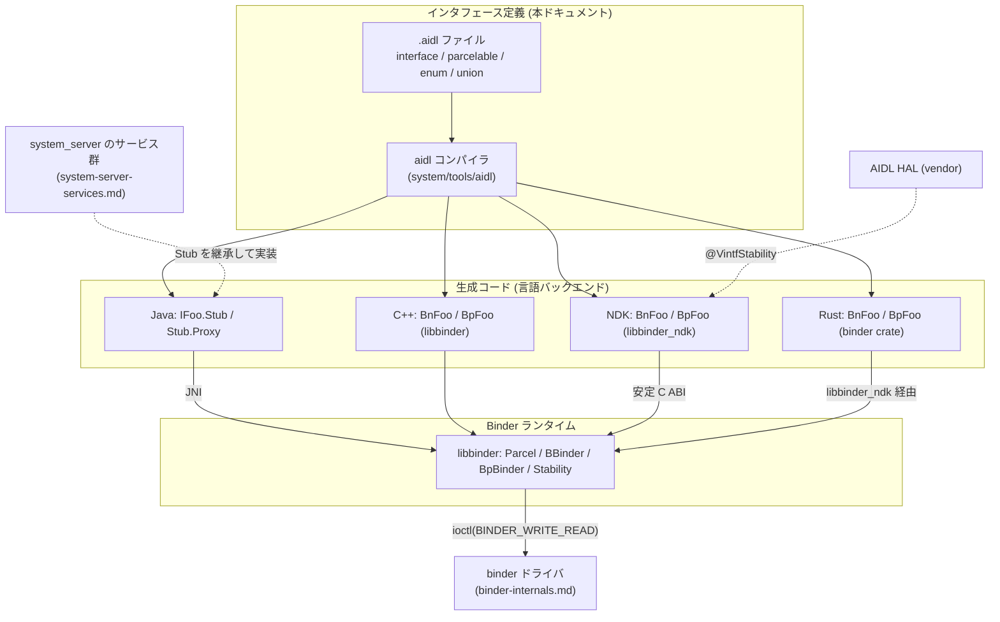
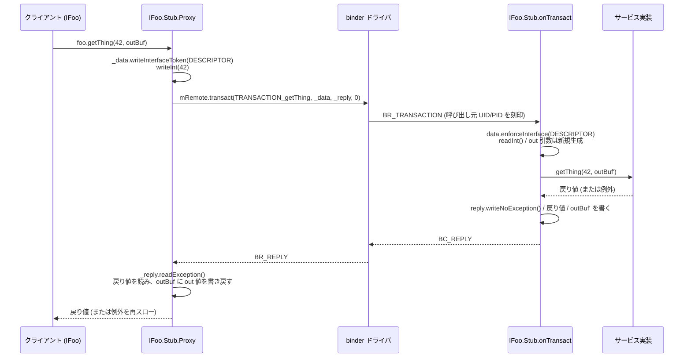

# AIDL — Binder の上のインタフェース定義層 (Android Interface Definition Language)

## 概要 (Overview)

[`binder-internals.md`](binder-internals.md) は Binder を**カーネルドライバ**の側から見た: ハンドル翻訳、1 コピー転送、スレッドプール、死亡通知。しかしドライバが運ぶのは `(対象ハンドル, トランザクションコード (transaction code), Parcel のバイト列)` という三つ組にすぎず、「どのコードがどのメソッドか」「バイト列のどこに何の型が並ぶか」は一切知らない。その**意味づけ**を担うのが **AIDL (Android Interface Definition Language)** である。`.aidl` ファイルに書いたインタフェースから、コンパイラ `aidl` がクライアント側の **Proxy** とサーバ側の **Stub** を生成し、メソッド呼び出しを Parcel への直列化 (marshalling) と `transact()`/`onTransact()` に機械的に変換する。

AIDL は「アプリが Service と話すための道具」として知られるが、実際の最大の利用者は OS 自身である。`IActivityManager`・`IPackageManager`・`IWindowManager` といった system_server のサービス群([`system-server-services.md`](system-server-services.md))、ネイティブデーモン、そして Android 11 以降は HAL (Hardware Abstraction Layer) までもが AIDL で定義される。その結果 AIDL は、単なるスタブ生成器から、**複数の言語バックエンド (Java/C++/NDK/Rust)、パーティション間の安定性 (stability) とバージョン管理、権限検査の宣言**を抱える「インタフェース契約の管理系」へと成長した。

本ドキュメントが答える問い: `.aidl` の 1 行は、どのようなバイト列と switch 文になるのか。`in`/`out`/`inout` と `oneway` はワイヤ上で何を意味するのか。例外はプロセス境界をどう越えるのか。system と vendor が別々に更新される世界で、インタフェースの互換性はどう凍結 (freeze) され検証されるのか。そして、なぜ Parcel の直列化の非対称性が 10 年以上にわたり権限昇格の温床であり続けたのか。分析深度は Level 3。

## 方法論 (Methodology)

- 生成コードの構造は、AOSP の AIDL コンパイラ(`system/tools/aidl` の `generate_java_binder.cpp`・`generate_cpp.cpp`・`generate_ndk.cpp`・`generate_rust.cpp`)と、Java 側ランタイム(`frameworks/base/core/java/android/os/{Binder,Parcel,IBinder}.java`)、ネイティブ側(`frameworks/native/libs/binder/{Parcel,Status,Stability}.cpp`)のクラス・メソッド名で参照する。行番号は改訂で動くため記載しない。以下のコード片はすべて**説明用に簡略化した骨格**であり、AOSP からの逐語引用ではない。
- 仕様の一次資料は source.android.com の AIDL 文書群(overview・backends・stable AIDL・AIDL for HALs・annotations)と developer.android.com の AIDL ガイドである。なお本稿執筆環境からは source.android.com への直接取得がネットワーク制限で不可能だったため、同サイトの記述は検索インデックス上の本文抜粋で照合し、developer.android.com(AIDL ガイド・`Parcel` リファレンス)は直接取得して確認した。
- セキュリティ面は、Google 自身の発表(Black Hat Europe 2022「Android Parcels: The Bad, the Good and the Better」)、実証エクスプロイトの一次記述(CVE-2023-45777 の作者による writeup)、査読論文(CCS 2025)を三点で突き合わせた。
- 書籍 有野 (2017) は Binder を Ⅰ巻 1.3・Ⅱ巻 1.4 の速習節で扱い、ActivityThread と system_server の境界(`ApplicationThread`)を Ⅱ巻 5.4 で扱う。当時(Android 7.0 Nougat)の姿を基準線とし、技術詳細 §8 に差分表を置く([`../../references/books/book-android-internals-arino.md`](../../references/books/book-android-internals-arino.md))。

## 発見事項 (Findings)

1. **AIDL の本質は「メソッド ↔ 整数コード」と「引数 ↔ Parcel 上の順序」の二つの対応表を、両端に同一に焼き込むことである。** 各メソッドは宣言順に `IBinder.FIRST_CALL_TRANSACTION`(= 1)からの連番を割り当てられ、引数は宣言順に書かれ同じ順に読まれる。Parcel 自体は自己記述的 (self-describing) ではないため、**両端の生成コードがずれた瞬間に、型検査なしで誤った値が読まれる**。互換性管理(stable AIDL)とセキュリティ(parcel mismatch)の問題は、どちらもこの一点から生じている。
2. **インタフェーストークン (DESCRIPTOR) は宛先確認であって認証ではない。** Proxy はすべての呼び出しの先頭に `writeInterfaceToken(DESCRIPTOR)` を書き、Stub は `enforceInterface(DESCRIPTOR)` で照合する。これは「このトランザクションは本当にこのインタフェース宛てか」を検査するだけで、トークンは誰でも書ける。**呼び出し元の正当性は `Binder.getCallingUid()` による権限検査でしか担保されない**。
3. **`oneway` はインタフェースの形を決める設計判断である。** system_server がアプリを呼ぶ `IApplicationThread` やウィンドウへの通知 `IWindow` は `oneway interface` として定義され、system_server のスレッドが応答の遅いアプリに引きずられない。一方アプリ → system_server の `IActivityManager` 等は基本的に同期である。「特権側から非特権側へは oneway」という非対称が、Android の可用性設計の骨格を成す([`binder-internals.md`](binder-internals.md) §4)。
4. **例外は Parcel の応答ヘッダとして運ばれ、許された型だけが境界を越える。** 応答 Parcel の先頭 int が 0 なら正常、負値なら例外コードで、`Parcel.writeException()` が文書化した型(`SecurityException`・`IllegalArgumentException`・`IllegalStateException`・`NullPointerException`・`BadParcelableException`・`NetworkOnMainThreadException` など)と `ServiceSpecificException`(サービス定義の int エラーコード)だけが呼び出し元で再構成される。任意の例外型は越えられない——**エラーもまた型付きの契約の一部**である。
5. **バックエンドは 4 系統あり、「安定かどうか」で使い分けが決まる。** Java、C++(`libbinder`)、NDK(`libbinder_ndk`、Android 10〜)、Rust(Android 12〜、`libbinder_ndk` の上に構築)。`libbinder` の C++ ABI はプラットフォーム内部用で安定ではないため、vendor パーティションや APEX など**プラットフォームと別に更新されるコードは NDK か Rust バックエンドを使う**。
6. **Stable AIDL は「インタフェースの凍結とハッシュ」で system/vendor の独立更新を可能にした。** `aidl_interface` モジュールは API のスナップショットを `aidl_api/<name>/<version>/` に凍結し、以後の変更は追記のみに制限される。実行時には `getInterfaceVersion()`/`getInterfaceHash()` で相手の版を問い合わせられる。HIDL (Android 8.0〜) が担っていた HAL の安定インタフェースは Android 11 から AIDL でも書けるようになり、Android 13 で HIDL は非推奨になった。
7. **Parcel 直列化の非対称性は、10 年以上続いた権限昇格の一大クラスである。** `writeToParcel` と `createFromParcel` が読み書きするバイト数が食い違う Parcelable が 1 つでもあると、system_server が検査した Bundle と、再直列化後に受信側が読む Bundle の中身が変わりうる(Bundle mismatch / "self-changing Bundle")。これが AccountManager 経由の LaunchAnyWhere 型攻撃を繰り返し成立させた。Android 13 の **LazyValue(遅延 Bundle)と型付き `getParcelable(key, Class)`** は個別修正ではなく根本原因への対策として導入されたが、2023 年にもその回避(CVE-2023-45777)が実証され、2025 年の査読研究は新たに 10 件の高深刻度脆弱性を報告している。

## アーキテクチャ (Architecture)

### 層構成 — 3 つのドキュメントの分担



凡例: 実線は生成・呼び出しの依存、点線は「利用者」の関係。`subgraph` は責務の境界を表す。

- **ドライバは型を知らない、AIDL は輸送を知らない**。この分担により、同じ `/dev/binder` の上で Java のアプリと Rust のデーモンと C++ の HAL が相互に呼び合える。言語間の互換性はバックエンドが**同一のワイヤ形式 (wire format)** を生成することで保証される。
- **stability は libbinder の実行時属性でもある**。`@VintfStability` なインタフェースから生成された Binder オブジェクトには libbinder の `Stability` クラスが「VINTF 安定」の印を付け、system 内部専用の Binder を vendor 側コンテキストへ渡すとトランザクションが拒否される。コンパイル時の凍結と実行時の印の二重で境界を守る。

### 1 回の呼び出しの一生 — Proxy から Stub まで



- 同一プロセス内では `Stub.asInterface()` が `queryLocalInterface(DESCRIPTOR)` で実装オブジェクト自体を返すため、Proxy もドライバも通らない直接呼び出しになる。developer.android.com のガイドは「ローカルプロセスからの呼び出しは呼び出し元と同じスレッドで実行される」「`oneway` をローカル呼び出しに付けても同期のまま」と明記している。

## 技術詳細 (Technical Details)

### 1. `.aidl` の構文と生成コード

- **定義できるもの**: `interface`(メソッド集合)、`parcelable`(構造化データ)、`enum`(`@Backing(type="int")` 等で基底型を指定)、`union`、定数(`const int`/`const String`)。サポート型は Java のプリミティブ(developer.android.com のガイドによれば `short` を除く)、`String`・`CharSequence`、配列、`List`・`Map`、他の AIDL インタフェースと parcelable、`IBinder`、`ParcelFileDescriptor` である。
- **生成される Java の骨格**(`generate_java_binder.cpp` の出力を説明用に簡略化):

**File**: `system/tools/aidl/generate_java_binder.cpp` が生成する `IFoo.java`(生成器のクラス/関数単位で参照、逐語引用ではない)
**Purpose**: Stub/Proxy/asInterface/トランザクションコードの関係を示す

```java
// Illustrative skeleton of Java code generated from IFoo.aidl (simplified, not verbatim).
public interface IFoo extends android.os.IInterface {
  public static abstract class Stub extends android.os.Binder implements IFoo {
    public static final String DESCRIPTOR = "com.example.IFoo";
    static final int TRANSACTION_getThing = IBinder.FIRST_CALL_TRANSACTION + 0;
    public static IFoo asInterface(IBinder obj) {
      IInterface iin = obj.queryLocalInterface(DESCRIPTOR);   // same process -> direct object
      return (iin instanceof IFoo) ? (IFoo) iin : new Proxy(obj);
    }
    @Override public boolean onTransact(int code, Parcel data, Parcel reply, int flags) {
      // token check for user transaction codes, then switch(code) -> unmarshal -> call -> marshal
    }
    private static class Proxy implements IFoo { private IBinder mRemote; /* marshal -> transact */ }
  }
  int getThing(int id, out ThingBuffer buf) throws RemoteException;
}
```

- **トランザクションコードの空間**: ユーザ定義メソッドは `FIRST_CALL_TRANSACTION`(0x00000001)〜`LAST_CALL_TRANSACTION`(0x00ffffff)。それ以外に `IBinder` は予約コード(`INTERFACE_TRANSACTION`・`PING_TRANSACTION`・`DUMP_TRANSACTION`・`SHELL_COMMAND_TRANSACTION` など、ASCII 文字を詰めた値)を持ち、`Binder.onTransact` の既定実装が処理する。`adb shell dumpsys` や `adb shell cmd` がサービスごとに動くのはこの予約コードのおかげである。メソッドには `void foo() = 5;` のように明示 ID も付けられる。**宣言の並べ替えはコードの付け替えを意味する**ため、既存インタフェースでは末尾追加しか許されない。
- **`asInterface` の型安全は片側だけ**: クライアントが得るのは型付きの `IFoo` だが、サーバ側 `onTransact` に届くのは任意プロセスが組み立てた任意の `(code, Parcel)` である。生成コードの読み出しは「期待する順に読む」だけであり、Parcel が期待と違えばそのまま誤読する。

### 2. 方向タグ `in`/`out`/`inout` と `oneway`

- **方向タグ**: developer.android.com のガイドによれば、非プリミティブ引数には方向タグが必須で、プリミティブ・`String`・`IBinder`・AIDL インタフェースは `in` 固定である。`in` はリクエスト Parcel だけに書かれ、`out` はサーバ側で**新しいオブジェクト**を生成して応答 Parcel で書き戻し、`inout` は往復とも直列化する。ガイドは「直列化は高価なので必要最小限の方向に限れ」と勧める。`out` の値はクライアント側の既存オブジェクトに `readFromParcel` で上書きされる——Java の参照渡しの見かけを、2 回のコピーで模倣しているにすぎない。
- **`oneway`**: `oneway void notify(...)` またはインタフェース全体を `oneway interface` と宣言する。生成コードは `transact` に `IBinder.FLAG_ONEWAY` を立て、応答 Parcel を持たない。したがって **oneway メソッドは戻り値も `out`/`inout` も例外の伝搬も持てない**。ドライバ側の意味論(同一ノード宛ての FIFO、非同期バッファの半分という背圧)は [`binder-internals.md`](binder-internals.md) §4 に譲る。

### 3. Parcelable — 非構造化と構造化

- **非構造化 (unstructured) parcelable**: `.aidl` には `parcelable Rect;` と宣言だけを書き、実体は手書きの Java クラス(`writeToParcel`・`describeContents`・`CREATOR`)や C++ ヘッダ(`cpp_header`)に置く。直列化の正しさは**書き手の規律**に依存し、読みと書きの非対称がそのまま §7 の脆弱性クラスになる。`Intent`・`Bundle`・`Configuration` などフレームワークの主要型はこの形である。
- **構造化 (structured) parcelable**: Android 10 以降、`parcelable Rect { int left; int top; ... }` とフィールドを `.aidl` に書けば、読み書きの両方が生成される(developer.android.com AIDL ガイド)。生成コードはデータの前に**全体サイズ**を書き、読み手は既知のフィールドを読み終えたらサイズ分の末尾へ位置を進める。これにより (a) 古い読み手は新しい版で末尾に追加されたフィールドを安全に読み飛ばせ(前方互換)、(b) 1 つの parcelable の誤読が後続データへ波及しにくい。stable AIDL では構造化 parcelable のみが使え、非構造化型は Java 限定の例外(`@JavaOnlyStableParcelable`)を除き許されない。

### 4. バックエンド — Java・C++・NDK・Rust

| バックエンド | ランタイム | 利用可能時期 | ABI 安定性 | 主な用途 |
|---|---|---|---|---|
| Java | `android.os.Binder`/`Parcel`(JNI で libbinder へ) | 初期から | SDK として安定 | アプリ、system_server |
| C++ (`cpp`) | `libbinder`(`BnFoo`/`BpFoo`、`binder::Status`) | Nougat 期以前から AOSP 内で利用 | **不安定**(プラットフォーム内部専用) | system パーティションのネイティブデーモン |
| NDK (`ndk`) | `libbinder_ndk`(`AIBinder`、`ndk::ScopedAStatus`) | Android 10 | 安定 C ABI | vendor・APEX・HAL |
| Rust (`rust`) | `binder` crate(`libbinder_ndk` の上) | Android 12 | 安定(NDK 経由) | 新規のシステムデーモン・HAL |

- すべて同じワイヤ形式を生成するため、**バックエンドの選択はプロセスごとの実装都合であり、相手側の言語とは無関係**である。
- Rust バックエンドが `libbinder_ndk` の上に作られた理由は、安定 ABI に乗ることで APEX や vendor からも使えるようにするためであり、同時に Parcel の読み書きやオブジェクト寿命の扱いからメモリ安全性違反のクラスを型で排除する狙いがある([`binder-internals.md`](binder-internals.md) のセキュリティ考察)。

### 5. Stable AIDL と HAL — 凍結・版・ハッシュ

- **ビルド定義**: Soong の `aidl_interface` モジュールがインタフェース群を束ね、`stability: "vintf"`(現時点で唯一のサポート値)、`versions_with_info`(Android 13 で導入、凍結済みの版と依存関係)、生成するバックエンドを宣言する。API を凍結するには `m <module>-freeze-api` を実行し、`aidl_api/<module>/<version>/` にスナップショットと `.hash` が作られる。**凍結済みディレクトリは以後決して編集してはならず、編集できるのは `current` だけ**である。
- **許される変更**: 新しい版で許されるのは、メソッドの末尾追加、parcelable フィールドの末尾追加(既定値つき)、enum 値・定数の追加など、**既存のコード番号とバイト配置を動かさない追記**に限られる。ビルドは `current` と最新の凍結版を比較し、後方非互換な変更を拒否する。
- **実行時の版交渉**: Android 10 以降、stable インタフェースにはメタメソッド `getInterfaceVersion()` と `getInterfaceHash()` が自動生成され、クライアントは相手の実装版を問い合わせて自分の知る版と比較できる(C++ なら `IFoo::VERSION` と `foo->getInterfaceVersion()` の比較)。これらはユーザ定義の番号空間の上端付近の固定コードに割り当てられ、メソッドの追加でずれない。古い実装に新しいメソッドを呼んだ場合は `UNKNOWN_TRANSACTION` が返り、クライアントは機能の不在として扱う。
- **凍結前 (unfrozen) の版**: 開発中の `current` 版は、リリース構成では使用できないよう制御される(release flag による「未凍結インタフェースの使用可否」の切り替え)。出荷端末で「凍結されていない契約」が system と vendor の間に紛れ込むことを防ぐ仕組みである。
- **HIDL → AIDL**: HIDL は Android 8.0 (Treble) で HAL 用に導入され `/dev/hwbinder` と `hwservicemanager` を使った。Android 11 で AIDL による HAL が可能になり、Android 13 で HIDL は非推奨となり新規 HAL は AIDL のみとなった。AIDL HAL は `@VintfStability` を付け、`android.hardware.foo.IFoo/default` のような「完全修飾インタフェース名/インスタンス名」で **通常の `servicemanager`(`/dev/binder`)** に登録され、vendor の VINTF マニフェストに `format="aidl"` の `<hal>` として宣言される。VTS がマニフェストと実装の整合を検証する。HAL と framework が同じ IDL・同じツールチェーンを共有するようになったことが最大の効果である。

### 6. system_server における AIDL — サービスの形

- **サービス = Stub のサブクラス**: `ActivityManagerService extends IActivityManager.Stub`、`PackageManagerService` 系の `IPackageManager.Stub` 実装、`WindowManagerService extends IWindowManager.Stub` のように、system_server の主要サービスは生成 Stub を継承して `ServiceManager.addService("activity", ...)` で登録される。アプリ側は `ServiceManager.getService()` → `IXxx.Stub.asInterface()` で得た Proxy を `ActivityManager` などの SDK マネージャクラスで包んで使う。どのサービスがどの順で起動されるかは [`system-server-services.md`](system-server-services.md) を参照。
- **逆向きのインタフェース**: system_server はアプリに `IApplicationThread`(ライフサイクル指示の受け口、`oneway interface`)を、ウィンドウに `IWindow`(リサイズ・フォーカス等の通知、`oneway interface`)を実装させて呼び返す。アプリ側ではこれらが Binder スレッドで届き、Handler で UI スレッドへ乗り換える([`looper-handler-message-loop.md`](looper-handler-message-loop.md) §5、[`app-components-lifecycle.md`](app-components-lifecycle.md))。
- **`@hide` と非 SDK インタフェース**: `IActivityManager` 等の AIDL は SDK 非公開であり、アプリが反射で直接 Proxy を叩く行為は非 SDK インタフェース制限の対象である。公開契約は SDK マネージャクラスであって AIDL ではない——AIDL の自由な変更(メソッド追加・並べ替え)は、この非公開性によって可能になっている。

### 7. 例外の伝搬と権限検査の宣言

- **応答ヘッダ**: 生成 Stub は正常時に `reply.writeNoException()`(int 0)を書き、Proxy は `_reply.readException()` でヘッダを読んで負の例外コードなら対応する例外を再スローする。`Parcel.writeException()` が扱えるのは文書化された型のみで、`ServiceSpecificException` はサービス定義の int コードとメッセージを運ぶ汎用の器である。StrictMode 違反情報やアプリ操作 (AppOps) の記録も、同じ応答ヘッダ領域に特殊コードとして相乗りする。
- **ネイティブ側**: C++ は `binder::Status`(例外コード・サービス固有コード・メッセージ)、NDK は `ndk::ScopedAStatus`、Rust は `binder::Status` を戻り値として返し、Java と同一のヘッダ形式に直列化される。トランスポート層の失敗(相手の死亡 = `DeadObjectException`、`TransactionTooLargeException`)は `RemoteException` 系として区別される。ガイドはクライアントに `DeadObjectException` と `SecurityException` の捕捉を求めている。
- **`@EnforcePermission`**: 従来、各サービスは実装の冒頭で `mContext.enforceCallingOrSelfPermission(...)` を手書きしてきた。近年の AOSP は `.aidl` のメソッドに `@EnforcePermission("MANAGE_USERS")`(`allOf`/`anyOf` も可)を付けると、生成 Stub が `PermissionEnforcer` を保持し `<method>_enforcePermission()` ヘルパを生成する方式を導入した。実装側は同じ注釈を付けてヘルパを先頭で呼び、その対応を lint が静的に検査する。権限を要しないメソッドには `@RequiresNoPermission`、独自検査には `@PermissionManuallyEnforced` を付ける。**「どのメソッドがどの権限を要するか」がインタフェース定義に現れ、機械的に監査可能になった**ことが要点である。

### 8. 何が変わり、何が変わっていないか (2016 Nougat → 現在)

| 機構 | Nougat (書籍) | 現在 (2026) | 変化の理由 |
|---|---|---|---|
| Stub/Proxy と transact の構造 | Binder 速習節(Ⅰ巻 1.3、Ⅱ巻 1.4)の「Proxy が Parcel を詰めて transact、Stub が onTransact で解く」 | **不変**。トークン・コード連番・応答ヘッダの形式も同じ | ワイヤ形式の互換がすべての前提 |
| ActivityManager の IPC | `ActivityManagerNative`/`ActivityManagerProxy` による**手書き**の Java 直列化。`ApplicationThreadNative` も手書き(Ⅱ巻 5.4) | Android 8.0 で `IActivityManager.aidl`・`IApplicationThread.aidl` に移行し生成コード化 | 手書き直列化の保守負担と誤りの排除 |
| ネイティブサービス | 多くが手書きの `BnXxx`/`BpXxx` | AIDL C++/NDK/Rust バックエンドが標準 | 言語間で同じ定義を共有 |
| HAL | legacy HAL(`hw_get_module` の dlopen)、HIDL 以前 | HIDL(8.0)を経て AIDL HAL(11〜)、HIDL は 13 で非推奨 | Treble の安定境界を単一 IDL に統一 |
| データ型 | 手書き Parcelable のみ | 構造化 parcelable(10〜)、enum・union、`@nullable` 等の注釈 | 直列化の自動生成と前方互換 |
| 互換性管理 | なし(同一ビルド内で両端を同時更新する前提) | stable AIDL: 凍結・`.hash`・`getInterfaceVersion`/`getInterfaceHash`(10〜)、`@VintfStability`(11〜) | system/vendor/APEX の独立更新 |
| 権限検査 | 実装内に手書き | `@EnforcePermission` による宣言と lint 検査 | 検査漏れの静的検出 |
| Bundle/Parcel の読み出し | 型なしの `getParcelable(key)`、Bundle は一括デシリアライズ | LazyValue(遅延 Bundle)と型付き `getParcelable(key, Class)`・`readParcelable(ClassLoader, Class)`(API 33) | parcel mismatch クラスの根本対策 |

- **不変の核**: 「両端の生成コードが同じ順序で読み書きする」という契約は 2016 年から変わっていない。変わったのは、その契約を**誰が、どの粒度で保証するか**——手書きから生成へ、同一ビルド前提から凍結とハッシュへ——である。

## セキュリティ考察 (Security Considerations)

- **onTransact は信頼境界である**: Stub に届く `(code, Parcel)` は任意のアプリが構築できる。DESCRIPTOR の照合は宛先確認にすぎず(発見事項 2)、権限検査は `Binder.getCallingUid()`/`getCallingPid()` に基づいて**Binder スレッド上で、処理の最初に**行う必要がある。検査後に `Binder.clearCallingIdentity()` で自分の身元に切り替えて特権操作をする定型は、復元(`restoreCallingIdentity`)を忘れると後続処理が特権で走る「身元取り違え」になる([`security-model.md`](security-model.md))。
- **Parcel mismatch / Bundle mismatch**: 非構造化 Parcelable の `writeToParcel` と `createFromParcel` の非対称(条件分岐で書く/読むフィールド数が違う、型の書き分け誤り等)があると、Bundle を**一度読んで検査し、再直列化して転送する**経路で、検査時と受信時の内容が食い違う。代表例が AccountManagerService の `KEY_INTENT` 検査である: 認証アプリが返した Bundle 中の Intent を system_server が検査し、Settings など特権プロセスがそれを起動する。食い違いを突けば、検査を通った後に任意の非公開 Activity を特権で起動させる **LaunchAnyWhere** 型の攻撃になる。Google は Black Hat Europe 2022 で、Bundle FengShui と呼ばれる既知手法群と、Android 12 上で特権アプリのプロセス内任意コード実行に至る CVE-2021-0928 を分析し、**個々の Parcelable を直すやり方はスケールしない**として根本原因への対策(Safer Parcel)を示した。
- **Android 13 の緩和とその限界**: LazyValue により、受信した Bundle は最初のアクセス時に String キーとプリミティブ値だけをデシリアライズし、非プリミティブ値は**長さ付きのまま**保持・転送される。1 つの値の誤読が後続エントリへ波及しなくなり、mismatch の主要な増幅経路が断たれた。さらに型付き `getParcelable(key, Class)` は、期待型以外のクラスの構築自体を拒む。しかし CVE-2023-45777 は、反射でパーセル用コンストラクタを呼ぶ経路から別クラスを構築させ、隣接する未デシリアライズ LazyValue の型タグを書き換えて Intent の差し替えを再び成立させた。修正は `KEY_INTENT` の読み出しを型付き `getParcelable(AccountManager.KEY_INTENT, Intent.class)` に切り替えることだった。
- **攻撃クラスは閉じていない**: CCS 2025 の Cao らは parcel mismatch を体系的に再検討し、既存緩和の新たな回避とシステムサービスの新しい攻撃連鎖を含む 10 件の未知の高深刻度脆弱性(うち 5 件に CVE)を報告した。構造化 parcelable(サイズ前置・生成コード)と型付き API への移行は有効だが、`Intent`・`Bundle` のような歴史的な非構造化型が残る限り、**「読んで検査し、書き直して渡す」経路は常に監査対象**である。
- **安全でないデシリアライズ**: `Parcel.readSerializable()`、ClassLoader 任せの `readParcelable(ClassLoader)`、`readValue()` は、送信側が指定したクラス名のオブジェクトを受信側で構築する。これは Java シリアライズ一般のガジェット攻撃と同型であり、型付き API(API 33)への置き換えが推奨される。`Parcel` のリファレンス自体が「汎用の直列化機構ではない」と警告している。
- **stability とケイパビリティ**: `Stability` による system/vendor 境界の実行時検査は、互換性だけでなく「vendor プロセスに system 内部の Binder が漏れる」経路を塞ぐ防御でもある。Binder オブジェクトを返すメソッドは権限の委譲であり([`binder-internals.md`](binder-internals.md) のケイパビリティ漏れ)、AIDL の戻り値型に `IBinder` や他インタフェースが現れる箇所はレビューの重点になる。

## 結論 (Conclusions)

- AIDL は、型を知らない Binder ドライバの上に「メソッド ↔ コード」「引数 ↔ Parcel 上の順序」の対応表を両端へ同一に生成する層である。Proxy/Stub・DESCRIPTOR・`FIRST_CALL_TRANSACTION`・応答の例外ヘッダという骨格は Nougat から変わっておらず、Android のすべてのシステムサービスと HAL がこの一つの形式で話す。
- その上に積まれた進化——構造化 parcelable、4 つのバックエンド、stable AIDL の凍結とハッシュ、`@VintfStability`、HIDL の置き換え——はいずれも、**「両端が同じ版の生成コードを持つ」という前提が system/vendor/APEX の独立更新で崩れた**ことへの応答である。
- セキュリティ面では、AIDL の境界は「型付き API の見かけ」と「任意バイト列が届く現実」の差にある。Parcel mismatch の 10 年は、手書き直列化の非対称という小さな誤りが、検査と転送の分離によって権限昇格へ増幅されることを示した。生成コード・長さ前置・型付き読み出し・宣言的な権限検査・Rust 化は、いずれも**書き手の規律に頼る部分を機械に移す**方向の対策である。

### 次の接続先 (Related Topics)

- [`binder-internals.md`](binder-internals.md) — AIDL の下層: ハンドル翻訳、1 コピー転送、oneway の FIFO と背圧、死亡通知。
- [`system-server-services.md`](system-server-services.md) — AIDL の最大の利用者: `IActivityManager`・`IPackageManager` 等を実装するサービス群の起動と構成。
- [`platform-architecture.md`](platform-architecture.md) — Treble と HAL 境界の全体像。
- [`app-components-lifecycle.md`](app-components-lifecycle.md) — `IApplicationThread` の oneway 呼び出しがライフサイクルになるまで。
- [`looper-handler-message-loop.md`](looper-handler-message-loop.md) — Binder スレッドに届いた呼び出しを UI スレッドへ乗り換える仕組み。
- [`security-model.md`](security-model.md) — `getCallingUid` に基づく権限検査と UID サンドボックス。
- [`package-management.md`](package-management.md) — `IPackageManager` の背後にあるパッケージ管理。

## 参考文献 (References)

**一次資料 (Primary — AOSP / Google)**

- AOSP, [AIDL overview](https://source.android.com/docs/core/architecture/aidl) — Accessed: 2026-09-27。
- AOSP, [AIDL backends](https://source.android.com/docs/core/architecture/aidl/aidl-backends) — Accessed: 2026-09-27。NDK バックエンド(Android 10)、Rust バックエンド(Android 12、`libbinder_ndk` 上)、C++ バックエンドの非安定性。
- AOSP, [Stable AIDL](https://source.android.com/docs/core/architecture/aidl/stable-aidl) — Accessed: 2026-09-27。`aidl_interface`、凍結、`getInterfaceVersion`/`getInterfaceHash`、`versions_with_info`。
- AOSP, [AIDL API guidelines](https://source.android.com/docs/core/architecture/aidl/stable-aidl-apis) — Accessed: 2026-09-27。
- AOSP, [AIDL for HALs](https://source.android.com/docs/core/architecture/aidl/aidl-hals) — Accessed: 2026-09-27。Android 11 での導入、`@VintfStability`、VINTF マニフェスト。
- AOSP, [Annotations in AIDL](https://source.android.com/docs/core/architecture/aidl/aidl-annotations) — Accessed: 2026-09-27。`@EnforcePermission` 等の注釈。
- AOSP, [HIDL](https://source.android.com/docs/core/architecture/hidl) — Accessed: 2026-09-27。Android 13 以降の HIDL 非推奨。
- AOSP, `system/tools/aidl`(`generate_java_binder.cpp` ほか)、`frameworks/base/core/java/android/os/{Binder,Parcel,IBinder}.java`、`frameworks/native/libs/binder/{Parcel,Status,Stability}.cpp`. — [android.googlesource.com/platform/system/tools/aidl](https://android.googlesource.com/platform/system/tools/aidl/) — Accessed: 2026-09-27。
- Android Developers, [Android Interface Definition Language (AIDL)](https://developer.android.com/develop/background-work/services/aidl) — Accessed: 2026-09-27。方向タグ、`oneway`、スレッディング、構造化 parcelable(Android 10〜)、例外。
- Android Developers, [Parcel (API reference)](https://developer.android.com/reference/android/os/Parcel) — Accessed: 2026-09-27。`writeException` の対応型、型付き `readParcelable`(API 33)、汎用直列化ではない旨の警告。
- Ke, H., Rufino, B., Uretsky, M. & Yang, Y. (2022). [Android Parcels: The Bad, the Good and the Better — Introducing Android's Safer Parcel](https://i.blackhat.com/EU-22/Wednesday-Briefings/EU-22-Ke-Android-Parcels-Introducing-Android-Safer-Parcel.pdf). *Black Hat Europe 2022* — Accessed: 2026-09-27。Bundle FengShui、CVE-2021-0928、Android 13 の Parcel 強化。

**査読論文・独立検証 (Peer-reviewed / Independent)**

- Cao, S., Zhou, H., Shi, S., Zhao, Y. & Wang, H. (2025). Parcel Mismatch Demystified: Addressing a Decade-Old Security Challenge in Android. *Proceedings of the 2025 ACM SIGSAC Conference on Computer and Communications Security (CCS '25)*. [doi:10.1145/3719027.3765034](https://dl.acm.org/doi/10.1145/3719027.3765034) — Accessed: 2026-09-27。
- Bednarski, M. (2023). [TheLastBundleMismatch — Writeup and exploit for CVE-2023-45777](https://github.com/michalbednarski/TheLastBundleMismatch) — Accessed: 2026-09-27。LazyValue 回避と型付き `getParcelable` による修正。

**二次資料 (Secondary)**

- 有野和真 (2017).『Androidを支える技術〈I〉60fpsを達成するモダンなGUIシステム』技術評論社. ISBN 978-4-7741-8759-4. 1.3 節(Binder の速習)。Android 7.0 Nougat 基準。
- 有野和真 (2017).『Androidを支える技術〈II〉真のマルチタスクに挑んだモバイルOSの心臓部』技術評論社. ISBN 978-4-7741-8861-4. 1.4 節「[速習] UI スレッド/Looper、Handler、Binder」、5.4 節(ActivityThread と ApplicationThread)。
