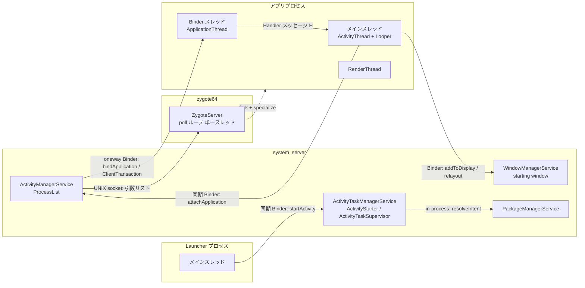
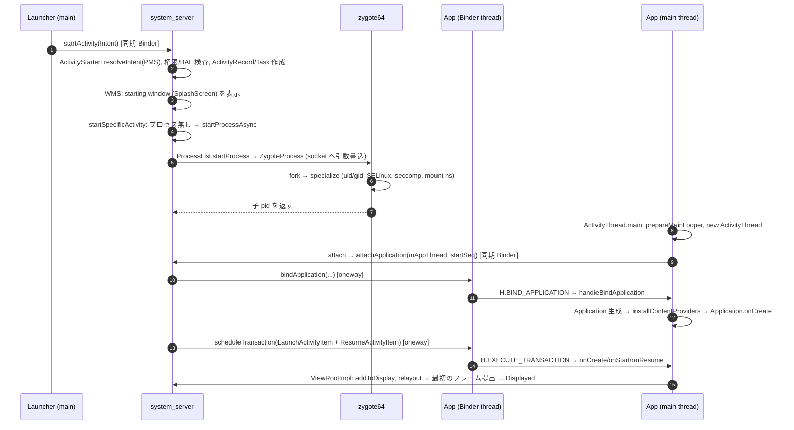

# アプリ起動の全行程 (Cold Start End-to-End: Zygote, ActivityThread & the First Frame)

## 概要 (Overview)

ホーム画面でアイコンをタップしてから最初のフレームが画面に出るまでの**コールドスタート (cold start)** は、Android のほぼ全ての中核機構を**一度ずつ必ず通過する唯一の操作**である。その中核機構とは、Intent 解決 (PackageManager)、タスク台帳 (ActivityTaskManagerService)、プロセス生成 (Zygote)、サンドボックス化 (UID・SELinux・seccomp・マウント名前空間)、Binder、メインスレッドの Looper、ライフサイクル状態機械、ウィンドウと描画パイプラインである。有野 (2017) Ⅱ巻 5.7「アプリの開始を見直す」が第 2〜5 章の総まとめとしてこの経路を選んだのは、それが「OS の心臓部を一筆書きで貫く線」だからである。

本ドキュメントは、この一筆書きを**背骨 (spine)** として、各ホップで「どのプロセスの・どのスレッドが・どの IPC で」動くのかを特定しながら追う。[`app-components-lifecycle.md`](app-components-lifecycle.md) がライフサイクル契約と ClientTransaction を、[`platform-architecture.md`](platform-architecture.md) が Zygote の COW 分岐を概観として扱ったのに対し、本書は**起動経路そのもの**に絞って一段深く潜る。

本ドキュメントが答える問い: なぜアプリのプロセスは `fork` だけで `exec` しないのか。fork 直後の「白紙のプロセス」はどうやって特定のアプリに**なる**のか。ContentProvider はなぜ `Application.onCreate` より先に初期化されるのか。「Displayed +XXXms」は正確に何を測っているのか。2016 年の Nougat から何が変わり、何が変わっていないのか。分析深度は Level 3。

## 方法論 (Methodology)

- 1 回のコールドスタートを **15 のホップ**に分節し、各ホップの担当プロセス (Launcher / system_server / zygote / アプリ)・スレッド (メイン / Binder プール / ProcStart ハンドラ)・通信手段 (同期 Binder / oneway Binder / UNIX ドメインソケット / Handler メッセージ) を特定する。
- 機構のベースラインは 有野 (2017) Ⅱ巻 第 5 章 (5.1〜5.7) と 4.3 (ActivityRecord と Bundle)。同書は Android 7.0 Nougat (android-7.0.0_r6) 準拠で、コードは著者による簡略化擬似コードである。現在の姿は AOSP `frameworks/base` main ブランチ (`ActivityThread.java`, `ZygoteInit.java`, `ZygoteServer.java`, `Zygote.java`, `ProcessList.java`, `ActivityTaskSupervisor.java`) と source.android.com / developer.android.com で確認した (Accessed: 2026-09-27)。AOSP の行番号は main で頻繁に動くため、引用は原則**ファイルパス＋クラス／メソッド名**で示し、検証済みの箇所には GitHub ミラー (`aosp-mirror`, 2025-11 時点のスナップショット) またはリリースタグでの行番号を併記する。
- 時間の数値は、公式の**閾値 (Android vitals)**、公式の**目標値 (ドキュメント)**、ベンダの**効果主張 (Baseline Profiles の約 30%)** を区別し、実測値としては扱わない。
- ライフサイクル・Binder・描画の各機構の内部は既存ドキュメントに委ね、本書は「起動経路上でそれがどう作用するか」だけを扱う。

## 発見事項 (Findings)

1. **アプリのプロセスは「fork された汎用プロセス」が後から身元を得る二段構えで作られる。** Zygote は fork 時点で「どのアプリか」をほとんど知らない (uid・SELinux ラベル・ABI 程度)。APK のパス・Application クラス名・ContentProvider 一覧・初期構成は、子プロセスが `ActivityThread.attach()` で system_server に**名乗り出た後**、`bindApplication` で**逆向きに**届く。有野 (2017) Ⅱ巻 5.1・5.3 が、白紙のプロセスが後からアプリになる過程として説明した構造は現在も同一である。この遅延結合こそが、USAP (事前 fork プール) を可能にした前提である。身元を後から注入できるなら、fork そのものを要求の前に済ませておける。
2. **起動は 3 つの IPC 様式の縫い合わせである。** Launcher→ATMS は同期 Binder、system_server→zygote は **UNIX ドメインソケット上のテキスト引数**、system_server→アプリは oneway Binder (IApplicationThread)、アプリ内部は Handler メッセージ。zygote だけが Binder を使わないのは、fork するプロセスが**マルチスレッドであってはならない** (fork は呼び出しスレッドしか複製しない) からで、Binder スレッドプールを持てない zygote はソケットと `poll` の単一スレッドループで待つ。
3. **ContentProvider は Application.onCreate より先に走り、これが「起動時間の見えない税」の出どころである。** `handleBindApplication` は Application インスタンス生成 → `installContentProviders` → `Application.onCreate` の順に実行する (AOSP main で確認)。provider は他アプリから同期的に問い合わせられうるため、アプリのコードが走る前に公開済みでなければならない。ライブラリが自動初期化のために provider を仕込む慣行はこの順序に便乗したもので、Jetpack **App Startup** は provider を 1 つに束ねてその税を削る応答である。
4. **「最初のフレーム」までに system_server は 2 回、別の理由で待つ。** 一度目はプロセスの `attachApplication` (fork と ART 起動の完了)、二度目は `activityIdle`／最初の描画完了 (Displayed の計測終点)。その間ユーザに見えるのは、アプリのコードが一行も走る前に **system_server (WindowManager) がテーマから描く starting window** であり、Android 12 の SplashScreen API はこの既存機構を全アプリ強制・アイコンアニメーション付きに標準化したものである。
5. **Zygote の設計原理は不変、変わったのは「何本・いつ fork するか」である。** preload → system_server の fork → 要求ループという ZygoteInit の三幕構成は Nougat から同じだが、(a) 64-bit only 端末での単一 zygote64、(b) ブラウザ系の **WebView zygote** とアプリ固有 preload の **app zygote** という「子 zygote」、(c) 事前 fork の **USAP プール** (Android 10〜、AOSP 既定は無効) が加わった。いずれも「共有で速く、分離は後から」という同じ文法の変奏である。
6. **起動の最適化は「実行前に済ませる」方向へ一貫して動いている。** ビルド時 (boot image)、zygote 起動時 (preload)、インストール時 (Baseline Profiles による AOT)、要求前 (USAP) と、仕事を起動のクリティカルパスの**外**へ押し出すのが全手段の共通項である。逆にアプリ側に残る最大の変数は Application／provider／最初の Activity の onCreate であり、公式計測 (TTID/TTFD) もそこに焦点を当てている。
7. **起動経路は同時にサンドボックス確立の経路である。** fork 直後の specialize で uid/gid・capabilities・SELinux ドメイン・seccomp-bpf・マウント名前空間が**アプリのコードをロードする前に**確定する。起動が速いことと隔離が強いことは、この「specialize してから身元を明かす」順序でしか両立しない。

## アーキテクチャ (Architecture)

### 登場人物 — 4 プロセスと 3 種類の IPC



凡例: 実線は IPC／呼び出し、点線はプロセス生成。`ATMS` は Android 10 で AMS から分離されたが、同一 system_server プロセス内にあるため両者間は通常のメソッド呼び出しである。system_server 内のサービス構成は [`system-server-services.md`](system-server-services.md)。

### 背骨 — 15 ホップのシーケンス



ホップ 10 と 13 はどちらも `attachApplication` の処理中に system_server が発行する oneway 呼び出しであり、同一ノード宛て oneway の FIFO 性 ([`binder-internals.md`](binder-internals.md)) によって **bind が launch より必ず先に**アプリへ届く。アプリ側では両者とも Binder スレッドで受けて H (Handler) にメッセージとして積み直し、メインスレッドで直列実行される。有野 (2017) Ⅱ巻 5.4.2 が図 5.2 で示した、ApplicationThread は要求を受けてメッセージとして投げるだけで、実処理は handleXX 系メソッドが担うという図式は、メッセージの中身が ClientTransaction に変わった今もそのまま成立している。

## 技術詳細 (Technical Details)

### 1. system_server 側の前半 — 解決・記録・プロセス判定 (ホップ 1〜4)

- **ホップ 1**: Launcher のメインスレッドが `IActivityTaskManager.startActivity` を**同期**で呼ぶ。system_server 側では Binder スレッドプールの 1 本がこれを受け、`ActivityStarter` が実務を担う。
- **ホップ 2 (Intent 解決)**: `ActivityStarter` は PackageManagerService に Intent を解決させ、対象 `ActivityInfo` (所属パッケージ・uid・launchMode・taskAffinity・テーマ) を得る。同一プロセス内の呼び出しなので IPC は発生しない。書籍 Ⅱ巻 5.7.2 が起動処理の最初の段としてインテントの解決を位置づけた段階で、ここで得た **uid と seinfo** が後の fork 引数になる (パッケージ台帳側は [`package-management.md`](package-management.md))。続いて権限・exported・Background Activity Launch 検査を経て `ActivityRecord` を作り `Task` に積む。
- **ホップ 3 (starting window)**: プロセスの有無と無関係に、WindowManager ([`window-manager.md`](window-manager.md)) が対象 Activity のテーマ (`windowBackground`／Android 12〜は `windowSplashScreen*` 属性) から**アプリのコードを使わずに**描ける窓を先に出す。タップへの視覚応答をアプリの起動速度から切り離す仕掛けである。
- **ホップ 4 (プロセス判定)**: `ActivityTaskSupervisor.startSpecificActivity` が `WindowProcessController` を引き、`wpc.hasThread()` なら既存プロセスへ直接 `realStartActivityLocked` (warm start)、無ければ `mService.startProcessAsync(r, knownToBeDead, isTop, HOSTING_TYPE_TOP_ACTIVITY …)` へ分岐する (AOSP main で確認)。書籍 Ⅱ巻 4.3.4 が説明する、ProcessRecord があれば scheduleLaunchActivity を、無ければ Process.start を呼ぶという二分岐と同じ判断である。**名前が「Async」である点**が重要で、ATMS はここで待たずにロックを手放し、Launcher の同期呼び出しを早く返す。

### 2. Zygote — preload・ソケット・fork (ホップ 5〜7)

- **ZygoteInit の三幕**: init が `app_process` を `--zygote` 付きで起動し (`init.zygote64.rc` 等。init 側は [`boot-init-properties.md`](boot-init-properties.md))、`ZygoteInit.main` は (1) `preload()`、(2) `forkSystemServer`、(3) `zygoteServer.runSelectLoop(abiList)` の順に進む。現在の `preload()` は `preloadClasses` (`/system/etc/preloaded-classes`)、`cacheNonBootClasspathClassLoaders`、`Resources.preloadResources`、HAL・グラフィックスドライバの事前ロード、`preloadSharedLibraries`、`preloadTextResources`、`WebViewFactory.prepareWebViewInZygote` などを呼ぶ (AOSP main で確認)。Nougat の preload (書籍 Ⅱ巻 5.2.3: クラス・リソース・OpenGL・共有ライブラリ・WebView) から品目が増えただけで、「全員が使うものを fork 前に温めて COW で配る」原理は同じ。ページ共有の OS 側は [`../operating-systems/virtual-memory-paging.md`](../operating-systems/virtual-memory-paging.md)、boot image との二段構えは [`art-runtime-internals.md`](art-runtime-internals.md)。
- **ホップ 5 (要求)**: `ProcessList.startProcess` は hosting 種別に応じ 3 経路に分岐する。WebView 用なら `startWebView`、app zygote 指定なら `createAppZygoteForProcessIfNeeded` 後に `appZygote.getProcess().start`、通常は `Process.start` である。いずれもエントリポイントは `"android.app.ActivityThread"` である (AOSP main で確認)。`FLAG_PROCESS_START_ASYNC` が有効なら実際の起動は `mProcStartHandler` スレッドへ投げられ、ソケット往復で ATMS/AMS のロックを握り続けない。
- **ソケット経路**: `ZygoteProcess` は `--setuid=`・`--setgid=`・`--runtime-flags=`・`--seinfo=`・`--nice-name=` 等の文字列引数を `zygote` ソケット (二次 ABI 用は `zygote_secondary`) に書き込む。受け側 `ZygoteServer.runSelectLoop` は名前こそ select だが現在は `Os.poll` で fd 群を待つ単一スレッドループである (AOSP main で確認)。書籍 Ⅱ巻 5.2.4 が解説した、index 0 がサーバソケットで以降が接続という構造は維持されている。
- **ホップ 6 (fork + specialize)**: `Zygote.forkAndSpecialize` の引数 (`uid, gid, gids, runtimeFlags, rlimits, mountExternal, seInfo, niceName, fdsToClose, …, isTopApp, pkgDataInfoList, allowlistedDataInfoList, bindMountAppDataDirs, bindMountAppStorageDirs, …`) がそのまま「specialize で何が確定するか」の一覧である。子プロセス側 (ネイティブ `core/jni/com_android_internal_os_Zygote.cpp`, aosp-mirror snapshot (2025-11) の main) では、まず `ForkCommon` 内で不要 fd を close し (`DetachDescriptors`, line 2485)、続く `SpecializeCommon` (line 1891〜) が次の順で進む: capabilities 境界集合の削減 (`DropCapabilitiesBoundingSet`, 1919) → マウント名前空間の分離とアプリデータ/ストレージの隔離・bind mount (`MountEmulatedStorage` 1928, `isolateAppData`/`isolateJitProfile` 1943-1945, `BindMountStorageDirs` 1951) → setgroups・rlimit (`SetGids`/`SetRLimits`, 1971-1972) → `setresgid` (2001) → **seccomp-bpf** フィルタ (`SetUpSeccompFilter`, 2010) → スケジューラポリシー (2013) → `setresuid` (2015) → capabilities の最終設定 (`SetCapabilities`, 2119) → **SELinux ドメイン遷移** (`selinux_android_setcontext`, 2133; seinfo から `untrusted_app` 系ドメインを決定) → スレッド名設定 (2141)。seccomp が `setresuid` より**前**なのは、フィルタ設置に CAP_SYS_ADMIN が要り、uid を 0 から変えると capabilities が消えるためである (代替の `PR_SET_NO_NEW_PRIVS` は SELinux ドメイン遷移を壊す; 同ファイル 2005-2009 行のコメント)。**uid 変更をスレッド生成前に行う**のは、Linux の資格情報がスレッド単位であり後から生えたスレッドの取りこぼしを防ぐためである。セキュリティモデル上の意味は [`security-model.md`](security-model.md)。
- **ホップ 7 (子の開始)**: 子は `ZygoteInit.zygoteInit` → `RuntimeInit` で Binder スレッドプールを起動 (`onZygoteInit`) し、`ActivityThread.main` を呼ぶ。Nougat は `MethodAndArgsCaller` 例外を投げて**スタックを巻き戻してから** main を呼んでいた (書籍 Ⅱ巻 5.2.2: 例外を setjmp 代わりに使う技巧) が、現在は `runSelectLoop`／`forkSystemServer` が **`Runnable` を返し、`caller.run()`** で実行する素直な形に置き換わった (置換は **Android 8.1**: `ZygoteInit.java` は android-8.0.0_r1 では `catch (Zygote.MethodAndArgsCaller caller) { caller.run(); }` (lines 766-767) だが、android-8.1.0_r1 では `final Runnable caller;` (line 712) に変わり例外クラスへの参照が消えている。main では lines 831/919/932)。
- **USAP プール (Android 10〜)**: zygote が要求前に「specialize していない子」を複数 fork して `usap_pool_primary` ソケットで待たせ、要求が来たら 1 つに身元を注入して払い出す。fork＋子の初期化をクリティカルパスから外す最適化だが、AOSP の `usap_pool_enabled` 既定値は **false** で、`dalvik.vm.usap_pool_enabled` か DeviceConfig で有効化する (`core/java/com/android/internal/os/ZygoteConfig.java` line 37 `USAP_POOL_ENABLED_DEFAULT = false`、`ZygoteServer.java` line 72 `mUsapPoolEnabled = false`; aosp-mirror snapshot (2025-11) の main)。どの端末で有効かはベンダ設定次第であり、一般化はできない。

### 3. アプリ側の前半 — main・attach・bindApplication (ホップ 8〜12)

- **ホップ 8**: `ActivityThread.main` は `Looper.prepareMainLooper()` → `new ActivityThread()` → `thread.attach(false, startSeq)` → `Looper.loop()` (AOSP main で確認)。書籍 Ⅱ巻 5.4.1 の流れと同じで、**このスレッドが UI スレッドになる**のは「main を走らせたスレッドで Looper を回すから」に過ぎない (Looper の機構は [`looper-handler-message-loop.md`](looper-handler-message-loop.md))。コンストラクタで `H` (Handler) と `ApplicationThread` (Binder スタブ) が生成される。
- **ホップ 9 (名乗り出)**: `attach` は `mgr.attachApplication(mAppThread, startSeq)` を**同期 Binder** で呼ぶ。`startSeq` は ProcessList が起動要求ごとに振った番号で、AMS はこれで「どの起動要求の結果として現れたプロセスか」を照合し、同名プロセスの再起動競合や遅れて現れたゾンビを弾く。これは Nougat の擬似コードには現れない、実運用で必要になった照合である。
- **ホップ 10〜11 (bindApplication)**: AMS は `ProcessRecord` に `IApplicationThread` を結びつけ、`linkToDeath` で死亡監視を張り、oneway で `bindApplication(processName, ApplicationInfo, providers, instrumentation, config, …)` を送る。アプリの Binder スレッドはこれを `H.BIND_APPLICATION` (値 110) に詰め替えてメインスレッドへ渡す。書籍 Ⅱ巻 5.5.2 が指摘したとおり、schedule 規約から外れて bindApplication という名前だが実体はメッセージ送信である点は今も同じ。
- **ホップ 12 (handleBindApplication の順序)**: AOSP main で確認できる順序は次のとおり。

  **File**: `core/java/android/app/ActivityThread.java` — `handleBindApplication()` (lines 7406-7720, aosp-mirror snapshot (2025-11) の main; 定義 7406、`makeApplicationInner` 7680、`installContentProviders` 7704、`callApplicationOnCreate` 7720。擬似コード化した要約)
  **Purpose**: アプリ全体の初期化順序
  ```text
  LoadedApk を用意 (APK パス → ClassLoader, Resources)       // ここで初めて「どのアプリか」になる
  app = makeApplicationInner(...)                          // Instrumentation.newApplication → Application.attach(Context)
  if (!restricted mode) installContentProviders(app, providers)  // 各 provider の onCreate
  mInstrumentation.onCreate(...)
  mInstrumentation.callApplicationOnCreate(app)            // Application.onCreate
  ```
  前提: 通常起動 (インストルメンテーション無し・バックアップの restricted mode 無し)。計算量は provider 数 *n* と各 onCreate のコストの和に比例し、すべてメインスレッドで**直列**に走る。書籍 Ⅱ巻 5.5 (図 5.4) の `makeApplication → newApplication` の系列は同一だが、provider の位置づけは本文で強調されていない。provider が先に来る理由は、provider が他プロセスから**同期**に引かれうる公開インタフェースであり、AMS は provider を要求したクライアントを publish まで待たせる設計だからである (Application.onCreate の中で自アプリの provider を使えることの保証でもある)。

### 4. アプリ側の後半 — Activity の生成から最初のフレームまで (ホップ 13〜15)

- **ホップ 13 (realStartActivity)**: `attachApplication` の処理中、RootWindowContainer 経由で待機中の ActivityRecord に対し `realStartActivityLocked` が走り、`LaunchActivityItem` (Intent・ActivityInfo・構成・保存状態 Bundle 等) と、`andResume` なら `ResumeActivityItem` を束ねて `getLifecycleManager().scheduleTransactionItems(thread, true /*shouldDispatchImmediately*/, launchActivityItem, lifecycleItem)` で送る (AOSP main で確認)。Nougat の `scheduleLaunchActivity` 単発 RPC (書籍 Ⅱ巻 5.6.1〜5.6.2) は Android 9 で ClientTransaction に置き換わった。輸送形式の設計論は [`app-components-lifecycle.md`](app-components-lifecycle.md) に譲る。
- **ホップ 14 (Activity の誕生)**: メインスレッドで `H.EXECUTE_TRANSACTION` (値 159) → `TransactionExecutor` → `handleLaunchActivity` → `performLaunchActivity`。ClassLoader で Activity をインスタンス化し、`createBaseContextForActivity` で Context を作り、`activity.attach(...)` で **PhoneWindow と ActivityRecord のトークン**を結びつけ、`onCreate` を呼ぶ。この流れは書籍 Ⅱ巻 5.6.2 の要約 (Activity 生成 → Context 生成 → attach → onCreate → onRestoreInstanceState → onPostCreate) と一致する。続く `ResumeActivityItem` で onStart/onResume、そして `WindowManager.addView` → **ViewRootImpl** 生成。コールドスタートでは `savedInstanceState` は null だが、プロセス死からの復帰 (warm start の一種) では system_server の ActivityRecord が保持していた Bundle (書籍 Ⅱ巻 4.3.2, 図 4.18) がここで LaunchActivityItem に乗って戻る。**生成と再生成は Bundle の有無しか違わない** (Ⅱ巻 4.3.4) という性質は不変である。
- **ホップ 15 (最初のフレーム)**: ViewRootImpl が WMS に `addToDisplay`、最初の traversal で `relayout` して SurfaceControl を得、measure/layout/draw (詳細は [`view-system-layout.md`](view-system-layout.md)) を経て RenderThread がバッファを BLAST で提出する ([`graphics-pipeline.md`](graphics-pipeline.md))。WMS はアプリ窓の描画完了を受けて starting window を除去し、`ActivityMetricsLogger` が **`Displayed <component>: +XXXms`** を記録する。これが TTID (Time To Initial Display) である。非同期読み込みを含めた「使える状態」はアプリ自身が `reportFullyDrawn()` を呼んで申告し、`Fully drawn` として記録される (TTFD)。

### 5. cold / warm / hot の定義と starting window

| 種別 | プロセス | Activity | 本書のホップで省略される区間 | SplashScreen (12〜) |
|------|---------|----------|---------------------------|-------------------|
| cold | 無し | 無し | なし (1〜15 全部) | 表示 |
| warm | あり、または死後に保存状態から再生成 | 無し (onCreate からやり直し) | 5〜12 (プロセスが生きている場合) | 表示 |
| hot | あり | あり (前面に戻すだけ) | 2 の一部・5〜14 | 表示しない |

- 定義は developer.android.com *App startup time* による。プロセスが lmkd に殺された後の Recents 復帰 ([`memory-lmkd.md`](memory-lmkd.md)) は公式定義上 warm に分類されるが、機構的には**プロセス生成を伴う**のでホップ 5〜12 も走る点に注意 (保存状態 Bundle 付きのコールドスタートと見るのが正確)。
- **Android vitals の「過剰」閾値**は cold ≥5 秒、warm ≥2 秒、hot ≥1.5 秒 (TTID 基準、Play Console の警告水準であって目標値ではない)。
- starting window は Nougat 時代から存在した (テーマの windowBackground による「プレビュー窓」)。Android 12 の SplashScreen API は、cold/warm の全アプリに**アイコン中心の定型スプラッシュを強制**し、`windowSplashScreenAnimatedIcon` (AVD、推奨 1,000ms 以下) と `installSplashScreen().setKeepOnScreenCondition` 等で終了タイミングをアプリが延長できるようにした。独自 Splash Activity を挟む慣行は「starting window → 自前 Splash → 本物」と窓を二重化し TTID を悪化させるため、公式に非推奨となった。

### 6. 計測と最適化の道具

- **計測**: logcat の `Displayed`／`Fully drawn`、`adb shell am start -W` (TotalTime/WaitTime)、Macrobenchmark の `StartupTimingMetric`、Perfetto トレースの `android_startup` 派生メトリクス (トレースを開くと自動計算され、メインスレッドの `bindApplication`・`activityStart`・`activityResume`・`installContentProviders` スライスや、fork 前の待ち・Binder 遅延・GC・I/O 待ちに内訳を割り付ける)。Android 15 (API 35) では `ActivityManager.getHistoricalProcessStartReasons` (ApplicationStartInfo) により、アプリ自身が本番環境で起動種別と各段のタイムスタンプを取得できるようになった。
- **最適化の系統**: (a) **Baseline Profiles**: 起動経路のメソッドをインストール時に AOT コンパイルさせ、解釈実行と JIT を避ける (公式主張は初回起動からコード実行が約 30% 高速化; ベンダ主張であり端末・アプリ依存)。(b) **App Startup ライブラリ**: 各ライブラリが個別に仕込んでいた ContentProvider を単一の `InitializationProvider` に集約し、依存順を宣言的に解決、不要なものは遅延初期化 (発見事項 3 の税の削減)。(c) Application／最初の Activity の onCreate からの遅延初期化・メインスレッドの Binder 同期呼び出しとディスク I/O の排除 (StrictMode で検出)。(d) プラットフォーム側では preload・USAP・プロセス起動の非同期化・起動中プロセスの top-app cgroup/優先度ブースト ([`process-thread-model.md`](process-thread-model.md)、[`../operating-systems/process-thread-scheduling.md`](../operating-systems/process-thread-scheduling.md))。

### 7. 何が変わり、何が変わっていないか (2016 Nougat → 現在)

| 機構 | Nougat (書籍) | 現在 (AOSP main / Android 16 世代) | 変化の理由 |
|------|--------------|----------------------------------|-----------|
| 起動要求の受け手 | ActivityManagerService / ActivityStackSupervisor (Ⅱ巻 5.5.3 図 5.4) | ActivityTaskManagerService / ActivityStarter / `ActivityTaskSupervisor` (Android 10 で ATMS 分離、12 で改名) | ウィンドウ・タスク管理を WM 側へ寄せ、AMS をプロセス/サービス管理に絞る責務分割 |
| プロセス生成要求 | AMS (ActivityStackSupervisor 経由) 内で同期に `Process.start` (Ⅱ巻 4.3.4。ATMS は Android 10 で分離) | `startProcessAsync` → ProcStart ハンドラで非同期、zygote policy flag 付き | ソケット往復中に巨大ロックを握らない (起動と他操作の相互ブロック回避) |
| zygote 構成 | 32/64 の 2 zygote 構成が一般的 (`init.zygote32.rc` 等, Ⅱ巻 5.2.1 注 5) | 64-bit only 端末は zygote64 単独 (Pixel 7 以降等)、加えて WebView zygote・app zygote | 32-bit アプリ廃止に伴う常駐メモリ削減、用途別 preload の分離 |
| fork のタイミング | 要求到着後に fork | USAP プールで要求前に fork 可能 (Android 10〜、AOSP 既定は無効) | fork＋初期化をクリティカルパス外へ |
| 子で main を呼ぶ方法 | `MethodAndArgsCaller` 例外でスタックを巻き戻す (Ⅱ巻 5.2.2) | `Runnable` を返して `caller.run()` | 例外を制御フローに使う技巧の解消、可読性 |
| 要求ループ | `select` (`selectReadable`) | `Os.poll`、USAP 補充イベントも同じループで処理 | fd 数と用途の増加 |
| specialize | setuid/setgid・SELinux・rlimit が中心 (Ⅱ巻 5.2.5) | 加えて seccomp-bpf (Android 8.0〜; `SetUpSeccompFilter` は android-8.0.0_r1 の Zygote.cpp に初出、7.1.2_r1 には無い)、アプリデータ/ストレージのマウント名前空間分離 (Android 11〜; `isolateAppData` は android-11.0.0_r1 に初出、10.0.0_r1 には無い)、`isTopApp` 優先度 | 攻撃面の縮小とアプリ間のファイル可視性の遮断 |
| Activity 起動指示 | `scheduleLaunchActivity` 単発 oneway RPC → `H.LAUNCH_ACTIVITY` (Ⅱ巻 5.6) | `LaunchActivityItem`+`ResumeActivityItem` の ClientTransaction → `H.EXECUTE_TRANSACTION` (Android 9〜; `core/java/android/app/servertransaction/ClientTransaction.java` は android-9.0.0_r1 に存在し 8.1.0_r1 には無い) | 目標状態の宣言による順序問題の解消 |
| 起動画面 | テーマ windowBackground のプレビュー窓 | SplashScreen API で全アプリ定型化 (Android 12〜) | 体感速度の均質化、独自スプラッシュによる二重窓の排除 |
| コード準備 | dex2oat の AOT/プロファイル (Ⅰ巻 第 7 章) | Baseline Profiles + Cloud Profiles でインストール時 AOT | 初回起動から最適化済みコードを得る |
| **不変** | zygote の preload→fork (COW) → ActivityThread.main → attach → bindApplication → Activity 生成 → 最初のフレームという骨格、「白紙のプロセスが後から身元を得る」遅延結合、Binder スレッドで受けて Handler でメインスレッドへ回す構造、保存 Bundle が system_server 側に残る設計 | — | バッテリー・メモリ制約下で「共有で速く、分離は後から」を両立する根本解が依然これしかない |

## セキュリティ考察 (Security Considerations)

- **Zygote は全アプリの共通祖先であり、最も価値の高い標的の一つである。** zygote は root 権限でソケットを待ち、渡された uid/seinfo で子を specialize する。したがって zygote ソケットへの書込権限 (system_server 等に限定、SELinux で強制) と、引数パーサの堅牢性が決定的に重要になる。CVE-2024-31317 (Android 9〜14、2024-06 のセキュリティパッチで修正) では、グローバル設定 `hidden_api_blacklist_exemptions` の値が system_server によって zygote への**改行区切りの引数プロトコル**にエスケープなしで埋め込まれたため、設定書込権限 (WRITE_SECURE_SETTINGS 相当、adb shell 等) を持つ者が任意 uid・SELinux ドメインの子を zygote に作らせることができた (Meta Red Team X の分析)。この事例は、「specialize を他者に指示させる経路」が特権昇格面になることを示す。
- **COW 共有は ASLR の弱体化と引き換えである。** 全アプリが同じ zygote のアドレス空間レイアウトを継承するため、あるアプリ内でライブラリのアドレスを知れば他アプリのものも推測できる。USAP や子 zygote は分岐点を増やすが、根本的な再ランダム化ではない ([`platform-architecture.md`](platform-architecture.md) の「速さのための共有と分離のための多様性の緊張」)。
- **specialize の順序がサンドボックスの正しさを決める。** uid 変更・seccomp・SELinux 遷移のいずれかがアプリコードのロード後にずれ込めば、その間は zygote の資格情報でアプリコードが走る。fd の閉じ忘れも同種で、source.android.com は「allowlist にない fd が fork 時に残っている」ことを SELinux 拒否や I/O 異常の原因として明示的に警告している。fd は権限そのもの ([`binder-internals.md`](binder-internals.md) のケイパビリティ論) だからである。
- **ContentProvider の先行初期化は、起動時の攻撃面でもある。** exported な provider はアプリの UI が一度も出ないまま外部からの問い合わせでプロセスを起動させ、Application.onCreate より前にコードを走らせる。provider の exported・permission 設定の誤りは「起動していないはずのアプリ」を叩く経路になる ([`security-model.md`](security-model.md))。
- **起動時間は情報でもある。** 他アプリの起動・前面遷移のタイミングは、`/proc` の可視性制限や GET_TASKS 廃止によって隠されてきた。Android 15 の ApplicationStartInfo が**自アプリの**起動履歴に限定されているのも同じ方針の延長にある。

## 結論 (Conclusions)

- コールドスタートは「fork 済みの汎用プロセスが、specialize で囲われ、attach で名乗り出て、bindApplication で身元を与えられ、ClientTransaction で最初の Activity を持たされる」という**遅延結合の連鎖**である。2016 年の Nougat から現在まで、この基本構造・順序・スレッドの役割分担は変わっていない。
- 変わったのは、基本構造の周りで仕事を**クリティカルパスの外へ押し出す**工夫 (非同期のプロセス起動、USAP、子 zygote、Baseline Profiles、SplashScreen による視覚応答の先取り) と、specialize の中身 (seccomp・マウント名前空間) の強化である。速度と隔離の双方が、同じ「specialize してから身元を明かす」順序の上に積み増されてきた。
- アプリ開発者が制御できる区間は、ホップ 12 (provider と Application.onCreate) とホップ 14〜15 (最初の Activity と最初のフレーム) にほぼ集約される。公式の TTID/TTFD、Perfetto の起動メトリクス、App Startup ライブラリはいずれもこの 2 区間に照準を合わせており、機構の理解はそのまま計測の読み方になる。

### 次の接続先 (Related Topics)

- [`app-components-lifecycle.md`](app-components-lifecycle.md) — ClientTransaction・二重の台帳・状態保存の三層。本書ホップ 13〜14 の意味論。
- [`platform-architecture.md`](platform-architecture.md) — Zygote/COW・lmkd・SELinux を含む全体像。
- [`binder-internals.md`](binder-internals.md) — 同期/oneway・FIFO・linkToDeath。ホップ 1・9・10・13 の輸送層。
- [`looper-handler-message-loop.md`](looper-handler-message-loop.md) — `ActivityThread.main` が回す Looper と H の機構。
- [`view-system-layout.md`](view-system-layout.md) / [`graphics-pipeline.md`](graphics-pipeline.md) — ホップ 15 以降、最初のフレームの中身。
- [`input-pipeline.md`](input-pipeline.md) — タップが Launcher に届くまで (ホップ 1 の手前)。
- [`package-management.md`](package-management.md) — Intent 解決と uid/seinfo の出どころ。
- [`memory-lmkd.md`](memory-lmkd.md) — 起動後の oom_adj 更新と、プロセス死からの warm start。
- [`boot-init-properties.md`](boot-init-properties.md) — init が zygote を起動するまで。
- [`art-runtime-internals.md`](art-runtime-internals.md) — boot image・AOT/JIT・プロファイル。Baseline Profiles の基盤。
- [`security-model.md`](security-model.md) — uid サンドボックス・SELinux・seccomp の位置づけ。
- [`process-thread-model.md`](process-thread-model.md) — fork 後のスレッド構成と top-app cgroup への移動。
- [`system-server-services.md`](system-server-services.md) — ホップ 1〜4 を担うサービス群の起動と配置。
- [`window-manager.md`](window-manager.md) — starting window と addToDisplay/relayout の WMS 側。

## 参考文献 (References)

**一次資料 (Primary — AOSP / Android 公式)**

- AOSP ソース `platform/frameworks/base` (main): `core/java/android/app/ActivityThread.java` (`main`, `attach`, `handleBindApplication`, `H.BIND_APPLICATION`, `H.EXECUTE_TRANSACTION`)、`core/java/com/android/internal/os/ZygoteInit.java` (`preload`, `main`)、`core/java/com/android/internal/os/ZygoteServer.java` (`runSelectLoop`, `fillUsapPool`)、`core/java/com/android/internal/os/Zygote.java` (`forkAndSpecialize`, ソケット名)、`services/core/java/com/android/server/am/ProcessList.java` (`startProcess`)、`services/core/java/com/android/server/wm/ActivityTaskSupervisor.java` (`startSpecificActivity`, `realStartActivityLocked`). — [android.googlesource.com/platform/frameworks/base](https://android.googlesource.com/platform/frameworks/base/+/refs/heads/main) — Accessed: 2026-09-27。
- AOSP, *About the Zygote processes*（64-bit zygote、USAP プール、WebView zygote、fork 時 fd の注意）. — [source.android.com/docs/core/runtime/zygote](https://source.android.com/docs/core/runtime/zygote) — Accessed: 2026-09-27。
- AOSP `ZygoteConfig.java`（`usap_pool_enabled` 既定値 false）. — [android.googlesource.com/…/ZygoteConfig.java](https://android.googlesource.com/platform/frameworks/base.git/+/master/core/java/com/android/internal/os/ZygoteConfig.java) — Accessed: 2026-09-27。
- Android Developers, *App startup time*（cold/warm/hot の定義、TTID/TTFD、`Displayed`、`reportFullyDrawn`、App Startup への言及）. — [developer.android.com/topic/performance/vitals/launch-time](https://developer.android.com/topic/performance/vitals/launch-time) — Accessed: 2026-09-27。
- Android Developers, *App startup time in Android vitals*（過剰判定の閾値 5s/2s/1.5s）. — [developer.android.com/google/play/vitals/launch-time](https://developer.android.com/google/play/vitals/launch-time) — Accessed: 2026-09-27。
- Android Developers, *Splash screens*（Android 12 SplashScreen API、表示条件、AVD 推奨時間）. — [developer.android.com/develop/ui/views/launch/splash-screen](https://developer.android.com/develop/ui/views/launch/splash-screen) — Accessed: 2026-09-27。
- Android Developers, *Baseline Profiles overview*（インストール時 AOT、約 30% の効果主張、Cloud Profiles）. — [developer.android.com/topic/performance/baselineprofiles/overview](https://developer.android.com/topic/performance/baselineprofiles/overview) — Accessed: 2026-09-27。
- Android Developers, *App Startup* ／ *App startup analysis and optimization*（InitializationProvider、Perfetto での bindApplication/activityStart 分析）. — [developer.android.com/topic/performance/appstartup/analysis-optimization](https://developer.android.com/topic/performance/appstartup/analysis-optimization) — Accessed: 2026-09-27。
- Perfetto, `android_startup` メトリクス定義. — [android.googlesource.com/platform/external/perfetto/…/android_startup.sql](https://android.googlesource.com/platform/external/perfetto/+/refs/heads/master/src/trace_processor/metrics/sql/android/android_startup.sql) — Accessed: 2026-09-27。
- AOSP GitHub ミラー `aosp-mirror/platform_frameworks_base`（2025-11 時点のスナップショット; 行番号の出典）: `core/jni/com_android_internal_os_Zygote.cpp` (`ForkCommon`, `SpecializeCommon`) と `ZygoteInit.java`・`ClientTransaction.java` のタグ比較 (android-7.1.2_r1 / 8.0.0_r1 / 8.1.0_r1 / 9.0.0_r1 / 10.0.0_r1 / 11.0.0_r1). — [github.com/aosp-mirror/platform_frameworks_base](https://github.com/aosp-mirror/platform_frameworks_base) — Accessed: 2026-09-27。
- Android Developers, `ApplicationStartInfo` / `ActivityManager#getHistoricalProcessStartReasons`（API 35; START_TIMESTAMP_FORK, BIND_APPLICATION, FIRST_FRAME, FULLY_DRAWN 等）. — [developer.android.com/reference/android/app/ApplicationStartInfo](https://developer.android.com/reference/android/app/ApplicationStartInfo) — Accessed: 2026-09-27。
- Android Security Bulletin—June 2024（CVE-2024-31317 の修正）. — [source.android.com/docs/security/bulletin/2024-06-01](https://source.android.com/docs/security/bulletin/2024-06-01) — Accessed: 2026-09-27。

**二次資料 (Secondary)**

- 有野和真 (2017).『Androidを支える技術〈II〉真のマルチタスクに挑んだモバイルOSの心臓部』技術評論社. ISBN 978-4-7741-8861-4. 第 5 章 (5.1〜5.8: app_process/ZygoteInit、ActivityThread の main/attach/handleMessage、「アプリの開始を見直す」)、4.3 (ActivityRecord と Bundle、プロセス有無による分岐)。Android 7.0 Nougat 準拠・簡略化擬似コード。
- 有野和真 (2017).『Androidを支える技術〈I〉60fpsを達成するモダンなGUIシステム』技術評論社. ISBN 978-4-7741-8759-4. 第 7 章（dex2oat とイメージ共有; Ⅱ巻 5.2.3 注 7 からの参照）。
- Meta Red Team X (2024). *Becoming any Android app via Zygote command injection*（CVE-2024-31317 の技術分析）. — [rtx.meta.security/exploitation/2024/06/03/Android-Zygote-injection.html](https://rtx.meta.security/exploitation/2024/06/03/Android-Zygote-injection.html) — Accessed: 2026-09-27。
