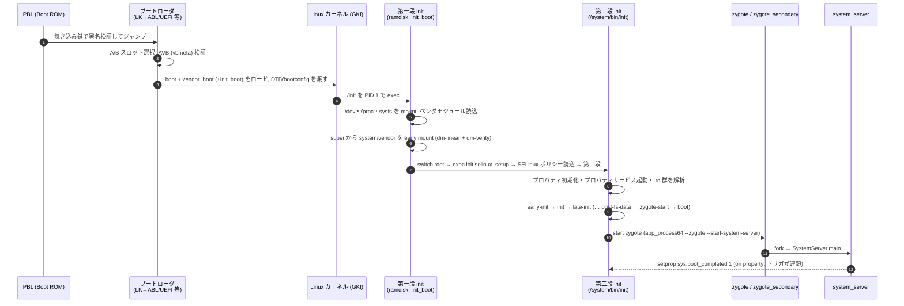

# ブートと init (Bootloader, init, Properties & init.rc)

## 概要 (Overview)

電源投入から Zygote・system_server が立ち上がるまでの区間——**ブートチェーン (PBL → ブートローダ → カーネル) → init (PID 1) → プロパティサービス → init.rc が起動するサービス群**——を、Android 固有の設計判断として読み解く。この区間には Android の二重人格がもっとも濃く出る: 一方では「管理者のいない家電」として勝手に書き換えられず、落ちても自力で立ち直らねばならない（組込みの要件）。他方では OS 全体をあとから安全に差し替え続けねばならない（PC の要件）。有野 (2017) Ⅱ巻 6章はこの緊張を LK ブートローダと Nougat の init を題材に描いたが、以後の 10 年でこの区間は Android でもっとも大きく作り直された場所の一つになった——A/B と Virtual A/B、動的パーティション、GKI と `init_boot`、fastbootd、二段 init、プロパティの SELinux 分割、APEX である。

本ドキュメントが答える問い: なぜブートローダは「署名検証器」であり、アンロックはなぜ全消去を伴うのか。なぜ fastboot の半分はユーザ空間 (fastbootd) に引っ越したのか。なぜ init は二段に割れたのか。なぜ init は systemd ではなく独自の宣言言語 (Android Init Language) とシングルスレッドの epoll ループで作られているのか。プロパティはなぜ「共有メモリ＋単一書き手」なのか。そして Zygote と system_server はどの行から生まれるのか。分析深度は Level 3。

## 方法論 (Methodology)

- 書籍（有野 (2017) Ⅱ巻 6章「ブートローダーと init プロセス」、Ⅱ巻 1.5、Ⅰ巻 1.3.3 / 1.3.7。Android 7.0 Nougat 基準）を**機構のベースライン**とし、現行 AOSP（`system/core/init/`、`system/core/rootdir/`、`bionic/libc/system_properties/`）と source.android.com の仕様を**現在**として、差分と差分の理由を明示する。書籍のコードは著者による簡略化擬似コードであり、実コードの引用は現行 AOSP から行う。
- 時間軸で「ブートチェーン → パーティション/イメージ形式 → init 第一段 → 第二段 → プロパティ → init.rc のサービス起動」と下り、各段で**制約（家電性・更新可能性・Treble 分離・検証可能性）→ 設計**の対応を取る。
- Verified Boot (AVB) の詳細は [`platform-architecture.md`](platform-architecture.md)・[`security-model.md`](security-model.md) に譲り、本書は「ブートローダの状態がどこで信頼の鎖を切るか」に限る。CPU リセット〜DRAM 初期化など SoC 側の一般論は [`../../hardware/hw-sw-interface/boot-initialization.md`](../../hardware/hw-sw-interface/boot-initialization.md) を参照する。
- バージョン依存の機構には導入版を付記する（「Android 10〜」等）。ベンダ固有部（ブートローダ実装）は公開情報の範囲に留め、確度を明記する。

## 発見事項 (Findings)

1. **ブートローダの本職は「読み込み」ではなく「拒否」である。** 書籍 (Ⅱ巻 6.2.2) は LK の仕事を HW 初期化、署名検証、カーネル/DT/RAM ディスクのロードとして整理し、アンロックとは署名検査を外すことだと述べる。この骨格は不変だが、現在の署名検証は AVB の vbmeta 連鎖に一般化され、ブートローダは検証結果（green/yellow/orange）を**カーネル以降と鍵アテステーションに申告する**立場になった。アンロックが**必ず工場出荷状態へのリセットを伴う**のは、「署名検査を外した者」が「既存データの持ち主」とは限らないからで、仕様は RAM の残存内容の消去まで要求する。
2. **fastboot の半分がユーザ空間へ移ったのは、パーティションが「論理」になったからである。** Android 10 の動的パーティションで system/vendor/product 等は `super` 上の dm-linear 論理デバイスになり、ブートローダはそのメタデータ (liblp) を解釈しない。そこで書き込みは recovery 内の **fastbootd** が担い、ブートローダは bootloader・radio・boot/recovery 系の物理パーティションだけを扱い、動的パーティションへの書き込みは**拒否しなければならない**。「ブートローダは小さく検証に専念、複雑な処理はテスト可能な共通ユーザ空間へ」という分業である。
3. **init は二段に割れ、第一段の仕事は「本物の init を検証済みストレージから連れてくること」になった。** Nougat の init は RAM ディスクをルートとして最後まで使い、単一の `main()` が mount・プロパティ・init.rc を順に処理した。現在は ramdisk（Android 13〜は `init_boot` の汎用 ramdisk）上の**第一段 init** が `/dev`・`/proc` 等を用意し、カーネルモジュールを載せ、`super` から system/vendor を**early mount**（dm-verity 付き）して switch root し、`/system/bin/init selinux_setup` → SELinux ポリシー読み込み → **第二段 init** と exec し直す。カーネルが論理パーティションを読めない以上、ルートを組み立てるのはユーザ空間しかない。
4. **init のメインループは書籍の時代から「単一スレッド・epoll・一回に一コマンド」のまま**である。変わったのは周辺: SIGCHLD は書籍の socketpair 自己パイプ方式から **signalfd** に置き換わり、`ReapAnyOutstandingChildren` が epoll の**最優先コールバック**として登録される（死んだ子を回収してから他のイベントを処理する順序保証）。プロパティサービスは init 本体から**別スレッドに切り出され**、ctl. メッセージだけがキュー経由で本体ループに渡る。
5. **プロパティは「全員が読める共有メモリ、書くのは init だけ」という単一書き手の設計で、現在は SELinux ラベルごとに領域が分割されている。** 書籍は `/dev/__properties__` を単一ファイルとして mmap する姿を描くが、実際には書籍が準拠する Android 7.0 の時点で既にこれが**ディレクトリ**になっており（bionic `libc/bionic/system_properties.cpp` @ android-7.0.0_r6: `context_node::open` (lines 748-770) が `"%s/%s"` で `property_filename`/コンテキスト名のファイルを開き、`/property_contexts` を読む `initialize_properties()` (line 944) を持つ。android-6.0.1_r1 の同ファイルにはこの仕組みが無い）、`property_contexts` のラベルごとに別の prop_area ファイルがあり、各プロセスは読む権限のある領域だけを read-only で mmap する。書き込みは `/dev/socket/property_service` への要求を init が `selinux_check_access` で検査して反映する。**読みは速く（システムコールなし）、書きは中央集権で監査可能**——読み書き比が極端に偏ったデータに対する最適な割り切りである。
6. **Treble はプロパティと init.rc を「パーティションの持ち物」に分けた。** init.rc は `/system/etc/init/hw/init.rc` を起点に `/system/etc/init`・`/system_ext`・`/vendor`・`/odm`・`/product` の各 `etc/init/` と APEX の `/apex/*/etc/` に分散し、プロパティも `vendor.`/`ro.vendor.` 等の名前空間と partition 別 `property_contexts` で所有者が分かれ、**sysprop** がパーティション境界をまたぐものに型付き API を与える。書籍が Nougat の新機能として紹介した .rc ファイルの分割読み込み (Ⅱ巻 1.5.1, 6.5.1) は、Treble の前夜に置かれた最初の一手だった。
7. **init は Android の「管理者」であり、その哲学は 10 年間変わっていない。** 書籍 (Ⅱ巻 6.5.5) が強調するように、ソケットと依存再起動 (onrestart) を init が一元管理するため各デーモンは自分の仕事だけに集中でき、OOM Killer に殺されても系全体が自己修復する、という設計は現行 `init.zygote64.rc` にもそのまま残る。変化は**失敗時の行き先**で、critical サービスの連続クラッシュ時の再起動先は書籍時点の recovery から既定で **bootloader** になり、さらに A/B 端末では「起動に成功しないスロットは使わない」ブートカウンタ（boot control HAL）がもう一段外側の自己修復になった。

## アーキテクチャ (Architecture)

### 電源投入から system_server まで



### パーティションとイメージ — 書籍の時代と現在

```
 Nougat (書籍 Ⅱ巻 6.1.2)            現在 (Android 13〜 発売機の典型)
 ┌─────────┐                         ┌──────────────────────────────┐
 │ aboot   │ LK ブートローダ         │ xbl/abl 等 (物理, _a/_b)       │ ブートローダ
 │ boot    │ kernel+DT+ramdisk(=/)   │ boot_a/_b      GKI カーネル    │ header v4
 │ recovery│ kernel+recovery ramdisk │ init_boot_a/_b 汎用 ramdisk    │ 第一段 init
 │ cache   │ OTA/recovery 作業域     │ vendor_boot_a/_b ベンダ ramdisk│ +DTB+モジュール
 │ system  │ /system (ro, ext4)      │ vbmeta_a/_b   AVB の根         │
 │ userdata│ /data                   │ super ┬ system_a/_b  ┐        │ 動的パーティション
 └─────────┘                         │       ├ vendor_a/_b  ├ dm-linear│ (Virtual A/B は
                                     │       ├ product/system_ext/odm┘│  COW スナップショット)
                                     │ userdata (/data, FBE)          │
                                     └──────────────────────────────┘
```

- 書籍の図 6.1（ヘッダ・カーネル・DT・RAM ディスク）は boot image v0 系の姿。現在の **header v3/v4** ではベンダ依存物（DTB・ベンダ ramdisk・モジュール）が `vendor_boot` に出て、`boot` は Google 署名の GKI カーネルだけ、さらに Android 13 からは汎用 ramdisk が `init_boot` に分離された。**「誰が署名し、誰が更新するか」ごとにイメージを割った**結果である（カーネルは Google、ramdisk の汎用部は AOSP、ベンダ部は SoC/OEM）。

## 技術詳細 (Technical Details)

### 1. ブートチェーンとブートローダの世代交代

- **PBL**（SoC 内 Boot ROM）は書き換え不能な信頼の起点で、eFuse の公開鍵ハッシュで次段を検証する（一般論は [`../../hardware/hw-sw-interface/boot-initialization.md`](../../hardware/hw-sw-interface/boot-initialization.md)）。
- 書籍は Nexus 系の **LK (Little Kernel)** を、署名付きイメージのロード、Device Tree、fastboot の 3 機能を持つ Android ブートローダのリファレンスとして扱う（Ⅱ巻 6.2.1）。以後 Qualcomm 系は Snapdragon 835 世代前後から **XBL (UEFI ファームウェア) ＋ ABL**（EDK II 上の EFI アプリ LinuxLoader。fastboot と Linux ローダを含む）へ移行した（二次資料による。確度: 中〜高）。他 SoC ベンダは U-Boot 派生や独自実装で、**ブートローダの実装は依然ベンダ依存**である。統一されたのは実装ではなく**契約**——AVB の検証手順、boot image ヘッダ形式、A/B の boot control、fastboot プロトコル、ロック状態の意味論——である。
- 以前はカーネルで行っていたことの多くがブートローダ側に移っている、と書籍 (Ⅱ巻 6.2.4) が観察した傾向は、GKI で逆向きの力を受けた: カーネルを汎用化するため、**機種差はブートローダが渡す DTB/DTBO・bootconfig とベンダモジュールに押し出され**、カーネル本体は機種非依存になった。

### 2. A/B・Virtual A/B・動的パーティション — 「更新」を起動系に組み込む

- **A/B (Android 7.0〜, シームレス更新)**: 起動系パーティションを 2 組持ち、OTA は非アクティブスロットへ書き込み、再起動でスロットを切り替える。boot control HAL がスロットごとの「起動成功」フラグと残り試行回数を管理し、成功しないスロットは自動でロールバックされる。書籍が説明する、`cache`/`recovery` を使い再起動後に recovery が書き換える方式との差は、**更新中も端末が使え、失敗しても旧スロットで起動できる**点にある。
- **動的パーティション (Android 10〜)**: `super` 内の liblp メタデータに論理パーティションの範囲を記録し、第一段 init が dm-linear で仮想ブロックデバイスを組む。書き換え単位のサイズを OTA ごとに変えられ、A/B でも `super` は 1 つ（メタデータを 2 組持つ）。対象は system/vendor/product/system_ext/odm で、ブートローダが読む boot・dtbo・vbmeta は物理のまま。
- **Virtual A/B (Android 11〜 発売機で GMS 要件)**: 動的パーティションを二重に持つ代わりに、新スロットを **COW スナップショット**（`/data` 上）として書き、起動成功を確認してから基底パーティションへマージする。Android 12 で独自 COW 形式による圧縮、13 で XOR 圧縮と `snapuserd`（dm-user 経由のユーザ空間ブロックデバイス）によるマージが入った。公式資料の目安で一時領域は A/B の約 9GB に対し圧縮 Virtual A/B で約 2.1GB。**物理的に二重なのはブートローダが使うパーティションだけ**になった。
- 帰結として、第一段 init は「スナップショットを重ねた論理デバイスを組み立て、dm-verity を載せてから mount する」**ストレージスタックの組立工**になった（ブロック層の一般論は [`../operating-systems/block-io-stack.md`](../operating-systems/block-io-stack.md)）。

### 3. fastboot と fastbootd

- 書籍 (Ⅱ巻 6.2.3) の fastboot は LK 内の USB プロトコル実装で、`flash`/`erase`/`boot`/`oem unlock` 等を扱った。現在は **fastboot プロトコル＝ホスト側 `fastboot` コマンド**は同じまま、実装が二か所に分かれる: ブートローダ内の fastboot（`getvar is-userspace` = no）と、recovery 内で動く **fastbootd**（= yes, Android 10〜）。`fastboot reboot fastboot` でブートローダは BCB に `boot-fastboot` を書いて recovery を起動し、fastbootd が `create-logical-partition`/`resize-logical-partition` 等を含む論理パーティション操作を担う。
- アンロックの正式コマンドは `fastboot flashing unlock`（書籍表 6.2 の `oem unlock` はベンダ拡張の旧名）で、Developer options の「OEM ロック解除」(`get_unlock_ability`) が許可していなければ拒否される。ブートローダ・fuse 等の critical 領域は別途 `flashing unlock_critical` と**物理ボタン操作**を要する。

### 4. init 第一段 — ルートを組み立てる

- `system/core/init/first_stage_init.cpp` の `FirstStageMain` は、tmpfs `/dev`・proc・sysfs・selinuxfs を mount し、`LoadKernelModules` で ramdisk 内のベンダモジュールを読み込み、`DoFirstStageMount` で fstab（DT もしくは ramdisk 内）に従い system/vendor 等を early mount する。最後に `/system/bin/init` を `selinux_setup` 引数で exec し、SELinux ポリシーを（system と vendor の分割ポリシーから）読み込んだうえで第二段として再 exec する。
- **system-as-root との関係**: Android 9 までの A/B 端末ではカーネルが system を直接ルートとして mount した。Android 10 でルートファイルシステムは ramdisk から system.img に統合され（system-as-root が全端末の既定に）、しかし論理パーティションはカーネルが読めないため、**「ramdisk の第一段 init が system を mount し、switch root する」**形に落ち着いた。RAM ディスクが最後までルートであり続けるという、書籍 (Ⅱ巻 6.1.3) が Android の特徴として挙げた点は、現在は成り立たない。
- なぜこの順序か: SELinux ポリシーは system と vendor の両方にまたがるため、**両方が mount されるまでポリシーを確定できない**。一方、第二段以降のすべての exec はドメイン遷移を伴うべきである。そこで「最小限の mount → ポリシー読込 → ラベル付き世界で第二段を開始」という三段階が必然になる。

### 5. init 第二段 — epoll ループ・SIGCHLD・サービス管理

```
 SecondStageMain (system/core/init/init.cpp, 要約)
   PropertyInit()                 … prop_area 群を作成し build.prop 等を読み込む
   InstallSignalFdHandler(&epoll) … SIGCHLD を signalfd で受ける
   StartPropertyService(...)      … 別スレッドでソケットを待つ
   LoadBootScripts(am, sm)        … /system/etc/init/hw/init.rc → 各 partition の etc/init
   am.QueueEventTrigger("early-init"); … ("init"); … ("late-init" or "charger")
   loop:
     am.ExecuteOneCommand()       … キューから 1 コマンドだけ実行
     HandleProcessActions()       … restart_period・timeout_period の期限処理
     epoll.Wait(timeout)          … 先頭コールバック = ReapAnyOutstandingChildren
     HandleControlMessages()      … ctl.start/stop/restart を 1 件処理
```
（擬似コード。関数名は現行 AOSP `init.cpp` に対応。計算量: 1 反復あたり O(1) コマンド＋準備完了 fd 数に比例）

- **一回に一コマンド**の設計は書籍時点から不変で、長い action が他のイベント（子の死・プロパティ変化）を飢えさせないための協調的スケジューリングである。代償として `exec`/`wait_for_prop` のような同期コマンドはループ全体を待たせるため、`exec_start`・`wait_for_prop` の使用箇所（apexd-bootstrap、odsign 検証待ち）は**起動時間のクリティカルパス**として意識的に配置されている。
- **SIGCHLD**: 書籍 (Ⅱ巻 6.3.4) はシグナルハンドラが socketpair に 1 バイト書き、epoll 側で読み捨てて `ReapAnyOutstandingChildren` を呼ぶ「自己パイプ」方式を説明する。現在は signalfd で同じ目的（非同期シグナルを同期イベントに変換）をより素直に達成し、さらに **reap を他の epoll イベントより先に**行う。これは「死んだデーモンの再起動要求が、死亡の回収より先に処理される」競合を防ぐためと AOSP のコメントが明記している。
- **サービスの死と再起動**: `Service::Reap` は（oneshot でなければ）プロセスグループを kill し、ソケットを片付け、`onrestart` を実行し、`SVC_RESTARTING` を立てる。実際の再起動はメインループが `restart_period`（既定 5 秒）後に行う。critical サービスは「fatal crash window（既定 4 分）内、または `sys.boot_completed` 前に 4 回超」の終了で端末を再起動し（`system/core/init/service.cpp` lines 356-383、窓の既定値は `service.h` line 189 `fatal_crash_window_ = 4min`; aosp-mirror snapshot (2025-11) の main）、行き先はサービスの `target=` 指定が無ければ `system/core/init/reboot_utils.cpp` line 40 の既定値 `init_fatal_reboot_target = "bootloader"`（カーネルコマンドライン/bootconfig の `androidboot.init_fatal_reboot_target` で上書き可, lines 65-78）。書籍時点のコード（`service.cpp` @ android-7.0.0_r6 lines 43-44, 136）は `CRITICAL_CRASH_THRESHOLD 4`／`CRITICAL_CRASH_WINDOW (4*60)` で `android_reboot(..., "recovery")` だった。なお現行は 24 時間以内に同理由の再起動済みなら再起動しない抑制 (`persist.init.svc.last_fatal_reboot_epoch`) も持つ。`init.zygote64.rc` は zygote 自身に `critical window=... target=zygote-fatal` を指定し、行き先をさらに細かく制御する。
- **ueventd**: 同じ init バイナリの別エントリで、カーネルの uevent を受けて `/dev` ノードを作り、`ueventd.rc` に従い権限と SELinux ラベルを付け、ファームウェア読み込み要求に応える。起動直後は既存デバイスの uevent を再生させる **coldboot** を行い、init は `wait_for_coldboot_done` でその完了を待つ——書籍のコード (Ⅱ巻 6.3.2) にも現れる同期点である。

### 6. Android Init Language — 宣言的な依存記述

```
 # system/core/rootdir/init.zygote64.rc（先頭 7 行と末尾 1 行を抜粋）
 service zygote /system/bin/app_process64 -Xzygote /system/bin --zygote --start-system-server --socket-name=zygote
     class main
     priority -20
     user root
     group root readproc reserved_disk
     socket zygote stream 660 root system
     socket usap_pool_primary stream 660 root system
     critical window=${zygote.critical_window.minute:-off} target=zygote-fatal
```
**File**: `system/core/rootdir/init.zygote64.rc`（AOSP main, 2026-09-27 参照）
**Purpose**: Zygote の起動定義。書籍 (Ⅱ巻 6.5.5) の 32bit 版 `app_process -Xzygote … --start-system-server` から、64bit 化・USAP プール用ソケット・task_profiles・critical 窓が加わった。

- 言語の要素は書籍どおり **action（`on <trigger>` ＋コマンド列）・trigger（イベント／`property:<name>=<value>`）・service（名前・実行ファイル・オプション）・import** の 4 つ。現在のオプションには `seclabel`・`capabilities`・`task_profiles`（Android 12〜、cgroup 設定の抽象化で `writepid` を置換。[`process-thread-model.md`](process-thread-model.md) 参照。Android 14 からはメインスレッドだけでなくプロセス全体に適用）・`interface`（提供する AIDL/HIDL サービスの宣言。servicemanager の遅延起動と連動）・`updatable`（APEX による上書きを許す）・`restart_period`・`timeout_period` 等が加わった。
- **ソケットを init が作る理由**（書籍の主張、現在も有効）: init がソケットを作り fd を環境変数 `ANDROID_SOCKET_<name>` で子に渡すので、デーモンは特権なしで listen でき、異常終了後も init が確実に後始末して再起動できる。現在はこれに SELinux ラベル付けが加わり、「どのドメインがこのソケットに connect できるか」までを init.rc＋ポリシーで宣言する。
- **起動順序**: `late-init` が `early-fs → fs → post-fs → late-fs → post-fs-data → zygote-start → early-boot → boot` を順に trigger する。`post-fs-data` では apexd が `/data` 上の更新済み APEX を含めて活性化し、`wait_for_prop apexd.status activated` で待つ（ART 自体が APEX であるため、Zygote より前に済ませる必要がある）。`zygote-start` は odsign（On-device Signing による ART 成果物の検証）の完了を待ってから `start zygote` / `start zygote_secondary` を実行する。
- **APEX と .rc**: APEX はモジュール内の `etc/*.rc` を持ち込み、`updatable` なサービスを置き換えられる。書籍時点の、init.rc は system イメージと一体であるという前提が崩れ、**サービス定義もモジュール単位で更新可能**になった（Mainline、[`package-management.md`](package-management.md)）。
- **Zygote → system_server**: `--start-system-server` を受けた ZygoteInit が最初に system_server を fork し（UID system）、以後 Zygote はソケットでアプリの fork 要求を待つ。system_server は起動フェーズ（[`system-server-services.md`](system-server-services.md)）を経て起動完了時に `sys.boot_completed=1` を設定し、`on property:sys.boot_completed=1` の action 群が連鎖する。アプリ起動側の続きは [`app-launch-end-to-end.md`](app-launch-end-to-end.md)。

### 7. プロパティサービス — 共有メモリと単一書き手

- **格納**: `/dev/__properties__/` 配下に `property_contexts` のラベル（例: `u:object_r:vendor_default_prop:s0`）ごとの prop_area ファイルと、名前→ラベルの対応表 (`property_info`) を置く。bionic の読み手は必要な領域を read-only で mmap し、名前をトライで引く。更新は serial（上位 8 ビットに値長、dirty ビット）と acquire/release 順序で整合を取り、`__system_property_wait` は serial 上の **futex** で変更を待つ——書籍 (Ⅱ巻 6.4.3) の「listener」の現在の下回りである。
- **書き込み**: クライアント（`setprop`、`SystemProperties.set`、libc の `__system_property_set`）は `/dev/socket/property_service` に名前と値を送る。init のプロパティスレッドは送信元の資格情報 (SO_PEERCRED/SELinux コンテキスト) で `CheckMacPerms`（`selinux_check_access`）を行い、`ro.` は**既に設定済みなら拒否**、`ctl.` は値を持たず init 本体への制御メッセージ（`CheckControlPropertyPerms` で対象サービスごとの権限も検査）、`persist.` は `/data/property/persistent_properties`（protobuf）に書き出す。現行コードは system_server 用の専用ソケットも別に持つ。
- **名前空間の意味論**: `ro.*` は一度きり（書籍の説明どおり）。ただし `ro.` は PROP_VALUE_MAX (92 バイト) の制限を免除され長い値を持てる（旧 API `__system_property_get` では読めない）。`persist.*` は再起動を越える。`ctl.start/stop/restart` は書籍が詳述した start/stop コマンドの実体（Ⅱ巻 6.4.2）で、現在は `ctl.` による任意サービス操作に SELinux の `start`/`stop` 権限が要る。
- **Treble と sysprop**: vendor 側は `vendor.`・`ro.vendor.`・`persist.vendor.`・`ro.odm.` 等の接頭辞に閉じ、system/vendor の `property_contexts` は別ファイルで管理される。パーティションをまたいで読まれるプロパティは `.sysprop` 記述から型付き API（Java/C++）を生成し、**文字列キーの暗黙契約を ABI 化**する（Android 10 で導入: 生成ツール `system/tools/sysprop` は android-10.0.0_r1 タグに存在し、android-9.0.0_r1 タグは存在しない）。

### 8. 何が変わり、何が変わっていないか (2016 Nougat → 現在)

| 機構 | Nougat (書籍) | 現在 | 変化の理由 |
|------|--------------|------|-----------|
| ブートローダ | LK（aboot）、署名検証＋DT＋fastboot | ABL/UEFI・U-Boot 派生等（ベンダ依存）＋AVB 2.0 の vbmeta 連鎖 | 検証対象の増加（system/vendor まで）とロールバック保護の標準化 |
| boot イメージ | ヘッダ＋kernel＋DT＋ramdisk（v0 系） | header v3/v4、`boot`（GKI）/`vendor_boot`/`init_boot`（13〜）に分割 | 署名者・更新者ごとの分離（GKI、Treble） |
| パーティション | aboot/boot/recovery/cache/system/userdata | A/B スロット、`super` 動的パーティション、Virtual A/B（COW） | シームレス・ロールバック可能な OTA と容量効率 |
| fastboot | ブートローダ内のみ、`oem unlock` | ブートローダ fastboot ＋ recovery 内 fastbootd、`flashing unlock` | 論理パーティションはユーザ空間でしか扱えない |
| ルート FS | ramdisk が最後までルート | 第一段 init が system を mount して switch root | 動的パーティション・system-as-root・検証済みルート |
| init の構造 | 単一 `main()`、C→C++ 移行直後 | first stage → selinux_setup → second stage、ueventd も同一バイナリ | early mount と SELinux ポリシー確定の順序制約 |
| SIGCHLD | シグナルハンドラ＋socketpair（自己パイプ） | signalfd、reap を epoll の先頭コールバックに | 簡潔化と「回収前の再起動要求」競合の排除 |
| critical 失敗時 | 4 分 4 回で recovery へ | 既定 bootloader、窓・行き先を設定可能、A/B ロールバック | 自己修復の外側に「旧スロットへ戻る」層が追加 |
| .rc 配置 | Nougat で `/system`・`/vendor`・`/odm` の etc/init 分割が始まる | `hw/init.rc` 起点＋system_ext/product/APEX、`interface`/`updatable` | Treble・Mainline でサービス定義もパーティション/モジュール所有に |
| プロパティ格納 | 書籍は単一 `/dev/__properties__` を mmap と記述（ただし 7.0 のコード自体は既にラベル別分割） | SELinux ラベル別 prop_area（7.0〜）、futex 待ち、長い `ro.` 値 | 読み取り権限の細粒度化と情報漏えい面の縮小 |
| プロパティ書込 | init 本体ループ内でソケット処理 | 専用スレッド、persist は protobuf、system_server 用ソケット | init 本体の応答性と永続化の堅牢化 |
| 不変のもの | epoll 単一ループ・一回一コマンド、init がソケットと再起動を一元管理、action/trigger/service の宣言言語、ctl. による制御、`--start-system-server` による Zygote 起点 | 同左 | 「管理者のいない家電」という要件は変わっていない |

## セキュリティ考察 (Security Considerations)

- **ロック状態は信頼の鎖の「スイッチ」である。** unlocked（orange）では AVB が改変イメージの起動を許すため、以後の SELinux・dm-verity・Keystore の保証はすべて「攻撃者が書いたカーネル」の善意に依存する。だから (a) 状態遷移は全消去を伴い、(b) Keymint/鍵アテステーションは Verified Boot 状態を証明書に刻み、リモートが unlocked を検出できる（[`security-model.md`](security-model.md)）。critical 領域の解除に物理操作を要するのは、**リモート攻撃が状態遷移を自動化できない**ようにするためである。
- **第一段 init と ramdisk は検証境界の内側にある。** GKI で汎用 ramdisk が `init_boot` に分かれたことで、第一段 init は Google/AOSP 側の署名単位になり、vendor_boot のベンダ ramdisk とは別の vbmeta 記述子で検証される。early mount は dm-verity を張った状態で行われ、**「検証されていないブロックを一度も読まずにルートを組む」**ことが二段 init の安全上の意味である。書籍の root 化手順（system に setuid の su を置く）は、dm-verity と system の読み取り専用・検証済みマウントにより、ロック状態のままでは成立しない。
- **プロパティは権限境界であり、情報源でもある。** 書籍 (Ⅱ巻 6.5.4) が紹介した、root 権限の action をプロパティトリガで公開して低権限アプリから操作させる手法は、現在では SELinux の `set` 権限でプロパティごとに書き手を限定しなければ権限昇格経路になる。読み取り側でも、ラベル別 prop_area と `property_contexts` によりアプリは許可されたプロパティしか mmap できず、端末識別子等の漏えい面が縮小された。`ctl.` はサービス停止＝可用性攻撃の入口なので、対象サービス単位で権限検査される。
- **init は最大の単一障害点かつ最高権限である。** PID 1 の異常はカーネルパニックに直結し、init の解析器（.rc、プロパティ値、uevent）は外部入力を受ける。第二段以降を SELinux ドメイン `init` に閉じ、プロパティ処理を別スレッド化し、`.rc` の読み込み元を固定のパーティション別ディレクトリに限定したのは、この攻撃面を縮める一連の措置と読める。
- **可用性（自己修復）とセキュリティは緊張する。** critical サービスのクラッシュループが bootloader/recovery に落ちる設計は、攻撃者がサービスを繰り返し殺せば端末を DoS できることも意味する。A/B のスロットロールバックは可用性を高めるが、ロールバック保護（AVB のロールバックインデックス）がなければ脆弱な旧版に戻す攻撃になりうる——両者が必ず対で実装されるのはこのためである。

## 結論 (Conclusions)

- ブートと init は、書籍が描いた、PC のように柔軟でありながら家電のように壊れないという二律背反を解くための機構であり、その**哲学（ブートローダは拒否する、init はすべてのデーモンの管理者である、設定は単一書き手の共有メモリに置く）は Nougat から変わっていない**。
- 変わったのは、それを実装する**単位と境界**である: パーティションは物理から論理へ（動的パーティション・Virtual A/B）、イメージは署名者ごとに（GKI・`vendor_boot`・`init_boot`）、init は制約の順序どおりに二段へ、.rc とプロパティは Treble・Mainline の所有境界ごとに分割された。いずれも「**OS をあとから安全に差し替え続ける**」要件が、起動系の構造そのものに浸透した結果である。
- 書籍の知識は機構の骨格（epoll ループ、Reap と onrestart、action/trigger、ctl. と prop_area）として現在も有効で、差分はほぼすべて「検証可能性」と「更新可能性」の二語で説明できる。

### 次の接続先 (Related Topics)

- [`platform-architecture.md`](platform-architecture.md) — Verified Boot（dm-verity・ロールバック保護）と Treble/APEX の全体像。
- [`security-model.md`](security-model.md) — SELinux ドメイン、鍵アテステーションに刻まれる Verified Boot 状態。
- [`app-launch-end-to-end.md`](app-launch-end-to-end.md) — Zygote 起動後、タップから最初のフレームまで。
- [`package-management.md`](package-management.md) — APEX/Mainline と、`/data` 上のモジュール更新。
- [`memory-lmkd.md`](memory-lmkd.md) — init.rc から起動される lmkd と oom_score_adj（書籍 Ⅱ巻 1.5.3 の lmkd エントリの現在）。
- [`looper-handler-message-loop.md`](looper-handler-message-loop.md) — init の epoll ループと対をなす、アプリ側のイベントループ。
- [`binder-internals.md`](binder-internals.md) — servicemanager と `interface` 宣言による遅延起動。
- [`../../hardware/hw-sw-interface/boot-initialization.md`](../../hardware/hw-sw-interface/boot-initialization.md) — Boot ROM・DRAM 初期化・多段ブートローダの一般構造。
- [`../operating-systems/block-io-stack.md`](../operating-systems/block-io-stack.md) ／ [`../operating-systems/filesystems.md`](../operating-systems/filesystems.md) — device-mapper と early mount の下回り。
- [`system-server-services.md`](system-server-services.md) — SystemServer.main 以降の起動フェーズと sys.boot_completed まで。
- [`process-thread-model.md`](process-thread-model.md) — init.rc の task_profiles と cgroup 階層。

## 参考文献 (References)

**一次資料 (Primary — AOSP / Android 公式)**

- AOSP, *Android Init Language* (`system/core/init/README.md`). — [android.googlesource.com/platform/system/core/+/refs/heads/main/init/README.md](https://android.googlesource.com/platform/system/core/+/refs/heads/main/init/README.md) — Accessed: 2026-09-27。.rc の読み込み順、trigger、service オプション（critical・restart_period・updatable 等）。
- AOSP ソース: `system/core/init/init.cpp`（`SecondStageMain`・`InstallSignalFdHandler`・`LoadBootScripts`）、`first_stage_init.cpp`（`FirstStageMain`・`DoFirstStageMount`）、`property_service.cpp`（`PropertySet`・`CheckMacPerms`・`WritePersistentProperty`）、`persistent_properties.cpp`. — [android.googlesource.com/platform/system/core/+/refs/heads/main/init/](https://android.googlesource.com/platform/system/core/+/refs/heads/main/init/) — Accessed: 2026-09-27。
- AOSP ソース: `system/core/rootdir/init.rc`、`init.zygote64.rc`. — [android.googlesource.com/platform/system/core/+/refs/heads/main/rootdir/](https://android.googlesource.com/platform/system/core/+/refs/heads/main/rootdir/) — Accessed: 2026-09-27。
- AOSP ソース: `bionic/libc/system_properties/`（prop_area・serial・futex 待機）. — [android.googlesource.com/platform/bionic/+/refs/heads/main/libc/system_properties/](https://android.googlesource.com/platform/bionic/+/refs/heads/main/libc/system_properties/) — Accessed: 2026-09-27。
- AOSP, *Boot image header*. — [source.android.com/docs/core/architecture/bootloader/boot-image-header](https://source.android.com/docs/core/architecture/bootloader/boot-image-header) — Accessed: 2026-09-27。
- AOSP, *Generic boot partition* (`init_boot`). — [source.android.com/docs/core/architecture/partitions/generic-boot](https://source.android.com/docs/core/architecture/partitions/generic-boot) — Accessed: 2026-09-27。
- AOSP, *Partition layout* (system-as-root). — [source.android.com/docs/core/architecture/partitions/system-as-root](https://source.android.com/docs/core/architecture/partitions/system-as-root) — Accessed: 2026-09-27。
- AOSP, *Implement dynamic partitions*. — [source.android.com/docs/core/ota/dynamic_partitions/implement](https://source.android.com/docs/core/ota/dynamic_partitions/implement) — Accessed: 2026-09-27。
- AOSP, *Virtual A/B overview*. — [source.android.com/docs/core/ota/virtual_ab](https://source.android.com/docs/core/ota/virtual_ab) — Accessed: 2026-09-27。容量値は公式資料の目安（target 値）。
- AOSP, *Fastboot in userspace* (fastbootd). — [source.android.com/docs/core/architecture/bootloader/fastbootd](https://source.android.com/docs/core/architecture/bootloader/fastbootd) — Accessed: 2026-09-27。
- AOSP, *Lock and unlock the bootloader*. — [source.android.com/docs/core/architecture/bootloader/locking_unlocking](https://source.android.com/docs/core/architecture/bootloader/locking_unlocking) — Accessed: 2026-09-27。
- AOSP, *Add system properties* (namespaces・property_contexts・sysprop). — [source.android.com/docs/core/architecture/configuration/add-system-properties](https://source.android.com/docs/core/architecture/configuration/add-system-properties) — Accessed: 2026-09-27。

**二次資料 (Secondary)**

- 有野和真 (2017).『Androidを支える技術〈II〉真のマルチタスクに挑んだモバイルOSの心臓部』技術評論社. ISBN 978-4-7741-8861-4. — 6章（6.1 パーティションとブートイメージ、6.2 LK と fastboot、6.3 init の main とシグナル処理、6.4 プロパティ、6.5 init.rc）、1.5（init.rc から起動されるサービス）。Android 7.0 基準。
- 有野和真 (2017).『Androidを支える技術〈I〉60fpsを達成するモダンなGUIシステム』技術評論社. ISBN 978-4-7741-8759-4. — 1.3.3（プロパティ）、1.3.6（Zygote）、1.3.7（init.rc から起動されるサービス）。
- Worth Doing Badly, *Comparing Qualcomm's XBL UEFI bootloaders on Snapdragon 820, 835, and 845*. — [worthdoingbadly.com/qcomxbl/](https://worthdoingbadly.com/qcomxbl/) — Accessed: 2026-09-27。LK から XBL/ABL への移行の技術解説（ベンダ一次資料が非公開のため二次資料で補う）。
- Inoki, *Android bootloader analysis — ABL*. — [blog.inoki.cc/2021/10/18/android-bootloader-analysis-abl-1-en/](https://blog.inoki.cc/2021/10/18/android-bootloader-analysis-abl-1-en/) — Accessed: 2026-09-27。ABL が EDK II 上の LinuxLoader.efi であることの解析。
