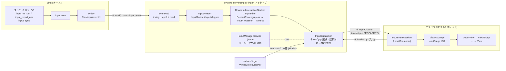

# 入力パイプライン (Touch to View: evdev, InputFlinger & InputChannel)

## 概要 (Overview)

指が画面に触れてから `View.onTouchEvent()` が呼ばれるまでの経路——**タッチコントローラ → カーネル入力サブシステム (input core / evdev) → `/dev/input/eventN` → InputFlinger (EventHub → InputReader → 中間ステージ群 → InputDispatcher) → InputChannel (socketpair) → アプリの InputEventReceiver → ViewRootImpl の InputStage 連鎖 → View ツリー**——を通しで追う。[`graphics-pipeline.md`](graphics-pipeline.md) が「アプリ → 画面」の出力経路であるのに対し、本書はその逆向きの入力経路であり、両者は Choreographer の `CALLBACK_INPUT` → animation → traversal という 1 フレームの先頭で合流する。

有野 (2017) Ⅰ巻 第 2 章は、この経路を「Linux はデバイスをファイルとして公開し、そのファイルと Java の世界の間をシステムサービスが取り持つ」という Android のデバイス対応の典型例として描いた。本書はその Nougat (Android 7.0) 時点の骨格を基準線に置き、**何が変わらず、何が変わったか**——特に InputReader と InputDispatcher の間に挿入された処理段、ウィンドウ情報の出どころの SurfaceFlinger への移動、タッチ遮蔽 (occlusion) によるセキュリティ判定、VSYNC に揃えたバッチングとリサンプリング——を現行 AOSP のソースで確かめる。

本ドキュメントが答える問い: なぜ入力はカーネルから直接アプリへ届かず、system_server 内のサービスを必ず経由するのか。なぜ InputReader と InputDispatcher は別スレッドなのか。アプリへの経路が Binder ではなく socketpair なのはなぜか。「どのウィンドウに届けるか」の判定はどこで、何の情報に基づいて行われ、それがなぜセキュリティ境界になるのか。分析深度は Level 3。

## 方法論 (Methodology)

- 1 回のタップ（DOWN → MOVE… → UP）を軸に、各段の担当プロセス・スレッド・受け渡されるデータ型（`struct input_event` → `RawEvent` → `NotifyMotionArgs` → `InputMessage` → `MotionEvent`）を特定する。
- 基準線は有野 (2017) Ⅰ巻 2.1〜2.6（Linux Input サブシステム、EventHub、InputReader、InputDispatcher と InputChannel）、4.8.3（タッチの送信と InputChannel）、6.5.6（ViewRootImpl が View へタッチイベントを届けるまで）。同書のコードは著者による簡略化擬似コードであるため、クラス名・定数は現行 AOSP（`frameworks/native/services/inputflinger/`、`frameworks/native/libs/input/`、`frameworks/base/core/java/android/view/`、main ブランチ、2026-09-27 参照）で照合し、導入版はリリースタグ（`android-13.0.0_r1` 等）のディレクトリ構成比較で判定した。
- カーネル側は kernel.org の入力サブシステム文書（`input.rst`、`multi-touch-protocol.rst`）を一次資料とする。デバイス側（タッチ IC・HID レポート）は [`../../hardware/peripherals-connectivity/input-devices-hid.md`](../../hardware/peripherals-connectivity/input-devices-hid.md) に委ねる。
- View 階層内部のヒットテスト・レイアウトの詳細は [`view-system-layout.md`](view-system-layout.md)、Looper/epoll の一般機構は [`looper-handler-message-loop.md`](looper-handler-message-loop.md) に委ね、本書は「サービス側の配送判断」と「プロセス境界の越え方」に重心を置く。

## 発見事項 (Findings)

1. **カーネルとの境界は 2016 年から一切変わっていない。** Android は今も `/dev/input` を inotify で監視し、各 `eventN` を epoll で待ち、`read()` で `struct input_event`（time, type, code, value）の列を取り出す。マルチタッチは slot と tracking ID で指の同一性を運ぶ **Type B プロトコル**で、`SYN_REPORT` が「ここまでが同一時刻の 1 フレーム」を示す。「多様なデバイス対応の大半をカーネルの標準抽象に任せる」という有野 (2017) Ⅰ巻 2.2 の指摘は、現在も入力スタックの土台である。
2. **InputReader と InputDispatcher の間は「空洞」から「パイプライン」になった。** Nougat では InputReader の listener がそのまま InputDispatcher だったが、現行の `InputManager` は `InputReader → UnwantedInteractionBlocker → InputFilter → PointerChoreographer → InputProcessor → InputDeviceMetricsCollector → InputDispatcher` という `InputListener` のデコレータ連鎖を組む（`services/inputflinger/InputManager.cpp` 冒頭コメント）。パーム除去 (Android 13〜)、ジェスチャ分類 HAL 呼び出し (InputClassifier → Android 14 で InputProcessor に改名)、マウスポインタ管理 (Android 15〜)、アクセシビリティ用キーフィルタ (Rust 実装、Android 15〜) が、**Reader/Dispatcher の責務を汚さず差し込める**構造になった。
3. **「どのウィンドウか」の真実は WindowManager から SurfaceFlinger に移った。** Nougat では WindowManagerService が `InputWindowHandle` の一覧を InputDispatcher に登録した（有野 (2017) Ⅰ巻 2.5.2）。Android 10 頃から SurfaceFlinger がレイヤ木から入力ウィンドウ情報 (`InputWindowInfo`) を作って InputFlinger に送る方式に移り、Android 13 では `WindowInfosListener` として InputDispatcher が SurfaceFlinger の更新を購読する形になった。**画面に実際に合成されている形状・変換・可視性**と、入力のヒットテストに使う幾何を同一ソースにするための移動であり、アニメーション中や BLAST トランザクション適用前後で「見えている場所と触れる場所がずれる」問題の根本対策である。
4. **アプリへの配送路が Binder でなく socketpair なのは、流量と完了通知の性質が違うからである。** InputChannel は `socketpair(AF_UNIX, SOCK_SEQPACKET)` の両端で、送信バッファは意図的に 32KB に絞られている（`libs/input/InputTransport.cpp`）。サーバ側 InputPublisher が `InputMessage` を書き、アプリ側 InputConsumer が読み、処理完了を **finished シグナルとして同じソケットで返す**。高頻度（120Hz 超のタッチ報告）で小さい固定長メッセージを、メッセージ境界を保ったまま順序通りに流し、かつ双方向に完了を返す用途には、トランザクション単位で同期を取る Binder より、fd 1 本の SEQPACKET の方が素直に合う。
5. **ANR の入力版は「finished が返らない時間」で測られる。** InputDispatcher は接続ごとに送信済み・未完了イベントの wait queue を持ち、既定 5 秒（`IInputConstants.UNMULTIPLIED_DEFAULT_DISPATCHING_TIMEOUT_MILLIS = 5000`、`ro.hw_timeout_multiplier` で伸長）を超えると ANR を報告する。これは [`app-components-lifecycle.md`](app-components-lifecycle.md) の「完了を時間でしか検証できない非同期設計の代金」の入力経路版であり、アプリのメインスレッドを塞ぐと入力 ANR になる理由がそのまま機構として読める。
6. **タッチは「届け方」まで VSYNC に揃えられている。** InputConsumer は MOVE をすぐ渡さずバッチし、アプリ側は Choreographer の `CALLBACK_INPUT` で次フレームの時刻 `frameTime` に合わせてまとめて取り出す。その際、フレーム時刻の 5ms 手前 (`RESAMPLE_LATENCY`) を目標に座標を内挿/外挿（最大 8ms 先まで）する**リサンプリング**が行われる（`libs/input/InputConsumer.cpp`、`ro.input.resampling` で既定有効）。タッチの報告周期とディスプレイのリフレッシュが非同期であることによるスクロールのガタつきを、1 フレーム 1 回の均等なサンプルに変換する仕掛けで、[`graphics-pipeline.md`](graphics-pipeline.md) の「なめらかさ＝等間隔性」が入力側でも貫かれている。
7. **配送判断そのものがセキュリティ境界である。** Android 12 から、`FLAG_NOT_TOUCHABLE` で「タッチを素通しする」他アプリのオーバーレイ越しのタッチは、合成不透明度が最大遮蔽不透明度（既定 0.8）を超えるとブロックされる（untrusted touch occlusion）。遮蔽の有無は InputDispatcher が SurfaceFlinger 由来のウィンドウ情報で判定し、`FLAG_WINDOW_IS_(PARTIALLY_)OBSCURED` としてアプリにも伝える。タップジャッキング対策は「View の属性」から「ディスパッチャのポリシー」へと重心が移った。

## アーキテクチャ (Architecture)

### 全体像 — 4 つのドメインと 3 つの境界



- **境界①（カーネル ↔ ユーザ空間）**: 標準の文字デバイス + epoll。Android 固有物はない。
- **境界②③（system_server ↔ アプリ）**: ウィンドウごとの InputChannel。サーバ端は InputDispatcher、クライアント端は ViewRootImpl が持つ。チャネルの生成は WindowManagerService（[`window-manager.md`](window-manager.md)）が `addWindow`（アプリ側 `WindowManager.addView`）時に InputManagerService へ依頼し、片端を Binder の out 引数としてアプリに渡す——**fd は Binder で一度だけ運ばれ、以後のイベント本体は fd 上を流れる**という、[`binder-internals.md`](binder-internals.md) の「大物は fd で」の入力版である。
- **ウィンドウ情報の流れ（破線ではない第三の入力）**: WMS → SurfaceControl トランザクション → SurfaceFlinger → WindowInfosListener → InputDispatcher。入力の宛先決定は、画面合成と同じ真実（レイヤ木）を参照する。

### スレッド構成 — 読むスレッドと配るスレッドを分ける理由

```
 InputReader スレッド                        InputDispatcher スレッド
 ─────────────────                        ───────────────────────
 EventHub::getEvents()  (epoll_wait)       dispatchOnce():
   └ RawEvent[] ──▶ InputDevice::process     inbound queue から取り出し
        └ MultiTouchInputMapper 等            ├ ポリシー問い合わせ (IMS / WM, 必要時)
           SYN_REPORT で 1 フレームに集約     ├ ターゲット選択 (focus / touch / spy)
   └ NotifyMotionArgs ─▶ 中間ステージ ─▶     ├ connection ごとの outbound queue へ
                        notifyMotion() ─────▶ └ InputPublisher で送信 → wait queue
                        (inbound queue に積むだけ)   finished 受信で wait queue から除去
                                                     タイムアウトで ANR 通知
```

- 有野 (2017) Ⅰ巻 2.5.1 が示した「InputDispatcher は外部要求を inbound キューで受け、自スレッドで宛先を決め、チャネルごとの outbound キューから送る」構造は現行も同じ。**デバイス読み出し（遅延が許されない）と配送（アプリの応答・ポリシー判断で待たされうる）を別スレッドにする**ことで、あるアプリが詰まってもカーネルバッファのあふれ（`SYN_DROPPED`）や他ウィンドウへの配送停止を招かない。

## 技術詳細 (Technical Details)

### 1. カーネル層 — input core・evdev・Type B マルチタッチ

- ドライバは割り込みで接触座標を取得し、`input_mt_slot()`（`ABS_MT_SLOT`）→ `ABS_MT_TRACKING_ID` → `ABS_MT_POSITION_X/Y` → … → `input_sync()`（`SYN_REPORT`）を送るだけでよい。ノード生成・バッファリング・タイムスタンプ付与は input core と evdev が行う（有野 (2017) Ⅰ巻 2.2.2〜2.2.3、kernel `input.rst`）。
- **Type B の要点は状態差分**: slot ごとの状態は受信側（Android の `MultiTouchMotionAccumulator`）が保持し、ドライバは変化分だけ送る。tracking ID が新しく現れれば接触開始、`-1` になれば離脱。kernel 文書は Type A（全接触を毎フレーム匿名で再送）を旧式とし、現行ドライバは Type B を使う。これが Android の `MotionEvent` における **pointer ID の安定性**（ピンチ中に 2 本の指が入れ替わらない）の出どころで、有野 (2017) Ⅰ巻 2.2.2 の図 2.4 が描く「どちらの指の軌跡か」の保証はハードウェア／ドライバ層で既に確定している。
- デバイス能力の問い合わせは `ioctl`（`EVIOCGBIT`、`EVIOCGABS` 等）で行う。EventHub は `ABS_MT_POSITION_X/Y` の有無でマルチタッチデバイスと判定し、デバイスクラス（KEYBOARD / CURSOR / TOUCH / TOUCH_MT / …）を付与する（有野 (2017) Ⅰ巻 2.4.3 表 2.1、現行は `InputDeviceClass` の `ftl::Flags`）。
- 時刻は `EVIOCSCLOCKID` で `CLOCK_MONOTONIC` に揃えられ（センサ系のみ `CLOCK_BOOTTIME`）、`MotionEvent.getEventTime()` と Choreographer のフレーム時刻が同じ時計で比較可能になる——後述のリサンプリングの前提である。

### 2. EventHub と InputReader — RawEvent から NotifyMotionArgs へ

- **EventHub**（`services/inputflinger/reader/EventHub.cpp`）は `/dev/input` を `inotify_add_watch(IN_CREATE | IN_DELETE)` で監視してホットプラグを検知し、開いた各 `eventN` の fd と inotify fd を 1 つの epoll に登録する。`getEvents()` が `epoll_wait` → `read` を行い、`input_event` に DeviceId を付した `RawEvent`、およびデバイス追加・削除の合成イベントを返す（有野 (2017) Ⅰ巻 2.4.3 図 2.12 の構図のまま）。
- **EPOLLWAKEUP**: 入力 fd は `EPOLLWAKEUP` 付きで登録され、イベント到着から次の `epoll_wait` 呼び出しまでカーネルがウェイクロックを保持する。サスペンド直前のタップが処理されずに眠る競合を、ユーザ空間のロック操作なしに閉じる設計で、[`../operating-systems/power-management.md`](../operating-systems/power-management.md) の autosleep/wakeup source と接続する。
- **InputDevice と InputMapper**: InputReader は DeviceId ごとに InputDevice を持ち、デバイスクラスに応じた InputMapper 群を登録する（有野 (2017) Ⅰ巻 2.4.4）。現行の `reader/mapper/` には `MultiTouchInputMapper`・`SingleTouchInputMapper`（共通基底 `TouchInputMapper`）、`KeyboardInputMapper`、`CursorInputMapper`、`TouchpadInputMapper`（Android 14 で新設: `reader/mapper/TouchpadInputMapper.cpp` は android-14.0.0_r1 に存在し android-13.0.0_r1 には無い。同タグで `gestures/` サブディレクトリも新設され、ChromeOS 由来のジェスチャライブラリでタッチパッドを扱う）、`RotaryEncoderInputMapper`、`SensorInputMapper` 等が並ぶ。**「新種のデバイスは Mapper を足せば対応できる」という拡張点の設計は 2016 年と同じ**で、変わったのは Mapper の数だけである。
- **TouchInputMapper の仕事**は集約以上に重い: IDC ファイル（Input Device Configuration）とディスプレイのビューポートから、生座標 → 表示座標の変換（回転・スケール・キャリブレーション）、ホバー/ツール種別（指・スタイラス・消しゴム）の判定、`pointerCount`・`PointerProperties`・`PointerCoords` の組み立てを行い、`SYN_REPORT` ごとに 1 つの `NotifyMotionArgs`（ACTION_DOWN / MOVE / POINTER_DOWN / UP / CANCEL…）を listener に渡す（有野 (2017) Ⅰ巻 2.4.5 の「SYNC でまとめて 1 つにする」の実体）。

### 3. InputReader と InputDispatcher の間 — 中間ステージの連鎖

| ステージ | 導入 | 役割 | 位置の理由 |
|---|---|---|---|
| UnwantedInteractionBlocker | Android 13 | タッチデバイスごとの PalmRejector（手のひら誤接触の除去）と `PreferStylusOverTouchBlocker`（スタイラス使用中の指タッチ抑制） | デバイス座標系の生に近い情報で判定し、誤接触を**配送判断より前に**消す |
| InputFilter (Rust) | Android 15 | バウンスキー・スローキー・スティッキーキー等のアクセシビリティ用キーフィルタ（`services/inputflinger/rust/`） | キー列の時間的加工はデバイス層でもアプリ層でもなく、全アプリ共通のこの位置が適切 |
| PointerChoreographer | Android 15 | マウス・タッチパッド・スタイラスのポインタアイコンと表示座標の一元管理 | 以前 InputReader の Mapper 内に散っていたポインタ状態を 1 か所に集約 |
| InputProcessor | Android 10 の InputClassifier → Android 14 で改名 | ベンダ HAL によるジェスチャ分類（深押し等の `CLASSIFICATION`）を**非同期に**付加 | 分類を待って配送を止めないため、結果は後続イベントに反映 |
| InputDeviceMetricsCollector | Android 15（`services/inputflinger/InputDeviceMetricsCollector.cpp` は android-14.0.0_r1 には無く android-15.0.0_r1 に存在。14 の後期 QPR タグ android-14.0.0_r50 には既に含まれる） | デバイス利用統計 | 観測のみ |

- いずれも同じ `InputListenerInterface`（`notifyMotion`・`notifyKey`…）を実装し、コンストラクタで次段を受け取るデコレータとして `InputManager` が逆順に組み立てる。**Reader・Dispatcher という 2 大コンポーネントの境界を固定したまま、横断的関心事を段として挿入する**設計で、有野 (2017) Ⅰ巻 2.4.5 末尾が述べた「知識をマッパーに局所化する」方針をパイプライン全体に拡張したものと読める。
- Rust 化は現時点（2026-09 参照の main）で InputFilter とその周辺に限られ、`createInputFlingerRust()` で AIDL 経由に起動される。入力スタック全体の Rust 移行を示す証拠は見当たらず、「新規の独立段から Rust で書く」という [`security-model.md`](security-model.md) のメモリ安全言語方針の局所適用と位置づけるのが妥当である。

### 4. InputDispatcher — ターゲット選択・遮蔽判定・ANR

- **キーは focus、タッチは位置**: キーイベントはフォーカスウィンドウ（WMS が決め、SurfaceFlinger 経由の情報とフォーカス要求で InputDispatcher が確定）へ、タッチは DOWN 時に座標をヒットテストしてタッチ対象を決め、以後その**ジェスチャ（DOWN〜UP）の間は対象を固定**する（`TouchState`）。途中で別ウィンドウが上に来ても MOVE はそのまま元のウィンドウへ流れ、ジェスチャの一貫性が保たれる。マルチウィンドウ（Nougat で導入）以降、2 本目の指を別ウィンドウに送る **split touch** も同じ TouchState で管理される。
- **ヒットテストの入力は `WindowInfo`**: 各ウィンドウの `touchableRegion`、座標変換行列、`InputConfig` フラグ（NOT_TOUCHABLE / NOT_FOCUSABLE / SPY / TRUSTED_OVERLAY / …）、所有者 UID、`alpha`、`touchOcclusionMode`。これらを SurfaceFlinger がレイヤ木から計算して `WindowInfosListener::onWindowInfosChanged()` で届ける（`dispatcher/InputDispatcher.cpp`）。Android 10〜12 は SurfaceFlinger → `IInputFlinger::setInputWindows()` の押し込み型（`include/input/IInputFlinger.h` の `setInputWindows` 宣言は android-10.0.0_r1 に存在し、android-9.0.0_r1 の同ファイルには無い）、Android 13 以降は listener 型。
- **spy ウィンドウ**（Android 13〜、`InputConfig::SPY`）: 通常のタッチ対象に加えて、同じイベントを「覗き見る」ウィンドウ群を `findTouchedSpyWindowsAtLocked()` で選び、同時に配送する。システムのジェスチャナビゲーション（戻る・ホームのエッジスワイプ）が典型で、ジェスチャと確定した時点で `pilferPointers()` により**下のウィンドウへの配送を CANCEL で打ち切って横取り**する。以前のグローバルな gesture monitor をウィンドウ概念に統合したもので、spy になれるのは `MONITOR_INPUT` 権限を持つ呼び出し元に限られる（`services/core/java/com/android/server/wm/WindowManagerService.java` の `sanitizeInputFeatures()`, lines 9314-9323: `INPUT_FEATURE_SPY` を要求した窓に対し `checkPermission(MONITOR_INPUT, ...)` が不許可なら例外; aosp-mirror snapshot (2025-11) の main）。
- **遮蔽判定**: タッチ対象より上にあり、座標を覆う他 UID のウィンドウの有無を `isWindowObscuredAtPointLocked()`（→ `FLAG_WINDOW_IS_OBSCURED`）と `isWindowObscuredLocked()`（→ `FLAG_WINDOW_IS_PARTIALLY_OBSCURED`）で調べ、フラグとしてアプリへ渡す。さらに Android 12 以降は NOT_TOUCHABLE な他アプリのウィンドウを「素通り」するタッチ自体を信頼性で評価し、合成不透明度が `mMaximumObscuringOpacityForTouch`（既定 0.8）を超えればブロックする。
- **ANR**: 送信したイベントは connection の wait queue に入り、アプリの finished で除去される。最古の未完了イベントが dispatching timeout（既定 5 秒 × `ro.hw_timeout_multiplier`）を超えると InputManagerService 経由で ActivityManager に ANR を通知する。フォーカス先が決まらないままキーが来た場合（アプリ起動直後にウィンドウが未表示など）も同じ時間で「no focused window」ANR となる。古すぎるイベント（`STALE_EVENT_TIMEOUT` 10 秒）は配送せず捨てる。

### 5. InputChannel — socketpair の上のプロトコル

- `InputChannel::openInputChannelPair()` が `socketpair(AF_UNIX, SOCK_SEQPACKET, 0, …)` を作り、送受信バッファを 32KB に設定する（`libs/input/InputTransport.cpp`、既定の約 128KB は過大というコメント付き）。SEQPACKET は**メッセージ境界と順序を保つ**ので、`InputMessage`（KEY / MOTION / FINISHED / FOCUS / CAPTURE / DRAG / TOUCH_MODE / TIMELINE 等の固定レイアウト構造体）を 1 メッセージ 1 イベントで流せる。
- **小さいバッファは背圧である**: アプリが読まなければ送信は `EAGAIN` で失敗し、InputDispatcher はそのチャネルの outbound queue に留める。バッファを大きくしないのは、詰まったアプリに古い MOVE を大量に溜めるより、**配送側で状態を持ち、最新の状態を送り直す方が正しい**からである（MOVE はまとめても意味が壊れない）。[`graphics-pipeline.md`](graphics-pipeline.md) の BufferQueue と同じ「有限の深さで流量を制御する」文法。
- 各チャネルには **IBinder トークン**が付き、WindowInfo 側のトークンと対応づけられる。ウィンドウとチャネルの結び付けを偽造不能なハンドルで行う点は、Activity の ActivityRecord トークン（[`app-components-lifecycle.md`](app-components-lifecycle.md)）と同じ設計である。
- **TIMELINE メッセージ**: アプリは各フレームの GPU 完了・表示時刻を InputDispatcher に返せ、入力イベントから画面表示までの end-to-end レイテンシが system_server 側で計測される（`InputEventTimeline`）。入力と描画の 2 本のパイプラインを 1 本の計測系に束ねる仕組みである。

### 6. アプリ側 — InputEventReceiver・バッチング・InputStage

```
 [UI スレッド Looper]                                   ※ 擬似コード（実装の簡略化）
 epoll が InputChannel fd の readable を検知 (Looper::addFd)
   └ NativeInputEventReceiver::handleEvent
        ├ DOWN/UP/KEY など: 即時 consume → InputEventReceiver.onInputEvent()
        └ MOVE: InputConsumer がバッチに溜め、onBatchedInputEventPending() を通知
              └ ViewRootImpl: Choreographer.postCallback(CALLBACK_INPUT, consumeBatchedInput)
                   次 VSYNC の doFrame(frameTime) 冒頭で
                   consumeBatchedInputEvents(frameTime)
                     └ frameTime − 5ms を目標にリサンプリングした 1 個の MOVE
                       (履歴は getHistoricalX() で保持)
 ViewRootImpl.enqueueInputEvent → deliverInputEvent → InputStage 連鎖
   NativePreIme → ViewPreIme → Ime → EarlyPostIme → NativePostIme → ViewPostIme → Synthetic
   └ ViewPostImeInputStage: mView.dispatchPointerEvent() → DecorView.dispatchTouchEvent()
 finishInputEvent(handled) → InputConsumer が FINISHED を送り返す
```

**File**: `core/java/android/view/ViewRootImpl.java` (lines 10471-10477, 10551-10562; aosp-mirror snapshot (2025-11) の main)
**Purpose**: `WindowInputEventReceiver.onBatchedInputEventPending()` は unbuffered 指定時のみ即時 `consumeBatchedInputEvents(-1)`、それ以外は `scheduleConsumeBatchedInput()` → `mChoreographer.postCallback(Choreographer.CALLBACK_INPUT, mConsumedBatchedInputRunnable, null)` で次フレームに回す。

- **バッチングの意味**: タッチコントローラは 120〜240Hz 以上で報告しうるが、アプリは 1 フレームに 1 回しか描けない。MOVE を VSYNC ごとに 1 つにまとめる（中間サンプルは `MotionEvent` の履歴として残す）ことで、UI スレッドの仕事量を報告レートではなくフレームレートに比例させる。これが [`graphics-pipeline.md`](graphics-pipeline.md) の「Choreographer は input → animation → traversal の順」の input 段の中身である。
- **リサンプリング**: バッチの最終サンプルをそのまま使うと、報告時刻とフレーム時刻の位相差が毎フレーム変わり、スクロール量が不均一になる。InputConsumer は `frameTime − RESAMPLE_LATENCY (5ms)` の時刻の座標を、隣接 2 サンプル間の内挿、または（サンプル間隔 2〜20ms の条件下で）最大 8ms までの外挿で合成する（`libs/input/InputConsumer.cpp`、現行は `Resampler.cpp`・`InputConsumerNoResampling.cpp` への分離も進行中）。「5ms のレイテンシを払ってジッタを買う」設計で、Swappy と同じ思想。予測をさらに進める `android.view.MotionPredictor`（TFLite モデル、API 34 = Android 14 で追加: `core/java/android/view/MotionPredictor.java` は android-14.0.0_r1 に存在し 13.0.0_r1 には無い。Jetpack 側のラッパは `androidx.input` の `MotionEventPredictor`）はスタイラス描画向けに別レイヤで提供される。
- **`requestUnbufferedDispatch()`**（`requestUnbufferedDispatch(MotionEvent)` は API 21 = Android 5.0 から (android-5.0.0_r1 の `View.java` line 9560)。ソースクラス単位で常時指定できる `requestUnbufferedDispatch(int source)` が API 30 = Android 11 で追加 (android-11.0.0_r1 の `View.java` line 16004; 10.0.0_r1 には無い)）: ゲームや描画アプリはバッチングを無効化し、報告レートのまま受け取れる。既定がバッチであることは、「多数派のアプリには省電力となめらかさ、少数派には明示的オプトイン」という Android の既定値設計の典型である。
- **InputStage 連鎖**（有野 (2017) Ⅰ巻 6.5.6 では `doProcessInputEvents()` での IME 横取りとして概説）: IME がキーを先に食う段（ImeInputStage）、ネイティブアクティビティ向けの段、View ツリーへ渡す段、トラックボール等を合成イベントに変換する段を責務の連鎖（Chain of Responsibility）として並べる。タッチは IME 段を事実上素通りして ViewPostImeInputStage に至る。
- **View ツリー内の配送**: `ViewGroup.dispatchTouchEvent()` は DOWN 時に `onInterceptTouchEvent()` で横取りの機会を得、子を Z 順の逆（手前から）にヒットテストして `TouchTarget` 連結リストに記録し、以後の MOVE/UP をその子へ送る。親が途中で intercept すると子には `ACTION_CANCEL` が送られる。「DOWN で対象を固定し、横取りは CANCEL で明示する」という規則は、**InputDispatcher（ウィンドウ間）と ViewGroup（View 間）で同型**であり、spy ウィンドウの `pilferPointers()` と `onInterceptTouchEvent()` はそれぞれの階層での同じ操作である。詳細は [`view-system-layout.md`](view-system-layout.md)。

### 7. 何が変わり、何が変わっていないか (2016 Nougat → 現在)

| 機構 | Nougat (書籍, Android 7.0) | 現在 (Android 16 / main, 2026-09) | 変化の理由 |
|---|---|---|---|
| カーネル境界 | `/dev/input/eventN`、`input_event`、Type B slot、epoll + inotify（Ⅰ巻 2.2, 2.4.3） | 同じ（時計の `EVIOCSCLOCKID` 指定、`EPOLLWAKEUP` を含め不変） | Linux 標準抽象に乗る限り変える理由がない |
| Reader → Dispatcher | listener = InputDispatcher 直結（Ⅰ巻 2.4.5） | Blocker → Filter → PointerChoreographer → Processor → Metrics の連鎖 | パーム除去・スタイラス・PC 的入力・アクセシビリティの需要増 |
| デバイス抽象 | Keyboard / Switch / Single・MultiTouch Mapper（表 2.2） | Touchpad・Rotary・Sensor・Vibrator・ExternalStylus 等へ拡張 | 大画面・PC モード・Wear・ペン対応 |
| ウィンドウ情報の出どころ | WMS が `registerInputChannel` とウィンドウ一覧を登録（Ⅰ巻 2.5.2） | SurfaceFlinger のレイヤ木 → `WindowInfosListener`（Android 13〜） | 合成結果と入力ヒットテストの幾何を一致させる（BLAST・アニメーション） |
| アプリへの経路 | InputChannel = socketpair のラッパ（Ⅰ巻 2.5, 6.5.3） | 同じ（`SOCK_SEQPACKET`、32KB、トークン付き） | 小メッセージ・順序・双方向完了通知に最適で置き換え不要 |
| 覗き見・横取り | 入力モニタ（グローバル） | spy ウィンドウ + `pilferPointers()`（Android 13〜） | ジェスチャナビゲーションの普及、モニタの権限・範囲を窓単位に限定 |
| タップジャッキング対策 | View 側 `filterTouchesWhenObscured` と `FLAG_WINDOW_IS_OBSCURED` | 加えて Dispatcher が不透明度 0.8 超の untrusted オーバーレイ越しタッチを遮断（Android 12〜） | オーバーレイ悪用の実害。判定を全アプリ共通の配送点へ |
| フレーム同期 | ViewRootImpl がキューイング後まとめて処理（Ⅰ巻 6.5.6） | `CALLBACK_INPUT` バッチ + 5ms リサンプリング + unbuffered オプトイン + 予測 API | 高リフレッシュ（90/120Hz）と高報告レート化で位相ずれが目立つ |
| 実装言語 | C++ + Java | C++ 主体、InputFilter など一部 Rust（Android 15〜） | 新規段からのメモリ安全化 |

- 総じて、**「ファイルとして公開 → システムサービスが仲介 → チャネルで各ウィンドウへ」という有野 (2017) の三段構造は完全に生きており**、変化はすべて (a) 中間段の挿入、(b) 宛先決定の情報源の置換、(c) 時間軸（VSYNC）への整列、という骨格を保った拡張である。

## セキュリティ考察 (Security Considerations)

- **入力の全経路は system_server が握る**: `/dev/input/*` は SELinux と UNIX 権限で system_server（input グループ）以外から読めない。アプリが他アプリのタッチを直接読めないことは、キーロガー・パスワード窃取に対する最も基本的な壁であり、入力を「必ずサービス経由にする」設計の第一の理由である（有野 (2017) の説明する移植性の理由と並ぶ、もう一つの理由）。
- **注入 (injection) は権限で区切る**: `InputManager.injectInputEvent` は `INJECT_EVENTS`（署名/特権）を要し、アクセシビリティサービス経由の注入には `POLICY_FLAG_INJECTED_FROM_ACCESSIBILITY` が付く。アプリが受け取るイベントの出自（ハードウェア由来か注入か）を区別できる印が残される。アクセシビリティは入力を観測・再注入できる最強の権限の一つであり、Android 13 以降の「制限付き設定」（サイドロードアプリのアクセシビリティ有効化制限）と組で運用される（[`security-model.md`](security-model.md)）。
- **タップジャッキングとオーバーレイ**: 半透明の `TYPE_APPLICATION_OVERLAY` で重要ボタンを偽装し、`FLAG_NOT_TOUCHABLE` でタッチを下へ通す古典攻撃に対し、Android 12 の untrusted touch 遮断は判定点を InputDispatcher へ移した。例外（同一 UID、IME・アクセシビリティ・アシスタントの trusted ウィンドウ、不可視・完全透明、合成不透明度 0.8 以下）の境界設計が攻撃面であり、trusted overlay の付与が system 権限に限られることが要となる。重要操作を持つアプリは依然として `filterTouchesWhenObscured` / `FLAG_WINDOW_IS_PARTIALLY_OBSCURED` による二重防御が推奨される。
- **spy ウィンドウとモニタの権限**: 全タッチを覗ける spy は、誤って非特権プロセスに許せば全画面キーロガーになる。`MONITOR_INPUT` 権限の検査（WMS `sanitizeInputFeatures()`）と、`pilferPointers()` による横取りのログ（CANCEL がアプリに届く）が防壁である。
- **入力はウェイクと電力の攻撃面でもある**: `EPOLLWAKEUP` はイベントごとにウェイクロックを取るため、壊れた（あるいは悪意ある）USB/Bluetooth HID がイベントを連射すればサスペンドを阻害できる。外部入力デバイスは [`../../hardware/peripherals-connectivity/input-devices-hid.md`](../../hardware/peripherals-connectivity/input-devices-hid.md) の HID 自己記述性ゆえにドライバなしで接続でき、BadUSB 型のキーストローク注入はこの経路をそのまま使う——カーネルから見て正規の入力デバイスである限り、Android の入力スタックは区別できない。
- **パーサとしての InputFlinger**: EventHub・Mapper はカーネルが伝えるデバイス能力（軸範囲・キー配列）と IDC/KL/KCM ファイルを解釈する、system_server 内のネイティブコードである。未知のデバイスが提示する異常な軸範囲などは入力の信頼境界上の値であり、新規段の Rust 実装はこの攻撃面を小さくする方向に沿う。

## 結論 (Conclusions)

- Android の入力パイプラインは、有野 (2017) が 2016 年に描いた「カーネルがファイルとして公開し、システムサービスが仲介し、ウィンドウごとのチャネルで届ける」三段構造をそのまま保っている。カーネル境界（evdev・Type B・epoll）と配送路（socketpair の InputChannel）は 10 年近く不変であり、それは両者が問題に対してほぼ最小の抽象だからである。
- 変化は骨格の**内側**で起きた: Reader と Dispatcher の間は横断的関心事（パーム除去・アクセシビリティ・ポインタ管理・分類）を差し込むデコレータ連鎖になり、宛先決定の情報源は WMS から SurfaceFlinger のレイヤ木へ移って「見えている場所＝触れる場所」を構造的に保証するようになった。
- 時間軸の設計——読むスレッドと配るスレッドの分離、finished による ANR 計測、VSYNC に揃えたバッチングと 5ms リサンプリング——は、[`graphics-pipeline.md`](graphics-pipeline.md) の出力側と対をなし、「スループットではなく等間隔性となめらかさ」という Android の知覚品質設計が入力側でも貫かれていることを示す。
- 配送判断はセキュリティ判断でもある。遮蔽判定・spy・注入フラグはすべて InputDispatcher という単一の関所に集約されており、タップジャッキング対策の重心が View の属性から配送ポリシーへ移ったことは、「全アプリ共通の判定は共通の通過点で行う」という設計原則の適用である。

### 次の接続先 (Related Topics)

- [`graphics-pipeline.md`](graphics-pipeline.md) — 出力側の対。Choreographer の input 段、BLAST、SurfaceFlinger（WindowInfo の供給元）。
- [`looper-handler-message-loop.md`](looper-handler-message-loop.md) — InputChannel fd を UI スレッドの epoll に載せる Looper の機構。
- [`view-system-layout.md`](view-system-layout.md) — ViewGroup のヒットテスト・`onInterceptTouchEvent`・TouchTarget の詳細。
- [`app-components-lifecycle.md`](app-components-lifecycle.md) — 入力 ANR を含む ANR 全般と、トークンによるシステム側台帳の設計。
- [`app-launch-end-to-end.md`](app-launch-end-to-end.md) — ホームでのタップが InputDispatcher を経て Activity 起動に至る全経路。
- [`binder-internals.md`](binder-internals.md) — InputChannel の fd を運ぶ制御路、トークンの偽造不能性。
- [`security-model.md`](security-model.md) — オーバーレイ・アクセシビリティ・署名権限の位置づけ。
- [`../../hardware/peripherals-connectivity/input-devices-hid.md`](../../hardware/peripherals-connectivity/input-devices-hid.md) — デバイス側（HID レポート、ポーリングと遅延バジェット）。
- [`../operating-systems/power-management.md`](../operating-systems/power-management.md) — `EPOLLWAKEUP` と wakeup source。
- [`window-manager.md`](window-manager.md) — addWindow による InputChannel 生成とフォーカス決定。

## 参考文献 (References)

**一次資料 (Primary — Linux / AOSP / Android 公式)**

- Linux kernel documentation, *Introduction to the input subsystem* (`input.rst`) ／ *Multi-touch (MT) Protocol* (`multi-touch-protocol.rst`). — [docs.kernel.org/input/input.html](https://docs.kernel.org/input/input.html) ／ [docs.kernel.org/input/multi-touch-protocol.html](https://docs.kernel.org/input/multi-touch-protocol.html) — Accessed: 2026-09-27。`struct input_event`、evdev、Type A/B と slot・tracking ID の規範。
- AOSP, *Input*（EventHub・InputReader・InputDispatcher・InputMapper と構成ファイルの体系）. — [source.android.com/docs/core/interaction/input](https://source.android.com/docs/core/interaction/input) — Accessed: 2026-09-27。
- AOSP ソース `frameworks/native/services/inputflinger/`: `InputManager.cpp`（ステージ連鎖のコメントと構築順）、`UnwantedInteractionBlocker.h`、`InputProcessor.h`、`rust/`（`input_filter.rs` ほか）、`reader/EventHub.cpp`（inotify・epoll・`EPOLLWAKEUP`・`EVIOCSCLOCKID`）、`reader/mapper/`、`dispatcher/InputDispatcher.cpp`（`DEFAULT_INPUT_DISPATCHING_TIMEOUT`、`STALE_EVENT_TIMEOUT`、`onWindowInfosChanged`、`findTouchedSpyWindowsAtLocked`、`isWindowObscuredAtPointLocked`）. main ブランチ、および `android-13.0.0_r1`・`android-14.0.0_r1`・`android-15.0.0_r1` タグのディレクトリ比較で導入版を判定. — [android.googlesource.com/platform/frameworks/native/+/refs/heads/main/services/inputflinger/](https://android.googlesource.com/platform/frameworks/native/+/refs/heads/main/services/inputflinger/) — Accessed: 2026-09-27。
- AOSP ソース `frameworks/native/libs/input/`: `InputTransport.cpp`（`socketpair(AF_UNIX, SOCK_SEQPACKET)`、`SOCKET_BUFFER_SIZE = 32KB`）、`InputConsumer.cpp`（`RESAMPLE_LATENCY` 5ms、`RESAMPLE_MAX_PREDICTION` 8ms、`ro.input.resampling`）、`android/os/IInputConstants.aidl`（`UNMULTIPLIED_DEFAULT_DISPATCHING_TIMEOUT_MILLIS = 5000`、`POLICY_FLAG_INJECTED_FROM_ACCESSIBILITY`）；`libs/gui/include/gui/WindowInfo.h`（`InputConfig::SPY`、`TRUSTED_OVERLAY`、`touchOcclusionMode`、`android-13.0.0_r1` で確認）. — [android.googlesource.com/platform/frameworks/native/+/refs/heads/main/libs/input/](https://android.googlesource.com/platform/frameworks/native/+/refs/heads/main/libs/input/) — Accessed: 2026-09-27。
- AOSP ソース `frameworks/base/core/java/android/view/ViewRootImpl.java`（`setView()` における InputStage 連鎖の構築、`WindowInputEventReceiver`）、`Choreographer.java`（`CALLBACK_INPUT`）. — [android.googlesource.com/platform/frameworks/base/+/refs/heads/main/core/java/android/view/ViewRootImpl.java](https://android.googlesource.com/platform/frameworks/base/+/refs/heads/main/core/java/android/view/ViewRootImpl.java) — Accessed: 2026-09-27。
- Android Developers, *Behavior changes: all apps — Android 12*（Untrusted touch events are blocked、最大遮蔽不透明度 0.8、例外一覧）. — [developer.android.com/about/versions/12/behavior-changes-all](https://developer.android.com/about/versions/12/behavior-changes-all) — Accessed: 2026-09-27。
- Android Developers, *View.requestUnbufferedDispatch* ／ *MotionEvent*（バッチと履歴、pointer ID）. — [developer.android.com/reference/android/view/View#requestUnbufferedDispatch(android.view.MotionEvent)](https://developer.android.com/reference/android/view/View#requestUnbufferedDispatch(android.view.MotionEvent)) — Accessed: 2026-09-27。

**二次資料 (Secondary)**

- 有野和真 (2017).『Androidを支える技術〈I〉60fpsを達成するモダンなGUIシステム』技術評論社. ISBN 978-4-7741-8759-4. 第 2 章「タッチとマルチタッチ」（2.1〜2.6: Input サブシステム、EventHub・InputReader・InputMapper、InputDispatcher と InputChannel）、4.8.3「タッチの送信と InputChannel」、6.5.6「ViewRootImpl が View へタッチイベントを届けるまで」。Android 7.0 (android-7.0.0_r6) 基準、2016 年 12 月時点。
- Xianzhu21, *InputChannel and InputDispatcher in Android*（Android 10 における SurfaceFlinger `updateInputWindowInfo` → `IInputFlinger::setInputWindows` の呼び出し経路の解説）. — [xianzhu21.space/developer/inputchannel_inputdispatcher/](https://xianzhu21.space/developer/inputchannel_inputdispatcher/) — Accessed: 2026-09-27。SurfaceFlinger 起点化の時期（Android 10）の裏付けに使用。一次資料での裏付け: `frameworks/native/include/input/IInputFlinger.h` の android-9.0.0_r1 ↔ android-10.0.0_r1 比較（10 で `setInputWindows` が追加）。
