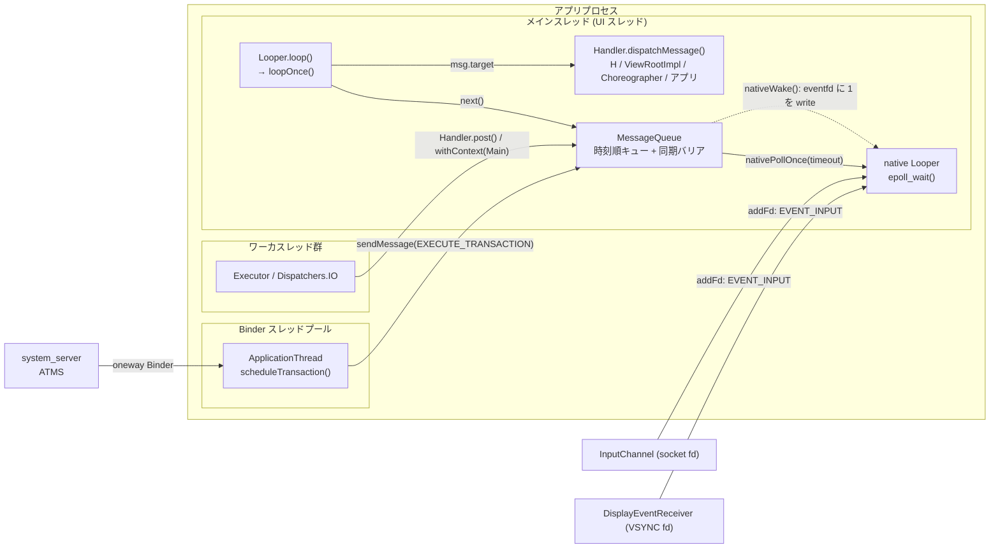
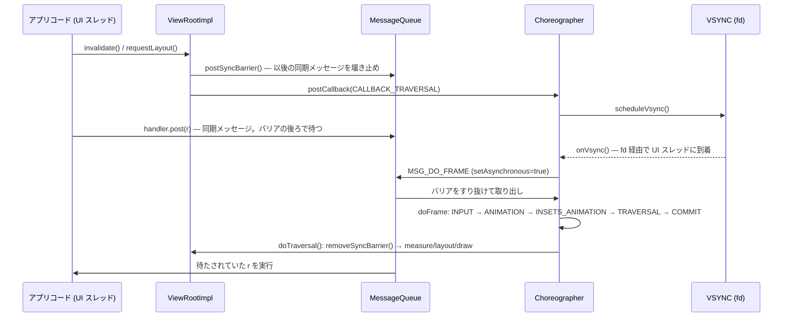

# UIスレッドとメッセージループ (Looper, MessageQueue & Handler)

## 概要 (Overview)

Android アプリのほぼすべてのコード——ライフサイクルコールバック、タッチイベント、描画 (measure/layout/draw)、アニメーション、`Handler.post()` した Runnable、Kotlin の `Dispatchers.Main` 上のコルーチン——は、**メインスレッド (UI スレッド) 上の 1 本のメッセージループ**で直列に実行される。このループの実体が **Looper**(ループ本体)・**MessageQueue**(時刻順のキューと、epoll によるスレッドの眠りと起床)・**Handler**(キューへの投入口であると同時に、取り出されたメッセージの処理者)の三つ組である。

本ドキュメントはこの三つ組を、Java 層のキュー操作から native 層の `epoll` + `eventfd` まで降りて追い、その上に載る優先制御(同期バリアと非同期メッセージ)、アイドル処理 (IdleHandler)、システムとの接点 (ActivityThread の `H` と Binder スレッド)、監視 (ANR・StrictMode・slow dispatch ログ・Perfetto) を積み上げる。

本ドキュメントが答える問い: なぜ GUI ツールキットはほぼ例外なく単一スレッドなのか。「Handler に post すると UI スレッドで動く」のは、どのデータ構造とどのシステムコールによって実現されているのか。60/120Hz のフレームは、同じキューに溢れる他の仕事をどうやって追い越すのか。そして Android 17 (2026) で 20 年ぶりに書き換えられた MessageQueue は、何を解決するために何を変えたのか。分析深度は Level 3。

## 方法論 (Methodology)

- 機構の基準線 (baseline) には有野 (2017) Ⅰ巻 第3章(UI スレッド・Looper・Handler、Android 7.0 Nougat ベース)と Ⅱ巻 1.4・5.4(Looper/Handler/Binder の速習、ActivityThread の `main()` と内部クラス `H`/`ApplicationThread`)を用いる。書籍のコードは著者による簡略化擬似コードであり、本書では再引用せず、現行 AOSP のクラス・メソッド名で再構成する。
- 現在の姿は AOSP の `android17-release` ブランチ(`android-17.0.0_r1`、2026-06 公開)のソースで確認した: `frameworks/base/core/java/android/os/{Looper,Handler,MessageQueue}.java`、`CombinedDeliMessageQueue/MessageQueue.java`、`MessageHeap.java`、`MessageStack.java`、`LooperDoctor.java`、`core/java/android/view/Choreographer.java`、`system/core/libutils/Looper.cpp`、`services/java/com/android/server/SystemServer.java`。行番号はファイル改訂で動くため、原則としてクラス・メソッド名で参照する。
- Android 17 の lock-free MessageQueue (DeliQueue) は、一次資料である Android Developers Blog(設計者本人の解説)と behavior change ガイドを、AOSP ソースの実装(ChangeId・データ構造)と突き合わせて記述する。性能数値は Google 自身の測定であり、独立検証は未見であることを明記する。
- 「Nougat → 現在」の差分を技術詳細 §7 に表として集約し、各所にも注記する。スレッド優先度・cgroup の一般論は [`../operating-systems/process-thread-scheduling.md`](../operating-systems/process-thread-scheduling.md) に委ねる。

## 発見事項 (Findings)

1. **UI の単一スレッド性は制約ではなく設計判断である。** View 階層・レイアウト状態・描画記録はロックなしで一貫性を保つ必要があり、入力(下から上)と状態変更(上から下)が逆向きのロック順序を要求する GUI では、細粒度ロックはデッドロックと性能劣化を招く。Android は他の主要ツールキット(Win32・WPF・Swing)と同じく「UI 状態は 1 スレッドだけが触る。他スレッドはメッセージで頼む」を選び、`ViewRootImpl` の `CalledFromWrongThreadException` でそれを強制する(有野 2017 Ⅰ巻 3.1)。
2. **Looper は「スレッドにキューを 1 つ与える」TLS の仕掛けである。** `Looper.prepare()` は Looper を `ThreadLocal` に格納し、`Looper.myLooper()` はそれを引くだけ——static メソッドなのにスレッドごとに違う結果を返す(同 3.2.2)。`new Handler()` が引数なしで「今のスレッドの Looper」に結び付くのもこの TLS のためで、**Handler で重要なのは「どのスレッドで post するか」ではなく「どのスレッドで new したか」**である(同 3.3.3)。この暗黙性は事故の元となり、Android 11 (API 30) で引数なし `Handler()` は非推奨になった。
3. **待機の実体は `epoll_wait` であり、起床の実体は `eventfd` への 8 バイトの write である。** `MessageQueue.next()` は「次のメッセージの時刻まで」を timeout にして native の `Looper::pollOnce` に入り、他スレッドからの `enqueueMessage` が先頭を差し替えたときだけ `nativeWake` → `eventfd` に 1 を書いて起こす。キューが空の UI スレッドは CPU を一切消費せずカーネル内で眠る——**電池を食わない待機**が GUI 常駐の前提条件である。
4. **同じ epoll が「メッセージ以外のイベント源」も待つ。** native Looper は任意の fd を監視でき(`addFd`)、入力イベント(InputChannel のソケット)と VSYNC(DisplayEventReceiver)はこの経路で UI スレッドに届く。つまり UI スレッドは「Java のキュー」と「カーネルからのイベント」を**1 つの `epoll_wait` で多重化**しており、入力・描画・アプリの post が同じ待ち点を共有する。
5. **フレームは同期バリアで他の仕事を追い越す。** `ViewRootImpl.scheduleTraversals()` はキューに**同期バリア**(target が null の特殊メッセージ)を置き、以後の通常 (synchronous) メッセージを堰き止める。Choreographer の VSYNC 駆動メッセージ (`MSG_DO_FRAME` 等) は**非同期 (asynchronous) メッセージ**としてバリアをすり抜け、フレーム処理が終わるとバリアが外される。FIFO を崩さずに「描画だけ優先レーン」を作る、キュー 1 本での優先度制御である。書籍 Ⅰ巻 3 章はこの機構に触れておらず、本書の中心的な補完点である。
6. **ライフサイクルは「Binder スレッド → Handler → UI スレッド」の乗り換えである。** system_server からの呼び出しは、アプリの **Binder スレッドプール**上で `ApplicationThread` のメソッドとして届き、それ自体は何も処理せず `H`(ActivityThread の Handler)にメッセージを投げるだけ(有野 2017 Ⅱ巻 5.4.2)。Nougat では `scheduleDestroyActivity` → `DESTROY_ACTIVITY` のように 1 RPC = 1 メッセージ種だったが、Android 9 以降は `scheduleTransaction` → `EXECUTE_TRANSACTION` の 1 種に集約された([`app-components-lifecycle.md`](app-components-lifecycle.md))。乗り換えの構造自体は不変である。
7. **Android 17 は MessageQueue を lock-free に作り直した (DeliQueue)。** 旧実装はキュー全体を 1 つのモニタロックで守っており、低優先度のバックグラウンドスレッドが post 中にプリエンプトされると、UI スレッドがそのロック待ちで締切を割る**優先度逆転**が実測されていた。DeliQueue は投入側を Treiber stack(CAS のみ)、取り出し側を Looper スレッド専有の min-heap に分け、取り消しは tombstone(論理削除)で行う。targetSdk 37 以上のアプリと system_server で有効になり、Google は p95 起動時の初フレーム 9.1% 短縮、アプリの missed frame 4% 減を報告している(自社測定)。

## アーキテクチャ (Architecture)

### 1 本のスレッドに集まるもの — 全体像

凡例: 実線はメッセージ/呼び出しの流れ、点線は起床シグナル。`subgraph` はスレッド境界を表す。

- **入口は 3 種類**: (a) 他スレッドからの `Handler` 投入(Binder スレッドの `ApplicationThread`、ワーカ、コルーチン)、(b) native Looper に登録された fd(入力・VSYNC)、(c) UI スレッド自身の post。**出口は 1 つ**: `Looper.loopOnce()` が取り出したメッセージを `msg.target`(Handler)に渡す。
- **Binder スレッドは UI 状態に触らない**: Binder 呼び出しを受けるのはプール内の別スレッドであり、UI 状態を触る処理は必ず Handler で UI スレッドへ乗り換える(有野 2017 Ⅱ巻 1.4.3)。これは [`binder-internals.md`](binder-internals.md) の「Binder ハンドラは短く、重い仕事は別スレッドへ」と、発見事項 1 の単一スレッド規律が交わる点である。

### 1 フレームの優先レーン — 同期バリアと非同期メッセージ

- `Choreographer` はスレッドごと(`ThreadLocal`)に存在し、コールバックを input → animation → insets animation → traversal → commit の固定順で実行する(`Choreographer.doFrame`)。描画パイプラインの後段(RenderThread・SurfaceFlinger)は [`graphics-pipeline.md`](graphics-pipeline.md) を参照。
- バリアは**フレーム要求時だけ**立つ。常時立てれば post した仕事が永遠に待たされ、立てなければ VSYNC 到着時に溜まった通常メッセージの後ろに描画が並ぶ——「フレームを要求した瞬間からフレームが終わるまで」だけ通常レーンを閉じるのが最小の介入である。

## 技術詳細 (Technical Details)

### 1. Looper — TLS とループ本体

- **準備**: `Looper.prepare()` は `sThreadLocal` に Looper が既にあれば例外(1 スレッド 1 Looper)、なければ生成して格納する。メインスレッドでは ActivityThread の `main()` が `Looper.prepareMainLooper()` を呼び、`sMainLooper` として全スレッドから参照可能にする(有野 2017 Ⅱ巻 5.4.1)。native 側の Looper も `thread_local static sp<Looper> gThreadLocalLooper`(`libutils/Looper.cpp`)でスレッドに結び付く——Java と C++ の両層で「スレッド = Looper」の対応が TLS で表現されている。
- **ループ**: `Looper.loop()` は `loopOnce()` を無限に呼ぶ。`loopOnce()` は (1) `MessageQueue.next()` で次のメッセージを得る(`null` なら quit)、(2) Observer 通知・`Trace.traceBegin`・Printer ログ、(3) `msg.target.dispatchMessage(msg)`、(4) slow dispatch/delivery 判定、(5) `msg.recycleUnchecked()` でプールへ返却、の順に進む。ActivityThread・SystemServer の `main()` は `Looper.loop()` の後に `throw new RuntimeException("Main thread loop unexpectedly exited")` を置く——**メインスレッドのループが戻ることはプロセスの異常終了と同義**である。
- **Message のプール**: `Message.obtain()` はグローバルな free list から再利用する(有野 2017 Ⅰ巻 3.3.4)。1 フレームに数十〜数百生成される小オブジェクトの GC 圧を下げるためで、[`art-runtime-internals.md`](art-runtime-internals.md) の「フレーム予算内で GC を起こさない」工夫の一例である。

### 2. MessageQueue.next() と native 層 — epoll + eventfd

- **時刻順キュー**: 各 Message は `when`(`SystemClock.uptimeMillis()` 基準の発火時刻)を持ち、`next()` は「発火時刻が最も早いもの」を返す。`postDelayed(r, 500)` は `when = now + 500` の挿入にすぎず、タイマ専用の機構はない(同 3.2.3)。`uptimeMillis` はディープスリープ中に進まないため、**端末が眠っている間は遅延も止まる**——長時間の予約に `AlarmManager` を使う理由がここにある。
- **待機の組み立て**: `next()` は先頭メッセージの `when` までの差を timeout として `nativePollOnce(ptr, timeoutMillis)` を呼ぶ(キューが空なら -1 = 無期限)。JNI 側 `NativeMessageQueue`(`frameworks/base/core/jni/android_os_MessageQueue.cpp`)を経て `Looper::pollOnce` → `pollInner` → `epoll_wait(epollFd, eventItems, EPOLL_MAX_EVENTS=16, timeoutMillis)` に至る。
- **起床**: 起床用 fd は `eventfd(0, EFD_NONBLOCK | EFD_CLOEXEC)`、epoll は `epoll_create1(EPOLL_CLOEXEC)` で作られ、`Looper::wake()` は eventfd に `uint64_t` の 1 を write する。受け側 `awoken()` が読み出してカウンタを戻す。`enqueueMessage` は「新メッセージが先頭になり、かつ Looper がブロック中」のときだけ wake を呼ぶので、無駄なシステムコールは発生しない。
- **fd 監視**: `Looper::addFd(fd, ident, events, callback)` で登録された fd は同じ epoll に載る。Java からは `MessageQueue.addOnFileDescriptorEventListener`(API 23)として公開される。入力の InputChannel(socketpair の片側、`ViewRootImpl.setView` で登録——有野 2017 Ⅰ巻 3.2.3 注5)と VSYNC の DisplayEventReceiver がこの経路の最大の利用者で、詳細は [`input-pipeline.md`](input-pipeline.md) を参照。
- **設計の理由**: pipe/eventfd + epoll は Linux の標準的な「セルフパイプ・トリック」の発展形であり、`select` と違い監視 fd 数に対してスケールし、eventfd は pipe より fd を 1 本節約してカウンタとして書き込みを合流できる。割り込み駆動の一般論は [`../../hardware/hw-sw-interface/mmio-dma-interrupts.md`](../../hardware/hw-sw-interface/mmio-dma-interrupts.md) の「ポーリングではなく割り込みで起きる」と同型で、asyncio・Tokio のイベントループ([`../compilers-runtimes/async-executors-asyncio-tokio.md`](../compilers-runtimes/async-executors-asyncio-tokio.md))とも同じ骨格である。

### 3. Handler — 投入口と処理者の二役

- **投入**: `post(Runnable)` は `Message.obtain()` に `callback = r` を詰め、`sendMessage(Message)` は `what`/`arg1`/`obj` を詰めた Message をそのまま使う。いずれも `enqueueMessage` で `msg.target = this`(自分自身)を埋め込み、非同期 Handler なら `msg.setAsynchronous(true)` を付けてキューへ入れる(`Handler.java`)。**Handler はメッセージに自分を埋め込んで Looper に投げ、Looper はそれを埋め込まれた Handler に返す**——投げるスレッドと処理するスレッドが違うことだけが要点である(有野 2017 Ⅰ巻 3.3.1)。
- **処理**: `dispatchMessage` は (1) `msg.callback` があればその `run()`、(2) コンストラクタで渡した `Handler.Callback` があればそれ、(3) なければ `handleMessage()` の順に分岐する。`post` 系は (1)、`sendMessage` 系は (3) に落ちる(同 3.3.6–3.3.7)。
- **API の変遷**: 引数なし `Handler()`/`Handler(Callback)` は「Looper の暗黙選択は、タスクの消失・Looper のないスレッドでのクラッシュ・競合を招く」として Android 11 (API 30) で非推奨。明示的な `new Handler(Looper.getMainLooper())` か、`Handler.createAsync(Looper)`(API 28)を使う。createAsync の Javadoc は、非同期 Handler のメッセージは「display vsync のような同期バリア」を迂回し、他 Handler のメッセージとの順序は保証しないと明記する。
- **メモリリーク**: 非 static 内部クラスの Handler は外側の Activity を参照し、遅延メッセージがキューに残る限り Activity を GC から守ってしまう(`FIND_POTENTIAL_LEAKS` 警告の由来)。`MessageQueue` → `Message` → `Handler` → `Activity` の参照鎖が、キューの寿命(プロセスと同じ)と Activity の寿命のずれを顕在化させる。

### 4. 同期バリア・非同期メッセージ・IdleHandler

- **バリアの実装**: `MessageQueue.postSyncBarrier()` は `target == null` の Message を時刻順の位置に挿入し、トークン(`arg1`)を返す。`next()` は先頭がバリアなら、その後ろから `isAsynchronous()` のメッセージだけを探して返す。`removeSyncBarrier(token)` で外れ、必要なら wake する。API は `@hide`(フレームワーク専用)であり、アプリが直接バリアを立てることはできない——**優先レーンの開閉権はフレームワークが独占する**。
- **非同期メッセージの利用者**: Choreographer は `MSG_DO_FRAME`・`MSG_DO_SCHEDULE_VSYNC`・`MSG_DO_SCHEDULE_CALLBACK` を `setAsynchronous(true)` で送り、`FrameDisplayEventReceiver.onVsync` も非同期メッセージを投げる(`Choreographer.java`)。アプリ側は `Message.setAsynchronous`(API 22)・`Handler.createAsync`(API 28)で非同期にできるが、バリアを立てる権限がないので、効果は「フレーム処理中でも待たされない」ことに限られる。
- **バリアの取り残し**: バリアを立てたまま外し忘れると、以後の同期メッセージが永遠に配送されずアプリが固まる(典型的には ANR として観測される)。`ViewRootImpl` の `unscheduleTraversals` が必ず対で外すのはこのためである。（`core/java/android/view/ViewRootImpl.java` lines 2980-3003 @ aosp-mirror 2025-11: `scheduleTraversals()` が `postSyncBarrier()` の直後に `Choreographer.CALLBACK_TRAVERSAL` を登録し、`unscheduleTraversals()` と `doTraversal()` が `removeSyncBarrier()` で外す）
- **IdleHandler**: `Looper.myQueue().addIdleHandler()` で登録したコールバックは、`next()` が「今すぐ配送できるメッセージがない」と判断して眠る直前に呼ばれ、`false` を返すと自動解除される。ActivityThread は `Idler` で「起動後にキューが落ち着いた」ことを検知して system_server に `activityIdle` を報告し([`app-components-lifecycle.md`](app-components-lifecycle.md) の起動完了報告)、`GC_WHEN_IDLE` のような「暇なときにやる」仕事もこの枠に置く。idle の定義が「キューが空」ではなく「期限の来たメッセージがない」である点に注意(遅延メッセージがあっても idle になりうる)。

### 5. ActivityThread の `H`・ApplicationThread・Binder スレッド

- **`main()` の骨格**(有野 2017 Ⅱ巻 5.4.1): `Looper.prepareMainLooper()` → `new ActivityThread()` → `attach(false)`(system_server の `attachApplication` を同期 Binder で呼び、自分の `ApplicationThread` を登録)→ `Looper.loop()`。`H` は ActivityThread のフィールド初期化で生成されるので、main スレッドの Looper に結び付く(同 5.4.2)。
- **命名規約**: `ApplicationThread` の `scheduleXxx()` は Binder スレッド上でメッセージを投げるだけ、`H.handleMessage` の `case XXX` が `handleXxx()` を呼んで実処理する(同 5.4.2)。Nougat では `LAUNCH_ACTIVITY=100`・`PAUSE_ACTIVITY=101`・`DESTROY_ACTIVITY=109` など Activity 操作ごとに what 値があったが、Android 17 の `H` の定数は `BIND_APPLICATION=110`・`CREATE_SERVICE=114`・`GC_WHEN_IDLE=120` などプロセス/サービス系が残り、Activity 系は `EXECUTE_TRANSACTION`(`ClientTransaction` 一括)に統合されている。
- **帰結**: ライフサイクル指示は oneway Binder で届くので、system_server は UI スレッドの混雑を待たない。一方アプリ側では、指示は**UI スレッドのキューに並ぶ**ため、UI スレッドが塞がっていればライフサイクルも止まる。ANR の本質は「oneway で投げた指示が、相手のキューで処理されない」ことの時間監視である([`app-components-lifecycle.md`](app-components-lifecycle.md) §5)。起動全体の時系列は [`app-launch-end-to-end.md`](app-launch-end-to-end.md) を参照。

### 6. 監視と診断 — ANR・StrictMode・slow ログ・Perfetto・コルーチン

- **ANR**: 入力が一定時間(既定 5 秒)消費されない、BroadcastReceiver/Service が期限内に終わらない等を system_server 側が計測する。計測対象はいずれも「UI スレッドのキューに並んだ仕事の完了」であり、MessageQueue の滞留がそのまま ANR の原因になる。
- **StrictMode**: `ThreadPolicy` はメインスレッド上のディスク I/O・ネットワーク・`noteSlowCall` で宣言した遅い呼び出しを検出する。ネットワークは Honeycomb (3.0) 以降、既定で `NetworkOnMainThreadException` を投げる強制ルールになった(有野 2017 Ⅰ巻 3.1.3)。「UI スレッドで時間のかかる処理をしない」という鉄則を、推奨から実行時検査へ格上げしたものである。
- **slow dispatch/delivery ログ**: `Looper.setSlowLogThresholdMs(dispatch, delivery)` を設定すると、`loopOnce()` は「処理に何 ms かかったか (dispatch)」と「予定時刻から何 ms 遅れて配送したか (delivery)」を計測してログする。system_server はメインループに 100ms/200ms を設定している(`SystemServer.java` の `SLOW_DISPATCH_THRESHOLD_MS`/`SLOW_DELIVERY_THRESHOLD_MS`)。
- **Looper.Observer と LooperStats**: `@hide` の `Looper.Observer`(`messageDispatchStarting`/`messageDispatched`/`dispatchingThrewException`)はプロセス全体の配送を観測するフックで、system_server は `LooperStatsService` を起動してハンドラごとの実行時間統計を集める。Android 17 にはさらに `@hide` の **`LooperDoctor`**(Looper の停滞・キュー肥大を単一の watchdog スレッドで監視し、違反時に Perfetto トレース収集を起動する診断機構)がある。
- **Perfetto**: `loopOnce()` は `Trace.traceBegin(traceTag, handler.getTraceName(msg))` でメッセージ単位のスライスを出し、Android 17 では Perfetto SDK の `mq` カテゴリ(`message_queue_send` のフロー・キュー長カウンタ)も出力する。「どの post がどのフレームを遅らせたか」をフロー矢印で追えるようになった。
- **Kotlin `Dispatchers.Main`**: kotlinx-coroutines-android の `HandlerDispatcher.kt` は `Looper.getMainLooper().asHandler(async = true)`(API 28+ は `Handler.createAsync`)で Handler を作り、`dispatch` は `handler.post`、`delay` は `postDelayed` である。つまりコルーチンの再開は**非同期メッセージとしてバリアをすり抜ける**。`Dispatchers.Main.immediate` は `Looper.myLooper() == handler.looper` なら post せず即時実行する。コルーチンは Looper の上の糖衣であって、別のスケジューラではない。

### 7. 何が変わり、何が変わっていないか (2016 Nougat → 現在)

| 機構 | Nougat (書籍) | 現在 (Android 17, 2026) | 変化の理由 |
|---|---|---|---|
| Looper/Handler/Message の構造 | TLS の Looper、`msg.target` に Handler を埋め込む、`dispatchMessage` の 3 分岐(Ⅰ巻 3.2–3.3) | **不変**。`loop()` は `loopOnce()` に分割され Observer・Trace・slow ログのフックが並ぶ | API 互換が最優先。観測点だけが増えた |
| MessageQueue の同期方式 | 単一モニタロック + 時刻順単方向リスト(挿入 O(N)) | targetSdk 37+ と system_server は **DeliQueue**: Treiber stack(投入, CAS)+ Looper 専有 min-heap(`MessageHeap`/`MessageStack`)+ tombstone 削除。旧実装は互換のため併存 | 背景スレッドとのロック競合による UI スレッドの優先度逆転の除去 |
| 実装の選択 | 単一実装 | ビルド時は release flag `RELEASE_PACKAGE_MESSAGEQUEUE_IMPLEMENTATION` で実装を選び、実行時は ChangeId `USE_NEW_MESSAGEQUEUE`(`@EnabledAfter(BAKLAVA)` = API 36 の次から)で切替 | 反射で `mMessages` を覗くテスト基盤・ライブラリとの互換を段階的に移行 |
| native 待機 | epoll + wake fd(Ⅰ巻 3.2.3) | **不変**: `epoll_create1` + `eventfd`、`EPOLL_MAX_EVENTS=16`。DeliQueue は quit 時の native 解放を tagged refcount で保護 | カーネル機構として既に最適。変える理由がない |
| ライフサイクルメッセージ | `H` に `LAUNCH_ACTIVITY` 等を個別定義、`ApplicationThread.scheduleXxx` が 1:1 で投げる(Ⅱ巻 5.4) | Activity 系は `EXECUTE_TRANSACTION` 1 種に集約(Android 9〜)。プロセス/サービス系の `H` 定数は残存 | 途中状態の管理を宣言的な ClientTransaction に移すため |
| Handler 生成 | `new Handler()` が一般的イディオム | 引数なし版は API 30 で非推奨。`Handler.createAsync`(API 28)が公開 | 暗黙の Looper 選択による事故の防止、フレームバリアとの関係の明示 |
| 観測 | Printer ログ(`setMessageLogging`)と systrace | slow dispatch/delivery、`Looper.Observer`/LooperStats、Perfetto `mq` フロー、LooperDoctor | ジャンクの原因を「どのメッセージか」まで特定する需要 |
| UI スレッドへの委譲の主流 | `Handler.post`・`AsyncTask`・`CursorLoader`(Ⅰ巻 3.1.3) | `AsyncTask` は API 30 で非推奨、Kotlin コルーチン `Dispatchers.Main`(内部は非同期 Handler)が主流 | 構造化並行性とキャンセルの一元管理 |

- **DeliQueue の要点**: 投入はどのスレッドからも CAS 1 回で終わり、ロックを持ったまま眠る者がいないので優先度逆転が起きない。取り出しは Looper スレッドだけが行い、スタックからヒープへ一括移送して `when`(同時刻は挿入順 `insertSeq`)で並べる。`removeMessages` は Message の `removed` フラグを CAS で立てる論理削除で、物理的な除去は Looper スレッドが後で行う——**並行性の難所を「単一消費者」という制約で消す**古典的設計である。比較関数を分岐なし(`Long.signum` の合成)にして 5 倍速くしたこと、ARMv8.1 LSE のアトミック命令の利用も報告されている。
- **互換性の代償**: 新実装でも `mMessages` フィールドは残るが**常に null**。Espresso は 3.7.0 以上、Robolectric は 4.17 以上(`@LooperMode(LEGACY)` は廃止)への更新が必要で、アイドル判定は公開 API の `MessageQueue.isIdle()` と `TestLooperManager`(Android 16 で拡張)に寄せる。`adb shell am compat enable/disable USE_NEW_MESSAGEQUEUE <pkg>` で targetSdk と独立に切り替えて検証できる。
- **不確かな点**: AOSP `main`(公開ミラー)には、DeliQueue 以前の `ConcurrentMessageQueue`(`ConcurrentSkipListSet` による lock-free 版、SystemUI 等のシステムプロセスに限定)系列の実装も残っており、Android 15〜16 期にどの範囲で出荷されたかは公開資料から確定できなかった。性能数値(挿入最大 5,000 倍、main thread のロック競合時間 15% 減、アプリ missed frame 4% 減、System UI 7.7% 減、p95 初フレーム 9.1% 短縮)はいずれも Google 社内ベータの自社測定であり、2026-09-27 時点で独立検証は見当たらない。

## セキュリティ考察 (Security Considerations)

- **UI スレッドの占有は可用性攻撃の面である**: 悪意ある/不具合のあるライブラリが UI スレッドで重い処理や Binder 同期呼び出しを行うと、アプリは ANR で kill される。逆に **system_server のメインループや Binder スレッドを塞げれば端末全体の可用性が落ちる**ため、system_server は Watchdog(ハンドラスレッドの定期チェックと停滞時の自己再起動)と slow ログで自らを守る。キューの滞留監視はセキュリティ上も「サービス拒否の検知器」である。
- **Handler 経由のスレッド乗り換えは信頼境界の乗り換えでもある**: Binder スレッド上では `Binder.getCallingUid()` が呼び出し元を示すが、Handler で UI スレッドに移した後は呼び出し元の身元は失われる。権限検査は**乗り換え前(Binder スレッド上)で行う**のが原則で、`loopOnce()` がメッセージ処理の前後で `Binder.clearCallingIdentity()` の値を比較し「Thread identity changed」を警告するのは、身元の取り違えを検出するための防御である([`binder-internals.md`](binder-internals.md)、[`security-model.md`](security-model.md))。
- **非同期メッセージとバリアは優先度の特権である**: `postSyncBarrier` を `@hide` に留め、アプリがバリアを立てられないようにしているのは、任意のコードがフレーム優先レーンを塞いだり、他コンポーネントのメッセージを無期限に止めたりできないようにするためと解釈できる。フレームワーク内部の `@UnsupportedAppUsage` を反射で叩く行為は、Android 17 の `mMessages` 無効化が示すように、実装差し替えで予告なく壊れる。
- **反射による内部参照の禁止は堅牢性の要件になった**: DeliQueue では `mMessages` が常に null を返し、反射で内部を覗くコードは静かに誤動作する。非 SDK インタフェース制限と同じ方向で、実装を差し替え可能に保つことが性能改善(と、それに伴う競合バグの除去)の前提になっている。
- **メッセージの中身は同一プロセス内でのみ信頼できる**: `Messenger` は Handler を Binder 越しに公開する仕組みで、受け取った `Message` の `what`/`obj`(Bundle)は他プロセス由来の不信入力になりうる。`Messenger` サービスでは `msg.sendingUid` による送信元確認と入力検証が必要である。

## 結論 (Conclusions)

- Android の UI スレッドは「単一スレッドが UI 状態を独占し、他者はメッセージで頼む」という GUI の普遍設計の一実装であり、その実体は **TLS に結び付いた Looper、時刻順の MessageQueue、そして epoll + eventfd による眠りと起床**である。Handler は投入口と処理者の二役を持つことで、スレッド間の受け渡しを「メッセージに自分を埋め込む」一点に集約している。
- 1 本のキューの上で、**同期バリアと非同期メッセージ**がフレームの優先レーンを作り、IdleHandler が「暇なとき」の枠を作る。入力と VSYNC は同じ epoll に fd として合流する。UI スレッドは多重化された単一の待ち点であり、ジャンクも ANR も「その待ち点の後ろに何が並んだか」として説明できる。
- 2016 年の Nougat から 2026 年の Android 17 まで、API と構造はほぼ不変である一方、観測(slow ログ・Observer・Perfetto `mq`・LooperDoctor)は大きく増え、Android 17 でついにキューの同期方式そのものが lock-free に置き換わった。変わったのは「ロックの取り方」と「見え方」であり、「1 スレッドに 1 キュー」という契約は 20 年間変わっていない。
- 書籍が扱わなかった同期バリア・非同期メッセージ・DeliQueue を補うと、Looper は単なるイベントループではなく、**フレーム締切・プロセス間ライフサイクル・スレッド優先度の三つの制約が交差する調停点**として読める。

### 次の接続先 (Related Topics)

- [`input-pipeline.md`](input-pipeline.md) — InputChannel の fd が native Looper に登録され、UI スレッドに入力が届くまで。
- [`view-system-layout.md`](view-system-layout.md) — `scheduleTraversals` の同期バリアの後に走る measure/layout/draw。
- [`graphics-pipeline.md`](graphics-pipeline.md) — Choreographer の後段(RenderThread・BufferQueue・SurfaceFlinger)と VSYNC の配布。
- [`app-components-lifecycle.md`](app-components-lifecycle.md) — `EXECUTE_TRANSACTION` で UI スレッドに届くライフサイクル指示と ANR。
- [`app-launch-end-to-end.md`](app-launch-end-to-end.md) — `ActivityThread.main()` の `prepareMainLooper` から最初のフレームまでの時系列。
- [`binder-internals.md`](binder-internals.md) — ApplicationThread が乗る Binder スレッドプールと oneway の意味論。
- [`../compilers-runtimes/async-executors-asyncio-tokio.md`](../compilers-runtimes/async-executors-asyncio-tokio.md) — 同じ「epoll + タスクキュー」骨格を持つ汎用イベントループとの比較。
- [`../operating-systems/process-thread-scheduling.md`](../operating-systems/process-thread-scheduling.md) — UI スレッド/RenderThread の優先度と、優先度逆転の一般論。

## 参考文献 (References)

**一次資料 (Primary — AOSP / Google)**

- AOSP, `frameworks/base/core/java/android/os/Looper.java`・`Handler.java`・`CombinedDeliMessageQueue/MessageQueue.java`・`MessageHeap.java`・`MessageStack.java`・`LooperDoctor.java`(branch `android17-release`). — [android.googlesource.com/platform/frameworks/base/+/refs/heads/android17-release/core/java/android/os/](https://android.googlesource.com/platform/frameworks/base/+/refs/heads/android17-release/core/java/android/os/) — Accessed: 2026-09-27。
- AOSP, `frameworks/base/core/java/Android.bp`(`release_package_messagequeue_implementation` による実装選択)および `main` の `CombinedMessageQueue/`・`ConcurrentMessageQueue/`. — [android.googlesource.com/platform/frameworks/base/+/refs/heads/main/core/java/Android.bp](https://android.googlesource.com/platform/frameworks/base/+/refs/heads/main/core/java/Android.bp) — Accessed: 2026-09-27。
- AOSP, `system/core/libutils/Looper.cpp`(epoll + eventfd、`thread_local` Looper). — [android.googlesource.com/platform/system/core/+/refs/heads/android17-release/libutils/Looper.cpp](https://android.googlesource.com/platform/system/core/+/refs/heads/android17-release/libutils/Looper.cpp) — Accessed: 2026-09-27。
- AOSP, `frameworks/base/core/java/android/view/Choreographer.java`(非同期メッセージ、コールバック順序). — [android.googlesource.com/platform/frameworks/base/+/refs/heads/android17-release/core/java/android/view/Choreographer.java](https://android.googlesource.com/platform/frameworks/base/+/refs/heads/android17-release/core/java/android/view/Choreographer.java) — Accessed: 2026-09-27。
- AOSP, `frameworks/base/services/java/com/android/server/SystemServer.java`(slow ログ閾値、`setUseDeliQueue`、LooperStatsService). — [android.googlesource.com/platform/frameworks/base/+/refs/heads/android17-release/services/java/com/android/server/SystemServer.java](https://android.googlesource.com/platform/frameworks/base/+/refs/heads/android17-release/services/java/com/android/server/SystemServer.java) — Accessed: 2026-09-27。
- Munger, C. & Barack, S. (2026). [Under the hood: Android 17's lock-free MessageQueue](https://developer.android.com/blog/posts/under-the-hood-android-17-lock-free-message-queue). *Android Developers Blog*, 2026-02-17 — Accessed: 2026-09-27。DeliQueue の設計・性能数値(自社測定)。
- Android Developers, [MessageQueue behavior change guidance (Android 17)](https://developer.android.com/about/versions/17/changes/messagequeue) — Accessed: 2026-09-27。`mMessages` の null 化、Espresso/Robolectric の要求版、`USE_NEW_MESSAGEQUEUE`。
- Kotlin, `kotlinx-coroutines-android` `HandlerDispatcher.kt`. — [github.com/Kotlin/kotlinx.coroutines/.../HandlerDispatcher.kt](https://github.com/Kotlin/kotlinx.coroutines/blob/master/ui/kotlinx-coroutines-android/src/HandlerDispatcher.kt) — Accessed: 2026-09-27。

**二次資料 (Secondary)**

- 有野和真 (2017).『Androidを支える技術〈I〉60fpsを達成するモダンなGUIシステム』技術評論社. ISBN 978-4-7741-8759-4. 第3章「UIスレッドとHandler」(3.1 UI スレッド、3.2 Looper、3.3 Handler)。Android 7.0 Nougat 基準。
- 有野和真 (2017).『Androidを支える技術〈II〉真のマルチタスクに挑んだモバイルOSの心臓部』技術評論社. ISBN 978-4-7741-8861-4. 1.4「[速習] UI スレッド/Looper、Handler、Binder」、5.4「ActivityThread の構成要素と main() メソッド」。
- Treiber, R. K. (1986). *Systems Programming: Coping with Parallelism*. IBM Almaden Research Center, RJ 5118。DeliQueue の投入側データ構造の出典。
