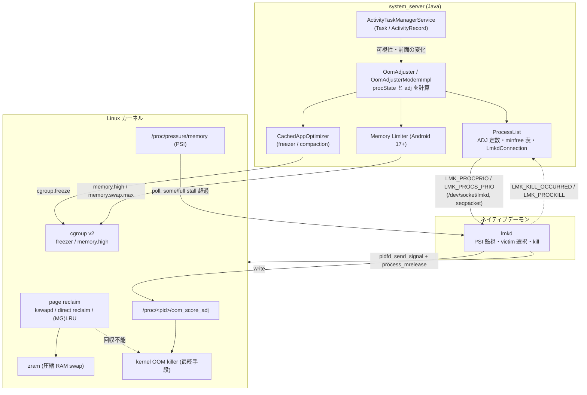

# メモリ管理と Low Memory Killer (Reclaim, oom_score_adj, lmkd & the Process-as-Cache Model)

## 概要 (Overview)

Android のメモリ管理は、汎用 Linux の「メモリ不足 (OOM) は稀な異常事態」という前提を**反転**させたところから始まる。スワップ先のディスクを持たず、数十のアプリがバックグラウンドに居座るスマートフォンでは、メモリ逼迫は**毎分起こる平常運転**である。そこで Android は、カーネルのページ回収 (page reclaim) と OOM killer の上に、「どのプロセスなら殺してよいか」をフレームワークが知らせる経路として `oom_score_adj` を通し、逼迫の早い段階で**重要度の低いプロセスから計画的に kill する** Low Memory Killer (LMK) を載せた。

[`platform-architecture.md`](platform-architecture.md) の「lmkd と『プロセス＝キャッシュ』」節はこれを 1 段落で要約した。本書はその節を Level 3 まで掘り下げ、次の問いに答える。

**本ドキュメントが答える問い**

- カーネルは何を「回収可能」とみなし、なぜスワップの無い Android では clean/dirty の区別が決定的になるのか。
- `oom_score_adj` は誰が、どの台帳から、どの値に設定しているのか。書籍 (Nougat) の -17〜16 表と現在の -1000〜999（カーネルの上限は 1000、`UNKNOWN_ADJ`=1001 はカーネルに書かれない内部値）はどう対応するのか。
- カーネル内 lowmemorykiller ドライバ (shrinker) はなぜ廃止され、userspace の lmkd (vmpressure → PSI) に置き換わったのか。
- cached app freezer・zram・MGLRU・16 KB ページ・Android 17 の Memory Limiter は、「プロセス＝キャッシュ」モデルの何を補強・修正したのか。

分析深度は Level 3。ページングの一般論は [`../operating-systems/virtual-memory-paging.md`](../operating-systems/virtual-memory-paging.md) に委ね、本書は Android 固有の差分に集中する。

## 方法論 (Methodology)

- **ベースライン**: 有野 (2017) Ⅱ巻 第3章（カーネル側のメモリ不足: 回収・OOM killer・lowmemorykiller・lmkd）、Ⅱ巻 4.2（ActivityStack と oom_score_adj）、Ⅰ巻 7.3（フラッシュとスワップ、clean/dirty、mmap と Zygote による共有）を Android 7.0 Nougat 時点の機構記述として用いる。書籍のコード片は著者による簡略化擬似コードであり、数値は実 AOSP で照合する。
- **現在**: AOSP `system/memory/lmkd`（`lmkd.cpp`, `README.md`）と `frameworks/base/services/core/java/com/android/server/am/`（`ProcessList.java`, `OomAdjuster.java`, `OomAdjusterModernImpl.java`, `CachedAppOptimizer.java`）の main ブランチ、source.android.com / developer.android.com の公式文書を一次資料とする（Accessed: 2026-09-27）。
- **照合**: 書籍の Nougat 記述は `android-7.0.0_r6` タグの `ProcessList.java` で裏取りし、書籍の表記と実コードの差（adj スケール）を明示する。性能数値は Google 公表値（target ではなく first-party measured）として扱い、独立検証の有無を注記する。
- **範囲外**: ART の GC とヒープ（[`art-runtime-internals.md`](art-runtime-internals.md)）、App Standby Bucket 等の電力制限は、メモリに関係する範囲のみ扱う。

## 発見事項 (Findings)

1. **Android の回収戦略は「clean を増やし、shared を増やす」の一点に集約される。** スワップ先が無い世界では、カーネルがプロセスに通知せず捨てられるのはファイルと内容が一致する clean ページだけであり、anonymous な dirty ページはプロセスごと殺す以外に取り戻せない。DEX/OAT・`.so`・リソースを mmap して実行する設計と、Zygote からの fork による COW 共有は、この制約から逆算された必然である（有野 (2017) Ⅰ巻 7.3）。**メモリ効率の良し悪しはアロケーション量ではなく「private dirty の量」で決まる。**
2. **`oom_score_adj` は「カーネルに渡すアプリケーション知識」のチャネルである。** カーネルは各プロセスの意味（前面か、音楽再生中か、ホームか）を知らない。ActivityManagerService (AMS、[`system-server-services.md`](system-server-services.md)) がプロセス状態から重要度を計算し、特権デーモン lmkd に Unix ソケットで送り、lmkd が `/proc/<pid>/oom_score_adj` に書く。書籍が描く、スコアを付けるのは UI 側で殺すのはカーネル側という分業は現在も不変で、変わったのは**殺す主体がカーネルから lmkd に移った**ことだけである。
3. **書籍の -17〜16 表は旧 `oom_adj` 表記であり、Nougat の実コードは既に oom_score_adj 単位だった。** `android-7.0.0_r6` の `ProcessList.java` は FOREGROUND 0 / VISIBLE 100 / … / CACHED 900〜906 と定義しており、外部インタフェースが旧 oom_adj のままだと書籍のコラムが述べている点は lowmemorykiller ドライバの `parameters/adj` 側の事情である。現在は CACHED が 900〜999 に拡張され、PERCEPTIBLE_LOW/MEDIUM 等の中間段が追加されて**階層が細分化**した。
4. **lowmemorykiller ドライバは「shrinker の目的外使用」であり、それが廃止理由でもあった。** ディスクキャッシュ解放用の `register_shrinker()` コールバックでプロセスを殺す設計は、書籍が裏の Activity をキャッシュとみなす仕組みとして読み解いた通り巧妙だが、発動が回収経路の内側（ロック保持中・直接回収中）に縛られ、空きページ数の閾値 (minfree) しか見ないため、ファイルキャッシュが大きい負荷で誤判定した。Linux 4.12 で staging から削除され、userspace lmkd に一本化された。
5. **逼迫の尺度が「空き量」から「停滞時間」へ移った。** lmkd は vmpressure イベント（誤検知が多い）を経て、Android 10 から PSI (Pressure Stall Information) の `some`/`full` 停滞時間で逼迫を測る。「空きが何 MB あるか」ではなく「回収待ちで何 ms 止まったか」を見ることで、大きなページキャッシュを抱えた端末でも**ユーザが体感する遅延そのもの**を閾値にできるようになった。
6. **cached プロセスは「殺す」前に「凍らせる」段が加わった。** Android 11 で導入された cached apps freezer は cgroup v2 freezer（[`process-thread-model.md`](process-thread-model.md)）で cached プロセスの実行を止め、Android 14 では（有効な端末で）cached 化から 10 秒後に凍結する。有効化の既定は端末依存である（Pixel 等は有効、§4 参照）。メモリは解放しないが CPU・電力・予期しない dirty 化を止め、zram への退避を安定させる。**プロセス＝キャッシュの「キャッシュ」が文字通り不活性データになった**。
7. **2026 年の Android 17 で、殺す基準に「プロセス単体の上限」が加わった。** Memory Limiter は cgroup v2 の `memory.high` / `memory.swap.max` で端末 RAM 階層ごとの per-app 上限を課し、超過すると当該 cgroup に回収を集中させ、zram も尽きれば kill する（`ApplicationExitInfo` の説明に `MemoryLimiter:AnonSwap`）。**システム全体の逼迫に反応する lmkd と、個別アプリの暴走を封じ込める Memory Limiter の二層**が現在の姿である。

## アーキテクチャ (Architecture)

### 全体像 — 重要度の計算・伝達・執行



凡例: 実線は制御・データの流れ、破線は通知または最終手段の経路。

- **計算・伝達・執行の三分割**が書籍時代から一貫した基本構成である。計算は AMS 側（プロセスの意味を知る唯一の場所）、伝達は root 権限を持つ最小デーモン lmkd、執行は Nougat ではカーネル（lowmemorykiller と OOM killer）、現在は lmkd 自身（カーネル OOM killer は最後の砦として残る）。
- lmkd は kill 後に AMS へ `LMK_PROCKILL` 等を返し、AMS は ProcessRecord を掃除する。ActivityRecord と保存状態は残るため、ユーザが戻ればプロセスが再生成される（[`app-components-lifecycle.md`](app-components-lifecycle.md) の「二重の台帳」）。

### メモリ逼迫の段階と各機構の担当

```
 空きメモリ ▲ 多い
            │  (1) 通常のページ回収: kswapd が clean ファイルページを捨て、anon を zram へ
            │      ─ MGLRU (Android 14 GKI〜) が「どれを捨てるか」を世代で判断
            │  (2) cached プロセスは既に freezer で停止 (CPU を使わず dirty 化もしない)
            │  (3) PSI some 停滞 > 閾値 ── lmkd: cached (adj ≥ 900 近傍) から kill
            │  (4) thrashing / swap 枯渇 ── lmkd: kill 対象の adj 下限を引き下げ
            │  (5) PSI full 停滞 (critical) ── lmkd: perceptible 以下まで kill
            │  (6) それでも割当不能 ── カーネル OOM killer (oom_score_adj を参照)
 空きメモリ ▼ 少ない
 (横軸なし: 上から下へ時間とともに逼迫が進むと読む)
```

書籍は (1) → lowmemorykiller（shrink_slab の時点）→ OOM killer の **2 段構え**を描いた（有野 (2017) Ⅱ巻 3.3.3）。現在は freezer と Memory Limiter が前後に挟まり、判断の入力が「空き量」から「停滞時間・thrashing 率・swap 残量」に多元化した。

## 技術詳細 (Technical Details)

### 1. カーネルのページ回収 — Android で何が「捨てられる」のか

- **回収は確保と対応しない。** プロセス A の割当が回収を誘発しても、回収されるのは無関係なプロセス B の古いページでありうる。回収はゾーンの水位 (watermark) を契機に、(a) 割当経路の直接回収 (direct reclaim) と (b) バックグラウンドの kswapd で起こる（有野 (2017) Ⅱ巻 3.2.2、一般論は [`../operating-systems/virtual-memory-paging.md`](../operating-systems/virtual-memory-paging.md) §3）。direct reclaim は割当スレッド（UI スレッドかもしれない）を止めるため、**ジャンクの直接原因**になる。
- **ページの 4 分類とスワップの有無。** 書籍の分類（同期可能＝ファイル一致の clean、破棄可能＝未使用キャッシュ、回収不能＝anon dirty、スワップ可能）で言えば、ディスクスワップの無い Android では anon dirty は回収不能である。ゆえに「コードを mmap で clean にする」「Zygote で shared にする」が Android の省メモリ設計の二本柱になった（Ⅰ巻 7.3.2〜7.3.4）。
- **zram による部分的な解禁。** 書籍のコラムが触れた、メモリ上の圧縮領域へスワップする方式が現在の標準 zram である。anon ページを RAM 内で圧縮して保持するため、ディスクスワップの欠点（書込寿命・レイテンシ・電力。フラッシュの消去単位と書込回数制限は [`../../hardware/hw-sw-interface/storage-nvm-interface.md`](../../hardware/hw-sw-interface/storage-nvm-interface.md)）を避けつつ、anon dirty を「一部回収可能」にした。ただし 2 次記憶の容量は増えないので、**zram は kill を遅らせる装置であって無くす装置ではない**。これは書籍のコラムの結論であり、現在も有効である。
- **MGLRU (Multi-Gen LRU)。** active/inactive の 2 リストでは「最近使われたか」の粒度が粗く、kswapd がページテーブル走査に CPU を費やしていた。MGLRU（Linux 6.1 で mainline）はページを世代で管理し、Android 14 の GKI カーネル (android14-5.15/6.1) で既定有効化された。Google は Pixel 6 での評価としてアプリ起動時間 約 6.6% 短縮、バックグラウンド kill 約 8% 減、kswapd CPU 約 54% 減を報告している（first-party 計測・二次報道経由、独立再現は未確認）。

### 2. `oom_score_adj` と AMS の重要度計算

**書籍 (Nougat) の表記と実コードの対応**

| 書籍の表記 (旧 oom_adj) | 意味 | Nougat 実コード (`ProcessList`, 7.0.0_r6) | 現在 (main) |
|---|---|---|---|
| 15〜9 | cached (古いほど大) | CACHED_APP_MIN/MAX_ADJ = 900〜906 | 900〜999（`CACHED_APP_LMK_FIRST_ADJ` = 950） |
| 8 | 活動の少ない Service | SERVICE_B_ADJ = 800 | 800 |
| 7 | 直前に使ったアプリ | PREVIOUS_APP_ADJ = 700 | 700 |
| 6 | ホーム | HOME_APP_ADJ = 600 | 600 |
| 5 | Service を含むプロセス | SERVICE_ADJ = 500 | 500 |
| 2 | 知覚可能 (音楽再生等) | PERCEPTIBLE_APP_ADJ = 200 | 200、加えて PERCEPTIBLE_MEDIUM 225 / LOW 250 |
| 1 | 可視 | VISIBLE_APP_ADJ = 100 | 100、加えて PERCEPTIBLE_RECENT_FOREGROUND 50 |
| 0 | 前面 | FOREGROUND_APP_ADJ = 0 | 0 |
| -12 / -16 / -17 | 永続・システム・ネイティブ | PERSISTENT_PROC -800 / SYSTEM -900 / NATIVE -1000 | 同左＋PERSISTENT_SERVICE -700 |

- 書籍の -17〜16 は、lowmemorykiller ドライバが外部に公開していた旧 `oom_adj` 単位（6 スロット）で説明したもので（Ⅱ巻 3.3.3 コラム）、AMS 自体は Nougat 時点で oom_score_adj 単位を扱っていた。**機構の理解としては書籍の説明で正しく、数値だけを現行単位で読み替えればよい。**
- **重要度はグラフ計算である。** Activity の可視性（Ⅱ巻 4.2.2 の、B を積むと A が 0 から 7 になる例）だけでなく、bindService・ContentProvider の接続で「重要なクライアントに使われているサーバは重要」という依存が伝播する。旧 `OomAdjuster` は再帰で計算し、循環（A が B を bind し B が A を bind）と入力順依存に弱かった。`OomAdjusterModernImpl` は procState/adj を**スロット（バケット）に並べて重要度順に接続を辿る**非再帰アルゴリズムで、変更に到達しうるプロセスだけを再計算する部分更新 (`partialUpdateLSP`) を持つ（AOSP `services/core/java/com/android/server/am/OomAdjusterModernImpl.java`。同ファイルは android-14.0.0_r1 に無く android-15.0.0_r1 に初出。切替は `ActivityManagerConstants.java` の `DEFAULT_ENABLE_NEW_OOM_ADJ = Flags.oomadjusterCorrectnessRewrite()` (android-15.0.0_r1 line 255; DeviceConfig `enable_new_oom_adj` で上書き可) で、aconfig フラグ `com.android.server.am.oomadjuster_correctness_rewrite` は AOSP `build/release` の Android 15 リリース構成 `ap3a` と Android 16 の `bp1a` で `state: ENABLED`（`aconfig/<config>/com.android.server.am/oomadjuster_correctness_rewrite_flag_values.textproto`, main ブランチ, Accessed: 2026-09-27）。すなわち **AOSP 既定では Android 15 から有効**。ベンダ構成で異なりうる）。
- **伝達は差分バッチ化された。** Nougat の lmkd プロトコルは `LMK_TARGET`（minfree/adj 表設定）と `LMK_PROCPRIO`（1 プロセスの adj 設定）の 2 コマンドだった（Ⅱ巻 3.3.4）。現在の `ProcessList` は `LMK_PROCREMOVE` / `LMK_SUBSCRIBE` / `LMK_PROCKILL` / `LMK_KILL_OCCURRED` / `LMK_START_MONITORING` / `LMK_BOOT_COMPLETED` / `LMK_PROCS_PRIO`（一括更新）など 12 種に増え、**一方向の設定チャネルから双方向の協調プロトコル**に変わった。

### 3. lowmemorykiller ドライバから userspace lmkd へ

- **Nougat の仕組み**: `drivers/staging/android/lowmemorykiller.c` が shrinker として登録され、`shrink_slab()` の度に空きページ数を `parameters/minfree` と比較、対応する `parameters/adj` 以上のプロセスを kill した（書籍の例: minfree "1024,4096"・adj "0,8" なら空き 4096 ページ未満で adj≥8 を kill）。lmkd は adj/minfree を書く係に過ぎなかった。
- **廃止の理由**: (a) 空き量の固定閾値は「大きなページキャッシュ（実は捨てられる）」を持つ負荷で誤判定し、低 RAM 端末では過剰なチューニングを要した（source.android.com lmkd）、(b) 回収経路の内側で任意プロセスを殺す設計は mm 側から見て筋が悪く、staging の「将来 mainline 化するための置き場」という役割にも合わなかった。Michal Hocko の削除パッチ (2017-02) が Linux 4.12 に取り込まれ、Android 9 以降は in-kernel ドライバが無ければ userspace lmkd が kill を担う。
- **PSI への移行**: userspace lmkd の初期は memcg の vmpressure イベントを監視したが誤検知が多く、Android 10 で PSI モードが導入された（PSI は Linux 4.20 mainline、Android 共通カーネル 4.9/4.14/4.19 へバックポート）。Android 11 では thrashing（ページキャッシュの refault 率）と swap 残量を判断に加えた。

**擬似コード — 現行 lmkd の判断ループ（簡略化、`lmkd.cpp` の `__mp_event_psi()` / `find_and_kill_process()` を要約）**

```text
on PSI event (some or full stall exceeded):          # ro.lmk.psi_partial_stall_ms (既定 70ms 高性能機 / 200ms 低RAM機)
    read /proc/meminfo, /proc/vmstat                  #   ro.lmk.psi_complete_stall_ms (既定 700ms)
    thrashing := refault 増分 / file LRU サイズ
    decide kill_reason, min_adj:
        swap 残 < swap_free_low_percentage and thrashing  -> LOW_SWAP_AND_THRASHING, min_adj = 0
        free < watermark and swap 枯渇                    -> LOW_MEM_AND_SWAP,       min_adj = 0
        thrashing > thrashing_limit                       -> LOW_MEM_AND_THRASHING,  min_adj = 200 相当
        full stall (critical)                             -> ...,                     min_adj = 0
        otherwise                                         -> no kill
    for adj from 1000 down to min_adj:                    # 高い adj（cached）から
        victim := (kill_heaviest_task ? 最大 RSS : LRU 末尾) of procs at adj
        if victim: pidfd_send_signal(SIGKILL); process_mrelease(pidfd); break
# 仮定: 1 回のイベントで 1 プロセス、kill_timeout_ms (既定 100ms) 内は再 kill しない
# 計算量: O(A + P_a)  A = adj 段数 (≤ 2001), P_a = 当該 adj のプロセス数
```

- **kill の高速化**: pidfd による PID 再利用レースの回避と、`process_mrelease()`（Linux 5.15）による「プロセス終了を待たずにアドレス空間を即時回収」が、kill → メモリ回復のレイテンシを縮めた。lmkd は専用の reaper スレッドで kill を非同期化している。
- **設計の含意**: 判断材料（PSI・vmstat）はカーネルの汎用機構、方針（どこまで殺すか）は userspace という分担は、書籍のコラム「Low Memory Killer の変遷」が予見した、Android 独自処理を汎用機構に置き換えて外の lmkd に移す流れの完成形である。

### 4. cached app freezer・圧縮・trim callback

- **freezer**: `CachedAppOptimizer` が cached 化したプロセスを cgroup v2 freezer に入れる（Android 11 で導入、Android 14 で「cached 化 10 秒後に凍結」へ強化）。凍結中のプロセスへの同期 Binder 呼び出しはクライアントを塞がないよう**サーバ側を kill**し、oneway は保留される（Binder ドライバの `BINDER_FREEZE`。機構は [`binder-internals.md`](binder-internals.md)）。AOSP では設定フラグ／開発者オプション「キャッシュされたアプリの実行を停止」で有効化する opt-in 機能で、既定の有効化は端末メーカー判断である。
- **compaction**: 同じ `CachedAppOptimizer` は cached プロセスの anon ページを能動的に zram へ押し出す「アプリ圧縮」も持ち、kill の手前でメモリを稼ぐ。
- **onTrimMemory**: 旧来は RUNNING_MODERATE/LOW/CRITICAL・MODERATE・COMPLETE の段階通知でアプリに自主解放を促したが、API 34 (Android 14) 以降は **`TRIM_MEMORY_UI_HIDDEN` と `TRIM_MEMORY_BACKGROUND` のみ配信**、他の定数は Android 15 で正式に deprecated、`onLowMemory()` も呼ばれない。freezer で止まったプロセスはコールバックを実行できず、段階通知の意味が失われたためと読める。**「OS がアプリに相談する」モデルから「OS が一方的に凍結・圧縮・kill する」モデルへの転換**である。

### 5. 計測 — PSS/USS/RSS と dmabuf

- **PSS** は共有ページを共有数で按分した値で、Zygote 共有の多い Android で「そのプロセスの公平な負担」を表す（developer.android.com memory overview）。**USS** は private のみ＝kill で確実に回収される量。RSS は共有を重複計上する。書籍の例（10MB×3 アプリのうち 8MB 共有なら実消費 14MB）は PSS 概念の要点そのものである。
- PSS 計測は smaps 全走査で高コストなため、AOSP には AppProfiler のバックグラウンド PSS 収集を RSS に置き換える aconfig フラグ `android.os.remove_app_profiler_pss_collection`（`core/java/android/os/flags.aconfig` lines 283-289 @ aosp-mirror main、"Replaces background PSS collection in AppProfiler with RSS"; 参照は `AppProfiler.java` line 752 ほか）がある。同フラグは android-14.0.0_r1 に無く android-15.0.0_r1 に初出し、AOSP `build/release` の `ap3a`（Android 15）・`bp1a`（Android 16）で `state: ENABLED`（`aconfig/<config>/android.os/remove_app_profiler_pss_collection_flag_values.textproto`, main, Accessed: 2026-09-27）。したがって AOSP 既定では Android 15 以降、AppProfiler の周期的な PSS 収集は RSS 計測に置き換わっている。
- **dmabuf**: GPU・カメラのバッファ（[`graphics-pipeline.md`](graphics-pipeline.md) の gralloc/BufferQueue）はどのプロセスの PSS にも現れない「見えない大口」だった。Android 12 は ION を DMA-BUF heaps に置き換え、`/sys/kernel/dmabuf/buffers` の統計と `libdmabufinfo`/`dmabuf_dump` で出所別に計上できるようにした。Android 17 の Memory Limiter は anon RSS＋swap に加えて bitmap メモリも計上対象とする。

### 6. 16 KB ページと Android 17 Memory Limiter

- **16 KB ページ (Android 15〜)**: ページが大きいと TLB 到達範囲が広がり、ページフォルトとページテーブル操作が減る。Google 公表値でアプリ起動 平均 3.16% 短縮、起動時電力 4.56% 減、システム起動 約 8%（約 950ms）短縮、その代償は「平均してやや多いメモリ使用」（内部断片化: 4 KB 単位なら 1 ページで済む小さなマッピングが 16 KB を占有）。ネイティブライブラリは ELF LOAD セグメントの 16 KB 整列が必須。lmkd の minfree・zram・PSS のように「ページ数」で語られる量はすべて単位が 4 倍になる点に注意（書籍注 5 が置く 1 ページ 4K という前提は変わる）。Google Play の対応必須期限は、2025-05 の告知では 2025-11-01（延長申請で 2026-05-31）、2026-09-27 時点の developer.android.com では「2027-02-01 以降、非対応の更新はリリース不可」と記載されており、**期限は告知ごとに変動している**。
- **Memory Limiter (Android 17〜)**: UID ≥ 10000 のアプリプロセスに、端末 RAM 階層ごとの上限を cgroup v2 で課す（例: 8 GB 機で可視 5 GiB / 背面 3 GiB、4 GB 機で 2 GiB / 1 GiB。3,200 MiB 未満と 18,432 MiB 以上の端末は対象外）。`memory.high` 到達で当該 cgroup に回収が集中し（clean ファイルページ破棄と非活性 anon の zram 退避＝ジャンクとして顕在化）、それでも増え続ければ kill される。lmkd が「全体の逼迫時に弱い者から殺す」のに対し、Memory Limiter は「逼迫していなくても暴走者を隔離する」。これは、**重要度順の kill では、前面で漏れ続けるアプリから他を守れない**という「プロセス＝キャッシュ」モデルの穴を塞ぐ追加である。Pixel から開始し、他メーカーは順次採用と告知されている。

### 7. 何が変わり、何が変わっていないか (2016 Nougat → 現在)

| 機構 | Nougat (書籍) | 現在 (Android 16/17, 2026) | 変化の理由 |
|---|---|---|---|
| kill の主体 | カーネル lowmemorykiller（shrinker）＋OOM killer | userspace lmkd（＋OOM killer は最終手段、Android 17 は Memory Limiter も） | 方針を userspace に出し、mainline カーネルの汎用機構だけで動かすため（staging 削除 4.12） |
| 逼迫の尺度 | 空きページ数 vs minfree 固定閾値 | PSI stall 時間・thrashing 率・swap 残量 | 大きなページキャッシュでの誤判定をなくし、体感遅延を直接測るため |
| 重要度の表現 | 書籍は旧 oom_adj -17〜16 で説明（実コードは -1000〜906） | oom_score_adj -1000〜999、中間段追加、cached 900〜999 | 知覚可能性の細分化と cached LRU の分解能向上 |
| AMS ↔ lmkd | LMK_TARGET / LMK_PROCPRIO の一方向 2 コマンド | 12 コマンドの双方向（kill 通知・購読・一括更新） | kill の実行主体が lmkd に移り、結果を AMS に返す必要が生じた |
| 重要度計算 | 再帰的 computeOomAdj | バケット式 OomAdjusterModernImpl、部分更新 | プロセス依存グラフの循環・入力順依存とコストの解消 |
| cached の扱い | 生きたまま待機、onTrimMemory で自主解放を依頼 | cgroup v2 freezer で凍結、圧縮、UI_HIDDEN/BACKGROUND のみ通知 | 背面の CPU・電力消費と dirty 化を止め、kill を遅らせるため |
| スワップ | 原則無し（圧縮 RAM は例外扱いのコラム） | zram が標準、MGLRU で選別精度向上 | anon dirty を部分的に回収可能にしつつフラッシュ寿命を守る |
| ページサイズ | 4 KB 前提 | 4 KB と 16 KB が併存（Android 15〜） | TLB 効率・起動性能と引き換えにメモリ微増を受容 |
| 個別アプリの上限 | Java ヒープ上限（getMemoryClass）のみ | Android 17 で cgroup による anon+swap 上限 | ネイティブ・グラフィックスを含む総量の暴走を封じるため |
| **不変** | clean/shared を増やす設計、AMS が重要度を決め特権デーモン経由で渡す分業、「いつ殺されてもよい」ライフサイクル契約 | 同左 | 制約（小 RAM・スワップ不可・多数の背面アプリ）の本質が変わっていない |

## セキュリティ考察 (Security Considerations)

- **`oom_score_adj` は資源配分の権限そのものである。** アプリが自分の値を書ければ皆が -1000 を名乗り機構が崩壊する（有野 (2017) Ⅱ巻 3.2.4）。そのため値の書込は root/`CAP_SYS_RESOURCE` 相当に限られ、lmkd のソケット `/dev/socket/lmkd` は `system` のみ（0660）が使え、SELinux ポリシーでも接続元が制限される。**重要度を上げる唯一の正規経路は、前景サービス（通知表示が義務）や可視ウィンドウといった「ユーザに見える」手段**であり、Android 14 の前景サービス型宣言義務はこの経路の乱用対策である（[`security-model.md`](security-model.md)）。
- **kill はサイドチャネルになりうる。** プロセスの生死・kill 理由・メモリ使用量は他アプリの活動を推測させる。`/proc` の他プロセス情報の不可視化（hidepid 相当）や `ActivityManager.getRunningAppProcesses()` の自アプリ限定化は、この観測面を閉じる措置である。自身の終了理由は `ApplicationExitInfo` でのみ知ることができる。
- **freezer と Binder の相互作用は DoS 防止策である。** 凍結されたサーバへの同期 Binder を待たせればクライアント（system_server かもしれない）が停止する。凍結側を kill する規則は、「凍結」という新しい状態を IPC の可用性の脅威にしないための設計である。
- **メモリ逼迫を誘発する攻撃**: 悪意あるアプリが前面で大量確保すれば他アプリの背面プロセスが次々 kill され、未保存状態の喪失を招く。Android 17 の Memory Limiter は、この「前面の特権を利用した資源独占」への構造的な上限である。一方、kill 後の復元は保存状態 Bundle を経由するため、Bundle 復元経路の堅牢性（[`app-components-lifecycle.md`](app-components-lifecycle.md) のセキュリティ考察）がここでも前提になる。
- **zram はメモリ上の平文である。** 圧縮は暗号化ではなく、コールドブート／DMA 攻撃に対する露出は通常 RAM と同等である。ディスクスワップを持たないことは、機密データが永続ストレージに漏れない副次的な利点でもある（zram writeback を使う構成ではこの利点が薄れる）。

## 結論 (Conclusions)

- Android のメモリ管理は「スワップできない RAM を、多数のアプリでどう分け合うか」という一つの制約から導かれる。clean と shared を最大化する実行形式・Zygote、殺される前提のライフサイクル契約、アプリ知識をカーネルに渡す `oom_score_adj` の三点は、Nougat の書籍時代から**一切変わっていない**基本構成である。
- 変わったのは執行の場所と尺度である。カーネル内 shrinker の目的外使用は userspace lmkd に移り、空き量の閾値は PSI の停滞時間に置き換わった。Low Memory Killer という呼び名が指す範囲が曖昧になりつつあると書籍が指摘した変遷は、**方針はユーザ空間、機構は mainline カーネル**という分業として完成した。
- 近年の追加（freezer・圧縮・MGLRU・16 KB・Memory Limiter）は、どれも「プロセス＝キャッシュ」モデルの弱点を補う方向にある: 背面キャッシュが CPU を消費する（→凍結）、殺すのが早すぎる（→圧縮と良い LRU）、前面の暴走は重要度で止められない（→per-app 上限）。モデル自体は放棄されず、**キャッシュの管理が精密になり続けている**と総括できる。

### 次の接続先 (Related Topics)

- [`platform-architecture.md`](platform-architecture.md) — lmkd・zram・cgroup の要約版。本書の出発点。
- [`app-components-lifecycle.md`](app-components-lifecycle.md) — oom_adj の入力となる ActivityRecord の台帳と、kill 後の状態復元経路。
- [`app-launch-end-to-end.md`](app-launch-end-to-end.md) — cached プロセスの有無がウォームスタートとコールドスタートを分ける過程。
- [`binder-internals.md`](binder-internals.md) — freezer と `BINDER_FREEZE`、linkToDeath による死亡通知。
- [`art-runtime-internals.md`](art-runtime-internals.md) — Java ヒープ・GC・mmap される OAT/ART イメージ（clean ページの供給源）。
- [`boot-init-properties.md`](boot-init-properties.md) — lmkd の init サービス定義と `ro.lmk.*` プロパティの供給経路。
- [`looper-handler-message-loop.md`](looper-handler-message-loop.md) — direct reclaim や GC によるメインスレッド停止がジャンク・ANR に至る経路。
- [`../operating-systems/virtual-memory-paging.md`](../operating-systems/virtual-memory-paging.md) — LRU・ページキャッシュ・OOM killer の一般論。
- [`../operating-systems/process-thread-scheduling.md`](../operating-systems/process-thread-scheduling.md) — cgroup 階層（cpuset・freezer・memory）の一般論。
- [`../../hardware/hw-sw-interface/storage-nvm-interface.md`](../../hardware/hw-sw-interface/storage-nvm-interface.md) — フラッシュの消去単位と書込寿命（ディスクスワップを避ける理由）。
- [`process-thread-model.md`](process-thread-model.md) — freezer が作用する cgroup v2 階層とプロセスの対応。
- [`system-server-services.md`](system-server-services.md) — OomAdjuster/ProcessList を持つ AMS の位置づけ。

## 参考文献 (References)

**一次資料 (Primary — AOSP / Android 公式 / Linux カーネル)**

- AOSP, *Low memory killer daemon*. — [source.android.com/docs/core/perf/lmkd](https://source.android.com/docs/core/perf/lmkd) — Accessed: 2026-09-27。in-kernel LMK の限界、vmpressure と PSI、Android 10/11 の変更。
- AOSP ソース: `system/memory/lmkd/lmkd.cpp`（`__mp_event_psi()`, `find_and_kill_process()`, `kill_one_process()`, reaper）、`system/memory/lmkd/README.md`（`ro.lmk.*` 既定値と 4.12 での driver 削除）. — [android.googlesource.com/platform/system/memory/lmkd](https://android.googlesource.com/platform/system/memory/lmkd/+/refs/heads/main) — Accessed: 2026-09-27。
- AOSP ソース: `frameworks/base/services/core/java/com/android/server/am/ProcessList.java`（ADJ 定数、`LMK_*` コマンド、`LmkdConnection`）、`OomAdjuster.java`、`OomAdjusterModernImpl.java`、`CachedAppOptimizer.java`（main および `android-7.0.0_r6` タグ）. — [android.googlesource.com/platform/frameworks/base](https://android.googlesource.com/platform/frameworks/base/+/refs/heads/main/services/core/java/com/android/server/am/) — Accessed: 2026-09-27。
- AOSP, *Cached apps freezer*. — [source.android.com/docs/core/perf/cached-apps-freezer](https://source.android.com/docs/core/perf/cached-apps-freezer) — Accessed: 2026-09-27。
- AOSP, *Memory Limiter*. — [source.android.com/docs/core/perf/memory-limiter](https://source.android.com/docs/core/perf/memory-limiter) — Accessed: 2026-09-27。RAM 階層別上限表と cgroup v2 属性。
- AOSP, *Implement DMABUF and GPU memory accounting in Android 12*. — [source.android.com/docs/core/graphics/implement-dma-buf-gpu-mem](https://source.android.com/docs/core/graphics/implement-dma-buf-gpu-mem) — Accessed: 2026-09-27。
- Android Developers, *Overview of memory management*. — [developer.android.com/topic/performance/memory-overview](https://developer.android.com/topic/performance/memory-overview) — Accessed: 2026-09-27。PSS・Zygote 共有・cached プロセスの kill。
- Android Developers, *ComponentCallbacks2*（TRIM_MEMORY_* の deprecation）. — [developer.android.com/reference/android/content/ComponentCallbacks2](https://developer.android.com/reference/android/content/ComponentCallbacks2) — Accessed: 2026-09-27。
- Android Developers, *Support 16 KB page sizes*. — [developer.android.com/guide/practices/page-sizes](https://developer.android.com/guide/practices/page-sizes) — Accessed: 2026-09-27。性能数値と Play 期限（2027-02-01 記載）。
- Android Developers Blog (2025). *Prepare your apps for Google Play's 16 KB page size compatibility requirement*. — [android-developers.googleblog.com/2025/05/prepare-play-apps-for-devices-with-16kb-page-size.html](https://android-developers.googleblog.com/2025/05/prepare-play-apps-for-devices-with-16kb-page-size.html) — Accessed: 2026-09-27。当初期限 2025-11-01。
- Android Developers Blog (2026). *Prioritizing Memory Efficiency: Essential Steps for Android 17* ／ *Preparing your app for broader memory limits*. — [android-developers.googleblog.com/2026/06/prioritizing-memory-efficiency-steps-for-android-17.html](https://android-developers.googleblog.com/2026/06/prioritizing-memory-efficiency-steps-for-android-17.html), [android-developers.googleblog.com/2026/08/app-broader-memory-limits.html](https://android-developers.googleblog.com/2026/08/app-broader-memory-limits.html) — Accessed: 2026-09-27。
- Hocko, M. (2017). *[PATCH] staging, android: remove lowmemory killer from the tree*. LKML. — [lore.kernel.org/lkml/20170222120121.12601-1-mhocko@kernel.org](https://lore.kernel.org/lkml/20170222120121.12601-1-mhocko@kernel.org/) — Accessed: 2026-09-27。
- The Linux Kernel documentation, *PSI — Pressure Stall Information* ／ *Multi-Gen LRU* ／ *zram: Compressed RAM-based block devices*. — [docs.kernel.org/accounting/psi.html](https://docs.kernel.org/accounting/psi.html), [docs.kernel.org/admin-guide/mm/multigen_lru.html](https://docs.kernel.org/admin-guide/mm/multigen_lru.html), [docs.kernel.org/admin-guide/blockdev/zram.html](https://docs.kernel.org/admin-guide/blockdev/zram.html) — Accessed: 2026-09-27。

**二次資料 (Secondary)**

- 有野和真 (2017).『Androidを支える技術〈II〉真のマルチタスクに挑んだモバイルOSの心臓部』技術評論社. ISBN 978-4-7741-8861-4. 第3章（カーネル側から見たメモリ不足）、4.2（アプリ側から見たメモリ不足）。Android 7.0 Nougat 基準。
- 有野和真 (2017).『Androidを支える技術〈I〉60fpsを達成するモダンなGUIシステム』技術評論社. ISBN 978-4-7741-8759-4. 7.3（メモリ節約の工夫と Zygote）。
- Rahman, M. / Esper (2023). *Android memory management is getting better with a new Linux kernel feature*（MGLRU の Android 14 既定化と Pixel 6 評価値の紹介）. — [esper.io/blog/android-dessert-bites-22-linux-memory-management-38419756](https://www.esper.io/blog/android-dessert-bites-22-linux-memory-management-38419756) — Accessed: 2026-09-27。
