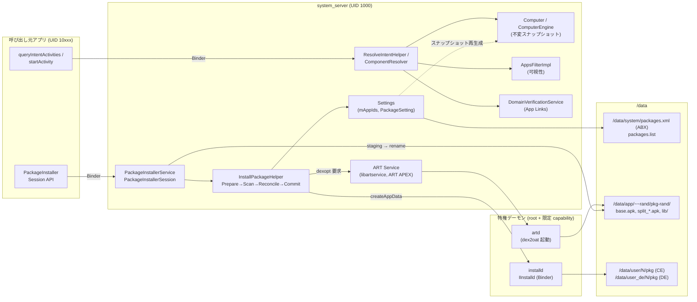
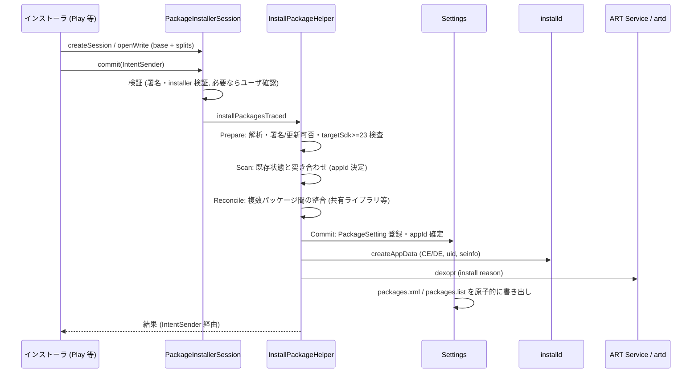

# パッケージ管理とインストール (PackageManagerService, installd & Intent Resolution)

## 概要 (Overview)

Android の「アプリをインストールする」という操作は、Linux から見ると**ユーザアカウントの新規作成**である。PackageManagerService (PMS) は空いている UID を払い出し、特権デーモン installd にホームディレクトリ (`/data/data/<pkg>`) を作らせて `chown` させ、その対応表を `packages.xml` という Android 版 `/etc/passwd` に書き込む。以後、Zygote はこの UID でプロセスを `setuid` し、カーネルの DAC がアプリ間隔離を強制する。同じ台帳は**名前解決**にも使われる——暗黙的 Intent は、PMS がメモリ上に保持する全アプリの intent-filter 一覧に対する検索問い合わせである。

本ドキュメントは、有野 (2017) Ⅱ巻 第2章 (Nougat, AOSP android-7.0.0_r6) が描いた「UID 払い出し → installd → packages.xml → resolveIntent」の骨格を機構の基準線とし、そこから現在 (Android 16 / 17 世代, 2026) までに**何が変わり、何が変わっていないか**を明示する。署名スキーム・パーミッション・SELinux の詳細は [`security-model.md`](security-model.md)、dexopt とコンパイルフィルタは [`art-runtime-internals.md`](art-runtime-internals.md) に委ね、本書は「台帳 (ledger) とその書き手・読み手」に集中する。分析深度は Level 3。

本ドキュメントが答える問い:

- なぜ Android はアプリを Linux ユーザに見立てたのか。UID はどう払い出され、マルチユーザ時代にどう拡張されたか。
- インストールは何段階の処理で、どこまでが非特権 (system_server) で、どこからが特権 (installd/artd) か。
- `packages.xml` はなぜ今もシステムの信頼の起点なのか。なぜバイナリ化され、それが何を壊しうるのか。
- ブート時のパッケージスキャンはなぜ遅く、どう緩和されてきたか。
- Intent の解決は PMS の中でどう行われ、Android 11 以降の「パッケージ可視性」と App Links 検証で何が変わったか。

## 方法論 (Methodology)

- 書籍 (Ⅱ巻 2.1〜2.6) の記述を「機構の基準線 (2016/Nougat)」として抽出し、各機構について現行 AOSP `main` ブランチのソース (`frameworks/base/services/core/java/com/android/server/pm/`, `frameworks/native/cmds/installd/`, `core/java/android/os/Process.java` / `UserHandle.java`) で現状を確認した (2026-09-27 閲覧)。
- 書籍のコード片は著者による簡略化であるため引用せず、現行 AOSP の定数・クラス名・コメントを一次資料として用いた。
- 挙動変更 (パッケージ可視性・App Links・Intent 照合の厳格化・最小 targetSdk) は Android Developers の behavior changes 文書を一次資料とし、導入バージョンを「Android N〜」の形で明示した。
- 数値 (UID 範囲、PER_USER_RANGE、ABX の性能比) は AOSP ソース上の定義を正とし、二次資料 (ABX 解析記事) で相互確認した。
- 公式が「目標」を述べているのか「実装済み」を述べているのかを区別し、SDK Runtime のように方針が撤回されたものは撤回日付とともに記す。

## 発見事項 (Findings)

1. **アプリ＝Linux ユーザという写像は 2016 年から一切変わっていない。** アプリ UID は依然 `FIRST_APPLICATION_UID = 10000`〜`LAST_APPLICATION_UID = 19999` (`Process.java`) の範囲から払い出される。変わったのは周辺だけで、マルチユーザでは `uid = userId × 100000 + appId` (`UserHandle.PER_USER_RANGE`) と**UID 空間を直積に拡張**し、隔離プロセス (99000〜) や SDK サンドボックス (20000〜29999) にも別レンジを割いた。「新しいセキュリティ要件を、カーネルから見れば古いマルチユーザ問題に見せる」(有野 (2017) Ⅱ巻 2.1.4) という設計判断は、10 年間の拡張すべてを吸収してきた。
2. **特権分離の線は「PMS は判断、特権デーモンは実行」のまま、特権側が二つに割れた。** Nougat では installd が data ディレクトリ作成と dexopt の両方を担った。Android 14 以降、dexopt は ART モジュール内の **ART Service** が所管し、特権作業は **artd** が担う。installd は `createAppData` 等のファイルシステム操作に縮退しつつ存続する (AIDL `IInstalld` に `dexopt` メソッド自体は残る)。分割の動機はセキュリティより**更新可能性**で、コンパイル方針を Mainline (ART APEX) 経由で OS 更新と独立に配るためである。
3. **installd への経路は UNIX ソケットから Binder に変わった。** 書籍時点の `init.rc` は `/dev/socket/installd` (所有者 system, 0600) で「system_server だけが話せる」を実現していたが、Android 8.0 で `IInstalld.aidl`（[`aidl-interfaces.md`](aidl-interfaces.md)）の Binder サービス (`InstalldNativeService`) となり (`frameworks/native/cmds/installd/` は android-7.1.2_r1 では `commands.cpp` のみで `binder/` ディレクトリが無く、android-8.0.0_r1 で `binder/` と `InstalldNativeService.cpp` が現れる)、呼び出し元制限は SELinux とサービスマネージャのアクセス制御に移った。installd 自身は `user root` だが `capabilities CHOWN DAC_OVERRIDE DAC_READ_SEARCH FOWNER FSETID KILL SETGID SETUID SYS_ADMIN` に絞られている (`installd.rc`)——「root だが全能ではない」構成は書籍の説明 (2.3.3) と同じ思想である。
4. **`packages.xml` は今も「Android の `/etc/passwd`」だが、中身はバイナリ (ABX) になった。** Android 12 以降、`Xml.resolveSerializer()` は `persist.sys.binary_xml` (既定 true) に従い Android Binary XML を書く。system_server の CPU 時間の無視できない割合が XML 処理に費やされていたことへの対策で、典型的な `packages.xml` で書き込み 4.3 倍高速・ディスク 2.4 倍削減という数値が `BinaryXmlSerializer` のクラス Javadoc に記されている (`core/java/com/android/internal/util/BinaryXmlSerializer.java` lines 45-47 @ android-12.0.0_r1: "benchmarking has shown to be 4.3x faster and use 2.4x less disk space than `Xml.newFastSerializer()` for a typical `packages.xml`"。比較対象はテキスト XML の高速シリアライザであり、第三者による再測定ではない)。ところがこの**性能最適化が新しい攻撃面を生んだ**: CVE-2024-34740 は `BinaryXmlSerializer` の長さフィールド (16bit) のオーバーフローで ABX の構造を注入し、`packages.xml` を改竄して system_server 権限に到達するものだった (2024 年 8 月修正)。台帳の整合性がシステムの信頼の起点であるという書籍の指摘 (2.4.4) の、最も直接的な実証である。
5. **PMS は巨大な単一クラスから「スナップショット＋ヘルパ群」に解体された。** 現行の `pm/` には `Computer`/`ComputerEngine` (読み取り専用の不変スナップショット上で問い合わせに答える)、`InstallPackageHelper` (Prepare→Scan→Reconcile→Commit の 4 段階アトミックインストール)、`InitAppsHelper` (ブートスキャン)、`AppsFilterImpl` (可視性フィルタ)、`ResolveIntentHelper` と `resolution/` (Intent 解決) が並ぶ。動機は**ロック競合**である: PMS の `mLock` は全アプリからの問い合わせと更新が奪い合う大域ロックで、PermissionManager 等との入れ子でデッドロックの危険もあった (`Computer.java` のコメント)。読み手をスナップショットに逃がすことで、更新 (まれ) と問い合わせ (頻繁) を分離した。
6. **Intent 解決は「能力による名前解決」から「可視性と所有権で制約された名前解決」になった。** 書籍時点では PMS は全アプリの intent-filter を持ち、呼び出し元が誰であれ候補を返した (2.5.3)。現在は (a) Android 11 のパッケージ可視性フィルタで**呼び出し元に見えるアプリだけ**が候補になり、(b) Android 12 で http/https の Web Intent は**ドメイン所有を検証済みのアプリ**にしか解決されず、未検証なら既定ブラウザへ落ち、(c) Android 13/14 で exported コンポーネントへの非一致 Intent・非 exported への暗黙 Intent が遮断された。解決アルゴリズムの核 (action/category/data の三項照合) は不変で、**照合の前後に認可フィルタが挿入された**のが変化の正体である。
7. **ブートスキャンの遅さは「宣言的な台帳を毎回実体と照合する」設計の代金である。** 書籍は「起動時に毎回全 APK をスキャンしている」ことを驚きとして記した (2.5.3)。現在もこの照合は本質的に残る (`packages.xml` と `/data/app`・システム区画・APEX 内の APK を突き合わせる) が、`ParallelPackageParser` による並列解析と、解析結果の**パッケージキャッシュ**で定常ブートを短縮している。キャッシュはシステム更新 (OTA) で無効化されるため、「OTA 後の初回ブートだけ遅い」という体感はこの設計から直接出てくる。

## アーキテクチャ (Architecture)

### 台帳とその書き手・読み手

凡例: 実線は呼び出し/書き込み、点線はデータの複製。サブグラフはプロセス (保護ドメイン) の境界を表す。

- **書き手は一人、読み手は多数**: 台帳 (`Settings` と `packages.xml`) を変更できるのはインストール/アンインストール経路の Commit 段だけで、Intent 解決・`getPackageInfo` 等の大量の読み取りは不変スナップショット (`Computer`) に向かう。これは DB の MVCC と同型の設計で、読み手が書き手のロックを待たない。
- **特権は二つのデーモンに分散**: installd はファイル所有権を変えられる (CHOWN/FOWNER) が、コンパイラを走らせる責務は artd に移った。どちらも system_server からの Binder 呼び出しでのみ動き、system_server 自身は root 権限を持たない——書籍 図2.3 の「特権部分だけを小さく切り出す」構図が二重化した形である。

### インストールの流れ (1 セッション)

## 技術詳細 (Technical Details)

### 1. UID の払い出しと ID 空間の設計

- **アプリ ID (appId)**: `Settings` 内の `mAppIds.acquireAndRegisterNewAppId()` が 10000〜19999 から空きを取る。書籍時点の `mUserIds` (ArrayList) は `AppIdSettingMap` に置き換わったが、「空いている番号を線形に探して払い出し、台帳に登録する」意味論は同じ。appId は**端末ローカルで、再インストールで変わりうる**ため、アプリの身元は UID ではなく**パッケージ名＋署名鍵**で表される (UID は実行時の主体、署名鍵は永続的な身元)。
- **マルチユーザ**: `UserHandle.getUid(userId, appId) = userId * 100000 + appId % 100000`。書籍の `ls` 出力に見える `u0_a341` はこの表記で、ユーザ 0・appId 10341 を意味する。同じアプリをユーザ 10 に入れると UID 1010341 になり、**ユーザ間の分離もカーネル DAC に写る**。書籍はマルチユーザを扱わないと明言している (2.1 コラム) が、現在は仕事用プロファイル・Private Space 等で日常的に使われ、UID の直積設計が効いている。
- **特殊レンジ** (`Process.java`): `SYSTEM_UID = 1000`、共有 GID `50000〜59999` (アプリ間で共有する読み取り専用リソース用)、SDK サンドボックス `20000〜29999`、App Zygote 隔離 `90000〜98999`、隔離プロセス `99000〜99999`。**隔離プロセス UID はインストール時ではなく起動時に動的に払い出される**点で、他のレンジと性質が異なる (isolatedProcess サービス、WebView レンダラ等)。
- **sharedUserId の退役**: 同一署名鍵のアプリが同じ UID を共有する仕組み (書籍 2.2.2 コラム) は API 29 で非推奨化され、「パッケージマネージャ内で非決定的な挙動を引き起こす」と公式に明記された。Android 13 (API 33) の `android:sharedUserMaxSdkVersion` で、新規インストールでは共有 UID を**無かったことにできる**。ただし既存インストールの UID は変えられない (データディレクトリの所有者が変わるため) ので、移行は「新規インストールから」しかできない——UID が永続状態に焼き込まれていることの帰結である。

### 2. インストールパイプライン — セッション、分割 APK、ストリーミング

- **PackageInstaller セッション** (Android 5.0〜): インストーラは `createSession` → `openWrite` で APK 群をステージング領域に書き込み、`commit` で一括投入する。セッションは system_server 再起動をまたいで永続化される (`install_sessions.xml`)。Android 14 以降 targetSdk < 23 のアプリはインストール自体が拒否される (`INSTALL_FAILED_DEPRECATED_SDK_VERSION`)——実行時パーミッションを回避するために古い targetSdk を名乗るマルウェアへの対策で、**インストール時検査がポリシー施行点になった**例である。
- **分割 APK と App Bundle**: 1 アプリ＝ base.apk ＋ ABI・画面密度・言語・機能ごとの `split_*.apk`。書籍の「fat バイナリ」(全 ABI の `.so` を 1 つの APK に同梱し、インストール時に必要な分だけ `lib/` にコピー、2.4.2) は、ストア側で端末に必要な分割だけを配る方式に置き換わった。Google Play は新規アプリに Android App Bundle を必須化している。**選択の場所がインストーラ (端末) からストア (サーバ) へ移った**ことで、ダウンロード量とストレージが減る代わりに、「端末上の APK 集合が元のビルド成果物と一致しない」ことを署名検証が扱う必要が生じた (分割ごとに同一鍵で署名、詳細は [`security-model.md`](security-model.md))。
- **4 段階アトミックインストール**: `InstallPackageHelper` は Prepare (解析・初期検証・署名の互換確認) → Scan (既存状態との照合) → Reconcile (同時にインストールされるパッケージ群の相互整合) → Commit (**ここだけがシステム状態を変更してよい**) に分け、「どの段で失敗しても全パッケージのインストールが失敗する」とコメントで規定する。複数 APK を原子的に入れる multi-package セッション (APEX＋APK の同時更新等) を成立させるための構造で、DB トランザクションの「検証と適用の分離」と同じ発想である。
- **配置**: APK は `/data/app/` 下に置かれ、ディレクトリ名は Android 8.0 で連番 (`<pkg>-1`) から `SecureRandom` 16 バイトの Base64 接尾辞 (`<pkg>-<random>`) に、Android 11 で `~~<random>/<pkg>-<random>/` の二段構成になった (`services/core/java/com/android/server/pm/PackageManagerService.java` の `getNextCodePath()`: android-7.1.2_r1 line 14124 は連番、android-8.0.0_r1 line 16866 はランダム接尾辞、android-11.0.0_r1 lines 704 `RANDOM_DIR_PREFIX = "~~"` と 15954-15967 で二段化) (推測によるパス指定を不可能にし、`ApplicationInfo.sourceDir` を唯一の正規の取得手段にする)。書籍の `org.nattou.www.layerpaint-2` のような連番は過去のものである。
- **インクリメンタルインストール** (Android 11〜): カーネルの **Incremental File System (IncFS)** 上に APK を置き、**全バイトが届く前にインストールを完了**させ、未到着ブロックは読み出し時にオンデマンド取得する (`adb install --incremental`、Play の段階配信)。この「部分的にしか存在しないファイルを検証する」問題を、APK Signature Scheme v4 (別ファイル `.idsig` の Merkle 木、fs-verity と同系) が解く。インストールの意味が「全部コピーした」から「検証可能に参照できる」へ変わった点が重要である。

### 3. installd・artd とデータディレクトリ

- **installd の責務**: `IInstalld.aidl` のメソッド群 (`createAppData`, `createAppDataBatched`, `destroyAppData`, `clearAppData`, `fixupAppData`, `restoreconAppData`, `getAppSize`, `moveCompleteApp`, `snapshotAppData` 等) がそのまま特権操作の目録になっている。どれも「アプリ UID 所有のディレクトリを作る/消す/測る/SELinux ラベルを付け直す」であり、**installd の攻撃面は IInstalld の引数検証に集約される**。
- **データディレクトリの二重化**: 書籍時点 (Nougat) で既にファイルベース暗号化 (FBE) と Direct Boot が導入されており、アプリデータは **CE (Credential Encrypted) `/data/user/N/<pkg>`** と **DE (Device Encrypted) `/data/user_de/N/<pkg>`** の二系統を持つ。書籍が示す `/data/data/<pkg>` はユーザ 0 の CE 領域と同一実体の互換パスである。installd はユーザごと・暗号クラスごとにディレクトリを作り、UID に `chown` し、SELinux ラベル (アプリの seinfo と MLS カテゴリ) を付ける——「chown するだけ」(書籍 2.3.4) だった処理に**暗号クラスと MAC ラベル付けが加わった**のが最大の差分である。
- **dexopt の移管**: Nougat の installd は `dexopt` コマンドで dex2oat を起動し、プロファイルのマージも担った (書籍 2.3.6)。Android 14 以降は ART Service が「いつ・どのフィルタで」を決め、artd が入出力を fd で受け取り capability を落として dex2oat を exec する。PMS 側の dexopt 実装は Android 13 以前向けとして残置扱いである。コンパイル方針の詳細は [`art-runtime-internals.md`](art-runtime-internals.md) を参照。

### 4. packages.xml・packages.list — 台帳の永続化

- **内容**: `<package>` 要素に名前・`codePath`・ネイティブライブラリパス・`userId` (appId)・installer・署名 (`<sigs>`, keyset)・付与済みインストール時パーミッション等を持つ (書籍 2.4.2 の構造は概ね現行と同じ)。ユーザごとの状態 (有効/無効・停止状態・実行時パーミッション) は別ファイル群に分かれている。
- **原子性**: 現行 `Settings` は `ResilientAtomicFile` で `packages.xml` / `packages-backup.xml` / `packages.xml.reservecopy` の三つ組を扱う。書籍の注 (「壊れていれば backup を使う」, 2.4.2 注6/注8) は、**予備コピーを加えた多重化**に発展した。台帳が壊れると全アプリの UID が失われる (＝全データが所有者不明になる) ため、最も保守的な書き込み戦略が取られる。
- **ABX (Android Binary XML)**: 先頭 4 バイトのマジック `ABX\0` で判別され、`Xml.resolvePullParser()` がテキスト XML と自動で読み分ける。型付きプリミティブ (int/long/bytes) を文字列化せずに直接書くことが速度と容量の効き所で、代償は人間が読めないこと (`abx2xml` ツールが必要) と、上述 CVE-2024-34740 のような**エンコーダ自身の境界バグ**である。
- **packages.list**: 「パッケージ名 → UID・デバッグ可否・データディレクトリ・seinfo・補助 GID」の平文一覧。Java の PMS に Binder で問い合わせられない (あるいは問い合わせるべきでない) ネイティブ側——`run-as` 等——のために、台帳の**射影を読み取り専用で公開**している。

### 5. ブート時スキャンと APEX

- **スキャンの順序** (`InitAppsHelper`): オーバーレイ → フレームワーク → 特権アプリ → システムアプリ → APEX 内の APK → `/data/app` のユーザアプリ。その過程で `packages.xml` の記録と実体の APK を突き合わせ、消えた/壊れた/途中までしか入っていないパッケージを整理する (書籍 2.4.3 注8 の「突き合わせ」)。
- **なぜ遅いか**: 数百の APK について ZIP を開き、バイナリ AndroidManifest を解析し、コンポーネントと intent-filter をメモリ上の索引に登録する必要がある。宣言的な台帳 (`packages.xml`) だけでは intent-filter 等の全情報を持たないため、**台帳は索引であって実体ではなく、実体は毎回 APK から再構築される**。現行は `ParallelPackageParser` のスレッドプールで並列解析し、解析済みパッケージのキャッシュ (`PackageCacher`) を再利用することで短縮している。OTA でシステム側が変わるとキャッシュが無効化され、同時に ART Service の `boot-after-ota` dexopt も走るため、OTA 直後の初回ブートが顕著に遅くなる。
- **APEX と Mainline** (Android 10〜): APEX は署名付き ZIP (APK と同じ基盤で検証可能) の中に ext4 イメージを持ち、`apexd` がブート初期にループデバイス＋dm-verity で `/apex/<name>@<ver>` にマウントする。APK では表現できない**ネイティブライブラリ・ランタイム・HAL を、ブート初期に使える形で**更新するための形式であり、ART 自体 (＝ ART Service/artd) もこの経路で更新される。PMS はブート時に有効な APEX を問い合わせ、その中の APK もスキャン対象にする (`getApexScanPartitions`)。「パッケージ」の概念が、アプリから OS 部品へ拡張されたと言える。

### 6. Intent 解決 — 照合、選択、認可

- **照合**: `resolveIntent` → `queryIntentActivitiesInternal` (`Computer` 上) → `ComponentResolver` が action/category/data (scheme・host・path・MIME) で intent-filter を照合し、優先度で並べる。明示的 Intent も同じ入口を通る (書籍 2.5.2 コラム) のは現在も同じ。
- **選択**: 候補が複数で既定の設定がなければ **ResolverActivity** (選択ダイアログ) を返す (書籍 2.6 コラム)。共有シートなど `createChooser` 系は現在は別の Chooser 実装 (IntentResolver モジュール) に分離されている。
- **パッケージ可視性** (Android 11〜, targetSdk 30+): `AppsFilterImpl.shouldFilterApplication()` が「呼び出し元はこのパッケージを見てよいか」を判定し、照合結果から見えないアプリを取り除く。マニフェストの `<queries>` (パッケージ名・Intent・プロバイダ authority) で必要な範囲を宣言し、全件取得の `QUERY_ALL_PACKAGES` は Google Play で審査対象になる。**インストール済みアプリ一覧はそれ自体が個人情報 (指紋・嗜好・信条の推定材料)** という認識が、名前解決に認可を持ち込ませた。
- **App Links 検証** (Android 12 で再設計): `android:autoVerify="true"` の http/https フィルタについて、`https://<host>/.well-known/assetlinks.json` を取得してアプリの署名証明書との対応を確かめ、`DomainVerificationService` がドメインごとの状態 (verified/approved/denied/none 等、`adb shell pm get-app-links` で確認可) を保持する。Android 12 以降は未承認ドメインの Web Intent は既定ブラウザへ解決され、Android 15 以降は定期的な再検証が入り更新反映に最大 7 日程度かかる。**「このドメインの正当な持ち主はこのアプリ」という外部の事実を、名前解決の入力にした**のが設計上の転換点である。
- **照合の厳格化**: Android 13 は exported コンポーネントに宣言した intent-filter と一致しない外部 Intent を遮断し、Android 14 は非 exported コンポーネントへの暗黙 Intent を `ActivityNotFoundException` にした。いずれも intent-filter を「広告」から「受理条件の契約」に格上げする変更である。

### 7. 何が変わり、何が変わっていないか (2016 Nougat → 現在)

| 機構 | Nougat (書籍) | 現在 (Android 16/17 世代) | 変化の理由 |
|------|---------------|---------------------------|------------|
| アプリの主体 | 1 アプリ＝1 Linux UID (10000〜19999) | 同じ。加えて userId×100000 の直積、SDK サンドボックス・隔離プロセス用レンジ | カーネル DAC に隔離を委ねる設計は十分に機能し、変える理由がなかった |
| UID 共有 | sharedUserId (同一署名で同一 UID) | API 29 で非推奨、API 33 で `sharedUserMaxSdkVersion` による段階的退役 | UID→パッケージの一意性が崩れ、PMS の非決定性と confused deputy の温床になった |
| PMS の構造 | 巨大な単一クラス＋大域ロック | `Computer` スナップショット＋`InstallPackageHelper` 等のヘルパ分割 | 問い合わせ頻度の増大に対するロック競合・デッドロック回避 |
| インストール手順 | UID 払い出し→installd で mkdir/chown→packages.xml 追記 | Prepare→Scan→Reconcile→Commit の 4 段階アトミック、multi-package セッション | APK＋APEX の同時更新、失敗時の部分状態の排除 |
| 特権デーモン | installd (ソケット、root＋capability) が dir 作成と dexopt | installd (Binder `IInstalld`) はファイル操作、dexopt は ART Service＋artd (Android 14〜) | コンパイル方針を Mainline で OS と独立に更新するため |
| データ配置 | `/data/data/<pkg>` (内部では CE/DE 導入済み) | `/data/user/N/<pkg>` (CE) ＋ `/data/user_de/N/<pkg>` (DE)、SELinux MLS ラベル付き | FBE・Direct Boot・マルチユーザ・アプリ間 MAC 分離 |
| APK 配置 | `/data/app/<pkg>-N/base.apk`、fat バイナリから lib 展開 | `~~rand/<pkg>-rand/` に base＋split、ストアが分割を選別 (AAB) | パス推測の防止、ダウンロード量・容量の削減 |
| 台帳形式 | `packages.xml` (テキスト XML)＋backup | ABX バイナリ XML (Android 12〜)＋backup＋reserve copy | system_server の XML 処理コスト削減、書き込みの堅牢化 |
| ブートスキャン | 起動ごとに全 APK を解析 | 並列解析＋パッケージキャッシュ、APEX 内 APK も対象 | ブート時間短縮。OTA 後のみキャッシュ無効化 |
| Intent 解決 | 全アプリの intent-filter を誰にでも照合 | 可視性フィルタ (11)・App Links のドメイン所有検証 (12)・非一致/非 exported 遮断 (13/14) | インストール済みアプリ一覧のプライバシー、Intent 横取り・リダイレクト攻撃 |
| インストール可能条件 | 署名が有効なら targetSdk を問わない | targetSdk < 23 は拒否 (Android 14〜) | 実行時パーミッション回避目的の古い targetSdk を封じる |

- **変わっていないもの**: 「PMS が台帳の唯一の書き手」「特権作業だけを小さなデーモンに切り出す」「intent-filter の三項照合」「台帳の整合性がシステムの信頼の起点」という四つの骨格。書籍が「他のシステムサービスを読む時にも応用できる」(2.6) と述べた構成原理は、現在の PMS/installd/artd にもそのまま適用できる。
- **SDK Runtime について**: Privacy Sandbox の一部として広告 SDK をアプリ本体と別 UID (20000〜29999 レンジ) の別プロセスで動かす SDK Runtime が構想され、installd にも `reconcileSdkData` 等の支援が入った。しかし Google は 2025-10-17 付で SDK Runtime を含む Privacy Sandbox 技術群の退役を発表しており、UID レンジや installd のメソッドは AOSP に残るものの、**アプリ配布の前提として扱うべき機構ではなくなった** (2026-09-27 時点)。

## セキュリティ考察 (Security Considerations)

- **台帳の改竄は全隔離の崩壊を意味する**: `packages.xml` の `userId` を書き換えれば任意アプリの UID で起動でき、`sharedUserId="android.uid.system"` のエントリを偽造できれば system_server 内でコードが動く。CVE-2024-34740 (ABX エンコーダの整数オーバーフロー経由の台帳注入) はこの経路の実例で、**性能最適化されたシリアライザが信頼の起点の直上にある**ことのリスクを示した。システム状態ファイルを扱うコードは入力が system_server 自身の生成物でも不信入力として扱う必要がある ([`binder-internals.md`](binder-internals.md) の「Parcel は信頼できない入力」と同型)。
- **installd/artd の引数は攻撃面そのもの**: root＋CHOWN/DAC_OVERRIDE を持つデーモンにパス・UID を渡す API は、パス横断・シンボリックリンク競合 (TOCTOU) の典型標的である。artd が「ファイルを fd で受け取り、capability を落としてから exec する」設計を採るのは、パス名解決を特権側に持ち込まないための防御である。
- **インストール時検証はポリシー施行点**: 署名互換 (更新は同一鍵か正当なローテーション系譜のみ、[`security-model.md`](security-model.md))、targetSdk 下限、インストーラの正当性 (unknown sources の許可はインストーラアプリ単位) がすべて Prepare 段に集中する。サイドロード経由のマルウェア対策が「実行時」より「インストール時」に寄っていくのは、ここが唯一すべての APK が必ず通る関門だからである。
- **名前解決は情報漏洩路でもある**: 可視性フィルタ導入前は `queryIntentActivities` や `getPackageInfo` の成否だけで、インストール済みアプリ (銀行・宗教・健康アプリ等) を列挙できた。フィルタ後も `<queries>` の宣言範囲・自動可視 (インストーラ、相互作用した相手等) の規則の隙が研究対象であり続ける。
- **Intent の横取りと偽装**: App Links 以前は、任意のアプリが `https://bank.example` の intent-filter を宣言してリンクを奪えた (選択ダイアログでユーザが誤選択)。ドメイン所有の検証はこれを暗号学的根拠 (assetlinks.json に記した証明書フィンガープリント) で閉じた。一方、カスタムスキーム (`myapp://`) には所有の概念がなく、OAuth リダイレクト横取り等の古典的問題は残る——App Links (https) への移行が推奨される理由である。

## 結論 (Conclusions)

- Android のパッケージ管理の本質は、**「アプリ＝Linux ユーザ」という写像を台帳 (packages.xml) で永続化し、その台帳を名前解決 (Intent) にも流用する**ことにある。この骨格は 2016 年の書籍から現在まで一切変わっておらず、マルチユーザ・隔離プロセス・SDK サンドボックスといった拡張はすべて UID 空間の区画追加として吸収された。
- 変わったのは台帳の**周辺の工学**である: 書き込みはアトミックな 4 段階トランザクションと三重化ファイルに、読み取りは不変スナップショットに、特権作業は installd と artd の二デーモンに、形式はバイナリ XML になった。いずれも「読み手の増加」「OS 部品の独立更新」「system_server の性能」という規模の圧力への応答で、機構の意味論を保ったまま実装を置き換えている。
- Intent 解決は「能力に基づく開かれた名前解決」から、**可視性・ドメイン所有・exported 契約で認可された名前解決**へと移った。書籍が「Android らしさの根幹」と呼んだアプリ間連携 (2.6) は残しつつ、その連携が情報漏洩・横取りの経路にならないよう、照合の前後に認可フィルタを挟む形で進化している。
- 台帳の整合性はシステムの信頼の起点であり続け、その直上に置いた最適化 (ABX) が最も深刻な脆弱性の一つを生んだ。**性能のために台帳の表現を変えるたびに、信頼の起点のコードを書き換えている**という自覚が、この層の設計・レビューに必要である。

### 次の接続先 (Related Topics)

- [`security-model.md`](security-model.md) — 署名スキーム v1〜v4、パーミッション保護レベル、SELinux の seinfo/MLS、FBE の CE/DE 鍵階層。本書の台帳が参照する「身元」と「権限」の定義。
- [`art-runtime-internals.md`](art-runtime-internals.md) — インストール後の dexopt (ART Service/artd)、コンパイルフィルタ、Baseline/Cloud Profiles。
- [`app-components-lifecycle.md`](app-components-lifecycle.md) — 解決された Intent を ATMS がどう起動に変えるか。exported・PendingIntent・BAL の文脈。
- [`app-launch-end-to-end.md`](app-launch-end-to-end.md) — resolveIntent から Zygote fork・`setuid` までの起動の全経路。
- [`boot-init-properties.md`](boot-init-properties.md) — init による installd/apexd の起動、`persist.sys.binary_xml` 等のプロパティ。
- [`platform-architecture.md`](platform-architecture.md) — system_server・Zygote・APEX/Mainline を含む全体像。
- [`binder-internals.md`](binder-internals.md) — IInstalld・IPackageManager の輸送層と呼び出し元 UID の刻印。
- [`../operating-systems/filesystems.md`](../operating-systems/filesystems.md) — ext4/f2fs、fs-verity、ループデバイスと dm-verity の一般論。
- [`../distributed-systems/consistency-models.md`](../distributed-systems/consistency-models.md) — スナップショット読み取り・単一書き手・アトミックコミットの一般論。
- [`aidl-interfaces.md`](aidl-interfaces.md) — IInstalld・IPackageManager の AIDL 定義と生成コード。
- [`system-server-services.md`](system-server-services.md) — PMS の起動順序と system_server 内の位置。

## 参考文献 (References)

**一次資料 (Primary — AOSP / Android 公式)**

- AOSP ソース: `frameworks/base/services/core/java/com/android/server/pm/` (`Computer.java`, `ComputerEngine.java`, `InstallPackageHelper.java`, `InitAppsHelper.java`, `Settings.java`, `AppsFilterImpl.java`, `ResolveIntentHelper.java`, `PackageInstallerSession.java`). — [android.googlesource.com/platform/frameworks/base/+/refs/heads/main/services/core/java/com/android/server/pm/](https://android.googlesource.com/platform/frameworks/base/+/refs/heads/main/services/core/java/com/android/server/pm/) — Accessed: 2026-09-27。
- AOSP ソース: `core/java/android/os/Process.java` (UID レンジ定数), `core/java/android/os/UserHandle.java` (`PER_USER_RANGE`, `getUid`), `core/java/android/util/Xml.java` (`ENABLE_BINARY_DEFAULT`, `resolveSerializer`/`resolvePullParser`). — [android.googlesource.com/platform/frameworks/base](https://android.googlesource.com/platform/frameworks/base/+/refs/heads/main/core/java/android/os/Process.java) — Accessed: 2026-09-27。
- AOSP ソース: `frameworks/native/cmds/installd/installd.rc` (capabilities), `binder/android/os/IInstalld.aidl` (特権操作の目録). — [android.googlesource.com/platform/frameworks/native/+/refs/heads/main/cmds/installd/](https://android.googlesource.com/platform/frameworks/native/+/refs/heads/main/cmds/installd/) — Accessed: 2026-09-27。
- AOSP, *ART Service configuration* ／ *Package manager configuration (dexopt, Android 13 以前)*. — [source.android.com/docs/core/runtime/configure/art-service](https://source.android.com/docs/core/runtime/configure/art-service) — Accessed: 2026-09-27。
- AOSP ソース: `art/artd/` (artd の役割・fd 渡しと capability 放棄). — [android.googlesource.com/platform/art/+/refs/heads/main/artd/](https://android.googlesource.com/platform/art/+/refs/heads/main/artd/) — Accessed: 2026-09-27。
- AOSP, *APEX file format*. — [source.android.com/docs/core/ota/apex](https://source.android.com/docs/core/ota/apex) — Accessed: 2026-09-27。
- AOSP, *Incremental File System* ／ *APK signature scheme v4*. — [source.android.com/docs/core/architecture/kernel/incfs](https://source.android.com/docs/core/architecture/kernel/incfs) — Accessed: 2026-09-27。
- Android Developers, *&lt;manifest&gt; element* (`sharedUserId` 非推奨・`sharedUserMaxSdkVersion`). — [developer.android.com/guide/topics/manifest/manifest-element](https://developer.android.com/guide/topics/manifest/manifest-element) — Accessed: 2026-09-27。
- Android Developers, *Package visibility filtering on Android*. — [developer.android.com/training/package-visibility](https://developer.android.com/training/package-visibility) — Accessed: 2026-09-27。
- Android Developers, *Verify Android App Links* ／ *Behavior changes: all apps (Android 12)*. — [developer.android.com/training/app-links/verify-android-applinks](https://developer.android.com/training/app-links/verify-android-applinks) — Accessed: 2026-09-27。
- Android Developers, *Behavior changes: Android 14* (最小インストール可能 targetSdk・暗黙 Intent の制限) ／ *Intents and intent filters*. — [developer.android.com/about/versions/14/behavior-changes-all](https://developer.android.com/about/versions/14/behavior-changes-all) — Accessed: 2026-09-27。
- Android Developers, *About Android App Bundles*. — [developer.android.com/guide/app-bundle](https://developer.android.com/guide/app-bundle) — Accessed: 2026-09-27。
- Google Privacy Sandbox, *Update on Plans for Privacy Sandbox Technologies* (2025-10-17, SDK Runtime を含む技術の退役). — [privacysandbox.google.com/blog/update-on-plans-for-privacy-sandbox-technologies](https://privacysandbox.google.com/blog/update-on-plans-for-privacy-sandbox-technologies) — Accessed: 2026-09-27。

**二次資料 (Secondary)**

- 有野和真 (2017).『Androidを支える技術〈II〉真のマルチタスクに挑んだモバイルOSの心臓部』技術評論社. ISBN 978-4-7741-8861-4. 第2章「アプリのインストールとその情報」(2.1〜2.6)。Nougat (android-7.0.0_r6) 基準、2017 年 2 月時点の情報。
- Bednarski, M. (2024). *AbxOverflow: Writeup for CVE-2024-34740* (BinaryXmlSerializer の整数オーバーフローから packages.xml 改竄・system_server 権限へ). — [github.com/michalbednarski/AbxOverflow](https://github.com/michalbednarski/AbxOverflow) — Accessed: 2026-09-27。
- CCL Solutions Group, *Android ABX – Binary XML* (ABX の形式・`packages.xml` での使用). — [cclsolutionsgroup.com/post/android-abx-binary-xml](https://www.cclsolutionsgroup.com/post/android-abx-binary-xml) — Accessed: 2026-09-27。
- Zhang, Q. *The changes of APK install location since Android Oreo* (`/data/app` のランダム化パス). — [medium.com/@quaful](https://medium.com/@quaful/the-changes-of-apk-install-location-since-android-oreo-e646d1b53c4d) — Accessed: 2026-09-27。
- Burner, T. (2022). *Making Sense of Intent Filters in Android 13* (非一致 Intent 遮断の解説). — [medium.com/androiddevelopers](https://medium.com/androiddevelopers/making-sense-of-intent-filters-in-android-13-8f6656903dde) — Accessed: 2026-09-27。
