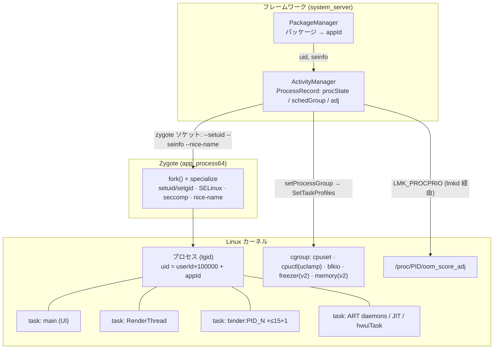
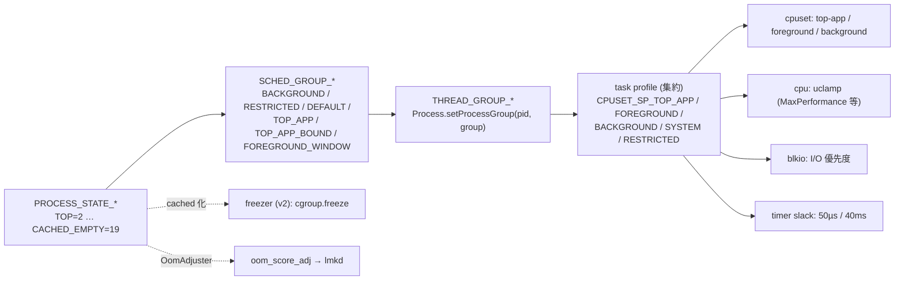

# プロセスとスレッドのモデル (Process & Thread Model: UIDs, Zygote Forks, Thread Inventory & Task Profiles)

## 概要 (Overview)

Android を下から読むとき、最初に押さえるべき層は「アプリは Linux から見て何か」である。答えは短い: **アプリは Linux ユーザ (UID) であり、その実行は Zygote から fork された Linux プロセスであり、アプリの Java スレッドは 1 本ずつカーネルの `task_struct` である**。Android 固有の仕組み (Binder、ActivityManager、ライフサイクル、lmkd) はすべて、この素の Linux の実体の上に「どの UID で・どのプロセスに・どのスレッドを・どの cgroup に置くか」を決める方針層として載っている。

本ドキュメントは Android の読み進め順 (Linux プロセス/スレッド → Binder → AIDL → system_server → Zygote/ART → Activity/Task → Looper/Handler → Window/Input/Graphics) の**第一層**として、次の写像を Level 3 で整理する。

- **身元の写像**: アプリ → appId → per-user UID、隔離プロセス・app zygote・SDK サンドボックスの UID レンジ。
- **実行単位の写像**: コンポーネント → プロセス (`android:process`)、プロセス → Zygote fork、Java `Thread` → pthread → `task_struct`。典型的なアプリプロセスに実在するスレッドの一覧。
- **重要度の写像**: `ActivityManager.PROCESS_STATE_*` → `SCHED_GROUP_*` → `THREAD_GROUP_*` → task profile → cgroup (cpuset・cpu/uclamp・blkio・timer slack・freezer)、および nice 値・SCHED_FIFO・ADPF ヒントセッション。
- **終わり方**: プロセス死・プロセスグループ kill・再起動の意味論。

本ドキュメントが答える問い: `ps -A` に並ぶ `u0_a123` の行と、その下の `RenderThread`・`binder:1234_2`・`HeapTaskDaemon` は何者で、誰が作り、誰がその CPU 配分を決めているのか。「前面アプリが速い」ことは、カーネルのどのノブで実現されているのか。スケジューラ・cgroup・nice の**一般論**は [`../operating-systems/process-thread-scheduling.md`](../operating-systems/process-thread-scheduling.md) に委ね、本書は Android がそれらを**どう配線したか**に集中する。分析深度は Level 3。

## 方法論 (Methodology)

- **基準線**: 有野 (2017) Ⅱ巻 第2章 (アプリ＝Linux ユーザの UID モデル)・第5章 (app_process と Zygote、ActivityThread)、Ⅰ巻 第5章 (RenderThread) を Android 7.0 Nougat 時点の機構記述として用いる。書籍のコードは著者による簡略化擬似コードであり、本書では再引用しない。
- **現行の一次資料**: AOSP `main` を GitHub 上の `aosp-mirror` スナップショット経由で確認した (2026-09-27): `frameworks/base/core/java/android/os/Process.java` (UID レンジ・優先度・スレッドグループ定数)、`core/java/android/app/ProcessStateEnum.aidl` (procstate 値)、`services/core/java/com/android/server/am/ProcessList.java` (`SCHED_GROUP_*`・隔離 UID 割当)、`OomAdjuster.java`・`ActivityManagerService.java` (FIFO UI・スレッド優先度)、`system/core/libprocessgroup/profiles/{task_profiles.json,cgroups.json}`、`system/core/init/first_stage_init.cpp` (`/proc` マウント)、`libs/hwui/renderthread/{RenderThread.cpp,HintSessionWrapper.cpp}`。`android.googlesource.com` と `source.android.com` は本環境から直接取得できなかったため、source.android.com の記述は検索結果の要約で確認し、該当箇所を「要約経由」と明示する。
- **行番号は付けない**: 上記ファイルは頻繁に改訂されるため、クラス・メソッド・定数名で参照する。
- **重複の回避**: UID の払い出しと `packages.xml` は [`package-management.md`](package-management.md)、`oom_score_adj` と lmkd は [`memory-lmkd.md`](memory-lmkd.md)、fork/specialize の手順は [`app-launch-end-to-end.md`](app-launch-end-to-end.md)、SELinux と権限は [`security-model.md`](security-model.md) に詳細がある。本書はそれらを「Linux への写像」という一本の軸で束ね、各所へリンクする。

## 発見事項 (Findings)

1. **Android のプロセスモデルに新しいカーネル抽象はほぼ無い。** 身元は UID/GID、隔離は UID＋SELinux＋seccomp、実行単位は `clone(2)` で作られるタスク、資源配分は cgroup と nice。Android が足したのは Binder ドライバを除けば **「方針を決めて既存のノブを回す」ユーザ空間の層**(ActivityManager・libprocessgroup・lmkd)である。したがって Linux の `ps`・`/proc`・`top`・Perfetto の語彙で Android の挙動をほぼ全部説明できる。
2. **UID は「アプリ × ユーザ」の直積で、隔離の粒度に応じてレンジが分かれる。** 通常アプリの appId は `FIRST_APPLICATION_UID = 10000`〜`LAST_APPLICATION_UID = 19999`、実 UID は `userId × 100000 + appId`。隔離プロセスは `FIRST_ISOLATED_UID = 99000`〜`LAST_ISOLATED_UID = 99999`、app zygote 由来の隔離は `90000`〜`98999` を `NUM_UIDS_PER_APP_ZYGOTE = 100` 単位で切り出し、SDK サンドボックスは `FIRST_SDK_SANDBOX_UID = 20000` から (`Process.java`)。**「権限を持たない他人」を安価に作れること**が、ブラウザのレンダラや信頼しない SDK を同じアプリ内で隔離する基盤になっている。
3. **アプリのプロセスは exec されず、fork されるだけである。** Zygote の子は `execve` を経ないので、`/proc/<pid>/exe` は `app_process64` を指し、プロセス名は specialize 時に `--nice-name` で書き換えた argv[0] と `comm` にすぎない。1 つのアプリは `android:process` で**複数プロセス**に分かれられ、各プロセスは独立した ART インスタンス・独立した `Application.onCreate()`・独立した static 領域を持つ。つまり「アプリ＝プロセス」は既定値であって等式ではない。
4. **Java スレッドは 1:1 でカーネルタスクになる。** ART の `java.lang.Thread` は bionic の `pthread_create` → `clone(CLONE_VM|CLONE_THREAD|…)` で作られ、`/proc/<pid>/task/<tid>` に 1 行ずつ現れる。M:N の軽量スレッドは無く、Kotlin コルーチンもこの上の糖衣である ([`../operating-systems/process-thread-scheduling.md`](../operating-systems/process-thread-scheduling.md) の 1:1 モデル)。ゆえに**アプリのスレッド数はそのまま `task_struct` 数・カーネルスタック数**であり、無制限な生成は OOM や RLIMIT 超過として顕在化する。
5. **典型的なアプリプロセスは、アプリが 1 本もスレッドを作らなくても 15〜20 本前後のスレッドを持つ。** メイン (UI) スレッド、RenderThread、Binder プール (`binder:<pid>_<N>`)、ART の GC・参照処理・finalizer 監視 (`HeapTaskDaemon`・`ReferenceQueueDaemon`・`FinalizerDaemon`・`FinalizerWatchdogDaemon`)、`Signal Catcher`、JIT・プロファイル保存、HWUI のワーカ (`hwuiTask*`) などである。**「メインスレッドが暇なのに遅い」問題の多くは、これら同居スレッドとの CPU・ロック競合として読める**。
6. **前面/背面の差は、procstate から task profile を経て cgroup に落ちる 4 段の写像である。** ActivityManager がプロセスごとに `PROCESS_STATE_*` (0〜20) と `SCHED_GROUP_*` を計算し、`Process.setProcessGroup` → libprocessgroup の `SetTaskProfiles` が `task_profiles.json` の集約プロファイル (`CPUSET_SP_TOP_APP` 等) を適用する。1 つの集約プロファイルは cpuset (使えるコア)・cpu (uclamp による周波数/配置のヒント)・blkio (I/O 優先度)・timer slack (背面は 40ms、通常は 50µs) を**同時に**切り替える。「前面が速い」は一つの設定ではなく、この束の効果である。
7. **AOSP 既定の cgroup 構成は v1 と v2 の混成である。** `cgroups.json` (main) は `cpu` (`/dev/cpuctl`)・`cpuset` (`/dev/cpuset`)・`blkio` (`/dev/blkio`) を v1 階層として、`freezer` と `memory` を v2 (`/sys/fs/cgroup`) としてマウントする。cached app freezer と Android 17 の Memory Limiter が v2 側、CPU 配分は v1 側という分担で、「Android は cgroup v2 に移行済み」という一般化は**既定構成については不正確**である (ベンダは JSON を上書きできる)。
8. **スレッド単位の特権的ブーストは、システムが名指しした少数のスレッドに限られる。** RenderThread は自ら `PRIORITY_DISPLAY` (nice -4) に上げ、前面アプリの UI スレッドと RenderThread は ActivityManager が `THREAD_PRIORITY_TOP_APP_BOOST` (-10) または構成次第で SCHED_FIFO に引き上げる。アプリ自身が同じ扱いを得る正規の道は、ADPF のヒントセッション (`PerformanceHintManager`, API 31) で「このスレッド群はこの締切で動きたい」と**申告する**ことであり、優先度を直接奪うことではない。

## アーキテクチャ (Architecture)

### 身元・実行単位・資源配分の三つの写像



凡例: 実線矢印は設定・生成の流れ、`---` はプロセスとスレッド (タスク) の包含。subgraph はプロセス/特権の境界。

- **三つの写像は別々の台帳から来る。** 身元 (UID・seinfo) はパッケージ台帳から fork 時に一度だけ確定し、以後プロセスが死ぬまで変わらない。資源配分 (cgroup・adj) は ActivityManager が状態変化のたびに**何度でも**書き換える。つまり UID は「誰か」、cgroup は「今どれだけ大事か」を表し、前者は不変・後者は可変という非対称がモデルの基本構造である。
- **ProcessRecord は Linux プロセスの影である。** system_server はアプリプロセスごとに `ProcessRecord` を持ち、Binder の `linkToDeath` でその死を知る。カーネル側の実体と framework 側の台帳の二重管理であり、両者の食い違い (fork 直後でまだ attach していない、死んだがまだ通知が来ていない) を `startSeq` 照合などで埋めている ([`app-launch-end-to-end.md`](app-launch-end-to-end.md) §3)。

### 重要度から cgroup までの 4 段



凡例: 実線は同期的な写像、点線は同じ procState から派生する別系統 (凍結とメモリ回収)。

## 技術詳細 (Technical Details)

### 1. 身元 — UID レンジと per-user UID

- **レンジ表** (`Process.java`、main): `SYSTEM_UID = 1000`、アプリ `10000〜19999`、SDK サンドボックス `20000〜`(アプリ appId + 10000 に対応)、app zygote 隔離 `90000〜98999`、隔離プロセス `99000〜99999`。カーネル側の同名定数は `system/core/libcutils/include/private/android_filesystem_config.h` の `AID_*` で、`AID_READPROC = 3009` のような「補助グループとして権限を付与する GID」も同じ表にある。
- **per-user UID**: `UserHandle.getUid(userId, appId) = userId × 100000 + appId`。ユーザ 0 の appId 10123 は `u0_a123`、ユーザ 10 では UID 1010123 (`u10_a123`)。同じ APK でも**ユーザが違えば別の Linux ユーザ**であり、ユーザ間のデータ分離は追加機構なしに DAC で成立する。払い出しと永続化 (`packages.xml`) は [`package-management.md`](package-management.md) §1・§4 を参照。
- **隔離プロセス** (`android:isolatedProcess="true"` の Service): 「独自の権限を持たず、Service API の bind/start 以外で通信できない」特別なプロセスとして起動される (developer.android.com の `<service>` 要素リファレンス)。`ProcessList` は `IsolatedUidRange.allocateIsolatedUidLocked()` で**起動のたびに**レンジから UID を払い出し、終了時に `freeIsolatedUidLocked()` で返す。ファイルシステム上に自分の UID で所有されたデータは存在せず、SELinux ドメインは `isolated_app`。Chrome/WebView のレンダラが代表的な利用者である。
- **app zygote** (`android:useAppZygote`): アプリ専用の子 Zygote を立て、アプリ定義の `ZygotePreload` でアプリ固有コードを前もってロードしてから隔離プロセスを fork する。起動コストの高い隔離レンダラ群を安く量産するための仕組みで、UID は `mAppIsolatedUidRangeAllocator` が app zygote ごとに 100 個ずつのブロックを割り当てる。

### 2. 実行単位 — Zygote fork、プロセス名、マルチプロセス

- **fork であって exec ではない**: 子は Zygote のアドレス空間 (preload 済みクラス・boot image・共有ライブラリ) を COW で引き継ぎ、`forkAndSpecialize` で UID/GID・補助グループ・capabilities・マウント名前空間・SELinux コンテキスト・seccomp・rlimit・nice-name を確定させる。手順の詳細は [`app-launch-end-to-end.md`](app-launch-end-to-end.md) §2、COW 共有のメモリ効果は [`memory-lmkd.md`](memory-lmkd.md) §1。**exec しないので ELF のロードも動的リンクもやり直さない**。これが起動速度の源泉であると同時に、ASLR の配置が全アプリで共通になるという代償でもある (セキュリティ考察)。
- **プロセス名**: `--nice-name` はプロセス名 (`/proc/<pid>/cmdline` の argv[0]) になり、`comm` は 15 文字に切り詰められる。`ps -A` の NAME 列がパッケージ名に見えるのはこの書き換えのためで、実行ファイルはあくまで `app_process64` である。
- **`android:process`**: 既定では全コンポーネントがパッケージ名と同名の 1 プロセスで動く。`:` で始まる名前はアプリ専用の新プロセス、小文字で始まる名前は「権限があれば」他アプリと共有できるグローバルプロセスになる (developer.android.com の `<service>`/processes-and-threads)。共有には同一 UID (`sharedUserId`、非推奨) と同一署名が要る。
- **マルチプロセスの帰結**: 各プロセスで `Application.onCreate()` が走り、シングルトン・static・メモリキャッシュ・SharedPreferences のインメモリ状態は共有されない。プロセス間の通信は Binder (AIDL・ContentProvider・Messenger) しかなく、これが次の層 [`binder-internals.md`](binder-internals.md) への入口になる。メモリ面では各プロセスが別々の Java ヒープと ART ランタイムを持つため、分割は PSS を増やす。

### 3. スレッドの実体 — Java Thread ↔ pthread ↔ task_struct

- **生成経路**: `Thread.start()` → ART `Thread::CreateNativeThread` → bionic `pthread_create` → `clone()` (アドレス空間・fd 表・シグナルハンドラ・スレッドグループを共有するフラグ群)。カーネルから見るとスレッドは tgid を共有するタスクで、`/proc/<pid>/task/<tid>/` に現れる。tid はシステム全体で一意な PID 空間の番号であり、`Process.myTid()` がそれを返す。
- **名前**: `Thread.setName()` は `prctl(PR_SET_NAME)` 相当でカーネルの `comm` (15 文字) に反映されるため、Perfetto・`top -H` でも同じ名前が見える。名前を付けないスレッドプールは `Thread-12` や `pool-3-thread-1` となり、トレース解析を難しくする。
- **優先度の二系統**: Java の `Thread.setPriority(1..10)` は ART 内の表で nice 値に写像され、`android.os.Process.setThreadPriority(tid, prio)` は nice を直接設定する。後者の定数 (`Process.java`): `THREAD_PRIORITY_LOWEST = 19`、`BACKGROUND = 10`、`DEFAULT = 0`、`FOREGROUND = -2`、`DISPLAY = -4`、`URGENT_DISPLAY = -8`、`VIDEO = -10`、`AUDIO = -16`、`URGENT_AUDIO = -19`、`TOP_APP_BOOST = -10`。Javadoc は DISPLAY について「アプリは通常この優先度に変更できない」と明記する。nice が CFS/EEVDF の重みにどう反映されるかは [`../operating-systems/process-thread-scheduling.md`](../operating-systems/process-thread-scheduling.md) §4–5。
- **`SCHED_RESET_ON_FORK`**: `OomAdjuster` の `Injector.setThreadPriority` は、フラグ `resetOnForkEnabled` が有効なら SCHED_OTHER のスレッドに `SCHED_RESET_ON_FORK` を付けてから優先度を変える (main で確認)。**ブーストされた UI スレッドから生まれたワーカがブーストを継承しない**ようにするための措置である。

### 4. 典型的なアプリプロセスのスレッド一覧

| スレッド名 (comm) | 作成者 | 役割 | 既定の扱い |
|---|---|---|---|
| (パッケージ名) = main | Zygote の fork そのもの | UI スレッド。Looper を回す ([`looper-handler-message-loop.md`](looper-handler-message-loop.md)) | 前面時に TOP_APP_BOOST または FIFO (§6) |
| `RenderThread` | HWUI (`RenderThread.cpp`) | 表示リストの再生と GPU 発行 ([`graphics-pipeline.md`](graphics-pipeline.md)) | 自ら `setpriority(…, PRIORITY_DISPLAY)` = nice -4 |
| `binder:<pid>_<N>` | libbinder `ProcessState` | 着信 Binder 呼び出しの処理 | 既定上限 15 本＋`startThreadPool` した 1 本、N は 16 進 |
| `HeapTaskDaemon` | ART `Daemons` | 並行 GC・トリミング等のヒープタスク | 通常優先度 |
| `ReferenceQueueDaemon` | ART `Daemons` | `ReferenceQueue` への enqueue | 同上 |
| `FinalizerDaemon` / `FinalizerWatchdogDaemon` | ART `Daemons` | `finalize()` の実行と、その超過監視 (既定 10 秒で `TimeoutException` によりプロセス停止) | 同上 |
| `Signal Catcher` | ART | SIGQUIT を受けてスタックダンプ (ANR 時の traces) | ほぼ常時スリープ |
| `Jit thread pool` / `Profile Saver` | ART | JIT コンパイル、プロファイルの `.prof` 書き出し ([`art-runtime-internals.md`](art-runtime-internals.md)) | 背面寄り |
| `hwuiTask*` | HWUI `CommonPool` | テクスチャ・パスの並列前処理 | ADPF セッションに含まれる (§7) |
| `ADB-JDWP Connection Control` など | ART | debuggable/JDWP 構成でのみ | — |

- **Binder プールの実態**: アプリ側は `RuntimeInit` の `onZygoteInit` → `ProcessState::startThreadPool()` で最初の 1 本を作り、以後はカーネルドライバが「待機中のスレッドが尽きた」ときに `BR_SPAWN_LOOPER` で増員を要求する。上限は libbinder の `DEFAULT_MAX_BINDER_THREADS = 15` で、`setThreadPoolMaxThreadCount` で変えられる (system_server は大きな値を設定する)。**15 本が同期呼び出しで埋まると以後の着信は待たされる**。これが Binder 呼び出しの処理を短く保つべき理由である。
- **スレッドは「誰が作ったか」で責任が分かれる**: UI・Binder・ART daemon はランタイムの所有物で、アプリはその優先度や数を変えるべきではない。アプリが作るのは Executor・コルーチンの `Dispatchers.Default/IO` のワーカで、これらは既定で DEFAULT (nice 0) のまま UI スレッドと同じ cgroup で競合する。

### 5. procstate → cgroup — SchedPolicy から task profile へ

- **procstate の階層** (`ProcessStateEnum.aidl`, main): `PERSISTENT 0`、`PERSISTENT_UI 1`、`TOP 2`、`BOUND_TOP 3`、`FOREGROUND_SERVICE 4`、`BOUND_FOREGROUND_SERVICE 5`、`IMPORTANT_FOREGROUND 6`、`IMPORTANT_BACKGROUND 7`、`TRANSIENT_BACKGROUND 8`、`BACKUP 9`、`SERVICE 10`、`RECEIVER 11`、`TOP_SLEEPING 12`、`HEAVY_WEIGHT 13`、`HOME 14`、`LAST_ACTIVITY 15`、`CACHED_ACTIVITY 16`、`CACHED_ACTIVITY_CLIENT 17`、`CACHED_RECENT 18`、`CACHED_EMPTY 19`、`NONEXISTENT 20` (`UNKNOWN -1`)。developer.android.com の説明する 4 段 (foreground / visible / service / cached) はこの細かい列の要約である。procstate は API ゲート (背面からの起動制限・ネットワーク制限) にも使われ、同じ `OomAdjuster` の計算から `oom_score_adj` も出る ([`memory-lmkd.md`](memory-lmkd.md) §2)。
- **schedGroup** (`ProcessList.java`): `SCHED_GROUP_BACKGROUND 0` → `THREAD_GROUP_BACKGROUND`、`RESTRICTED 1` → `THREAD_GROUP_RESTRICTED`、`DEFAULT 2` → `THREAD_GROUP_DEFAULT`、`TOP_APP 3` → `THREAD_GROUP_TOP_APP`、`TOP_APP_BOUND 4` (前面アプリに bind されたプロセスを前面と区別)、`FOREGROUND_WINDOW 5` (default と top-app の中間)。`OomAdjuster` は最上位アクティビティのプロセス、リモートアニメーション中のプロセス、分割画面・フリーフォームで可視のプロセスに `SCHED_GROUP_TOP_APP` を与え、`setProcessGroup(pid, group)` → `Process.setProcessGroup` で適用する。
- **task profile**: libprocessgroup は「どの cgroup のどのファイルに何を書くか」を `task_profiles.json` に外出しし、フレームワークは `SetTaskProfiles`/`SetProcessProfiles` にプロファイル名を渡すだけになった (source.android.com「Cgroup abstraction layer」、要約経由)。旧来の `set_sched_policy`/`set_cpuset_policy` は API を保ったまま内部実装が task profile に置き換えられている (同)。main の集約プロファイルを以下に示す。

**File**: `system/core/libprocessgroup/profiles/task_profiles.json` (AggregateProfiles, main — 抜粋して表に再構成)
**Purpose**: スレッドグループが実際にどのノブの束に対応するか

| 集約プロファイル | 構成プロファイル | 実体 |
|---|---|---|
| `CPUSET_SP_TOP_APP` | `MaxPerformance`, `ProcessCapacityMax`, `MaxIoPriority`, `TimerSlackNormal` | cpu=`top-app`、cpuset=`top-app`、slack 50µs |
| `CPUSET_SP_FOREGROUND` | `HighPerformance`, `ProcessCapacityHigh`, `HighIoPriority`, `TimerSlackNormal` | cpu/cpuset=`foreground` |
| `CPUSET_SP_FOREGROUND_WINDOW` | `HighPerformanceWI`, `ProcessCapacityHighWI`, `HighIoPriority`, `TimerSlackNormal` | `foreground_window` |
| `CPUSET_SP_BACKGROUND` | `HighEnergySaving`, `ProcessCapacityLow`, `LowIoPriority`, `TimerSlackHigh` | cpuset=`background`、slack 40ms |
| `CPUSET_SP_SYSTEM` / `CPUSET_SP_RESTRICTED` | `ServiceCapacityLow` / `ServiceCapacityRestricted`, `TimerSlackNormal` | `system-background` / `restricted` |
| `SCHED_SP_RT_APP` | `RealtimePerformance`, `MaxIoPriority`, `TimerSlackNormal` | 音声等の RT アプリ |

- **読み方**: cpuset は「どのコアに乗ってよいか」(ビッグコアを top-app に開放し background は小コアに閉じ込める)、cpu 側は uclamp (`UClampMin`/`UClampMax`/`UClampLatencySensitive` 属性) で「スケジューラと DVFS にどれだけの性能を見積もらせるか」、timer slack は「タイマ起床をどれだけまとめてよいか」で、背面の 40ms は**起床の合流による省電力**である ([`../operating-systems/power-management.md`](../operating-systems/power-management.md))。各グループの具体的なコア集合と uclamp 値はデバイスの init.rc・ベンダ JSON が決め、AOSP の JSON は枠組みだけを与える。
- **v1/v2 の混成**: `cgroups.json` (main) は v1 の `cpu`=`/dev/cpuctl`・`cpuset`=`/dev/cpuset`・`blkio`=`/dev/blkio` と、v2 の `/sys/fs/cgroup` (コントローラ `freezer`、任意で `memory`) を並べる。発見事項 7 のとおり、CPU 配分と凍結・メモリ制限は別の階層で動いている。

擬似コード化すると、状態変化 1 回あたりの適用は次のとおり。

```text
// Pseudocode (language-agnostic). 仮定: procState/schedGroup は OomAdjuster が計算済み。
on_process_state_changed(proc):
    group   = map_sched_group(proc.schedGroup)          // SCHED_GROUP_* → THREAD_GROUP_*
    profile = aggregate_profile_for(group)              // THREAD_GROUP_* → CPUSET_SP_* (task_profiles.json)
    for action in profile.actions:                      // cpuset / cpu(uclamp) / blkio / timerslack
        write(action.cgroup_file, proc.pid or each tid) // cgroup.procs か tasks へ書く
    if proc.becameCached and freezer_enabled: schedule_freeze(proc, delay)   // cgroup.freeze = 1
    send_to_lmkd(proc.pid, proc.uid, proc.oomAdj)       // oom_score_adj (memory-lmkd.md)
// 計算量: O(A + T)  A = プロファイル内アクション数 (定数, ≤ 5), T = スレッド単位適用時のスレッド数
```

### 6. スレッド単位のブースト — UI スレッド・RenderThread と SCHED_FIFO

- **RenderThread**: HWUI は RenderThread 起動時に自ら `setpriority(PRIO_PROCESS, 0, PRIORITY_DISPLAY)` を呼ぶ (`RenderThread.cpp`, main)。さらに `ActivityManagerService` はアプリから通知された RenderThread の tid を記録し (`setRenderThread`)、前面化・背面化のたびに UI スレッドと対で扱う。
- **前面の UI スレッド**: プロセスが top になると、ActivityManager は UI スレッド (= pid と同じ tid) と RenderThread を `THREAD_PRIORITY_TOP_APP_BOOST` (-10) に上げ、top を外れると元に戻す。`sys.use_fifo_ui` プロパティが有効な構成 (`mUseFifoUiScheduling`) では代わりに `scheduleAsFifoPriority` で **SCHED_FIFO** にし、`scheduleAsRegularPriority` で戻す。AOSP の jank 解説はこれを「UI クリティカルでないスレッドとの競合によるジャンクをほぼ消す」一方、「能力の低い端末では入力処理や背面の音楽再生が追いつかなくなりうる」ため検証を要する選択肢として位置づけている (source.android.com「Identify jitter-related jank」、要約経由)。
- **なぜ UI と RenderThread の 2 本だけか**: フレームの締切 (60Hz で約 16.7ms、120Hz で約 8.3ms) を直接背負うのはこの 2 本で、他のスレッドを上げると上げた分だけ互いの競合が戻ってくる。RT クラスは CFS/EEVDF より常に優先されるため、暴走すると同じコアの通常タスクを飢えさせる。一般論の「RT は最悪ケースの問題」([`../operating-systems/process-thread-scheduling.md`](../operating-systems/process-thread-scheduling.md) §6) がそのまま当てはまる。

### 7. ADPF ヒントセッション — 優先度ではなく締切を申告する

- **API**: `PerformanceHintManager.createHintSession(int[] tids, long targetDurationNanos)` (API 31) でセッションを作り、各フレーム (作業単位) の実績を `reportActualWorkDuration` で、目標変更を `updateTargetWorkDuration` で報告する。tids は呼び出しアプリのスレッドでなければならない。後続 API でスレッド集合の差し替え (`setThreads`) や省電力優先の指定も加わった。
- **システム側の解釈**: 実績と目標の差から、PowerHAL がセッションに属するスレッドの uclamp やコア配置・周波数を調整する。**「このスレッドを速くしろ」ではなく「この仕事はこの締切に間に合わせたい」という情報**を渡すことで、ベンダ固有の最適化 (どのコアをどの周波数で使うか) を SoC 側に委ねる設計である。
- **HWUI 自身が最大の利用者**: `HintSessionWrapper.cpp` (main) は UI スレッド・RenderThread・`CommonPool` (hwuiTask) の tid をまとめて 1 セッションにし、`APerformanceHint_reportActualWorkDuration` 等でフレームごとの実績を報告する。つまり一般アプリは何もしなくても描画スレッド群が ADPF の対象になり、ゲームエンジン等の独自描画スレッドは自前でセッションを作る必要がある。

### 8. 凍結・死・再起動の意味論

- **cached app freezer**: cached になったプロセスは、構成が有効なら遅延の後に v2 の `cgroup.freeze` で丸ごと停止される (`task_profiles.json` の `Frozen`/`Unfrozen`、`Process.setProcessFrozen`)。凍結中のプロセスはスレッドが 1 本も走らず、同期 Binder を受けると凍結側が kill される。導入経緯と既定値は [`memory-lmkd.md`](memory-lmkd.md) §4。
- **死の検出**: プロセスは lmkd の SIGKILL・自身のクラッシュ・`am force-stop`・Memory Limiter などで死ぬ。system_server は `IApplicationThread` への `linkToDeath` (Binder ドライバの死亡通知) で即座に知り、`ProcessRecord` を片付けて Activity・Service・Provider の後始末をする。**`onDestroy()` は呼ばれる保証がない** (developer.android.com「Processes and app lifecycle」)。終了理由はアプリ側から `ApplicationExitInfo` (API 30) で事後に読める。
- **プロセスグループ kill**: libprocessgroup はアプリプロセスごとに uid/pid 単位の cgroup (`CgroupProcs` 属性で参照) を作り、ActivityManager の kill はその**グループ全体**に SIGKILL を送る。アプリが `fork`/`Runtime.exec` した子プロセスも親と一緒に回収され、「親を殺したがネイティブの子が残る」事態を防ぐ。
- **再起動**: プロセスは「必要になったら作り直す」キャッシュである。ActivityRecord 側に残る保存状態 Bundle から Activity を再生成し、`START_STICKY` の Service は再スケジュールされ、クラッシュを繰り返すプロセスは再起動が抑止される。ライフサイクル側の契約は [`app-components-lifecycle.md`](app-components-lifecycle.md) を参照。

### 9. 何が変わり、何が変わっていないか (2016 Nougat → 現在)

| 機構 | Nougat (書籍) | 現在 (Android 16/17, 2026) | 変化の理由 |
|---|---|---|---|
| アプリの身元 | 1 アプリ = 1 UID (10000〜)、userId × 100000 (Ⅱ巻 2 章) | **不変**。加えて app zygote 隔離 90000〜98999、SDK サンドボックス 20000〜 | 同一アプリ内の不信コード (レンダラ・広告 SDK) を安く隔離する需要 |
| プロセス生成 | Zygote fork、`MethodAndArgsCaller` 例外でスタックを巻き戻し main へ (Ⅱ巻 5.2) | fork＋specialize は不変。`Runnable` を返す形 (8.1〜)、USAP プール (10〜、既定無効)、app zygote (10〜) | 起動のクリティカルパス短縮と隔離プロセスの量産 |
| 重要度 → CPU 配分 | libcutils の `set_sched_policy` (SP_BACKGROUND / FOREGROUND / TOP_APP) が cpuctl・cpuset・timer slack を直接書く | `SCHED_GROUP_*` → `THREAD_GROUP_*` → `task_profiles.json` の集約プロファイル → `SetTaskProfiles` | cgroup のパスや構成 (v1/v2・ベンダ差) を JSON に外出しし、フレームワークから切り離すため |
| 性能ノブ | cpuset と cpu shares、ベンダ独自の schedtune/boost | uclamp (Linux 5.3〜) を task profile から操作、ADPF ヒントセッション (12〜) | out-of-tree の schedtune を mainline 機構に置き換える GKI 方針 |
| cached プロセス | 生きたまま待機、CPU も使える | cgroup v2 freezer で凍結 (11〜) | 背面の電力・CPU 消費と予期しない dirty 化の停止 |
| 前面 UI の優先 | RenderThread は PRIORITY_DISPLAY、UI スレッドのブースト | 同左に加え TOP_APP_BOOST、構成次第で SCHED_FIFO、ADPF による締切申告 | 90/120Hz 化でフレーム予算が半分以下になった |
| `/proc` の可視性 | Android 7.0 で他アプリのプロセス情報を大幅に制限 | `hidepid=2,gid=AID_READPROC` でのマウントを first-stage init が行う | サイドチャネル (他アプリの活動推測) の遮断 |
| **不変** | UID サンドボックス、Zygote からの fork と COW 共有、1:1 スレッド、「プロセスはいつ殺されてもよい」契約 | 同左 | 制約 (相互不信のアプリ・小 RAM・電池) の本質が変わっていない |

## セキュリティ考察 (Security Considerations)

- **UID サンドボックスは最下層の壁である**: アプリ間の分離は、まず異なる UID によるファイル DAC とシグナル送信・ptrace の制限でカーネルが強制する。その上に SELinux の per-app MLS カテゴリと `untrusted_app` ドメイン、隔離プロセスには権限を持たない `isolated_app` ドメインが重なる (詳細は [`security-model.md`](security-model.md))。隔離プロセスが「UID を毎回払い出す」のは、前回の実行が残したファイルや IPC 状態を次の実行に持ち越させないためでもある。
- **seccomp-bpf は Zygote で全アプリに一括で掛かる**: Android 8.0 以降、Zygote は specialize の過程でアプリ用 seccomp フィルタ (bionic の `libseccomp_policy` が生成) を設定し、以後その子すべてが同じフィルタを継承する。fork モデルの利点で、個々のアプリが何もしなくても**許可リスト外のシステムコールはカーネル入口で拒否**され、違反はプロセスの SIGSYS 終了になる。
- **`/proc` は情報漏洩の面である**: `/proc/<pid>/` の stat・status・cmdline は他アプリの起動状況・メモリ量・前後関係を推測させる。first-stage init は `/proc` を `hidepid=2,gid=AID_READPROC` でマウントし (`first_stage_init.cpp`, main)、同一 UID 以外のプロセス情報を不可視にする。`READPROC` グループを持つ特権デーモンだけが全体を見られる。アプリが自分以外のプロセス一覧を得る手段は、Android 7.0 以降事実上なくなった。
- **ptrace とデバッグ**: 異なる UID 間の ptrace はカーネル DAC と SELinux の双方で拒否される。同一 UID 内でも、非 debuggable アプリはダンプ不可 (`PR_SET_DUMPABLE`) とされ、JDWP スレッドは debuggable 構成でしか動かない。**debuggable ビルドの配布は自プロセスへのアタッチ経路を開ける**ことになるため、リリースビルドでの無効化が前提である。
- **fork モデルの代償 — ASLR の共有**: exec しないため、全アプリが Zygote と同じライブラリ配置・boot image 配置を持つ。ある 1 アプリから得たアドレス情報が他アプリや system_server の攻撃に使える可能性があり、これは Zygote モデル固有の弱点として知られる (USAP の事前 fork も同じ性質を持つ)。
- **優先度と cgroup は資源配分の権限である**: アプリが自分を top-app cpuset や SCHED_FIFO に置けるなら、他アプリと UI を飢えさせる DoS になる。cgroup ファイルの所有者は `system` (`cgroups.json`) で、RT クラスや高い nice はアプリから取れない。ADPF が「優先度」ではなく「締切の申告」を API にし、tids を自アプリに限定しているのは、ブースト要求を**システム側の判断を経由する助言**に留めるためと読める。
- **kill の一貫性**: プロセスグループ単位の kill は、アプリが子プロセスを使って lmkd や force-stop から逃れる回避策を封じる。Memory Limiter や freezer と合わせ、「アプリが自分の寿命を延ばす手段」はユーザに見える前景サービス等の正規経路に限られている ([`memory-lmkd.md`](memory-lmkd.md) のセキュリティ考察)。

## 結論 (Conclusions)

- Android のプロセスモデルは、**UID (誰か)・fork されたプロセス (どこで動くか)・1:1 のタスク (何が動くか)・cgroup と nice (どれだけ動けるか)** という Linux の既存抽象への写像として完全に記述できる。Android 固有なのは、その写像を状態変化のたびに更新する ActivityManager と libprocessgroup という方針層である。
- 身元は fork 時に一度だけ確定して不変、資源配分は procState に応じて何度でも変わる。この非対称が「プロセスはキャッシュ」「前面だけが速い」という Android の体感的性質を生んでいる。
- Nougat から現在までに、機構の基本構造 (UID・Zygote・1:1 スレッド) は変わらず、**配分の表現**が変わった: 直接書き込む SchedPolicy から JSON で記述される task profile へ、ベンダ独自のブーストから mainline の uclamp と ADPF の締切申告へ、cached の放置から freezer による凍結へ。
- アプリ開発者にとっての実践的な帰結は三つ: (1) 自分のプロセスに同居するスレッドの一覧を知り、名前を付けて観測可能にする。(2) UI スレッドと RenderThread の締切を守るため、ワーカの優先度は上げずに下げる (BACKGROUND)。(3) プロセスはいつ凍結・kill されてもよい前提で状態を保存する。

### 次の接続先 (Related Topics)

- [`binder-internals.md`](binder-internals.md) — 読み進め順の次の層。Binder スレッドプール・呼び出し元 UID の刻印・死亡通知。
- [`platform-architecture.md`](platform-architecture.md) — Zygote・Binder・lmkd を含むプラットフォーム全体の見取り図。
- [`app-launch-end-to-end.md`](app-launch-end-to-end.md) — Zygote への fork 要求と specialize の手順、ActivityThread の起動。
- [`memory-lmkd.md`](memory-lmkd.md) — 同じ procState から計算される `oom_score_adj`、lmkd、freezer、Memory Limiter。
- [`package-management.md`](package-management.md) — appId の払い出しと `packages.xml`。
- [`security-model.md`](security-model.md) — SELinux ドメイン・権限モデルと UID サンドボックスの上の層。
- [`looper-handler-message-loop.md`](looper-handler-message-loop.md) — メインスレッドの中で何が回っているか。
- [`graphics-pipeline.md`](graphics-pipeline.md) — RenderThread と hwuiTask の仕事の中身。
- [`../operating-systems/process-thread-scheduling.md`](../operating-systems/process-thread-scheduling.md) — task_struct・1:1 モデル・CFS/EEVDF・RT クラス・cgroup の一般論。
- [`../operating-systems/power-management.md`](../operating-systems/power-management.md) — uclamp・DVFS・timer slack が作用する電力側の機構。

## 参考文献 (References)

**一次資料 (Primary — AOSP / Google)**

- AOSP, `frameworks/base/core/java/android/os/Process.java` (UID レンジ、`THREAD_PRIORITY_*`、`THREAD_GROUP_*`、`setThreadPriority`/`setProcessGroup`/`setProcessFrozen`), main. — [github.com/aosp-mirror/platform_frameworks_base/.../Process.java](https://github.com/aosp-mirror/platform_frameworks_base/blob/main/core/java/android/os/Process.java) — Accessed: 2026-09-27
- AOSP, `frameworks/base/core/java/android/app/ProcessStateEnum.aidl` (procstate 値), main. — [github.com/aosp-mirror/platform_frameworks_base/.../ProcessStateEnum.aidl](https://github.com/aosp-mirror/platform_frameworks_base/blob/main/core/java/android/app/ProcessStateEnum.aidl) — Accessed: 2026-09-27
- AOSP, `frameworks/base/services/core/java/com/android/server/am/ProcessList.java`・`OomAdjuster.java`・`ActivityManagerService.java` (`SCHED_GROUP_*`、隔離 UID 割当、`setProcessGroup`、`mUseFifoUiScheduling`、`SCHED_RESET_ON_FORK`), main. — [github.com/aosp-mirror/platform_frameworks_base/.../server/am/](https://github.com/aosp-mirror/platform_frameworks_base/tree/main/services/core/java/com/android/server/am) — Accessed: 2026-09-27
- AOSP, `system/core/libprocessgroup/profiles/task_profiles.json`・`cgroups.json`, main. — [github.com/aosp-mirror/platform_system_core/.../profiles/](https://github.com/aosp-mirror/platform_system_core/tree/main/libprocessgroup/profiles) — Accessed: 2026-09-27
- AOSP, `system/core/init/first_stage_init.cpp` (`/proc` の `hidepid=2,gid=AID_READPROC` マウント), main. — [github.com/aosp-mirror/platform_system_core/.../first_stage_init.cpp](https://github.com/aosp-mirror/platform_system_core/blob/main/init/first_stage_init.cpp) — Accessed: 2026-09-27
- AOSP, `frameworks/base/libs/hwui/renderthread/RenderThread.cpp`・`HintSessionWrapper.cpp`, main. — [github.com/aosp-mirror/platform_frameworks_base/.../renderthread/](https://github.com/aosp-mirror/platform_frameworks_base/tree/main/libs/hwui/renderthread) — Accessed: 2026-09-27
- AOSP, `libcore/libart/src/main/java/java/lang/Daemons.java` (ART daemon スレッドと finalizer タイムアウト). — [android.googlesource.com/platform/libcore/+/826b803/libart/src/main/java/java/lang/Daemons.java](https://android.googlesource.com/platform/libcore/+/826b803/libart/src/main/java/java/lang/Daemons.java) — Accessed: 2026-09-27
- Android Open Source Project, [Cgroup abstraction layer](https://source.android.com/docs/core/perf/cgroups) — Accessed: 2026-09-27 (検索要約経由)
- Android Open Source Project, [Handle threads (Binder threading)](https://source.android.com/docs/core/architecture/ipc/binder-threading) — Accessed: 2026-09-27 (検索要約経由。libbinder の既定 15 スレッド)
- Android Open Source Project, [Identify jitter-related jank](https://source.android.com/devices/tech/debug/jank_jitter) — Accessed: 2026-09-27 (検索要約経由。`sys.use_fifo_ui`)
- Android Open Source Project, [Security enhancements](https://source.android.com/docs/security/enhancements) — Accessed: 2026-09-27 (Android 7.0 の `/proc` 制限)
- Android Developers, [Processes and app lifecycle](https://developer.android.com/guide/components/activities/process-lifecycle) — Accessed: 2026-09-27
- Android Developers, [Processes and threads overview](https://developer.android.com/guide/components/processes-and-threads) — Accessed: 2026-09-27
- Android Developers, [`<service>` element (isolatedProcess, process)](https://developer.android.com/guide/topics/manifest/service-element) — Accessed: 2026-09-27
- Android Developers, [PerformanceHintManager](https://developer.android.com/reference/android/os/PerformanceHintManager) — Accessed: 2026-09-27
- Android Developers Blog, [Seccomp filter in Android O](https://android-developers.googleblog.com/2017/07/seccomp-filter-in-android-o.html) — Accessed: 2026-09-27

**二次資料 (Secondary)**

- 有野和真 (2017).『Androidを支える技術〈II〉真のマルチタスクに挑んだモバイルOSの心臓部』技術評論社. ISBN 978-4-7741-8861-4. 第2章 (アプリ＝Linux ユーザ)、第5章 (app_process と Zygote、ActivityThread)。Android 7.0 Nougat 基準。読書ノートは [`../../references/books/book-android-internals-arino.md`](../../references/books/book-android-internals-arino.md)。
- 有野和真 (2017).『Androidを支える技術〈I〉60fpsを達成するモダンなGUIシステム』技術評論社. ISBN 978-4-7741-8759-4. 第5章 (ThreadedRenderer/RenderThread)。
