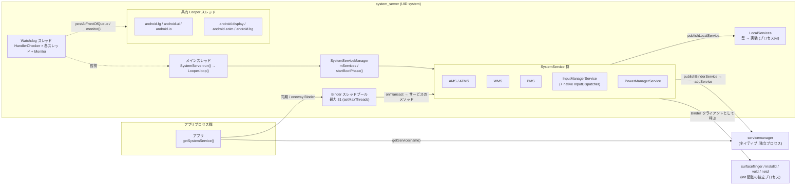
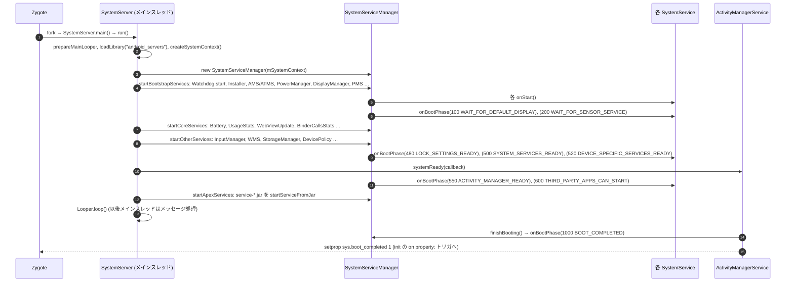

# system_server とシステムサービス (SystemServer, SystemServiceManager & Watchdog)

## 概要 (Overview)

[`boot-init-properties.md`](boot-init-properties.md) は、init が Zygote を起動し、Zygote が `--start-system-server` を受けて **system_server** を fork するところで終わる。本ドキュメントはその続き、つまり `SystemServer.main()` の最初の行から、約百のフレームワークサービスが段階的に立ち上がり、`sys.boot_completed=1` が設定されるまでを追い、さらに起動後の system_server を支配する三つの構造、**スレッドモデル・大きなロック・Watchdog による自己監視**を分析する。

system_server は UID `system` で動く単一の Java プロセスで、ActivityManager・WindowManager・PackageManager・InputManager・PowerManager などフレームワーク層の中枢をほぼすべて抱える([`platform-architecture.md`](platform-architecture.md) の「カーネルの外のカーネル」)。本ドキュメントが答える問い: 数百のサービスの起動順序は何で決まり、互いの依存はどう解決されるのか。サービスはなぜ「Binder で公開するもの」と「プロセス内でだけ共有するもの」に分かれるのか。数十本の Binder スレッドが同時に叩く巨大プロセスは、どうやってデッドロックと停滞を検出し、自力で立ち直るのか。そしてこの設計は、なぜ Android で最も価値の高い攻撃対象を生むのか。分析深度は Level 3。

## 方法論 (Methodology)

- 機構の基準線 (baseline) には有野 (2017) Ⅰ巻 1.3(Activity・ActivityThread・Binder・SystemServer・Zygote の速習、Android 7.0 Nougat 基準)と Ⅱ巻 5 章(Zygote と ActivityThread)を用いる。書籍は system_server をサービスの入れ物として速習するに留まるため、内部構造は現行 AOSP で再構成する。
- 現在の姿は AOSP `frameworks/base` の `main` ブランチ(GitHub ミラー `aosp-mirror/platform_frameworks_base`、2026-09-27 参照)で確認した: `services/java/com/android/server/SystemServer.java`、`services/core/java/com/android/server/{SystemService,SystemServiceManager,Watchdog,DisplayThread,UiThread}.java`、`core/java/com/android/internal/os/BackgroundThread.java`、`services/core/java/com/android/server/wm/WindowManagerGlobalLock.java`、`services/core/java/com/android/server/pm/PackageManagerService.java`、`core/jni/com_android_internal_os_Zygote.cpp`、および `system/core/rootdir/init.zygote64.rc`。行番号は改訂で動くため、クラス・メソッド・定数名で参照する。
- 各機構について「制約(単一プロセス・起動時間・可用性)→ 設計」の対応を取り、Nougat からの差分は技術詳細 §11 の表に集約する。導入バージョンを公開資料で確定できなかったものは本文で「確度」を明記する。
- Binder の下回り(binder_proc・スレッドプール・oneway)は [`binder-internals.md`](binder-internals.md)、権限モデル全体は [`security-model.md`](security-model.md)、メッセージループの内部は [`looper-handler-message-loop.md`](looper-handler-message-loop.md) に委ねる。

## 発見事項 (Findings)

1. **system_server の起動は「クラス名のリスト」と「単調増加する boot phase」の二軸で制御される。** `SystemServer.run()` は `startBootstrapServices` → `startCoreServices` → `startOtherServices` → `startApexServices` の順にサービスを生成し、各サービスの `onStart()` を呼ぶ。サービス間の依存は生成順だけでは表現しきれないため、`SystemServiceManager.startBootPhase()` が `PHASE_WAIT_FOR_DEFAULT_DISPLAY`(100)から `PHASE_BOOT_COMPLETED`(1000)までの**番号付きの同期点**を全サービスに一斉配信する。`startBootPhase` は新しい phase が現在値より大きいことを強制し、後戻りを許さない。これは、依存グラフを解く代わりに**全順序の「段」で近似する**割り切りである。
2. **サービスはリフレクションで生成される。** `SystemServiceManager.startService(Class)` は `getConstructor(Context.class)` → `newInstance(mContext)` でインスタンス化し、`startService(String className)` はビルド時に解決できないクラスを `SYSTEMSERVERCLASSPATH` から名前で読む。さらに `startServiceFromJar()` は `SystemServerClassLoaderFactory` で APEX 内の `service-*.jar`(例: `/apex/com.android.wifi/javalib/service-wifi.jar`)を別 ClassLoader で読み込む。**system_server の中身は、もはや system イメージだけで決まらない**。Mainline モジュールが system_server 内にコードを持ち込む。
3. **公開には二系統ある: Binder と LocalServices。** `publishBinderService()` は `ServiceManager.addService(name, binder, allowIsolated, dumpPriority)` で servicemanager に登録し、アプリから `getSystemService()` 経由で到達可能にする。`publishLocalService()` は `LocalServices.addService(Class, impl)`(プロセス内の型→実装マップ)に登録するだけで、**Binder を経由しない・権限検査を持たない・プロセス外から見えない**内部 API(`ActivityManagerInternal`、`PackageManagerInternal` 等)を提供する。system_server の「サービス間は普通のメソッド呼び出し」という性質は、この二系統の使い分けで成り立つ。
4. **system_server の内部は「共有シングルトンスレッド」と「31 本の Binder プール」の二層である。** メインスレッドのほか、`android.fg`(FgThread)・`android.ui`(UiThread)・`android.io`(IoThread)・`android.display`(DisplayThread)・`android.anim`(AnimationThread)・`android.bg`(BackgroundThread)など、用途と優先度の異なる Looper スレッドがプロセス内で共有される。外部からの呼び出しは `BinderInternal.setMaxThreads(sMaxBinderThreads)`(`sMaxBinderThreads = 31`)で上限付けされた Binder スレッドが受ける。**Binder スレッドは短く受けてロックを取るか Handler に回す**のが原則で、この規律が破れると全アプリの呼び出しが詰まる。
5. **最大の設計負債は「少数の大きなロック」である。** ActivityManagerService 自身のモニタ(いわゆる AMS lock)、ActivityTaskManagerService と WindowManagerService が共有する `WindowManagerGlobalLock`、PackageManagerService の `mLock`/`mInstallLock`/`mSnapshotLock` が、プロセス内の多数のコードパスを直列化する。PMS はロック順序をコメントで規定し(`mInstallLock` は `mLock` を保持したまま取ってはならない)、メソッド名の接尾辞 `LI`/`LIF`/`LPr`/`LPw` で「呼ぶ前に持つべきロック」を型のように表す。近年の改善は、ロックを細かく割るのではなく**読み取りをロックの外に出す**方向(PMS の `Computer`/snapshot)で進んでいる。
6. **Watchdog は system_server の「自殺装置」であり、その先には Zygote の道連れがある。** `Watchdog` は各共有スレッドに `HandlerChecker` を置き、`postAtFrontOfQueue` で空の確認メッセージを先頭に積んで応答を測り、モニタスレッド上では登録された `Monitor.monitor()`(実質「このロックを取れるか」)を順に呼ぶ。既定タイムアウトは 60 秒(`DEFAULT_TIMEOUT`、デバッグビルドは 10 秒)で、その 1/4 経過時点(`PRE_WATCHDOG_TIMEOUT_RATIO = 4`)で全スレッドのスタックを採取し、期限切れで `Process.killProcess(Process.myPid())` → `System.exit(10)` する。Zygote の SIGCHLD ハンドラは system_server の死を検知すると `"Exit zygote because system server (pid %d) has terminated"` を記録して自らを `SIGKILL` し、init が Zygote を再起動する。結果は**カーネルを再起動しない「ランタイム再起動 (soft reboot)」** である。
7. **ネイティブサービスの多くは system_server の外にあるが、全部ではない。** surfaceflinger・servicemanager・installd・vold・netd・audioserver・cameraserver 等は init が起動する独立プロセスで、system_server が死んでも生き残る(Zygote の `onrestart` で再起動されるものを除く)。一方、`libandroid_servers` を通じて system_server 内に載るネイティブ部品(InputReader/InputDispatcher、SensorService 等)もあり、**「Java のサービス = system_server、ネイティブ = 別プロセス」という単純な対応は成り立たない**。

## アーキテクチャ (Architecture)

### system_server の内部構造 — サービス・スレッド・外部との境界



凡例: 実線は呼び出し・登録、点線は監視。`subgraph` はプロセス境界またはスレッド群を表す。

- **入口は二つ**: servicemanager に登録された名前を引いて Binder で入る外部経路と、`LocalServices.getService(Class)` で直接オブジェクトを得るプロセス内経路。前者は `Binder.getCallingUid()` による権限検査を伴い、後者は伴わない(§4)。
- **system_server は「サーバ」であると同時に「クライアント」でもある**: surfaceflinger・installd・vold などの独立デーモンに対して Binder クライアントとして振る舞う。installd が単一スレッドで遅い(PMS のコメント)ことが `mInstallLock` という別ロックの存在理由になる、というように、**外部デーモンの性質が system_server 内部のロック設計を規定する**。

### 起動の時系列 — サービス群と boot phase



- phase の数値は `SystemService.java` の定数値である。数値が飛び飛び(480, 500, 520, 550)なのは、**後から間に phase を挿入できる余地**を残すためと読める(`PHASE_DEVICE_SPECIFIC_SERVICES_READY` = 520 は実際に後から挿入された例と考えられるが、導入版は未確定)。
- `PHASE_BOOT_COMPLETED` は SystemServer 自身ではなく AMS の `finishBooting()` から発火する。つまり**起動の最終段は「最初のホーム画面が出て、ユーザ 0 の起動処理が進んだ」という AMS 側の事実**に同期しており、`run()` の直線的な処理の外にある。

## 技術詳細 (Technical Details)

### 1. SystemServer.main() と run() — プロセスの準備

- `main()` は `new SystemServer().run()` を呼ぶだけである。コンストラクタは `sys.system_server.start_count` を読み、`mRuntimeRestart = mStartCount > 1` で「これはランタイム再起動か」を判定する(起動時間メトリクスの記録をこれで分ける)。
- `run()` の前半は**プロセスの性格付け**である: `Process.setThreadPriority(THREAD_PRIORITY_FOREGROUND)` と `setCanSelfBackground(false)` でメインスレッドが背景優先度に落ちないようにし、`VMRuntime.getRuntime().clearGrowthLimit()` でアプリ用のヒープ上限を外し、`Binder.setWarnOnBlocking(true)` で system_server から他プロセスへの**同期 Binder 呼び出しに警告**を出させる(アプリに同期で呼ばれて待たされることは、system_server にとって可用性上の危険だからである)。
- `Looper.prepareMainLooper()` の後、`setSlowLogThresholdMs(SLOW_DISPATCH_THRESHOLD_MS = 100, SLOW_DELIVERY_THRESHOLD_MS = 200)` でメインループの遅延ログを有効にする([`looper-handler-message-loop.md`](looper-handler-message-loop.md) §6)。`System.loadLibrary("android_servers")` で JNI 層(`services/core/jni/`)を読み込み、`createSystemContext()` で `ActivityThread.systemMain()` を経由した**システム用の Context**を作る。system_server は「framework-res.apk をリソースとして持つ特殊なアプリ」として自分を初期化する。
- 起動中の並列化には `SystemServerInitThreadPool.start()` が使われ、`SystemServiceManager` は `PHASE_BOOT_COMPLETED` 到達時にこのプールを畳む。末尾は `Looper.loop()` と `throw new RuntimeException("Main thread loop unexpectedly exited")` で、メインループの終了はプロセスの異常と同義である。

### 2. SystemServiceManager — リフレクション・順序・計時

- `startService(SystemService)` は `mServices` に追加し、`mServiceClassnames` で重複起動を防ぎ、`onStart()` を呼んで所要時間を `SERVICE_CALL_WARN_TIME_MS`(50ms)と比較して警告する。`startBootPhase()` も各サービスの `onBootPhase()` を同じ 50ms 閾値で計時する。**遅いサービスを名指しで記録する**ことが、起動時間の回帰を防ぐ第一の手段になっている。
- リフレクションの意味: `SystemServer.java` はクラス名文字列(`startService(String)`)で生成するサービスを多数含み、ビルド構成によって存在しないサービス(Wear・Auto・TV 固有)を同じ起動コードから扱える。代償は**コンパイル時の依存検査が働かない**ことで、依存の正しさは boot phase の規律とテストに委ねられる。
- 典型的な実装パターンは `Lifecycle` 内部クラスである: `ActivityManagerService.Lifecycle`・`InputManagerService.Lifecycle` のように、`SystemService` を継承した薄い殻が本体を生成して `onStart()` で publish する。本体クラスが `SystemService` の単一継承に縛られず、既存の `IFoo.Stub` 継承を保てる。
- ただし WMS は例外的に `WindowManagerService.main(context, inputManager, ...)` で生成され、`ServiceManager.addService(Context.WINDOW_SERVICE, wm, false, DUMP_FLAG_PRIORITY_CRITICAL | ...)` で**直接** servicemanager に登録される。SystemService 化以前の古い形が中枢サービスに残っている例である。

### 3. SystemService のライフサイクル — boot phase とユーザ

| phase 定数 | 値 | Javadoc の意味(要約) |
|---|---|---|
| `PHASE_WAIT_FOR_DEFAULT_DISPLAY` | 100 | 最初期の phase。既定ディスプレイの準備を待つ |
| `PHASE_WAIT_FOR_SENSOR_SERVICE` | 200 | SensorService の利用可能を待つ |
| `PHASE_LOCK_SETTINGS_READY` | 480 | ロック設定(LockSettings)のデータを取得できる |
| `PHASE_SYSTEM_SERVICES_READY` | 500 | PowerManager・PackageManager 等のコアサービスを安全に呼べる |
| `PHASE_DEVICE_SPECIFIC_SERVICES_READY` | 520 | デバイス固有サービスを安全に呼べる |
| `PHASE_ACTIVITY_MANAGER_READY` | 550 | Intent をブロードキャストできる |
| `PHASE_THIRD_PARTY_APPS_CAN_START` | 600 | サードパーティアプリを起動・bind できる |
| `PHASE_BOOT_COMPLETED` | 1000 | ユーザ操作を許可できる |

- **`onStart()` でやってよいこと**は「自分を publish する」ことまでで、他サービスを呼ぶのは該当 phase の `onBootPhase()` を待つ、というのが契約である。例えば `PHASE_THIRD_PARTY_APPS_CAN_START` より前にサードパーティアプリへ bind すると、PMS のパッケージ走査や AMS の準備が終わっていない可能性がある。
- **ユーザライフサイクル**: マルチユーザ対応のため、`onUserStarting` → `onUserUnlocking`(資格情報で暗号化されたストレージ (CE) が使えるようになる)→ `onUserUnlocked` → `onUserSwitching(from, to)` → `onUserStopping` → `onUserStopped`、および非同期の `onUserCompletedEvent` がある(引数は `TargetUser`)。`SystemServiceManager.onUser()` が全サービスに配信し、`isUserSupported()` が false のサービスは対象外になり、一部の配信はスレッドプールで並列化される。**boot phase が「端末」の段階、user callback が「ユーザ」の段階**という二次元のライフサイクルである。
- Nougat の同等 API は `onStartUser(int)`・`onUnlockUser(int)`・`onSwitchUser(int)`・`onStopUser(int)` で、`TargetUser` を取る現行名への改名は Android 11 前後と考えられる(確度: 中)。

### 4. 公開と取得 — ServiceManager と LocalServices

- `publishBinderService(name, service, allowIsolated, dumpPriority)` は `ServiceManager.addService()` への薄い委譲である。`allowIsolated` は isolatedProcess(UID が隔離範囲のサンドボックス、例: WebView レンダラ)からの取得を許すかどうか、`dumpPriority` は `dumpsys` のバグレポート採取優先度を決める。登録の可否は servicemanager 側で SELinux の `service_manager` クラス(`add` 権限)により検査される([`binder-internals.md`](binder-internals.md))。
- `publishLocalService(Class<T>, T)` は `LocalServices.addService()` で型をキーに登録し、他サービスは `LocalServices.getService(ActivityManagerInternal.class)` のように取得する。**`*Internal` 抽象クラスは system_server 内部専用の API 境界**であり、Binder 境界を越えないため Parcel 化・権限検査・`clearCallingIdentity` が不要になる。
- **帰結**: 同じ機能に「外向き(AIDL、権限検査あり)」と「内向き(Internal、検査なし)」の二つの入口ができる。外向き入口で検査を済ませてから内部実装に委譲する形が基本で、**検査を外向き入口で漏らすと、内向き API の無防備さがそのまま外に露出する**(セキュリティ考察)。

### 5. 主要サービスの配置

| サービス | 起動段 | 役割 | 関連ドキュメント |
|---|---|---|---|
| ActivityManagerService (AMS) | bootstrap | プロセス・サービス・ブロードキャスト・oom_score_adj | [`app-components-lifecycle.md`](app-components-lifecycle.md)、[`memory-lmkd.md`](memory-lmkd.md) |
| ActivityTaskManagerService (ATMS) | bootstrap | Activity・タスク(Android 10 で AMS から分離、パッケージ `com.android.server.wm`) | [`app-launch-end-to-end.md`](app-launch-end-to-end.md) |
| PackageManagerService (PMS) | bootstrap | パッケージ走査・インストール・インテント解決・権限 | [`package-management.md`](package-management.md) |
| PowerManagerService | bootstrap | WakeLock・画面状態・スリープ | [`../operating-systems/power-management.md`](../operating-systems/power-management.md) |
| DisplayManagerService | bootstrap | 論理ディスプレイ(phase 100 の待ち合わせ対象) | [`graphics-pipeline.md`](graphics-pipeline.md) |
| WindowManagerService (WMS) | other | ウィンドウ・Surface 配置・フォーカス | [`view-system-layout.md`](view-system-layout.md) |
| InputManagerService | other | 入力(ネイティブの InputReader/InputDispatcher を同一プロセスに持つ) | [`input-pipeline.md`](input-pipeline.md) |
| Mainline のサービス(Wi-Fi、Bluetooth 等) | apex | APEX 内 `service-*.jar` | [`package-management.md`](package-management.md) |

- **Installer は最初期に起動される**: `startBootstrapServices` の冒頭で installd への接続を確立し、PMS が起動時の走査でディレクトリ作成・権限設定を installd に頼めるようにする。特権操作は installd、判断は PMS という書籍 Ⅱ巻 2 章の分業は現在も同じである。

### 6. スレッドモデル — 共有 Looper スレッドと Binder プール

- **共有シングルトンスレッド**: `ServiceThread`(`HandlerThread` の派生)として実装され、`getHandler()` で共有される。`UiThread`(`android.ui`、`THREAD_PRIORITY_FOREGROUND`)の Javadoc は「UI 表示用の共有スレッド。数 ms を超える処理を置いてはならない」と述べ、`DisplayThread`(`android.display`)は「表示に影響する処理のための最小遅延スレッド」で優先度は `THREAD_PRIORITY_DISPLAY + 1`(AnimationThread より一段低い)、`BackgroundThread`(`android.bg`)は `THREAD_PRIORITY_BACKGROUND` の汎用背景スレッドである。FgThread(`android.fg`)は「時間がかかってもよいが遅れてはならない」前景処理、IoThread(`android.io`)は I/O 待ちを伴う処理の置き場である。**スレッドを用途と優先度で先に用意し、各サービスは自前スレッドを作らずに借りる**ことで、スレッド数と優先度設計をプロセス全体で統制する。
- **Binder プール**: `BinderInternal.setMaxThreads(31)` は、カーネルがユーザ空間に追加の Binder スレッド生成を要求できる上限である。アプリからの同期呼び出しはこのプールの 1 本を呼び出し完了まで占有するため、**遅いハンドラやロック待ちが重なるとプールが枯渇**し、以後の全 IPC が待ち行列に並ぶ。Watchdog の `BinderThreadMonitor` は「Binder スレッドが空くまでブロックする」モニタで、枯渇を停滞として検出する(§8)。
- **Binder スレッド → Handler の乗り換え**: 長い処理は Binder スレッドで受けてから専用スレッドの Handler に回すのが原則である。ただし乗り換え後は呼び出し元の身元(`Binder.getCallingUid()`)が失われるため、**権限検査は乗り換え前に行う**([`looper-handler-message-loop.md`](looper-handler-message-loop.md) セキュリティ考察)。

### 7. 大きなロックとロック順序

- **AMS lock**: `ActivityManagerService` のインスタンス自身をモニタとする `synchronized (this)` が歴史的に広範囲を守ってきた。プロセス状態には専用の `mProcLock` が追加されるなど、分割は段階的に進んでいる(導入版は未確定、確度: 中)。
- **`WindowManagerGlobalLock`**: WMS と ATMS が共有するグローバルロックの型で、Javadoc は「WM のクリティカルセクションで CPU ブーストを行うため、`services/core/Android.bp` のパターンに合わせてクラスを用意している」と述べる。つまりこのロックの保持区間は**ビルド時の書き換えで CPU ブーストが挿入される**ほど性能上重要である。Activity 管理が Android 10 で `com.android.server.wm` に移り、Activity とウィンドウが同じロックを共有するようになったことは、両者の状態が不可分に絡むことの表れである。
- **PMS のロック**: `mLock`(メモリ上のパッケージ状態、「システムで最も競合するロックの一つ」なので瞬間的に持つ)、`mInstallLock`(installd 呼び出し。installd は単一スレッドで遅いので `mLock` 保持中に取ってはならない)、`mSnapshotLock`(snapshot の有効性。`mLock` 保持中に取ってはならないが、逆は可)。読み取りは `snapshotComputer()` が返す `Computer`(ライブまたは深いコピー)経由でロック外に逃がす。
- **ロック順序の問題**: 大きなロック同士を異なる順序で取ればデッドロックする。システムサービス間の呼び出しは「どのロックを持ったまま他サービスを呼んでよいか」の暗黙の規約に依存しており、規約違反は Watchdog のスタックダンプに「同じロックを待つ多数の Binder スレッド」として現れる。PMS の接尾辞規約(`LI`/`LIF`/`LPr`/`LPw`)は、この規約を名前で可視化する試みである。一般論は [`../operating-systems/process-thread-scheduling.md`](../operating-systems/process-thread-scheduling.md) の優先度逆転と同型である。

### 8. Watchdog とランタイム再起動

```
 Watchdog.run() の骨格(要約。定数名は現行 AOSP Watchdog.java に対応)
   loop:
     for each HandlerChecker hc: hc.scheduleCheckLocked(timeout)
         … 各スレッドの Looper に postAtFrontOfQueue(hc) / モニタスレッドは Monitor.monitor() を順に実行
     wait(checkInterval)                        … timeout / PRE_WATCHDOG_TIMEOUT_RATIO(= 60s/4 = 15s)
     state = 最悪の hc の状態 ∈ {COMPLETED, WAITING, WAITED_UNTIL_PRE_WATCHDOG, OVERDUE}
     WAITED_UNTIL_PRE_WATCHDOG → system_server 全スレッドのスタックを採取(初回のみ)
     OVERDUE → 停滞スレッド名とスタック・関連ネイティブプロセスのトレースを記録
               → Process.killProcess(Process.myPid()); System.exit(10)
```
(擬似コード。計算量: 1 周期あたり O(チェッカ数 + モニタ数)。前提: 各 Looper が生きていれば先頭に積んだメッセージは次の dispatch で即座に処理される)

- **`postAtFrontOfQueue` の意味**: 確認メッセージをキューの先頭に置くので、測っているのは「キューの長さ」ではなく「**今処理中のメッセージが終わらない**」ことである。モニタ(`Monitor.monitor()` の典型的実装は対象ロックを取って即座に離すだけ)は「このロックが永遠に取れない」ことを測る。監視対象は foreground・main・ui・i/o・display・animation・surface animation の各スレッドと、モニタ専用チェッカである。
- **Nougat との差**: 書籍時点の Watchdog は 60 秒の半分(30 秒)で `WAITED_HALF` として事前ダンプを取った。現行は 1/4(15 秒)時点の `WAITED_UNTIL_PRE_WATCHDOG` に前倒しされ、停滞の早い段階の状態を残せるようになった。
- **死後の連鎖**: system_server が死ぬ(Watchdog による自殺でも、未捕捉例外でも)と、Zygote の `SigChldHandler` が `pid == gSystemServerPid` を検知して自らを `kill(getpid(), SIGKILL)` する。init は Zygote の死に対して `init.zygote64.rc` の `onrestart` を実行し(`restart audioserver`・`cameraserver`・`media`・`netd`・`wificond`、`write /sys/power/state on` 等)、Zygote を再起動する。新しい Zygote が新しい system_server を fork し、`sys.system_server.start_count` が増えて `mRuntimeRestart` が真になる。**全アプリは(Zygote の子なので)この過程で失われるが、カーネル・surfaceflinger・vold 等は生き残る**。これが「soft reboot」の正体である。
- **連続失敗の行き先**: Zygote は `critical window=${zygote.critical_window.minute:-off} target=zygote-fatal` を持ち、窓が設定されていれば短時間の繰り返し失敗は init の fatal reboot 経路に落ちる([`boot-init-properties.md`](boot-init-properties.md) §5)。

### 9. 権限検査の型 — getCallingUid と clearCallingIdentity

- Binder ドライバはトランザクションに送信元の PID/UID を刻印し、`Binder.getCallingUid()`/`getCallingPid()` がそれを返す。サービスは `enforceCallingOrSelfPermission()`・`checkCallingPermission()` 等でこれを検査する([`security-model.md`](security-model.md))。
- `Binder.clearCallingIdentity()` は現在スレッドの呼び出し元身元を**自プロセス(system)に差し替え**、以前の値をトークンとして返す。system_server が「呼び出し元の検査は済んだので、以後の内部処理(他サービス呼び出し・ファイル操作)は system として行う」ときに使い、`finally` で `restoreCallingIdentity(token)` する(`Binder.withCleanCallingIdentity` はその糖衣)。**clear を検査の前に置く、restore を忘れる、clear した区間で呼び出し元が指定したパスや Intent を処理する**のが典型的な誤用である。

### 10. ネイティブサービス・Mainline・起動時間計測

- **system_server の外**: servicemanager(Binder の名前解決、Android 11 以降は AIDL の C++ 実装)、surfaceflinger(合成)、installd(パッケージのファイル操作)、vold(ストレージ・暗号化)、netd、audioserver・cameraserver・mediaserver 系、lmkd 等は init.rc から起動される独立プロセスである。system_server に比べて小さく、SELinux ドメインで権限を絞りやすい。これは**特権の強い仕事ほど小さな別プロセスへ**という方向である([`platform-architecture.md`](platform-architecture.md))。
- **APEX サービス**: `startApexServices` は APEX が宣言したシステムサービスを列挙し、`startServiceFromJar(className, jarPath)` で `SystemServerClassLoaderFactory` が作る ClassLoader から生成する。モジュールごとの ClassLoader により、Mainline モジュールの jar を system イメージの OTA なしに Play 経由で更新できる([`package-management.md`](package-management.md))。代償として system_server の起動経路に「`/data` 上の更新済み APEX が正しく活性化されていること」が加わる。
- **起動時間計測**: `TimingsTraceAndSlog` は区間ごとに `Trace` のスライスとログ(タグ `SystemServerTiming`)を同時に出す。`adb logcat -s SystemServerTiming` で各サービスの `onStart`・各 phase の所要時間が得られ、Perfetto では同名スライスとして見える。EventLog の `boot_progress_*`(`boot_progress_system_run`・`boot_progress_pms_start`・`boot_progress_ams_ready`・`boot_progress_enable_screen` 等)は起動の里程標である。

### 11. 何が変わり、何が変わっていないか (2016 Nougat → 現在)

| 機構 | Nougat (書籍) | 現在 | 変化の理由 |
|---|---|---|---|
| 起動の構造 | `startBootstrapServices`/`startCoreServices`/`startOtherServices`、`SystemServiceManager` と boot phase(Ⅰ巻 1.3 の速習の範囲) | 同骨格に `startApexServices` が追加、phase に `WAIT_FOR_DEFAULT_DISPLAY`・`WAIT_FOR_SENSOR_SERVICE`・`DEVICE_SPECIFIC_SERVICES_READY` | Mainline、起動並列化と依存の明確化 |
| サービスの出所 | system イメージの `services.jar` | `SYSTEMSERVERCLASSPATH` + APEX の `service-*.jar`(`SystemServerClassLoaderFactory`) | サービス単位の更新可能性(Mainline) |
| Activity 管理 | AMS 内(`ActivityStackSupervisor`)、AMS lock で直列化 | ATMS(`com.android.server.wm`)に分離、WMS と `WindowManagerGlobalLock` を共有 | Activity とウィンドウの状態の一体管理 |
| ユーザライフサイクル | `onStartUser(int)` 等 | `onUserStarting(TargetUser)` 等、`onUserCompletedEvent`、並列配信 | マルチユーザ・ヘッドレスシステムユーザ対応 |
| PMS のロック | `mPackages` を中心とする大ロック + `mInstallLock` | `mLock`・`mInstallLock`・`mSnapshotLock`、`Computer` snapshot による読み取りのロック外化 | 最も競合するロックの読み取り負荷の除去 |
| Watchdog | 60 秒、30 秒で事前ダンプ(`WAITED_HALF`) | 60 秒、15 秒で事前ダンプ(`WAITED_UNTIL_PRE_WATCHDOG`)、`BinderThreadMonitor` | 停滞初期の状態の保存 |
| 不変のもの | UID system の単一プロセス、Zygote からの fork、Binder + ServiceManager による公開、共有 Looper スレッド、Watchdog → 自殺 → Zygote 道連れ → ランタイム再起動 | 同左 | 「サービス間の呼び出しを安く」と「自己修復」の要件は変わっていない |

- 書籍 Ⅰ巻・Ⅱ巻の対応表では Nougat の `mPackages` 大ロックや `WAITED_HALF` の詳細までは扱われておらず、上表の Nougat 列の一部は AOSP `android-7.0.0` 系ソースの一般的な知識に基づく(確度: 中)。

## セキュリティ考察 (Security Considerations)

- **system_server はフレームワーク層で最も価値の高い標的である。** UID `system` で動き、全アプリの権限表・パッケージ情報・ウィンドウを保持するため、ここでの任意コード実行は「フレームワーク層の権限検査すべての無効化」に等しい([`security-model.md`](security-model.md) の単一障害点)。残る防壁は SELinux の `system_server` ドメインとハードウェア層であり、それが Treble 以後 HAL やデーモンを別プロセス・別ドメインに切り出してきた理由でもある。
- **混乱した代理 (confused deputy) が主要な脆弱性類型である。** system_server は高い権限で他者の依頼を代行するので、「依頼内容の検証漏れ」がそのまま権限昇格になる。[`app-launch-end-to-end.md`](app-launch-end-to-end.md) で扱った CVE-2024-31317 は、system_server が設定値をエスケープせず Zygote 引数に埋め込んだため、設定の書き込み権限が任意 UID でのプロセス生成に化けた例である。Intent・PendingIntent・Bundle など**呼び出し元が中身を決めるオブジェクトを system の権限で処理する**箇所が、構造的な危険点である。
- **`clearCallingIdentity` の誤用は検査のバイパスになる。** clear した区間では `getCallingUid()` が system を返すため、その区間内で権限検査を行えば常に成功する。検査は clear の前に、呼び出し元身元で行わなければならない。LocalServices の `*Internal` API は検査を持たないので、外向き AIDL 入口での検査漏れは内部 API の全権をそのまま外に渡す(§4)。
- **Binder 経由の DoS は、アプリが system_server の可用性を削る手段である。** 31 本の Binder プールを遅い同期呼び出しで埋める、大ロックを長く保持させる経路を叩く、大量の Binder オブジェクトを登録させる、といった攻撃は、Watchdog の発動 → ランタイム再起動という形で**端末全体の DoS**になる。対策として system_server は他プロセスへの同期呼び出しを `setWarnOnBlocking` で警告し、アプリへの呼び出し(IApplicationThread 等)を oneway にし、`BinderCallsStatsService` で呼び出し元別の負荷を計測する。Watchdog 自体は可用性を取り戻す仕組みだが、**攻撃者が再現可能な停滞を起こせれば、Watchdog は再起動ループの駆動装置になる**。
- **APEX による system_server へのコード持ち込みは、署名検証が境界になる。** `service-*.jar` は system_server 内で同じ権限で動くため、APEX の署名検証と活性化(apexd)が system_server のコード完全性の一部になる([`boot-init-properties.md`](boot-init-properties.md) の APEX・odsign)。

## 結論 (Conclusions)

- system_server は「数百のサービスを一つのプロセスに入れ、呼び出しを安くする」という設計判断の実体であり、その起動は**クラス名のリストと単調な boot phase**という単純な二軸で制御される。依存グラフを解かずに全順序の段で近似する割り切りが、多数のサービスを同じ起動コードに収めることを可能にしている。
- 同一プロセスであることの利益(LocalServices による検査なしの直接呼び出し、共有 Looper スレッド)と代償(大きなロックとロック順序、Binder プール枯渇、単一障害点)は表裏一体であり、Watchdog → Zygote 道連れ → ランタイム再起動という**自殺による自己修復**が、この代償を可用性の面で受け止めている。
- Nougat から現在までの変化は、基本構造の置き換えではなく**Mainline によるコードの出所の多様化**(APEX サービス)と、**ロック競合の局所的な解消**(ATMS の分離、PMS の snapshot)に集中している。「単一の巨大な特権プロセス」という構造は 10 年間維持されており、セキュリティ上の課題もそこに根差したまま残っている。

### 次の接続先 (Related Topics)

- [`boot-init-properties.md`](boot-init-properties.md) — Zygote が system_server を fork するまでと、`sys.boot_completed` で連鎖する init の action。
- [`binder-internals.md`](binder-internals.md) — servicemanager、Binder スレッドプール、`linkToDeath`、oneway の意味論。
- [`app-launch-end-to-end.md`](app-launch-end-to-end.md) — ATMS/AMS がアプリを起動する 15 ホップ。
- [`looper-handler-message-loop.md`](looper-handler-message-loop.md) — 共有スレッドの Looper、slow ログ、Watchdog が測るメッセージループ。
- [`package-management.md`](package-management.md) — PMS と installd、APEX/Mainline。
- [`input-pipeline.md`](input-pipeline.md) ／ [`graphics-pipeline.md`](graphics-pipeline.md) — system_server 内の InputDispatcher と、外の surfaceflinger。
- [`security-model.md`](security-model.md) — 権限検査の層と system_server の単一障害点性。
- [`memory-lmkd.md`](memory-lmkd.md) — AMS が計算する oom_score_adj と lmkd。
- [`../operating-systems/process-thread-scheduling.md`](../operating-systems/process-thread-scheduling.md) — スレッド優先度とロックによる優先度逆転の一般論。

## 参考文献 (References)

**一次資料 (Primary — AOSP / Google)**

- AOSP, `frameworks/base/services/java/com/android/server/SystemServer.java`(`run`・`startBootstrapServices`・`startCoreServices`・`startOtherServices`・`startApexServices`、`sMaxBinderThreads`). — [github.com/aosp-mirror/platform_frameworks_base/.../SystemServer.java](https://github.com/aosp-mirror/platform_frameworks_base/blob/main/services/java/com/android/server/SystemServer.java) — Accessed: 2026-09-27。
- AOSP, `services/core/java/com/android/server/SystemService.java`(`PHASE_*` 定数、ユーザライフサイクル、`publishBinderService`・`publishLocalService`). — [github.com/aosp-mirror/platform_frameworks_base/.../SystemService.java](https://github.com/aosp-mirror/platform_frameworks_base/blob/main/services/core/java/com/android/server/SystemService.java) — Accessed: 2026-09-27。
- AOSP, `services/core/java/com/android/server/SystemServiceManager.java`(`startService`・`startServiceFromJar`・`startBootPhase`・`SERVICE_CALL_WARN_TIME_MS`). — [github.com/aosp-mirror/platform_frameworks_base/.../SystemServiceManager.java](https://github.com/aosp-mirror/platform_frameworks_base/blob/main/services/core/java/com/android/server/SystemServiceManager.java) — Accessed: 2026-09-27。
- AOSP, `services/core/java/com/android/server/Watchdog.java`(`DEFAULT_TIMEOUT`・`PRE_WATCHDOG_TIMEOUT_RATIO`・`HandlerChecker`・`BinderThreadMonitor`). — [github.com/aosp-mirror/platform_frameworks_base/.../Watchdog.java](https://github.com/aosp-mirror/platform_frameworks_base/blob/main/services/core/java/com/android/server/Watchdog.java) — Accessed: 2026-09-27。
- AOSP, `services/core/java/com/android/server/{DisplayThread,UiThread}.java`、`core/java/com/android/internal/os/BackgroundThread.java`、`services/core/java/com/android/server/wm/WindowManagerGlobalLock.java`. — [github.com/aosp-mirror/platform_frameworks_base/tree/main/services/core/java/com/android/server](https://github.com/aosp-mirror/platform_frameworks_base/tree/main/services/core/java/com/android/server) — Accessed: 2026-09-27。
- AOSP, `services/core/java/com/android/server/pm/PackageManagerService.java`(ロック順序コメント、`LI`/`LPr`/`LPw` 規約、`Computer`/snapshot). — [github.com/aosp-mirror/platform_frameworks_base/.../PackageManagerService.java](https://github.com/aosp-mirror/platform_frameworks_base/blob/main/services/core/java/com/android/server/pm/PackageManagerService.java) — Accessed: 2026-09-27。
- AOSP, `core/jni/com_android_internal_os_Zygote.cpp`(`SigChldHandler` による system_server 死亡時の Zygote 自殺). — [github.com/aosp-mirror/platform_frameworks_base/.../com_android_internal_os_Zygote.cpp](https://github.com/aosp-mirror/platform_frameworks_base/blob/main/core/jni/com_android_internal_os_Zygote.cpp) — Accessed: 2026-09-27。
- AOSP, `system/core/rootdir/init.zygote64.rc`(`onrestart`・`critical`). — [github.com/aosp-mirror/platform_system_core/blob/main/rootdir/init.zygote64.rc](https://github.com/aosp-mirror/platform_system_core/blob/main/rootdir/init.zygote64.rc) — Accessed: 2026-09-27。
- Android Developers, [Binder API reference (`clearCallingIdentity`・`getCallingUid`)](https://developer.android.com/reference/android/os/Binder) — Accessed: 2026-09-27。

**二次資料 (Secondary)**

- 有野和真 (2017).『Androidを支える技術〈I〉60fpsを達成するモダンなGUIシステム』技術評論社. ISBN 978-4-7741-8759-4. 1.3(Binder・SystemServer・Zygote の速習)。Android 7.0 Nougat 基準。
- 有野和真 (2017).『Androidを支える技術〈II〉真のマルチタスクに挑んだモバイルOSの心臓部』技術評論社. ISBN 978-4-7741-8861-4. 2 章(installd と PMS)、5 章(Zygote と ActivityThread)。
