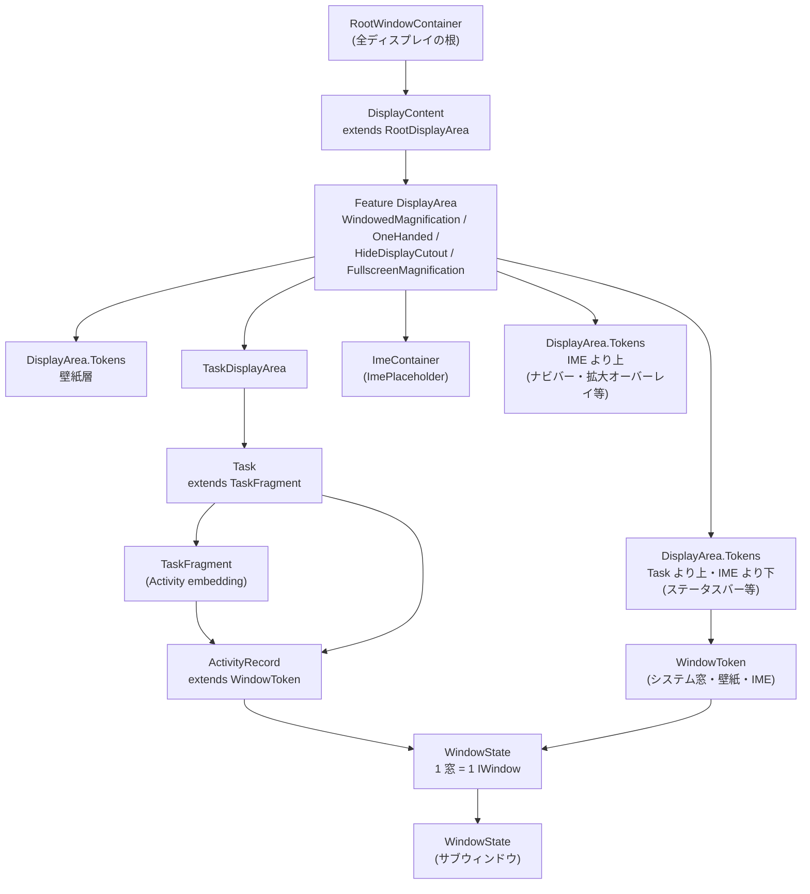
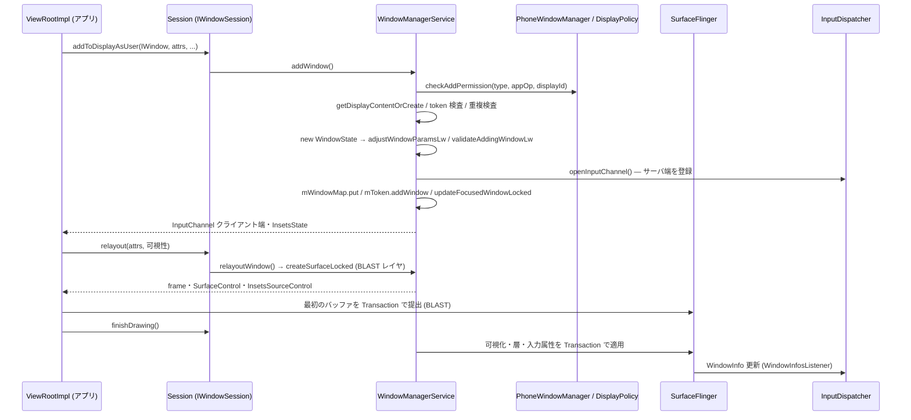

# ウィンドウマネージャ (WindowManagerService & Window Hierarchy)

## 概要 (Overview)

Android の画面に並ぶ「窓」——Activity の窓、ダイアログ、ステータスバー、ナビゲーションバー、IME、トースト、他アプリのオーバーレイ——の**配置・重なり順 (z-order)・大きさ・フォーカス・可視性**を一元的に決めるのが、system_server 内の **WindowManagerService (WMS)** である。WMS 自身は画素を 1 つも描かない。アプリ側の ViewRootImpl が窓の中身を描き([`view-system-layout.md`](view-system-layout.md))、SurfaceFlinger が合成し([`graphics-pipeline.md`](graphics-pipeline.md))、InputDispatcher が入力を配る([`input-pipeline.md`](input-pipeline.md))。WMS はその三者に「どの窓が、どこに、どの順で、どの状態で存在するか」という**唯一の真実 (single source of truth)** を供給する制御面 (control plane) である。

本ドキュメントは、WMS を中心にシステム側の窓管理を追う: `WindowContainer` の木構造(RootWindowContainer → DisplayContent → DisplayArea → Task → TaskFragment → ActivityRecord → WindowState)、窓の種類と z-order の決め方、`addWindow` の検査列、relayout と SurfaceControl の割り当て、フォーカスと入力への窓情報の供給、インセット、回転と構成変更、Shell Transitions、そしてマルチウィンドウ・Activity embedding・デスクトップウィンドウイングまで。

本ドキュメントが答える問い: WMS は ActivityTaskManagerService (ATMS) とどう分担し、なぜ同じロックを共有するのか。「窓が重なる順番」は誰がどのデータ構造で決めているのか。アプリはなぜ他アプリの窓に「なりすまし」できないのか。2016 年の Nougat で WMS が自前で回していたアニメーションと層番号は、現在どこへ行ったのか。分析深度は Level 3。

## 方法論 (Methodology)

- 機構の基準線には有野 (2017) Ⅰ巻 6.5(ViewRootImpl と WMS の関係、`relayoutWindow` と Surface 生成)・6.6.1(`SYSTEM_ALERT_WINDOW`)・2.5.2(`InputWindowHandle` の登録)、Ⅱ巻 4 章(ActivityStack とタスク)を用いる(いずれも Android 7.0 Nougat 基準、[`../../references/books/book-android-internals-arino.md`](../../references/books/book-android-internals-arino.md))。書籍のコードは簡略化擬似コードのため再引用しない。
- 現在の姿は AOSP `frameworks/base/services/core/java/com/android/server/wm/` のソースを GitHub の aosp-mirror(`platform_frameworks_base` の `main`、2025-11 時点のスナップショット)で確認した: `WindowManagerService.java`(`addWindow`・`relayoutWindow`・`sanitizeFlagSlippery`・`sanitizeInputFeatures`)、`WindowContainer.java`、`DisplayContent.java`、`DisplayAreaPolicy.java`、`DisplayAreaPolicyBuilder.java`、`WindowStateAnimator.java`、`ActivityRecord.java`、`TransitionController.java`、`InsetsSourceProvider.java`。行番号はファイル改訂で動くため、クラス・メソッド名で参照する。android.googlesource.com・source.android.com は本調査環境から到達できなかったため、AOSP 公式サイトの記述は二次的に扱う。
- アプリ向けの挙動(untrusted touch 遮断、Activity embedding、Android 16 の大画面挙動)は developer.android.com の behavior changes とガイドで確認した。導入版が一次資料で確定できなかったものは「不確かな点」として §8 と結論前に明記する。
- アプリ側(ViewRootImpl・インセットの消費)・入力配送・合成の詳細は兄弟ドキュメントに委ね、本書はそれらを結ぶシステム側の窓管理に絞る。

## 発見事項 (Findings)

1. **WMS と ATMS は「別サービス・同じロック」である。** Android 10 で Activity/タスク管理は ActivityManagerService から `com.android.server.wm` パッケージの ActivityTaskManagerService に移され、WMS はコンストラクタで `mGlobalLock = atm.getGlobalLock()` を取り込む(`WindowManagerService` のコンストラクタ)。この `WindowManagerGlobalLock` 1 本が Activity 状態と窓状態の両方を守るため、「Activity を前面に出す」と「その窓を最上位に置く」が**一つの原子的な状態遷移**として扱える。代償は、窓操作と Activity 操作が system_server 内で直列化されることである。
2. **窓管理は一本の木 (`WindowContainer`) に統一された。** Nougat では DisplayContent・TaskStack・Task・AppWindowToken・WindowState が個別のリストで管理されていたが、現在はすべて `WindowContainer<E>`(`mParent`・`mChildren`・`mSurfaceControl`・`mSurfaceAnimator` を持つ汎用ノード)の派生である。`DisplayContent` は `RootDisplayArea` を継承し、`ActivityRecord` は `WindowToken` を継承する。**木の形がそのまま SurfaceFlinger のレイヤ木の形**になり、z-order・クリップ・アニメーションは部分木単位で扱われる。
3. **z-order は「窓の型 → 層番号 → DisplayArea」で決まる。** 窓の型(アプリ 1–99、サブウィンドウ 1000–1999、システム 2000–2999)を `WindowManagerPolicy.getWindowLayerFromTypeLw()` が層番号に写し、`DisplayAreaPolicyBuilder` がその層番号の範囲ごとに `DisplayArea.Tokens` の葉を作る。拡大・片手モード・カットアウト隠しなどの「機能 (Feature)」は層範囲を覆う中間 DisplayArea として木に挿入される。**z-order は数値の比較ではなく、木の中での位置**になった。
4. **窓の追加は「権限 × トークン × 型」の三重検査である。** `addWindow` は `mPolicy.checkAddPermission()`(型に対する権限・AppOps)、`getDisplayContentOrCreate()`(ディスプレイへのアクセス)、`mWindowMap` による二重登録検査、`unprivilegedAppCanCreateTokenWith()`(トークンと型の整合)を通過した窓にだけ `WindowState` を作る。アプリが他アプリの Activity に窓を重ねられないのは、窓が**サーバ発行の IBinder トークン**に束ねられ、そのトークンが型と一致しなければ `ADD_BAD_APP_TOKEN` 等で拒否されるからである。
5. **WMS は SurfaceControl の木を操作する制御面であり、画素はアプリ → SurfaceFlinger の直接経路を通る。** 各 `WindowContainer` は自分の `SurfaceControl` を持ち、窓の中身用の Surface は `WindowStateAnimator.createSurfaceLocked()` が `WindowState` のサーフェスを親として BLAST レイヤで作る。アニメーションは対象の上に**リーシュ (leash)** と呼ぶ中間レイヤを挿し、それを動かす。Nougat の「WMS がフレームごとに全窓の位置と層を書き換える」方式は消えた。
6. **入力の宛先情報は WMS → SurfaceFlinger → InputDispatcher の順に流れる。** Nougat では WMS が `InputWindowHandle` の一覧を直接 InputDispatcher に登録したが、現在 WMS は窓の入力属性を SurfaceControl のトランザクションに載せ、SurfaceFlinger が合成と同じレイヤ木から `WindowInfo` を計算して配る([`input-pipeline.md`](input-pipeline.md) 発見事項 3)。**見えている窓と、タッチが届く窓が同じ木から計算される**ことで、両者の食い違いを突く攻撃面が縮んだ。
7. **遷移 (transition) の主体は system_server から SystemUI 内の WM Shell に移った。** Shell Transitions では、system_server の `TransitionController` が変化に関与する container を「収集」し、`BLASTSyncEngine` で全参加窓の描画完了を待ってから、SystemUI プロセスの `ITransitionPlayer`(WM Shell の `Transitions`)に「開始時と終了時のスナップショット」を渡し、アニメーションは Shell が行う。分割画面・PiP・デスクトップウィンドウイングも Shell 側の `TaskOrganizer` 系 API で実装され、**ポリシーと演出は SystemUI、状態の真実は WMS** という分業になった。

## アーキテクチャ (Architecture)

### 窓の木 — WindowContainer 階層

凡例: 矢印は `WindowContainer` の親 → 子。左から右が z-order の下 → 上(兄弟順)。Feature DisplayArea は層範囲を覆う中間ノードで、実際には複数段に入れ子になる。

- 木の形は `DisplayAreaPolicyBuilder` のクラス Javadoc に例示されている(`RootDisplayArea (DisplayContent)` → `WindowedMagnification` → `DisplayArea.Tokens` / `TaskDisplayArea` / `ImeContainers` …)。既定のポリシー `DisplayAreaPolicy.DefaultProvider` は `configureTrustedHierarchyBuilder` で 5 つの Feature を登録する: `WindowedMagnification`(`TYPE_ACCESSIBILITY_MAGNIFICATION_OVERLAY` 未満の全層)、`HideDisplayCutout`(ナビバー・ステータスバー・通知シェード以外、既定ディスプレイのみ)、`OneHanded`(ナビバー・`TYPE_SECURE_SYSTEM_OVERLAY` 以外、既定ディスプレイのみ)、`FullscreenMagnification`(IME・ナビバー・拡大オーバーレイ以外)、`ImePlaceholder`(IME 窓のみ)。
- 設計の要点は、**機能ごとに「どの層の窓をまとめて動かすか」を木の部分木として宣言できる**ことである。片手モードは `OneHanded` の DisplayArea 1 つを下にずらせば済み、拡大は `WindowedMagnification` の部分木だけを拡大すればナビバーは拡大されない。ベンダは `DisplayAreaPolicy.Provider` を差し替えて独自の Feature(車載の複数ルートなど)を定義できる。

### addWindow から最初の表示まで — システム側

- アプリ側で何が起きるか(`WindowManagerGlobal.addView` から `performTraversals` まで)は [`view-system-layout.md`](view-system-layout.md) §4、InputChannel の構造は [`input-pipeline.md`](input-pipeline.md) §5 を参照。
- **描画完了の往復**: WMS は窓を「作った」時点ではなく、アプリが最初のフレームを描いて `finishDrawing` を返し、描画状態が `WindowStateAnimator` の `NO_SURFACE → DRAW_PENDING → COMMIT_DRAW_PENDING → READY_TO_SHOW → HAS_DRAWN` を進んだ時点で初めて窓を見せる。未描画の真っ黒な窓を見せないための状態機械であり、起動時にはこの間を起動ウィンドウ (starting window / splash screen) が埋める([`app-launch-end-to-end.md`](app-launch-end-to-end.md))。

## 技術詳細 (Technical Details)

### 1. WMS の位置づけ — system_server・ATMS・ロック

- WMS は `SystemServer.startOtherServices()` で起動される Java サービスで、`IWindowManager`(システム・シェル向け)と、アプリごとの `Session`(`IWindowSession`、`openSession` で発行)を公開する。アプリは窓操作をすべて自分の Session 経由で行い、Session は呼び出し元の UID/PID を保持するので、後続の検査は Session の身元に基づく。
- **ATMS との共有ロック**: `WindowManagerGlobalLock` は ATMS が生成し、WMS がそれを借りる(`mGlobalLock = atm.getGlobalLock()`)。ActivityRecord・Task は ATMS の概念だが、同時に WMS の窓の木のノードでもあるため、ロックを分ければロック順序の逆転を避けられない。system_server で最も競合するロックの一つであり、Binder スレッドが長時間保持すると窓操作全体が滞る([`binder-internals.md`](binder-internals.md)、[`looper-handler-message-loop.md`](looper-handler-message-loop.md) セキュリティ考察の Watchdog)。
- **ポリシーの分離**: 型ごとの権限・層番号・システムバーの配置は `WindowManagerPolicy`(実装 `PhoneWindowManager`)とディスプレイごとの `DisplayPolicy` に分離されている。WMS 本体は機構、ポリシーは差し替え可能という古典的分離で、車載・TV などの派生はここを変える。

### 2. 窓の種類と z-order

- **型の三区分**(`WindowManager.LayoutParams`): アプリ窓 `FIRST_APPLICATION_WINDOW`(1)〜`LAST_APPLICATION_WINDOW`(99)は Activity のトークンを要し、サブウィンドウ `FIRST_SUB_WINDOW`(1000)〜1999 は親窓(PopupWindow・パネル等)を要し、システム窓 `FIRST_SYSTEM_WINDOW`(2000)〜`LAST_SYSTEM_WINDOW`(2999)は型ごとの権限を要する。
- **`TYPE_APPLICATION_OVERLAY`(2038)**: Android 8.0 (API 26) 以降、`SYSTEM_ALERT_WINDOW` を持つ非システムアプリが使える唯一のオーバーレイ型で、旧来の `TYPE_PHONE`・`TYPE_SYSTEM_ALERT`・`TYPE_SYSTEM_OVERLAY` 等は targetSdk 26 以上では使えない。オーバーレイ型はステータスバーや IME より**下**の層に置かれ、「他アプリの上だがシステム UI の下」に固定される。
- **層の決定**: 型 → 層番号の写像は `WindowManagerPolicy.getWindowLayerFromTypeLw()`、その層番号で `DisplayArea.Tokens` の葉が選ばれる。同じ葉の中の順序は追加順と `WindowToken` の順、Task 内の窓は Task の兄弟順(前面 Task が末尾)で決まる。WMS は各ノードの `assignChildLayers()` で子の相対層を `SurfaceControl.Transaction.setLayer()` に書き込むだけで、絶対 z 値は SurfaceFlinger が木を辿って決める。
- **サブウィンドウ**: `WindowState` は子 `WindowState` を持てる(`mSubLayer` が負なら親の下、正なら上。`TYPE_APPLICATION_MEDIA` は下に置かれる SurfaceView 用の古い型)。現在の SurfaceView は WMS の窓ではなく、アプリが自窓の SurfaceControl の子として作る子レイヤである([`graphics-pipeline.md`](graphics-pipeline.md))。

### 3. addWindow — 検査列とトークン

- **検査の順序**(`WindowManagerService.addWindow`): (1) `mPolicy.checkAddPermission(type, isRoundedCornerOverlay, packageName, appOp, displayId)` が型に応じた権限(`INTERNAL_SYSTEM_WINDOW`・`SYSTEM_ALERT_WINDOW` の AppOp 等)を検査、(2) `mDisplayReady` と Session の生存確認、(3) サブウィンドウなら `windowForClientLocked()` で親を引き、なければ `ADD_BAD_SUBWINDOW_TOKEN`、(4) `getDisplayContentOrCreate(displayId, attrs.token)`(なければ `ADD_INVALID_DISPLAY`)、(5) `mWindowMap.containsKey(client.asBinder())` なら `ADD_DUPLICATE_ADD`、(6) トークン検査。
- **トークン検査**: `attrs.token` から `WindowToken` を引き、アプリ窓ならそれが `ActivityRecord` であること(`ADD_NOT_APP_TOKEN`)、終了中でないこと(`ADD_APP_EXITING`)を確かめる。トークンが見つからない場合、`unprivilegedAppCanCreateTokenWith()` が「その型なら非特権アプリでも暗黙にトークンを作ってよいか」を判定し、アプリ窓・IME・壁紙・音声対話・アクセシビリティ・トースト等の型では拒否(`ADD_BAD_APP_TOKEN`)する。`ActivityRecord` のトークンは ATMS 内部の `Token extends Binder` で、アプリは自分に渡されたもの以外を得られない。
- **正規化**: 通過後は `DisplayPolicy.adjustWindowParamsLw()`(型に不相応なフラグの除去)・`validateAddingWindowLw()`(ステータスバー等の単一性と権限)に加え、`sanitizeFlagSlippery()`(`FLAG_SLIPPERY` の特権限定)と `sanitizeInputFeatures()`(spy 窓の `MONITOR_INPUT` 限定)で、**要求された属性を権限に合わせて削る**。
- **登録**: `new WindowState(...)` → `openInputChannel()`(`openInputChannels` 指定時)→ `mWindowMap.put()` → `mToken.addWindow(win)`(木への挿入)→ `updateFocusedWindowLocked()` → `InputMonitor.setInputFocusLw()`。

### 4. relayout・Surface・リーシュ

- **Surface の割り当て**: 窓が可視になる `relayoutWindow()` で Surface が作られる。`WindowStateAnimator.createSurfaceLocked()` は `mWin.makeSurface().setParent(mWin.mSurfaceControl)...setMetadata(METADATA_WINDOW_TYPE / METADATA_OWNER_UID / METADATA_OWNER_PID).setBLASTLayer().build()` で、`WindowState` 自身のコンテナ層の**子**としてバッファ用レイヤを作る。アプリには `outSurfaceControl` のコピーが返り、アプリは BLASTBufferQueue でそこへ直接バッファを提出する。
- **二層構造の意味**: `WindowState` のコンテナ層(WMS が位置・クロップ・層を操作)と、その子のバッファ層(アプリが中身を差し替え)を分けることで、WMS の幾何変更とアプリのバッファ提出が互いを待たずに済む。所有者 UID のメタデータは SurfaceFlinger 側での入力信頼判定やスクリーンショット制御に使われる。
- **WindowSurfaceController の消滅**: Nougat〜近年まで Surface 操作は `WindowSurfaceController` クラスが包んでいたが、2025-11 時点の main には同ファイルが存在せず、`WindowStateAnimator` が `mSurfaceControl` を直接持つ(`setCallsite("WindowSurfaceController")` の文字列だけが残る)。
- **リーシュ**: `WindowContainer` の `mSurfaceAnimator` はアニメーション開始時に対象と親の間へ `mAnimationLeash` を挿し、変換はリーシュにだけかける。対象自身の位置・層は触らないので、アニメーション中の relayout と演出が衝突せず、アニメーションの所有権をプロセス外(Shell・Launcher)へ**リーシュごと貸し出せる**。インセットのアニメーション(後述)もこの仕組みを使う。

### 5. フォーカス・入力・インセット

- **フォーカス**: `DisplayContent` は `mFocusedApp`(「この app より下の窓はフォーカスを取れない」前面アプリ)と `mCurrentFocus`(キーとポインタを受ける窓)を持つ。`updateFocusedWindowLocked()` は木を上から走査し、`mFocusedApp` より上で最初のフォーカス可能窓を選ぶ。複数ディスプレイでは「トップフォーカスディスプレイ」の概念が加わる。
- **入力への供給**: `DisplayContent.mInputMonitor`(`InputMonitor`)が各 `WindowState` の touchable region・フラグ・所有者 UID を SurfaceControl の入力情報としてトランザクションに載せ、フォーカス要求もトランザクション経由で出す。確定は InputDispatcher 側で行われる。ヒットテストと遮蔽判定の詳細は [`input-pipeline.md`](input-pipeline.md) §4。
- **インセット**: 窓どうしの「食い込み」(ステータスバー・ナビバー・IME・カットアウト)はサーバ側 `DisplayContent.mInsetsStateController`(`InsetsStateController`)が集約し、種類ごとの `InsetsSourceProvider` が「そのインセットを生む窓」の frame から `InsetsSource` を作る。制御権を得たクライアント(`mControlTarget`、通常はフォーカス窓)には `InsetsSourceControl` とともに**バー窓のリーシュ**が渡され、アプリ内の `InsetsController` がバーや IME の出入りをアプリのフレームと同期してアニメーションできる(`WindowInsetsAnimation`、Android 11〜)。アプリ側の消費と edge-to-edge 強制は [`view-system-layout.md`](view-system-layout.md) §8。
- **IME**: IME 窓は `ImeContainer`(`mImeWindowsContainer`)にまとめられ、対象アプリの窓の直上に来るよう層が調整される。入力先(IME target)の決定は WMS、IME プロセスの接続は InputMethodManagerService という分担である。

### 6. 構成変更と回転

- **回転の決定**: `DisplayContent.updateOrientation()` が前面 Activity の要求向き・センサ(`DisplayRotation` と `WindowOrientationListener`)・ユーザ設定から回転を決め、変われば `sendNewConfiguration()` で `Configuration` を再計算し、ATMS がその構成を Task → Activity へ配る(ClientTransaction での `onConfigurationChanged` か再生成。[`app-components-lifecycle.md`](app-components-lifecycle.md))。
- **固定回転変換 (fixed rotation transform)**: Android 11 以降、向きの違うアプリを起動するときは、ディスプレイ全体を回す前に起動中 Activity にだけ回転後の構成と変換を先に与え、起動アニメーション後にディスプレイを追随させる。Nougat の「画面を凍結 (freeze) してスクリーンショットを回す」方式に比べ、アプリの再レイアウトと演出が並行できる。
- **Android 16 の大画面挙動**: targetSdk 36 のアプリは、最小幅 600dp 以上のディスプレイで `screenOrientation`・`resizableActivity`・`min/maxAspectRatio`・`setRequestedOrientation()` が無視される(ゲームと、ユーザ設定での明示オプトインを除く)。`PROPERTY_COMPAT_ALLOW_RESTRICTED_RESIZABILITY` による一時オプトアウトは targetSdk 37 で無効になる。**窓の大きさと向きの決定権が、アプリの宣言からウィンドウマネージャ側へ移った**ことを意味する。

### 7. Shell Transitions・WM Shell・マルチウィンドウ

- **TransitionController**: 状態変化(Activity の開閉、Task の前面化、回転、分割の変更)は `Transition` として記録される。`mCollectingTransition` に参加 container を収集(フェーズ 1)→ 参加窓の再描画完了を `BLASTSyncEngine` の sync set で待つ(フェーズ 2)→ `onTransactionReady` で開始・終了の SurfaceControl トランザクションを確定 → `mPlayingTransitions` へ移り、Shell の `ITransitionPlayer` が演出する。複数の遷移を並行収集・並行再生する track の仕組みもある(`TransitionController` の Javadoc)。
- **BLAST sync**: 遷移の終端は「全参加窓が新しいサイズ・構成で描き終えたバッファ」と「WMS の幾何変更」を 1 つのトランザクションにまとめて適用することで、リサイズ中の引き伸ばしや黒帯を防ぐ。アプリ側の同期描画は `ViewRootImpl` の sync(`SurfaceSyncGroup`)が担う。
- **WM Shell**: `frameworks/base/libs/WindowManager/Shell` のライブラリが SystemUI プロセス(と一部 Launcher)に組み込まれ、`TaskOrganizer`・`DisplayAreaOrganizer`・`TaskFragmentOrganizer`(総称 WindowOrganizer、Android 11〜)で WMS の Task・DisplayArea の SurfaceControl と構成を**外部から所有・操作**する。分割画面・PiP・フリーフォーム/デスクトップウィンドウイング・片手モード・バブルは Shell 側の実装である。
- **デスクトップウィンドウイング**: タブレット向けの移動・リサイズ可能なフリーフォーム窓(キャプションバー、タスクバー)は 2024 年に Pixel Tablet で開発者プレビューとなり、Android 16 世代で本格化した。フリーフォームでは窓サイズ変更のたびに構成変更が起きるため、構成変更への耐性がアプリの必須要件になる。
- **TaskFragment と Activity embedding**: 12L (API 32) で `Task` と `ActivityRecord` の間に `TaskFragment` が入り(`Task extends TaskFragment`、`ActivityRecord.getTaskFragment()`)、1 つの Task 内で 2 つの Activity を並べられるようになった。アプリは Jetpack WindowManager(`androidx.window`)の `SplitPairRule` 等で宣言し、実装はデバイス側の **WindowManager Extensions**(`androidx.window.extensions`、OEM が system イメージに同梱するモジュール)が `TaskFragmentOrganizer` を使って行う。分割の有効化にはマニフェストの `PROPERTY_ACTIVITY_EMBEDDING_SPLITS_ENABLED` が要る(WindowManager 1.1.0-alpha06 以降)。

### 8. 何が変わり、何が変わっていないか (2016 Nougat → 現在)

| 機構 | Nougat (書籍) | 現在 (2025–2026 の main / Android 16–17) | 変化の理由 |
|---|---|---|---|
| Activity 管理との関係 | AMS (`com.android.server.am`) が ActivityStack を持ち、WMS とは別ロックで AppWindowToken を介して連携 | ATMS が `com.android.server.wm` に移り、WMS と `WindowManagerGlobalLock` を共有(Android 10〜) | 二重台帳とロック順序問題の解消 |
| 窓の階層 | DisplayContent → TaskStack → Task → AppWindowToken → WindowState(Ⅱ巻 4 章の ActivityStack と並行する別構造) | 単一の `WindowContainer` 木。ActivityStack は Task に統合、AppWindowToken は ActivityRecord に統合、DisplayArea(Android 11〜)・TaskFragment(12L〜)が追加 | 大画面・折りたたみ・マルチディスプレイで「部分木ごとに動かす」需要 |
| z-order | `WindowLayersController.assignWindowLayers()` が各窓に整数 `mLayer`(型の基底層 × 乗数 + オフセット)を割り当て、グローバルな Surface の Z を直接設定 | `assignChildLayers()` が親に対する相対層を設定。SurfaceFlinger のレイヤ木が絶対順序を決める | 部分木の移動・リーシュ・機能 DisplayArea と両立させるため |
| アニメーション | `WindowAnimator` と `WindowStateAnimator` が WMS 内で毎フレーム全窓の変換を計算して Surface に書く(`android.anim` スレッド) | `SurfaceAnimator` + リーシュ。アプリ遷移は Shell Transitions で SystemUI の WM Shell が演出 | system_server の毎フレーム負荷とロック保持の削減、演出の差し替え可能性 |
| Surface 操作 | `WindowSurfaceController` がグローバルトランザクション(`openTransaction`/`closeTransaction`)で操作。バッファは SurfaceFlinger 内の BufferQueue(Ⅰ巻 6.5.4 のコラムが追い切れなかった箇所) | コンテナごとの `SurfaceControl.Transaction`、BLAST でバッファと幾何を原子的に適用。`WindowSurfaceController` クラスは消滅 | 窓の幾何とバッファの食い違い(リサイズ時のちらつき)の根絶 |
| 入力への窓情報 | WMS が `InputWindowHandle` 一覧を InputDispatcher へ登録(Ⅰ巻 2.5.2) | WMS → SurfaceControl → SurfaceFlinger → `WindowInfosListener` | 合成と入力のヒットテストを同一の木から計算 |
| インセット | `fitsSystemWindows` と `IWindow.resized()` で渡される Rect 群(Ⅰ巻 4.4.2・6.5.3) | サーバ側 `InsetsStateController`/`InsetsSourceProvider`、クライアント側 `InsetsController`、リーシュによる同期アニメーション | IME・バーの出入りをアプリのフレームと同期させるため |
| マルチウィンドウ | Nougat で分割画面・PiP(TV)・フリーフォーム(実験)が導入、WMS 内部に実装 | WM Shell(SystemUI)が TaskOrganizer で実装。Activity embedding、デスクトップウィンドウイング | ポリシー・演出を system_server から分離し更新しやすくする |
| オーバーレイ | `SYSTEM_ALERT_WINDOW` + `TYPE_SYSTEM_ALERT` 等(Ⅰ巻 6.6.1) | `TYPE_APPLICATION_OVERLAY` に一本化(8.0〜)、untrusted touch 遮断(12〜)、`HIDE_OVERLAY_WINDOWS`(12〜) | オーバーレイ攻撃の継続的な封じ込め |

- **変わっていないもの**: アプリ ↔ WMS の `IWindowSession`(同期中心)/`IWindow`(oneway)の非対称契約、型の三区分と番号帯、`WindowState` = 1 つの `IWindow`、窓をトークンに束ねる認可モデル、「WMS は画素を描かない」原則。書籍が描いた ViewRootImpl から見た WMS の役割は、ほぼそのまま現在も有効である。
- **不確かな点**: Shell Transitions は Android 13 で導入されたが、旧 `AppTransition` 経路を置き換えて既定化された正確な版と、デバイス側のフラグの扱いは一次資料で確定できなかった。`WindowSurfaceController` の撤去時期も、2025-11 のスナップショットで不在を確認したのみで、どのリリースから不在かは未確認である。デスクトップウィンドウイングの提供範囲(機種・フォームファクタ)は OEM とリリースごとに変動しており、2026-09-27 時点の状況として読むべきである。

## セキュリティ考察 (Security Considerations)

- **オーバーレイは UI 偽装の最大の道具である**: `SYSTEM_ALERT_WINDOW` を持つアプリは他アプリの上に `TYPE_APPLICATION_OVERLAY` を置ける。Fratantonio et al. (2017) の *Cloak and Dagger* は、この権限とアクセシビリティ権限の組み合わせで、ユーザに気付かれずに UI のフィードバックループ全体(入力の横取り・偽画面・クリックジャッキング)を掌握できることを示した。WMS 側の構造的な対策は、(a) 型を 1 つに限定し層をシステム UI の下に固定する(8.0)、(b) 付与を設定画面での特別なアクセス許可にする、(c) 次項以降の入力側遮断、の三段である。
- **タップジャッキングと untrusted touch 遮断**: 半透明オーバーレイで重要ボタンを覆い、`FLAG_NOT_TOUCHABLE` でタッチを下へ通す古典攻撃に対し、Android 12 は他 UID の窓を素通りするタッチを原則ブロックする。許されるのは、アクセシビリティ・IME・アシスタント等の信頼窓、不可視窓、alpha 0 の窓、合成不透明度が最大遮蔽不透明度(既定 0.8)以下の system alert 窓などに限られ、`TYPE_APPLICATION_OVERLAY` は信頼窓に含まれない。遮断時は `Untrusted touch due to occlusion by PACKAGE_NAME` がログされる。アプリ側の防御は `filterTouchesWhenObscured` と `MotionEvent.FLAG_WINDOW_IS_OBSCURED`/`FLAG_WINDOW_IS_PARTIALLY_OBSCURED` の検査で、判定の実装は [`input-pipeline.md`](input-pipeline.md) §4。
- **オーバーレイの能動的な排除**: 決済・権限付与などの機微な画面は、`HIDE_OVERLAY_WINDOWS` 権限(Android 12 で追加された normal 権限)を持って `Window.setHideOverlayWindows(true)` を呼ぶと、その窓の表示中は非システムのオーバーレイ窓を隠させられる。WMS 内では `mHidingNonSystemOverlayWindows` のリストが空でない間、新規・既存の非システムオーバーレイに `setForceHideNonSystemOverlayWindowIfNeeded()` が適用される。システムの権限ダイアログ・設定画面も同じ機構で自身を守る。
- **トークン偽造と窓の乗っ取り**: 窓はサーバ発行の IBinder トークンに束ねられ、`addWindow` はトークンの種類と窓の型の整合(`ADD_BAD_APP_TOKEN`・`ADD_NOT_APP_TOKEN`)と、非特権アプリが暗黙に作れるトークンの型(`unprivilegedAppCanCreateTokenWith`)を検査する。Binder のトークンは参照でしか得られない能力 (capability) なので、他アプリの ActivityRecord に窓を重ねる・システム窓の型を詐称することはできない。過去にはトースト窓(`TYPE_TOAST`)を長時間表示してオーバーレイ代わりに使う攻撃が報告され、トーストは NotificationManagerService 発行のトークンと表示時間制限に縛られるようになった。Activity embedding でも、他アプリの Activity を埋め込むには埋め込まれる側が `knownActivityEmbeddingCerts` でホストの証明書を指定するか `allowUntrustedActivityEmbedding` を明示する必要があり、untrusted 埋め込みでは入力が制限される(`ActivityRecord.isEmbeddedInUntrustedMode()`)。
- **`FLAG_SECURE` と画面の機密性**: `FLAG_SECURE` の窓は SurfaceFlinger で secure レイヤとして扱われ、スクリーンショット・画面録画・非セキュアディスプレイへのミラーでは黒く塗られ、最近のタスクのサムネイルにも出ない。WMS は `refreshSecureSurfaceState()` で状態を反映し、デバイス管理者による画面キャプチャ禁止は `refreshScreenCaptureDisabled()` で扱う。ただし保護は「合成出力の取得経路」に対するもので、アプリ自身のプロセス内のデータやアクセシビリティ経由のテキスト取得は別の層で守る必要がある([`security-model.md`](security-model.md))。
- **特権入力機能の権限限定**: 全タッチを覗ける spy 窓(`MONITOR_INPUT`)、窓をまたいでタッチを滑らせる `FLAG_SLIPPERY`、信頼オーバーレイ(`TRUSTED_OVERLAY`)は、`addWindow`/`relayout` の `sanitize*` 群で権限のない呼び出し元から削られる。**要求された属性を拒否するのではなく静かに削る**設計のため、権限のないアプリでは機能が黙って無効になる点に注意が要る。
- **共有ロックは可用性の急所である**: `WindowManagerGlobalLock` は ATMS と共有されるため、任意のアプリから呼べる窓 API で重い処理を誘発できれば、端末全体の窓操作と Activity 遷移が止まる。Watchdog による system_server の自己再起動は最後の防衛線であり、窓 API の入力検証とロック保持時間の短縮は DoS 対策でもある。

## 結論 (Conclusions)

- WMS は「どの窓が、どこに、どの順で、どの状態で存在するか」の唯一の真実を持つ制御面であり、画素は描かず、SurfaceControl の木を操作し、その木から SurfaceFlinger が合成と入力のヒットテストを同時に計算する。ViewRootImpl・SurfaceFlinger・InputDispatcher の三者は、WMS の木を共通の座標系として結ばれている。
- 2016 年の Nougat からの最大の変化は、窓・タスク・ディスプレイを**単一の `WindowContainer` 木**に統合し、z-order を整数の層番号から**木の中の位置**へ、アニメーションを全窓の毎フレーム書き換えから**リーシュ**へ、遷移の演出を system_server から **WM Shell** へ移したことである。いずれも大画面・折りたたみ・マルチウィンドウ・デスクトップウィンドウイングで「部分木ごとに、原子的に、プロセス外から」窓を動かす要求への答えである。
- 一方で、`IWindowSession`/`IWindow` の契約、型の三区分、トークンによる認可という骨格は書籍の時代から変わっていない。セキュリティ上は、窓の追加をトークンと型で縛る認可モデルの上に、オーバーレイの型の一本化・untrusted touch 遮断・オーバーレイの能動的排除が積み重ねられ、「画面は最後の攻撃面」への対策が WMS と入力系の協調で強化され続けている。

### 次の接続先 (Related Topics)

- [`view-system-layout.md`](view-system-layout.md) — アプリ側の相手方: ViewRootImpl、`IWindowSession`/`IWindow`、インセットの消費と edge-to-edge。
- [`input-pipeline.md`](input-pipeline.md) — WMS が供給した窓情報を使うヒットテスト・遮蔽判定・フォーカス確定・ANR。
- [`graphics-pipeline.md`](graphics-pipeline.md) — WMS が操作する SurfaceControl の先: BLAST、SurfaceFlinger、HWC。
- [`app-components-lifecycle.md`](app-components-lifecycle.md) — ATMS 側の台帳(Task・ActivityRecord・TaskFragment)と構成変更の配送。
- [`app-launch-end-to-end.md`](app-launch-end-to-end.md) — 起動ウィンドウから最初のフレーム表示までの時系列。
- [`looper-handler-message-loop.md`](looper-handler-message-loop.md) — `IWindow` の oneway 呼び出しが UI スレッドへ乗り換える仕組み。
- [`security-model.md`](security-model.md) — `SYSTEM_ALERT_WINDOW` などの特別なアクセス権限と AppOps の位置づけ。
- [`binder-internals.md`](binder-internals.md) — 窓トークンとして使われる IBinder の capability としての性質。

## 参考文献 (References)

**一次資料 (Primary — AOSP / Google)**

- AOSP, `frameworks/base/services/core/java/com/android/server/wm/WindowManagerService.java`(`addWindow`・`relayoutWindow`・`unprivilegedAppCanCreateTokenWith`・`sanitizeFlagSlippery`・`sanitizeInputFeatures`・`mHidingNonSystemOverlayWindows`、コンストラクタの `atm.getGlobalLock()`). aosp-mirror `platform_frameworks_base` main (2025-11 snapshot). — [github.com/aosp-mirror/platform_frameworks_base/.../wm/WindowManagerService.java](https://github.com/aosp-mirror/platform_frameworks_base/blob/main/services/core/java/com/android/server/wm/WindowManagerService.java) — Accessed: 2026-09-27
- AOSP, `.../wm/WindowContainer.java`・`DisplayContent.java`・`ActivityRecord.java`(`mSurfaceAnimator`・`mAnimationLeash`・`mSyncState`、`DisplayContent extends RootDisplayArea`、`mCurrentFocus`・`mFocusedApp`・`mInsetsStateController`・`mImeWindowsContainer`、`ActivityRecord extends WindowToken`). — [github.com/aosp-mirror/platform_frameworks_base/tree/main/services/core/java/com/android/server/wm](https://github.com/aosp-mirror/platform_frameworks_base/tree/main/services/core/java/com/android/server/wm) — Accessed: 2026-09-27
- AOSP, `.../wm/DisplayAreaPolicy.java`・`DisplayAreaPolicyBuilder.java`(`DefaultProvider.configureTrustedHierarchyBuilder` の Feature 定義、階層例の Javadoc). — [github.com/aosp-mirror/platform_frameworks_base/.../wm/DisplayAreaPolicyBuilder.java](https://github.com/aosp-mirror/platform_frameworks_base/blob/main/services/core/java/com/android/server/wm/DisplayAreaPolicyBuilder.java) — Accessed: 2026-09-27
- AOSP, `.../wm/WindowStateAnimator.java`(`createSurfaceLocked`、描画状態 `NO_SURFACE`〜`HAS_DRAWN`)・`TransitionController.java`・`InsetsSourceProvider.java`. — [github.com/aosp-mirror/platform_frameworks_base/.../wm/TransitionController.java](https://github.com/aosp-mirror/platform_frameworks_base/blob/main/services/core/java/com/android/server/wm/TransitionController.java) — Accessed: 2026-09-27
- Android Developers, [Behavior changes: all apps (Android 12) — Untrusted touch events](https://developer.android.com/about/versions/12/behavior-changes-all) — Accessed: 2026-09-27
- Android Developers, [Behavior changes: Apps targeting Android 16 — large screens, orientation and resizability](https://developer.android.com/about/versions/16/behavior-changes-16) — Accessed: 2026-09-27
- Android Developers, [Activity embedding](https://developer.android.com/guide/topics/large-screens/activity-embedding) — Accessed: 2026-09-27。12L 以降、Jetpack WindowManager と WindowManager Extensions、`knownActivityEmbeddingCerts`・`allowUntrustedActivityEmbedding`。
- Android Developers, [`WindowManager.LayoutParams`](https://developer.android.com/reference/android/view/WindowManager.LayoutParams) — Accessed: 2026-09-27。窓の型の番号帯、`TYPE_APPLICATION_OVERLAY`、`FLAG_SECURE`。
- AOSP, [Desktop windowing](https://source.android.com/docs/core/display/desktop-windowing)・[Support multi-window](https://source.android.com/docs/core/display/multi-window)・[WindowManager Extensions module](https://source.android.com/docs/core/display/windowmanager-extensions) — Accessed: 2026-09-27(検索結果での存在確認のみ。本文の記述は他資料で裏付けた範囲に限定)。
- Android Developers Blog, [Developer Preview: Desktop windowing on Android Tablets](https://android-developers.googleblog.com/2024/09/developer-preview-desktop-windowing-on-android-tablets.html) — Accessed: 2026-09-27

**査読論文 (Peer-reviewed)**

- Fratantonio, Y., Qian, C., Chung, S. P., & Lee, W. (2017). Cloak and Dagger: From Two Permissions to Complete Control of the UI Feedback Loop. *2017 IEEE Symposium on Security and Privacy (SP)*, 1041–1057. DOI: 10.1109/SP.2017.39

**二次資料 (Secondary)**

- 有野和真 (2017).『Androidを支える技術〈I〉60fpsを達成するモダンなGUIシステム』技術評論社. ISBN 978-4-7741-8759-4. 2.5.2(InputWindowHandle)、4.4.2(fitsSystemWindows)、6.5(ViewRootImpl と WindowManagerService、6.5.3 resized、6.5.4 relayoutWindow と Surface)、6.6.1(SYSTEM_ALERT_WINDOW)。Android 7.0 Nougat 基準。
- 有野和真 (2017).『Androidを支える技術〈II〉真のマルチタスクに挑んだモバイルOSの心臓部』技術評論社. ISBN 978-4-7741-8861-4. 4 章(ActivityStack とタスク)。
