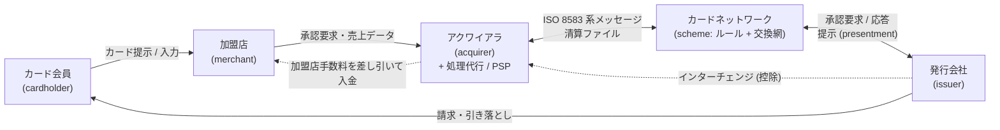
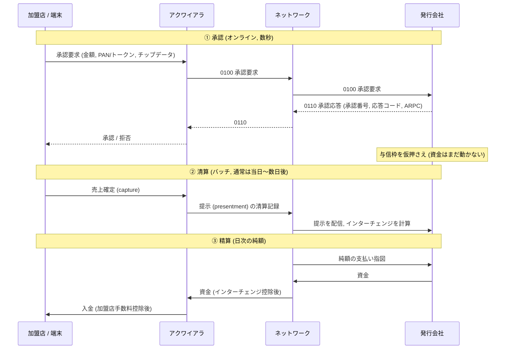
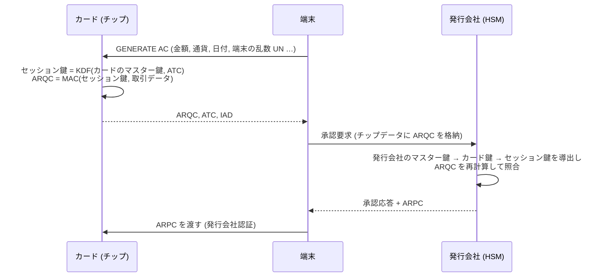
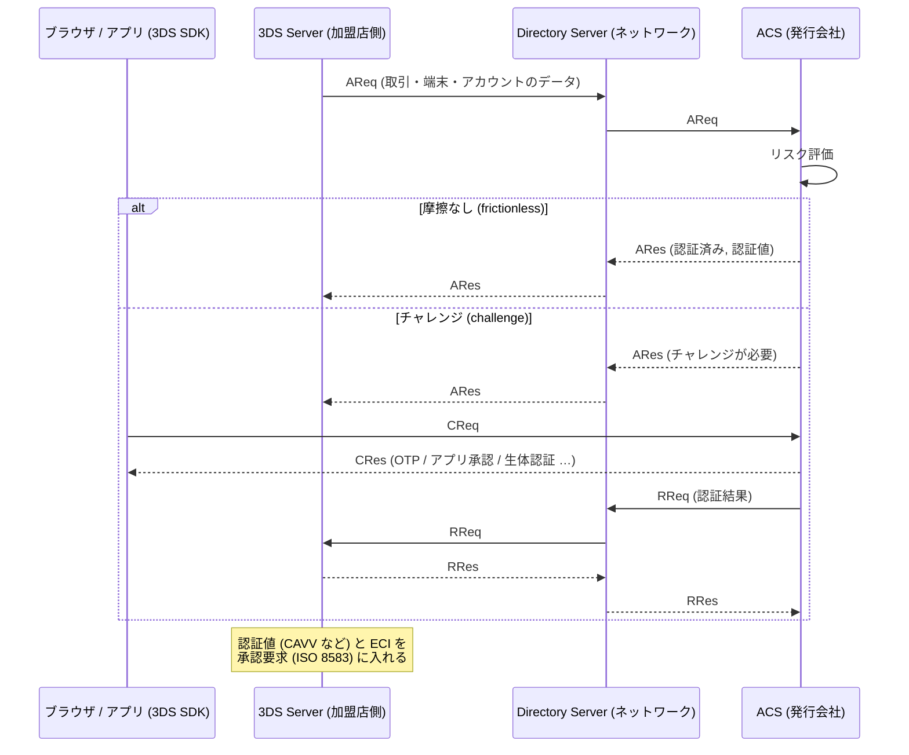
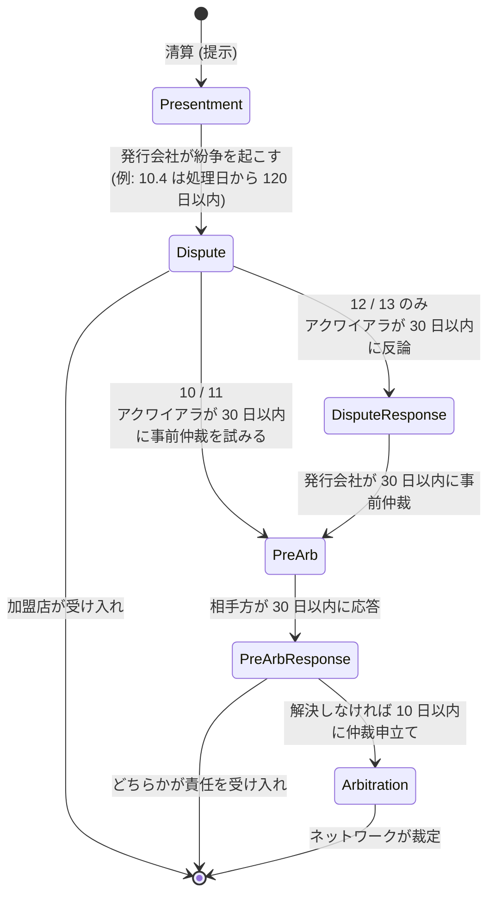

# カード決済ネットワーク (Card Payment Networks: Authorization, Clearing & Settlement)

## 概要 (Overview)

レジでカードをかざしてから数秒で「承認」と表示されても、その時点ではまだお金は 1 円も動いていない。承認 (authorization) は、カード発行会社 (issuer) が「この取引に応じる」と約束しただけである。加盟店の売上が確定するのは、加盟店側の金融機関 (acquirer) が取引記録をネットワークに提出する清算 (clearing) のときで、資金が実際に移るのは、ネットワークが参加者間の差額をまとめて決済する精算 (settlement) のときである。カード決済はこの 3 つの段階を別々のメッセージと別々の時間軸で処理する。

本ドキュメントはこの下部構造を仕様として分析する。対象は、カード会員・発行会社・アクワイアラ・加盟店・ネットワークの四者モデル (four-party model)、オンラインのメッセージ形式 ISO 8583 と ISO 20022 への移行の議論、承認・清算・精算の分離、インターチェンジ (interchange) と手数料、EMV チップの暗号文 (ARQC / ARPC)、EMVCo のネットワークトークン、EMV 3-D セキュア (3DS) の摩擦なしフローとチャレンジフロー、欧州 PSD2 の強力な顧客認証 (SCA)、チャージバック (chargeback) と紛争処理、そして PCI DSS v4.0.1 の適用範囲である。

位置づけとして、カードと端末の間の無線と暗号は [`../../hardware/peripherals/nfc-contactless-payments.md`](../../hardware/peripherals/nfc-contactless-payments.md) が扱い、決済代行事業者 (PSP) がこの層を API として抽象化した姿は [`stripe-connect-specification.md`](stripe-connect-specification.md) が扱う。本書はその間にある、端末から発行会社までのメッセージと資金の流れを扱う。中心となる主張は、**カード決済の安全性と経済性は「承認と資金移動を分離し、その間の責任をルールで配分する」設計から生まれている**、ということである。分析深度は Level 3。

---

## 方法論 (Methodology)

- 一次資料: 規格は ISO のカタログと ISO 20022 登録機関の資料、EMVCo の公開ページ、PCI SSC の規格本文 (PCI DSS v4.0.1) と FAQ、ネットワークのルールは Visa が公開している *Visa Core Rules and Visa Product and Service Rules*（2024-04-13 版、v1.2）、規制は EUR-Lex と legislation.gov.uk に掲載された EU 規則の採択時の原文を使う。いずれも 2026-11-28 に閲覧した。
- 有償・登録制の仕様: ISO 8583 の本文（ISO 8583:2023）、EMV の Book 1〜4、EMV 3DS の Protocol and Core Functions Specification の本文は参照していない。ISO 8583 の構造（MTI、ビットマップ、データ要素）は、IBM の製品資料とオープンソース実装 jPOS の資料で確認した。これらは二次資料であり、ネットワークごとの独自拡張は確かめていない。EMV の暗号文は、査読付き論文 (Basin ら、2021) と AWS Payment Cryptography の資料 (EMV 4.4 Book 2 を参照) で確認した。
- ルールの版: Visa の公開ルールは機密部分を省いた抜粋で、閲覧できたのは 2024-04 版である。より新しい版で期限や条件が変わっている可能性がある。Mastercard のルール文書は取得できなかったため、紛争処理の具体的な期限は Visa についてのみ書く。
- 時点情報: EU の決済サービス規則 (PSR) と PSD3 は、2026-11-28 時点で官報掲載前であり、本書は現行の PSD2 と委任規則 (EU) 2018/389 を基準にする。
- 範囲外: 国内のデビット網・QR 決済・口座間送金 (A2A) は扱わない。本書は法的助言ではない。

---

## 発見事項 (Findings)

1. **ネットワークはルールと交換網を提供し、与信リスクは発行会社が負う。** Visa のルールは承認を「発行会社、または発行会社に代わる Stand-In Processing などが取引を承認する手続き」と定義する[^visa-rules]。発行会社が応答できないときや応答が遅いときは、ネットワークの Stand-In Processing (STIP) が発行会社の指示に従って代わりに承認する[^visa-rules]。
2. **承認・清算・精算は別のメッセージで別のときに行われる。** Visa は清算を「Visa と参加者の間で交換される記録の検証と金額確定の処理」、精算を「清算の結果として参加者間で負う精算額の報告と資金移動」と定義する。精算額は参加者ごとの日次の純額である[^visa-rules]。承認はオンラインの V.I.P. System、清算はファイルベースの BASE II が担う[^visa-rules]。
3. **ISO 8583 はメッセージの形式だけを定め、伝送と精算は対象外である。** 現行版は ISO 8583:2023（第 3 版）で、旧版の ISO 8583-1:2003 などは廃止された。抄録はトークンもカードと同じ用語で扱うと明記している[^iso8583-2023]。本文は有償で、本書は MTI とビットマップの構造を二次資料で確認した[^ibm-8583][^jpos-bitmap]。
4. **ISO 20022 にはカードの業務領域があるが、アクワイアラと発行会社の間の移行は市場任せである。** ISO 20022 は「Acquirer to Issuer Card Transactions (cain)」を業務領域として持ち、承認・取消・提示 (presentment) を対象にする[^iso20022-ba]。欧州カード関係者グループ (ECSG) は 2017 年の最終報告で、エコシステム全体での移行には事業上の根拠がないとし、個別事業者の判断による市場主導の移行を勧めた[^ecsg-a2i]。
5. **インターチェンジはアクワイアラから発行会社へ支払われる既定の移転価格である。** 加盟店がアクワイアラに払う加盟店手数料 (merchant discount / merchant service fee) は個別に交渉され、インターチェンジはその内訳の 1 つになる[^visa-rules]。EU ではインターチェンジ手数料規則 (EU) 2015/751 が、消費者向けデビットカードを取引額の 0.2%、クレジットカードを 0.3% に上限規制している[^ifr-summary]。
6. **チップの暗号文はカードと発行会社の共有鍵による MAC であり、端末は検証しない。** カードは取引データと取引カウンタから ARQC を作り、発行会社は同じ入力から ARQC を再計算して照合し、応答として ARPC を返す[^basin2021][^aws-arqc]。
7. **ネットワークトークンは PAN の代替値で、使える範囲が制限される。** Visa のルールはトークンを、EMV Payment Tokenisation Specification – Technical Framework に従って発行される決済資格情報と定義する[^visa-rules]。この枠組みの v2.4 は 2026-07-09 に公開された[^emvco-specs]。
8. **3DS の認証結果は紛争の責任配分に直結する。** Visa のルールでは、EMV 3DS で認証され、CAVV を承認要求に入れ ECI 5 で処理された取引は、不正の紛争（条件 10.4）の対象外になる[^visa-rules]。
9. **PSD2 の SCA には金額と累積額で決まる免除がある。** 遠隔取引は 1 件 30 ユーロ以下で、前回の SCA 以降の累計 100 ユーロ以下か 5 回以下なら免除できる[^rts-art16]。取引リスク分析 (TRA) による免除は、不正率が基準値以下の範囲（カードの遠隔取引で 100 / 250 / 500 ユーロに対し 0.13% / 0.06% / 0.01%）でのみ使える[^rts-annex]。
10. **紛争処理は理由の種類によって 2 つの手順に分かれる。** Visa の紛争は不正 (10)・承認 (11)・処理誤り (12)・消費者紛争 (13) の 4 分類で、10 と 11 では加盟店側の Dispute Response の段階がなく、12 と 13 にはある[^visa-rules]。
11. **PCI DSS v4.0.1 が唯一の有効版で、決済ページのスクリプト管理が必須になった。** v4.0.1 は 2024-06 に公開され、v4.0 は 2024-12-31 に廃止された。将来日付の要件は 2025-03-31 に有効になった[^pci-401]。決済ページのスクリプトの承認・完全性・一覧化 (6.4.3) と改ざん検知 (11.6.1) は、このとき必須になった[^pci-ecom]。

---

## アーキテクチャ (Architecture)

### 四者モデル (Four-Party Model)

| 当事者 | 役割 | 主なリスク |
|--------|------|------------|
| カード会員 | カード（またはトークン）で支払う | 不正利用、二重請求 |
| 発行会社 | カードを発行し、承認判断と与信を行う。チップの鍵とトークンの発行も担う | 与信リスク、不正損失（責任移転がなければ） |
| アクワイアラ | 加盟店と契約し、取引をネットワークへ送り、加盟店へ入金する | 加盟店の倒産・不正（チャージバックを回収できない損失） |
| 加盟店 | 商品・サービスを提供し、カードを受け付ける | チャージバック、PCI DSS の遵守 |
| ネットワーク | ルール、交換網、清算・精算、紛争の裁定を提供する | システム障害（STIP で縮退運転） |

三者モデル (three-party model) では、ネットワーク自身が発行会社とアクワイアラを兼ねる（American Express の大部分など）。EU のインターチェンジ上限は四者モデルを対象にしており、三者モデルには一部の規定しか適用されない[^ifr-summary]。Stripe などの PSP はアクワイアラ（またはアクワイアラと契約する処理代行）として加盟店側に立ち、この構造を API の背後に隠す（[`stripe-connect-specification.md`](stripe-connect-specification.md)）。

### 承認・清算・精算 (Authorization, Clearing & Settlement)

この分離には理由がある。承認の時点では最終金額が決まらない取引（ホテル、ガソリン、チップの加算）があり、売上の取消や返品もある。承認で与信枠を仮押さえし、清算で確定額を提示し、精算で参加者間の差額だけを日次でまとめて動かすことで、取引ごとの資金移動を避けている。これに対して、1 つのメッセージで承認と清算を兼ねる方式は単一メッセージ方式 (single message) と呼ばれ、ISO 8583 では金融取引クラスの 0200 系がこれにあたる（MTI は後述）。

---

## 技術詳細 (Technical Details)

### ISO 8583 のメッセージ構造

ISO 8583 の 1 メッセージはメッセージ種別 (MTI)、ビットマップ、データ要素 (data element, DE) の並びでできている[^ibm-8583]。

| 部分 | 内容 |
|------|------|
| MTI | 4 桁の数字。1 桁目は版（0 = 1987、1 = 1993、2 = 2003）、2 桁目はクラス（1 = 承認、2 = 金融取引、4 = 取消・チャージバック、5 = 照合、8 = ネットワーク管理など）、3 桁目は機能（0 = 要求、1 = 要求への応答、2 = アドバイス…）、4 桁目は発信元（0 = アクワイアラ、2 = 発行会社など） |
| 1 次ビットマップ | 64 ビット。DE 1〜64 のどれがあるかを示す。先頭ビットが立っていれば 2 次ビットマップがある |
| 2 次ビットマップ | DE 65〜128 の有無を示す。3 次ビットマップもあるが、ほとんど使われない |
| データ要素 | 固定長または長さ接頭辞 (LL / LLL) つきの可変長。各ネットワークが用途を独自に拡張する |

ビットマップは 8 バイトのバイナリか 16 文字の 16 進表記で送られる[^ibm-8583][^jpos-bitmap]。MTI の各桁の意味は IBM の資料が「版・クラス・機能・発信元」の 4 区分を示しており、各値は公開の実装資料による。代表的な組み合わせは、0100 / 0110（承認の要求と応答）、0200 / 0210（金融取引、単一メッセージ方式）、0400 / 0420（取消の要求とアドバイス）、0800（ネットワーク管理、エコー試験や鍵交換）である。

よく使われるデータ要素は、PAN (DE 2)、処理コード (DE 3)、取引金額 (DE 4)、システム追跡番号 STAN (DE 11)、POS 入力モード (DE 22)、照会番号 RRN (DE 37)、承認番号 (DE 38)、応答コード (DE 39)、端末 ID と加盟店 ID (DE 41 / 42)、通貨 (DE 49)、PIN ブロック (DE 52)、チップデータ (DE 55) である。取消 (0400) は元の取引を DE 90（元の MTI、STAN、送信日時など）で指す。実際の電文は ISO 8583 そのものではなく、ネットワークごとの方言である。たとえば Visa はアクワイアラの国コードを Field 19 に入れることを求め、発行会社はそれを使って取引が SCA の対象かどうかを判断する。Visa のトークン取引では、トークンの検証値 TAVV と 3DS の CAVV が Field 126.8 と 126.9 で運ばれる[^visa-secure-2019]。

エッジケースと障害時の動きは次のとおりである。

- タイムアウト: アクワイアラが応答を受け取れないとき、承認されたかどうかは分からない。アクワイアラは取消 (0400 / 0420) を送って、発行会社側の仮押さえを確実に解く。元の取引の特定には STAN・送信日時・RRN を使う。これは API の冪等キー (idempotency key) にあたる仕組みである。
- 発行会社の障害: ネットワークの STIP が発行会社の設定した上限の範囲で代わりに承認し、後で発行会社にアドバイスを送る[^visa-rules]。発行会社は、自分が見ていない承認の結果を後から受け入れることになる。
- 承認と提示の不一致: 承認額と提示額の差、承認から期限を過ぎた提示、二重の提示は、処理誤りの紛争（Visa 条件 12.1 遅延提示、12.5 金額誤り、12.6 二重処理）になる[^visa-rules]。

### ISO 20022 への移行の位置づけ

ISO 20022 は XML / ASN.1 で定義されるメッセージ体系で、カードについても加盟店とアクワイアラの間 (caaa)、アクワイアラと発行会社の間 (cain)、端末管理 (catm)、トークン管理 (tokm)、精算報告 (casr)、不正報告 (cafr) などの業務領域を持つ[^iso20022-ba]。cain の起点は ATICA (Acquirer to Issuer Card Messages) と呼ばれる作業である[^ecsg-a2i]。

ただし、銀行間送金 (SWIFT の MT から MX への移行) とは異なり、カードのアクワイアラと発行会社の間では、ISO 8583 からの一斉移行は計画されていない。ECSG は 2016 年の調査で ISO 20022 の発展性を認めつつ、エコシステム全体での移行には事業上の根拠がないと結論し、2017 年の最終報告では機能ごと、ネットワークごと、処理事業者のグループごとの市場主導の移行を想定した[^ecsg-a2i]。2026-11 時点で、Visa や Mastercard がアクワイアラと発行会社の間を ISO 20022 へ移す日程を公表した資料は見つからなかった。

### インターチェンジと手数料の構造

加盟店が払う手数料 (merchant service charge, MSC) は、おおむね次の 3 つに分かれる。

| 構成要素 | 誰から誰へ | 決まり方 |
|----------|------------|----------|
| インターチェンジ | アクワイアラ → 発行会社 | ネットワークが既定値を設定する。カードの種類、取引の種類（対面 / 非対面、3DS の有無）、業種、地域で変わる。規制で上限を設ける国・地域がある |
| スキーム手数料 (scheme fee) | 発行会社・アクワイアラ → ネットワーク | ネットワークと各参加者の契約による |
| アクワイアラの利幅 | 加盟店 → アクワイアラ | 加盟店とアクワイアラが個別に交渉する |

Visa はインターチェンジを「アクワイアラと発行会社の間の既定の移転価格」と説明し、高すぎれば加盟店が受け付けず、低すぎれば発行会社が発行しない、という両面市場の均衡として位置づけている[^visa-rules]。これは第一当事者の説明である。EU の規則 (EU) 2015/751 は消費者カードについて 0.2% / 0.3% の上限を設け、加盟国は国内取引についてさらに低い上限を設けられる[^ifr-summary]。インターチェンジは清算のときに計算され、精算額から控除される。

### EMV チップの暗号文 (ARQC / ARPC)

チップカードの承認では、カードが取引ごとに暗号文を作る。カードと端末の間のコマンドの流れは [`../../hardware/peripherals/nfc-contactless-payments.md`](../../hardware/peripherals/nfc-contactless-payments.md) に図がある。ここではネットワークの側から見る。

- 鍵の構造: 発行会社のマスター鍵 (IMK) から PAN ごとのカード鍵を導出してチップに入れ、取引ごとに ATC（取引カウンタ）からセッション鍵を作る。EMV 4.4 Book 2 はこの共通セッション鍵 (CSK) の導出方法、MAC に含める最低限のデータ、応答 ARPC の作り方を定めている[^aws-arqc]。ネットワークによっては追加のデータや独自の導出方式を求める[^aws-arqc]。
- ARPC: 方式 1 は ARQC と 2 バイトの応答コード (ARC) から 8 バイトの ARPC を作る。方式 2 は ARQC と 4 バイトのカード状態更新 (CSU) などに MAC をかけて 4 バイトの ARPC を作る[^jpos-arpc][^aws-arqc]。カードは ARPC で応答が本物の発行会社から来たことを確かめ、CSU でカード内のカウンタやロック状態を更新できる。
- 端末は検証しない: 暗号文は対称鍵の MAC なので、検証できるのは鍵を持つ発行会社（またはその代理）だけである。端末が確かめられるのは、オフラインデータ認証の公開鍵証明書の部分に限られる。この非対称性のため、暗号文に含まれないデータの改ざんは端末でも発行会社でも気づかれない場合がある（Basin らの PIN 迂回）[^basin2021]。
- ネットワークの側の要件: Visa のルールでは、チップで処理されたのにアクワイアラが承認要求に完全なチップデータを入れなかった場合、偽造カードの不正はアクワイアラの責任になる（条件 10.1 EMV 責任移転）[^visa-rules]。暗号文を運ばない実装は責任を引き受ける実装である。

### ネットワークトークン (EMV Payment Tokenisation)

EMV の決済トークンは PAN を置き換える一意の値で、特定の加盟店・端末・決済の方法の外では使えないように制限される[^emvco-token]。トークンを発行・管理するのがトークンサービス事業者 (TSP) で、ネットワーク自身が担うことが多い。トークンを要求する側（ウォレット、加盟店、PSP）はトークン要求者 (Token Requestor) として TSP に登録する[^visa-rules]。トークン化された取引と元の PAN は、Payment Account Reference (PAR) で結びつけられ、不正検知などに使われる[^emvco-token]。

ネットワークの中では、アクワイアラはトークンのまま承認要求を送り、TSP（ネットワーク）がトークンを PAN に戻して発行会社へ渡す。トークンには取引ごとの暗号文（Visa の TAVV など）がつき、トークンがドメイン制限の範囲で使われたことを示す[^visa-secure-2019]。加盟店側に PAN が残らないため、漏洩時の被害が限られ、カードの再発行時もトークンを更新するだけで済む。ISO 8583:2023 がトークンもカードの用語で扱うと明記したのはこのためである[^iso8583-2023]。スマートフォンの端末専用番号 (Device Account Number) も、このトークンの一形態である（NFC 文書を参照）。

### EMV 3-D セキュア 2.x

EMV 3DS は非対面 (card-not-present) の取引で、加盟店が取引・端末・カード会員のデータを発行会社に送り、発行会社が本人を認証する仕組みである[^emvco-3ds]。「3 ドメイン」は加盟店・アクワイアラのドメイン、発行会社のドメイン、相互運用のドメイン（ネットワーク）を指す。中核の部品は、加盟店側の 3DS Server (3DSS)、ネットワークが運用する Directory Server (DS)、発行会社側の Access Control Server (ACS) である[^pci-3ds-faq]。

- メッセージ: AReq は JSON 形式で、3DS Requestor が DS を経由して ACS に送る[^fido-3ds]。仕様は 100 を超えるデータ要素を定義している[^emvco-3ds-opt]。PReq / PRes は、3DS Server が DS からどのカードの番号帯が 3DS に対応しているかを取得するための組である[^visa-secure-2019]。
- 摩擦なしとチャレンジ: 発行会社はリアルタイムのリスク評価に基づいて、チャレンジなしで認証できる。リスクが高いときはワンタイムパスコード、銀行アプリでの承認 (OOB)、WebAuthn、Secure Payment Confirmation (SPC) などでチャレンジする[^emvco-3ds-opt]。分離型認証 (decoupled authentication) は、決済の流れとは別に認証を行う方式で、一部の電話・通信販売や定期課金のような加盟店起点の取引に使える[^emvco-3ds-opt]。
- 認証値と ECI: Visa Secure では、完全に認証された取引は ECI 05、発行会社が 3DS に参加していないときの「試行」は ECI 06 で、Visa が発行会社に代わって CAVV を返す。CAVV の Version 7 は認証した金額・通貨・日付を含む。Visa は ACS に AReq への 5 秒以内の応答を求めている[^visa-secure-2019]。
- 版: EMV 3DS v2.3 は WebAuthn と SPC、OOB の自動遷移、端末の紐づけなどを追加した[^emvco-3ds-v23]。v2.3.1.1 が v2.3.1.0 を置き換え、v2.4.0.0 は 2026-11 時点で草案とコメント処理の段階にある[^emvco-3ds]。WebAuthn そのものの仕様は [`webauthn-passkeys-specification.md`](webauthn-passkeys-specification.md) を参照。

### PSD2 の強力な顧客認証 (SCA)

PSD2 の技術基準 (RTS) である委任規則 (EU) 2018/389 は 2019-09-14 から適用され、知識・所持・生体の 3 要素のうち 2 つ以上を独立に使う認証と、遠隔取引での金額と受取人への動的な紐づけ (dynamic linking) を求める[^rts-art38]。カードの非対面取引では、EMV 3DS のチャレンジが SCA の主な実現手段になる[^emvco-3ds-v23]。免除は次のとおりである。

| 免除 | 条件（採択時の原文） |
|------|------------------------|
| 対面の非接触 (第 11 条) | 1 件 50 ユーロ以下、かつ前回の SCA 以降の累計 150 ユーロ以下か 5 回以下[^rts-art11] |
| 少額の遠隔取引 (第 16 条) | 1 件 30 ユーロ以下、かつ累計 100 ユーロ以下か 5 回以下[^rts-art16] |
| 取引リスク分析 (第 18 条) | 決済サービス事業者自身の不正率が基準値以下。カードの遠隔取引では 500 ユーロまで 0.01%、250 ユーロまで 0.06%、100 ユーロまで 0.13%[^rts-annex] |
| そのほか | 信頼済みの受取人 (第 13 条)、定額の定期取引 (第 14 条)、無人の交通・駐車端末 (第 12 条) など |

TRA の免除はそれを適用しようとする決済サービス事業者自身の不正率が基準値以下であればよい。アクワイアラの不正率が基準値以下なら、アクワイアラは免除を求められるが、受け入れるかどうかの最終判断は常に支払人側の事業者（発行会社）が行う[^eba-qa]。監視している不正率が 2 四半期続けて基準値を超えると、その免除の使用をやめなければならない[^rts-art20]。実務では、加盟店側（アクワイアラ）が 3DS の AReq で免除を要求し、発行会社が最終的に受け入れるか判断する。免除で SCA を省いた取引の不正の責任は、免除を適用した側に寄る、というのがネットワークのルールの一般的な形だが、本書では Visa と Mastercard の該当条文を確認できていない。

PSD2 の後継である PSR（規則）と PSD3（指令）は、2026-04-23 に EU 理事会が最終妥協テキストを公表し、2026-11-28 時点では官報掲載前である[^psr-status]。PSR は官報掲載の 20 日後に発効し、18 か月前後の移行期間を経て適用される見込みとされる[^psr-status]。SCA の免除の枠組みが変わる可能性があるため、利用時に EUR-Lex で確認する必要がある。

### チャージバックと紛争処理

チャージバックは、発行会社が清算済みの取引を、ネットワークを通じてアクワイアラに差し戻す手続きである。Visa の紛争は 4 分類である[^visa-rules]。

| 分類 | 代表的な条件 |
|------|--------------|
| 10 不正 (Fraud) | 10.1 EMV 責任移転（偽造）、10.2 EMV 責任移転（偽造以外）、10.3 対面のその他の不正、10.4 非対面のその他の不正、10.5 不正監視プログラム |
| 11 承認 (Authorization) | 11.1 カード回収情報、11.2 承認拒否、11.3 承認なし / 遅延提示 |
| 12 処理誤り (Processing Errors) | 12.1 遅延提示、12.2 取引コード誤り、12.3 通貨誤り、12.5 金額誤り、12.6 二重処理 / 他の手段で支払い済み |
| 13 消費者紛争 (Consumer Disputes) | 13.1 商品・サービス未着、13.2 解約済みの定期取引、13.3 説明と異なる・欠陥、13.6 返金未処理、13.7 キャンセル済み |

Visa の非対面不正 (10.4) の申立て期限は取引処理日から 120 暦日で、事前仲裁は紛争処理日から 30 暦日、仲裁申立ては事前仲裁の応答から 10 暦日である[^visa-rules]。期限や証拠の要件は条件ごと・地域ごとに異なる（ナイジェリアの国内取引の例外など）。責任移転の仕組みはこの紛争の可否として表れる。

- EMV 責任移転 (10.1): チップカードなのに、端末がチップを読めなかった、またはチップデータを送らなかった場合、偽造による損失はアクワイアラ側に移る[^visa-rules]。
- 3DS (10.4 の無効条件): EMV 3DS で認証され CAVV つき ECI 5 で承認された取引には、10.4 の紛争を起こせない[^visa-rules]。
- 乱用の防止: 過去 120 日に 35 件を超える紛争が起こされたアカウントの取引には、10.4 の紛争を起こせない[^visa-rules]。

PSP はこの差し戻しを加盟店や連結アカウントの残高から回収する。Stripe Connect の決済タイプでどの残高から引かれるかが変わるのは、この層の結果である（[`stripe-connect-specification.md`](stripe-connect-specification.md)）。

---

## セキュリティ考察 (Security Considerations)

### PCI DSS v4.0.1 の適用範囲

PCI DSS は口座データ (account data) を保存・処理・伝送する環境と、そのセキュリティに影響しうる環境に適用される。口座データはカード会員データ（PAN、会員名、有効期限、サービスコード）と機微な認証データ (SAD: トラックデータまたはチップ上の同等データ、カード検証コード、PIN / PIN ブロック) からなる[^pci-dss-401]。

| 要件 | 内容 | 決済ネットワークの文脈での意味 |
|------|------|--------------------------------|
| 3.3.1 | SAD は暗号化していても承認後に保存しない。受け取った SAD は承認の完了時に復元不能にする | 承認は保存してよい情報の境界である。CVC や PIN ブロックは承認要求に乗った後に消える必要がある |
| 3.5.1 | 保存する PAN は、強い暗号による一方向ハッシュ、切り詰め、インデックストークン、鍵管理つきの強い暗号のいずれかで読めなくする | 清算・紛争のために PAN を持つ事業者の義務。ネットワークトークンで PAN を持たない設計は範囲を縮める |
| 6.4.3 | 利用者のブラウザで動く決済ページのスクリプトを承認し、完全性を確かめ、一覧化して理由を記録する | 3DS や決済フォームを置くページへの e-skimming 対策 |
| 11.6.1 | 決済ページのスクリプトとセキュリティ関連の HTTP ヘッダーの不正な変更を検知して警告する（少なくとも週 1 回など） | 同上。ブラウザに届いた状態を評価する |

6.4.3 と 11.6.1 は 2025-03-31 に必須になった。PCI SSC は同時期に SAQ A（決済を第三者の iframe やリダイレクトに完全に委ねる加盟店向け）からこの 2 つを外し、代わりに「サイトがスクリプト攻撃の影響を受けないこと」を加盟店が確認する適格条件を加えた[^pci-ecom]。PSP の埋め込み型の決済フォームを使う設計が PCI DSS の範囲を縮めるのはこのためで、加盟店のページ全体が範囲外になるわけではない。なお、PCI SSC のブログを 2026-11-28 に確認した範囲では、v4.0.1 の次の版の公開は発表されていない[^pci-blog]。3DS の部品（3DSS、DS、ACS）には別の規格 PCI 3DS Core Security Standard がある[^pci-3ds-faq]。

### 脅威と防御の対応

| 脅威 | 層 | 防御 | 残る弱点 |
|------|----|------|----------|
| 磁気ストライプの偽造 | 端末〜発行会社 | EMV チップの ARQC、EMV 責任移転 | チップを読まないフォールバック取引、チップデータを送らない実装 |
| 非対面の盗用（番号・CVC の窃取） | 加盟店〜発行会社 | 3DS と SCA、ネットワークトークンのドメイン制限 | SCA 免除の取引、3DS 非対応の地域、OTP のフィッシング |
| 決済ページの改ざん (e-skimming) | 加盟店のフロントエンド | PCI DSS 6.4.3 / 11.6.1、iframe による分離 | ページの外（ブラウザ拡張、端末のマルウェア） |
| 暗号文に含まれないデータの改ざん | 端末〜カード | カーネルの改良、発行会社側の照合 | 端末の判断だけで処理される項目（[NFC 文書](../../hardware/peripherals/nfc-contactless-payments.md)の PIN 迂回） |
| 発行会社の鍵の漏洩 | 発行会社 | HSM での鍵の保管と導出、鍵の用途制限 (TR-31 の鍵用途) | HSM の外での鍵の取り扱い |
| 紛争の乱用（友好的詐欺） | カード会員〜発行会社 | 3DS の認証値、Compelling Evidence、紛争件数の上限 | 消費者紛争 (13) は認証とは別の論点 |
| タイムアウト時の二重承認 | アクワイアラ〜ネットワーク | 取消 (0400 / 0420)、STAN / RRN による照合 | 取消が届かない間の与信枠の仮押さえ |

この表で目立つのは、暗号と認証が責任の所在を決める手段として使われていることである。ARQC を運ぶか、3DS の認証値を承認要求に入れるかは、技術的な安全性の選択であると同時に、不正損失を誰が負うかの選択でもある。暗号の基礎（MAC、鍵の導出）は [`../security/applied-cryptography.md`](../security/applied-cryptography.md)、HSM と TEE は [`../../hardware/security/side-channels-tee-secure-boot.md`](../../hardware/security/side-channels-tee-secure-boot.md)、加盟店とネットワークの間の TLS は [`../networking/tls-internals.md`](../networking/tls-internals.md)、iframe の分離は [`../browsers/web-security-model.md`](../browsers/web-security-model.md) を参照。

---

## 結論 (Conclusions)

- カード決済は、承認（オンラインの約束）、清算（確定額の提示）、精算（日次の純額の資金移動）を分けることで、未確定の金額、取消、返品、障害時の代理承認を扱っている。PSP の API の「オーソリ」「キャプチャ」「入金」は、この 3 段階に対応している。
- ISO 8583 は形式の規格にすぎず、実際の電文はネットワークごとの方言である。ISO 20022 にはカードの業務領域があるものの、アクワイアラと発行会社の間の移行は、一斉移行ではなく市場任せとされた。
- 安全性の仕組み（EMV の暗号文、ネットワークトークン、3DS）は、それぞれ不正損失の責任移転のルールと組になっている。チップデータを運ばない、3DS を使わない、SCA を免除する、という選択は、その損失を自分で引き受けるという選択である。
- 規制は経済性と認証の両面に及ぶ。EU のインターチェンジ上限と PSD2 の SCA は、ネットワークのルールの上に法律の層を重ねている。PSR / PSD3 は 2026-11 時点で官報掲載前であり、SCA の枠組みは今後変わりうる。
- PCI DSS v4.0.1 は承認を機微な認証データを保存してよいかどうかの境界とし、決済ページのスクリプト管理を必須にした。PAN を持たない設計（トークン、iframe）は範囲を縮めるが、ゼロにはしない。

### 次の接続先 (Related Topics)

- [`../../hardware/peripherals/nfc-contactless-payments.md`](../../hardware/peripherals/nfc-contactless-payments.md) — カードと端末の間の無線、EMV のコマンド、Device Account Number、リレー攻撃と PIN 迂回。
- [`stripe-connect-specification.md`](stripe-connect-specification.md) — この層を API として抽象化した PSP の姿。決済タイプと返金・紛争の引き落とし元。
- [`webauthn-passkeys-specification.md`](webauthn-passkeys-specification.md) — 3DS 2.3 のチャレンジで使える WebAuthn と SPC の基礎。
- [`../security/applied-cryptography.md`](../security/applied-cryptography.md) — MAC と鍵の導出、対称鍵による認証の限界。
- [`../../hardware/security/side-channels-tee-secure-boot.md`](../../hardware/security/side-channels-tee-secure-boot.md) — 鍵を守るハードウェア（HSM、Secure Enclave、TEE）。

---

## 参考文献 (References)

**一次資料 — 規格・仕様 (Primary — Standards & Specifications)**

[^iso8583-2023]: ISO. *ISO 8583:2023 Financial services — Financial transaction card originated messages — Interchange message specifications* (Edition 3, 2023-07, ISO/TC 68/SC 9). [iso.org](https://www.iso.org/standard/79451.html) — Accessed: 2026-11-28. — 抄録（アクワイアラと発行会社の間の共通インターフェース、伝送と精算は範囲外、トークンとカードの用語）のみ確認。本文は有償で未参照。
[^iso20022-ba]: ISO 20022 Registration Authority. *ISO 20022 Business Areas* (2025-06). [iso20022.org](https://www.iso20022.org/sites/default/files/media/file/ISO20022_BusinessAreas.pdf) — Accessed: 2026-11-28. — caaa / cain / casp / catp / caad / catm / caam / cafc / tokm / canm / cafm / casr / cafr の定義。
[^emvco-3ds]: EMVCo. *EMV 3-D Secure*. [emvco.com](https://www.emvco.com/emv-technologies/3-d-secure/) — Accessed: 2026-11-28. — 目的、摩擦なし・チャレンジの説明、v2.2 以上の推奨、v2.4.0.0 の草案。v2.3.1.1 による v2.3.1.0 の置き換えは EMVCo の告知による。
[^emvco-3ds-v23]: EMVCo. *What is new with EMV 3DS v2.3* (2021-11-12). [emvco.com](https://www.emvco.com/knowledge-hub/what-is-new-with-emv-3ds-v2-3/) — Accessed: 2026-11-28.
[^emvco-3ds-opt]: EMVCo. *Optimising Online Payment Authentication with EMV 3-D Secure*. [emvco.com](https://www.emvco.com/knowledge-hub/optimising-online-payment-authentication-with-emv-3-d-secure/) — Accessed: 2026-11-28. — 摩擦なし・チャレンジ・分離型認証、100 を超えるデータ要素、5 つのメッセージ拡張。
[^emvco-token]: EMVCo. *Payment Tokenisation*. [emvco.com](https://www.emvco.com/emv-technologies/payment-tokenisation/) — Accessed: 2026-11-28. — ドメイン制限、TSP コード、PAR。
[^emvco-specs]: EMVCo. *Specifications* (一覧: EMV Payment Tokenisation Specification – Technical Framework v2.4, 2026-07-09; v2.3, 2021-10-19). [emvco.com](https://www.emvco.com/specifications/page/3/) — Accessed: 2026-11-28.
[^pci-dss-401]: PCI Security Standards Council. (2024-06). *Payment Card Industry Data Security Standard: Requirements and Testing Procedures, v4.0.1*. [pcisecuritystandards.org](https://www.pcisecuritystandards.org/document_library/) — Accessed: 2026-11-28. — 表 2（口座データ）、要件 3.3.1、3.5.1、6.4.3、11.6.1。
[^pci-401]: PCI SSC. *Just Published: PCI DSS v4.0.1* (2024-06-11). [blog.pcisecuritystandards.org](https://blog.pcisecuritystandards.org/just-published-pci-dss-v4-0-1) — Accessed: 2026-11-28. — 要件の追加・削除なし、v4.0 の 2024-12-31 廃止、将来日付の要件の 2025-03-31 発効。
[^pci-ecom]: PCI SSC. *Coffee with the Council Podcast: Guidance for PCI DSS E-commerce Requirements Effective After 31 March 2025* (2025-03-26). [blog.pcisecuritystandards.org](https://blog.pcisecuritystandards.org/coffee-with-the-council-podcast-guidance-for-pci-dss-e-commerce-requirements-effective-after-31-march-2025) — Accessed: 2026-11-28. — 6.4.3 / 11.6.1 と SAQ A の改訂。
[^pci-blog]: PCI SSC. *PCI Perspectives* (blog index; 2026-09〜11 の投稿). [blog.pcisecuritystandards.org](https://blog.pcisecuritystandards.org/) — Accessed: 2026-11-28.
[^pci-3ds-faq]: PCI SSC. (2019-10). *PCI 3DS Core Security Standard — Frequently Asked Questions* v1.1. [pcisecuritystandards.org](https://listings.pcisecuritystandards.org/documents/FAQs_for_PCI_3DS_Core_Security_Standard.pdf) — Accessed: 2026-11-28. — 3 ドメイン（加盟店・アクワイアラ、発行会社、相互運用）と 3DSS / DS / ACS。

**一次資料 — ネットワークのルール・業界団体 (Primary — Scheme Rules & Industry Bodies)**

[^visa-rules]: Visa. (2024-04-13, Version 1.2 2024-06-04). *Visa Core Rules and Visa Product and Service Rules* (public edition). [visa.com](https://bo.review.visa.com/content/dam/VCOM/download/visa-rules-public.pdf) — Accessed: 2026-11-28. — 用語集（Authorization、Clearing、Settlement、Presentment、BASE II、V.I.P. System、STIP、Token、Token Requestor、Visa Secure）、1.9.1.2（インターチェンジの説明）、11.2.2 / 11.2.3（紛争手順と期限）、11.7〜11.10（紛争条件、10.1 と 10.4 の条件）。機密部分を省いた公開版であり、閲覧できた最新版がこの版だった。
[^visa-secure-2019]: Visa. (2019-09-12). *Visa Secure Processing Requirements and Reminders* (Article ID AI09303). [usa.visa.com](https://usa.visa.com/dam/VCOM/global/support-legal/documents/visa-secure-vbn-visa-public.pdf) — Accessed: 2026-11-28. — PReq / PRes、ECI 05 / 06、CAVV の版、AReq への 5 秒の応答、Field 19、Field 126.8 / 126.9。
[^fido-3ds]: FIDO Alliance. (2020-09). *FIDO Authentication and EMV 3-D Secure: Using FIDO for Payment Authentication*. Piel, B. (Mastercard) & Lindemann, R. (Nok Nok Labs), Eds. [fidoalliance.org](https://fidoalliance.org/wp-content/uploads/2020/09/FIDO-and-EMV-3DS-Technical-Note-2020-09-01.pdf) — Accessed: 2026-11-28. — AReq が DS を経由して ACS に送られる JSON メッセージであること。
[^ecsg-a2i]: European Card Stakeholders Group. (2017-06). *Acquirer to Issuer Domain — Final Report* (ERPB/2017/006, ECSG006-17 v1.3). [ecb.europa.eu](https://www.ecb.europa.eu/paym/groups/erpb/shared/pdf/7th-ERPB-meeting/ECSG_Acquirer_to_Issuer_study.pdf) — Accessed: 2026-11-28. — 2016 年調査の結論（エコシステム全体の事業上の根拠なし、市場主導の移行）、移行シナリオ、ATICA。

**一次資料 — 規制 (Primary — Regulation)**

[^ifr-summary]: EUR-Lex. *Summary of Regulation (EU) 2015/751 — Fees for card-based payments*. [eur-lex.europa.eu](https://eur-lex.europa.eu/EN/legal-content/summary/fees-for-card-based-payments.html) — Accessed: 2026-11-28. — 0.2% / 0.3% の上限、加盟国の国内取引の選択肢。三者モデルへの適用範囲は Herbert Smith Freehills の解説 ([hsfkramer.com](https://www.hsfkramer.com/insights/2015-06/eu-regulations-increase-transparency-of-card-based-payments), Accessed: 2026-11-28) で補った。
[^rts-art11]: Commission Delegated Regulation (EU) 2018/389, Article 11 (as adopted). [legislation.gov.uk](https://www.legislation.gov.uk/eur/2018/389/article/11/adopted) — Accessed: 2026-11-28.
[^rts-art16]: Commission Delegated Regulation (EU) 2018/389, Article 16 (as adopted). [legislation.gov.uk](https://www.legislation.gov.uk/eur/2018/389/article/16/adopted) — Accessed: 2026-11-28.
[^rts-annex]: Commission Delegated Regulation (EU) 2018/389, Annex (as adopted). [legislation.gov.uk](https://www.legislation.gov.uk/eur/2018/389/annex/adopted) — Accessed: 2026-11-28.
[^rts-art38]: Commission Delegated Regulation (EU) 2018/389, Article 38 and Chapter II (as adopted). [legislation.gov.uk](https://www.legislation.gov.uk/eur/2018/389/contents/adopted) — Accessed: 2026-11-28. — 2019-09-14 からの適用。legislation.gov.uk の "adopted" 版は EU が採択した時点の原文である。
[^rts-art20]: Commission Delegated Regulation (EU) 2018/389, Article 20 (as adopted). [legislation.gov.uk](https://www.legislation.gov.uk/eur/2018/389/article/20/adopted) — Accessed: 2026-11-28. — 2 四半期連続で基準値を超えたときの免除の停止。
[^eba-qa]: European Banking Authority. *Single Rulebook Q&A 2018_4034* (TRA の免除を適用する事業者の不正率、支払人側の事業者の最終判断). [eba.europa.eu](https://www.eba.europa.eu/single-rule-book-qa/qna/view/publicId/2018_4034) — Accessed: 2026-11-28.

**二次資料 (Secondary)**

[^ibm-8583]: IBM. *ISO8583 messaging standard* (IBM Integration Bus 10.0 documentation). [ibm.com](https://www.ibm.com/support/knowledgecenter/en/SSMKHH_10.0.0/com.ibm.etools.mft.doc/bd34064_.htm) — Accessed: 2026-11-28. — MTI の 4 区分、1987 / 1993 / 2003 の版、1 次・2 次・3 次ビットマップ。
[^jpos-bitmap]: jPOS. *ISO Packager — Bitmap* (tutorial). [jpos.org](https://jpos.org/docs/tutorial/iso-packager/bitmap) — Accessed: 2026-11-28. — バイナリ 8 バイト / 16 進 16 文字の表現。MTI の各値と DE の番号は公開の実装資料に基づく。
[^jpos-arpc]: jPOS. *ARPCMethod* (source documentation, EMV 4.2 Book 2 §8.2 を参照). [jpos.org](https://jpos.org/doc/javadoc/src-html/org.jpos.jpos/org/jpos/security/ARPCMethod.html) — Accessed: 2026-11-28.
[^aws-arqc]: Amazon Web Services. *Verify an EMV ARQC and generate an ARPC* (AWS Payment Cryptography User Guide). [docs.aws.amazon.com](https://docs.aws.amazon.com/payment-cryptography/latest/userguide/use-cases-issuers.generalfunctions.arqc.html) — Accessed: 2026-11-28. — EMV 4.4 Book 2 の CSK、ARPC 方式 2 の CSU、TR-31 の鍵用途。
[^basin2021]: Basin, D., Sasse, R., & Toro-Pozo, J. (2021). The EMV Standard: Break, Fix, Verify. *2021 IEEE Symposium on Security and Privacy*, 1766–1781. https://doi.org/10.1109/SP40001.2021.00037
[^psr-status]: A&L Goodbody. *PSD 3 / PSR final compromise texts published* (2026-04-24). [algoodbody.com](https://www.algoodbody.com/insights-publications/psd-3-psr-final-compromise-texts-published) / Worldline. *The scope and timeline are locked in for PSD3 and PSR. What should PSPs know?* (2026-03-10). [worldline.com](https://worldline.com/en/home/main-navigation/resources/blogs/2026/the-scope-and-timeline-are-locked-in-for-psd3-and-psr-what-should-psps-know) — Accessed: 2026-11-28. — 2026-04-23 の理事会による最終妥協テキスト公表、官報掲載後 20 日で発効、約 18 か月の移行（法律事務所・事業者による解説）。2026-11-28 時点で官報掲載は確認できなかった。
