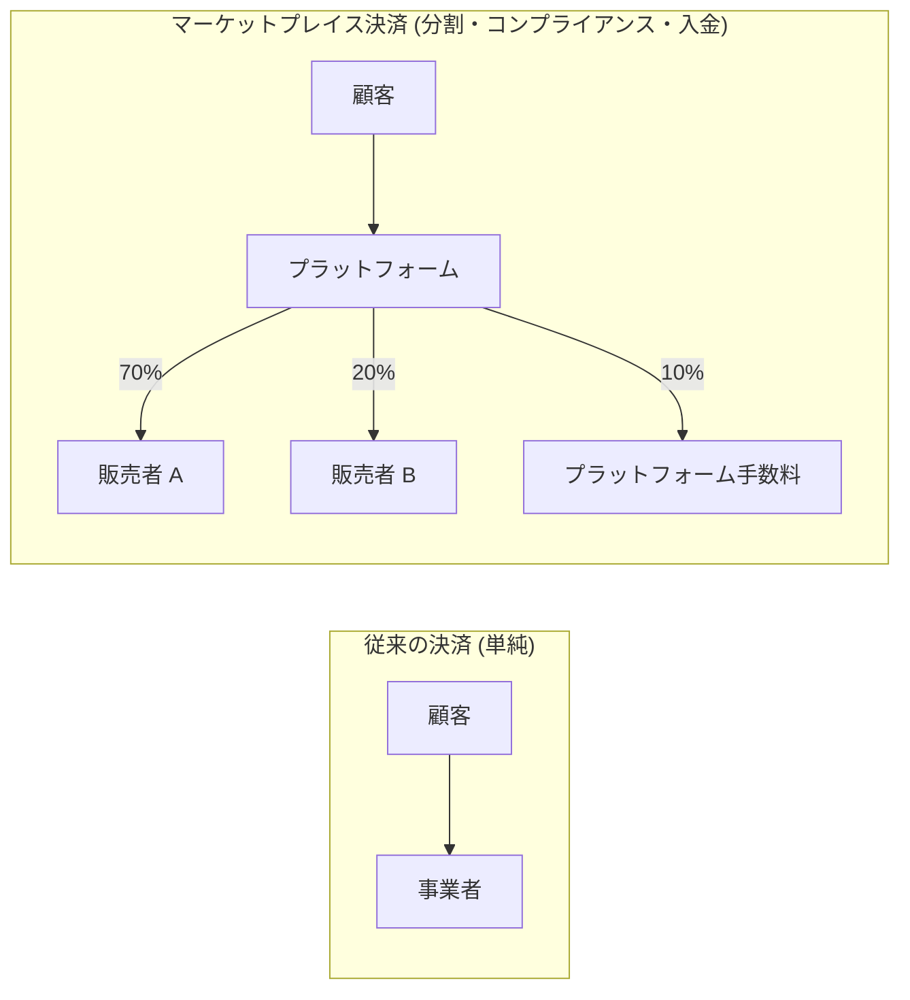
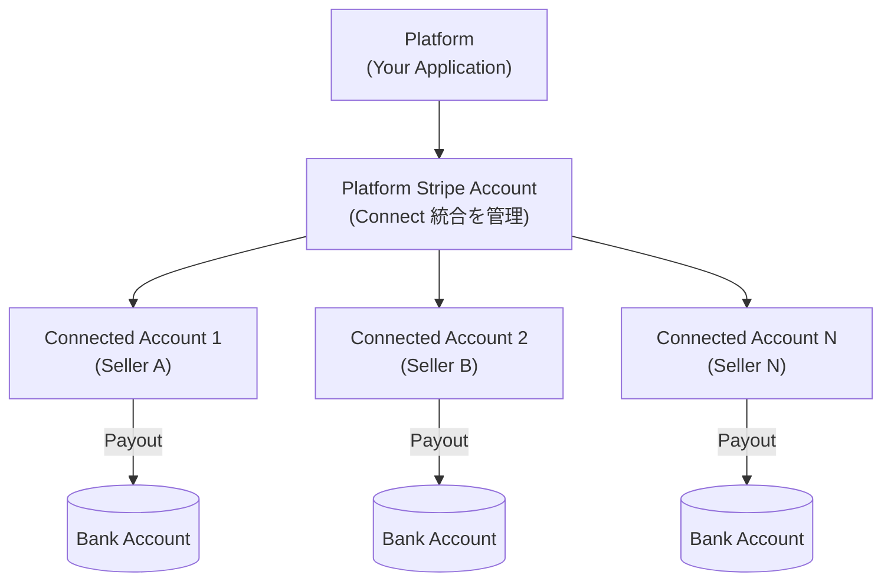
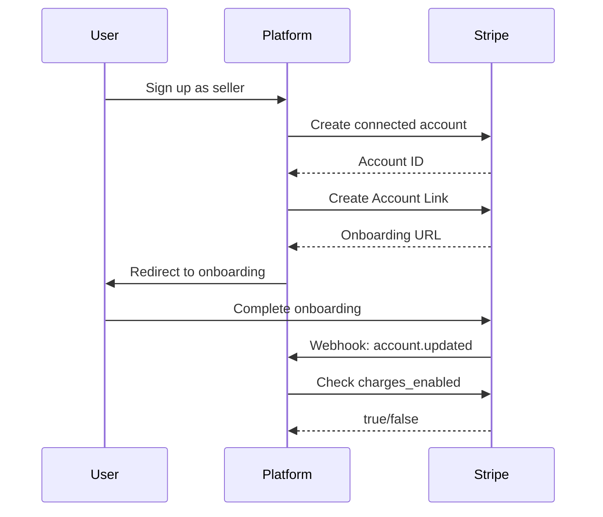

# Stripe Connect 仕様分析 (Stripe Connect: Multi-Party Payments Specification)

**Version**: 2.0
**Last Updated**: 2026-07-06
**Status**: Research Complete

---

## 概要 (Overview)

Stripe Connect は、マルチパーティ決済 (multi-party payments) を扱うプラットフォーム・マーケットプレイス向けの決済インフラである。顧客からの支払いを受け付け、複数の販売者・サービスプロバイダー・ベンダーへ資金を分配する——「1 つの取引を複数の当事者で分け合う」ことを、API のレベルでネイティブにサポートする。

本ドキュメントは、Connect のアカウントタイプ、決済タイプ (charge types)、資金フロー、オンボーディング、料金体系を、Stripe 公式ドキュメントを一次資料として整理する。

---

## なぜ Stripe Connect か (Why Stripe Connect?)

### 問題: マーケットプレイス決済は複雑 (The Problem)

従来の決済プロセッサは、資金が一直線に流れることを前提としている: 顧客 → 事業者。しかしマーケットプレイスやプラットフォームでは、1 つの取引を複数の当事者 (プラットフォーム、販売者、サービスプロバイダー) に分割する必要があり、根本的に異なる決済フローが要る。



### Stripe と Stripe Connect の違い (Stripe vs Stripe Connect)

| 観点 | Stripe (Standard) | Stripe Connect |
|------|-------------------|----------------|
| **目的** | 単一事業者の決済 | マルチパーティのプラットフォーム決済 |
| **資金フロー** | 顧客 → 事業者 | 顧客 → プラットフォーム → 複数の受取人 |
| **分割決済** | 非対応 | ネイティブ対応 |
| **販売者オンボーディング** | 対象外 | KYC/AML を組み込み |
| **コンプライアンス** | 事業者が自ら対応 | Stripe が全当事者分を担う |
| **税務報告** | 手動 | 自動化 (米国 1099 等) |

### Connect が解決する課題 (Challenges Connect Solves)

#### 1. 資金移動規制 (Money Transmission Regulations)

事業者が第三者間で資金を移動すると、金融規制上「資金移動業者 (money transmitter)」に分類されうる。その場合、金融当局への登録 (米国では FinCEN など)、州ごとのライセンス取得 (米国は 50 以上の異なる要件)、銀行秘密法 (BSA) およびマネーロンダリング対策 (AML) 法への準拠と、多大な法的・運用上のオーバーヘッドが発生する。

Connect では **Stripe がライセンスを持つ資金移動業者として機能**するため、プラットフォームはこの規制負担を負わずに分割決済を実現できる。

#### 2. 販売者の本人確認とコンプライアンス (Seller Verification & Compliance)

プラットフォームは全販売者の本人確認 (KYC: Know Your Customer) と AML スクリーニングを行う義務がある。自前で対応する場合、カスタム確認フローの構築、機密文書の収集と安全な保管、継続的な監視と再確認、各国の規制変更への追随が必要になる。Connect は、規制変更時に自動更新される**自動 KYC/AML** を提供する。

#### 3. 分割決済の複雑さ (Split Payment Complexity)

手動での決済分割は運用上の負債を生む: 取引ごとの各当事者の分配額計算、異なる手数料体系 (固定・パーセンテージ・ハイブリッド) の処理、決済タイミングの不一致 (クレジットカードは数日で決済、銀行振込は様々)、複数の受取人にまたがる返金処理、全資金移動の追跡と照合。Connect はこれらを**トランザクションレベルで自動的に**処理する。

#### 4. 紛争・返金管理 (Dispute & Refund Management)

顧客が分割決済に対して返金を要求したりチャージバック (chargeback) を申請した場合、Connect なしではプラットフォームが各販売者に個別に連絡し、分配額を計算し、返金を調整しなければならない。Connect では Stripe が各当事者から**正しい金額を自動的に回収**する。

#### 5. グローバル展開 (Global Expansion)

Connect なしの国際展開には、各国のローカル銀行口座、各地域の決済規制の理解、通貨変換のロジスティクス、現地税務コンプライアンスが必要になる。Connect は自動通貨変換とローカル入金 (payout) により **135 以上の通貨と 40 以上の決済手段**をカバーする (Stripe 公称値、執筆時点)。

### Connect が必要なケース (When You Need Connect)

以下のビジネスモデルには Connect が必要である。

- 他者に代わって決済を受け付ける (マーケットプレイスモデル)
- 1 つの支払いを複数の受取人に分割する
- 入金を受け取る販売者/プロバイダーをオンボーディングする
- ユーザー同士が取引するプラットフォームを運営する

以下の場合は不要である (通常の Stripe で足りる)。

- シンプルな E コマース (単一販売者)
- SaaS サブスクリプション (単一受取人)
- 単一組織への寄付

### 実例 (Real-World Examples)

| プラットフォーム | Connect が必要な理由 |
|----------|----------------------|
| **Shopify** | マーチャントの決済受付を可能にし、Shopify がプラットフォーム手数料を取る |
| **Airbnb** | ホスト (宿泊費) とプラットフォーム (サービス料) で支払いを分割 |
| **DoorDash** | レストラン・ドライバー・プラットフォームの三者で分割 |
| **Instacart** | 複雑な分割: 食料品店、買い物代行者、配達パートナー、プラットフォーム |
| **Kickstarter** | 目標達成まで資金を保持し、その後プロジェクト作成者へ分配 |

---

## 主要機能 (Key Features)

- マルチパーティ決済処理と資金分配
- 135 以上の通貨と 40 以上の決済手段をサポート
- 自動手数料分割 (固定、パーセンテージ、ハイブリッド)
- 組み込みコンプライアンス (PCI、AML、各地域の税要件)
- 100 以上の国での消費税・VAT・GST サポート
- Stripe Radar による不正検知 (fraud detection)
- 複数地域での即日送金

(いずれも Stripe 公称値、執筆時点)

---

## アーキテクチャ (Architecture)

### システム構成 (System Components)

プラットフォームは自身の Stripe アカウントの下に、販売者ごとの**接続アカウント (connected account)** をぶら下げる。各接続アカウントの残高が、それぞれの銀行口座へ入金 (payout) される。



### 決済フロー (Payment Flow)


---

## アカウントタイプ (Account Types)

### 比較表 (Comparison Table)

| 観点 | Standard | Express | Custom |
|--------|----------|---------|--------|
| **実装工数** | 非常に少ない | 少ない | 非常に多い |
| **ダッシュボード** | Stripe ダッシュボード全機能 | Express ダッシュボード (限定) | なし |
| **オンボーディング** | Stripe が担当 | Stripe が担当 | プラットフォームが担当 |
| **本人確認** | Stripe が担当 | Stripe が担当 | プラットフォームが担当 |
| **不正・紛争の責任** | 接続アカウント | プラットフォーム | プラットフォーム |
| **ブランディング** | Stripe ブランド | 共同ブランド | ホワイトラベル |
| **追加料金** | なし | ¥200/月 + 入金手数料 | ¥200/月 + 入金手数料 |

### Standard アカウント

- 最適な用途: SaaS プラットフォーム、ストアビルダー (例: Shopify)
- 接続アカウントは完全な Stripe ダッシュボードにアクセス可能
- 最小限の実装工数。Stripe がすべてのコンプライアンスとユーザーサポートを担当
- Connect 追加料金なし

### Express アカウント

- 最適な用途: マーケットプレイス、ライドシェア、民泊 (例: Airbnb、Lyft)
- 接続アカウント向けの軽量な Express ダッシュボード
- Stripe がオンボーディングと本人確認を担当
- プラットフォームが入金タイミングと手数料を制御し、不正損失の責任も負う

### Custom アカウント

- 最適な用途: ホワイトラベルソリューションが必要な大企業
- ユーザーエクスペリエンスを完全に制御でき、プラットフォームがすべてのアカウント操作を担当
- 接続アカウントはダッシュボードにアクセス不可
- 相当なエンジニアリングリソースが必要

**重要事項**: アカウントタイプは作成後に変更できない。

---

## 決済タイプ (Charge Types)

### Direct charges (直接課金)

課金 (charge) を**接続アカウント側**で作成する方式。資金は接続アカウントの残高に直接計上され、プラットフォームは `application_fee_amount` で手数料を徴収する。SaaS プラットフォームや独立系販売者マーケットプレイスに向く。

```javascript
// Example: Direct Charge
const paymentIntent = await stripe.paymentIntents.create({
  amount: 10000,
  currency: 'jpy',
  application_fee_amount: 1000, // Platform fee
}, {
  stripeAccount: 'acct_connected_account_id',
});
```

### Destination charges (送金先課金)

課金を**プラットフォームアカウント側**で作成し、資金を自動的に接続アカウントへ送金する方式。プラットフォームは差額を手数料として保持する。マーケットプレイス、ライドシェア、デリバリープラットフォームに向く。

```javascript
// Example: Destination Charge
const paymentIntent = await stripe.paymentIntents.create({
  amount: 10000,
  currency: 'jpy',
  transfer_data: {
    destination: 'acct_connected_account_id',
    amount: 9000, // Amount to connected account
  },
});
```

### Separate charges and transfers (分離課金と送金)

課金と送金 (transfer) を独立した操作として扱う方式。1 つの支払いを複数の接続アカウントへ分割でき、マルチパーティシナリオで最大の柔軟性を持つ。デリバリープラットフォーム (レストランとドライバーへの分割) が典型例。

```javascript
// Example: Separate Charge and Transfer
// Step 1: Create charge
const paymentIntent = await stripe.paymentIntents.create({
  amount: 10000,
  currency: 'jpy',
});

// Step 2: Transfer to multiple accounts
await stripe.transfers.create({
  amount: 7000,
  currency: 'jpy',
  destination: 'acct_restaurant_id',
});

await stripe.transfers.create({
  amount: 2000,
  currency: 'jpy',
  destination: 'acct_driver_id',
});
```

---

## オンボーディングフロー (Onboarding Flow)

### 実装オプション (Options)

| オプション | 説明 | 向いている用途 |
|--------|-------------|----------|
| **Stripe-Hosted** | Stripe の共同ブランドフォームへリダイレクト | 素早い実装 |
| **Embedded** | 自アプリ内に埋め込むオンボーディングコンポーネント | シームレスな UX |
| **API** | Stripe API でカスタム UI を構築 | 完全なカスタマイズ |

### 実装ステップ (Implementation Steps)

接続アカウントを作成し、Account Link で Stripe のオンボーディングへ誘導、完了は Webhook (`account.updated`) で検知して `charges_enabled` を確認する。



### コード例 (Code Example)

```javascript
// Step 1: Create connected account
const account = await stripe.accounts.create({
  type: 'express',
  country: 'JP',
  email: 'seller@example.com',
  capabilities: {
    card_payments: { requested: true },
    transfers: { requested: true },
  },
});

// Step 2: Create account link for onboarding
const accountLink = await stripe.accountLinks.create({
  account: account.id,
  refresh_url: 'https://example.com/reauth',
  return_url: 'https://example.com/return',
  type: 'account_onboarding',
});

// Step 3: Redirect user to accountLink.url

// Step 4: Handle webhook for account.updated
// Check account.charges_enabled === true
```

---

## 料金体系 (Pricing)

以下は**日本向け料金の 2025 年 12 月調査時点の値**である。料金は Stripe の第一次資料 (first-party) の数値であり変動しうるため、実装時には必ず [公式料金ページ](https://stripe.com/en-jp/connect/pricing) で最新値を確認すること。

### モデル 1: Stripe が料金を設定 (Stripe Handles Pricing)

Stripe が接続アカウントに決済処理手数料を直接請求する。プラットフォームに Connect 追加料金はなく、収益シェアの対象となる可能性がある。

| 項目 | 手数料 |
|------|-----|
| 基本決済処理 | 3.6% + ¥30 |
| Connect 料金 | なし |
| 収益シェア | 対象プラットフォームは受領可能 |

### モデル 2: プラットフォームが料金を設定 (You Handle Pricing)

プラットフォームが処理手数料を負担し、接続アカウントに対して独自の料金を設定できる。

| 項目 | 手数料 |
|------|-----|
| 月間アクティブアカウント | ¥200/アカウント |
| 入金 (payout) ごと | 0.25% + ¥250 |
| アカウントデビット | デビット額の 1.5% |

### 追加料金 (Additional Fees)

| 項目 | 手数料 |
|------|-----|
| 通貨変換 (非米国) | 2% |
| 代替通貨での入金 | 1% |
| 日本の消費税 (JCT) | その時点の税率を適用 |

---

## セキュリティ考察 (Security Considerations)

1. **PCI コンプライアンス**: 決済データの PCI DSS 準拠は Stripe が担う
2. **本人確認**: KYC/AML チェックは自動的に実行される
3. **不正検知**: Stripe Radar による不正防止が組み込まれている
4. **Webhook セキュリティ**: Webhook の署名検証を必ず行う
5. **API キー管理**: 最小権限の制限付きキー (restricted keys) を使用する

---

## ユースケース (Use Cases)

| プラットフォーム類型 | アカウントタイプ | Charge Type | 例 |
|---------------|--------------|-------------|---------|
| E コマース SaaS | Standard | Direct | Shopify, Thinkific |
| マーケットプレイス | Express | Destination | Airbnb, Etsy |
| ライドシェア | Express | Destination | Uber, Lyft |
| デリバリー | Express/Custom | Separate | DoorDash, Uber Eats |
| クラウドファンディング | Express | Destination | Kickstarter |

---

## 参考文献 (References)

**一次資料 (Primary — Stripe 公式)**

- [Stripe Connect Documentation](https://docs.stripe.com/connect) — Accessed: 2025-12-26
- [How Connect Works](https://docs.stripe.com/connect/how-connect-works) — Accessed: 2025-12-26
- [Connect Account Types](https://docs.stripe.com/connect/accounts) — Accessed: 2025-12-26
- [Connect Onboarding](https://docs.stripe.com/connect/onboarding) — Accessed: 2025-12-26
- [Connect Pricing (Japan)](https://stripe.com/en-jp/connect/pricing) — Accessed: 2025-12-26
- [Split Payments Implementation - Stripe](https://stripe.com/resources/more/how-to-implement-split-payment-systems-what-businesses-need-to-do-to-make-it-work) — Accessed: 2025-12-26

**二次資料 (Secondary — 解説)**

- [Stripe vs Stripe Connect - Preczn](https://www.preczn.com/blog/stripe-vs-stripeconnect-everything-you-need-to-know) — Accessed: 2025-12-26
- [Stripe Connect Comparison - ChargeKeep](https://www.chargekeep.com/stripe-connect-accounts-comparison/) — Accessed: 2025-12-26
- [Stripe Connect Overview - Sharetribe](https://www.sharetribe.com/academy/marketplace-payments/stripe-connect-overview/) — Accessed: 2025-12-26
- [Money Transmission Laws - Modern Treasury](https://www.moderntreasury.com/journal/how-do-money-transmission-laws-work) — Accessed: 2025-12-26

---

## 更新履歴 (Document History)

| Version | Date | Changes |
|---------|------|---------|
| 1.0 | 2025-12-26 | Initial research and documentation |
| 1.1 | 2025-12-26 | Add "Why Stripe Connect?" section, remove integration checklist |
| 2.0 | 2026-07-06 | Rewrite in Japanese-primary style per current language policy; convert ASCII diagrams to Mermaid; add point-in-time caveats to pricing figures |
