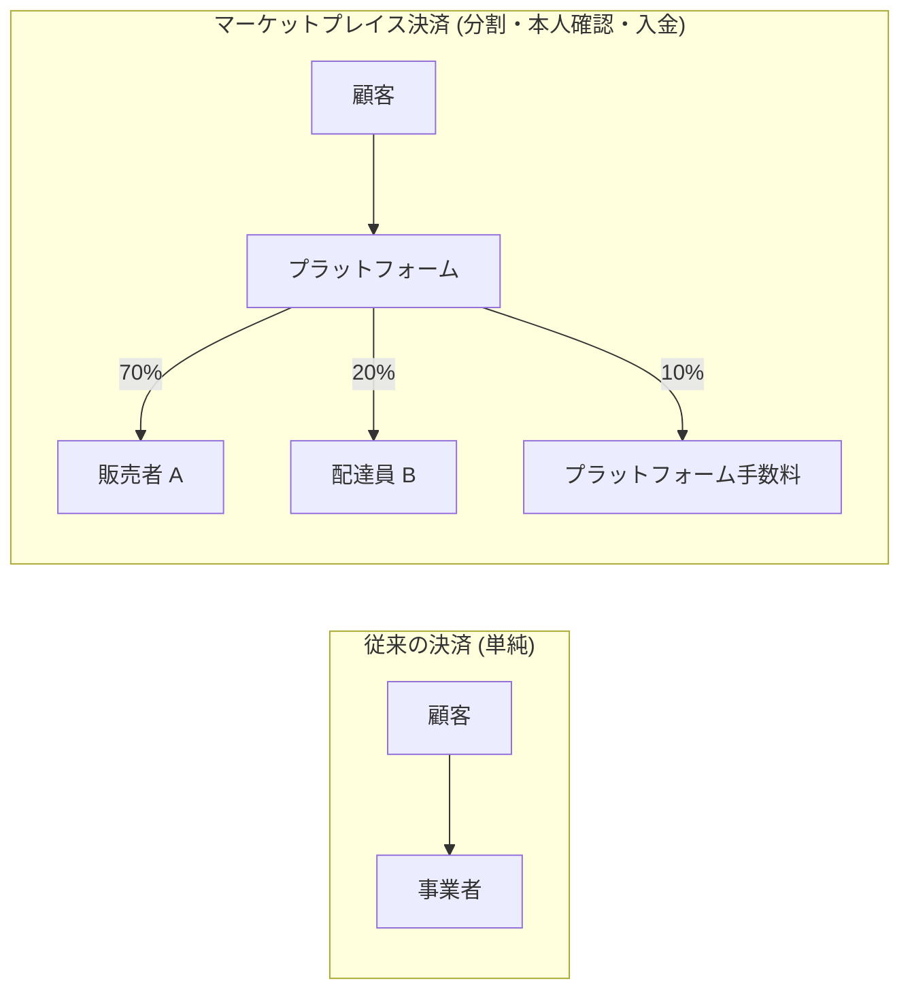
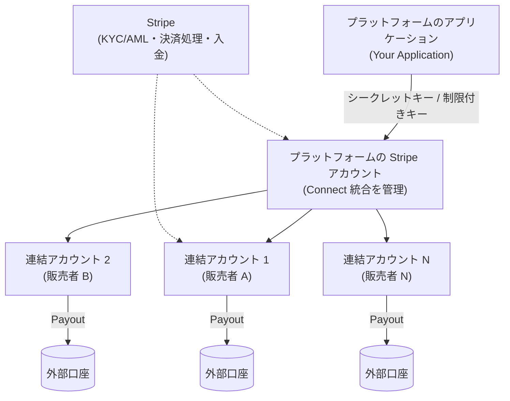
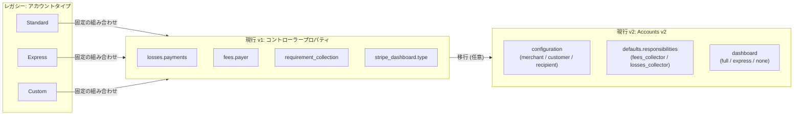
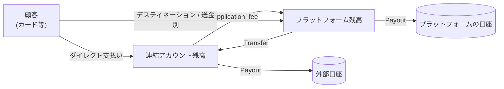
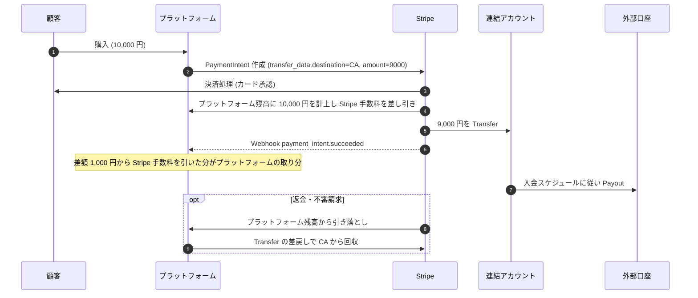
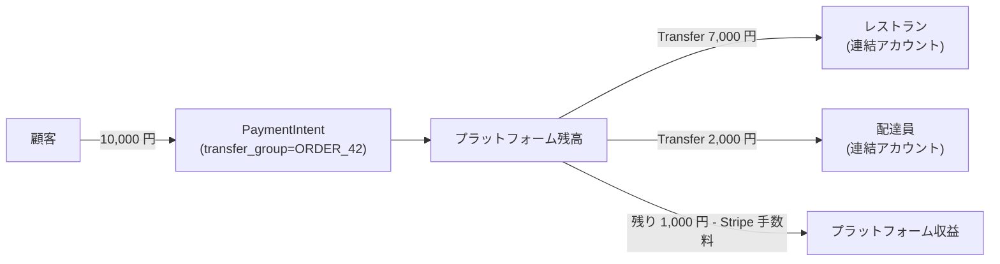
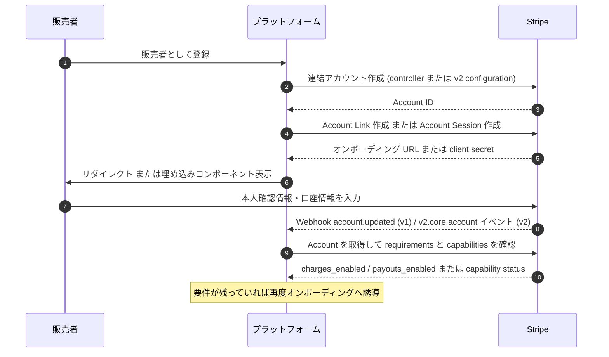
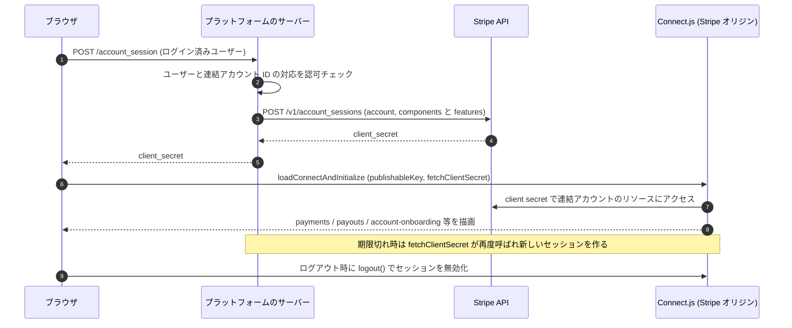

# Stripe Connect 仕様分析 (Stripe Connect: Multi-Party Payments Specification)

**Version**: 3.0
**Last Updated**: 2026-10-04
**Status**: Research Complete（Stripe 公式ドキュメント 2026-10-04 閲覧時点）

---

## 概要 (Overview)

Stripe Connect は、マルチパーティ決済 (multi-party payments) を扱うプラットフォーム・マーケットプレイス向けの決済インフラである。顧客からの支払いを受け付け、販売者・サービス提供者などの複数の受取人へ資金を分配する。「1 つの取引を複数の当事者で分け合う」ことと、その当事者全員の本人確認 (KYC) や入金 (payout) を、API のレベルでネイティブに扱う。

従来の決済プロセッサは、顧客 → 事業者という一直線の資金フローを前提とする。マーケットプレイスでは 1 つの取引をプラットフォーム・販売者・配達員などに分割する必要があり、資金移動規制・KYC/AML・返金と紛争の按分・多通貨入金といった問題が同時に生じる。Connect は、これらをプラットフォームから Stripe 側へ移す仕組みである。



本ドキュメントは、Connect のアカウントモデル、決済タイプ (charge types)、資金フロー、オンボーディング、Webhook、料金体系を、Stripe 公式ドキュメントを一次資料として再構成する。2025 年から 2026 年にかけて Connect のアカウントモデルは大きく変わった。従来の **Standard / Express / Custom の「アカウントタイプ」はレガシー扱い**となり、**コントローラープロパティ (controller properties)** と **Accounts v2 API の構成 (configurations)** が現行の設計手段になっている。本書ではこの「現行」と「レガシー」を明示的に区別する。

関連文書として、Standard アカウントの OAuth 連携や API 認可の一般論は [`authentication-tokens-specification.md`](authentication-tokens-specification.md)、Webhook 受信に必要な TLS の性質は [`../networking/tls-internals.md`](../networking/tls-internals.md)、埋め込みコンポーネントが前提とする CSP・オリジン分離は [`../browsers/web-security-model.md`](../browsers/web-security-model.md) を参照。

---

## 方法論 (Methodology)

- **一次資料**: Stripe の公式ドキュメント (docs.stripe.com)、API リファレンス、変更履歴 (changelog)、料金ページ (stripe.com) を 2026-10-04 に閲覧し、そこに書かれた仕様のみを規範的な事実として扱う。Stripe は API 仕様の第一当事者であり権威ある情報源だが、同時にマーケティングの主体でもある。そのため「135 以上の通貨」のような公称値は **Stripe 公称値** と明記する。
- **現行 / レガシーの区別**: Stripe 自身がドキュメント上で「非推奨機能」「旧アカウントタイプ」「公開プレビュー」と表示しているものはその表示に従う。プレビュー機能は API バージョン名（例: `2026-09-30.preview`）とともに記す。
- **料金**: 料金は日本向けページの値を 2026-10-04 時点で確認し、確認できなかった値は削除した。料金は随時変わるため、実装・見積もり時には必ず公式ページを再確認すること。
- **二次資料**: 資金移動規制の一般的な説明など、Stripe が当事者として語りにくい論点にのみ用い、規範的な主張には使わない。
- **範囲外**: カードネットワーク・清算の下部構造（ISO 8583、3-D セキュア等）は扱わない。また本書は法的助言ではない。

---

## 発見事項 (Findings)

1. **アカウントタイプはレガシーになった。** Stripe の「連結アカウントのタイプ」ページは、その内容が「すでに旧連結アカウントタイプ (Standard、Express、または Custom アカウント) を使用しているプラットフォームにのみ適用」されると明示している。新規プラットフォームには Accounts v2 API か、コントローラープロパティを使う Accounts v1 API を案内している[^accounts-types]。
2. **コントローラープロパティは「責任の分解」である。** 旧 3 タイプは、`losses.payments`（マイナス残高の責任）、`fees.payer`（Stripe 手数料の支払者）、`requirement_collection`（KYC 要件の収集責任）、`stripe_dashboard.type`（ダッシュボードの種類）の 4 軸の特定の組み合わせにすぎない。この 4 軸を個別に指定できるようになった[^controller]。
3. **Accounts v2 は「役割の合成」である。** v2 の `Account` は `merchant`（決済受付）・`customer`（プラットフォームから請求される）・`recipient`（送金の受取）という構成を後から追加でき、本人確認データを再収集せずに機能を拡張できる。Customers API を使わずに顧客も同じ `Account` で表せる[^accounts-v2]。
4. **Accounts v2 の提供状況は用途で異なる。** Connect プラットフォームの連結アカウント用途では提供されている一方、Connect 以外の顧客管理用途は 2026-04-22 からすべての Stripe ユーザー向けの公開プレビューである[^changelog-v2]。ドキュメントのサンプルは `Stripe-Version: 2026-09-30.preview` を指定している[^accounts-v2]。OAuth 連携、Treasury・Issuing のケイパビリティなど、まだ v1 が必要な機能も残る[^accounts-v2]。
5. **決済タイプの選択が資金・責任・手数料を決める。** ダイレクト支払いでは返金・不審請求が連結アカウント残高から引き落とされる。デスティネーション支払いと支払いと送金別方式ではプラットフォーム残高から引き落とされる[^charges]。ダイレクト支払いは旧 Express / Custom アカウントには推奨されない[^charges]。
6. **オンボーディングとダッシュボードは「埋め込み」が主流になった。** Connect 埋め込みコンポーネント (embedded components) は、サーバーで作成した Account Session の client secret を使い、オンボーディング・決済一覧・入金などの UI を自サイトに埋め込む[^embedded]。
7. **Webhook は「スコープ」と「シン / スナップショット」の 2 軸になった。** Connect 用 Webhook は自社アカウントと連結アカウントのスコープに分かれる。v2 の `Account` は `v2.core.account.*` のシンイベントと v1 の `account.updated` の両方を発火させ、それぞれスコープが異なる[^connect-webhooks]。
8. **料金（日本、2026-10-04 時点）**: 「Stripe が料金を設定」モデルでは Connect 追加料金なし。「貴社が料金を設定」モデルでは、有効アカウントあたり月額 ¥200、入金ごとに 0.25% + ¥250、アカウントデビットはデビット額の 1.5% である[^pricing-jp]。

---

## アーキテクチャ (Architecture)

### システム構成 (System Components)

プラットフォームは自身の Stripe アカウントの下に、販売者ごとの**連結アカウント (connected account)** を持つ。各連結アカウントの残高は、それぞれの外部口座（銀行口座・デビットカード）へ入金 (payout) される。



プラットフォームが連結アカウントのリソースを操作するときは、`Stripe-Account` ヘッダー（SDK では `stripeAccount` オプション）で対象アカウントを指定して、そのアカウントとして API を呼ぶ。Webhook の連結アカウントイベントには最上位の `account` プロパティが付き、どの連結アカウントのイベントかを示す[^connect-webhooks]。

### アカウントモデルの変遷 (Account Model: Current vs Legacy)

| 世代 | 指定方法 | ステータス（2026-10-04） |
|------|----------|--------------------------|
| アカウントタイプ | `POST /v1/accounts` に `type=standard\|express\|custom` | **レガシー**。既存プラットフォームは中断なく継続利用可能。作成後のタイプ変更は不可[^accounts-types] |
| コントローラープロパティ | `POST /v1/accounts` に `controller[...]` | **現行 (v1)**。移行は任意で、API バージョン更新も不要。既存アカウントにも対応する値が自動設定済み[^controller] |
| Accounts v2 | `POST /v2/core/accounts` に `configuration` と `defaults.responsibilities` | **現行 (v2)**。Connect 向けに提供。顧客管理用途は公開プレビュー[^accounts-v2][^changelog-v2] |

#### コントローラープロパティ (Controller Properties)

| プロパティ | 値 | 意味 |
|------------|-----|------|
| `controller.losses.payments` | `stripe`（既定） / `application` | 連結アカウントのマイナス残高を誰が負担するか |
| `controller.fees.payer` | `account`（既定） / `application`（作成時に指定可）。`application_express` / `application_custom` は旧タイプ由来の読み取り値 | Stripe 手数料を誰が支払うか |
| `controller.requirement_collection` | `stripe`（既定） / `application` | 要件の期限切れや変更時に、誰が最新情報を収集するか |
| `controller.stripe_dashboard.type` | `full`（既定） / `express` / `none` | 連結アカウントが使えるダッシュボード。作成後は変更不可 |

旧タイプとの対応は次のとおりである[^controller]。

| 旧タイプ | `losses.payments` | `fees.payer` | `requirement_collection` | `stripe_dashboard.type` |
|----------|-------------------|--------------|--------------------------|-------------------------|
| Standard | `stripe` | `account` | `stripe` | `full` |
| Express | `application` | `application_express` | `stripe` | `express` |
| Custom | `application` | `application_custom` | `application` | `none` |

コントローラープロパティで Express 相当・Custom 相当を作ると `fees.payer` は `application` になり、旧タイプで作った場合（`application_express` / `application_custom`）とは、ダイレクト支払い時の手数料請求の挙動が異なる。移行時に手数料ロジックで注意すべき差分である[^controller]。

組み合わせには制約がある。`requirement_collection = application` は、`losses.payments = stripe`、`fees.payer = account`、`stripe_dashboard.type = express / full` のいずれとも両立しない。`stripe_dashboard.type = full` は、`losses.payments = application`、`fees.payer = application`、`requirement_collection = application` と両立しない[^controller]。つまり、**KYC 収集をプラットフォームが担うなら、損失と手数料の責任もプラットフォームが負う**、という一貫したリスク配分が強制される。



#### Accounts v2 の構成 (Configurations)

| 構成 | 有効になる主な機能 | v1 との対応 |
|------|--------------------|-------------|
| `merchant` | 顧客からの決済受付（`card_payments`、`stripe_balance.payouts`） | v1 の `payouts` ケイパビリティを置き換え |
| `customer` | プラットフォームがこの `Account` にサブスクリプション・請求書で請求 | `Customer` オブジェクトの代替（`customer_account` パラメータ） |
| `recipient` | 送金の受け取り（`stripe_balance.stripe_transfers`）。間接支払いに必要 | v1 の `transfers` ケイパビリティを置き換え |

v2 の利点は、(1) 構成を追加しても既提出の本人確認情報を再収集しない、(2) 連結アカウントと顧客を単一 API で扱える、の 2 点である。v1 エンドポイントに v2 の `Account` ID を渡すことも可能で、その場合レスポンスは v1 形式になるが、更新は v2 オブジェクトに反映される[^accounts-v2]。

**v1 がまだ必要な場面**（2026-10-04 時点）: OAuth による連結アカウント認証、受取人利用規約 (recipient service agreement) への署名、`treasury`・`card_issuing_*`・非推奨ケイパビリティ・一部プレビュー決済手段の管理[^accounts-v2]。

### 資金フローの全体像 (Fund Flow Overview)



---

## 技術詳細 (Technical Details)

### Connect が解決する課題 (Problems Connect Solves)

| 課題 | 自前で対応する場合 | Connect での扱い |
|------|--------------------|------------------|
| 資金移動規制 | 第三者間の資金移動は、法域によっては資金移動業 (money transmission) として登録・ライセンスの対象になりうる（米国では連邦登録と州ごとのライセンス等）[^mt] | 資金の保管・移動を Stripe 側の仕組みで行う。ただし規制上の位置づけは法域とビジネスモデルに依存する |
| 販売者の本人確認 (KYC/AML) | 確認フローの構築、機密文書の保管、継続的な再確認、規制変更への追随 | `requirement_collection = stripe` なら、要件変更時に Stripe が情報を収集する[^controller] |
| 分割決済 | 取引ごとの分配計算、決済タイミングのずれ、照合 | 決済タイプ（後述）と Transfer で、トランザクション単位に資金を移動する |
| 返金・紛争 | 当事者ごとの按分と回収 | 決済タイプに応じて、引き落とし元の残高が決まる。送金の差戻し (transfer reversal) で回収する[^charges] |
| 多通貨・国際展開 | 現地口座、通貨換算、現地規制 | 135 以上の通貨での請求（Stripe 公称値）と、通貨換算・越境入金の仕組み[^currencies] |

Connect が**必要**なのは、他者に代わって決済を受け付ける場合、1 つの支払いを複数の受取人に分割する場合、入金を受け取る販売者・提供者をオンボーディングする場合である。単一販売者の E コマースや、単一受取人の SaaS サブスクリプションなら通常の Stripe で足りる。

### 決済タイプ (Charge Types)

Connect の決済タイプは 3 種類あり、「ダイレクト」と「間接」（デスティネーション、支払いと送金別方式）の 2 カテゴリに分かれる[^charges]。

| 観点 | ダイレクト支払い | デスティネーション支払い | 支払いと送金別方式 |
|------|------------------|--------------------------|---------------------|
| 支払いの作成先 | 連結アカウント | プラットフォーム | プラットフォーム |
| 典型的な顧客の取引相手 | 連結アカウント（プラットフォームは見えにくい） | プラットフォーム | プラットフォーム |
| 1 取引あたりの受取人 | 1 | 1 | 複数可 |
| Stripe 手数料の引き落とし元 | 連結アカウントまたはプラットフォーム（選択） | プラットフォーム | プラットフォーム |
| 返金・不審請求の引き落とし元 | 連結アカウント残高 | プラットフォーム残高（送金の差戻しで回収） | プラットフォーム残高（送金の差戻しで回収） |
| 向いている例（Stripe の例示） | SaaS（Shopify、Thinkific） | ライドシェア、住宅賃貸マーケットプレイス | 複数当事者への分割（DoorDash） |
| 注意 | 連結アカウントに `card_payments` が必要。旧 Express / Custom には非推奨 | 地域をまたぐ資金フローは一部地域のみ（`on_behalf_of` で緩和） | 送金額が支払い額を上回る・先行送金も可能なため残高管理が必要 |

#### ダイレクト支払い (Direct Charges)

```javascript
// Language: JavaScript (stripe-node). Purpose: create a PaymentIntent on the connected account
// and collect a platform fee. Source: adapted from docs.stripe.com/connect/direct-charges.
const paymentIntent = await stripe.paymentIntents.create({
  amount: 10000,               // JPY is zero-decimal: 10,000 yen
  currency: 'jpy',
  application_fee_amount: 1000, // platform fee moved to the platform balance
}, {
  stripeAccount: 'acct_connected_account_id', // Stripe-Account header
});
```

#### デスティネーション支払い (Destination Charges)

プラットフォームで支払いを作成し、売上の一部または全額を連結アカウントへ即時に送金する。プラットフォーム残高に残る分が手数料に相当する[^charges]。



```javascript
// Language: JavaScript (stripe-node). Purpose: destination charge that transfers 9,000 JPY
// to the connected account and keeps the rest on the platform.
const paymentIntent = await stripe.paymentIntents.create({
  amount: 10000,
  currency: 'jpy',
  transfer_data: {
    destination: 'acct_connected_account_id',
    amount: 9000, // alternatively omit and set application_fee_amount
  },
  on_behalf_of: 'acct_connected_account_id', // optional: make the connected account the settlement merchant
});
```

`on_behalf_of` を連結アカウントに設定すると、その国で決済が処理され、連結アカウントの国の手数料体系と明細書表記が使われる。異なる国の場合は顧客の明細書に連結アカウントの住所・電話番号が表示される[^charges]。

#### 支払いと送金別方式 (Separate Charges and Transfers)

支払いと送金 (transfer) を独立した操作として扱う。1 つの支払いを複数の連結アカウントへ分割でき、支払い時点で受取人が未確定な場合にも使える。Stripe 自身が「より複雑な導入が必要で、ユースケースで必要な場合にのみ使用」と注意している[^charges]。



```javascript
// Language: JavaScript (stripe-node). Purpose: one charge split across two connected accounts.
// Step 1: charge on the platform, grouped by transfer_group
const paymentIntent = await stripe.paymentIntents.create({
  amount: 10000,
  currency: 'jpy',
  transfer_group: 'ORDER_42',
});

// Step 2: after the charge succeeds, transfer to each party.
// source_transaction ties the transfer to the charge so it waits for those funds.
await stripe.transfers.create({
  amount: 7000, currency: 'jpy',
  destination: 'acct_restaurant_id',
  transfer_group: 'ORDER_42',
  source_transaction: chargeId, // the Charge ID (latest_charge) of the PaymentIntent
});
await stripe.transfers.create({
  amount: 2000, currency: 'jpy',
  destination: 'acct_driver_id',
  transfer_group: 'ORDER_42',
  source_transaction: chargeId,
});
```

### オンボーディング (Onboarding)

#### 実装オプション (Options)

| オプション | 説明 | 向いている用途 |
|------------|------|----------------|
| Stripe ホスト型 | Account Link で Stripe のオンボーディングフォームへリダイレクト | 素早い実装 |
| 埋め込み型 | `account-onboarding` 埋め込みコンポーネントを自アプリ内に表示 | シームレスな UX |
| API 型 | 自前 UI で情報を収集し API で送信（`requirement_collection = application` が前提） | 完全なカスタマイズ。ただし機密個人情報の取り扱い責任が生じる |

#### 連結アカウントの作成（現行の書き方）

**v1 + コントローラープロパティ（Express 相当の例）**[^controller]

```javascript
// Language: JavaScript (stripe-node). Purpose: create a connected account by
// responsibilities instead of the legacy `type` parameter.
const account = await stripe.accounts.create({
  country: 'JP',
  email: 'seller@example.com',
  controller: {
    stripe_dashboard: { type: 'express' },
    fees: { payer: 'application' },
    losses: { payments: 'application' },
    // requirement_collection defaults to 'stripe'
  },
  capabilities: {
    card_payments: { requested: true },
    transfers: { requested: true },
  },
});

// Hosted onboarding via Account Link
const accountLink = await stripe.accountLinks.create({
  account: account.id,
  refresh_url: 'https://example.com/reauth',
  return_url: 'https://example.com/return',
  type: 'account_onboarding',
});
// Redirect the user to accountLink.url; on refresh_url, create a new link
```

**Accounts v2**（公式ドキュメントのサンプルを要約。プレビュー版 API バージョンを指定）[^accounts-v2]

```bash
# Language: shell (curl). Purpose: create a v2 Account with the merchant configuration.
# Source: docs.stripe.com/connect/accounts-v2 (accessed 2026-10-04).
curl -X POST https://api.stripe.com/v2/core/accounts \
  -H "Authorization: Bearer █████████" \
  -H "Stripe-Version: 2026-09-30.preview" \
  --json '{
    "contact_email": "jenny.rosen@example.com",
    "display_name": "Jenny Rosen",
    "dashboard": "full",
    "identity": { "country": "us", "entity_type": "company",
                  "business_details": { "registered_name": "Furever" } },
    "configuration": { "merchant": { "capabilities": { "card_payments": { "requested": true } } } },
    "defaults": { "currency": "usd",
                  "responsibilities": { "fees_collector": "stripe", "losses_collector": "stripe" } },
    "include": ["configuration.merchant", "identity", "requirements"]
  }'
```

v2 の API 呼び出しは、既定では一部のプロパティしか値を返さない。`include` で明示的に要求する設計になっている[^accounts-v2]。

#### オンボーディング完了の検知



完了判定は Webhook を契機に Account を取得し直して行う。Webhook ペイロードの値をそのまま信じるのではなく、最新状態を API で確認する。

### 埋め込みコンポーネント (Connect Embedded Components)

埋め込みコンポーネントは、Stripe ダッシュボードの機能を自サイトに組み込む UI ライブラリである（Web 用 Connect.js、iOS / Android / React Native SDK）[^embedded]。



- **Account Session**: `POST /v1/account_sessions` で、どのコンポーネントとどの機能（例: `refund_management`、`dispute_management`）を有効にするかを指定する。複数のユーザーロールがあるサイトでは、ロールとコンポーネント機能の対応づけをプラットフォーム側で行う[^embedded]。
- **client secret**: 連結アカウントへの API アクセスを委任する文字列である。長いセッションでは期限が切れ、Connect.js が `fetchClientSecret` で自動的に更新する[^embedded]。
- **主なコンポーネント**: アカウント登録、アカウント管理、通知バナー、決済、入金、残高など。アカウント登録・アカウント管理・残高・入金・通知バナー等は、状況によって連結アカウントの Stripe ユーザー認証（ポップアップ）を要求する[^embedded]。
- **制約**: モバイル/デスクトップアプリの埋め込み WebView では使えず、ネイティブ SDK を使う。`Cross-Origin-Opener-Policy: same-origin` を設定すると、ユーザー認証のポップアップが機能しなくなる[^embedded]。

### Webhook とイベント (Webhooks and Events)

| 項目 | 仕様（2026-10-04 時点） |
|------|-------------------------|
| スコープ | 「Your account」（`events_from: ["@self"]` / `connect=false`）と「Connected accounts」（`events_from: ["@accounts"]` / `connect=true`）[^connect-webhooks][^webhooks] |
| ペイロード形式 | スナップショットイベント（v1 リソース、`data.object` に発生時点のオブジェクト）とシンイベント（v2 リソース、関連オブジェクトは API で取得）[^webhooks] |
| v2 Account のイベント | `v2.core.account.*` は Your account スコープ、v1 `account.updated` は Connected accounts スコープで届く（同じ Account が発火元でも異なる）[^connect-webhooks] |
| 主要イベント | `account.updated`、`account.application.deauthorized`、`account.external_account.updated`、`person.updated`、`payment_intent.succeeded`、`payout.failed`、`balance.available`[^connect-webhooks] |
| 署名 | `Stripe-Signature: t=<timestamp>,v1=<signature>`。署名は `timestamp + "." + 生のリクエストボディ` に対するエンドポイントシークレット (`whsec_...`) をキーとした HMAC-SHA256[^webhooks] |
| リプレイ対策 | 公式ライブラリの既定許容差は 5 分。許容値 0 は鮮度チェックを無効化するため使わない[^webhooks] |
| 再試行 | 本番環境では指数バックオフで最長 3 日間[^webhooks] |
| 順序・重複 | 配信順序は保証されない。同一イベントが複数回届きうるため、イベント ID で重複を排除する[^webhooks] |
| TLS | Webhook は TLS 1.2 / 1.3 のみをサポート[^webhooks] |

Connect の Webhook では、本番用 URL が本番とテストの両方のイベントを受け取る。そのため `livemode` を確認してから処理する[^connect-webhooks]。

### 冪等性 (Idempotency)

すべての `POST` リクエストは `Idempotency-Key` ヘッダーを受け付ける。Stripe は最初のリクエストの結果（失敗を含む）を保存し、同じキーの再送には同じ結果を返す。キーは最大 255 文字で、24 時間以上経過したキーは削除されうる。同じキーでパラメータが異なる場合はエラーになる[^idempotency]。送金 (Transfer) のように重複実行が直接損失になる操作では、注文 ID などから決定的にキーを導出し、ネットワーク障害時のリトライを安全にする。

### 料金体系 (Pricing) — 日本、2026-10-04 時点

以下は [Stripe Connect 料金ページ（日本）](https://stripe.com/jp/connect/pricing) で 2026-10-04 に確認した値である[^pricing-jp]。料金は第一当事者の公表値であり、変更されうる。また個別契約 (custom pricing) は反映していない。

**モデル 1: Stripe が料金を設定 (Stripe handles pricing)** — Stripe が連結アカウントに決済手数料を直接請求する。

| 項目 | 手数料 |
|------|--------|
| プラットフォーム料金 | なし |
| 入金手数料 | なし |
| アカウント手数料 | なし |

**モデル 2: 貴社が料金を設定 (You handle pricing)** — プラットフォームが Stripe 手数料を負担し、連結アカウントへの料金を自ら設定する。

| 項目 | 手数料 |
|------|--------|
| 有効なアカウント | ¥200 / アカウント / 月（当該月に銀行口座またはデビットカードへの入金があったアカウント） |
| 入金 (payout) | 入金ごとに 0.25% + ¥250 |
| アカウントデビット | デビット額の 1.5% |

**参考: 決済処理手数料（Payments、日本）** — 国内カード決済は 3.6%、通貨換算が必要な場合は +2%（[Stripe 料金ページ（日本）](https://stripe.com/jp/pricing)、2026-10-04 確認）[^pricing-payments-jp]。旧版にあった「3.6% + ¥30」「代替通貨での入金 1%」は 2026-10-04 時点の日本向け公式ページで確認できなかったため削除した。越境入金の料率と、手数料への消費税の扱いは Connect 料金ページに明記がない。

### ユースケースと推奨構成 (Use Cases)

| プラットフォーム類型 | 推奨構成（現行の表現） | 決済タイプ | Stripe ドキュメントの例 |
|----------------------|------------------------|------------|--------------------------|
| E コマース SaaS / ストアビルダー | `dashboard: full`、手数料・損失は Stripe（旧 Standard 相当） | ダイレクト | Shopify、Thinkific |
| マーケットプレイス・ライドシェア | `dashboard: express`、手数料・損失はプラットフォーム（旧 Express 相当） | デスティネーション | Airbnb、Lyft |
| 複数当事者への分割（デリバリー） | 受取側は `recipient` 構成 / `transfers` ケイパビリティ | 支払いと送金別方式 | DoorDash |
| ホワイトラベル | `dashboard: none`、KYC 収集もプラットフォーム（旧 Custom 相当） | デスティネーション / 送金別 | — |
| 連結アカウントへの SaaS 課金も行う | v2 で `merchant` + `customer` 構成を同一 Account に付与 | ダイレクト + Billing | — |

例示の企業名は、Stripe のドキュメントが各構成・決済タイプの典型例として挙げているものに限った[^accounts-types][^charges]。

---

## セキュリティ考察 (Security Considerations)

### 責任分界 (Shared Responsibility)

Connect のセキュリティは、Stripe とプラットフォームの責任分界で決まる。コントローラープロパティはこの分界を API で明示したものである。

| 領域 | Stripe が担う | プラットフォームが担う |
|------|---------------|------------------------|
| カードデータ (PCI DSS) | Stripe.js / Elements / Checkout 経由ならカード番号はプラットフォームに届かない | 自前でカード番号を扱わない設計の維持 |
| KYC/AML | `requirement_collection = stripe` なら要件の収集と更新 | `application` の場合、身分証・納税者番号等の機密個人情報の取り扱いと追加の規制・セキュリティ要件[^accounts-types] |
| 不正・損失 | `losses.payments = stripe` ならマイナス残高の最終負担 | `application` の場合、信用・不正リスク管理とマイナス残高の負担[^controller] |
| 連結アカウントの乗っ取り | 埋め込みコンポーネントでの Stripe ユーザー認証 | `disable_stripe_user_authentication` を使う場合は、2 段階認証など同等の対策（Stripe のベストプラクティス）[^embedded] |

### API キーと認可

- **シークレットキーの保護**: シークレットキーはサーバー側のシークレットマネージャーで管理し、コードやリポジトリに置かない。Stripe は Account Session 作成用に、その資源だけにアクセスできる**制限付きキー (restricted key)** の使用を推奨している[^embedded]。鍵管理の一般論は [`../cloud/cloud-kms-confidential-computing.md`](../cloud/cloud-kms-confidential-computing.md) を参照。
- **`Stripe-Account` の認可漏れ (IDOR)**: プラットフォームのシークレットキーは、どの連結アカウントとしても API を呼べる。リクエスト中の連結アカウント ID を、ログイン中ユーザーが本当に所有しているかを必ずサーバー側で照合する。Account Session の作成エンドポイントも同様で、ここを誤ると他の販売者の決済・入金情報を埋め込み UI 経由で閲覧・操作させてしまう。
- **ロールと機能の対応**: Account Session で返金・不審請求管理などの機能を有効にする場合は、サイト内のユーザーロールに応じて有効化する[^embedded]。

### Webhook

- **署名の検証は必須**: 生のリクエストボディ・`Stripe-Signature`・エンドポイントシークレットで検証する。フレームワークが JSON をパースし直すと検証に失敗するため、生ボディを保持する。`v1` 以外のスキームは無視してダウングレードを防ぎ、比較は定数時間で行う[^webhooks]。
- **リプレイと重複**: タイムスタンプの許容差（既定 5 分）とイベント ID による重複排除を併用する。順序に依存しない処理にする[^webhooks]。
- **シークレットのローテーション**: エンドポイントシークレットは定期的に、あるいは漏洩の疑いがあれば更新する。旧シークレットを最大 24 時間併存させられる[^webhooks]。
- **送信元の制限**: 署名検証に加えて、Stripe の公開 IP アドレスからのみ受け付ける許可リストも Stripe は推奨している[^webhooks]。
- **CSRF 除外**: Web フレームワークの CSRF 保護から Webhook ルートだけを除外する。署名検証がその代わりになる。

### 埋め込みコンポーネント

- CSP を使うサイトでは `frame-src` / `script-src` に `https://connect-js.stripe.com` と `https://js.stripe.com` を、`img-src` に `https://*.stripe.com` を追加する[^embedded]。CSP とオリジン分離の原理は [`../browsers/web-security-model.md`](../browsers/web-security-model.md) を参照。
- client secret はブラウザに渡る委任トークンである。ログアウト時には `logout()` で Account Session を無効化する[^embedded]。トークン委任と失効の一般論は [`authentication-tokens-specification.md`](authentication-tokens-specification.md) を参照。

### 金銭的整合性

- 送金・返金・入金を伴う `POST` には `Idempotency-Key` を付け、リトライによる二重送金を防ぐ[^idempotency]。
- 支払いと送金別方式では、送金額が支払額を上回る・先行送金するといった操作が可能である。そのため残高を監視し、可能なら `source_transaction` で送金を支払いに紐づける[^charges]。
- `debit_negative_balances` を有効にしない限り、マイナス残高の連結アカウントの外部口座からは引き落とされない[^charges]。損失を負担する構成（`losses.payments = application`）では、入金スケジュールの遅延や準備金による与信管理を設計に含める。

### 依存関係

Stripe SDK・Connect.js の更新は、決済経路そのものの変更である。バージョン固定と来歴確認については [`../security/software-supply-chain-security.md`](../security/software-supply-chain-security.md) を参照。

---

## 結論 (Conclusions)

Stripe Connect の本質は、マルチパーティ決済に伴う**責任（KYC、損失、手数料、ユーザー接点）の配分**を API として表現することにある。旧来の Standard / Express / Custom は、この配分の代表的な 3 点を名前で固定したものだった。コントローラープロパティはそれを 4 つの独立した軸に分解し、Accounts v2 はさらに「何ができるか（merchant / customer / recipient）」を構成として後から合成できるようにした。2026-10-04 時点で、新規実装はアカウントタイプを使うべきではなく、Accounts v2（Connect 向けに提供）か、v1 + コントローラープロパティを選ぶことが Stripe 自身の推奨である。

資金フローの設計は、決済タイプの選択でほぼ決まる。ダイレクト支払いは返金・紛争のリスクを連結アカウントに置き、デスティネーション支払いと支払いと送金別方式はそれをプラットフォームに置く。この選択はコントローラープロパティの責任配分と整合させる必要がある（例: 旧 Express / Custom 相当でダイレクト支払いを使うことは推奨されない）。

セキュリティ上の最大の論点は、プラットフォームのシークレットキーが全連結アカウントに対して強い権限を持つことである。`Stripe-Account` の指定や Account Session の作成でユーザーと連結アカウントの対応を照合し損ねると、他人の資金や個人情報に触れる経路が生まれる。Webhook 署名の検証、冪等キー、制限付きキー、埋め込みコンポーネントの CSP とセッション無効化は、いずれもこの「強い権限を持つプラットフォーム」を前提とした防御である。

Connect は 2025〜2026 年に API モデルを大きく変えており、プレビュー機能も多い。本書の記述は 2026-10-04 の公式ドキュメントに基づくスナップショットであり、特に Accounts v2 の提供範囲と料金は、利用時に公式ドキュメントで再確認する必要がある。

---

## 付録 A: レガシーアカウントタイプの比較 (Appendix A: Legacy Account Types)

既存のプラットフォームが旧タイプを使い続ける場合の参考として、Stripe の比較表を要約する[^accounts-types]。新規実装では上記のコントローラープロパティ / Accounts v2 を使う。

| 観点 | Standard | Express | Custom |
|------|----------|---------|--------|
| 組み込みの負荷 | とても低い | 低い | 非常に高い |
| 組み込みの方法 | API または OAuth | API | API |
| 不正・不審請求の責任 | ダイレクト支払いは連結アカウント、デスティネーション支払いはプラットフォーム | プラットフォーム | プラットフォーム |
| アカウント登録・本人確認情報の収集 | Stripe | Stripe | プラットフォームまたは Stripe |
| 連結アカウントのダッシュボード | フル機能 | Express ダッシュボード | なし |
| サポートされる決済タイプ | ダイレクトのみ | デスティネーション、送金別、ダイレクト（非推奨） | デスティネーション、送金別、ダイレクト（非推奨） |
| 新しいコンプライアンス要件への自動追随 | はい | はい | いいえ |
| 追加コスト | — | あり | あり |

作成後にタイプと国は変更できない。Connect で構築する拡張機能 (extensions) から Standard アカウントに接続するには OAuth が必要である[^accounts-types]。

---

## 付録 B: 更新履歴 (Appendix B: Document History)

| Version | Date | Changes |
|---------|------|---------|
| 1.0 | 2025-12-26 | Initial research and documentation |
| 1.1 | 2025-12-26 | Add "Why Stripe Connect?" section, remove integration checklist |
| 2.0 | 2026-07-06 | Rewrite in Japanese-primary style per current language policy; convert ASCII diagrams to Mermaid; add point-in-time caveats to pricing figures |
| 3.0 | 2026-10-04 | Restructure into the analysis-document template; mark account types as legacy and add controller properties / Accounts v2 / embedded components; add fund-flow and session sequence diagrams; re-verify Japan pricing and drop unverifiable figures; switch to footnote references |

---

## 参考文献 (References)

**一次資料 (Primary — Stripe 公式)**

[^accounts-types]: Stripe. *連結アカウントのタイプ (Connected account types)*. https://docs.stripe.com/connect/accounts — Accessed: 2026-10-04. — 旧アカウントタイプが既存プラットフォームのみ対象である旨の「非推奨機能」表示と比較表。

[^controller]: Stripe. *Migrate to controller properties*. https://docs.stripe.com/connect/migrate-to-controller-properties — Accessed: 2026-10-04. — 4 つのコントローラープロパティ、旧タイプとの対応表、非対応の組み合わせ。

[^accounts-v2]: Stripe. *Connect and the Accounts v2 API*. https://docs.stripe.com/connect/accounts-v2 — Accessed: 2026-10-04. — 構成 (merchant / customer / recipient)、`/v2/core/accounts` のサンプル（`Stripe-Version: 2026-09-30.preview`）、v1 が必要な機能の一覧。

[^changelog-v2]: Stripe. *Makes Accounts v2 available to all Stripe users for managing customers* (Changelog, 2026-04-22, `2026-04-22.preview`). https://docs.stripe.com/changelog/dahlia/2026-04-22/accounts-v2-expanded-availability — Accessed: 2026-10-04.

[^charges]: Stripe. *Connect 導入における支払いの仕組みを理解する (Understand how charges work in a Connect integration)*. https://docs.stripe.com/connect/charges — Accessed: 2026-10-04. — 3 種の決済タイプ、`on_behalf_of`、返金・不審請求の引き落とし元。

[^embedded]: Stripe. *Get started with Connect embedded components* (Web). https://docs.stripe.com/connect/get-started-connect-embedded-components?platform=web — Accessed: 2026-10-04. — Account Session、client secret、CSP 要件、ユーザー認証、logout。

[^connect-webhooks]: Stripe. *Connect webhooks*. https://docs.stripe.com/connect/webhooks — Accessed: 2026-10-04. — スコープ、`account` プロパティ、主要イベント、`livemode`。

[^webhooks]: Stripe. *Receive Stripe events in your webhook endpoint*. https://docs.stripe.com/webhooks — Accessed: 2026-10-04. — 署名方式 (HMAC-SHA256)、許容差 5 分、再試行 3 日、順序非保証、TLS 1.2/1.3、イベント送信先 API。

[^idempotency]: Stripe. *Idempotent requests* (API Reference). https://docs.stripe.com/api/idempotent_requests — Accessed: 2026-10-04.

[^currencies]: Stripe. *Supported currencies*. https://docs.stripe.com/currencies — Accessed: 2026-10-04. — 「135 以上の通貨」は Stripe 公称値。

[^pricing-jp]: Stripe. *Connect の料金体系（日本）*. https://stripe.com/jp/connect/pricing — Accessed: 2026-10-04. — 料金は変更されうる第一当事者の公表値。

[^pricing-payments-jp]: Stripe. *料金体系（日本）*. https://stripe.com/jp/pricing — Accessed: 2026-10-04.

**二次資料 (Secondary — 規制の一般解説)**

[^mt]: Modern Treasury. *How Do Money Transmission Laws Work?* https://www.moderntreasury.com/journal/how-do-money-transmission-laws-work — Accessed: 2026-10-04. — 米国の資金移動業規制の概説（法的助言ではない。具体的な適用は法域ごとに専門家の確認が必要）。
