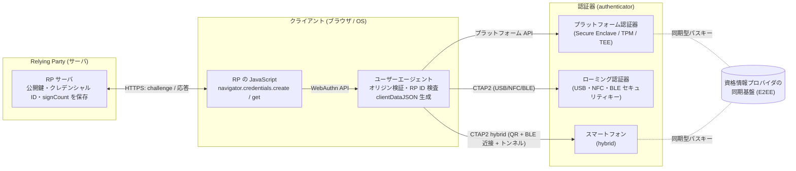
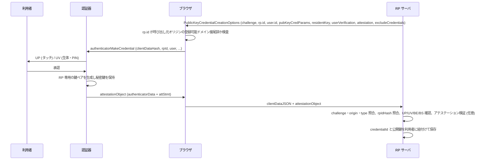
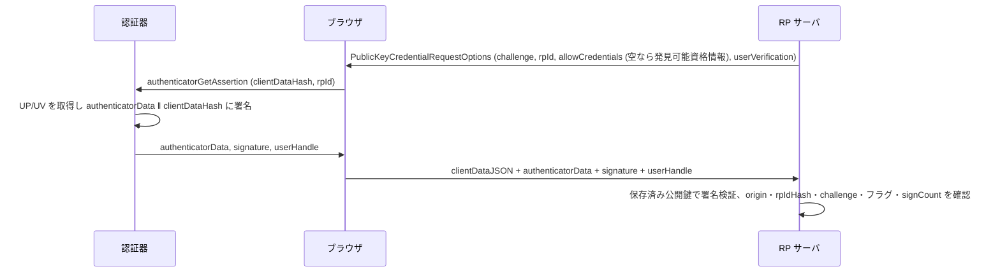

# WebAuthn / パスキー仕様 (WebAuthn & Passkeys Specification: Ceremonies, Origin Binding & Synced Credentials)

## 概要 (Overview)

パスワードの根本的な欠陥は、**秘密をサーバと共有し、毎回それを相手に渡す**ことにある。利用者は偽サイトと本物を見分けられず、サーバは漏洩すれば全利用者の秘密を失う。WebAuthn (Web Authentication) は、この共有秘密を**オリジンに束縛された公開鍵ペア**に置き換える W3C 仕様である。秘密鍵は認証器 (authenticator) から出ず、サーバは公開鍵しか持たず、署名には要求元のオリジンが刻まれる。

本ドキュメントは、W3C WebAuthn Level 3 と FIDO Alliance の CTAP (Client to Authenticator Protocol) 2.x からなる FIDO2 を仕様として分析する。対象は登録・認証の儀式 (ceremony)、アテステーション (attestation) とそのプライバシー、RP ID によるフィッシング耐性、ユーザー検証 (UV) とユーザー存在確認 (UP) の区別、発見可能な資格情報 (discoverable credential)、そして「パスキー (passkey)」の名で普及した同期型資格情報 (synced passkey) とハイブリッドトランスポートである。

中心テーゼは、**WebAuthn のフィッシング耐性は利用者の注意ではなくブラウザが署名対象に書き込むオリジンから来る**、ということ。そしてパスキーの普及は、この強い性質の一部（鍵の非輸出性）を**可用性と回復性のために意図的に手放した**取引の上に成り立っている。この取引を判断できるようにするため、仕様は BE/BS フラグとアテステーションを用意している。

[`authentication-tokens-specification.md`](authentication-tokens-specification.md) が扱う JWT/OAuth/OIDC は「認証後の状態をどう運ぶか」の層であり、本書はその手前の「最初の本人確認をどう行うか」の層にあたる。分析深度は Level 3。

## 方法論 (Methodology)

- 一次資料は W3C WebAuthn Level 3 (2026-08-25 勧告)[^webauthn3] と FIDO CTAP 2.2 (2025-07-14 Proposed Standard)[^ctap22] とする。ブラウザ・OS の挙動は各ベンダーの開発者文書で補い、**仕様の規定**と**実装の状況**を区別して日付を付ける。
- 各機構を「どの攻撃・どの運用課題への応答か」で説明する。フィッシング（中間者中継を含む）、サーバ側の資格情報漏洩、端末紛失、利用者の追跡 (tracking) を主要な脅威軸とする。
- 保証水準の評価には NIST SP 800-63B-4 (2025-08-26)[^sp80063b4] の AAL (Authenticator Assurance Level) と「フィッシング耐性」の定義を用いる。
- 暗号プリミティブ（ECDSA P-256、Ed25519）の一般論と実装上の落とし穴は [`../security/applied-cryptography.md`](../security/applied-cryptography.md)、ブラウザのオリジンモデルは [`../browsers/web-security-model.md`](../browsers/web-security-model.md)、鍵を守るハードウェア（Secure Enclave、TEE、TPM）は [`../../hardware/security/side-channels-tee-secure-boot.md`](../../hardware/security/side-channels-tee-secure-boot.md) に委ねる。

## 発見事項 (Findings)

1. **フィッシング耐性は「オリジンを署名に含める」一点から生じる。** ブラウザは呼び出し元のオリジンを `clientDataJSON` に書き込み、認証器は RP ID のハッシュを `authenticatorData` に入れ、両者のハッシュに署名する。偽サイト `examp1e.com` は `example.com` の資格情報をそもそも呼び出せず、中継しても署名内のオリジンが一致しない。NIST SP 800-63B-4 はこれを「検証者名束縛 (verifier name binding)」と呼び、フィッシング耐性の要件を満たす方式として WebAuthn を例示している[^sp80063b4]。
2. **サーバ側の漏洩は他サイトに波及しない。** RP は公開鍵とクレデンシャル ID しか保存しないため、データベースの流出はパスワードハッシュの流出とは異なり、オフライン総当たりにもクレデンシャルスタッフィング (credential stuffing) にも使えない。鍵ペアは RP ごとに生成されるため、RP 間で利用者を名寄せする識別子にもならない。
3. **「パスキー」は仕様用語ではなく、発見可能な資格情報の利用者向けの呼称である。** 仕様上の実体は discoverable credential（旧称 resident key）であり、同期されるか否かは認証器（資格情報プロバイダ）の実装が決める[^passkeys-terms]。RP は `authenticatorData` の **BE (Backup Eligibility)** と **BS (Backup State)** フラグで、その資格情報が同期可能か、実際にバックアップされているかを知る。BE は資格情報の生成時に固定され、BS は時間とともに変化しうる[^webauthn3]。
4. **同期型パスキーは AAL3 の要件を満たさない。** 秘密鍵が端末外（同期基盤）に出るため、非輸出性を要求する AAL3 では使用が禁止され (SHALL NOT)、AAL2 以下で付録 B の要件を満たす場合に限り使用が認められる[^sp80063b4]。デバイス束縛型（セキュリティキー等）と同期型の差は、フィッシング耐性ではなく**鍵の所在の数と回復経路**にある。
5. **ハイブリッドトランスポートは、近接性を BLE で証明することで QR コード経由の遠隔中継を防ぐ。** 旧称 caBLE は CTAP 2.2 で hybrid として標準化され、QR コードで開始する方式と、事前にペアリングした状態で開始する方式 (state-assisted) を定義する。どちらも BLE 広告による近接確認とトンネルサービスを組み合わせる[^ctap22]。
6. **アテステーションは「認証器の型番を証明する仕組み」であり、利用者の追跡手段になりうる。** そのため既定値は `none` である[^mdn-creation]。同期型パスキーでは実務上アテステーションがほぼ得られず、RP が認証器のモデルを制限したい場合は、エンタープライズアテステーション (enterprise attestation) かデバイス束縛型への限定が必要になる。
7. **最大の残存リスクは WebAuthn の外側にある。** 認証後のセッション Cookie の窃取、より弱い代替手段（SMS OTP、パスワード、回復メール）へのダウングレード、同期基盤アカウント（Apple/Google アカウント）の乗っ取り、侵害された端末やブラウザ自体は、どれも WebAuthn の署名検証では防げない。**フィッシング耐性はアカウント全体の最弱経路に律速される。**

## アーキテクチャ (Architecture)

### 構成要素と信頼境界

凡例: 実線はプロトコル呼び出し、点線は同期型パスキーの鍵複製経路、円柱は資格情報プロバイダ（iCloud キーチェーン、Google パスワードマネージャー、サードパーティ製マネージャー等）が運用する同期基盤を表す。

### 登録の儀式 (Registration Ceremony)

### 認証の儀式 (Authentication Ceremony)

## 技術詳細 (Technical Details)

### 1. 仕様の現在地（2026-10-04 時点）

| 仕様 | 版 | 状態 | 日付 | 主な追加 |
|---|---|---|---|---|
| W3C WebAuthn | Level 3 | W3C 勧告 (Recommendation) | 2026-08-25（CR スナップショット 2026-05-26 から実質的変更なし）[^webauthn3] | ハイント (hints)、関連オリジン要求、`getClientCapabilities()`、JSON 直列化 (`parseCreationOptionsFromJSON` 等)、Signal API、BE/BS の明確化 |
| FIDO CTAP | 2.1 | Proposed Standard | 2021-06-15[^fido-specs] | credProtect、largeBlob、エンタープライズアテステーション、PIN/UV 認証プロトコル 2 |
| FIDO CTAP | 2.2 | Proposed Standard | 2025-07-14[^ctap22][^fido-specs] | hybrid トランスポートの標準化、エンタープライズアテステーションの制御強化、PIN 複雑性ポリシー |
| FIDO CTAP | 2.3 | Proposed Standard | 2026-02-26[^fido-specs] | （本書では 2.2 を基準に分析） |

仕様が勧告になったことと、各ブラウザ・OS が全機能を実装したことは別である。Level 3 の個別機能の実装状況は `getClientCapabilities()` で実行時に検出するのが仕様の想定する使い方である[^webauthn3][^passkeys-ror]。

### 2. 検証すべきデータ構造

`authenticatorData` は最低 37 バイトからなる[^mdn-authdata]。

| フィールド | 長さ | 意味 |
|---|---|---|
| rpIdHash | 32 B | RP ID の SHA-256。サーバは自身の RP ID のハッシュと照合する |
| flags | 1 B | bit0 UP、bit2 UV、bit3 BE、bit4 BS、bit6 AT（attested credential data あり）、bit7 ED（拡張あり）。bit1 と bit5 は予約 |
| signCount | 4 B | 署名カウンタ。未対応なら 0 |
| attestedCredentialData | 可変 | 登録時のみ。AAGUID（16 B、認証器モデル識別子）、credentialId、COSE 形式の公開鍵 |
| extensions | 可変 | CBOR マップ |

`clientDataJSON` は `type`（`webauthn.create` / `webauthn.get`）、`challenge`、`origin`、`crossOrigin`、`topOrigin`（クロスオリジン iframe 時）を含む[^mdn-clientdata]。サーバの検証漏れの典型は、`origin` を期待値と照合しない、`challenge` を使い捨てにしない（リプレイを許す）、`type` を確認しない（登録応答を認証に流用される）、`rpIdHash` を検査しない、の 4 つである。

### 3. RP ID とオリジン束縛 — フィッシング耐性の源泉

- **RP ID の規則**: RP ID は呼び出し元オリジンの実効ドメインと等しいか、その登録可能ドメイン接尾辞 (registrable domain suffix) でなければならない。たとえば `login.example.com` は RP ID `example.com` を名乗れるが、`example.co.jp` や公開接尾辞 (`com`) は名乗れない。資格情報は RP ID に束縛され、同じ RP ID の要求でしか使えない[^webauthn2-privacy]。
- **二重の束縛**: ブラウザが書き込む `origin`（`clientDataJSON` 内）と、認証器が書き込む `rpIdHash`（`authenticatorData` 内）の両方が署名対象になる。前者は「どのページから要求されたか」、後者は「どの RP の鍵か」を表す。JavaScript から `origin` を偽る手段はない。
- **中間者中継への耐性**: リアルタイム中継型のフィッシング（攻撃者のプロキシが本物サイトに中継する AitM 型）でも、利用者のブラウザが署名する `origin` は攻撃者のドメインになる。そのため RP の検証で失敗する。TOTP や SMS OTP がこの攻撃に無力なのとの決定的な差である。
- **関連オリジン要求 (Related Origin Requests)**: ccTLD や複数ブランドで同じ資格情報を使いたい RP のため、Level 3 は RP ID 配下の `/.well-known/webauthn` に `origins` 配列の JSON を置いて許可オリジンを列挙する仕組みを定めた[^webauthn3][^passkeys-ror]。仕様は少なくとも 5 つの一意なラベルのサポートを求めるが、5 を超えて対応するクライアントは知られておらず、実務上の上限は 5 である[^passkeys-ror]。これはオリジン束縛を**RP 自身の宣言で**拡張する機構であり、その JSON の改竄は束縛の破れに直結する。
- **ネイティブアプリ**: ブラウザ外ではオリジンの代わりに、アプリとドメインの関連付け（Apple の Associated Domains、Android の Digital Asset Links）が RP ID の正当性を担保する。OS 側の機構は [`../ios/security-architecture.md`](../ios/security-architecture.md) と [`../android/security-model.md`](../android/security-model.md) を参照。

### 4. ユーザー存在確認 (UP) とユーザー検証 (UV)

| 区分 | 何を証明するか | 手段 | フラグ |
|---|---|---|---|
| ユーザー存在確認 (User Presence) | 誰かがその場で操作した（マルウェアによる無人実行ではない） | タッチ、ボタン | UP (bit0) |
| ユーザー検証 (User Verification) | 認証器の正当な持ち主が操作した | 生体認証、PIN、端末パスコード | UV (bit2) |

- `userVerification` の既定値は `preferred` である[^mdn-creation]。`preferred` では UV なしの応答も返りうるため、**多要素相当を主張するなら RP は UV フラグを自分で検査しなければならない**。UV が立った WebAuthn は「所持（鍵）」と「知識/生体（PIN/生体）」を 1 回の操作で満たす多要素認証になる。
- 生体情報は認証器の外に出ない。RP が受け取るのは「UV に成功した」という 1 ビットだけであり、どの方式で検証したかも原則として分からない。
- CTAP 2.1 以降の PIN/UV 認証プロトコル 2 は、クライアントと認証器の間で ECDH による共有秘密を確立し、AES と HMAC で PIN とトークンを保護する。トークンには権限 (permissions) が付き、用途外の操作には使えない[^ctap22]。

### 5. 発見可能な資格情報と条件付き UI

- **非発見型 (non-discoverable)**: 秘密鍵をクレデンシャル ID に暗号化して埋め込み、認証器は状態を持たない（セキュリティキーの容量問題への解）。RP は先にユーザー名を受け取り、`allowCredentials` で ID を渡す必要がある。
- **発見可能 (discoverable)**: 認証器が RP ID・user handle・鍵を保存する。`allowCredentials` を空にすると、認証器が候補を提示する。ユーザー名入力すら不要な「パスキー」体験はこの方式に依存する。`residentKey` は `discouraged` / `preferred` / `required` から選ぶ[^mdn-creation]。
- **条件付き UI (conditional mediation)**: `navigator.credentials.get({ mediation: 'conditional' })` は、ユーザー名欄（`autocomplete="username webauthn"`）にフォーカスしたときにだけ、パスワードと並べてパスキーを自動入力候補として示す。モーダルダイアログを出さずにパスワード利用者とパスキー利用者を同じ画面で扱えるのが利点である。対応状況は `getClientCapabilities()` の `conditionalGet` で検出する[^webdev-autofill]。
- **条件付き作成 (conditional create)**: `create()` に `mediation: 'conditional'` を指定すると、利用者が直前に既定のパスワードマネージャーの保存済みパスワードでログインした場合に限り、パスキーが無操作で作成され、作成後に通知される。Chrome（デスクトップは Chrome 136、Android は 14 以上）と Safari が対応し、可否は資格情報プロバイダの対応にも依存する[^chrome-condcreate]。パスワードからの移行を「利用者に選ばせない」形で進める機構である。
- **Signal API**: RP がサーバ側で削除した資格情報や変更したユーザー名を、`signalUnknownCredential` / `signalAllAcceptedCredentials` / `signalCurrentUserDetails` で資格情報プロバイダに伝え、自動入力候補と RP の状態の不整合を解消する[^webauthn3]。

### 6. 同期型パスキーとデバイス束縛型 — BE/BS フラグ

| 観点 | デバイス束縛型 (device-bound) | 同期型 (synced) |
|---|---|---|
| 鍵の所在 | 単一の認証器（セキュリティキー等）から出ない[^fido-passkeys] | 資格情報プロバイダの同期基盤経由で利用者の全端末に複製される[^fido-passkeys] |
| BE / BS | BE=0, BS=0 | BE=1。バックアップ済みなら BS=1 |
| 端末紛失時 | 資格情報を失う。RP 側で複数登録と回復経路が必須 | 他端末・同期基盤から回復できる |
| NIST AAL | AAL3 の要件を満たしうる | AAL3 では禁止、AAL2 まで（付録 B の要件下）[^sp80063b4] |
| アテステーション | 取得・検証が可能 | 実務上ほぼ得られない |
| 主な残存リスク | 物理的紛失・盗難 | 同期基盤アカウントの乗っ取り、プロバイダへの信頼 |

- 同期基盤はエンドツーエンド暗号化 (E2EE) を前提とする。Google は、パスキーは端末上で暗号化されてから同期され、Google 自身は利用者になりすますことができないと説明している[^google-passkeys]。この保証はベンダーの自己申告であり、独立検証の範囲は限られる点に留意する。
- RP は BE/BS を使ってリスクに応じた方針を取れる。例として、BE=0（デバイス束縛型）の資格情報しか持たない利用者には追加の回復手段の登録を促す、BS=1 になった時点でパスワードの廃止を提案する、といった運用がある。
- 資格情報プロバイダ間の移行のため、FIDO Alliance は資格情報交換仕様 (Credential Exchange Specifications) を公開している[^fido-cx]。これは囲い込みを緩める一方、エクスポート経路という新しい攻撃面も生む。

### 7. ハイブリッドトランスポート (Hybrid, 旧 caBLE)

- **QR 起点**: PC のブラウザが QR コードを表示し、スマートフォンでそれを読む。QR には鍵合意用の情報が含まれる。スマートフォンは BLE 広告を発し、PC がそれを受信できること（物理的近接）を確認したうえで、クラウドのトンネルサービスを経由して暗号化された CTAP2 セッションを張る[^ctap22]。
- **状態支援型 (state-assisted)**: 一度リンクした端末同士は QR なしで開始できる。この場合も BLE による近接確認を行う[^ctap22]。
- **設計の要点**: トンネル（インターネット経由）だけなら、攻撃者は QR コードの画像を遠隔の被害者に送りつけて中継できてしまう。BLE 近接確認は、この「QR フィッシング」の遠隔中継を物理層で断つための要素である。加えて、スマートフォン側の署名にも PC ブラウザが検証した `origin` が入るため、オリジン束縛は hybrid でも維持される。

### 8. アテステーションとプライバシー

- **形式**: Level 3 は packed、TPM、Android Key、Android SafetyNet、FIDO U2F、none、Apple Anonymous、compound を定義する[^webauthn3]。`attestation` の要求値は `none`（既定）/ `indirect` / `direct` / `enterprise` である[^mdn-creation]。
- **プライバシー上の緊張**: 同じアテステーション証明書を共有する大量の認証器は、利用者を「その型番の利用者」という集団として識別可能にする。仕様は匿名化 CA などで漏洩を減らす手段に触れている[^webauthn2-privacy]。逆に、個体ごとに一意な証明書は RP 横断の追跡を可能にするため、一般の Web では使えない。
- **検証の実務**: 型番の信頼性を判断するには、AAGUID と FIDO メタデータサービス (MDS) のルート証明書でアテステーションを検証する。Yubico は、アテステーションを登録時に必須にするよりも、取得して保存し後で検証できるようにすること、許可リストより拒否リストで運用することを推奨している[^yubico-attestation]。
- **エンタープライズアテステーション**: 個体を一意に識別できるアテステーションで、組織が配布した認証器だけを許可する用途に使う。認証器は `authenticatorGetInfo` の `ep` オプションで対応を示す。運用には、認証器にあらかじめ RP ID のリストを設定するベンダー支援型と、プラットフォームが要求元を審査するプラットフォーム管理型がある。認証器は利用者に警告を表示しなければならない[^ctap22]。一般の Web サイトがこれを要求できないことが、プライバシーを守る仕組みになっている。

### 9. アカウント回復

WebAuthn 仕様は回復手段を規定しない。回復は RP の設計課題であり、ここがフィッシング耐性の最弱点になりやすい。

- **複数資格情報の登録**: デバイス束縛型だけを使うなら、予備のセキュリティキーを含め 2 つ以上の登録を促す。`excludeCredentials` で同一認証器の二重登録を防ぐ。
- **同期型パスキーへの委譲**: 端末紛失からの回復を資格情報プロバイダの同期基盤に委ねる。RP の回復フローは単純になるが、セキュリティの一部が同期基盤アカウントの保護（その回復フローを含む）に移る。
- **弱い回復経路の排除**: SMS やメールのリンクによる回復を残すと、攻撃者はパスキーではなく回復経路を狙う。回復時に本人確認を強化する、回復直後の高リスク操作に待機期間を設ける、といった補償策が必要になる。

## セキュリティ考察 (Security Considerations)

### 脅威モデル

| 脅威 | WebAuthn の効果 | 根拠・残存リスク |
|---|---|---|
| 偽サイトによるフィッシング（中継型を含む） | **防ぐ** | 署名内の `origin` と `rpIdHash` が一致しない。NIST の検証者名束縛[^sp80063b4] |
| RP のデータベース漏洩 | **防ぐ** | 公開鍵のみ保存。漏洩しても認証に使えず、他サイトへ波及しない |
| クレデンシャルスタッフィング・総当たり | **防ぐ** | RP ごとに独立した鍵ペアで、推測可能な秘密がない |
| QR コードの遠隔中継 | **緩和** | hybrid の BLE 近接確認[^ctap22] |
| 認証器のクローン | **検出を補助** | signCount の後退で検出しうる。ただしカウンタ未対応の認証器は 0 を返し[^mdn-authdata]、端末間で複製される同期型ではカウンタの単調性を保てないため、パスキーではこの検出は実質的に機能しない |
| 認証後のセッション窃取（インフォスティーラー、Cookie 窃取） | **防げない** | セッショントークンは WebAuthn の外側。[`authentication-tokens-specification.md`](authentication-tokens-specification.md) の層で、短寿命化や送信者制約付きトークンで対処する |
| 弱い代替手段へのダウングレード | **防げない** | パスワード・SMS OTP・回復メールを残す限り、攻撃者はそちらを選ぶ |
| 同期基盤アカウントの乗っ取り | **防げない** | 同期型パスキーの全鍵が攻撃者の端末に同期されうる。プロバイダ側の多要素認証と回復の強度に依存する |
| 侵害されたブラウザ・OS・悪性拡張機能 | **防げない** | `origin` を書き込むのはユーザーエージェント自身。信頼の起点が侵害されれば束縛は意味を失う。ブラウザの権限モデルは [`../browsers/web-security-model.md`](../browsers/web-security-model.md) |
| 署名検証の実装欠陥 | **RP 側の責務** | CVE-2022-21449 では Java の ECDSA 検証の欠陥により WebAuthn のアサーションも偽造可能になった[^psychic]。検証ライブラリの選定と更新が必要（[`../security/applied-cryptography.md`](../security/applied-cryptography.md)） |

### 設計上の留意点

- **フィッシング耐性はアカウント単位で評価する。** パスキーを追加しただけでは、パスワードや SMS が残る限りフィッシング耐性のあるアカウントにはならない。パスキー登録後に弱い手段を無効化する経路まで設計して、はじめて効果が出る。
- **サーバ側の検証を省略しない。** challenge の一回性、`origin` の厳密一致（関連オリジンを含む許可リスト）、`type`、`rpIdHash`、UV フラグ（必要時）、署名を必ず検証する。WebAuthn の安全性は暗号よりもこの検証規律に懸かっている。
- **保証水準と資格情報の種別を対応させる。** 高保証（AAL3 相当）が要る操作では BE=0 の資格情報やエンタープライズアテステーションを要求し、一般利用者には同期型パスキーで可用性を優先する、という二層化が現実的である[^sp80063b4]。
- **鍵の保護はハードウェアに依存する。** プラットフォーム認証器の秘密鍵は Secure Enclave・TEE・TPM に保持され、その分離が破れれば鍵も漏れうる。ハードウェア側の脅威は [`../../hardware/security/side-channels-tee-secure-boot.md`](../../hardware/security/side-channels-tee-secure-boot.md) を参照。

## 結論 (Conclusions)

- WebAuthn は、共有秘密を RP ごとの公開鍵ペアに置き換え、署名にオリジンを刻むことで、フィッシングとサーバ漏洩という二大問題を構造的に解決した。その耐性は利用者の注意力ではなく、ブラウザと認証器が書き込むデータの検証から生じる。
- 2026 年 8 月に WebAuthn Level 3 が W3C 勧告となり、CTAP 2.2 で hybrid トランスポートが標準化されたことで、関連オリジン・JSON 直列化・Signal API・条件付き UI など、パスキーの大規模運用に必要な部品が仕様として揃った。
- パスキーの普及は、鍵の非輸出性を同期による可用性と交換した結果である。BE/BS フラグ、アテステーション、NIST の AAL 区分は、この取引を RP がリスクに応じて判断するための道具立てである。
- 残る攻撃面は、セッション窃取、弱い代替手段、同期基盤アカウント、侵害された端末など、WebAuthn の外側に移った。パスキー導入の成否は、プロトコルそのものよりも、アカウント回復と代替手段の設計で決まる。

### 次の接続先 (Related Topics)

- [`authentication-tokens-specification.md`](authentication-tokens-specification.md) — 認証後の状態を運ぶ JWT/OAuth/OIDC の層。セッション窃取対策の主戦場。
- [`../browsers/web-security-model.md`](../browsers/web-security-model.md) — オリジン・サイト・iframe の境界。WebAuthn の `origin` / `topOrigin` の前提。
- [`../security/applied-cryptography.md`](../security/applied-cryptography.md) — 署名プリミティブの選択と、検証側の実装上の落とし穴。
- [`../../hardware/security/side-channels-tee-secure-boot.md`](../../hardware/security/side-channels-tee-secure-boot.md) — プラットフォーム認証器の鍵を守る TEE・Secure Enclave・TPM。
- [`../ios/security-architecture.md`](../ios/security-architecture.md) / [`../android/security-model.md`](../android/security-model.md) — OS の資格情報管理とアプリ-ドメイン関連付け。

## 参考文献 (References)

**一次資料 — 仕様・標準 (Primary — Specifications & Standards)**

[^webauthn3]: W3C. (2026-08-25). Web Authentication: An API for accessing Public Key Credentials — Level 3. *W3C Recommendation*. Editors: Cappalli, T., Kumar, A., Lundberg, E., Miller, M., et al. [w3.org](https://www.w3.org/TR/webauthn-3/) — Accessed: 2026-10-04
[^webauthn2-privacy]: W3C. (2021). Web Authentication: An API for accessing Public Key Credentials — Level 2. *W3C Recommendation*（§13 セキュリティ考察、§14.4.1 アテステーションのプライバシー）. [w3.org](https://www.w3.org/TR/webauthn-2/) — Accessed: 2026-10-04
[^ctap22]: FIDO Alliance. (2025-07-14). Client to Authenticator Protocol (CTAP) v2.2. *Proposed Standard*. [fidoalliance.org](https://fidoalliance.org/specs/fido-v2.2-ps-20250714/fido-client-to-authenticator-protocol-v2.2-ps-20250714.html) — Accessed: 2026-10-04
[^fido-specs]: FIDO Alliance. [Download Specifications](https://fidoalliance.org/specifications/download/)（CTAP 2.1 / 2.2 / 2.3 の版と日付） — Accessed: 2026-10-04
[^sp80063b4]: NIST. (2025-08-26). Digital Identity Guidelines: Authentication and Authenticator Management. *NIST SP 800-63B-4*. [pages.nist.gov](https://pages.nist.gov/800-63-4/sp800-63b.html) — Accessed: 2026-10-04
[^fido-cx]: FIDO Alliance. [Credential Exchange Specifications](https://fidoalliance.org/specifications-credential-exchange-specifications/) — Accessed: 2026-10-04

**一次資料 — ベンダー文書 (Primary — Vendor Documentation)**

[^chrome-condcreate]: Google Chrome for Developers. [Help users adopt passkeys more seamlessly (Conditional Create)](https://developer.chrome.com/docs/identity/webauthn-conditional-create) — Accessed: 2026-10-04
[^google-passkeys]: Google for Developers. [Passkeys FAQ](https://developers.google.com/identity/passkeys/faq) — Accessed: 2026-10-04（ベンダーによる自己申告）
[^fido-passkeys]: FIDO Alliance. [Passkeys](https://fidoalliance.org/passkeys/) — Accessed: 2026-10-04

**二次資料 (Secondary — Developer References & Explainers)**

[^mdn-authdata]: MDN Web Docs. [Authenticator data](https://developer.mozilla.org/en-US/docs/Web/API/Web_Authentication_API/Authenticator_data) — Accessed: 2026-10-04
[^mdn-clientdata]: MDN Web Docs. [AuthenticatorResponse: clientDataJSON property](https://developer.mozilla.org/en-US/docs/Web/API/AuthenticatorResponse/clientDataJSON) — Accessed: 2026-10-04
[^mdn-creation]: MDN Web Docs. [PublicKeyCredentialCreationOptions](https://developer.mozilla.org/en-US/docs/Web/API/PublicKeyCredentialCreationOptions) — Accessed: 2026-10-04
[^webdev-autofill]: web.dev. [Sign in with a passkey through form autofill](https://web.dev/articles/passkey-form-autofill) — Accessed: 2026-10-04
[^passkeys-ror]: passkeys.dev (W3C WebAuthn WG / FIDO Alliance 有志). [Related Origin Requests](https://passkeys.dev/docs/advanced/related-origins/) — Accessed: 2026-10-04
[^passkeys-terms]: passkeys.dev. [Terminology](https://passkeys.dev/docs/reference/terms/) — Accessed: 2026-10-04
[^yubico-attestation]: Yubico. [WebAuthn Developer Guide: Attestation](https://developers.yubico.com/WebAuthn/WebAuthn_Developer_Guide/Attestation.html) — Accessed: 2026-10-04
[^psychic]: Madden, N. (2022-04-19). [CVE-2022-21449: Psychic Signatures in Java](https://neilmadden.blog/2022/04/19/psychic-signatures-in-java/) — Accessed: 2026-10-04
