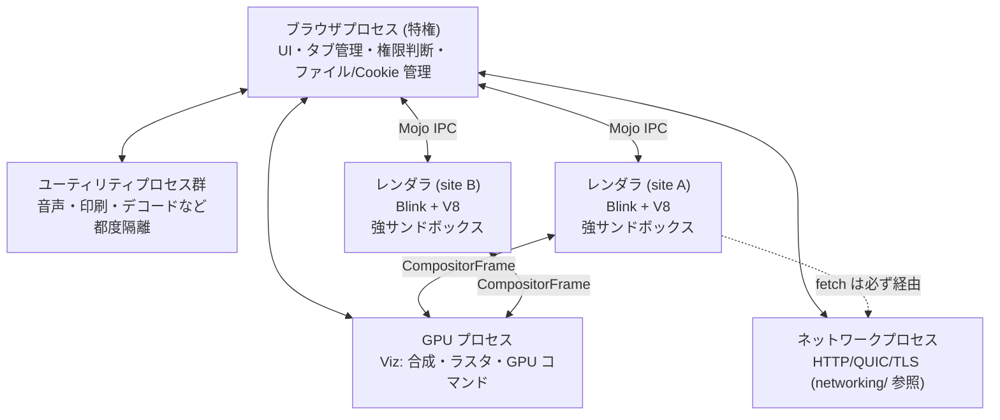

# ブラウザアーキテクチャ (Browser Architecture): プロセスモデル・レンダリング・JS エンジン

## 概要 (Overview)

ブラウザは「アプリケーション」の顔をした**オペレーティングシステム**である。相互に信頼しない多数のプログラム (ウェブサイト) をダウンロードしてすぐに実行し、資源を多重化し、隔離を強制する——[`../android/`](../android/README.md)・[`../ios/`](../ios/README.md) が扱ったのと同じ問題を、インストールという儀式すらない、より敵対的な前提で解く。本書はこの「第三のプラットフォーム」を、既存 2 プラットフォームと同じ切り口 (プロセス・IPC・実行系・グラフィックス・セキュリティ) で解剖する。主対象は Chromium (最も文書化された実装) とし、WebKit/Firefox は対照として参照する。

中心テーゼは二つ。第一に、**ブラウザのプロセスモデルはウェブの信頼境界 (同一生成元ポリシー) を OS の隔離境界 (プロセス) に写像する試みの歴史**である、ということ。2008 年のマルチプロセス化 (タブ≒プロセス) は「レンダラは乗っ取られる」を設計前提に据え、2018 年のサイト分離 (site isolation) は Spectre ([`../../hardware/cpu/branch-prediction-speculation.md`](../../hardware/cpu/branch-prediction-speculation.md)) によって「プロセス内に秘密を同居させた時点で負け」が確定したことへの応答だった。ハードウェアの投機実行がブラウザのプロセス設計を書き換えた——本リポジトリが追う「層をまたぐ強制」の教科書的事例である。

第二に、**レンダリングと JS 実行は「敵が書いたコードを毎フレーム締切内に走らせる」問題**である、ということ。16.7 ms の締切 ([`../android/graphics-pipeline.md`](../android/graphics-pipeline.md)・[`../ios/core-animation-render-server.md`](../ios/core-animation-render-server.md) と同じ) を、事前コンパイルも静的検証もできない動的言語で守るために、投機的 JIT・並行 GC・スレッド分割 (メイン/コンポジタ) という機構群が積み上がった。[`../compilers-runtimes/managed-runtimes-gc-jit.md`](../compilers-runtimes/managed-runtimes-gc-jit.md) の一般論が最も苛烈な形で現れる現場である。

分析深度は Level 3。ネットワーク層 (HTTP/QUIC/TLS/DNS) は [`../networking/`](../networking/README.md) に、JIT/GC の一般論は [`../compilers-runtimes/`](../compilers-runtimes/README.md) に委ね、本書はブラウザ固有の構造に集中する。

## 方法論 (Methodology)

- Chromium の公式設計文書・セキュリティ文書と、サイト分離の原著論文 (Reis et al., USENIX Security '19) を一次資料とし、V8/JSC の実装は開発チームの技術解説 (v8.dev, webkit.org) で確認する。
- プロセスモデルは「どの信頼境界を、どの OS 機構に、いくらのコストで写像したか」という会計として記述する。サンドボックスは各 OS の機構 ([`../operating-systems/`](../operating-systems/README.md)・[`../operating-systems/`](../operating-systems/README.md) の seccomp) への写像として整理する。
- レンダリングは Android/iOS の既存分析と同じ語彙 (メインスレッド/コンポジタ・VSYNC・ダメージ追跡) で記述し、三者比較を可能にする。
- 実装バージョンで揺れる細部 (プロセス上限・ティア構成の閾値) は構造の説明に必要な範囲に留め、参照時点 (2026-07) を明示する。

## 発見事項 (Findings)

1. **ブラウザの信頼モデルは「レンダラは既に乗っ取られている」から始まる。** ウェブページのパース・レイアウト・JS 実行を担うレンダラプロセスは、数千万行の C++ で敵対入力を処理するため、脆弱性の存在を前提に置く。設計目標は「侵入させない」ではなく「侵入後に何も奪わせない」——レンダラを最小権限のサンドボックスに閉じ込め、価値あるもの (Cookie・ファイル・ネットワーク) はすべて特権プロセスへの IPC 越しの依頼にする。[`../ios/`](../ios/README.md) のコード署名が「実行前に信頼を検証する」解だとすれば、ブラウザは「検証不能なコードを実行しながら封じ込める」対極の解である。
2. **サイト分離は Spectre への構造的応答であり、「プロセス=セキュリティ境界」への回帰である。** タブ単位の分離では、iframe や `window.open` で同一プロセスに異なるサイトが同居し得た。Spectre は「同一アドレス空間内の秘密は投機実行で読める」ことを示し、ソフトウェア内の隔離 (同一生成元ポリシーの論理的強制) だけでは不十分になった。Chrome 67 (2018) 以降のサイト分離はサイト単位でレンダラを分け、クロスサイト iframe を別プロセスに追い出し (out-of-process iframe)、CORB/ORB で「そもそも他サイトのデータをレンダラに載せない」方向へ進んだ。代償はプロセス数とメモリの増加 (総メモリ 10–13% 増との実測報告) であり、**メモリの富裕な環境でだけ買える防御**という側面を持つ (Android の低メモリ端末では適用範囲を絞る)。
3. **IPC (Mojo) はケイパビリティ様式であり、検証責任は常に特権側にある。** レンダラ↔ブラウザ間の Mojo インタフェースはメッセージパイプのハンドルを能力として受け渡す。compromised renderer を前提とするため、特権側はレンダラ発のあらゆる引数を再検証する (「レンダラの言うオリジンを信じない」)。これは [`../android/binder-internals.md`](../android/binder-internals.md) の「カーネルが保証する呼び出し元 UID」、[`../ios/mach-ipc-xpc.md`](../ios/mach-ipc-xpc.md) の audit token と同じ問題への、ユーザ空間実装による解である。
4. **レンダリングパイプラインは「メインスレッドを信用しない」よう進化した。** DOM→スタイル→レイアウト→ペイント→合成の各段のうち、前半はページの JS と同じスレッドを奪い合う。スクロールやアニメーションを JS の混雑から守るため、合成 (compositing) は別スレッド・別プロセス (GPU プロセスの Viz) へ段階的に移された——「メインスレッドが 1 フレーム落としてもスクロールは滑らか」は、レイヤ化 + コンポジタスレッドの成果である。Android の RenderThread、iOS のレンダーサーバと同型の分割が、ブラウザ内で三たび発明されている。
5. **JS エンジンの多段ティアは「起動の速さ」と「ピークの速さ」の両取りである。** V8 はインタプリタ (Ignition) → ベースライン (Sparkplug) → 中間最適化 (Maglev) → 最適化 (TurboFan) の 4 ティア (as of 2026)、JSC は LLInt→Baseline→DFG→FTL(B3) の 4 ティア。実行頻度に応じて段階投資し、hidden class とインラインキャッシュによる型投機、外れたら deoptimization で下位ティアに落ちる——[`../compilers-runtimes/managed-runtimes-gc-jit.md`](../compilers-runtimes/managed-runtimes-gc-jit.md) の一般構造そのものだが、「ページ遷移のたびにコールドスタート」というブラウザ固有の条件が下位ティアの重要性を極端に高めている。
6. **メモリ安全性がこのプラットフォームの主戦場である。** Chromium は深刻な脆弱性の約 70% がメモリ安全性起因と公表し、対策として (a) ヒープスキャンで use-after-free を緩和する MiraclePtr/PartitionAlloc、(b) DOM オブジェクトのガベージコレクション化 (Oilpan)、(c) V8 ヒープ内ポインタを 40 bit オフセットに閉じ込める V8 sandbox、(d) 新規コードの Rust 許容、を積層した。JIT が生成する実行可能メモリと型投機は攻撃者にとって最良の材料 (型混同→任意読み書き) であり、iOS が第三者 JIT を長年禁じた理由 ([`../ios/security-architecture.md`](../ios/security-architecture.md)) もここにある。
7. **ブラウザは「クラッシュの単位」を売っている。** マルチプロセス化の最初の動機はセキュリティと並んで信頼性だった——1 タブの無限ループやクラッシュが他タブを道連れにしない。プロセスはエラー封じ込め (fault isolation) の単位であり、[`../operating-systems/process-thread-scheduling.md`](../operating-systems/process-thread-scheduling.md) のプロセス抽象が「アプリ内のアプリ」に再適用されている。

## アーキテクチャ (Architecture)

### プロセス構成 — 特権の同心円



- 権限はブラウザプロセスに集中し、危険な仕事 (敵対データのパース) は権限のないプロセスへ外注する。「パースする者は権限を持たず、権限を持つ者はパースしない」という分業が全体の設計原理である。
- ネットワーク・GPU すら別プロセスなのは、それぞれが敵対入力 (パケット、シェーダ/画像) のパーサだからである。壊れても再起動すればよい。

### レンダリングパイプライン — DOM から画素まで

```
 メインスレッド (site ごとのレンダラ内)
   HTML パース → DOM ── CSS パース → CSSOM
        └→ スタイル解決 → レイアウト (LayoutNG) → ペイント (描画命令の記録)
                                                     │ commit (レイヤ+命令)
 コンポジタスレッド                                    ▼
   スクロール/アニメーション処理 → ラスタ依頼 → CompositorFrame 提出
                                                     │
 GPU プロセス (Viz)                                   ▼
   ラスタライズ (Skia/GPU) → 全レンダラのフレームを集約合成 → VSYNC に同期して表示
```

- 各段は差分駆動である (dirty bit / ダメージ追跡)。スタイル変更はレイアウトを、`transform` の変更は合成だけを再実行する——「どの CSS プロパティがどの段を再起動するか」がフロントエンド性能論の実体である。
- JS はメインスレッドの同居人であり、イベントループ (タスク→マイクロタスク→必要ならレンダリング更新) が唯一のスケジューラ。長タスクがフレームを落とす構造は [`../concurrency/`](../concurrency/README.md) の協調的マルチタスクの典型例で、Web Worker が「共有メモリなし・メッセージパッシング」の別スレッドを提供する。

## 技術詳細 (Technical Details)

### 1. プロセスモデルとサイト分離

- **分離の単位は「サイト」**(eTLD+1 + スキーム) であり、オリジンより粗い。`document.domain` による同一サイト内の緩和 (歴史的遺物) を許容するための妥協で、オリジン単位への細分化はプロセス数との取引で段階的に進む。
- **out-of-process iframe (OOPIF)**: クロスサイト iframe は親と別プロセスで描画され、親のコンポジタに合成だけが届く。入力イベントのルーティング・フォーカス・スクロール連鎖がプロセス境界をまたぐ、実装上最も高くついた機構である。
- **CORB/ORB**: サイト分離はプロセス内の秘密を無くす戦略なので、「他サイトの JSON をレンダラのメモリに載せない」ことが本質。fetch の応答をネットワークプロセス側で分類し、越境が疑わしいデータはレンダラに渡さない。
- **プロセス数の経済**: サイト数だけプロセスが要るため、メモリとトレードオフになる。Chromium はプロセスの再利用・上限・Android での部分適用 (パスワード入力サイト等を優先分離) といった予算管理を持つ。**セキュリティ境界の粒度がメモリ予算で決まる**という、プラットフォーム分析 3 例目の「制約からの再設計」である。

### 2. サンドボックスと Mojo IPC

- **レンダラの権限**: 理想は「計算と IPC 以外何もできない」。Linux では 2 層——名前空間サンドボックス (user/PID/network namespaces で見える世界を空にする) + seccomp-BPF ([`../operating-systems/ebpf-kernel-programmability.md`](../operating-systems/ebpf-kernel-programmability.md) の classic BPF 応用) でシステムコール表面を削る。Windows では制限トークン + Job + win32k ロックアウト、macOS では Seatbelt プロファイル。**OS ごとに材料が違う同じ檻**であり、[`../virtualization/`](../virtualization/README.md) のコンテナ隔離と同じ機構を「1 アプリ内」で使う。
- **ブローカ様式**: フォント・GPU・ファイルなど、サンドボックス内から直接触れない資源は特権側のブローカが代行し、ポリシーで許可範囲を絞る。
- **Mojo**: インタフェース定義 (.mojom) からバインディングを生成、メッセージパイプの端点 (ハンドル) を能力として受け渡す。送れるのは「持っている」パイプだけであり、機能の到達可能性がハンドルの所持で決まる——Binder の handle 翻訳・Mach のポート権利と同じケイパビリティ設計。特権側の検証漏れ (「レンダラがそんな値を送るはずがない」) がサンドボックス脱出の定番であるため、`ReportBadMessage` による即時 kill と、境界をまたぐ入力の再検証が規律になっている。
- **Rule of 2**: Chromium の設計規律——「信頼できない入力・安全でない言語・高権限」のうち同時に満たしてよいのは 2 つまで。3 つ揃う場所はサンドボックス化するか、言語を替えるか、入力を検証済みに変える。セキュリティ設計を工学的チェックリストに落とした好例である。

### 3. レンダリングとグラフィックス

- **LayoutNG / フラグメントツリー**: レイアウトは DOM とは別の不変フラグメントツリーを出力する設計に再構築され、部分再レイアウトと並行処理への道を作った。スタイル解決・レイアウトは今もメインスレッドの最大の消費者であり、`contain`・`content-visibility` は開発者がダメージ範囲を宣言するための契約である。
- **合成とラスタ**: ペイントは「描画命令の記録」であり、画素化 (ラスタ) はコンポジタ配下のワーカ/GPU で行う。スクロールは合成済みレイヤの再配置なのでメインスレッド不要——ただし `wheel`/`touch` に非 passive リスナがあると、コンポジタは JS の返答 (preventDefault するか) を待たされる。`passive: true` が性能プラクティスである理由はこのスレッド間依存にある。
- **Viz (GPU プロセス)**: 各レンダラの CompositorFrame を集約し、ブラウザ UI もろとも一括合成して VSYNC に同期して提示する。表示の最終権限を 1 箇所に集める点で Android の SurfaceFlinger・iOS のレンダーサーバと同役であり、三者は「アプリ (レンダラ) はフレームを提案し、システムが合成する」という同一契約に収斂している。
- **フレームの締切**: 60–120 Hz の VSYNC 周期内に「入力→JS→スタイル→レイアウト→ペイント→合成」を収める。間に合わない場合の症状 (ジャンク) と観測 (Long Tasks、`requestAnimationFrame` タイミング) は Android/iOS の同名問題と同じ構造で、プラットフォーム 3 例の比較読みができる。

### 4. JS エンジン — V8 の多段ティアと投機

- **ティアの分業** (V8, as of 2026): Ignition (バイトコードインタプリタ、起動即実行・フットプリント最小) → Sparkplug (バイトコードから 1:1 で素朴な機械語を吐く高速ベースライン) → Maglev (SSA ベースの中間最適化) → TurboFan (型フィードバックに基づく投機的最適化)。上位ほどコンパイルが高く、実行頻度 (ホットネス) が投資判断になる。JSC も LLInt→Baseline→DFG→FTL と同型で、**4 ティアへの収斂は「ウェブのワークロードは大半が一度しか走らない」ことへの応答**である。
- **型投機の資材**: hidden class (shape) がオブジェクトレイアウトを静的型のように扱わせ、インラインキャッシュが呼び出し点ごとの観測型を蓄える。TurboFan は「この shape しか来ない」前提で最適化し、外れたら deopt で Ignition に落ちる。詳細な一般論は [`../compilers-runtimes/managed-runtimes-gc-jit.md`](../compilers-runtimes/managed-runtimes-gc-jit.md)。
- **GC (Orinoco)**: 世代別 + 並列 (young) + 並行マーキング (old)。メインスレッドの停止をフレーム間隙 (アイドル時間) にスケジュールする idle-time GC は、「締切の合間に掃除する」ブラウザ固有の適応である。DOM オブジェクト (C++) 側も Oilpan (トレーシング GC) で管理され、V8 ヒープとの間の参照は cross-heap の統合トレースで回収する——**2 つのヒープ・2 つの言語をまたぐ GC** という難所がブラウザにはある。
- **WebAssembly**: 検証可能なバイトコードで「JS を経由しない移植可能実行」を提供する。検証器付きバイトコード + JIT という構図は [`../operating-systems/`](../operating-systems/README.md) と同型であり、比較分析はロードマップ ([`../compilers-runtimes/`](../compilers-runtimes/README.md) 候補) に置く。
- **プラットフォーム制約**: iOS では長らく WebKit/JavaScriptCore のみが JIT (書込可能→実行可能なメモリ) を許され、他ブラウザは JIT なしの WebKit ラッパだった。EU の DMA を機に代替エンジンの門が条件付きで開いた (as of 2026、適用範囲は流動的)。JIT 権限がプラットフォームの統制点になる構造は [`../ios/platform-architecture.md`](../ios/platform-architecture.md) の延長線にある。

### 5. 観測の入口 (Observability)

| 疑問 | 道具 |
|---|---|
| どの段が締切を破ったか | DevTools Performance / Perfetto (`chrome://tracing`)。フレームごとに main/compositor/GPU の時間割が見える |
| レイアウト/スタイルの再計算範囲 | DevTools の Layout/Recalc イベント、`contain` の効き |
| JIT のティアと deopt | `--trace-opt` / `--trace-deopt` (d8)、`chrome://tracing` の v8 カテゴリ |
| GC の停止と頻度 | Performance パネルの GC イベント、`--trace-gc` |
| プロセス構成とメモリ | `chrome://process-internals` (サイト分離の実態)、タスクマネージャ |
| IPC 境界 | `chrome://tracing` の mojo カテゴリ、`ReportBadMessage` のクラッシュレポート |

## セキュリティ考察 (Security Considerations)

- **典型的な攻撃連鎖は「レンダラ RCE → サンドボックス脱出 → カーネル」の 3 段**である。初段は JIT の型混同や DOM の use-after-free、二段目は Mojo インタフェースの検証漏れやブローカのポリシー穴、三段目は OS カーネル ([`../security/memory-safety-exploit-mitigations.md`](../security/memory-safety-exploit-mitigations.md) の緩和技術が各段に効く)。防御の投資配分もこの連鎖に沿う——初段は潰しきれない前提で、二段目の表面 (レンダラから見える特権インタフェース) の最小化に価値が集中する。
- **サイト分離後の残余リスク**: プロセス分離は「レンダラ内の他サイトデータ」を消すが、タイミング系のサイドチャネル (キャッシュ・`SharedArrayBuffer` の高精度時計) は残る。`SharedArrayBuffer` が Spectre 後に一時無効化され、cross-origin isolation (COOP/COEP) を宣言したページだけに戻された経緯は、「**高精度時計は能力である**」という認識の制度化である。
- **メモリ安全対策の積層** (as of 2026): PartitionAlloc (型/パーティション分離)・MiraclePtr (BackupRefPtr による UAF の非搾取化)・Oilpan・V8 sandbox (ヒープ内 40bit オフセット化で「V8 内の任意読み書き」をヒープ内に封じる)・CFI・新規コードの Rust。単一の銀弾ではなく、[`../security/memory-safety-exploit-mitigations.md`](../security/memory-safety-exploit-mitigations.md) の軍拡競争の最前線として読める。
- **ウェブ固有の応用層攻撃** (XSS・CSRF・クリックジャッキング) と同一生成元ポリシーの意味論は、本書の機構層とは別の層として今後のウェブセキュリティ分析 ([`../security/`](../security/README.md) 候補) に委ねる。機構側の含意だけ述べれば——**同一生成元ポリシーはレンダラ内のソフトウェア検査からプロセス境界へ、20 年かけて「降格」された**。論理的強制は投機実行の前に敗れたからである。

## 結論 (Conclusions)

- ブラウザは Android・iOS に続く第三のプラットフォームであり、しかも最も敵対的な前提 (無署名コードの即時実行) を持つ。その解——最小権限プロセスへの分割、ケイパビリティ IPC、特権側での全入力再検証——は、モバイル 2 例と同じ設計語彙に収斂しつつ、「検証より封じ込め」へ大きく傾いている。
- サイト分離は「ウェブの信頼境界を OS のプロセスに写像する」写像の完成形に近づく一歩であり、その引き金がハードウェアの投機実行だった事実は、本リポジトリの縦の視点 (ハードの性質がソフトの構造を書き換える) の代表例である。
- レンダリングは「メインスレッドからの独立」を推進力に進化し、合成の最終権限を 1 プロセスに集める構造は 3 プラットフォームで同型になった。JS エンジンの多段ティア + 投機 + 並行 GC は、締切付き・コールドスタート常態という条件が生んだマネージドランタイムの極点である。
- メモリ安全性が主戦場であることは統計 (深刻な脆弱性の約 70%) が示しており、部分緩和の積層と Rust への漸進が現在の解である。ブラウザの防御史は、ソフトウェアセキュリティ全体の縮図として継続観察に値する。

### 次の接続先 (Related Topics)

- [`../android/graphics-pipeline.md`](../android/graphics-pipeline.md)・[`../ios/core-animation-render-server.md`](../ios/core-animation-render-server.md) — 合成アーキテクチャの 3 者比較の相手。
- [`../compilers-runtimes/managed-runtimes-gc-jit.md`](../compilers-runtimes/managed-runtimes-gc-jit.md) — JIT・投機・GC の一般論。V8/JSC はその実プロダクト。
- [`../security/memory-safety-exploit-mitigations.md`](../security/memory-safety-exploit-mitigations.md) — 攻撃連鎖の各段に効く緩和技術の系譜。
- [`../networking/http-quic-evolution.md`](../networking/http-quic-evolution.md)・[`../networking/tls-internals.md`](../networking/tls-internals.md) — ネットワークプロセスの中身。
- [`../../hardware/cpu/branch-prediction-speculation.md`](../../hardware/cpu/branch-prediction-speculation.md) — サイト分離を強制した投機実行の物理。

## 参考文献 (References)

**一次資料 (Primary — 論文・設計文書)**

- Reis, C., Moshchuk, A., & Oberheide, J. (2019). Site Isolation: Process Separation for Web Sites within the Browser. *USENIX Security '19*. — サイト分離の設計・実装・コスト実測の原著。
- Kocher, P., et al. (2019). Spectre Attacks: Exploiting Speculative Execution. *IEEE S&P '19*. DOI: 10.1109/SP.2019.00002 — プロセス内隔離の敗北を示した原典。
- Barth, A., Jackson, C., Reis, C., & The Google Chrome Team (2008). The Security Architecture of the Chromium Browser. *Technical Report*. — マルチプロセス化と「compromised renderer」モデルの初出。
- Chromium Project — [Multi-process Architecture / Sandbox / Mojo docs](https://chromium.googlesource.com/chromium/src/+/main/docs/) — Accessed: 2026-07-10。設計文書 (design docs) 一式。
- Chromium Security — [Memory Safety](https://www.chromium.org/Home/chromium-security/memory-safety/)・[The Rule of 2](https://chromium.googlesource.com/chromium/src/+/main/docs/security/rule-of-2.md) — Accessed: 2026-07-10。70% 統計と設計規律の一次情報。

**二次資料 (Secondary — 実装チームの技術解説)**

- V8 team — [v8.dev blog](https://v8.dev/blog) (Ignition, TurboFan, Sparkplug, Maglev, Orinoco, The V8 Sandbox) — Accessed: 2026-07-10。
- Pizlo, F. (2020). [Speculation in JavaScriptCore](https://webkit.org/blog/10308/speculation-in-javascriptcore/) — WebKit blog. Accessed: 2026-07-10。JSC のティアと投機の網羅的解説。
- Chrome Developers — [RenderingNG](https://developer.chrome.com/docs/chromium/renderingng-architecture) — Accessed: 2026-07-10。レンダリングパイプライン再構築の解説。
- Kosaka, M. (2018). [Inside look at modern web browser (Part 1–4)](https://developer.chrome.com/blog/inside-browser-part1/) — Chrome Developers. Accessed: 2026-07-10。プロセス構成の入門的正典。
