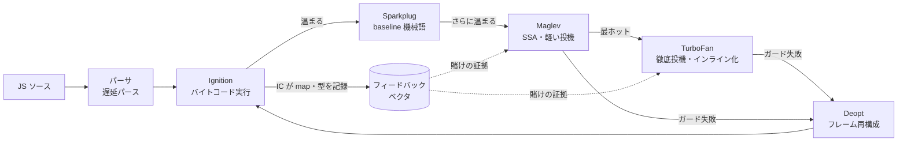

# V8 の内部 (V8 Internals)

## 概要 (Overview)

JavaScript は最適化に敵対的な言語である。変数に型がなく、オブジェクトの形は実行中に変わり、`eval` はコードを実行時に生成する。しかし現実の V8 は、この言語を静的型言語に迫る速度で走らせる。その全機構は一つの賭けに要約できる: **「動的と定義された言語にも、実行時には静的な規則性が現れる。それを発見し、規則性が続くと仮定して最適化し、破れたら証拠つきで撤退する」**。hidden class は形の規則性を、インラインキャッシュは呼び出し点の規則性を、階層型 JIT は「どこまで賭けるか」の資金配分を、脱最適化 (deoptimization) は撤退の機構を担う。

本ドキュメントは [`managed-runtimes-gc-jit.md`](../compilers-runtimes/managed-runtimes-gc-jit.md) が一般論として述べた機構（階層 JIT・投機と deopt・GC）の**実装各論**であり、[`browser-architecture.md`](browser-architecture.md) が概観した V8 を、hidden class の遷移木からポインタ圧縮・Torque・V8 sandbox まで掘り下げる。ブラウザという「16.6 ms ごとに締切が来る敵対的環境」（レンダリングパイプラインと compromised renderer 前提）が、各設計をどう規定しているかを貫く軸にする。分析深度は Level 3。

## 方法論 (Methodology)

- 各機構を「**何の規則性に賭けるか / 賭けが当たると何が省けるか / 外れると何を払うか**」の三点で記述し、独立した仕組みの列挙ではなく一つの投機体系として組み立てる。
- 起源を持つ概念は原典（Smalltalk のインラインキャッシュ、Self の maps と PIC）に紐づけ、V8 固有の実装と分離する[^deutsch][^self][^pic]。
- 実装詳細は V8 の公式技術ブログ・設計文書 (v8.dev) を一次資料とし、バージョンで変わる閾値・数値は桁感に留める。ブログ記載の性能数値は V8 チーム自身の測定であり、公表時点の値として扱う（2026-10-04 に再確認）。
- セキュリティは「JIT は最も攻撃される攻撃面」という事実から出発し、[`../security/`](../security/) の4層（見つける・exploit させない・閉じ込める・出所検証）に対応づける。

## 発見事項 (Findings)

1. **hidden class（V8 では map）は「構造体の無い言語に構造体を製造する」発明である。** 同じ順序で同じプロパティを足されたオブジェクトは同じ map を共有し、プロパティアクセスは「map を確認 → 固定オフセットを読む」に落ちる。つまり、ハッシュ表の探索が構造体のフィールド参照になる。map はプロパティ追加ごとに**遷移木 (transition tree)** を成し、この機構は Self 言語の maps の直系である[^self][^v8-props]。プログラマ側の帰結も明確で、「オブジェクトの形を揃える」コードが速いのは map 共有がキャッシュとインラインキャッシュの命中を生むからである。
2. **インラインキャッシュ (IC) は「呼び出し点ごとの記憶」であり、その状態遷移が最適化全体の通貨になる。** 各プロパティアクセス・呼び出し点は、直近に見た map と対応するハンドラを記憶する（Smalltalk-80 由来[^deutsch]、複数 map を持つ polymorphic IC は Self 由来[^pic]）。単型 (monomorphic) → 多型 (polymorphic, 数個まで) → 雑型 (megamorphic, 諦めて汎用辞書へ) という状態は、単なる高速化ではなく**フィードバックベクタ**として記録され、上位ティアのコンパイラが「何に賭けてよいか」を判断する証拠になる。IC は、実行しながら型を集めるプロファイラである。
3. **4 ティアの JIT は「コンパイルコストと実行速度のポートフォリオ」である。** Ignition（バイトコードインタプリタ: 起動最速・メモリ最小）→ Sparkplug（バイトコードから機械語へほぼ一対一変換する baseline: コンパイルが速いことが唯一の存在理由）→ Maglev（SSA ベースの中間ティア: IC フィードバックで投機するが最適化は軽め）→ TurboFan（最上位: 徹底した投機・インライン化・脱仮想化）[^v8-tiers]。Sparkplug は 2021 年、Maglev は 2023 年の Chrome M117 で加わった最新のティアで、Maglev のコンパイル速度は「Sparkplug の約 10 分の 1、TurboFan の約 10 倍」と説明されている[^v8-tiers]。実行回数という「人気投票」で昇格させる構造は、[`../ai/`](../ai/)・[`../../hardware/cpu/`](../../hardware/cpu/) に通じる「ホットな少数に資源を集中する」原理の言語処理系版である。
4. **投機的最適化の会計は deopt で締まる。** TurboFan/Maglev のコードは「この変数は Smi (小整数)」「この map のまま」という仮定をガード（型チェック）として埋め込み、破れるとただちに**最適化コードのフレームをインタプリタのフレームへ再構成して**降格する (deoptimization)[^v8-deopt]。重要なのは、deopt が失敗ではなく**設計された撤退**だという点である。撤退可能だからこそ大胆に賭けられる。ただし「賭けては外れる」の反復 (deopt loop) は最悪の性能病理であり、形の不安定なコードが遅い本当の理由になる。
5. **GC (Orinoco) の設計目標は「スループット」ではなく「16.6 ms の締切を破らないこと」である。** 世代別（若い世代は並列コピー式 scavenger、老世代はマーク＆スイープ/コンパクト）に加え、マーキングの**並行化**（メインスレッドと同時に別スレッドで走る、write barrier で整合を保つ）・インクリメンタル化により、停止時間をフレーム予算の隙間に押し込む[^v8-gc]。V8 チームの測定では、並列 scavenger は若い世代 GC のメインスレッド時間を 20〜50% 削り[^v8-scavenger]、並行マーキングはメインスレッドのマーキング時間を 60〜70% 削った[^v8-concurrent-marking]。[`realtime-fundamentals.md`](../embedded/realtime-fundamentals.md) の言葉でいえば、ブラウザの GC はソフトリアルタイム制約下の並行アルゴリズム設計である。
6. **ポインタ圧縮は「メモリはキャッシュなので、小さいことは速い」の実装である。** 64 bit 環境でもヒープ内ポインタを 4 GB の「ケージ」内 32 bit オフセットとして表現し、V8 ヒープを最大 43%、Chrome のレンダラプロセス全体のメモリを（デスクトップで）最大 20% 削減し、実サイトでは CPU 時間と GC 時間もむしろ減った[^v8-ptr]。タグ付け（最下位ビットで Smi と ポインタを区別、31 bit 整数はポインタ経由なしの即値）と併せ、「表現の 1 bit」がシステム全体の性能を左右する。これは [`cache-memory-hierarchy.md`](../../hardware/cpu/cache-memory-hierarchy.md) の帰結が言語ランタイムの表現設計に現れた例である。
7. **Torque と V8 sandbox は「ランタイム自身のバグ」への応答である。** 組み込み関数 (builtins) を手書きアセンブリ/CSA から型付き DSL の **Torque** に移したのは、最も攻撃される足回りのコードから人為ミスのクラスを消すため[^v8-torque]。**V8 sandbox** はヒープ破壊が起きた**後**を設計する。具体的には、ヒープ外への生ポインタを外部ポインタ表経由のハンドルに置き換え、ケージ内の破壊がプロセス全体の任意読み書きへ昇格しない構造を目指す[^v8-sandbox]。V8 チームによれば、典型的なワークロードでのオーバーヘッドは約 1% 以下で、64 bit 版 Chrome の主要プラットフォームでは 2024 年 4 月の公表時点ですでに約 2 年前から既定で有効、同時に Chrome の脆弱性報奨プログラム (VRP) の対象にもなった[^v8-sandbox]。[`memory-safety-exploit-mitigations.md`](../security/memory-safety-exploit-mitigations.md) の「バグから exploit への距離を伸ばす」戦略の、ランタイム内での実装である。

## アーキテクチャ (Architecture)

### 投機の資金循環 — ティアとフィードバック

### 賭けの対象と機構の対応

| 規則性への賭け | 機構 | 当たると省けるもの | 外れの処理 |
|---|---|---|---|
| オブジェクトの形は揃う | hidden class (map) | 辞書探索 → 固定オフセット | map 遷移・辞書モード落ち |
| 同じ場所には同じ形が来る | インラインキャッシュ | map 探索・ハンドラ選択 | 多型化 → 雑型化 |
| ホットな関数は型が安定 | Maglev/TurboFan の投機 | 型チェック・ボクシング・呼出オーバーヘッド | deopt でティア降格 |
| 配列は同種要素で密 | elements kinds | 要素アクセスの汎用処理 | kind 遷移（packed→holey 等、不可逆） |
| 整数は 31 bit に収まる | Smi タグ | ヒープ確保・間接参照 | HeapNumber へ昇格 |

## 技術詳細 (Technical Details)

### 1. map・遷移木・elements kinds (Maps, Transitions & Elements Kinds)

- map はオブジェクトの「形の記述子」（プロパティ名→オフセット、プロトタイプ、要素種別）を持ち、同形のオブジェクト間で共有される。`{a:1}` に `b` を足すと `{a}` の map から `{a,b}` の map への**遷移辺**をたどる（無ければ作る）。生成順が違えば別の map になる[^v8-props]。これが「コンストラクタで全プロパティを同順に初期化せよ」という経験則の実体である。
- 大量のプロパティ削除・動的追加は map 管理のコストが割に合わなくなり、**辞書モード**（本物のハッシュ表）へ脱落する[^v8-props]。速い道と遅い道が言語仕様上は同じ操作である点が、JS 性能の「見えない崖」の正体である。
- **elements kinds**: 配列は要素の種類（PACKED_SMI → PACKED_DOUBLE → PACKED → 各 HOLEY 版）で内部表現が分かれ、遷移は一方向（具体的 → 一般的）にしか進まない[^v8-elements]。`new Array(n)`（穴あき）より literal で密に作る方が速い、の機構的根拠。

### 2. IC とフィードバックベクタ (ICs & Feedback Vectors)

- 各関数はバイトコードと並んで**フィードバックベクタ**（呼出点ごとのスロット列）を持ち、IC の観測結果（見た map、呼んだ関数）を蓄積する。Sparkplug 以降の全ティアが同じベクタを共有するため、昇格時に「証拠」を引き継げる。ティア間の一貫性はこのデータ構造が担う。
- megamorphic への転落は「その場所は多態的」という事実の記録でもあり、TurboFan はそこでは賭けない。**最適化の質はコードの「単型度」で決まる**。[`fuzzing-program-analysis.md`](../security/fuzzing-program-analysis.md) 的に言えば、フィードバックは実行という名の継続的プロファイリングである。

### 3. Maglev・TurboFan・Turboshaft (The Optimizing Tiers)

- **Maglev**: SSA ベースの CFG 上でフィードバックに基づく型特化・簡単なインライン化を行い、TurboFan の数分の一のコンパイル時間で「そこそこ速い」コードを出す。存在理由は**中間の人気帯**（TurboFan を待つほどホットではないが Sparkplug では遅い関数）の回収である[^v8-tiers]。
- **TurboFan**: sea-of-nodes IR での大域最適化（脱仮想化・エスケープ解析・冗長性除去）を経て機械語へ。近年は IR を CFG ベースの **Turboshaft** へ移行し、コンパイル時間と保守性を改善した。2025 年 3 月の V8 チームの報告時点で、TurboFan の JavaScript バックエンド全体と WebAssembly のパイプライン全体が Turboshaft に移り、コンパイル時間は sea-of-nodes 比で半減した。残る JavaScript のフロントエンドは Maglev の CFG ベース IR で置き換える計画とされる[^v8-turboshaft]（2026-10-04 時点でこれより新しい一次報告は確認できていない）。数値・型の表現 (representation selection) が「ボクシングをどこまで消せるか」を決め、これが JS の数値計算性能の核心である。
- インライン化は最強の最適化（呼出コスト除去 + 文脈特化の連鎖）だが、コードサイズと deopt 範囲を広げる。ここでもポートフォリオの再配分が続く。

### 4. Deopt の機構 (Deoptimization Mechanics)

- 最適化コードには**脱出地点ごとの翻訳表**（最適化フレームの各値が、対応するインタプリタフレームのどこに入るか）が併置される。ガード失敗時（eager）や、依存していた map が別所で無効化された時（lazy: コードに「もう走るな」と印を付け、次回突入時に降格）に、翻訳表からインタプリタのフレームを**その場で組み立てて**実行を継続する[^v8-deopt]。
- この「いつでも正確に世界を巻き戻せる」制約が最適化の自由度を制限する（副作用の順序・観測可能性の保存）。つまり、投機の上限は撤退の正確さで決まる。

### 5. Orinoco GC (Garbage Collection)

- **若い世代**: 2 半空間のコピー式 scavenger を複数スレッドで並列実行。生存オブジェクトだけコピーするため「ほとんど死ぬ」若い世代と相性が良い（世代仮説）。
- **老世代**: 並行マーキング（tri-color + write barrier）→ 並列スイープ、断片化が進めば圧縮。ポインタの張り替えを伴う圧縮・退避は安全点で行い、「**メインスレッドの停止をどの作業から順に追放するか**」の歴史が Orinoco の歴史である[^v8-gc]。並行マーキングでは write barrier をアトミック操作で実装し、「黒いオブジェクトが白いオブジェクトを指さない」強い三色不変条件を保つ[^v8-concurrent-marking]。
- 世代間ポインタは remembered set で追跡し、scavenge が老世代全走査を免れる。これは [`cache-coherence.md`](../../hardware/cpu/cache-coherence.md) のディレクトリと同じ「全捜索を差分記録で置換する」構図である。

### 6. ポインタ圧縮・Smi・sandbox の表現 (Representation & the Sandbox)

- タグ付け: 最下位 bit 0 なら **Smi**（31 bit 即値整数）、1 ならヒープポインタ。ポインタ圧縮下では「ケージ基底 + 32 bit オフセット」で表現し、基底はレジスタに常駐する[^v8-ptr]。
- **V8 sandbox**: ケージ外を指す必要のある参照（ArrayBuffer の backing store 等）を**外部ポインタ表**のインデックスに置換し、表の側で型タグとケージ外アドレスを検証する。ヒープ内の値を全部書き換えられても、ケージ外の任意アドレスを直接指す手段を奪う。つまり「compromised renderer」前提 ([`browser-architecture.md`](browser-architecture.md)) の下で、**ランタイム内にもう一枚の檻**を張る設計である[^v8-sandbox]。

## セキュリティ考察 (Security Considerations)

- **JIT は実戦で最も突かれる攻撃面である。** V8 チームによれば、2021〜2023 年に実環境で捕捉された Chrome の exploit はすべてレンダラ内のメモリ破壊から始まり、その 60% が V8 の脆弱性だった。しかもその多くは古典的なメモリバグではなく、メモリ破壊に転化できる微妙なロジックバグ（IC・投機・map 無効化の縁で起きる型混同）である[^v8-sandbox]。投機体系の複雑さが、そのまま攻撃面になっている。[`../compilers-runtimes/`](../compilers-runtimes/) の一般論で述べた JIT 型混同の、最大の実例がここである。
- **防御は 4 層で読む**（[`../security/`](../security/) の枠組み）。見つける層は、JIT を狙う中間言語ベースのファザー Fuzzilli[^fuzzilli] 等による継続的ファジング、exploit させない層は Torque による builtins の型安全化とヒープの隔離・強化、閉じ込める層は V8 sandbox → プロセスサンドボックス → サイト分離の三重の檻 ([`sandbox-architectures.md`](../security/sandbox-architectures.md)) である。出所の層では、ソース信頼性をそもそも仮定しない（Web の前提）。
- **JIT を捨てる選択肢**: 実行可能メモリへの書き込みを禁じるプラットフォームや高保証環境向けの JIT-less モード（`--jitless`、Ignition インタプリタのみで動作）[^v8-jitless]や、iOS の JIT 禁止 ([`security-architecture.md`](../ios/security-architecture.md)) は、「投機体系の攻撃面」対「性能」のトレードオフで性能よりも攻撃面の縮小を優先した解であり、本ドキュメントの体系全体が**性能のために引き受けたリスク**であることを照らし返す。

## 結論 (Conclusions)

V8 は「動的言語の実行時の規則性」に対する投機の体系である。map が形を、IC が場所ごとの型を発見し、フィードバックベクタが証拠を集め、4 ティアが賭け金を段階的に積み、deopt が撤退を保証し、GC とポインタ圧縮が 16.6 ms の締切とメモリの物理の中に全体を収める。そして Torque と V8 sandbox は、この体系自身の複雑さ（最大の攻撃面）への内省である。[`../compilers-runtimes/`](../compilers-runtimes/) の一般論、[`../security/`](../security/) の防御 4 層、[`../../hardware/cpu/`](../../hardware/cpu/) の投機・キャッシュと、三方向の議論がひとつのランタイムの中で交差する、リポジトリでも屈指の合流点といえる。

---

## 参考文献 (References)

[^deutsch]: Deutsch, L. P. & Schiffman, A. M. (1984). Efficient Implementation of the Smalltalk-80 System. *Proc. ACM POPL 1984*, 297–302. DOI: 10.1145/800017.800542 — インラインキャッシュの原典。

[^self]: Chambers, C., Ungar, D. & Lee, E. (1989). An Efficient Implementation of SELF. *Proc. OOPSLA 1989*, 49–70. DOI: 10.1145/74877.74884 — maps（hidden class の原型）の原典。

[^pic]: Hölzle, U., Chambers, C. & Ungar, D. (1991). Optimizing Dynamically-Typed Object-Oriented Languages With Polymorphic Inline Caches. *Proc. ECOOP 1991*, 21–38. — 多型インラインキャッシュと適応最適化の原典。

[^v8-tiers]: V8 project. *Sparkplug — a non-optimizing JavaScript compiler* / *Maglev — V8's Fastest Optimizing JIT*. https://v8.dev/blog/sparkplug, https://v8.dev/blog/maglev — Accessed: 2026-10-04. — ティア構成の一次解説。

[^v8-deopt]: V8 project — TurboFan 設計資料および deoptimizer のドキュメント. https://v8.dev/docs/turbofan — Accessed: 2026-07-13.

[^v8-gc]: V8 project. *Trash talk: the Orinoco garbage collector*. https://v8.dev/blog/trash-talk — Accessed: 2026-07-13. — 並列 scavenger・並行マーキングの一次解説。

[^v8-ptr]: V8 project. *Pointer Compression in V8*. https://v8.dev/blog/pointer-compression — Accessed: 2026-10-04. — ケージ・タグ表現・性能影響の一次資料。

[^v8-torque]: V8 project. *V8 Torque user manual*. https://v8.dev/docs/torque — Accessed: 2026-07-13. — builtins の型安全 DSL 化の一次資料。

[^v8-sandbox]: V8 project. *The V8 Sandbox*. https://v8.dev/blog/sandbox — Accessed: 2026-10-04. — 外部ポインタ表・ケージ設計、2021〜2023 年の in-the-wild exploit 統計（60% が V8）、オーバーヘッド約 1% の一次資料（2024-04-04 公開）。

[^v8-props]: Bruni, C. (2017). *Fast properties in V8*. V8 blog. https://v8.dev/blog/fast-properties — Accessed: 2026-10-04. — hidden class・遷移木・辞書モード（slow properties）の一次解説。

[^v8-elements]: Bynens, M. (2017). *Elements kinds in V8*. V8 blog. https://v8.dev/blog/elements-kinds — Accessed: 2026-10-04. — 「Elements kind transitions can only go from specific kinds to more general kinds」。

[^v8-scavenger]: Degenbaev, U., Lippautz, M. & Payer, H. (2017). *Orinoco: young generation garbage collection*. V8 blog. https://v8.dev/blog/orinoco-parallel-scavenger — Accessed: 2026-10-04. — 並列 scavenger による若い世代 GC のメインスレッド時間 20〜50% 削減。

[^v8-concurrent-marking]: Degenbaev, U., Lippautz, M. & Payer, H. (2018). *Concurrent marking in V8*. V8 blog. https://v8.dev/blog/concurrent-marking — Accessed: 2026-10-04. — メインスレッドのマーキング時間 60〜70% 削減、アトミックな write barrier と三色不変条件。

[^v8-turboshaft]: V8 project (2025). *Land ahoy: leaving the Sea of Nodes*. V8 blog (2025-03-25). https://v8.dev/blog/leaving-the-sea-of-nodes — Accessed: 2026-10-04. — Turboshaft への移行範囲とコンパイル時間半減。

[^v8-jitless]: Gruber, J. (2019). *JIT-less V8*. V8 blog. https://v8.dev/blog/jitless — Accessed: 2026-10-04. — `--jitless` フラグと、実行可能メモリへの書き込みを禁じるプラットフォーム（iOS 等）という動機。

[^fuzzilli]: Groß, S., Koch, S., Bernhard, L., Holz, T. & Johns, M. (2023). FUZZILLI: Fuzzing for JavaScript JIT Compiler Vulnerabilities. *Proc. NDSS 2023*. DOI: 10.14722/ndss.2023.24290 — 中間言語 (FuzzIL) 上の変異による JIT ファジング。

その他の標準的典拠を挙げる。

- Aycock, J. (2003). A Brief History of Just-In-Time. *ACM Computing Surveys*, 35(2), 97–113. DOI: 10.1145/857076.857077 — JIT の系譜の総説。
- Jones, R., Hosking, A. & Moss, E. (2011). *The Garbage Collection Handbook*. Chapman & Hall/CRC. — 世代別・並行 GC の理論的典拠。
