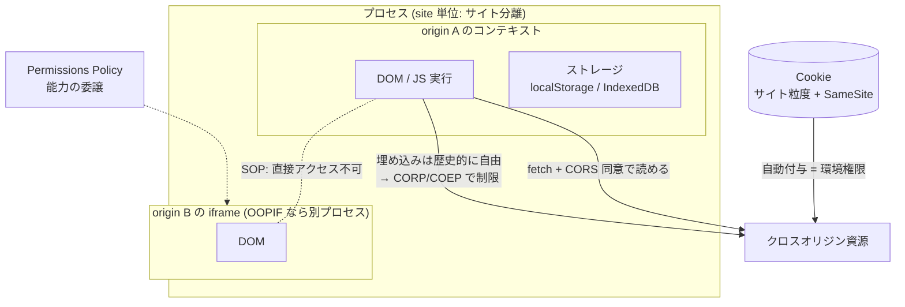

# ウェブセキュリティモデル (Web Security Model)

## 概要 (Overview)

Web は「見知らぬサイトのコードを、インストールも署名もなしに即時実行する」ことを日常とする唯一のプラットフォームである。その安全性を支える憲法が**同一生成元ポリシー (same-origin policy, SOP)**——「コンテンツへのアクセス権は生成元 (origin) ごとに区画される」という原則——であり、ウェブセキュリティの歴史は、この憲法の**穴**（設計時の寛容さが残した既定の相互作用）を、後付けの改正（CSP・SameSite・COOP/COEP）で塞いでいく過程として読める。

本ドキュメントは、生成元という主体の定義から始め、SOP が守るもの/守らないもの、境界を内側から破る XSS と外側から悪用する CSRF、緩和プロトコルとしての CORS、Spectre 以降の「プロセス分離を成立させるための」ヘッダ群 (COOP/COEP/CORP)、そして権限のケーパビリティモデル (Permissions Policy) までを一つの体系として整理する。`browser-architecture.md`（プロセス分離の実装）と `../security/sandbox-architectures.md`（隔離の一般論）の**ポリシー層**にあたり、`../security/` 横串の候補「ウェブ・アプリケーションセキュリティ」の本体である。防御的観点に徹し、攻撃の再現手順は示さない。分析深度は Level 3。

## 方法論 (Methodology)

- 全体を**「既定で許されている相互作用」と「後から足された制限」の対**として整理する。ウェブの脆弱性クラスの多くは「バグ」ではなく 1990 年代の設計の**既定値**に由来する、という視点を貫く。
- 各防御ヘッダ・機構を「何の攻撃クラスを、どの境界で断つか」で分類し、単なるヘッダのカタログ化を避ける。
- 仕様の一次資料（HTML/Fetch 仕様、RFC 6454、CSP3）と原典研究（CSRF の Barth ら、サイト分離の Reis ら）に紐づける[^rfc6454][^csrf][^site-isolation]。
- 変化の速い領域（サードパーティ Cookie の段階的廃止・ストレージ分割）は 2026-07 時点の状況として日付つきで扱う。

## 発見事項 (Findings)

1. **生成元 (origin) = (スキーム, ホスト, ポート) がウェブの主体 (principal) であり、「サイト」との不一致が事故の源泉である。** DOM・ストレージ・fetch の可視性は origin で区画される[^rfc6454]。一方 Cookie は歴史的にホスト+パスの別体系で、SameSite の「サイト」は eTLD+1 という第三の粒度を使う——**三つの境界定義が併存する**こと自体が、Cookie が繰り返し問題を起こす構造的理由である（`__Host-` プレフィックスや origin-bound な仕組みへの移行はこの収拾である）。
2. **SOP は「読むこと」を禁じるが「送ること」を禁じない——この非対称が CSRF とクロスサイトリークを生んだ。** 初期のウェブは合成可能性を優先し、クロスオリジンへの埋め込み（画像・スクリプト・iframe）とフォーム送信を既定で許した。応答は読めなくても、**リクエストは認証情報 (Cookie) つきで飛ぶ**——この「環境権限 (ambient authority)」が CSRF の本体であり[^csrf]、また「読めなくても観測できる」（読み込みの成否・時間）ことがクロスサイトリーク (XS-Leaks) の土壌になった。
3. **XSS は境界を内側から破る——注入されたコードは被害者の origin の全権限で走る。** SOP がどれほど堅くても、攻撃者の文字列がスクリプトとして解釈されれば境界の内側に入られる。防御は世代を重ねた: 出力エスケープ（正しくやり続けるのが難しい）→ **CSP** (content security policy)——実行可能スクリプトの出所を nonce/ハッシュで許可制にする、事実上のケーパビリティ化——→ **Trusted Types**——DOM の危険な代入点 (sink) を型レベルで保護する。「危険な操作を列挙して塞ぐ」から「安全な操作以外を不可能にする」への転換であり、`../security/memory-safety-exploit-mitigations.md` の「緩和から根絶へ」と同じ弧を描いている。
4. **CSRF の終息は既定値の変更によって訪れた。** トークン方式（副作用を伴う要求に、環境権限では入手できない値を要求する）が長年の対策だったが、決定打は **SameSite=Lax の既定化 (2020)**——クロスサイトのサブリソース要求に Cookie を付けない、という既定の反転だった。**個々のアプリの努力より、プラットフォームの既定値が攻撃クラスを消す**——ウェブセキュリティ史の最重要教訓である。
5. **CORS は防御ではなく緩和のプロトコルである。** CORS はクロスオリジン読み取りを「守る」仕組みではなく、SOP の制限を**サーバの明示的な同意で緩める**手続きである（単純でない要求には preflight で事前伺いを立てる）。よくある誤解——「CORS を設定すれば安全」——は方向が逆で、`Access-Control-Allow-Origin: *` は同意の全開放である。設計の含意として、**サーバは Origin ヘッダを信頼境界の入力として扱える**ようになった（`Sec-Fetch-*` メタデータと併せ、要求の来歴で判断する現代的パターン）。
6. **Spectre は「プロセスに載っているものは全部読める」を意味し、ウェブのポリシー層はプロセス分離の共犯者になった。** サイト分離 (`browser-architecture.md`) がプロセス境界を site 単位にしても、クロスオリジンのサブリソース（画像・スクリプト）は歴史的既定により**攻撃者のプロセスに読み込まれてしまう**。これを塞ぐのが CORP（リソース側の「誰に埋め込まれてよいか」宣言）・CORB/ORB（明らかに不適な読み込みの遮断）・**COOP/COEP**（自分の閲覧コンテキストを分離し、同意したリソースだけで構成されたと証明した文書にのみ、`SharedArrayBuffer` 等の高精度タイマ級機能を返す `crossOriginIsolated`）である[^coop-coep]。**マイクロアーキテクチャの攻撃 (`../../hardware/hardware-security/`) が、HTTP ヘッダの仕様を書かせた**——本リポジトリで最も鮮明なハードウェア→ウェブの縦断事例である。
7. **強力な機能はケーパビリティとして配られる体系に収斂した。** 位置情報・カメラ・クリップボード等は、安全な文脈 (HTTPS) + ユーザ操作 (user activation) + 許可プロンプトの三条件で解錠され、**Permissions Policy** が埋め込み先 (iframe) への委譲を明示化する。「埋め込んだだけで孫 iframe がマイクを使える」既定を否定するこの構造は、`../security/sandbox-architectures.md` の WASI・`../../software/embedded-rtos/rtos-architectures.md` の seL4 と同じ**「既定権限ゼロ + 明示的な能力の受け渡し」**であり、ウェブが 30 年かけてケーパビリティモデルに漂着したことを示す。

## アーキテクチャ (Architecture)

### 境界の地図 — 何がどこで区画されるか



### 攻撃クラスと防御の対応

| 攻撃クラス | 突く既定 | 現代の主防御 | 性格 |
|---|---|---|---|
| XSS | 文字列とコードの混同 | CSP (nonce/strict-dynamic) + Trusted Types + フレームワークの自動エスケープ | 実行の許可制化 |
| CSRF | Cookie の自動付与 | **SameSite 既定** + トークン + `Sec-Fetch-*` 検査 | 既定値の反転 |
| クリックジャッキング | クロスオリジン iframe の自由 | `frame-ancestors` (CSP) / XFO | 埋め込みの許可制化 |
| XS-Leaks / Spectre | 埋め込み自由 + 観測可能性 | CORP / ORB / COOP+COEP / 分割キャッシュ | 「読み込ませない」へ |
| セッション窃取 | Cookie の広い有効範囲 | HTTPS 常時 + `__Host-` + HttpOnly | 範囲の最小化 |

## 技術詳細 (Technical Details)

### 1. origin・site・Cookie の三体系 (Origin, Site & Cookies)

- **origin** = scheme://host:port の三つ組。`document.domain` による緩和は廃止方向で、origin は不変の主体になった。**site** = スキーム + eTLD+1（`https://a.example.com` と `https://b.example.com` は同 site・別 origin）。プロセス分離の単位が site なのは、歴史的に同 site の文書が `document.domain` で相互アクセスしえたためである。
- Cookie は `Domain`/`Path`/`Secure`/`HttpOnly`/`SameSite` の属性体系を持つ別世界で、**要求に「自動で」付く**ことが環境権限の正体。`SameSite=Lax`（トップレベル遷移の GET のみクロスサイト送信）が既定になり、None は Secure 必須になった。`__Host-` プレフィックスは「この origin だけ・パス全体・Secure」を名前で強制する、後付けの origin 束縛である。
- サードパーティ Cookie とストレージは**分割 (partitioning)** へ向かっている（埋め込み文脈ごとに別の壺を与える。2026-07 時点で主要ブラウザの実装・移行は進行中だが完全廃止の足並みは揃っていない）——追跡防止（プライバシー）と、クロスサイトリークの遮断（セキュリティ）が同じ機構に合流している。

### 2. CSP の設計と現実 (CSP in Practice)

- 現代の推奨は許可リスト（ドメイン列挙）ではなく **nonce ベース + `strict-dynamic`**: 「この応答に埋めた乱数を持つ script のみ実行可、それが読み込むものは信頼を継承」。ドメイン許可リストは、許可先ドメイン上の JSONP や Angular 等の「ガジェット」で迂回される事例が体系的に示されたためである[^csp-eval]。
- CSP は**多層防御の一層**であり、XSS の根本対策（出力文脈に応じたエスケープ・テンプレートの自動処理・Trusted Types）の代替ではない。`report-only` モードによる段階導入・違反レポート収集という**運用の設計**が実務の大半を占める——`../observability/` 的な「まず観測、then 強制」パターン。

### 3. crossOriginIsolated への道 (The Isolation Headers)

```
COOP: same-origin  … 自文書を opener/popup の閲覧コンテキストグループから切り離す
COEP: require-corp … 自文書が読み込む全サブリソースに CORS か CORP の明示同意を要求
→ 両方満たすと crossOriginIsolated = true:
   SharedArrayBuffer・高精度 performance.now() 等が解錠される
```

- 論理は明快である: **高精度タイマ（Spectre の読み出し装置）を渡してよいのは、「同意したリソースしか同居していない」と証明されたプロセスだけ**[^coop-coep]。プラットフォームは機能を人質に取ることで、ヘッダの採用（=エコシステム全体の宣言の普及）を駆動した——既定値を直接変えられないとき、プラットフォームがどう移行を設計するかの教科書例である。

### 4. XS-Leaks — ウェブ層のサイドチャネル (XS-Leaks)

- 読めない応答も、その**副作用**——読み込みの成否 (onerror)、フレーム数、キャッシュの温度、リダイレクトの有無——は観測できる。これを積むとログイン状態・検索結果の有無などクロスサイトの状態が推定できる。`../../hardware/hardware-security/side-channels-tee-secure-boot.md` のサイドチャネルと完全に同型の「共有資源経由の観測」がアプリケーション層で起きている。
- 対策は共有の分割で対応する: HTTP キャッシュのキーを要求元サイトで分割 (partitioned cache)、`Sec-Fetch-*` によるサーバ側での文脈判定、フレームカウント等の観測面の縮小。**「共有をやめる」以外の恒久対策がない**点までサイドチャネルの一般論と一致する。

### 5. サンドボックス属性と埋め込みの制御 (Sandboxing Embeds)

- `<iframe sandbox>` は埋め込み内容の能力（スクリプト・フォーム・トップナビゲーション・popup）を既定で全没収し、必要なものだけ許可トークンで返す——文書粒度のケーパビリティ制御であり、広告・ユーザ生成コンテンツの封じ込めの基本形。
- Permissions Policy は逆方向（親から子への強力機能の委譲宣言）を担い、`sandbox` と対で「埋め込み関係の権限契約」を構成する。`browser-architecture.md` の OOPIF がこの契約のプロセス的裏付けを与える。

## セキュリティ考察 (Security Considerations)

> 本ドキュメント全体がセキュリティ分析であるため、本節は体系の**残余リスク**に絞る。

- **既定の寛容さは完全には取り戻せない。** 互換性がウェブの至上命題である以上、危険な既定（埋め込み自由・Cookie 自動付与）の廃止は数年〜十年単位の移行になり、その間は**オプトイン防御の非採用サイトが攻撃面として残る**。プラットフォーム防御の普及率こそがウェブ全体の安全水準である。
- **第三者スクリプトは origin 内の全権限で走る。** 解析タグ・広告・CDN 上のライブラリは XSS と等価の信頼を得る——これは `../security/software-supply-chain-security.md` のサプライチェーン問題のウェブ版であり、CSP・SRI (subresource integrity)・Trusted Types が技術的対策、依存の棚卸しが運用的対策になる。
- **人間の層は SOP の外にある。** フィッシング・同形異義文字ドメイン・許可プロンプト疲れは、origin の数学では防げない。UI セキュリティ（表示の真正性）はブラウザ設計の独立した戦線であり、本ドキュメントの範囲外として明示しておく。
- **拡張機能は別の権限体系を持つ**（content script の隔離ワールド・host permissions）。ロードマップの「拡張機能アーキテクチャ」で扱う。

## 結論 (Conclusions)

ウェブセキュリティモデルは、「origin という主体」+「読みは禁止・送りは自由という 1990 年代の既定」の上に、攻撃クラスごとの改正——実行の許可制化 (CSP)、既定値の反転 (SameSite)、読み込みの同意制 (CORS/CORP)、分離の証明と機能の解錠 (COOP/COEP)、能力の明示委譲 (Permissions Policy)——を積み上げた成文法体系である。教訓は一貫している: **個々の開発者の注意より、プラットフォームの既定値が攻撃クラスを殺す**。そして Spectre 以降、この成文法はハードウェアの物理 (`../../hardware/`) とプロセスモデル (`browser-architecture.md`) の三位一体でしか成立しない——ウェブのヘッダ仕様にマイクロアーキテクチャが書き込まれた時代の、これがポリシー層の全体像である。

---

## 参考文献 (References)

[^rfc6454]: Barth, A. (2011). *RFC 6454: The Web Origin Concept*. IETF. https://www.rfc-editor.org/rfc/rfc6454 — origin の定義の規格一次資料。

[^csrf]: Barth, A., Jackson, C. & Mitchell, J. C. (2008). Robust Defenses for Cross-Site Request Forgery. *Proc. ACM CCS 2008*, 75–88. DOI: 10.1145/1455770.1455782 — CSRF の分析と Origin ヘッダ提案の原典。

[^site-isolation]: Reis, C., Moshchuk, A. & Oskov, N. (2019). Site Isolation: Process Separation for Web Sites within the Browser. *Proc. USENIX Security 2019*. — サイト分離とウェブ既定の相互作用の一次文献。

[^coop-coep]: WHATWG HTML Standard — *Cross-origin opener policy / embedder policy* および W3C. https://html.spec.whatwg.org/ — Accessed: 2026-07-13. — COOP/COEP/crossOriginIsolated の仕様一次資料。

[^csp-eval]: Weichselbaum, L., Spagnuolo, M., Lekies, S. & Janc, A. (2016). CSP Is Dead, Long Live CSP! On the Insecurity of Whitelists and the Future of Content Security Policy. *Proc. ACM CCS 2016*, 1376–1387. DOI: 10.1145/2976749.2978363 — 許可リスト型 CSP の体系的迂回と nonce/strict-dynamic の提案。

その他の標準的典拠:

- W3C. *Content Security Policy Level 3*. https://www.w3.org/TR/CSP3/ — Accessed: 2026-07-13.
- WHATWG. *Fetch Standard*（CORS・ORB を含む）. https://fetch.spec.whatwg.org/ — Accessed: 2026-07-13.
- Zalewski, M. (2011). *The Tangled Web: A Guide to Securing Modern Web Applications*. No Starch Press. — ウェブの歴史的既定と帰結の体系的整理。
- XS-Leaks Wiki. https://xsleaks.dev/ — Accessed: 2026-07-13. — クロスサイトリークの分類（コミュニティ維持の一次的整理）。
