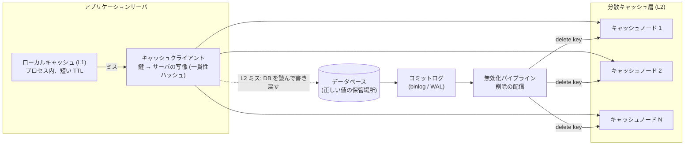
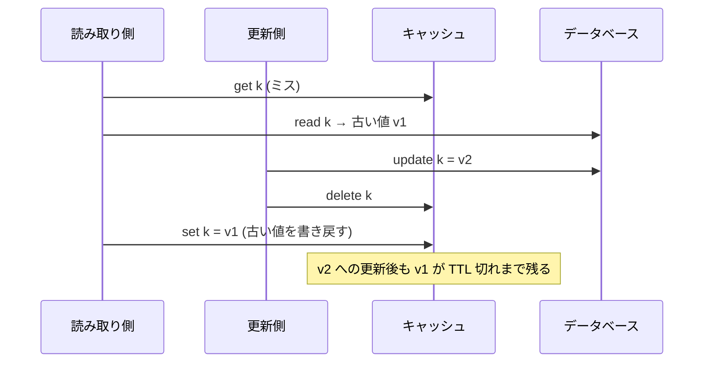

# 分散キャッシュのアーキテクチャ (Distributed Cache Architecture)

## 概要 (Overview)

Web サービスの読み取りの大部分は、データベースではなくメモリ上のキャッシュが返している。memcached と Redis に代表される**分散キャッシュ (distributed cache)** は、データベースの前に置く高速なキー・バリュー層であり、読み取りの遅延を下げ、データベースへの負荷を桁で減らす。

一方でキャッシュは、データの二つ目の写しを、データベースのトランザクションの外に持つ仕組みでもある。そのため、構造上3つの問題を抱える。第一に、**一貫性**の問題がある。データベースを更新してもキャッシュには古い値が残りうる。第二に、**負荷の集中**の問題がある。人気のキーの期限切れや、特定のキーへのアクセスの偏りが、データベースやキャッシュの1台に負荷を集める。第三に、**依存の逆転**の問題がある。キャッシュは本来なくても動く最適化のはずだが、ヒット率が高くなるほどデータベースはキャッシュがある前提で小さく作られ、キャッシュを失ったときに系全体が倒れる。

本ドキュメントは、キャッシュの利用パターン、無効化と競合、スタンピード、配置とホットキー、置換方式、障害時の振る舞いを、Facebook の memcache 運用論文 (Nishtala et al. 2013) と Redis・memcached の一次資料をもとに分析する。一貫性ハッシュの理論は [`../distributed-systems/replication-partitioning.md`](../distributed-systems/replication-partitioning.md)、CDN のキャッシュ階層は [`../networking/cdn-edge-delivery.md`](../networking/cdn-edge-delivery.md)、メタステーブル障害の一般論は [`../distributed-systems/failure-models.md`](../distributed-systems/failure-models.md) に委ね、本ドキュメントはアプリケーションとデータベースの間に置くキャッシュに固有の論点を扱う。分析深度は Level 3。

## 方法論 (Methodology)

- キャッシュを「速いデータベース」ではなく、**データベースの派生データを、データベースとは別の障害・一貫性の単位で持つ層**として扱い、その帰結を一貫性・負荷・障害の3つの軸で整理する。
- 一次資料は、大規模運用の報告 (Facebook memcache: NSDI 2013)、アルゴリズムの論文 (一貫性ハッシュ、確率的早期期限切れ、TinyLFU)、障害研究 (メタステーブル障害)、および memcached・Redis の公式文書とリリースノートである。製品の機能はその時点の公式文書に依拠し、ライセンスなど変化の速い事実は確認日を付ける。
- ヒット率と負荷の数値例は、式の振る舞いを示すための仮定値であり、測定値ではない。その旨を都度明記する。

## 発見事項 (Findings)

1. **キャッシュの効果はヒット率ではなくミス率で効く。** データベースに届く負荷はミス率に比例するので、ヒット率 99% と 98% の差は小さく見えても、データベースの負荷は2倍違う。逆に、ヒット率を上げる努力の価値は、ミス率が小さくなるほど大きくなる。
2. **キャッシュ・アサイドの「更新したら削除」には、古い値を書き戻す競合が構造的に残る。** 読み取り側がミスしてデータベースから古い値を読み、その間に更新側がデータベースを書き換えてキャッシュを削除すると、読み取り側が古い値をキャッシュに書き込んでしまう。Facebook は、ミスした読み取りにリース (lease) と呼ぶトークンを渡し、その間に削除があれば書き込みを拒否する方式でこれを防いだ[^nishtala]。
3. **人気キーの期限切れは、データベースへの自傷的な集中アクセス (スタンピード) を起こす。** 対策は「1つだけに取りに行かせる」(リース、リクエスト合流) と「期限前に確率的に1つが更新する」(確率的早期期限切れ[^vattani]) の2系統がある。どちらも、同時に起きるミスを1回のデータベース読み取りにまとめる点で共通している。
4. **キャッシュが重くなるほど、キャッシュの喪失は障害になる。** ヒット率が高い系ほどデータベースは小さく作られる。キャッシュの全消去やコールドスタートでミス率が跳ね上がると、データベースが過負荷になり、遅くなったデータベースのせいでキャッシュの再充填も進まない。この「キャッシュ喪失による持続的な過負荷」は、メタステーブル障害の典型的な持続効果として挙げられている[^bronson]。
5. **分散キャッシュの規模を制約するのは、平均ではなく偏りである。** 一貫性ハッシュで鍵を均等に分けても、アクセスの偏り (ホットキー) は1台に集まる。ホットキーには、複製、クライアント側のローカルキャッシュ、鍵の分割といった、分散の方式とは別の対策が要る。
6. **インターネットに露出したキャッシュは、増幅器にも侵入口にもなる。** memcached の UDP 応答は送信元を偽装したリクエストで大量の応答を返すため、2018 年に GitHub が受けたピーク 1.35 Tbps の DDoS に悪用された[^github-ddos]。memcached は 1.5.6 で UDP を既定で無効にした[^memcached156]。認証なしで公開された Redis も、データの窃取や設定変更の入口になる。

## アーキテクチャ (Architecture)

### 読み取り経路と無効化経路



凡例: 実線は読み取り経路と削除の配信、破線はミス時のデータベース読み取り。L1 は各プロセス内のキャッシュ、L2 は共有の分散キャッシュ層。

キャッシュ層が持つのは、データベースの値の写しである。この前提から、2つの経路が分かれる。

- **読み取り経路**: アプリケーションはまずローカルキャッシュ (L1) を、次に分散キャッシュ (L2) を引き、ミスしたらデータベースを読んで L2 に書き戻す。L2 の振り分けはクライアント側の一貫性ハッシュが行うのが一般的で、Facebook は振り分けと複製をプロキシ (mcrouter) に集約した[^nishtala]。
- **無効化経路**: データベースが更新されたら、対応するキーを削除する。アプリケーションが更新のたびに自分で削除する方法は単純だが、削除の失敗やリージョン間の伝播が漏れやすい。Facebook はデータベースのコミットログを読んで削除を配信する仕組み (mcsqueal) を置き、コミットされた更新から漏れなく削除を配信した[^nishtala]。

### キャッシュの利用パターン

| パターン | 読み取り | 書き込み | 一貫性の性質 | 典型的な使い方 |
|---|---|---|---|---|
| キャッシュ・アサイド (cache-aside, look-aside) | アプリがキャッシュを引き、ミスなら DB を読んで書き戻す | アプリが DB を更新し、キャッシュを削除 | 削除と書き戻しの競合で古い値が残りうる (技術詳細 1) | memcached・Redis の最も一般的な使い方 |
| リードスルー (read-through) | キャッシュ自身がミス時に DB を読む | (別の方式と組み合わせる) | 読み取りの合流をキャッシュ側で行いやすい | ローダ関数付きのライブラリキャッシュ |
| ライトスルー (write-through) | キャッシュを引く | キャッシュと DB の両方に同期的に書く | 書き込みの遅延が増えるが、写しのずれは小さい | 読み取りが多く、更新後すぐ読む用途 |
| ライトバック (write-back, write-behind) | キャッシュを引く | キャッシュに書き、DB へは非同期に反映 | キャッシュの障害で未反映の書き込みを失いうる | カウンタや集計など、損失を許容できる値 |

ライトバックでは、DB に反映されるまでの間、キャッシュが最新の値を持つ唯一の場所になる。キャッシュの障害がデータ損失になるので、他の3つとは性質が根本的に違う。Redis を永続化 (RDB スナップショットや AOF) 付きで主記憶として使う構成も、この側に属する。

## 技術詳細 (Technical Details)

### 1. 無効化と古い値の書き戻し (invalidation and stale sets)

キャッシュ・アサイドで「DB を更新してからキャッシュを削除する」順序を守っても、次の競合で古い値がキャッシュに残る。



この競合は、読み取り側が DB を読んでからキャッシュに書くまでの間に、更新と削除が割り込むことで起きる。順序を逆にして「先に削除してから DB を更新する」と、削除と DB 更新の間に別の読み取りが古い値を書き戻す窓が広がる。どちらの順序でも窓は残る。

対策は3つある。

- **リース (lease)**: Facebook の方式では、ミスした読み取りにキャッシュサーバがリーストークンを渡す。読み取り側は値を書き込むときにトークンを添え、その間に同じキーの削除が届いていればサーバは書き込みを拒否する[^nishtala]。削除が「進行中の書き戻しを無効にする」意味を持つようになる。
- **条件付き書き込み**: memcached の `cas` (check-and-set) や、バージョン番号を値に含めて古いバージョンの上書きを拒む方式は、同じ考え方を値の側で実現する。
- **短い TTL と遅延削除**: TTL を短くすれば、古い値が残る時間に上限がつく。更新直後の削除に加えて少し遅れてもう一度削除する「二重削除」も使われるが、窓を狭めるだけで消しはしない。

キャッシュとデータベースは同じトランザクションに入らないので、これらはいずれも「古い値が残る時間を短くする、または確率を下げる」対策であり、線形化可能性のような強い一貫性は与えない。更新直後に自分の書き込みを読む (read-your-writes) 必要がある画面では、その読み取りだけ DB を直接引く、または書き込んだ値を L1 に置くといった、経路ごとの対処が現実的である。

### 2. スタンピードとホットキー (stampedes and hot keys)

人気のキーが期限切れになった瞬間、そのキーへの同時リクエストがすべてミスし、同じ値を DB から並行して読み込む。これを**キャッシュスタンピード (cache stampede)** または thundering herd と呼ぶ。値の生成が重いほど、生成中に届くリクエストも増えて悪化する。

```text
同時ミスを1回の DB 読み取りにまとめる方式:
  リース / 単一フライト (single-flight):
    最初のミスだけに DB を読ませ、他は短く待って再試行する
    Facebook はリースの発行をキーごとに 10 秒に1回に制限した [nishtala]
  確率的早期期限切れ (XFetch):
    残り TTL が短いほど高い確率で、期限前に1リクエストだけが再計算する
    再計算の確率を生成時間に比例させると最適になる [vattani]
  バックグラウンド更新:
    期限切れの値を返しつつ、裏で1つのワーカーが更新する (stale-while-revalidate)
```

**ホットキー (hot key)** は、期限切れとは関係なく、1つのキーへのアクセスが1台のキャッシュノードの処理能力を超える問題である。一貫性ハッシュは鍵の数を均等に分けるが、アクセスの偏りは分けない。対策は次の3つで、いずれも分散の方式の外側にある。

- **キーの複製**: ホットキーを複数のノードに置き、読み取りを分散させる。書き込み時にはすべての複製を無効化する必要がある。
- **ローカルキャッシュ (L1)**: アプリケーションのプロセス内に短い TTL で保持する。Redis 6 のクライアント側キャッシュ (client-side caching) は、サーバがクライアントの保持するキーを追跡し、変更時に無効化を通知する[^redis-csc]。
- **キーの分割**: 大きな値やカウンタを複数のキーに分け、読み取り側で集約する。

### 3. 配置とリバランス (placement and rebalancing)

キャッシュノードの追加や削除で鍵の振り分けが変わると、移動した鍵はすべてミスになる。`hash(key) mod n` では n が変わるとほぼ全鍵が移動してキャッシュが実質的に空になるが、一貫性ハッシュなら移動は平均で全体の 1/n にとどまる[^karger]。キャッシュでは移動した鍵のデータを移す必要はなく、ミスとして DB から読み直されるだけである。そのため、リバランスの費用は「データの転送量」ではなく「一時的に増えるミスと DB 負荷」として現れる。

Redis Cluster は一貫性ハッシュではなく、鍵を CRC16 で 16384 個の**ハッシュスロット**に割り当て、スロットをノードに配る[^redis-cluster]。スロット単位でノード間を移動 (リシャーディング) でき、移動中のスロットへのアクセスはリダイレクト (`ASK`/`MOVED`) で正しいノードに導かれる。複数キーの操作は同じスロットの鍵どうしでしか行えないため、ハッシュタグ (`{user:42}:profile` のように `{}` 内だけをハッシュする) で関連する鍵を同じスロットに集める設計が要る。

Facebook はキャッシュを、リージョン内の複数のクラスタに同じデータの写しを持たせ、さらに故障したサーバの代わりに一時的に応答する小さなプール (gutter) を用意した[^nishtala]。故障したサーバの鍵を他のサーバに再ハッシュすると、そのサーバのホットキーが別のサーバを連鎖的に過負荷にしうるので、専用の予備プールで受ける。新しいクラスタを立ち上げるときは、空のキャッシュでいきなり本番の負荷を受けず、既存のクラスタからミスを埋める「コールドクラスタのウォームアップ」を行う[^nishtala]。

### 4. 置換方式とメモリ管理 (eviction and memory management)

メモリが満杯になったとき何を捨てるかは、ヒット率を直接決める。

| 方式 | 仕組み | 特徴 |
|---|---|---|
| LRU | 最も長く使われていないものを捨てる | 一度だけ読まれる大量の鍵 (走査) で人気の鍵が追い出される |
| 近似 LRU (Redis) | 少数の鍵をサンプリングし、その中で最も古いものを捨てる | 全体のリストを持たずに済む。サンプル数で精度とコストを交換する[^redis-eviction] |
| LFU / 近似 LFU (Redis) | アクセス頻度の小さいものを捨てる。頻度は対数カウンタで近似し、時間で減衰させる | 走査に強いが、過去の人気が残りやすい[^redis-eviction] |
| セグメント化 LRU (memcached) | 新しい鍵と再アクセスされた鍵を別のリストで管理する | 一度だけの鍵が人気の鍵を追い出しにくい |
| W-TinyLFU (Caffeine など) | 小さな LRU の窓と、頻度の概算 (Count-Min Sketch) による入場判定を組み合わせる | 新しい鍵を入れる前に、追い出される鍵より人気かを判定する[^tinylfu] |

memcached はスラブアロケータでメモリを管理する。値の大きさごとにクラスを分け、同じクラスの固定長チャンクに値を置く。断片化は起きにくいが、ワークロードの値の大きさの分布が変わると、あるクラスは満杯で追い出しが多く、別のクラスは余っているという偏りが生じる。memcached はクラス間でページを移す機能 (slab rebalancing) でこれに対処している[^memcached-docs]。

### 5. ヒット率、負荷、キャッシュ喪失 (hit ratio, load, and cache loss)

ヒット率 h の効果を、仮定値で計算する。

```text
仮定: 読み取り 1,000,000 req/s、キャッシュ 0.5 ms、DB 10 ms

DB に届く負荷 = (1 − h) × 1,000,000
平均遅延     = h × 0.5 + (1 − h) × 10   [ms]

h = 99%: DB 10,000 req/s、平均 0.595 ms
h = 98%: DB 20,000 req/s、平均 0.69 ms
h = 0%  (キャッシュ全消去): DB 1,000,000 req/s — 99% 時の 100 倍
```

平均遅延の差は小さいが、DB の負荷はミス率に比例して倍々で変わる (発見事項 1)。この系の DB を h = 99% 前提の 10,000 req/s に合わせて作ると、キャッシュを失った瞬間に 100 倍の負荷が届く。DB が過負荷で遅くなると、ミスを埋める読み取りも遅れ、ヒット率が回復しない。タイムアウトとリトライが加わると負荷はさらに増える。トリガ (キャッシュの再起動) が去っても過負荷が続くこの状態は、メタステーブル障害の持続効果の一つとして挙げられている[^bronson][^huang]。

対策は、キャッシュを「なくても動く最適化」ではなく「容量計画に組み込まれた部品」として扱うことである。

- キャッシュの再起動や更新は1台ずつ、ウォームアップを伴って行う。
- ミス時の DB アクセスに同時実行数の上限を設け、上限を超えたら DB に流さずに失敗させる (負荷遮断)。
- 永続化やレプリカを持つ構成 (Redis のレプリケーション、Facebook のクラスタ間の写し) で、全消去が起きにくくする。
- ヒット率をサービスの重要な指標として監視し、DB の容量に対する「キャッシュなしで耐えられる割合」を把握する。

### 6. Redis と memcached の設計の違い (Redis vs. memcached)

| 観点 | memcached | Redis |
|---|---|---|
| データモデル | バイト列のキー・バリューのみ | 文字列、リスト、ハッシュ、集合、ソート済み集合、ストリームなど |
| 実行モデル | マルチスレッド | コマンドの実行は単一スレッドのイベントループ。ネットワーク I/O はスレッド化できる (6.0 以降)[^redis-docs] |
| 永続化 | なし (純粋なキャッシュ) | RDB スナップショット、AOF (追記ログ)、またはなし |
| 複製・分散 | サーバ間の機能はなく、クライアントやプロキシが担う | 非同期レプリケーション、Redis Cluster (ハッシュスロット)、Sentinel による自動フェイルオーバ |
| 一貫性 | 単一キーの原子的操作と `cas` | 単一スレッドによる操作の直列化、トランザクション (`MULTI`)、Lua スクリプト。レプリケーションは非同期で、フェイルオーバ時に確認済みの書き込みを失いうる[^redis-docs] |

memcached は「単純で、マルチコアを使い切る純粋なキャッシュ」に、Redis は「データ構造サーバ」に寄せた設計である。Redis の単一スレッドの実行は、コマンドを直列化して原子性を簡単に与える一方、1つの重いコマンド (大きな集合の全件取得など) が他のすべてのコマンドを待たせる。

ライセンスの経緯は、製品選定に直接効く時事的な事実である (2026-10-11 確認)。Redis は 2024 年 3 月に BSD から RSALv2 と SSPLv1 の選択制に変わり、これを受けて Linux Foundation は BSD 版の最後のリリース (7.2.4) から **Valkey** を分岐させた。Redis は 2025 年の Redis 8 で、OSI 承認のライセンスである AGPLv3 を選択肢に加えている[^redis-license][^valkey][^redis8]。

## セキュリティ考察 (Security Considerations)

- **公開されたキャッシュとアンプ攻撃**: memcached の UDP インタフェースは、小さなリクエストに大きな応答を返すため、送信元を偽装したリクエストで被害者に大量の応答を送りつける反射・増幅攻撃に使える。2018 年 2 月の GitHub への攻撃はピーク 1.35 Tbps に達した[^github-ddos]。memcached 1.5.6 は UDP を既定で無効にした (CVE-2018-1000115)[^memcached156]。キャッシュはインターネットから到達できない内部ネットワークにだけ置くのが原則である。
- **認証のない Redis**: 古い Redis は既定で認証がなく、外部に公開されると任意のコマンドを実行される。設定変更のコマンドでディスクに任意のファイルを書けるため、データの窃取にとどまらず、ホストへの侵入の足がかりにもなる。Redis 6 で ACL が導入され、ユーザごとにコマンドと鍵の範囲を制限できるようになった[^redis-docs]。保護モード、ACL、TLS、危険なコマンドの無効化を組み合わせる。
- **キーの名前空間とテナント間の漏洩**: 複数のテナントやサービスが同じキャッシュを共有するとき、キーの組み立てにテナント ID を含め忘れると、別のテナントの値を返す。キャッシュは認可の判定を持たないので、キーの設計そのものが分離の境界になる。認可の結果に依存する値 (権限によって中身が変わる画面など) は、権限ごとに別のキーにするか、キャッシュしない。
- **キャッシュポイズニング**: 攻撃者が制御できる入力からキーや値を作ると、誤った値をキャッシュに入れ、他の利用者に配らせることができる。キーの正規化と、キャッシュに入れる前の検証が要る。
- **アルゴリズム的な DoS**: 攻撃者がキーを選べる場合、ハッシュの衝突や、ホットキーの意図的な作成で特定のノードを過負荷にできる。ミスを大量に起こすリクエスト (存在しないキーの連続読み取り) で DB を直接叩く攻撃には、存在しないことのキャッシュ (ネガティブキャッシュ) や Bloom フィルタで対処する。

## 結論 (Conclusions)

分散キャッシュは、データベースの値の写しを、データベースとは別の一貫性と障害の単位で持つ層である。この1点から本ドキュメントの論点はすべて導かれる。写しなので古い値が残りうる (無効化と競合)。別の単位なので同時のミスや偏りが下流に集まる (スタンピードとホットキー)。そして、写しに頼るほど下流が小さく作られ、写しの喪失が系全体の障害になる (キャッシュ喪失とメタステーブル障害)。

設計上の判断は、キャッシュを「なくても動く最適化」として扱うか、「容量計画に組み込まれた部品」として扱うかに集約される。ヒット率が高い大規模な系は、事実上後者になっている。その場合は、ウォームアップ、負荷遮断、複製によって、キャッシュの喪失そのものを起こりにくくする必要がある。

### 次の接続先 (Related Topics)

- [`../distributed-systems/replication-partitioning.md`](../distributed-systems/replication-partitioning.md) — 一貫性ハッシュとリバランスの一般論
- [`../distributed-systems/failure-models.md`](../distributed-systems/failure-models.md) — メタステーブル障害と持続効果
- [`../networking/cdn-edge-delivery.md`](../networking/cdn-edge-delivery.md) — エッジのキャッシュ階層、オリジンシールドとリクエスト合流
- [`../distributed-systems/consistency-models.md`](../distributed-systems/consistency-models.md) — read-your-writes と線形化可能性
- [`../cloud/cloud-databases-aurora-dynamodb.md`](../cloud/cloud-databases-aurora-dynamodb.md) — データベース側の読み取りスケーリング

## 参考文献 (References)

[^nishtala]: Nishtala, R., Fugal, H., Grimm, S., Kwiatkowski, M., Lee, H., Li, H. C., McElroy, R., Paleczny, M., Peek, D., Saab, P., Stafford, D., Tung, T., & Venkataramani, V. (2013). Scaling Memcache at Facebook. *Proc. 10th USENIX NSDI*, 385–398. — リース、mcrouter、mcsqueal による無効化、gutter プール、コールドクラスタのウォームアップ。

[^karger]: Karger, D., Lehman, E., Leighton, T., Panigrahy, R., Levine, M., & Lewin, D. (1997). Consistent Hashing and Random Trees: Distributed Caching Protocols for Relieving Hot Spots on the World Wide Web. *Proc. STOC '97*, 654–663. DOI: 10.1145/258533.258660 — 一貫性ハッシュの原典。

[^vattani]: Vattani, A., Chierichetti, F., & Lowenstein, K. (2015). Optimal Probabilistic Cache Stampede Prevention. *Proceedings of the VLDB Endowment*, 8(8), 886–897. DOI: 10.14778/2757807.2757813 — 確率的早期期限切れ (XFetch)。

[^tinylfu]: Einziger, G., Friedman, R., & Manes, B. (2017). TinyLFU: A Highly Efficient Cache Admission Policy. *ACM Transactions on Storage*, 13(4), Article 35. DOI: 10.1145/3149371 — 頻度の概算による入場判定と W-TinyLFU。

[^bronson]: Bronson, N., Aghayev, A., Charapko, A., & Zhu, T. (2021). Metastable Failures in Distributed Systems. *Proc. HotOS '21*, 221–227. DOI: 10.1145/3458336.3465286 — ルックアサイドキャッシュの喪失を含む持続効果の分類。

[^huang]: Huang, L., Magnusson, M., Muralikrishna, A. B., Estyak, S., Isaacs, R., Aghayev, A., Zhu, T., & Charapko, A. (2022). Metastable Failures in the Wild. *Proc. 16th USENIX OSDI*. — 11 組織 22 件のメタステーブル障害の調査。

[^redis-docs]: [Redis Documentation](https://redis.io/docs/latest/) — I/O スレッド、永続化 (RDB/AOF)、レプリケーション、ACL。Accessed: 2026-10-11.

[^redis-cluster]: [Redis Cluster specification](https://redis.io/docs/latest/operate/oss_and_stack/reference/cluster-spec/) — 16384 ハッシュスロット、MOVED/ASK リダイレクト、ハッシュタグ。Accessed: 2026-10-11.

[^redis-csc]: [Redis client-side caching](https://redis.io/docs/latest/develop/reference/client-side-caching/) — サーバ側のキー追跡と無効化通知。Accessed: 2026-10-11.

[^redis-eviction]: [Redis key eviction](https://redis.io/docs/latest/develop/reference/eviction/) — 近似 LRU・LFU とサンプリング。Accessed: 2026-10-11.

[^memcached-docs]: [memcached Wiki](https://github.com/memcached/memcached/wiki) — スラブアロケータ、セグメント化 LRU、スラブの再配分。Accessed: 2026-10-11.

[^memcached156]: [memcached ReleaseNotes156](https://github.com/memcached/memcached/wiki/ReleaseNotes156) — UDP の既定無効化 (CVE-2018-1000115)。Accessed: 2026-10-11.

[^github-ddos]: [The Hacker News — Biggest-Ever DDoS Attack (1.35 Tbs) Hits Github Website](https://thehackernews.com/2018/03/biggest-ddos-attack-github.html) — 2018 年 2 月 28 日の memcached 増幅攻撃、ピーク 1.35 Tbps。Accessed: 2026-10-11.

[^redis-license]: [Redis — Licenses](https://redis.io/legal/licenses/) — 7.2 までの BSD、7.4 以降の RSALv2/SSPLv1、Redis 8 での AGPLv3 の追加。Accessed: 2026-10-11.

[^valkey]: [Linux Foundation — Linux Foundation Launches Open Source Valkey Community](https://linuxfoundation.org/press/linux-foundation-launches-open-source-valkey-community) — 2024 年 3 月 28 日の発表。Redis 7.2.4 からの分岐、BSD 3-Clause の維持。Accessed: 2026-10-11.

[^redis8]: [Phoronix — Redis 8.0 Released: Now Tri-Licensed With AGPLv3](https://www.phoronix.com/news/Redis-8.0-Goes-AGPLv3) — Redis 8 での AGPLv3 の追加。Accessed: 2026-10-11.
