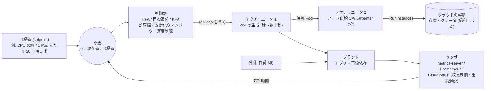
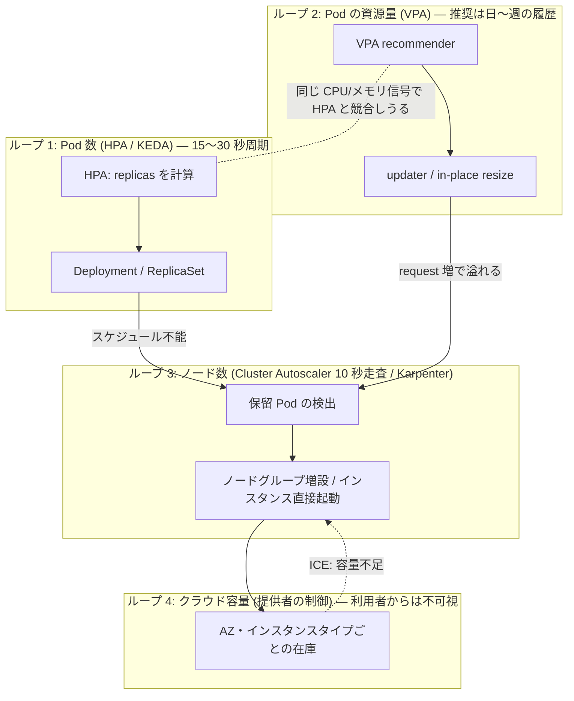

# オートスケーリングと容量制御 (Autoscaling & Capacity Control: Feedback Loops, HPA/Karpenter, AWS Scaling & Headroom)

## 概要 (Overview)

**オートスケーリング (autoscaling)** は「負荷に合わせて台数を自動で増減する便利機能」として説明されがちである。だが構造を見ると、これは**センサ (メトリクス収集) → 制御器 (スケーリング判断) → アクチュエータ (Pod・ノード・インスタンスの起動) という遅延付きのフィードバック制御系**そのものである。そう見れば、オートスケーラの典型的な故障である発振 (ばたつき)、積分器の飽和に似た溜め込み (windup)、遅れによる取りこぼしは、すべて制御工学の教科書が 1 章ずつ割いて扱う現象になる。Kubernetes の水平 Pod オートスケーラ (HPA) も、AWS EC2 Auto Scaling の目標追跡 (target tracking) も、設定項目の大半 (許容幅・安定化ウィンドウ・ウォームアップ・クールダウン) はこの制御系の安定化装置である。

本ドキュメントの中心テーゼは 2 つ。(1) オートスケーリングは**入れ子のフィードバックループ**である。Pod 数を決める HPA の下に、ノードを供給する Cluster Autoscaler / Karpenter があり、その下にクラウドの容量そのものがある。カスケード制御の定石は「内側のループほど速くせよ」だが、クラウドでは内側 (ノードの供給) のほうが外側 (Pod 数の判断) より桁で遅い。安定性はこの逆転を前提に設計しなければならない。(2) どれほど賢い制御器でも、**アクチュエータの遅延より速い負荷の立ち上がりには追いつけない**。この下限は制御則の工夫では消せないので、余裕容量 (headroom)・予測・負荷制限 (load shedding) という制御ループの外側の手段で補うしかない。[`container-orchestration-kubernetes.md`](container-orchestration-kubernetes.md) は「HPA × Cluster Autoscaler の合成は発振しうる」と一行で指摘しているが、本書はそれを制御の言葉で展開する。分析深度は Level 3。版に依存する記述は 2026-10-07 時点 (Kubernetes 公式文書は v1.37 を追跡) のものである。

## 方法論 (Methodology)

- オートスケーラを「機能の一覧」ではなく**制御ブロック図** (目標値・誤差・制御則・むだ時間・飽和) に写像し、各製品の設定項目がブロック図のどこに効くかを対応づける。制御理論の語彙は Hellerstein et al. (2004) と Åström & Murray (2021) に、待ち行列の語彙は [`../../foundations/mathematics/probability-statistics/markov-chains-queueing.md`](../../foundations/mathematics/probability-statistics/markov-chains-queueing.md) に、1 次・2 次系の時定数と減衰は [`../../foundations/mathematics/calculus-analysis/ordinary-differential-equations.md`](../../foundations/mathematics/calculus-analysis/ordinary-differential-equations.md) に依る。
- 一般機構は既存文書に委ねる。調停ループと etcd は [`container-orchestration-kubernetes.md`](container-orchestration-kubernetes.md)、メタステーブル障害・リトライ増幅・アドミッション制御・静的安定性は [`cloud-control-planes.md`](cloud-control-planes.md)、コールドスタートの内部は [`serverless-faas-internals.md`](serverless-faas-internals.md)、スポットの中断は [`spot-capacity-economics.md`](spot-capacity-economics.md)、メトリクス基盤は [`cloud-observability.md`](cloud-observability.md) を参照し、ここでは再説しない。
- 一次資料は Kubernetes 公式文書・KEP・フィーチャーゲート文書、Cluster Autoscaler / Karpenter / KEDA / Knative の OSS 公式文書、AWS の各サービス文書、査読付き論文 (Autopilot EuroSys '20, Borg EuroSys '15)。AWS の記述はベンダー一次資料として扱い、仕様値 (保証・上限) と挙動の説明 (「通常は」) を区別する。版番号と既定値はすべて 2026-10-07 に確認した。
- 数値例のうち出典を示さないもの (遅延予算の内訳、余裕容量の試算) は、式の振る舞いを示すための**仮定値**であり、測定値ではない。その旨を都度明記する。

## 発見事項 (Findings)

1. **HPA の制御則は「比例制御」ではなく「比率による一発補正 (デッドビート型)」であり、だからこそ遅延に弱い。** HPA の式 `desiredReplicas = ceil(currentReplicas × currentMetric / desiredMetric)` は、Pod あたりのメトリクスが負荷 / Pod 数に正確に比例するなら、1 回の計算で誤差をゼロにする台数を出す。制御工学でいうデッドビート制御に近く、平時は速い。しかしデッドビート制御は「前回の操作の結果がもう測定に現れている」ことを前提とする。15 秒ごとに判断するのに新しい Pod が準備完了するまで数十秒〜数分かかれば、制御器は効き始めていない操作をもう一度上乗せし、行き過ぎ (オーバーシュート) が起きる。準備前の Pod の使用量を 0% と見なす規則や、5 分のスケールダウン安定化ウィンドウは、このむだ時間を補償するための仕組みと読める (技術詳細 1)。

2. **入れ子のループは「内側ほど速く」というカスケード制御の原則に逆らっている。** 化学プラントのカスケード制御では、内側 (流量) のループを外側 (温度) より十分速くし、外側から見て内側を「即座に追従する装置」と見なせるようにする。Kubernetes では外側の HPA が 15 秒周期で Pod 数を書き、内側の Cluster Autoscaler は保留 Pod の検出から増設要求までだけで小規模クラスタで約 30 秒、100〜1000 ノードで最大約 60 秒かかる。そのあとにインスタンスの起動とノード登録が続く。内側が遅いので、外側から見ると巨大なむだ時間を持つ装置になる。HPA を速く調整しても総遅延はほとんど縮まらない。効くのは、内側の遅延そのものを先払いする手段 (優先度の低いプレースホルダ Pod による余裕確保、ウォームプール、予測スケーリング) である。

3. **非対称性 (速く増やし、ゆっくり減らす) は好みではなく、誤差の費用が非対称であることの帰結である。** 容量不足の費用は SLO 違反・エラー・連鎖障害であり、容量過剰の費用は数分ぶんの課金にすぎない。HPA の既定はスケールアップの安定化ウィンドウが 0 秒、スケールダウンが 300 秒である。EC2 Auto Scaling の目標追跡も、いずれかのポリシーが求めればスケールアウトし、全ポリシーがそろって初めてスケールインし、しかも段階的に縮める。DynamoDB の自動スケーリングは、2 分連続の超過でスケールアップし、15 データポイント連続の下回りでスケールダウンする。この非対称は制御の言葉ではヒステリシスであり、ばたつきを抑えるのと同時に「迷ったら多めに持つ」という損失関数を符号化している。

4. **スケーリング信号の選択は、遅れる信号と先行する信号の選択である。CPU 使用率は遅れる側にある。** CPU 使用率は「仕事がすでに Pod に届き、処理され始めた」後にしか上がらない。I/O 待ちや下流待ちで詰まっている Pod では、負荷が増えても CPU はむしろ下がる。キュー長や同時実行数 (in-flight) は、リトルの法則 `L = λW` により到着率 λ の増加にも応答時間 W の悪化にも即座に反応する。そのため先行指標として働く。Knative が同時実行数でスケールし、AWS が SQS のキュー長を「インスタンスあたりのバックログ」に変換して目標追跡させるよう勧めるのは、このためである。ただし先行信号はノイズも大きいので、Knative は 60 秒の安定ウィンドウと 6 秒のパニックウィンドウという 2 つの時定数を併用している。

5. **飽和する信号でスケールすると、制御器の利得が上限で頭打ちになる。** CPU 使用率は上限 (limit) で飽和する。request = limit で目標を 90% にすると、比率 currentMetric/desiredMetric は最大でも 100/90 ≈ 1.11 にしかならない。1 回のスケールで約 11% しか増やせず、既定の許容幅 10% とほぼ同じなので、過負荷のさなかにほとんど増えない (本書の算術による導出)。目標を 50% にすれば 1 回で最大 2 倍まで増やせる。目標値の選び方は効率の問題である前に、**制御器の最大利得**の問題である。同じ理屈で、上限のあるメトリクス (接続プール使用率、スレッドプールの占有率) はすべて飽和点で情報を失う。

6. **スケールアップは下流への負荷の増幅器にもなる。** クライアント側 (Web 層・ワーカー) を増やすと、共有している下流 (データベース・外部 API) への接続数と要求率も比例して増える。下流が律速であれば、スケールアウトは処理量を増やさずに、競合・接続枯渇・タイムアウトとリトライだけを増やす。過負荷 → スケールアウト → 下流のさらなる過負荷という正帰還は、[`cloud-control-planes.md`](cloud-control-planes.md) のメタステーブル障害の入口そのものである。オートスケーラには「どこまで増やすと下流を壊すか」という知識がない。だから最大台数 (maxReplicas / MaxSize) は単なる費用の上限ではなく、**下流を守る安全上の上限**として設計する必要がある。

7. **容量は無限ではない。上限・クォータ・在庫切れが、制御系の見えないアクチュエータ飽和として効く。** EC2 は要求したインスタンスタイプの On-Demand 容量がその AZ にないとき `InsufficientInstanceCapacity` を返す。AWS 自身の対処法は「数分待って再試行」「台数を分割」「AZ を指定しない」「別のインスタンスタイプ」である。Lambda はアカウントあたり既定 1,000 の同時実行と、関数あたり 10 秒ごと 1,000 環境の増加速度で頭打ちになる。DynamoDB の on-demand モードは、過去ピークの 2 倍を 30 分以内に超えるとスロットリングしうる。これらはどれも、制御器から見ると「操作量を出しても効かない」飽和である。飽和中に要求が積み上がり、解除された瞬間に一斉に放出される挙動は、制御工学の積分ワインドアップ (integral windup) とよく似ている (技術詳細 5)。

8. **オートスケーリングは負荷制限の代替ではなく補完である。両者は時間スケールが違う。** スケーリングは分単位で容量を変え、負荷制限 (load shedding) とアドミッション制御はミリ秒単位で要求を捨てる。発見事項 2 の遅延がある以上、立ち上がりの数分間は「容量 < 負荷」が必ず起こりうる。その間に全要求を受け入れて全員を遅くするか、一部を速く断って残りを守るかは、スケーラではなく入口の設計が決める。Google の Autopilot 論文 (EuroSys '20) の主張も同じ方向を向いている。自動化の価値は「最適な台数」よりも、人手の設定に比べて余剰 (slack) を 46% から 23% に減らしつつ、OOM で深刻な影響を受けるジョブを 10 分の 1 にしたという**安全側の効率化**にある (論文の自己報告値)。

## アーキテクチャ (Architecture)

### 制御ブロック図への写像



凡例: 実線の矢印は信号の流れ、円は比較器を表す。図の要点は、遅延が**センサ側** (収集・集約) と**アクチュエータ側** (起動・準備) の両方に入ることである。HPA の 15 秒という判断周期は、全体の遅延のうちでは小さい部類に入る。

### 製品ごとの制御装置の対応

| 制御の概念 | Kubernetes HPA | EC2 Auto Scaling | DynamoDB (provisioned) | Knative KPA |
|---|---|---|---|---|
| 目標値 | `target` (利用率 / 平均値 / 値) | 目標追跡の target value | 目標利用率 20–90% | Pod あたり同時実行数 |
| 判断周期 | 15 秒 (`--horizontal-pod-autoscaler-sync-period`) | CloudWatch アラーム評価 | 1 分粒度のメトリクス | 継続的 |
| 不感帯 (dead band) | 許容幅 0.1 (HPA ごとに変更可, 1.37 GA) | 丸めによる不感帯 (公式文書の説明) | — | — |
| むだ時間の補償 | 未準備 Pod を 0% と見なす、CPU 初期化期間 5 分 | インスタンスウォームアップ | — | パニックウィンドウ |
| ヒステリシス | scaleDown 安定化 300 秒 / scaleUp 0 秒 | スケールインは段階的・全ポリシー合意 | 下降は 15 点連続、1 日の減少回数に上限 | パニック中は縮小しない |
| 速度制限 | `policies` (既定: 15 秒あたり 100% または 4 Pod の大きい方) | ステップの大きさ | 増加を急にはできない (公式文書) | — |
| 予測 (フィードフォワード) | なし (外部で実装) | 予測スケーリング・スケジュール | スケジュール | なし |

### 入れ子のループと時間スケール



4 つのループは、互いの存在を知らずに同じプラントを操作する。ループ 1 と 2 が同じ CPU 信号を見ると、2 つの制御器が 1 つの誤差を奪い合う。Kubernetes の VPA 文書が CPU/メモリで HPA と併用しないよう警告しているのはこのためである。ループ 3 は、ループ 1 の出力 (保留 Pod) を入力にする直列接続で、その遅延は全部ループ 1 のむだ時間に加算される。ループ 4 は利用者からは見えず、飽和したときだけエラーとして姿を現す。

## 技術詳細 (Technical Details)

### 1. HPA のアルゴリズムと安定化装置

```text
# Pseudocode: Kubernetes HPA の 1 回の調停 (公式文書 "Algorithm details" の記述を要約)
# Source: kubernetes.io/docs/concepts/workloads/autoscaling/horizontal-pod-autoscale/
#         (Algorithm details, Support for configurable scaling behavior), v1.37 文書
# Complexity: O(M × P) per sync (M = メトリクス数, P = 対象 Pod 数)
# Assumptions: メトリクスは Pod あたりの平均として取得でき、負荷にほぼ比例する
for each metric m:
    pods  := 削除中・失敗した Pod を除外
    ready := 準備完了かつメトリクスのある Pod
    ratio := avg(m over ready) / target(m)
    if |ratio - 1| <= tolerance(direction): candidate[m] := current; continue
    # 欠損と未準備を「保守側」に補完して再計算
    if scale-up:   未準備 Pod・欠損 Pod は使用率 0% と仮定
    if scale-down: 欠損 Pod は目標値の 100% と仮定
    candidate[m] := ceil(current × recomputed_ratio)
desired := max over m of candidate[m]       # 取得失敗があり縮小方向なら何もしない
desired := 過去 stabilizationWindow 内の推奨の (縮小時は最大値 / 拡大時は最小値)
desired := policies による 1 周期あたりの変化量上限で切り詰め
desired := clamp(desired, minReplicas, maxReplicas)
```

- **欠損の補完は方向ごとに保守側へ倒す**: スケールアップでは未準備 Pod を 0% と見なして増やしすぎを防ぎ、スケールダウンでは欠損 Pod を 100% と見なして減らしすぎを防ぐ。むだ時間の間に「起動中の Pod が効いていない」ことを、測定値の側で補償する設計である。未準備の判定には `--horizontal-pod-autoscaler-initial-readiness-delay` (既定 30 秒) と `--horizontal-pod-autoscaler-cpu-initialization-period` (既定 5 分) が使われる。JIT のウォームアップ中に CPU が高く出る Pod を、スケールの根拠から外すための仕組みである。
- **複数メトリクスは最大値をとる**: 各メトリクスから出した台数のうち最大を採用する。メトリクスの一部が取れずに縮小方向が示されたときはスケールを見送るが、拡大方向なら取れたメトリクスだけで拡大する。可用性を優先する非対称がここにもある。
- **既定の `behavior`**: スケールダウンは安定化 300 秒・15 秒あたり 100% まで、スケールアップは安定化 0 秒・15 秒あたり「100% と 4 Pod の大きい方」である。つまり小さなワークロードでも 1 周期で 4 Pod までは増やせ、大きなワークロードは 1 周期で最大 2 倍になる。`behavior` は KEP-853 で導入され (1.18)、`autoscaling/v2` (1.23 GA) の一部である。
- **許容幅の個別設定**: 0.1 の許容幅は長らく `kube-controller-manager` のフラグでクラスタ一律だった。KEP-4951 で `behavior.scaleUp.tolerance` / `scaleDown.tolerance` として HPA ごと・方向ごとに設定できるようになった (1.33 alpha、v1.37 で GA)。数千 Pod 規模では 10% の不感帯が数百 Pod ぶんの容量不足に相当するため、大規模ワークロードほど不感帯を狭めたいという要求から生まれた。
- **メトリクスの種類**: Resource (CPU・メモリの利用率)、ContainerResource (特定コンテナ)、Pods (Pod あたりのカスタムメトリクス)、Object (Ingress のリクエスト率などクラスタ内オブジェクトの値)、External (クラスタ外のキュー長など) の 5 種である。0 台へのスケール (`minReplicas: 0`) は Object / External メトリクスに限られ、`HPAScaleToZero` ゲートは v1.37 で beta (既定で有効) に上がった。CPU のような Resource メトリクスは Pod がないと測れないので、0 台からは戻れない。

### 2. VPA・KEDA・ノード供給 — 他の 3 つのループ

- **VPA (Vertical Pod Autoscaler)**: 本体外のアドオンで、recommender (履歴から目標・下限・上限を推奨)、updater (適用)、admission controller (新規 Pod の request を書き換える mutating webhook) の 3 部品からなる。モードは `Off` (推奨のみ)・`Initial` (作成時のみ)・`Recreate` (退去して再作成)・`InPlaceOrRecreate` (in-place を試み、だめなら退去) で、旧 `Auto` は非推奨になった。土台となる **in-place の Pod リサイズ** (`InPlacePodVerticalScaling`) は 1.27 alpha、1.33 beta を経て 1.35 で GA になった。VPA の `InPlaceOrRecreate` は同時期に beta へ上がった。それまで垂直スケーリングは「Pod を殺して作り直す」ことと同義で、ステートフルなワークロードには使いにくかった。in-place リサイズにより、アクチュエータの遅延と副作用が大きく下がった。
- **KEDA**: イベント源 (キュー・ストリーム・DB など) を scaler で読み、0↔1 の起動・停止 (activation) は KEDA 自身が、1↔N は KEDA が外部メトリクスとして公開した値で HPA が担う、という分業をとる。既定の `pollingInterval` は 30 秒、`cooldownPeriod` は 300 秒である。scaler ごとに起動閾値 (`activationThreshold`) と拡大閾値 (`threshold`) を分けて持てる。これは 0↔1 という最もコールドスタートの重い遷移に、別のヒステリシスを与える仕組みである。
- **Cluster Autoscaler (CA)**: 10 秒ごと (`--scan-interval`) にスケジュール不能な Pod を探し、ノードグループの雛形ノードの上でスケジューリングを模擬して、増設で解決するかを判定する。どのグループを増やすかは expander が選ぶ (既定は `least-waste`)。縮小は、request の合計が 50% 未満のノードが 10 分間 (`--scale-down-unneeded-time`) 不要であり続けたら候補になり、増設後 10 分 (`--scale-down-delay-after-add`) は縮小を考えない。増設したノードが 15 分 (`--max-node-provision-time`) 以内に現れなければ、そのグループを諦めて他を試す。これは容量不足 (発見事項 7) に対する CA 側のタイムアウトである。
- **Karpenter**: ノードグループを介さず、保留 Pod の要求から直接インスタンスタイプを選んで起動する。縮小側は **disruption** という独立した調停として設計されている。統合 (consolidation) の方針は `WhenEmpty`・`WhenEmptyOrUnderutilized` (既定)・`Balanced` (節約が Pod の中断の費用を上回る場合のみ) の 3 つで、空ノードの並列削除 → 複数ノードの統合 → 単一ノードの統合の順に試す (v1.14 文書)。中断の速度は NodePool の disruption budget (未指定時 `nodes: 10%`) で制限し、時間帯や理由 (Drifted / Underutilized / Empty) ごとに予算を分けられる。ただし期限切れ (expiration) と中断通知 (interruption) は強制的な経路で、予算の対象外である。縮小に速度制限をかけることは、**縮小方向のループの利得を下げること**にほかならない。
- **余裕容量の先払い**: CA の公式 FAQ は、優先度の極めて低い (例: `value: -10`) PriorityClass を持つ pause Pod の Deployment で容量を確保しておく方法を示している。本物の Pod が来ると pause Pod がプリエンプトされて即座に場所が空き、追い出された pause Pod が保留になって CA の増設を誘発する。ノード供給のむだ時間を、本物の Pod の経路から外してプレースホルダの経路へ移す技法である。

### 3. AWS のスケーリング方式

| 方式 | 制御の型 | 要点 (ベンダー文書) |
|---|---|---|
| 目標追跡 (target tracking) | 目標値への追従。サーモスタットに例えられている | アラームは AWS が自動生成・管理する。どれか 1 つのポリシーが求めればスケールアウトし、全ポリシーがそろって初めてスケールインする。丸めは容量を足りなくしない方向に行う |
| ステップスケーリング | 誤差の大きさ別の区分線形制御 | アラーム超過の幅ごとに増減量を定義する。目標追跡より細かく制御したいときに使う |
| シンプルスケーリング + クールダウン | オン/オフ制御 + 固定の不応期 | 既定のクールダウンは 300 秒。AWS 自身が非推奨としている |
| 予測スケーリング | フィードフォワード | 24 時間以上 (最大 14 日) の履歴から、今後 48 時間の 1 時間単位の予測を作る。予測は 6 時間ごとに更新される。最初は forecast only モードで動き、予測ではスケールインしない |
| スケジュール | 開ループ | 既知のイベント (営業開始・セール) に合わせて事前に容量を置く |

- **ウォームアップとウォームプール**: インスタンスウォームアップの間、新しいインスタンスはグループの集約メトリクスに入らず、スケールインも止まる (発見事項 1 のむだ時間の補償を AWS 側で実装したもの)。ウォームプールは事前に初期化したインスタンスを `Stopped` / `Hibernated` / `Running` で待機させる。Stopped なら払うのは EBS と Elastic IP だけである。プールが空になった、あるいは AZ が容量不足のときは、通常のコールドスタートに戻る。加重付きの混在インスタンスグループやスポットとは併用できない。
- **予測スケーリングの安全装置**: 予測が最大容量に迫ったときに最大容量を自動で引き上げる `MaxCapacityBreachBehavior` がある。文書は、引き上げた最大値が元に戻らないことを警告している。予測が外れたときに費用の天井が静かに上がっていくため、セキュリティ考察の「上限は安全上限である」という論点に直結する。予測と動的スケーリングを併用すると、各ポリシーの求める容量の最大値が採用される。
- **Lambda**: 同時実行数 = 平均要求率 × 平均実行時間 (リトルの法則そのもの) で見積もる。既定ではアカウント (リージョン) あたり 1,000 同時実行で、要求率も同時実行数の 10 倍 (既定で 10,000 RPS) で制限される。2023-11 以降、関数ごとに 10 秒あたり 1,000 実行環境ずつ増やせる (以前はアカウント共有で最初の 1 分に 500–3,000、以後 1 分ごとに 500)。Provisioned Concurrency は事前初期化した環境で、確保には 1〜2 分の準備がかかり、関数あたり毎分 6,000 環境まで確保できる。なお同じ公式文書内に「10 秒ごとに 500」とする例示も残っており、本書は本文の規定値と AWS News Blog の発表 (1,000 / 10 秒) を採る。
- **DynamoDB**: provisioned モードの自動スケーリングは Application Auto Scaling の目標追跡で、目標利用率は 20–90% から選ぶ。2 分連続の超過で発火し、`UpdateTable` の反映に数分かかり、その間は旧容量を超えた要求がスロットリングされる。減少は 1 日最大 27 回 (常時最大 4 回ぶんの予算が 1 時間に 1 回ずつ回復する) に制限される。on-demand モードは過去ピークの 2 倍までは即座に受け入れ、それを超える成長は 30 分かけるか事前のウォーム化 (warm throughput) を要する。on-demand でも制御がなくなるわけではなく、「過去ピーク」という状態を持つ別の制御器に置き換わっただけである ([`cloud-databases-aurora-dynamodb.md`](cloud-databases-aurora-dynamodb.md))。

### 4. 遅延予算 — スケーリングが追いつける負荷の上限

スケールアウトの総遅延は次の和である。

`T_total = T_measure (収集・集約) + T_decide (判断周期・アラーム評価) + T_provision (ノード/インスタンス起動・登録) + T_pull (イメージ取得) + T_ready (アプリ初期化・JIT・キャッシュ温め・readiness)`

| 項 | 支配要因 | 縮める手段 |
|---|---|---|
| T_measure | metrics-server / CloudWatch の解像度。EC2 の基本監視は 5 分、詳細監視で 1 分 | 高解像度メトリクス、アプリ側の先行信号 |
| T_decide | HPA 15 秒、CA の走査 10 秒 + 30〜60 秒の判断 | (総遅延への寄与は小さい) |
| T_provision | インスタンスタイプ・AMI・容量の在庫 | ウォームプール、プレースホルダ Pod、Karpenter |
| T_pull | イメージサイズ・レジストリ | 小さいイメージ、遅延ロード ([`serverless-faas-internals.md`](serverless-faas-internals.md)) |
| T_ready | ランタイムの初期化、依存先への接続確立 | スナップショット復元、事前の暖機、初期化期間の設定 |

目標利用率を u とすると、平時の容量は負荷の 1/u 倍あるので、総遅延の間に負荷が 1/u 倍を超えて増えなければ、取りこぼさずに済む。負荷が成長率 g (毎秒) で指数的に増えるなら、条件は `e^{g·T_total} ≤ 1/u`、つまり `T_total ≤ ln(1/u) / g` である。仮定値で試算すると、u = 0.6 なら ln(1/0.6) ≈ 0.51 で、負荷が 1 分で 2 倍になる立ち上がり (g = ln2/60 ≈ 0.0116/s) に耐えられる総遅延は約 44 秒になる。ノードの起動を含むスケールアウトは通常これより長いので、この立ち上がりを反応型スケーリングだけで吸収することはできない。式が言っているのは、**遅延を縮められないなら、u を下げる (余裕を持つ) か、g を下げる (予測で早めに動く・入口で流量を絞る) しかない**ということである。目標利用率を上げて費用を下げる行為は、耐えられる立ち上がり速度を下げる行為と同じである。

### 5. 故障モードの制御論的分類

| 故障 | 制御の言葉 | 典型的な引き金 | 対策 |
|---|---|---|---|
| ばたつき (thrashing) | 利得過大 + むだ時間による発振 | 短い安定化ウィンドウ、周期的な負荷、起動直後の高 CPU | ヒステリシス (安定化ウィンドウ)、許容幅、速度制限、初期化期間 |
| 二重制御 | 1 つの誤差を 2 つの制御器が奪い合う | HPA と VPA が同じ CPU 信号を見る | 信号の分離 (HPA はカスタム、VPA は request) |
| ワインドアップ | 飽和中の要求の積み上がり | maxReplicas 到達、ICE、クォータ、保留 Pod の滞留 | 飽和の検知とアラート、上限の明示、キューの期限切れ (deadline) |
| 下流の過負荷 | 正帰還 (ループ利得 > 1) | クライアント層の拡大が DB 接続を増やす | 下流の容量に合わせた maxReplicas、接続プールの上限、[`cloud-control-planes.md`](cloud-control-planes.md) のリトライ予算 |
| 飽和信号 | センサの飽和による利得の頭打ち | request = limit で高い目標値 | 目標値を下げる、飽和しない信号 (キュー・同時実行数) |
| コールドスタートの増幅 | アクチュエータの遅延が負荷に比例して伸びる | 一斉起動によるイメージ取得の集中、依存先への接続嵐 | 段階的な拡大、ウォームプール、Provisioned Concurrency |
| 縮小による障害 | 縮小方向の操作の副作用 | 統合による一斉退去、PDB なし | disruption budget、PDB、`do-not-disrupt`、縮小の時間帯制限 |

ワインドアップは特に見落とされやすい。容量不足で保留 Pod とキューが積み上がっている間、制御器の求める台数は増え続ける。容量が戻った瞬間に積み上がった全量が一斉に起動し、一斉にイメージを取りに行き、一斉に下流へ接続する。立ち上がりの負荷は「元の負荷 + 溜まったバックログ」になり、容量回復が新たな過負荷の引き金になる。この型はメタステーブル障害の持続効果と重なる。キューに期限を付けて古い要求を捨てることは、制御工学でいう積分器のクランプ (anti-windup) に相当する。

### 6. 容量計画 — 余裕・AZ 喪失・待ち行列

- **利用率とレイテンシ**: M/M/1 待ち行列の平均滞在時間は `W = 1/(μ − λ) = S/(1 − ρ)` (S = 1/μ は平均処理時間、ρ = λ/μ は利用率) である (Kleinrock 1975)。処理時間に対する倍率は ρ = 0.5 で 2 倍、0.8 で 5 倍、0.9 で 10 倍、0.95 で 20 倍になる。M/M/1 では滞在時間が率 (μ − λ) の指数分布に従うので、p99 は `ln(100)/(μ − λ) ≈ 4.6 × W` で、平均よりさらに速く悪化する。実システムは M/M/1 ではないが、「利用率 100% の手前で遅延が発散する」という形は頑健である。目標利用率は費用の目標ではなく、**レイテンシ SLO から逆算される上限**である ([`../observability/observability-performance-engineering.md`](../observability/observability-performance-engineering.md))。
- **AZ 喪失への備え**: N 個の AZ に均等配置して 1 AZ の喪失を無操作で吸収するには、各 AZ に定常負荷の N/(N−1) 倍が要る。3 AZ なら 1.5 倍で、平時の上限利用率は目標の 2/3 になる。障害時にオートスケールで補う計画は、障害の影響下にあるかもしれないコントロールプレーンと、同じ AZ から逃げてくる全利用者との容量の奪い合いに賭けることになる ([`cloud-control-planes.md`](cloud-control-planes.md) の静的安定性、[`multi-region-global-architecture.md`](multi-region-global-architecture.md))。
- **余裕の重ね方**: 実効の平時利用率の上限 ≈ (レイテンシ SLO から決まる ρ_max) × (AZ 喪失係数 (N−1)/N) × (立ち上がり余裕 e^{−g·T_total})。各項は独立した理由による掛け算なので、合わせると平時利用率は直感より低くなる (例: 0.8 × 2/3 × 0.9 ≈ 0.48, 仮定値)。Borg の論文が示した、優先度の低いバッチ仕事でこの余裕を埋めて利用率を回収する手法 (Verma et al. 2015) と、スポットによる余裕の転売 ([`spot-capacity-economics.md`](spot-capacity-economics.md)) は、この「安全のための空き」を経済的に再利用する方法である。
- **費用との接続**: 余裕容量・ウォームプール・Provisioned Concurrency はどれも「遅延を減らすためにアイドルを買う」行為であり、FinOps の単位原価に直接現れる ([`cloud-cost-structure-finops.md`](cloud-cost-structure-finops.md))。オートスケーリングによる節約は、平時の利用率を上げた分ではなく、**谷の時間帯に容量を返せた分**として測るのが正しい。

### 7. 予測とスケジュール — フィードフォワードの役割

反応型のフィードバックは、誤差が出てからしか動けない。予測スケーリングは負荷のパターン (日次・週次) から外乱を先回りする**フィードフォワード**であり、遅延予算の式で g を実質的に下げる。AWS の予測スケーリングが予測ではスケールインせず、縮小を動的ポリシーに任せる設計は、予測が外れたときの費用を「増やしすぎ」の側に限定する非対称の一種である。予測の前提は「グループが均質で、インスタンスあたりの容量が等しい」ことである。混在インスタンスグループでは予測が不正確になると文書は注意している。Google の Autopilot は、Borg 上のジョブに対して、過去の使用量の移動窓統計と、複数のモデルから選ぶ機械学習型の推奨器で、垂直 (CPU/メモリの上限) と水平 (タスク数) の両方を自動設定する。論文時点で Google 全体の資源使用量の 48% 超が Autopilot 管理下にあったとされる (Rzadca et al. 2020, 自己報告値)。垂直方向の推奨が主戦場である点は、Kubernetes の VPA と in-place リサイズの GA が後を追う構図になっている。

## セキュリティ考察 (Security Considerations)

- **ウォレット枯渇攻撃 (Denial of Wallet)**: オートスケーリングは可用性への攻撃 (DoS) を費用への攻撃に変換する。容量が自動で増える系では、攻撃者がサービスを落とせなくても請求額を膨らませられる。Kelly, Glavin & Barrett (2021) は、レート制限に掛からない低速で持続的な呼び出しが、DoS 対策を迂回する有効な型になると論じた。最大台数・予約同時実行数 (Lambda の reserved concurrency は上限としても働く)・DynamoDB on-demand の最大スループット設定は、費用面の**サーキットブレーカ**として明示的に設定すべきである。予算アラートは検知であって防止ではない。
- **上限は安全上限である**: 発見事項 6 のとおり、maxReplicas は下流を守る上限でもある。予測スケーリングの `MaxCapacityBreachBehavior` のように上限を自動で引き上げる機能は、上限が元に戻らない点も含めて、変更管理の対象として扱う必要がある。上限を IaC で宣言し、ドリフトを検知する ([`infrastructure-as-code.md`](infrastructure-as-code.md))。
- **オートスケーラの権限**: CA / Karpenter はインスタンスの起動・終了、ネットワークインタフェースの操作、`iam:PassRole` を持つ高権限の主体である。侵害されれば、任意の AMI・任意のロールでの計算資源の起動 (暗号資産の採掘、横移動の足場) に使える。起動できるインスタンスプロファイル・タグ・サブネットを条件キーで絞り、IRSA / Pod Identity でコントローラの Pod だけに資格情報を与える ([`cloud-iam-authorization.md`](cloud-iam-authorization.md))。KEDA の scaler もイベント源の読み取り資格情報を持つので、最小権限で切り分ける。
- **メトリクスの改ざんと汚染**: External / Object メトリクスや KEDA の scaler は、クラスタ外の値をスケーリング判断に直結させる。信頼できない発生源 (テナントが書き込めるキュー、改ざん可能なメトリクスエンドポイント、アプリが自己申告するカスタムメトリクス) の値を使うと、偽の高値で過剰起動 (費用攻撃)、偽の低値で縮退 (可用性攻撃) を誘発できる。メトリクス API (`external.metrics.k8s.io`) の提供者は API 集約の一部として認証・認可の対象であり、提供者の Service を差し替えられる主体は事実上オートスケーラを操作できる。値の上下限の妥当性検査と、複数信号での最大値採用 (HPA の既定) が緩和策になる。
- **縮小を悪用した可用性攻撃**: 統合や縮小は Pod の退去を伴う。PodDisruptionBudget を持たないワークロードや、`do-not-disrupt` を任意の主体が付け外しできる状態は、縮小の速度制御を無効化または悪用する経路になる。逆に、全 Pod に退去禁止を付けるとノードが永久に返らず、費用面の攻撃面になる。

## 結論 (Conclusions)

- オートスケーリングは、遅延付きのフィードバック制御系である。HPA の許容幅・安定化ウィンドウ・速度制限、AWS のウォームアップ・クールダウン、Karpenter の disruption budget は、どれも不感帯・ヒステリシス・利得の制限という同じ道具の別名であり、制御の言葉で読めば設定の意味と相互作用が見える。
- ループは入れ子で、しかも内側 (ノード供給) が外側 (Pod 数) より遅いという、カスケード制御の原則と逆の構造をしている。外側の制御器をいくら速くしても総遅延は縮まない。安定性と応答性は、内側の遅延を先払いする手段 (プレースホルダ Pod・ウォームプール・in-place リサイズ・予測) で得る。
- スケーリングはアクチュエータの遅延より速い立ち上がりに追いつけない。この下限は `T_total ≤ ln(1/u) / g` という形で、目標利用率 u と負荷の成長率 g を結ぶ。余裕容量・予測・負荷制限は、制御則の工夫では消せないこの下限を補うための、ループ外の手段である。
- 容量は有限であり、上限・クォータ・在庫切れは見えない飽和として効く。飽和中の積み上がりは容量回復の瞬間に新たな過負荷を生む。上限は費用の天井であると同時に、下流と請求書を守る安全装置として設計する。

### 次の接続先 (Related Topics)

- [`container-orchestration-kubernetes.md`](container-orchestration-kubernetes.md) — HPA・CA・Karpenter が載る調停ループの機械と、本書が展開した「ばたつき」の一行指摘。
- [`cloud-control-planes.md`](cloud-control-planes.md) — メタステーブル障害・リトライ予算・アドミッション制御・静的安定性。スケーリングの限界を補う側の原則。
- [`serverless-faas-internals.md`](serverless-faas-internals.md) — コールドスタートの分解。FaaS におけるアクチュエータ遅延の内訳。
- [`spot-capacity-economics.md`](spot-capacity-economics.md) — 余裕容量の経済的な再利用と、中断という別種の容量変動。
- [`cloud-cost-structure-finops.md`](cloud-cost-structure-finops.md) — 余裕容量・ウォームプールの費用を単位原価として扱う枠組み。
- [`deployment-safety-progressive-delivery.md`](deployment-safety-progressive-delivery.md) — デプロイ中のスケーリングの停止・容量確保と、段階的な展開の相互作用。
- [`../../foundations/mathematics/probability-statistics/markov-chains-queueing.md`](../../foundations/mathematics/probability-statistics/markov-chains-queueing.md) — M/M/1 とリトルの法則。目標利用率の理論的根拠。
- [`../../foundations/mathematics/calculus-analysis/ordinary-differential-equations.md`](../../foundations/mathematics/calculus-analysis/ordinary-differential-equations.md) — 時定数・減衰・固有値による安定判別。発振の数学。

## 参考文献 (References)

**一次資料 (Primary — 仕様・公式文書・論文)**

- [Kubernetes Documentation: Horizontal Pod Autoscaling](https://kubernetes.io/docs/concepts/workloads/autoscaling/horizontal-pod-autoscale/) — Accessed: 2026-10-07。アルゴリズム、許容幅、未準備 Pod と欠損の扱い、既定の `behavior`、複数メトリクス、0 台へのスケール。
- [Kubernetes Documentation: Vertical Pod Autoscaling](https://kubernetes.io/docs/concepts/workloads/autoscaling/vertical-pod-autoscale/) — Accessed: 2026-10-07。部品構成、更新モード、HPA との併用の警告。
- [Kubernetes Feature Gates (HPAConfigurableTolerance, HPAScaleToZero, InPlacePodVerticalScaling)](https://kubernetes.io/docs/reference/command-line-tools-reference/feature-gates/) — Accessed: 2026-10-07。各機能の成熟度と版。
- [KEP-853: Configurable scale up/down velocity for HPA](https://www.kubernetes.dev/resources/keps/853/) — Accessed: 2026-10-07。
- [KEP-4951: Configurable tolerance for HPA](https://www.kubernetes.dev/resources/keps/4951/) — Accessed: 2026-10-07。
- [Cluster Autoscaler FAQ](https://github.com/kubernetes/autoscaler/blob/master/cluster-autoscaler/FAQ.md) — Accessed: 2026-10-07。走査間隔、縮小条件、増設の遅延の目安、expander、overprovisioning、`--max-node-provision-time`。
- Hellerstein, J. L., Diao, Y., Parekh, S., & Tilbury, D. M. (2004). *Feedback Control of Computing Systems*. Wiley-IEEE Press. ISBN 978-0-471-26637-2 — 計算機システムへの制御理論の適用 (比例制御・むだ時間・安定性) の標準的教科書。
- Åström, K. J., & Murray, R. M. (2021). *Feedback Systems: An Introduction for Scientists and Engineers* (2nd ed.). Princeton University Press. ISBN 978-0-691-19398-4 — フィードバック・フィードフォワード・積分ワインドアップ・カスケード制御の一般論。
- Kleinrock, L. (1975). *Queueing Systems, Volume 1: Theory*. Wiley. — M/M/1 の滞在時間分布。
- Little, J. D. C. (1961). A proof for the queuing formula: L = λW. *Operations Research*, 9(3), 383–387. DOI: 10.1287/opre.9.3.383
- Rzadca, K., Findeisen, P., Swiderski, J., Zych, P., Broniek, P., Kusmierek, J., Nowak, P., Strack, B., Witusowski, P., Hand, S., & Wilkes, J. (2020). Autopilot: Workload Autoscaling at Google. *EuroSys '20*. DOI: 10.1145/3342195.3387524 — 垂直・水平の自動設定、余剰 23% 対 46%、OOM の 10 分の 1 化 (自己報告値)。
- Verma, A., Pedrosa, L., Korupolu, M., Oppenheimer, D., Tune, E., & Wilkes, J. (2015). Large-scale cluster management at Google with Borg. *EuroSys '15*. DOI: 10.1145/2741948.2741964 — 優先度による余裕容量の回収と利用率。
- Kelly, D., Glavin, F. G., & Barrett, E. (2021). Denial of Wallet — Defining a Looming Threat to Serverless Computing. *arXiv:2104.08031*. — 費用への攻撃の定義と攻撃パターン。

**公式ブログ (Primary — 時点情報)**

- [Kubernetes 1.35: In-Place Pod Resize Graduates to Stable](https://kubernetes.io/blog/2025/12/19/kubernetes-v1-35-in-place-pod-resize-ga/) — Accessed: 2026-10-07。1.27 alpha → 1.33 beta → 1.35 GA、VPA `InPlaceOrRecreate` の beta 化。
- [Kubernetes v1.33: HorizontalPodAutoscaler Configurable Tolerance](https://kubernetes.io/blog/2025/04/28/kubernetes-v1-33-hpa-configurable-tolerance/) — Accessed: 2026-10-07。

**ベンダー / OSS 提示 (Vendor-presented)**

- [Karpenter Documentation: Disruption](https://karpenter.sh/docs/concepts/disruption/) — Accessed: 2026-10-07 (v1.14)。統合方針、disruption budget の既定 `nodes: 10%`、強制的な中断経路。
- [KEDA Documentation: Scaling Deployments, StatefulSets & Custom Resources](https://keda.sh/docs/latest/concepts/scaling-deployments/) — Accessed: 2026-10-07。activation と HPA の分業、`pollingInterval` / `cooldownPeriod` の既定。
- [Knative Documentation: Additional autoscaling configuration for Knative Pod Autoscaler](https://knative.dev/docs/serving/autoscaling/kpa-specific/) — Accessed: 2026-10-07。安定ウィンドウ 60 秒、パニックウィンドウ 10%、パニック閾値 200%。
- [Amazon EC2 Auto Scaling: Target tracking scaling policies](https://docs.aws.amazon.com/autoscaling/ec2/userguide/as-scaling-target-tracking.html) — Accessed: 2026-10-07。スケールアウト優先、丸め、ウォームアップ、目標追跡に使えないメトリクス。
- [Amazon EC2 Auto Scaling: How predictive scaling works](https://docs.aws.amazon.com/autoscaling/ec2/userguide/predictive-scaling-policy-overview.html) — Accessed: 2026-10-07。履歴 24 時間〜14 日、48 時間予測、6 時間更新、最大容量の自動引き上げの警告。
- [Amazon EC2 Auto Scaling: Scaling cooldowns](https://docs.aws.amazon.com/autoscaling/ec2/userguide/ec2-auto-scaling-scaling-cooldowns.html) — Accessed: 2026-10-07。既定 300 秒、シンプルスケーリングの非推奨。
- [Amazon EC2 Auto Scaling: Warm pools](https://docs.aws.amazon.com/autoscaling/ec2/userguide/ec2-auto-scaling-warm-pools.html) — Accessed: 2026-10-07。プールの状態と費用、制約。
- [Amazon EC2: Troubleshoot instance launch issues (InsufficientInstanceCapacity)](https://docs.aws.amazon.com/AWSEC2/latest/UserGuide/troubleshooting-launch.html) — Accessed: 2026-10-07。
- [AWS Lambda: Understanding Lambda function scaling](https://docs.aws.amazon.com/lambda/latest/dg/lambda-concurrency.html) — Accessed: 2026-10-07。同時実行の式、アカウント既定 1,000、RPS 上限 10 倍、Provisioned Concurrency の確保速度。
- [AWS Lambda: Lambda scaling behavior](https://docs.aws.amazon.com/lambda/latest/dg/scaling-behavior.html) — Accessed: 2026-10-07。関数ごとに 10 秒あたり 1,000 実行環境。
- [AWS Lambda functions now scale 12 times faster when handling high-volume requests](https://aws.amazon.com/blogs/aws/aws-lambda-functions-now-scale-12-times-faster-when-handling-high-volume-requests/) — Accessed: 2026-10-07。2023-11 の変更と旧方式。
- [Amazon DynamoDB: Managing throughput capacity automatically with DynamoDB auto scaling](https://docs.aws.amazon.com/amazondynamodb/latest/developerguide/AutoScaling.html) — Accessed: 2026-10-07。目標利用率 20–90%、2 分 / 15 データポイントの発火条件。
- [Amazon DynamoDB: On-demand capacity mode](https://docs.aws.amazon.com/amazondynamodb/latest/developerguide/on-demand-capacity-mode.html) — Accessed: 2026-10-07。過去ピークの 2 倍と 30 分、最大スループット設定。
- [Amazon DynamoDB: Quotas (decreasing provisioned throughput)](https://docs.aws.amazon.com/amazondynamodb/latest/developerguide/ServiceQuotas.html) — Accessed: 2026-10-07。1 日 27 回の減少上限。
