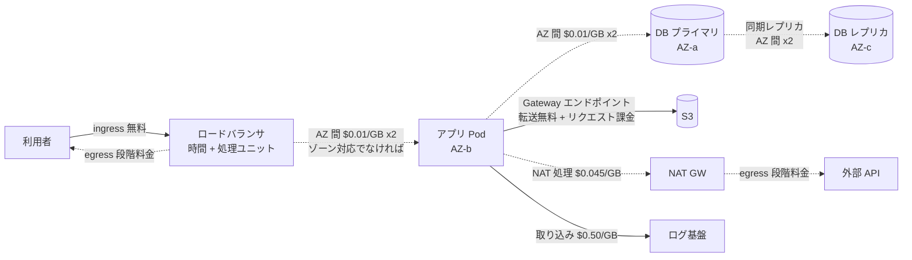
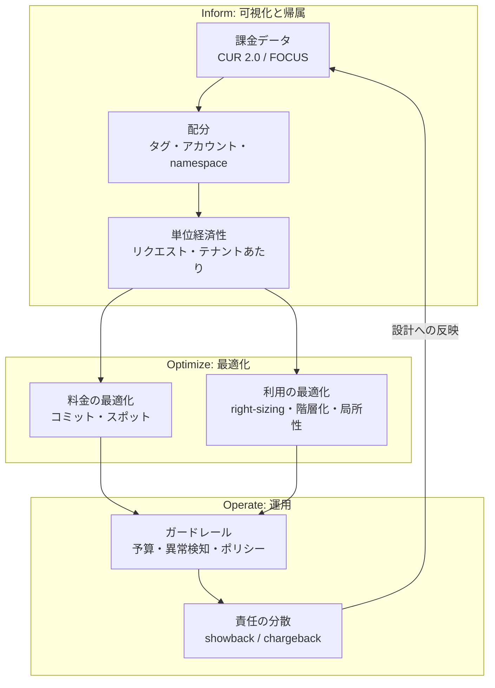

# クラウドのコスト構造と FinOps (Cloud Cost Structure & FinOps: Billing Dimensions, Commitments, Unit Economics & Guardrails)

## 概要 (Overview)

クラウドの請求書は、使った量の単なる集計ではない。それは**事業者が自らのコスト構造とインセンティブを価格へ符号化したもの**である。何を計量するか (秒・GB-月・リクエスト・GB 転送)、どこに無料枠を置くか (同一 AZ 内の転送、Gateway VPC エンドポイント)、どこに高い単価を置くか (インターネットへの egress、NAT の処理量) という選択は、事業者の原価 (電力・帯域・在庫リスク) と戦略 (囲い込み・移行の誘導) を反映している。そして利用者のアーキテクチャは、意識しているかどうかにかかわらず、この**課金次元 (billing dimension)** に沿って形づくられる。

本ドキュメントの中心テーゼは 2 つ。(1) コストは運用の後始末ではなく**アーキテクチャの性質**であり、レイテンシや可用性と同じ**非機能要件 (non-functional requirement)** として設計時に扱うべきものである。AZ をまたぐ 1 本の矢印、NAT を経由する 1 本の経路、ログの 1 行が、そのまま単価を持つからである。(2) **FinOps** は、この性質を制御可能にするフィードバックループである。可視化 (Inform) → 帰属と最適化 (Optimize) → 運用への組み込み (Operate) という循環がなければ、課金は数日遅れて届く開ループの信号にとどまる。価格モデルが容量リスクの配分契約であるという論点は [`spot-capacity-economics.md`](spot-capacity-economics.md) が扱った。本書はその上に、請求書の解剖、単位経済性、ガードレール、回帰 (repatriation) 論争を積む。分析深度は Level 3。価格はすべて **2026-10-07 時点の表示価格 (list price)** であり、特記がなければ AWS US East (N. Virginia, us-east-1) の値である。

## 方法論 (Methodology)

- 請求書を「課金次元 × 単価 × 量」に分解し、各次元がどの物理資源 (CPU 時間・ディスク・ネットワーク帯域・制御平面の処理) と事業者のどの意図に対応するかを読む。単価は 2026-10-07 に AWS の公式価格ページで確認した。価格表が動的に描画されて本文を取得できない項目 (EC2 のインターネット egress 段階料金) は、その旨を明記し、二次資料と照合した。
- 標準と枠組みは一次資料に依拠する。FinOps Framework (FinOps Foundation)、FOCUS 仕様、OpenCost 仕様 (CNCF)、EU Data Act (規則 (EU) 2023/2854) がそれにあたる。
- 回帰論争では、当事者の公表値 (37signals のブログ、Dropbox の S-1 届出書) を**当事者の主張 (first-party claim)** として、ベンチャーキャピタルの分析 (a16z) を**二次資料・意見**として扱い、独立の監査がないことを明示する。
- 一般機構は既存文書に委ねる。NAT・TGW・PrivateLink は [`cloud-network-topology.md`](cloud-network-topology.md)、テレメトリのカーディナリティ経済は [`cloud-observability.md`](cloud-observability.md)、スキャン課金は [`data-lakehouse-analytics.md`](data-lakehouse-analytics.md)、FaaS の多重化は [`serverless-faas-internals.md`](serverless-faas-internals.md)、スポットは [`spot-capacity-economics.md`](spot-capacity-economics.md) を参照する。

## 発見事項 (Findings)

1. **課金次元はアーキテクチャへの設計圧力であり、無料と有料の境界線がトポロジーを決める。** AWS では同一 AZ 内の転送は無料で、AZ をまたぐ転送は**送信側と受信側の双方で $0.01/GB** かかる (EC2 価格ページ, 2026-10-07 時点の表示価格)。つまり AZ 間を流れる 1 GB は請求書上 $0.02 になる。この境界があるため、「どの AZ の誰と話すか」はレイテンシだけでなく単価の問題になる。Kubernetes の `trafficDistribution: PreferSameZone` ([`kubernetes-networking.md`](kubernetes-networking.md)) やゾーン対応のレプリカ読み取りは、この境界線に沿って設計を曲げる機構である。逆に、無料の境界 (同一 AZ、Gateway VPC エンドポイント) へ寄せるほど請求書は小さくなる。課金次元は、事業者が利用者のトポロジーを誘導するための最も強い API になっている。

2. **大きな請求は計算資源ではなく「隠れた乗数」から生まれることが多い。** 典型は 4 つある。(a) **AZ 間転送**: 3 AZ に均等に置かれたサービス間呼び出しは、ランダムに振り分けると約 2/3 が AZ をまたぐ。レプリケーション係数 3 の分散ログ ([`../messaging/distributed-logs-delivery-semantics.md`](../messaging/distributed-logs-delivery-semantics.md)) は、書き込み 1 GB ごとに 2 GB 分の AZ 間複製を生む。(b) **NAT ゲートウェイの処理課金**: $0.045/GB の処理料に時間課金 $0.045/時が加わる。S3 や ECR のイメージ取得を NAT 経由で行うと、本来無料にできる経路に処理料を払うことになる。S3 と DynamoDB 向けの Gateway VPC エンドポイントには時間課金も処理課金もない (VPC 価格ページ)。(c) **ログ取り込み**: CloudWatch Logs の Standard クラスは取り込み $0.50/GB で、S3 Standard の保存単価 $0.023/GB-月の約 22 倍である。(d) **小さなオブジェクトとリクエスト課金**: S3 の PUT は $0.005/1,000 件なので、1 KB のオブジェクト 10 億個は保存料 (約 1 TB, 月 $23) に対して書き込みだけで $5,000 かかる。どの乗数も、計算資源の監視だけでは見えない。

3. **時間の粒度とアドレスのような「無料に見えた資源」の課金化は、事業者の原価構造の変化を映している。** EC2 は 2017-10-02 に Linux インスタンスの秒単位課金 (最低 60 秒) へ移行した (AWS 告知)。これは短命なインスタンスを前提にする自動スケーリングや CI の経済性を変えた。逆方向の例が、2024-02-01 に始まったパブリック IPv4 アドレスへの課金 ($0.005/時、使用中・未使用を問わない) である。IPv4 の枯渇で取得原価が上がった資源を、事業者が「無料の付属品」から「計量される資源」へ移したものであり、1 アドレスで月約 $3.65 になる。どちらも、課金次元は固定されたものではなく原価とともに動く制度であることを示す。

4. **コミットメント割引は金融のヘッジであり、評価軸はカバレッジと利用率の 2 つである。** Savings Plans は 1 年または 3 年の時間あたり支出額をコミットする契約で、Compute Savings Plans は最大 66%、EC2 Instance Savings Plans は最大 72% の割引を謳う (ベンダー提示の上限値)。前者はインスタンスファミリー・リージョン・Fargate・Lambda をまたいで適用される柔軟性と引き換えに割引が小さい。ヘッジとしての評価軸は 2 つある。**カバレッジ (coverage)** は対象となる利用のうちコミットで覆われた割合、**利用率 (utilization)** は購入したコミットのうち実際に使われた割合である。カバレッジを上げるほど割引の総額は増えるが、需要が減ったときに使われないコミットが残る。損益分岐の利用率は「1 − 割引率」で与えられる (技術詳細 2)。これは容量リスクを顧客が引き受ける契約である ([`spot-capacity-economics.md`](spot-capacity-economics.md) 発見事項 5) という読みと整合する。

5. **egress 料金は囲い込みの経済であり、規制がその形を変え始めている。** インターネットへの egress は入力 (ingress) が無料であるのと対照的に高い単価を持ち、データの重力 (data gravity) を事業者側へ傾ける。2024 年に、Google Cloud (01 月、公式ブログの日付は 01-12)、AWS (03-05)、Azure (03-13) が、**全データを移して退去する顧客に限り** egress を免除すると相次いで発表した。いずれもサポートへの申請と承認、期限内の移行 (AWS は 2025-09-30 の更新で 90 日、Azure は 60 日) を条件とし、日常的な egress は対象外である。37signals の S3 退去 (2025) では、この制度で約 $250K の egress が免除されたと報じられている (報道)。背景には EU Data Act (規則 (EU) 2023/2854) がある。同法第 29 条は、2024-01-11 から 2027-01-12 まで切替料金 (switching charges) を事業者の直接原価以下に制限し、2027-01-12 以降は切替料金を禁止する。Google Cloud は 2025-09 に、EU・英国の組織内マルチクラウド転送を無償で計量する Data Transfer Essentials を開始した。規制は「退去時の egress」を先に無料化し、「並行利用時の egress」を原価水準へ押し下げる順で効いている。

6. **単位経済性への翻訳ができて初めて、コストは設計判断の入力になる。** 月額の総額は事業の成長とともに増えるのが正常であり、総額の増減だけを見ても良し悪しは判断できない。判断できるのは**単位経済性 (unit economics)**、つまりリクエスト・テナント・トランザクションあたりのコストである。そこへ至るには、請求行を所有者へ帰属させる仕組み (コスト配分タグ、アカウント構造、Kubernetes の namespace とラベル) と、ベンダー横断で同じ列名を持つ課金データの標準が要る。FOCUS (FinOps Open Cost and Usage Specification) は 2024-06 に 1.0 が GA になり、2026-06-04 に 1.4 が批准された (FinOps Foundation 発表)。AWS は Data Exports で CUR 2.0 と FOCUS 1.0 / 1.2 形式の出力を提供している。共有資源の配分は Kubernetes で最も難しく、CNCF Incubating の OpenCost は、ワークロードのコストを `max(request, usage)` で定義し、未使用分をアイドルコストとして別に扱う仕様を示している。

7. **主要クラウドの従量課金には、利用者が設定できる「ハードな支出上限」がない。** AWS Budgets のアクションは IAM ポリシーや SCP の適用、特定の EC2 / RDS インスタンスの停止はできるが、支出そのものを止める機構ではない。予算情報の更新は 1 日最大 3 回であり、Cost Anomaly Detection も Cost Explorer の最大 24 時間の遅延を引き継ぐ。Google Cloud の文書は、アラートのみの予算は利用や支出を自動で上限設定しないと明記し、課金の無効化はプログラムで自動化するよう案内している。Azure の支出制限は無料アカウントやクレジット付きサブスクリプションに限られ、従量課金 (pay-as-you-go) とコミットメント型では有効にできない。上限がないのは、上限到達時にサービスを止めることが多くの顧客にとって請求超過より悪いという事業者側の判断の表れでもある。その結果、「財布を枯らす攻撃 (denial of wallet)」や漏洩した鍵による高額請求に対しては、検知の遅延を前提にした多層の防御を利用者が組むしかない。

8. **回帰 (repatriation) 論争は「クラウドは高いか」ではなく「どの需要形状でクラウドの弾力性に価格を払う価値があるか」の問題である。** 37signals は、クラウドの年間支出を $3.2M から $1.3M に減らし、約 $700K のハードウェアを 2023 年中に回収し、5 年で $10M 超を節約する見込みだと公表した (当事者の主張, 2024-10-17)。Dropbox は S-1 届出書で、利用者データの大半を自社基盤 (Magic Pocket) へ移したことで 2 年間で約 $74.6M の費用を削減したと開示した (2018, 当事者の開示)。a16z の分析 (2021) は、上場ソフトウェア企業でクラウド費用が売上原価を圧迫し時価総額を押し下げていると論じた (二次資料・意見)。一方で、これらの事例は**需要が予測可能で、規模が大きく、運用人材を持つ**企業である。成長が不確実な段階での弾力性、マネージドサービスによる運用労力の削減、複数リージョンへの即時展開は、ハードウェアの償却表には現れない価値である。どちらの立場の数字も独立監査を受けていない。妥当な読みは、需要が平坦で予測可能になったワークロードから順に、コミット・自社基盤という「顧客がリスクを持つ」形へ移す、という連続的な判断である。

## アーキテクチャ (Architecture)

### 課金次元の解剖

請求書の各行は、次の 5 つの次元のどれかに属する。単価は us-east-1 の 2026-10-07 時点の表示価格である。

| 次元 | 計量単位 | 代表的な単価 (us-east-1) | 対応する原価 / 意図 |
|---|---|---|---|
| 計算 | インスタンス秒 (最低 60 秒)、GB-秒 (Lambda) | Lambda x86: $0.0000166667/GB-秒 + $0.20/100 万リクエスト | CPU・メモリの占有時間。秒単位化で短命な実行を奨励 |
| 保存 | GB-月、ストレージクラス | S3 Standard $0.023/GB-月 (最初の 50 TB)、Glacier Deep Archive $0.0036/GB-月 | ディスクの容量と耐久性。取り出しの遅さと引き換えに単価を下げる |
| リクエスト | 1,000 件あたり | S3 PUT/COPY/POST/LIST $0.005、GET $0.0004 | 制御平面とメタデータの処理。小さなオブジェクトほど支配的になる |
| 転送 | GB | AZ 間 $0.01 (送受信それぞれ)、NAT 処理 $0.045、インターネット egress は段階料金 (最初の 100 GB/月は全サービス合算で無料) | 帯域と境界機器。ingress 無料・egress 有料で重力を作る |
| 付属資源 | 時間 | パブリック IPv4 $0.005/時、NAT ゲートウェイ $0.045/時 | 希少資源と常駐機器。未使用でも課金される |
| マネージドサービス | 取り込み GB、リクエスト、ユニット | CloudWatch Logs 取り込み $0.50/GB (Standard)、$0.25/GB (Infrequent Access) | 索引付け・保持の処理原価 ([`cloud-observability.md`](cloud-observability.md)) |

インターネット egress の段階料金は、EC2 価格ページの表が動的に描画されるため本文を取得できなかった。最初の 10 TB/月 の帯で $0.09/GB とする二次資料が複数あるが、本書では一次確認できていない値として扱う。リージョン間転送はリージョンの組ごとに単価が異なるため、本書では具体値を示さない。

### 1 リクエストの経路に付く課金メーター

下図は、典型的な 3 AZ 構成の Web アプリで、1 リクエストがどこで課金次元に触れるかを示す。実線は同一 AZ 内 (転送無料)、破線は AZ 境界または外部との境界 (転送課金) を表す。



凡例: 実線 = 同一 AZ 内または転送無料の経路、破線 = 転送課金のかかる境界越え。

### FinOps のフィードバックループ

FinOps Framework は、原則 (Principles)、ペルソナ (Personas)、フェーズ (Phases)、スコープ (Scopes)、ドメイン (Domains)、ケイパビリティ (Capabilities)、成熟度 (Maturity) で構成される。2025 年の改訂でスコープが中核要素に加わり、2026 年の改訂で Executive Strategy Alignment などが追加された。工学的に見ると、その骨格は請求データを入力とする制御ループである。



### 価格モデルの比較

| モデル | リスクを持つ側 | 割引 (ベンダー提示) | 適する需要形状 | 詳細 |
|---|---|---|---|---|
| オンデマンド | 事業者 | なし (基準価格) | 予測できない変動分 | — |
| Compute Savings Plans | 顧客 (支出額) | 最大 66% | 構成が変わるが総量は安定 | 技術詳細 2 |
| EC2 Instance Savings Plans / リザーブド | 顧客 (ファミリー・リージョン固定) | 最大 72% | 構成も総量も安定 | 技術詳細 2 |
| スポット | 顧客 (中断) | 変動 | 中断に耐える弾力的な仕事 | [`spot-capacity-economics.md`](spot-capacity-economics.md) |
| エンタープライズ割引 (私的契約) | 顧客 (総支出のコミット) | 非公開 | 全社規模の長期利用 | 契約条件は公開されず比較できない |

### 配分の方式 — showback と chargeback

**showback** は、費用を所有チームへ帰属させて見せるだけで、予算は中央に残す方式である。**chargeback** は、帰属させた費用を各チームの予算から実際に差し引く方式である。chargeback は責任を強く分散させるが、共有資源 (ネットワーク基盤、監視、Kubernetes の制御平面) の配分規則が不公平だと、チームは費用を減らすのではなく配分規則の抜け穴を探し始める。実務では showback で配分規則への合意を作ってから chargeback へ移ることが多い。いずれも、タグ付けされていない費用の割合を指標として追うことが前提になる。

## 技術詳細 (Technical Details)

### 1. AZ 間転送の定量化 — Kubernetes とレプリケーション

**仮定**: 3 AZ に容量が均等に配置され、呼び出し先がゾーンを考慮せず一様に選ばれる。AZ 間転送は送受信それぞれ $0.01/GB (us-east-1, 2026-10-07 時点の表示価格)。

```
サービス間呼び出し:  E[AZ 間割合] = 1 − 1/Z            (Z = AZ 数; Z=3 で 2/3)
  1 GB あたりの転送費 = (1 − 1/Z) × 2 × $0.01 ≈ $0.0133   (Z=3)
レプリケーション係数 R の書き込み (各レプリカが別 AZ):
  1 GB 書き込みあたり = (R − 1) × 2 × $0.01 = $0.04        (R=3)
  + 生産者からリーダーへの経路: (1 − 1/Z) × $0.02
```

計算量は呼び出しグラフのエッジ数に線形である。この式から 2 つの設計判断が出る。(a) 読み取りの多いサービスでは、ゾーン対応のルーティング (`trafficDistribution`、Kafka の follower fetching のような最寄りレプリカ読み取り) で第 1 式の (1 − 1/Z) を 0 に近づけられる。ただし、ゾーンごとの容量が揃っていないと負荷が偏る ([`kubernetes-networking.md`](kubernetes-networking.md))。(b) 第 2 式の複製は可用性そのものなので削れない。ここで**コストと耐障害性のトレードオフが明示的になる**。マルチ AZ の複製を減らせば転送費は下がるが、AZ 障害時にデータを失う。AZ 1 つを失っても全負荷を処理できるようにする静的安定性 ([`cloud-control-planes.md`](cloud-control-planes.md)) は、3 AZ 構成で各 AZ にピークの 1/2 の容量を置くこと、つまり平常時に 1.5 倍の容量を持つことを要求する。この 1.5 倍は浪費ではなく、可用性目標の価格である。

### 2. コミットメントの損益分岐 — 利用率の閾値

**仮定**: 割引率 d のコミットを時間あたり支出額 c で購入する。コミットはオンデマンド換算で c / (1 − d) 分の利用を覆う。実際に覆われた利用の割合 (利用率) を u とする。

```
コミットで得る価値 (オンデマンド換算) = u × c / (1 − d)
支払額                              = c
利益が出る条件: u × c / (1 − d) > c   ⇔   u > 1 − d

例: d = 0.30 → 損益分岐の利用率 70%
    d = 0.66 → 損益分岐の利用率 34%
```

割引が深いほど、低い利用率でも元が取れる。これが 3 年契約が魅力的に見える理由である。ただし割引が深い契約ほど期間が長く柔軟性が低いため、需要の下振れや世代交代 (Graviton など新しいファミリーへの移行) で利用率 u 自体が下がるリスクが大きくなる。実務では、過去の最低水準の利用 (ベース負荷) までを柔軟な契約でカバーし、カバレッジを 100% にしないことで、需要減少というテールリスクに備える。これは債券のラダー (満期分散) と同じ構造で、購入時期をずらして満期を分散すると、需要の変化に合わせて段階的に契約を組み替えられる。

### 3. サーバーレスとプロビジョニングの損益分岐

**仮定**: Lambda の x86 料金 (us-east-1、無料枠を除く) で、メモリ m GB、平均実行時間 t 秒、月間リクエスト数 N。比較対象は、同じピークを処理できる常時稼働構成の月額 C (インスタンス・LB・冗長分を含む)。ネットワークや周辺サービスの費用は両者で等しいとする。

```
Lambda 月額     = N × ($0.20 / 10^6 + m × t × $0.0000166667)
損益分岐点 N*   = C / ($0.20 / 10^6 + m × t × $0.0000166667)

例 (仮の値): m = 0.5 GB, t = 0.1 s → 1 リクエスト ≈ $1.03 × 10^-6
             C = $60/月 → N* ≈ 5,800 万リクエスト/月 ≈ 平均 22 rps
```

結論は「平均負荷が低く、ピークと平均の比が大きいほどサーバーレスが有利」である。プロビジョニング側の C はピークで決まり、Lambda 側の費用は平均で決まるからである。逆に、平坦で高い負荷では常時稼働構成 (さらにコミット割引) が有利になる。式の外にある項として、プロビジョニング側の運用労力、Lambda のコールドスタート ([`serverless-faas-internals.md`](serverless-faas-internals.md))、ゼロへのスケール (scale-to-zero) の価値がある。ゼロへのスケールは開発・検証環境で特に効く。Arm (Graviton) の Lambda は GB-秒単価が x86 より約 20% 低い ($0.0000133334)。

### 4. 利用最適化の手段と、その限界

- **right-sizing**: 利用率の実測に基づいてインスタンスサイズを下げる。メモリの最大値とテールレイテンシを見ずに CPU 平均だけで下げると、ピーク時の性能劣化として跳ね返る。自動スケーリングの目標値設計は [`autoscaling-capacity-control.md`](autoscaling-capacity-control.md) と一体で考える。
- **Arm への移行**: Graviton2 の発表時 (2020) に AWS は x86 比で最大 40% 良い価格性能を謳い、現行の Graviton ページは「比較可能な x86 インスタンスより最大 20% 安い」と表示している (いずれもベンダー提示)。実効値はワークロード依存であり、自分のベンチマークで確かめる必要がある。CPU マイクロアーキテクチャの差は [`../../hardware/cpu/`](../../hardware/cpu/) を参照。
- **保存の階層化**: S3 Intelligent-Tiering はアクセス頻度に応じてオブジェクトを自動で階層移動するが、監視・自動化料 $0.0025/1,000 オブジェクトがかかり、128 KB 未満のオブジェクトは自動階層化の対象外である。小さなオブジェクトが大量にある場合は、まず集約 (パック) してから階層化するほうが効く。ライフサイクル規則による明示的な移行は、アクセスパターンが既知の場合に安い ([`../object-storage/object-storage-architecture.md`](../object-storage/object-storage-architecture.md))。
- **キャッシュと CDN**: オリジンからの egress を CDN のキャッシュヒットで置き換える ([`../networking/cdn-edge-delivery.md`](../networking/cdn-edge-delivery.md))。データ分析ではスキャン量課金をパーティションと列指向形式で減らす ([`data-lakehouse-analytics.md`](data-lakehouse-analytics.md))。
- **経路の付け替え**: S3 と DynamoDB は Gateway VPC エンドポイントへ、その他のサービスは Interface エンドポイント (時間課金と処理課金がある) へ移し、NAT の処理課金を避ける。egress の集約設計は [`cloud-network-topology.md`](cloud-network-topology.md) が扱う。
- **テレメトリの抑制**: ログはサンプリング、低頻度クラス (取り込み単価が半分) への振り分け、保持期間の短縮で、メトリクスはカーディナリティの管理で抑える ([`cloud-observability.md`](cloud-observability.md))。

### 5. 課金データの標準化と共有コストの配分

CUR 2.0 は AWS 固有の列名を持つ詳細な課金データで、Data Exports では SQL による列の選択と行の絞り込みができる。FOCUS は列名と意味をベンダー横断で揃える仕様で、請求額の種類 (例えば請求額と償却後の実効額) や、コミットの購入と消費を同じ列体系で表す。1.4 では請求書照合のためのデータセット (Invoice Detail、Billing Period) と、コミット適用可能性の追跡が加わった。標準化の工学的な価値は、マルチクラウドや SaaS の費用を同じクエリで単位経済性へ集計できることにある。

Kubernetes の共有コストは、ノード単位の請求を Pod へ割り付ける問題になる。OpenCost 仕様は、ワークロードの費用を `max(request, usage)` とする。予約したが使わなかった資源も、スケジューラが他者から奪った資源として費用に数えるためである。ノード費用からワークロード費用を引いた残りがアイドルコストになり、システムワークロードや管理料などの共有費用は、均等・利用比例・独自指標のいずれかで配分できる。この定義は、request を過大に宣言するチームに費用が帰属することを意味し、right-sizing への誘因として働く。マルチテナント SaaS でテナント単位の原価を出す方法は [`multi-tenant-saas-architecture.md`](multi-tenant-saas-architecture.md) で扱う。

### 6. ガードレールの多層構成

ハードな支出上限がない以上、ガードレールは遅延の異なる複数の層で組む。

| 層 | 機構 | 反応の遅延 | 限界 |
|---|---|---|---|
| 予防 | Service Quotas、SCP によるリージョン・インスタンスタイプの制限、IaC のポリシー検査 | 即時 (作成時) | 量の上限であり金額の上限ではない |
| 検知 (規則) | AWS Budgets のしきい値とアクション | 最大 1 日 3 回の更新 | アクションは IAM/SCP 適用と特定インスタンスの停止に限られる |
| 検知 (統計) | AWS Cost Anomaly Detection (機械学習) | Cost Explorer の最大 24 時間遅延 + 約 1 日 3 回の評価 | 新しいサービスは 10 日分の履歴が必要 |
| 実行時 | アプリ側のレート制限、同時実行数の上限 (Lambda の予約同時実行)、API ゲートウェイのスロットリング | 即時 | 正当なスパイクも抑える |

Service Quotas は事業者が「意図しないプロビジョニングによる過剰請求」を防ぐ目的も持つと説明しているが、上限は資源の数であり、転送量やリクエスト量の金額を止めるものではない。実行時の層だけが即時に効くので、**金額のリスクが大きい経路 (公開されたサーバーレス API、egress の大きい配信) ほど、アプリケーション側に流量の上限を設計する**必要がある。

## セキュリティ考察 (Security Considerations)

- **認証情報の侵害は計算資源の窃取として現れる。** Google Cloud の Threat Horizons レポート (2021-11) は、侵害された GCP インスタンス 50 件のうち 86% が暗号通貨の採掘に使われ、10% が他の脆弱なシステムの探索、8% が他の標的への攻撃に使われたと報告した。攻撃者の目的はデータではなく、被害者の課金で動く計算資源である。漏洩したアクセスキーで大型インスタンスや GPU が全リージョンに起動されれば、請求は検知の遅延 (数時間〜24 時間) の間に積み上がる。対策は、長期のアクセスキーを作らないこと ([`cloud-iam-authorization.md`](cloud-iam-authorization.md) の一時認証情報)、使わないリージョンとインスタンスタイプを SCP で拒否すること、そして GPU などの高額資源のクォータを低く保つことである。
- **denial of wallet は可用性ではなく財布を狙う。** Kelly ら (2021) は、従量課金のサーバーレス関数を大量に呼び出し、サービスを止めずに請求だけを膨らませる攻撃を denial of wallet と定義した。自動スケーリングが DoS への耐性を与える一方で、その耐性がそのまま費用の増幅器になる。公開エンドポイントには認証、レート制限、同時実行数の上限を置き、同時実行数の上限は「処理できる最大量」ではなく「払える最大量」から逆算する。
- **課金データは機密情報である。** CUR や FOCUS の明細には、アカウント構造、リソース ID、タグ (顧客名やプロジェクト名を含みうる)、利用量の推移が含まれ、事業の規模や新製品の兆候を読み取れる。課金データのバケットは他の機密データと同じ暗号化とアクセス制御で扱い、Data Exports の列選択で不要な列を除いて出力する。
- **コストの可視性にも最小権限を適用する。** 請求コンソールや Cost Explorer の権限は、閲覧 (showback) と購入 (Savings Plans の購入・リザーブドの変更) を分ける。コミットの購入は数年にわたる金銭的な義務を生むので、本番環境の変更と同等の承認を要する操作として扱う。
- **ガードレール自体の停止を監視する。** 予算アクションの削除、異常検知モニターの無効化、クォータ引き上げの申請は、攻撃者が採掘の前に行いうる操作である。これらを CloudTrail で監視対象にし、[`cloud-observability.md`](cloud-observability.md) の監査系統へ流す。

## 結論 (Conclusions)

- クラウドの請求書は、事業者の原価とインセンティブを課金次元へ符号化したものである。同一 AZ 内は無料、AZ 間は双方向で課金、ingress は無料で egress は有料、Gateway エンドポイントは無料で NAT は処理課金、という境界線を読めば、事業者が利用者をどのトポロジーへ誘導しているかが分かる。
- コストはアーキテクチャの性質であり、非機能要件として設計時に扱うべきものである。AZ 間の矢印、NAT 経由の経路、ログの取り込み量、オブジェクトの大きさは、すべて単価を持つ。耐障害性のための複製と静的安定性の余剰容量は削減対象ではなく可用性の価格であり、コストと耐障害性のトレードオフは明示的に判断する。
- FinOps は、数日遅れて届く課金の信号を、可視化・帰属・最適化・運用の閉ループへ変える仕組みである。その前提は、単位経済性へ翻訳できる課金データ (CUR 2.0、FOCUS) と、共有資源の配分規則 (OpenCost の `max(request, usage)`) である。
- ハードな支出上限がないため、ガードレールは遅延の異なる多層 (予防・規則・統計・実行時) で組む。即時に効くのは実行時の流量制限だけである。認証情報の侵害と denial of wallet は、このガードレール設計をセキュリティの問題にする。
- 回帰論争に一般解はない。需要が予測可能で規模が大きいワークロードほど、コミットや自社基盤という「顧客がリスクを持つ」形が有利になり、不確実な需要ほどクラウドの弾力性に払う価値が大きい。egress 規制 (EU Data Act) は、この判断を退去費用で歪めにくくする方向に働いている。

### 次の接続先 (Related Topics)

- [`spot-capacity-economics.md`](spot-capacity-economics.md) — 価格モデルを容量リスクの配分契約として読む枠組みと、スポットの実効コスト。
- [`cloud-network-topology.md`](cloud-network-topology.md) — NAT・TGW・PrivateLink と egress の集約設計。
- [`kubernetes-networking.md`](kubernetes-networking.md) — `trafficDistribution` によるゾーン局所化と AZ 間転送の削減。
- [`cloud-observability.md`](cloud-observability.md) — テレメトリのカーディナリティと取り込み課金の経済。
- [`serverless-faas-internals.md`](serverless-faas-internals.md) — GB-秒課金の背後にある統計多重化。
- [`autoscaling-capacity-control.md`](autoscaling-capacity-control.md) — 容量制御と right-sizing の一体設計。
- [`multi-tenant-saas-architecture.md`](multi-tenant-saas-architecture.md) — テナント単位の原価配分と単位経済性。
- [`multi-region-global-architecture.md`](multi-region-global-architecture.md) — リージョン間複製の転送費と可用性目標の価格。
- [`cloud-design-principles.md`](cloud-design-principles.md) — コストを含む非機能要件の設計原則。

## 参考文献 (References)

**一次資料 (Primary — 公式価格・公式文書・仕様・規則)**

- [Amazon EC2 On-Demand Pricing](https://aws.amazon.com/ec2/pricing/on-demand/) — Accessed: 2026-10-07。秒単位課金の対象 OS、AZ 間転送 $0.01/GB (送受信それぞれ)、インターネット egress の無料枠 100 GB/月。
- [Amazon VPC Pricing](https://aws.amazon.com/vpc/pricing/) — Accessed: 2026-10-07。NAT ゲートウェイ $0.045/時・$0.045/GB、パブリック IPv4 $0.005/時、Gateway VPC エンドポイントの無料 (us-east-1)。
- [Amazon S3 Pricing](https://aws.amazon.com/s3/pricing/) — Accessed: 2026-10-07。S3 Standard の保存単価、リクエスト単価、Intelligent-Tiering の監視料と 128 KB の下限、Glacier Deep Archive。
- [AWS Lambda Pricing](https://aws.amazon.com/lambda/pricing/) — Accessed: 2026-10-07。リクエスト単価と GB-秒単価 (x86 / Arm)。
- [Amazon CloudWatch Pricing](https://aws.amazon.com/cloudwatch/pricing/) — Accessed: 2026-10-07。Logs の取り込み・保存単価。
- [Compute Savings Plans Pricing](https://aws.amazon.com/savingsplans/compute-pricing/) — Accessed: 2026-10-07。最大割引率と適用範囲 (ベンダー提示の上限値)。
- [Announcing Amazon EC2 per second billing](https://aws.amazon.com/about-aws/whats-new/2017/10/announcing-amazon-ec2-per-second-billing/) — Accessed: 2026-10-07。2017-10-02 開始、最低 60 秒。
- [New – AWS Public IPv4 Address Charge + Public IP Insights](https://aws.amazon.com/blogs/aws/new-aws-public-ipv4-address-charge-public-ip-insights/) — Accessed: 2026-10-07。2024-02-01 からの課金。
- [AWS Architecture Blog: Overview of Data Transfer Costs for Common Architectures](https://aws.amazon.com/blogs/architecture/overview-of-data-transfer-costs-for-common-architectures/) — Accessed: 2026-10-07。AZ 間・リージョン間・NAT・Gateway エンドポイントの課金関係。
- [AWS Architecture Blog: Exploring Data Transfer Costs for AWS Managed Databases](https://aws.amazon.com/blogs/architecture/exploring-data-transfer-costs-for-aws-managed-databases/) — Accessed: 2026-10-07。マネージド DB の AZ 間複製の転送費。
- [AWS Data Exports: What is AWS Data Exports?](https://docs.aws.amazon.com/cur/latest/userguide/what-is-data-exports.html) — Accessed: 2026-10-07。CUR 2.0、FOCUS 1.0 / 1.2 形式の出力、列選択。
- [AWS Budgets: Configuring budget actions](https://docs.aws.amazon.com/cost-management/latest/userguide/budgets-controls.html) — Accessed: 2026-10-07。
- [AWS Budgets: Managing your costs with AWS Budgets](https://docs.aws.amazon.com/cost-management/latest/userguide/budgets-managing-costs.html) — Accessed: 2026-10-07。更新頻度 (1 日最大 3 回)。
- [AWS Cost Anomaly Detection: Detecting unusual spend](https://docs.aws.amazon.com/cost-management/latest/userguide/manage-ad.html) — Accessed: 2026-10-07。評価頻度、最大 24 時間の遅延、10 日の履歴要件。
- [Google Cloud Billing: Create, edit, or delete budgets and budget alerts](https://docs.cloud.google.com/billing/docs/how-to/budgets) — Accessed: 2026-10-07。アラートのみの予算は上限を設けないこと、報告の遅延。
- [Microsoft Learn: Azure spending limit](https://learn.microsoft.com/en-us/azure/cost-management-billing/manage/spending-limit) — Accessed: 2026-10-07。支出制限の対象サブスクリプション。
- [AWS News Blog: Free data transfer out to internet when moving out of AWS](https://aws.amazon.com/blogs/aws/free-data-transfer-out-to-internet-when-moving-out-of-aws/) — Accessed: 2026-10-07。2024-03-05 発表、2025-09-30 更新 (90 日)。
- [Google Cloud Blog: Eliminating data transfer fees when migrating off Google Cloud](https://cloud.google.com/blog/products/networking/eliminating-data-transfer-fees-when-migrating-off-google-cloud) — Accessed: 2026-10-07。
- [Azure Updates: Free data transfer out to internet when leaving Azure](https://azure.microsoft.com/updates/now-available-free-data-transfer-out-to-internet-when-leaving-azure/) — Accessed: 2026-10-07。
- [Google Cloud Blog: New for the UK and EU — no-cost multicloud Data Transfer Essentials](https://cloud.google.com/blog/products/networking/new-for-the-uk-and-eu-no-cost-multicloud-data-transfer-essentials) — Accessed: 2026-10-07。
- [Regulation (EU) 2023/2854 (Data Act)](https://eur-lex.europa.eu/eli/reg/2023/2854/oj) — Accessed: 2026-10-07。第 29 条 (切替料金の段階的廃止)。
- [FinOps Foundation: FinOps Framework](https://www.finops.org/framework/) — Accessed: 2026-10-07。構成要素、ペルソナ、ドメイン、2025 / 2026 年の改訂。
- [FinOps Foundation: FinOps Principles](https://www.finops.org/framework/principles/) — Accessed: 2026-10-07。
- [FinOps Foundation: FinOps Phases (Lifecycle)](https://www.finops.org/framework/lifecycle/) — Accessed: 2026-10-07。Inform / Optimize / Operate とスコープ。
- [FOCUS Specification](https://focus.finops.org/focus-specification/) — Accessed: 2026-10-07。現行 1.4、版の履歴。
- [FinOps Foundation: FOCUS 1.0 is available](https://www.finops.org/insights/focus-1-0-available/) — Accessed: 2026-10-07。2024-06 の GA。
- [OpenCost Specification](https://www.opencost.io/docs/specification) — Accessed: 2026-10-07。`max(request, usage)`、アイドルコスト、共有コストの配分。
- [CNCF Blog: OpenCost advances to the CNCF Incubator](https://www.cncf.io/blog/2024/10/31/opencost-advances-to-the-cncf-incubator/) — Accessed: 2026-10-07。
- [Google Cloud Cybersecurity Action Team: Threat Horizons (November 2021)](https://services.google.com/fh/files/misc/gcat_threathorizons_brief_nov2021.pdf) — Accessed: 2026-10-07。侵害インスタンスの 86% が採掘に使用。
- Kelly, D., Glavin, F. G., & Barrett, E. (2021). Denial of Wallet — Defining a Looming Threat to Serverless Computing. *arXiv preprint*, arXiv:2104.08031. DOI: 10.48550/arXiv.2104.08031

**ベンダー提示 (Vendor-presented)**

- [AWS Graviton Processor](https://aws.amazon.com/ec2/graviton/) — Accessed: 2026-10-07。「比較可能な x86 インスタンスより最大 20% 安い」。
- [AWS Announces General Availability of the Sixth Generation of Amazon EC2 Instances Powered by AWS Graviton2 Processors](https://press.aboutamazon.com/2020/6/aws-announces-general-availability-of-the-sixth-generation-of-amazon-ec2-instances-powered-by-aws-graviton2-processors) — Accessed: 2026-10-07。「最大 40% 良い価格性能」(2020)。

**当事者の公表 (First-party claims — 独立監査なし)**

- [Hansson, D. H. (2024-10-17). Our cloud-exit savings will now top ten million over five years](https://world.hey.com/dhh/our-cloud-exit-savings-will-now-top-ten-million-over-five-years-c7d9b5bd) — Accessed: 2026-10-07。37signals の年間支出 $3.2M → $1.3M、ハードウェア約 $700K、S3 からの移行計画。
- [Dropbox, Inc. (2018). Form S-1 Registration Statement](https://www.sec.gov/Archives/edgar/data/0001467623/000119312518055809/d451946ds1.htm) — Accessed: 2026-10-07。Infrastructure Optimization による 2 年間の費用削減。

**二次資料 (Secondary)**

- [Wang, S., & Casado, M. (2021-05-27). The Cost of Cloud, a Trillion Dollar Paradox. a16z](https://a16z.com/the-cost-of-cloud-a-trillion-dollar-paradox/) — Accessed: 2026-10-07。意見・分析記事。
- [The Stack: AWS waives egress fees for 37signals S3 exit](https://www.thestack.technology/dhh-aws-egress-s3-pure/) — Accessed: 2026-10-07。退去時 egress 免除の適用事例 (報道)。
- [DatacenterDynamics: Microsoft puts an end to Azure egress fees](https://datacenterdynamics.com/en/news/microsoft-puts-an-end-to-azure-egress-fees) — Accessed: 2026-10-07。免除条件 (60 日・全サブスクリプションの解約) の照合。
