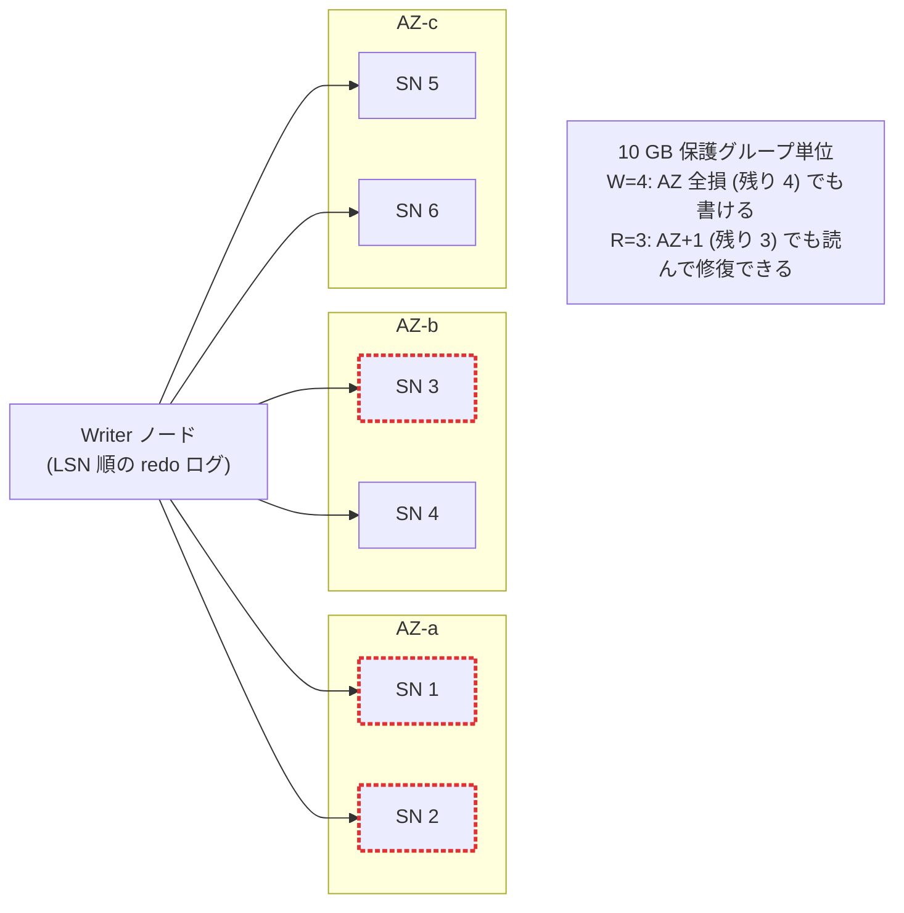

# クラウドデータベースの設計系譜 (Cloud-Native Databases: Aurora & DynamoDB)

## 概要 (Overview)

クラウド事業者が「データベースをサービスとして売る」とき、単機の DBMS をそのまま VM に載せる段階を超えると、2 つの根本的に異なる設計が現れる。**Aurora** は MySQL/PostgreSQL というリレーショナルの契約（SQL・トランザクション・既存アプリ互換）を守ったまま、ページの**下**のストレージ層を分散システムとして作り直した。標語は「**ログこそデータベース (the log is the database)**」である。**DynamoDB** はリレーショナルの契約そのものを手放し、「**どんな規模でも 1 桁ミリ秒**」という予測可能性を製品にした。標語は「**予測可能な性能こそ商品 (predictability is the product)**」である。

本ドキュメントの中心テーゼは、クラウドデータベースの設計とは **「何を約束し続けるか」の選択**だ、ということである。Aurora は互換性を約束したから、SQL 実行層は変えられず、革新はすべて redo ログとストレージの間に押し込まれた。DynamoDB は予測可能性を約束したから、リクエストあたりの仕事量が有界にならない操作（join・全表スキャン・アドホックな集計）を **API から排除**した。両者は同じ力（マルチテナントの経済と [`cloud-control-planes.md`](cloud-control-planes.md) の信頼性原則）に押されながら、正反対の層で答えた対照実験であり、「計算と記憶の分離 (compute-storage disaggregation)」という共通の構造がその下にある。一次資料は Aurora の SIGMOD '17/'18 論文、DynamoDB の ATC '22/'23 論文、および祖先である Dynamo の SOSP '07 論文。分析深度は Level 3。

## 方法論 (Methodology)

- ストレージエンジン (B-tree/LSM/WAL) の一般論は [`../databases/storage-engines.md`](../databases/storage-engines.md)、トランザクションと分離レベルは [`../databases/transactions-isolation.md`](../databases/transactions-isolation.md)、クォーラムと一貫性の語彙は [`../distributed-systems/`](../distributed-systems/) に依拠し、本書では再導出しない。
- 各設計を「守った契約 → そこから強制される機構」の順で読む。機構を珍しさで評価せず、**契約からの演繹**として評価する。
- 主たる根拠は査読付き論文 (SIGMOD/ATC/SOSP)。論文は当事者著者によるため一次資料でありつつ自社系の宣伝を含みうる。そのため性能値は「論文報告値」と明示し、設計判断の記述を主に用いる。現行製品の仕様は AWS 文書（ベンダー一次資料）で補い、アクセス日を付す。

## 発見事項 (Findings)

1. **クラウドで最初に破綻するのはネットワーク I/O の経済であり、Aurora の答えは「ログ以外を流さない」である。** MySQL を複製ネットワークストレージ上で動かすと、1 コミットあたり redo ログ・binlog・データページ・ダブルライトバッファ等が多重に流れ、さらにそれがミラー間で複製される。つまり書き込み増幅がネットワークで乗算される。Aurora はコンピュートノードから**redo ログレコードだけ**をストレージ層へ送り、ページの実体化 (materialization) はストレージノードが非同期に行う。ページとは「ログの適用結果のキャッシュ」にすぎない、という WAL の理論的含意（[`../databases/storage-engines.md`](../databases/storage-engines.md)）を、アーキテクチャの物理配置にまで昇格させた設計である。SIGMOD '17 の報告値では、ミラー版 MySQL 比で I/O トラフィックが桁で減る。

2. **Aurora のクォーラム (6 copies / 3 AZ, W=4, R=3) は「AZ+1 故障」から逆算されている。** 守りたいのは「1 AZ 全損 + 無関係な 1 ノード故障」の同時発生で (a) 書き込み可用性を失わない、(b) データを失わない、の 2 つ。3 AZ × 2 コピーの 6 レプリカで W=4 なら AZ 全損 (−2) 後も書け、R=3 なら AZ+1 (−3) 後も読んで修復できる。さらにボリュームを **10 GB のセグメント（保護グループ）** に刻み、故障の修復単位を小さくして MTTR を分単位へ圧縮する。[`../../foundations/mathematics/probability-statistics/reliability-theory.md`](../../foundations/mathematics/probability-statistics/reliability-theory.md) の語彙で言えば、「修復が終わる前に次が壊れる」確率を W/R ではなく **MTTR の短縮**で削る設計である。

3. **Aurora は読み取りクォーラムを日常経路から消し、合意を I/O 経路から追放した (SIGMOD '18)。** 素朴なクォーラム系は読みのたびに R 台へ問い合わせるが、Aurora のコンピュートノードは各セグメントの複製状態（どのストレージノードがどの LSN まで持つか）を追跡しており、**完全と分かっているレプリカ 1 台**から読む。書き込みも、グローバルな合意 (Paxos 級) をコミットごとに走らせるのではなく、単一ライターが振る LSN の全順序と、非同期 ack の水位線 (VDL: Volume Durable LSN) だけで一貫性を保つ。分散合意はストレージ構成の変更時、つまりコントロールプレーンにだけ残る。[`cloud-control-planes.md`](cloud-control-planes.md) の「データプレーンから制御系への同期依存を消す」原則が、DB 内部で再演されている。

4. **Aurora ではクラッシュリカバリが「常時実行中」になり、チェックポイントが消えた。** ARIES 型の再起動時 redo 再生（[`../databases/storage-engines.md`](../databases/storage-engines.md)）は、ストレージノードが**平時からログを継続適用している**ため不要になる。再起動時にやることは VDL の確定（どこまでが耐久か）だけで、リカバリ時間はログ量に比例しない。フォアグラウンドのチェックポイント I/O スパイクも消える。「リカバリは異常時の特別処理」という単機 DBMS の前提が、ログとページの分離によって「リカバリは定常状態」へ反転した。

5. **DynamoDB は Dynamo の子ではなく反省である。** SOSP '07 の Dynamo はリーダーレス・結果整合・アプリ側での競合解決 (vector clock) を特徴とする社内システムだったが、「結果整合の扱いとチューニングが開発者に重すぎる」という運用経験こそが製品版 DynamoDB の出発点になった (ATC '22 が明言する)。DynamoDB の複製は**リーダーベースの Multi-Paxos**（パーティションごとの複製グループ、[`../distributed-systems/consensus.md`](../distributed-systems/consensus.md)）であり、強一貫読み取りをオプションとして提供する。名前の連続性は機構の連続性ではない。むしろ「結果整合を製品の顔にした祖先」への訂正として読むべき系譜である。

6. **DynamoDB の予測可能性は API の制約から来る。つまり「クエリの最適化」ではなく「クエリの禁止」である。** 提供する操作は、キー指定の get/put/update と、単一パーティションキー内の範囲 query に実質限られ、**1 リクエストの仕事量が有界**になるよう言語が設計されている。join・アドホック集計・全表スキャンの排除により、リクエストは RCU/WCU という一様な通貨で事前計量でき、アドミッション制御（[`cloud-control-planes.md`](cloud-control-planes.md) 発見事項 7 の GAC）が成立する。任意 SQL を受ける限りリクエストコストは非有界であり、予測可能性は原理的に約束できない。スキーマ設計の負担（アクセスパターン駆動の非正規化）は、この約束の対価としてユーザ側に移転されたコストである。

7. **DynamoDB のメタデータ経路は「キャッシュの双峰性」を定常負荷化で解消した。これは constant work の実地例である。** リクエストルータはパーティション→ストレージノードの対応をローカルキャッシュしており、ヒット率 99.75% という数字は一見優秀だが、ルータの新規投入やキャッシュ失効時に**ミスの嵐がメタデータ層を直撃する双峰性 (bimodality)** を意味する。対策として導入された MemDS（全メタデータをメモリ複製する専用フリート）へは、**キャッシュにヒットしても**非同期で常に問い合わせる。こうしてメタデータ層への負荷をヒット率と無関係な定数にし、キャッシュ全損時の挙動を平時と同一にする (ATC '22)。[`cloud-control-planes.md`](cloud-control-planes.md) の一定作業パターンとメタステーブル障害回避が、1 つの実装判断に同時に現れた例である。

## アーキテクチャ (Architecture)

### Aurora — ログの 6 方向ファンアウトと記憶の分離

```
            SQL / トランザクション / バッファプール (MySQL 互換のまま)
           ┌───────────────────────────────┐   リードレプリカ (〜15台)
 Client ──▶│ Writer ノード                  │──▶ 同じ共有ボリュームを読む
           │  redo ログレコード生成 (LSN 順) │    (ログを受けてキャッシュ更新)
           └──────────────┬────────────────┘
                          │ redo ログ**だけ**を送る (ページは送らない)
        ┌────────┬────────┼────────┬────────┬────────┐
        ▼        ▼        ▼        ▼        ▼        ▼
      ┌────┐  ┌────┐   ┌────┐  ┌────┐   ┌────┐  ┌────┐
      │ SN │  │ SN │   │ SN │  │ SN │   │ SN │  │ SN │   6 レプリカ
      └────┘  └────┘   └────┘  └────┘   └────┘  └────┘   (10GB セグメント単位)
       AZ-a    AZ-a     AZ-b    AZ-b     AZ-c    AZ-c
        4/6 ack でコミット水位 (VDL) が前進。ストレージノード (SN) は
        ログ受領 → 欠落分をゴシップで補完 → ページを非同期実体化 → S3 へ継続バックアップ
```

### Aurora のクォーラム配置と AZ+1 故障

上図の 6 レプリカを故障ドメイン（AZ）ごとに束ね直すと、W=4 / R=3 が「AZ 全損 + 1 ノード」から逆算された値であることが読める（発見事項 2）。凡例: 赤枠は想定故障（AZ-a 全損 + AZ-b の 1 ノード）、矢印は redo ログの送信。



### DynamoDB — 有界リクエストとパーティション複製

```
 Client ─(署名付きリクエスト)─▶ ┌──────────────┐    ┌──────────┐
                               │ Request Router │──▶│  GAC     │ テーブル単位の
                               │  認可・計量     │    │ (token)  │ アドミッション制御
                               └───────┬────────┘    └──────────┘
                 パーティション位置の解決 │  ┌────────┐
                 (ヒットしても常時非同期照会)├─▶│ MemDS  │ メタデータ全量のメモリ複製
                                        ▼  └────────┘
                  ┌─ パーティション複製グループ (Multi-Paxos) ─────────┐
                  │  Leader storage node   [B-tree + WAL]   AZ-a     │
                  │  Follower storage node [B-tree + WAL]   AZ-b     │
                  │  Log replica           [WAL のみ]        AZ-c     │
                  └──────────────────────────────────────────────────┘
                    書き込み: リーダー経由で過半数へ複製 / 強一貫読み: リーダー
                    GSI へはログを非同期伝播 (結果整合)
```

## 技術詳細 (Technical Details)

### 1. Aurora の水位線機構 — LSN・VCL・VDL

単一ライターが全 redo レコードに LSN で全順序を与えるため、ストレージ側は「どこまで連続して持っているか」だけを管理すればよい。各ストレージノードは受領レコードを ack し、欠落はノード間ゴシップで埋める。コンピュートノードは 4/6 ack の完了点から **VCL (Volume Complete LSN)** を、その上でトランザクション境界に整合する **VDL (Volume Durable LSN)** を計算し、コミットは「自分のコミット LSN ≤ VDL になった時点」で非同期に応答される（グループコミットの分散版）。クラッシュ後は VCL より先のレコードを切り捨てて全ノードの状態を揃える。ここに Paxos 的な提案・投票は存在しない。**単一ライターによる順序付けが合意の代替**であり、その代償としてマルチライター化は困難な拡張になる (SIGMOD '18 はメンバーシップ変更もエポック番号と静止点で合意なしに行う設計を述べる)。

### 2. Aurora のセグメント修復と読み取り経路

10 GB セグメント × 6 レプリカが修復の単位である。ノード故障時は残存レプリカからセグメント単位で並列再複製され、ボリューム全体のコピーを待たない。修復時間を短くするほど「修復中に追加故障が重なる」窓が縮み、実効耐久性が上がる（[`../object-storage/object-storage-architecture.md`](../object-storage/object-storage-architecture.md) の修復増幅の議論と同じ算術）。読み取りは、コンピュートノードが保持する各レプリカの到達 LSN 記録に基づき、必要 LSN まで完全なレプリカを 1 台選んで行う。リードレプリカは同じ共有ボリュームを読むため、ストレージの複製とレプリカ台数が独立になる。その結果、「レプリカ追加 = データコピー」という単機複製の等式が成り立たなくなり、スケールアウトの限界費用が激減する。

### 3. DynamoDB のパーティション機構と容量制御の変遷

パーティションは B-tree + WAL を持つストレージノード 3 台（3 AZ）の Multi-Paxos 複製グループで、**ログレプリカ**（WAL のみ保持し B-tree を持たないメンバー）により、フルレプリカ修復中も低コストで耐久クォーラムを維持する。テーブルはキー範囲で自動分割され、スループット超過・サイズ超過で分割・移動される。容量制御の歴史は [`cloud-control-planes.md`](cloud-control-planes.md) で扱った通り静的等分割 → バースト許容 → 適応容量 → **GAC** と進み、ATC '22 はさらに「分割してもホットキーそのものは分割できない」ため、アクセス分布を見てキー単位で分離する分割ポリシーまで踏み込む。オンデマンドモードは「プロビジョニングの廃止」ではなく、この制御群の上に載った「事前申告なしの計量課金」である。

### 4. GSI とトランザクション (ATC '23)

- **GSI (Global Secondary Index)**: 別のパーティションキーで張り直したテーブルの実体であり、基表の WAL から非同期に伝播される（結果整合）。伝播はテーブル間の分散ログ配送そのもので、[`../messaging/distributed-logs-delivery-semantics.md`](../messaging/distributed-logs-delivery-semantics.md) の語彙（順序・再送・冪等）がそのまま適用される。GSI の書き込みが詰まると基表への逆圧として現れる。
- **トランザクション**: TransactWriteItems は**ワンショット**（対話型でない）に限定した 2 相コミットで、タイムスタンプ順序付けにより直列化可能性を与える。長時間ロックを持たない・デッドロックしない・平常運転の単発操作の性能に影響しないことが設計目標で、「トランザクションを使わない人にコストを払わせない」というマルチテナントの公平性が機構選択を決めている (ATC '23)。分離レベルの語彙は [`../databases/transactions-isolation.md`](../databases/transactions-isolation.md) を参照。ここでも対話型トランザクションの排除、すなわち**契約の制限が予測可能性の源泉**である。

### 5. 系譜の対比

| 軸 | Dynamo (SOSP '07) | DynamoDB (ATC '22) | Aurora (SIGMOD '17/'18) |
|---|---|---|---|
| 守る契約 | 常時書き込み可用性 | どんな規模でも 1 桁 ms（論文報告値） | MySQL/PostgreSQL 互換 |
| データモデル | KV | KV + ドキュメント, GSI | リレーショナル (SQL) |
| 複製 | リーダーレス, sloppy quorum | リーダーベース Multi-Paxos | 単一ライター + 6 way ログ複製 |
| 一貫性 | 結果整合 (vector clock) | 既定は結果整合・強一貫はオプション | 強一貫 (単一ライターの全順序) |
| スケール単位 | 仮想ノード (consistent hashing) | パーティション (自動分割) | セグメント (記憶) × レプリカ (計算) |
| 「難しさ」の置き場所 | アプリ (競合解決) | スキーマ設計 (アクセスパターン駆動) | ストレージ層 (互換性の裏側) |

三者は「難しさをどこへ移すか」の選択肢の網羅に近い。難しさは消えず、移動するだけである。

## セキュリティ考察 (Security Considerations)

- **認可の粒度が対照的である**: DynamoDB は全リクエストが [`cloud-iam-authorization.md`](cloud-iam-authorization.md) の SigV4 + IAM 評価を通るため、項目・属性レベルの条件 (`dynamodb:LeadingKeys` による行レベル制限) まで IAM の語彙で書ける。Aurora は接続確立後は DB 内の GRANT 体系であり、クラウド IAM は入口（接続・IAM 認証トークン）までを守る。「毎リクエスト認可」と「セッション認可」の差は、監査の分解能と資格情報漏えい時の被害範囲に直結する。
- **暗号化はストレージ分離の恩恵を受ける**: どちらも KMS のエンベロープ暗号化で保存時暗号化を行うが、Aurora の共有ストレージ・継続 S3 バックアップ、DynamoDB のテーブル単位鍵は、いずれも「記憶層が計算層と独立に暗号化・鍵ローテーションを管理できる」分離の帰結である。バックアップ・PITR (Point-in-Time Recovery) は可用性機能であると同時に、ランサムウェア・誤削除に対する復旧線でもある。
- **マルチテナントの隔離線が異なる**: DynamoDB は共有フリート上のマルチテナントであり、隔離はアドミッション制御と暗号化が担い、noisy neighbor 対策 (GAC・分割) はそのまま可用性面のテナント隔離である。Aurora はコンピュートが専有インスタンス、ストレージが共有フリートという混成で、テナント境界の議論は層ごとに分かれる。
- **API 面積の差**: SQL を受ける Aurora は SQL インジェクション・権限昇格 (DB 内 GRANT の誤設定) という古典的攻撃面を保持する。DynamoDB の狭い API は攻撃面も狭い。契約の制限は性能だけでなくセキュリティの予測可能性も買っている。ただし NoSQL 側にも式インジェクション (条件式へのユーザ入力連結) は存在し、「狭い API = 安全」ではない。

## 結論 (Conclusions)

- クラウドデータベースの設計は「何を約束し続けるか」で決まる。互換性を約束した Aurora は革新をページの下へ、予測可能性を約束した DynamoDB は制約を API の形へ押し込んだ。機構の差はすべてこの選択からの演繹であり、「どちらが進んでいるか」という問いは成立しない。
- 「ログこそデータベース」は WAL の理論的地位（ページはログの実体化キャッシュ）を物理配置に昇格させたものであり、計算と記憶の分離・修復単位の細分化・リカバリの定常化はその系である。この構造は以後のクラウド DB（分散 SQL への展開を含む）の共通語彙になった。系譜の現在形としては、合意ベースの分散 SQL へ同じ分離を持ち込む Aurora DSQL 系の設計が続いている（ベンダー提示, 2026-07-30 時点）。
- DynamoDB の教訓は「スケールの敵は機構ではなく非有界性」だということ。リクエストコストの有界化・メタデータ負荷の定常化・ワンショット限定のトランザクションは、すべて「最悪ケースを入力から追放する」操作であり、[`cloud-control-planes.md`](cloud-control-planes.md) の相関破壊と並ぶ、クラウド設計のもう一つの通奏低音である。
- 利用者側の選択基準も契約で立てるのがよい：既存 SQL 資産と柔軟なクエリが要るなら Aurora 側、アクセスパターンが固定できて規模・レイテンシの予測可能性が最優先なら DynamoDB 側となる。これは「難しさの置き場所」を自分のチームのどこに引き受けるかという問いである。

### 次の接続先 (Related Topics)

- [`../databases/storage-engines.md`](../databases/storage-engines.md) — WAL・B-tree・ARIES という本書の前提語彙。Aurora が「昇格」させた当のもの。
- [`../databases/transactions-isolation.md`](../databases/transactions-isolation.md) — 分離レベルの語彙。DynamoDB トランザクションの直列化可能性の位置づけ。
- [`../distributed-systems/consensus.md`](../distributed-systems/consensus.md) — Multi-Paxos 複製グループと「合意を避ける」設計の対比軸。
- [`cloud-control-planes.md`](cloud-control-planes.md) — GAC・constant work・メタステーブル回避という本書の制御面の一般論。
- [`cloud-block-storage.md`](cloud-block-storage.md) — さらに一層下、ブロックデバイスとしての計算と記憶の分離。

## 参考文献 (References)

**一次資料 (Primary — 査読付き論文)**

- Verbitski, A., Gupta, A., Saha, D., et al. (2017). Amazon Aurora: Design Considerations for High Throughput Cloud-Native Relational Databases. *SIGMOD '17*, 1041–1052. DOI: 10.1145/3035918.3056101 — ログ複製・6/4/3 クォーラム・セグメント設計の一次記述。
- Verbitski, A., Gupta, A., Saha, D., et al. (2018). Amazon Aurora: On Avoiding Distributed Consensus for I/Os, Commits, and Membership Changes. *SIGMOD '18*, 789–796. DOI: 10.1145/3183713.3196937 — VDL 水位線・読みクォーラム回避・エポックによる構成変更。
- Elhemali, M., Gallagher, N., Gordon, N., et al. (2022). Amazon DynamoDB: A Scalable, Predictably Performant, and Fully Managed NoSQL Database Service. *USENIX ATC '22*. — 複製・GAC・MemDS・分割ポリシー・Dynamo からの訣別の一次記述。
- Idziorek, J., Keyes, A., Lazier, C., et al. (2023). Distributed Transactions at Scale in Amazon DynamoDB. *USENIX ATC '23*. — ワンショット 2 相 + タイムスタンプ順序付けの設計。
- DeCandia, G., Hastorun, D., Jampani, M., et al. (2007). Dynamo: Amazon's Highly Available Key-value Store. *SOSP '07*, 205–220. DOI: 10.1145/1294261.1294281 — 祖先システム。リーダーレス・結果整合側の原典。

**ベンダー一次資料 (Vendor — 現行仕様の規範記述)**

- AWS 文書: *Amazon Aurora storage and reliability*; *DynamoDB read/write capacity, DynamoDB transactions*. [docs.aws.amazon.com](https://docs.aws.amazon.com/AmazonRDS/latest/AuroraUserGuide/Aurora.Overview.StorageReliability.html) — Accessed: 2026-07-30。
