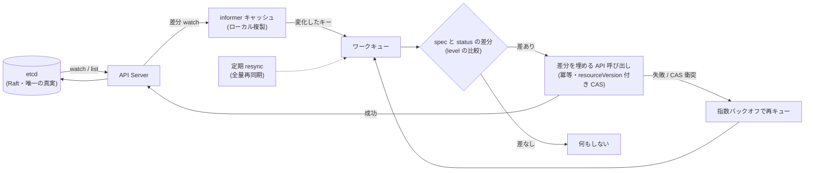

# コンテナオーケストレーション (Container Orchestration: Kubernetes, Reconciliation & EKS)

## 概要 (Overview)

**Kubernetes** は「コンテナを並べる道具」として説明されがちだが、その本体はコンテナともスケジューリングともあまり関係がない。本体は、**宣言された望ましい状態 (desired state) と観測された現在状態 (observed state) の差分を、独立した調停ループ (reconciliation loop) の群れが埋め続ける**という汎用の制御機械である。コンテナの起動は、この機械が調停する対象の一つにすぎない。同じ機械が、ロードバランサの設定も、証明書の発行も、データベースのフェイルオーバーさえも (Operator として) 調停する。Google の内部システム Borg の 10 年の運用経験 (EuroSys '15) から抽出された設計であり、系譜は Borg → Omega → Kubernetes と公開文献で追える (CACM 2016)。

本ドキュメントの中心テーゼは 2 つ。(1) Kubernetes は [`cloud-control-planes.md`](cloud-control-planes.md) で扱った原則群 (望ましい状態と調停、コントロール/データプレーン分離、静的安定性) の**最も普及したオープン実装**であり、あのドキュメントの一般論はこの 1 システムの中で全部観察できる。(2) その調停機械は **etcd という単一の強一貫ストアの周りに、互いを直接知らないコントローラ群が楽観並行制御だけで協調する**という振り付けなし (choreography) の設計であり、堅牢性 (どの部品が停止しても再起動すれば収束する) と引き換えに、因果の追いにくさという運用コストを払っている。EKS (Elastic Kubernetes Service) はこの機械を AWS の設計原則 (マルチ AZ、マネージドコントロールプレーン、IAM 統合) の上へ載せ直した製品として、両者の接合部を読む。分析深度は Level 3。

## 方法論 (Methodology)

- Kubernetes を「機能の集合」ではなく **API 機械 (API machinery) + 調停パターン**という 2 つの原理に還元し、個々の機能 (Deployment, HPA, …) はその原理の適用例として扱う。
- コンテナの隔離機構 (namespace/cgroup) は [`../virtualization/hardware-virtualization-containers.md`](../virtualization/hardware-virtualization-containers.md)、合意 (Raft/etcd) は [`../distributed-systems/consensus.md`](../distributed-systems/consensus.md)、ネットワーク配管は [`../networking/`](../networking/) に委ね、本書はオーケストレーション層に固有の機構へ集中する。
- 一次資料は Borg/Omega/Kubernetes の系譜論文 (EuroSys '15, CACM 2016) と Kubernetes 公式仕様文書 (API conventions)。EKS 固有の記述は AWS 文書(ベンダー一次資料)に依り、明示する。

## 発見事項 (Findings)

1. **Kubernetes の単位操作は「コマンドの実行」ではなく「望ましい状態の記録」である。** `kubectl` も CI/CD も、やることは API サーバへのオブジェクト (YAML の実体) の書き込みだけで、その時点では何も起きていない。実際の仕事は、そのオブジェクトを watch していたコントローラが**非同期に**差分を検出して行う。命令型 API (「コンテナを 3 つ起動せよ」) と違い、宣言型 (「レプリカ数 3 という状態が真であれ」) は**再試行・再起動・順序乱れに対して自然に冪等**であり、障害からの回復と平時の運用が同じコード経路になる。これは [`cloud-control-planes.md`](cloud-control-planes.md) の「一定作業」原則の状態管理版である。

2. **正しさの根拠はイベントではなく水位 (level) にある。** コントローラはイベント (edge) を取りこぼしてもおかしくならない。判断基準が常に「現在状態と望ましい状態の**差**」(level) だからであり、watch 通知は「差を早く見つけるための最適化」にすぎない。全コントローラは定期的な全量再同期 (resync) を持ち、見逃した変化は次の周期で必ず拾われる。イベント駆動系の典型的な破綻 (通知の欠落・重複・順序逆転が状態をおかしくすること) が原理的に起きない。この **level-triggered reconciliation** こそ Kubernetes の self-healing の実体であり、「Pod が死んだら再作成される」のは誰かが死亡イベントに反応したからではなく、「レプリカ数が宣言より少ない」という水位差が観測されたからである。

3. **コントローラ群は互いを知らず、etcd を介してのみ協調する。楽観並行制御による振り付けなし設計である。** Deployment コントローラは ReplicaSet を書き、ReplicaSet コントローラは Pod を書き、スケジューラは Pod の nodeName を書き、kubelet はそれを見て起動する。この 4 者は互いを呼び出さず、存在すら知らない。共有するのは API サーバ (背後の etcd) だけで、衝突は `resourceVersion` による**楽観並行制御** (書き込み時に「読んだ時の版か」を検査し、負けたら読み直して再試行) で解決される。中央の指揮者 (orchestrator の語に反して) は存在しない。部品の追加・交換が容易で部分故障に強い一方、「なぜこの Pod がこうなったか」の因果はログを横断しないと再構成できない。これが振り付けなし協調の古典的な代償である。

4. **etcd は Kubernetes 唯一の状態であり、クラスタの規模限界は計算ではなく「watch のファンアウト」で決まる。** etcd は Raft ([`../distributed-systems/consensus.md`](../distributed-systems/consensus.md)) による強一貫ストアで、全オブジェクトの唯一の真実を持つ。API サーバは etcd の前段キャッシュ + 認可 + 検証層である。スケール限界を決めるのは Pod 数そのものより、**1 つの書き込みが何本の watch ストリームへ配信されるか**と、大量 LIST (全 Pod 一覧の反復取得) の負荷であり、クライアント側の informer キャッシュ (ローカル複製 + 差分 watch) はこの負荷を「初回 1 回の LIST + 以後は差分」へ抑えるための必須機構である。「全部品が 1 つの合意ストアを見る」設計は一貫性の議論を一箇所に集約する代わりに、そのストアの容量・レイテンシがクラスタ全体の天井になる。

5. **スケジューラは最適化器ではなく「述語と得点のパイプライン」であり、厳密な最適化を意図的に放棄している。** 配置は、実行可能性の絞り込み (資源量・affinity/anti-affinity・taint/toleration・topology spread による filter) と、残った候補の採点 (score) の 2 段で決まり、大域最適の bin packing は解かない (NP 困難であり、かつ次の Pod が来れば前提が変わる)。「十分よい配置を高速に、逐次に」という設計は、[`serverless-faas-internals.md`](serverless-faas-internals.md) の FaaS 配置と同じ判断であり、表現力 (制約の種類) を増やすほど配置計算とユーザの認知負荷が増える。taint と affinity の組合せ爆発は Kubernetes 運用の実際の難所である。

6. **ノード側も同じ調停であり、CRI/CNI/CSI というプラグイン境界がクラウドへの配管点になる。** kubelet は「このノードにあるべき Pod 集合」と実状態を調停するローカルループで、コンテナ実行は CRI (containerd)、ネットワークは CNI、ストレージは CSI へ委譲される。EKS ではこの境界がそのまま AWS 接合点になる：**VPC CNI** は Pod に VPC の IP (ENI のセカンダリ IP) を直接与え、オーバーレイの上にオーバーレイを重ねる二重の税 ([`../networking/virtual-networks-overlay.md`](../networking/virtual-networks-overlay.md)) を回避する。**EBS CSI** はボリュームの attach/detach を調停ループ化する ([`cloud-block-storage.md`](cloud-block-storage.md) の「attach はデータアクセス」がそのまま権限設計に影響する)。インスタンスタイプごとの ENI/IP 数上限が「ノードに載る Pod 数」を決めるという、ハードウェア由来の制約がスケジューリングまで貫通する点が象徴的である (ベンダー仕様)。

7. **EKS は「Kubernetes のコントロールプレーン運用」を製品化したものであり、K8s 自身が cloud-control-planes の適用対象になる。** マネージドコントロールプレーン (API サーバ + etcd) はクラスタごとに隔離され、複数 AZ に複製される (ベンダー提示)。ワーカーノードはデータプレーンであり、**API サーバが停止しても実行中の Pod は走り続ける**。kubelet は最後の既知状態で自立動作する (静的安定性そのもの)。逆に言えば、アプリの経路上に API サーバ呼び出しを置く設計 (起動時に ConfigMap を同期取得する等) は、この静的安定性を自ら破る。オートスケーリングは調停ループの再帰合成である。HPA がレプリカ数を書き、それで Pod が溢れると Cluster Autoscaler / Karpenter がノードを書く。このようなフィードバックループの合成には発振 (スケールのばたつき) という制御工学的リスクが伴う。Karpenter はノードグループという中間抽象を外し、保留 Pod の要求から直接インスタンスタイプを選んで起動する「グループレス」設計で bin packing の自由度を回復した (ベンダー/OSS 文書)。

## アーキテクチャ (Architecture)

### 調停の連鎖 — 1 つの Deployment が Pod になるまで

```
        kubectl apply (望ましい状態の記録のみ・ここでは何も起きない)
              │
              ▼
 ┌─ Control Plane (EKS: マネージド, マルチ AZ) ──────────────────────┐
 │   API Server ──── etcd (Raft, 唯一の真実)                        │
 │      ▲ ▲ ▲   watch/list + 楽観並行制御 (resourceVersion)         │
 │      │ │ │                                                      │
 │      │ │ └── Deployment controller: 「RS が無い」→ ReplicaSet 作成 │
 │      │ └──── ReplicaSet controller: 「Pod が 3 未満」→ Pod 作成    │
 │      └────── Scheduler: 「nodeName が空」→ filter/score → 割当     │
 └──────────────────────────────────────────────────────────────────┘
        watch (nodeName == 自分のノード)
              │
              ▼
 ┌─ Data Plane (ワーカーノード群) ────────────────────────────────────┐
 │  kubelet (ローカル調停ループ)                                      │
 │    ├─ CRI → containerd → コンテナ (namespace/cgroup)              │
 │    ├─ CNI → VPC CNI: ENI セカンダリ IP を Pod へ (EKS)            │
 │    └─ CSI → EBS attach/detach (EKS)                              │
 │  ※ API サーバ停止時も実行中 Pod は継続 (静的安定性)                 │
 └───────────────────────────────────────────────────────────────────┘

 各矢印は「呼び出し」ではなく「etcd 上の状態を見て動く」。部品間の直接通信はない。
```

### コントローラ 1 つの調停ループ

上の連鎖を構成する各コントローラは、同じ標準形のループを回している（技術詳細の「標準形」に対応）。watch 通知は差分を早く見つけるための最適化にすぎず、定期的な resync が取りこぼしを拾うので、正しさは水位差 (level) の比較だけに依存する。



### 抽象度のスペクトル — どこまでを機械に任せるか

| | EC2 直 | EKS + ノード管理 | EKS Fargate | Lambda |
|---|---|---|---|---|
| ユーザが宣言する単位 | インスタンス | Pod + ノードプール | Pod | 関数 |
| 容量管理 | ユーザ | 調停ループ (CA/Karpenter) | プラットフォーム | プラットフォーム |
| 課金の粒度 | インスタンス時間 | インスタンス時間 | Pod 時間 | リクエスト実行 ms |
| 隔離の実体 | VM | ノード内はコンテナ | Pod ごと microVM | サンドボックスごと microVM |

右へ行くほど [`serverless-faas-internals.md`](serverless-faas-internals.md) の世界に近づき、Fargate は「Pod を宣言単位のまま、テナント境界をハードウェア仮想化へ」という中間解である ([`../virtualization/hardware-virtualization-containers.md`](../virtualization/hardware-virtualization-containers.md) の「コンテナ in VM」の帰結)。

## 技術詳細 (Technical Details)

### 1. API 機械 — spec/status と楽観並行制御

すべてのオブジェクトは `spec` (望ましい状態、ユーザが書く) と `status` (観測状態、コントローラが書く) を持ち、この分離が「誰が何を書いてよいか」の規約になる。書き込みは `resourceVersion` (etcd のリビジョン) 付き compare-and-swap であり、二人のコントローラが同じオブジェクトを更新しても後勝ちの上書き (lost update) にならず、負けた側が読み直して再調停する。ロックは存在せず、衝突は「再試行が安い」前提で楽観的に処理される ([`../concurrency/lock-free-data-structures.md`](../concurrency/lock-free-data-structures.md) の CAS リトライループと同型の判断が、分散状態管理の粒度で反復されている)。watch は etcd のリビジョン順の差分ストリームで、informer はこれをローカルキャッシュ + ワークキューへ変換する。コントローラ作者が触るのは「キューから取り出したキーを調停する冪等関数」だけ、という開発モデルまで含めてパターン化されている。

### 2. 調停ループの解剖と失敗の作法

標準形は「(1) キーを取り出す → (2) 現在状態を informer キャッシュから読む → (3) 望ましい状態との差分を計算 → (4) 差分を埋める API 呼び出し (冪等) → (5) 失敗したら指数バックオフ付きで再キュー」。重要な規律が 3 つ。**冪等性**: 同じキーを何度調停しても結果が同じであること (二重実行は正常系である)。**バックオフ**: 失敗の高速リトライはコントロールプレーンへの自己 DoS になる ([`cloud-control-planes.md`](cloud-control-planes.md) のリトライ増幅がクラスタ内で再現する)。**status への正直な記録**: 収束できない理由 (イベント・condition) を status に書き、人間の介入点を作る。Operator パターンとは、この標準形をデータベースのフェイルオーバーやバックアップといったドメイン固有の運用知識へ適用したものであり、「運用手順書をコントローラに焼き込む」という表現が実体に近い。

### 3. スケジューリングパイプラインとプリエンプション

filter 段は述語の連言 (資源要求・nodeSelector・affinity/anti-affinity・taint/toleration・topology spread constraint) で候補ノードを絞り、score 段が重み付き合算で選ぶ。どのノードも通らない Pod は Pending に落ち、優先度 (PriorityClass) が高ければ低優先 Pod の**プリエンプション** (退去) が試みられる。このとき PodDisruptionBudget (同時に落としてよい数の宣言) が退去の安全弁になる。この一式は [`../operating-systems/process-thread-scheduling.md`](../operating-systems/process-thread-scheduling.md) の単機スケジューラと対照的で、ミリ秒粒度の時分割ではなく「配置の決定を一度だけ、ただし制約は豊かに」という設計点にいる。バッチ系 (ギャングスケジューリングが要る ML ジョブ, [`../ai/ml-training-systems.md`](../ai/ml-training-systems.md)) には素の逐次配置が合わず、専用スケジューラプラグインが並立するのはこの設計点の帰結である。

### 4. EKS の接合部 — IAM・VPC・ノード供給

- **認証の接合 (IRSA)**: Pod の ServiceAccount に IAM ロールを対応づける仕組みは、クラスタの OIDC 発行者が署名した ServiceAccount トークンを STS が検証して一時クレデンシャルに交換する。これは [`cloud-iam-authorization.md`](cloud-iam-authorization.md) の OIDC フェデレーションそのものであり、「ノードのロールを全 Pod が共有する」という粗い境界を Pod 単位の最小権限へ細分化する。
- **ネットワークの接合**: VPC CNI は Pod をオーバーレイなしで VPC の一級市民にする。Pod 密度がインスタンスの ENI/IP 上限に縛られる代わりに、セキュリティグループ・フローログ・ルーティングという VPC の道具立て ([`../networking/virtual-networks-overlay.md`](../networking/virtual-networks-overlay.md)) がそのまま Pod に適用される。プレフィックス委任 (ENI に /28 を割る) は密度制限の緩和策である (ベンダー仕様)。
- **ノード供給**: Cluster Autoscaler は「ノードグループの希望台数」を調停する (グループ内は同型インスタンス)。Karpenter は保留 Pod の資源要求・アーキテクチャ・可用域制約から**インスタンスタイプの選択ごと**行う。スポットインスタンスの中断 (2 分前通知) への対応や、詰め直しによる統合 (consolidation) まで調停ループに含めており、容量経済 ([`README.md`](README.md) のスポット市場テーマ) との接点になっている。

### 5. 運用上の失敗モード

- **etcd の限界**: オブジェクト総量 (既定クォータは GB 級)・書き込みレート・大きすぎるオブジェクト (ConfigMap への巨大データ格納) がクラスタ全体を劣化させる。コンパクションとデフラグは運用必須であり、EKS はこれを隠蔽するが免除はしない (クォータは残る)。
- **LIST の嵐**: informer を使わないクライアント (雑な cron、素朴な運用スクリプト) が全量 LIST を反復すると API サーバのメモリを焼く。API Priority and Fairness (フロー単位の流量制御) は [`cloud-control-planes.md`](cloud-control-planes.md) のアドミッション制御のクラスタ内実装である。
- **ばたつき (thrashing)**: HPA のメトリクス遅延 × Cluster Autoscaler のノード起動遅延の合成は、スケールアウト/インの発振を生みうる。安定化ウィンドウ・クールダウンは制御ループのダンピングであり、「二重のフィードバックループを合成したら位相余裕を確認する」という制御工学の常識がそのまま適用される。
- **ノード分断**: ノードが API サーバから見えなくなったとき、Pod を別ノードへ「移す」判断は本質的に危険である。ノードが停止したのか、見えないだけなのかを区別できないからである ([`../distributed-systems/consensus.md`](../distributed-systems/consensus.md) の故障検出の非決定性)。eviction のタイマーと、ステートフルワークロードでの fencing (同一ボリュームの二重 attach 防止, [`cloud-block-storage.md`](cloud-block-storage.md)) が保守側の答えになる。

## セキュリティ考察 (Security Considerations)

- **namespace はテナント境界ではない。** RBAC + namespace の分離は「同一組織内の誤り防止」には十分だが、共有カーネル上のコンテナである以上、相互不信テナント間の境界にはならない ([`../virtualization/hardware-virtualization-containers.md`](../virtualization/hardware-virtualization-containers.md) の帰結)。マルチテナント SaaS を K8s で作るなら、テナント境界にはノード分離 (専有ノードプール) か microVM (Fargate/Kata) を置くのが定石であり、「namespace で分けたからマルチテナント対応」という設計は境界の等級を取り違えている。
- **API サーバとコントローラの権限が最重要資産である。** API サーバへの管理者アクセスはクラスタ上の全ワークロードの掌握を意味し、さらに IRSA/ノードロール経由でクラウド側権限へ波及する。admission webhook (検証・変更) は全書き込みへの介入点であり、防御の要 (Pod Security Standards の強制、イメージ署名検証) であると同時に、侵害されれば万能の改竄点になる。webhook 自体の供給元は [`../security/software-supply-chain-security.md`](../security/software-supply-chain-security.md) の審査対象である。
- **Secret は既定では「base64 された平文」に近い。** etcd 内の Secret は保存時暗号化 (KMS プロバイダ) を有効化して初めて鍵管理と分離され、EKS では KMS エンベロープ暗号化が選べる (ベンダー仕様)。加えて「Secret を読める RBAC 主体の列挙」が実効的な機密境界であり、暗号化は RBAC 誤設定を救わない。
- **ノードの資格情報は横移動の踏み台になる。** kubelet のクレデンシャルや (IRSA 以前の) ノード IAM ロールは、1 コンテナの侵害をノード上全 Pod・さらにクラウド API へ広げうる。IMDS へのアクセス制限 (ホップ制限, [`cloud-iam-authorization.md`](cloud-iam-authorization.md)) と Pod 単位ロールへの移行は、この横移動経路の遮断である。

## 結論 (Conclusions)

- Kubernetes の本質は「宣言された状態へ収束し続ける汎用調停機械」であり、コンテナはその最初の適用対象にすぎない。CRD + Operator により任意のドメインへ拡張された現在、Kubernetes は「プラットフォームを作るためのプラットフォーム」として読むのが実態に合う。
- 堅牢性の源泉は 3 点に還元できる：level-triggered (取りこぼしが自己修復する)、楽観並行制御 (指揮者なしで衝突が解ける)、静的安定性 (コントロールプレーン停止がデータプレーンを止めない)。いずれも [`cloud-control-planes.md`](cloud-control-planes.md) の一般原則の実装であり、クラウド設計の語彙を 1 つのオープン実装で検証できる稀有な教材である。
- 代償も同じ根から生える：因果の追いにくさ (振り付けなし協調)、etcd という単一の天井、制約表現の組合せ爆発、フィードバックループ合成の発振。Kubernetes の運用の難しさは実装品質の問題ではなく、この設計点の**税**である。
- EKS の視点では、Kubernetes は「AWS の上にもう一段のクラウドを作る」行為であり、接合部 (IRSA・VPC CNI・CSI・Karpenter) はすべて「K8s の抽象と AWS の抽象のどちらを一級にするか」という選択である。抽象度スペクトル (EC2 → EKS → Fargate → Lambda) のどこに立つかは、[`cloud-databases-aurora-dynamodb.md`](cloud-databases-aurora-dynamodb.md) と同じく「難しさをどこへ置くか」の選択であり、万能の答えは存在しない。

### 次の接続先 (Related Topics)

- [`cloud-control-planes.md`](cloud-control-planes.md) — 本書の設計原則の一般論 (望ましい状態・静的安定性・アドミッション制御)。
- [`../virtualization/hardware-virtualization-containers.md`](../virtualization/hardware-virtualization-containers.md) — コンテナの隔離実体と「テナント境界には microVM」の根拠。
- [`../distributed-systems/consensus.md`](../distributed-systems/consensus.md) — etcd/Raft と故障検出の非決定性。
- [`../networking/service-mesh.md`](../networking/service-mesh.md) — Pod 間通信の上に載るもう一段の制御平面。
- [`serverless-faas-internals.md`](serverless-faas-internals.md) — 抽象度スペクトルの対極。配置・在庫・スケーリングの同型問題。

## 参考文献 (References)

**一次資料 (Primary — 論文・仕様)**

- Verma, A., Pedrosa, L., Korupolu, M., Oppenheimer, D., Tune, E., & Wilkes, J. (2015). Large-scale cluster management at Google with Borg. *EuroSys '15*. DOI: 10.1145/2741948.2741964 — 祖先システムの運用知見 (利用率・隔離・ジョブ混載)。
- Burns, B., Grant, B., Oppenheimer, D., Brewer, E., & Wilkes, J. (2016). Borg, Omega, and Kubernetes. *Communications of the ACM*, 59(5), 50–57. DOI: 10.1145/2890784 — 三世代の設計比較。宣言的 API と調停への収束の理由。
- Schwarzkopf, M., Konwinski, A., Abd-El-Malek, M., & Wilkes, J. (2013). Omega: flexible, scalable schedulers for large compute clusters. *EuroSys '13*. DOI: 10.1145/2465351.2465386 — 楽観並行制御による共有状態スケジューリングの原型。
- Kubernetes 公式文書: *API Conventions*; *Controllers*; *Scheduling Framework*. [kubernetes.io/docs/](https://kubernetes.io/docs/concepts/architecture/controller/) — Accessed: 2026-07-30。spec/status・調停・スケジューリング段の規範記述。
- Ongaro, D., & Ousterhout, J. (2014). In Search of an Understandable Consensus Algorithm (Raft). *USENIX ATC '14*. — etcd の合意基盤 (詳細は [`../distributed-systems/consensus.md`](../distributed-systems/consensus.md))。

**ベンダー提示 (Vendor-presented)**

- AWS 文書: *Amazon EKS Best Practices Guide*; *Amazon VPC CNI*; *EKS control plane architecture*. [docs.aws.amazon.com/eks/](https://docs.aws.amazon.com/eks/latest/best-practices/introduction.html) — Accessed: 2026-07-30。マネージドコントロールプレーン構成・ENI/IP 上限・IRSA。
- Karpenter 公式文書. [karpenter.sh/docs/](https://karpenter.sh/docs/) — Accessed: 2026-07-30。グループレスなノード供給と consolidation。
