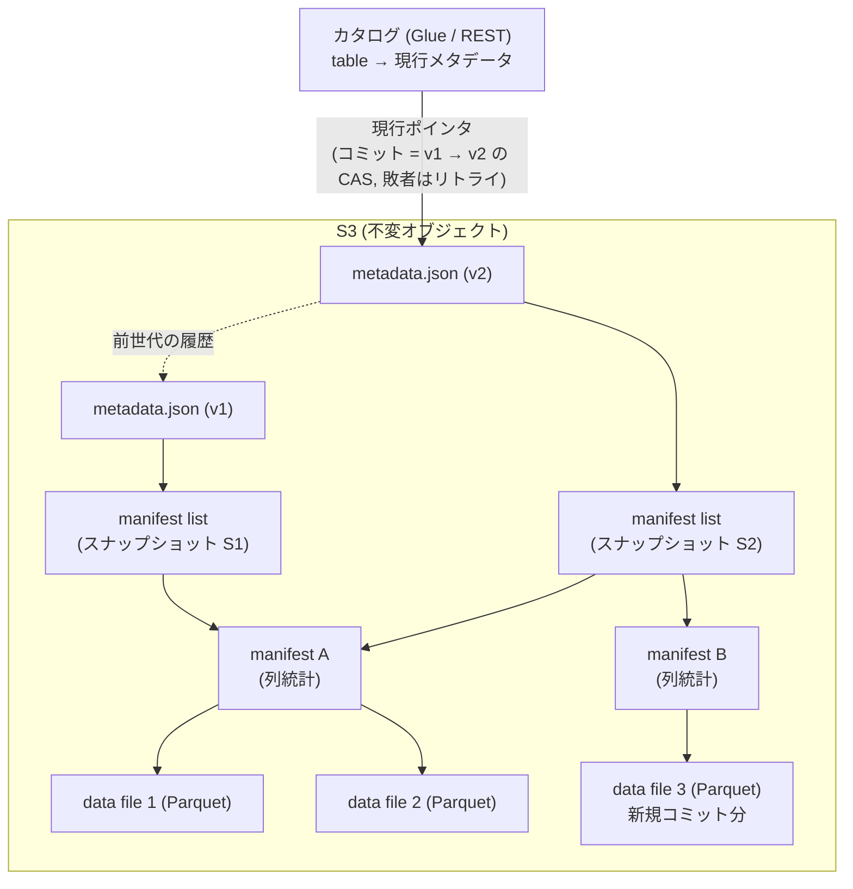

# データレイクハウスと分析基盤 (Data Lakehouse: Columnar Formats, Table Formats & Disaggregated Query)

## 概要 (Overview)

分析基盤の歴史は、二つの極の間の弁証法である。**データウェアハウス (DWH)** は統合されたスキーマ・ACID・高速なクエリを提供したが、高価でスキーマ先行 (schema-on-write) の硬直を持つ。**データレイク**はオブジェクトストレージ ([`../object-storage/object-storage-architecture.md`](../object-storage/object-storage-architecture.md)) に生データを安価に溜める自由を与えたが、その代償として一貫性もスキーマ管理も失い、「データの沼」と揶揄された。**レイクハウス (lakehouse)** はこの綜合である。S3 型ストレージの上に、**開かれた列指向ファイル形式 (Parquet)**、**開かれたテーブル形式 (Apache Iceberg / Delta Lake)**、そして**使い捨ての分離されたクエリエンジン群 (Athena/Trino, Spark, Redshift Spectrum)** を積み、「ストレージは一つ、エンジンは多数」を成立させる (CIDR '21)。

本ドキュメントの中心テーゼは 2 つ。(1) レイクハウスとは、[`cloud-databases-aurora-dynamodb.md`](cloud-databases-aurora-dynamodb.md) で見た**計算と記憶の分離**の分析版である。ただし分離の主目的が異なり、OLTP では弾力性のための分離だったものが、分析では「**同じデータに複数のエンジンを選べる**」ためのオープンな分離になる。(2) テーブル形式 (Iceberg 等) の本体は、**オブジェクトストレージが意図的に捨てたもの (原子性・rename・一覧の一貫性) をメタデータ層で買い戻す機構**である。オブジェクトストレージ編の「貧しい API」の帰結が分析ワークロードでどう痛み、メタデータの木とポインタの原子的差し替え (これは [`../databases/storage-engines.md`](../databases/storage-engines.md) の copy-on-write と同型) がそれをどう解くかを機構から追う。分析深度は Level 3。

## 方法論 (Methodology)

- 行指向/列指向・LSM・MVCC といったストレージエンジンの語彙は [`../databases/storage-engines.md`](../databases/storage-engines.md) / [`transactions-isolation.md`](../databases/transactions-isolation.md) から借用し、レイクハウスの機構を「同じ問題がオブジェクトストレージという制約下でどう再解決されたか」として読む。
- 一次資料は列指向の古典 (C-Store VLDB '05)、ネスト列形式の原典 (Dremel VLDB '10)、計算と記憶の分離 DWH (Snowflake SIGMOD '16)、テーブル形式 (Delta Lake VLDB '20)、レイクハウス論 (CIDR '21)、および Apache Iceberg の公式仕様 (オープン仕様であり、ベンダー中立の一次資料)。AWS 製品への対応付けはベンダー文書に依り、明示する。
- ストリーミング取り込みの意味論 (exactly-once・ウィンドウ) は [`../messaging/distributed-logs-delivery-semantics.md`](../messaging/distributed-logs-delivery-semantics.md) に委ねる。

## 発見事項 (Findings)

1. **列指向は分析の物理学である。スキャンする物理量を桁で減らす。** OLTP は「1 行の全列」を読む (行指向が最適) が、分析クエリは「全行の少数列」を読む。列ごとに連続配置すれば、(a) 必要な列だけを読める (列刈り)、(b) 同型データの連続は圧縮が桁違いに有効になる (辞書・RLE・delta 符号化)、(c) 稠密な数値列は SIMD ([`../../hardware/cpu/simd-vector.md`](../../hardware/cpu/simd-vector.md)) に直結する。C-Store (VLDB '05) がこの転換を体系化し、Parquet は Dremel (VLDB '10) のネスト構造符号化 (repetition/definition levels) を加えてオープン形式として標準化した。行/列の選択は「どの軸でデータを連続にするか」というレイアウトの決定であり、B-tree/LSM ([`../databases/storage-engines.md`](../databases/storage-engines.md)) に並ぶ第三の基本形である。

2. **Parquet ファイルは「ミニ索引を内蔵した不変の断片」であり、クエリ高速化の実体は読まない技術である。** ファイルは row group (行の塊) × column chunk (列) に割られ、各チャンクが min/max・null 数などの統計を持つ。エンジンは述語 (`WHERE date = '2026-07-01'`) を統計と突き合わせ、**範囲外の row group を読まずに飛ばす** (述語プッシュダウン・スキャン刈り)。パーティション (ディレクトリ分割) → ファイル統計 → row group 統計 → ページ統計という多段の刈り込みはすべて同じ原理、つまり「読む前に除外できる構造を書き込み時に仕込む」ことであり、[`../search/inverted-index-fulltext-search.md`](../search/inverted-index-fulltext-search.md) の枝刈りと同じ思想がスキャン系に現れたものである。ソート順 (クラスタリング) がこの刈り込みの効果を決めるため、「どの列で並べて書くか」が分析基盤の最重要チューニングになる。

3. **「ディレクトリはテーブルではない」。素のオブジェクトストアは分析のトランザクション要求と衝突する。** Hive 形式 (パス規約 `dt=2026-07-01/` によるパーティション) の実体はただのオブジェクト集合であり、(a) 複数ファイルの追加・削除に原子性がない (途中状態が読者に見える)、(b) rename がない ([`../object-storage/object-storage-architecture.md`](../object-storage/object-storage-architecture.md) の「意図的な放棄」) ので「一時パスに書いて原子的に差し替え」ができない、(c) パーティション列挙が LIST 依存で遅く・非原子的。同時書き込み・読み書き競合・部分失敗のすべてが不整合な読み取りを生む。オブジェクトストレージが捨てた POSIX の性質は、まさに分析基盤が必要とするものだった。

4. **テーブル形式はメタデータの木とポインタ 1 つの原子的差し替えで ACID を買い戻す。** Iceberg のテーブルは「メタデータファイル → マニフェストリスト → マニフェスト → データファイル群」という不変オブジェクトの木であり、コミットとは**新しい木を書いてからカタログ上のルートポインタを compare-and-swap で振り替える**ことである。読者は自分が掴んだルートから辿る限り一貫したスナップショットを見る (スナップショット分離)。書き込みの衝突は CAS の敗者がリトライする (楽観並行制御)。これは [`../databases/storage-engines.md`](../databases/storage-engines.md) の copy-on-write 構造と MVCC の教科書的再演であり、しかも全部品が不変オブジェクトなので S3 の得意分野 (不変データの倉庫) に完璧に整合する。**唯一の可変点をカタログの 1 ポインタに圧縮した**ことが設計の要諦であり、タイムトラベル (旧スナップショット読み) と増分読み (スナップショット差分) は木構造の無償の副産物である。

5. **計算と記憶の分離は、分析では「エンジンの複数性」のためにある。** Snowflake (SIGMOD '16) が示した弾力性 (仮想ウェアハウスの起動・停止・サイズ変更) に加え、オープンなレイクハウスでは分離の意味がもう一段進む：同じ Parquet + Iceberg のテーブルを、アドホック SQL は Athena/Trino で、大規模変換は Spark で、ML の特徴量読みは別のリーダーで読む。つまり、**ワークロードごとに最適なエンジンを選び、データは動かさない**。ストレージ形式がオープン標準であることが lock-in を破り、エンジン側を競争にさらす。[`cloud-databases-aurora-dynamodb.md`](cloud-databases-aurora-dynamodb.md) の「何を約束するか」の語彙で言えば、レイクハウスは**特定エンジンの性能ではなく「データの可搬性と寿命」を約束する**設計である (データはエンジンより長生きする、という経験則への賭け)。

6. **カタログが分析基盤のコントロールプレーンである。** 「テーブル名 → 現在のメタデータポインタ」を持つカタログ (Glue Data Catalog, Iceberg REST catalog) は、[`cloud-block-storage.md`](cloud-block-storage.md) の Physalia と同じ「構成の権威」の位置にいる。データ (不変ファイル群) は倉庫であり、どの木が「現在」かを知るのはカタログだけ、コミットの直列化点 (CAS) もカタログである。ここでも**データプレーン (スキャン) とコントロールプレーン (カタログ) の分離**が再演され、カタログの可用性・権限管理が基盤全体の急所になる。スキーマ進化 (列の追加・改名) がテーブル形式で安全なのも、スキーマが「ファイルの中」ではなくメタデータ側にあり、列 ID による対応付けで旧ファイルを読み替えられるからである。

7. **ストリーミングとの合流点は「小さいファイルの洪水」との戦いである。** 分散ログ ([`../messaging/distributed-logs-delivery-semantics.md`](../messaging/distributed-logs-delivery-semantics.md)) からの継続的取り込みは、分〜秒間隔の小さなコミットを生む。スキャン効率は大きな連続ファイルを要求するのに、低レイテンシは小さな頻繁な書き込みを要求する。テーブル形式はこの緊張を**バックグラウンドの compaction** (小ファイルの統合・再ソート・古いスナップショットの掃除) で吸収する。LSM-tree のコンパクション ([`../databases/storage-engines.md`](../databases/storage-engines.md)) と完全に同型の「書き込み最適 → 読み取り最適への非同期変換」が、テーブル規模で再演されている。Lambda/Kappa アーキテクチャ論争の実務的着地点は「ログ → レイクハウスへの増分コミット + compaction」という単一経路に収束しつつある。

## アーキテクチャ (Architecture)

### レイクハウスの積層

```
 クエリエンジン群 (使い捨て・選択可能)        コントロールプレーン
 ┌─────────┬─────────┬───────────┐      ┌───────────────────┐
 │ Athena/  │ Spark    │ Redshift  │─────▶│ カタログ            │
 │ Trino    │ (ETL/ML) │ Spectrum  │      │ (Glue / REST)      │
 └────┬─────┴────┬─────┴────┬──────┘      │ table → 現行メタデータ│
      │ 述語プッシュダウン・列刈り            │ コミット = ポインタCAS │
      ▼          ▼          ▼             └─────────┬─────────┘
 ┌─ S3 (不変オブジェクトの倉庫) ─────────────────────┼──────────┐
 │  テーブル形式のメタデータ木 (Iceberg):             ▼          │
 │   metadata.json → manifest list → manifests → data files   │
 │  データ: Parquet (row group × column chunk + min/max 統計)  │
 └────────────────────────────────────────────────────────────┘
      ▲ 増分コミット (小ファイル)          ▲ compaction (非同期の読み最適化)
      │                                  │
 分散ログ (Kafka/Kinesis) からの取り込み    メンテナンスジョブ
```

### テーブル形式のメタデータ木とコミット

上の積層のうち、ACID を買い戻す中核である Iceberg のメタデータ木を展開する。実線は参照（ポインタ）、点線は新しいメタデータが前世代を履歴として指す関係を表す。コミットは新しい木を書き終えてからルートポインタ 1 つを振り替える操作であり、旧スナップショットの木は不変のまま残る（発見事項 4）。



### スキャン刈り込みの多段構造

| 段 | 判定材料 | 除外の粒度 | 書き込み時に仕込むもの |
|---|---|---|---|
| パーティション | パーティション値 (メタデータ) | ディレクトリ相当 | パーティション設計 |
| ファイル | マニフェストの列統計 | ファイル | ソート/クラスタリング |
| row group | フッタの min/max | 数十〜百 MB 単位 | 同上 |
| ページ | ページ索引 | KB〜MB 単位 | 同上 |
| 列 | 射影 (SELECT 列) | column chunk | 列指向そのもの |

各段の効果はデータの並び順に依存する。**ソートされていない列の min/max は広がりきって何も刈れない**。「書き込み時の秩序が読み取り時の速度を買う」という一行が、この表の全てである。

## 技術詳細 (Technical Details)

### 1. Parquet の内部 — ネスト構造と符号化

Dremel (VLDB '10) の貢献は「ネストした構造 (配列・入れ子レコード) を、行に戻さずに列のまま表現する」符号化であり、各値に repetition level (どの深さの繰り返しの続きか) と definition level (どの深さまで非 null か) を付す。これにより JSON 的な半構造データも列指向の恩恵 (圧縮・刈り込み) を受ける。符号化は辞書 (低カーディナリティ列を整数辞書引きに)・RLE・bit-packing・delta が使い分けられ、圧縮 (Zstd 等) はその上に載る。「意味を知る符号化が先、汎用圧縮が後」の二段構えで、汎用圧縮単独より桁違いに有効である。この構造は [`../databases/storage-engines.md`](../databases/storage-engines.md) の「ページ内レイアウト」の分析版であり、フォーマットの決定が 10 年単位でエコシステム全体を拘束する (Parquet の後方互換は事実上の公理) という点で、ISA ([`../../hardware/cpu/isa-riscv-intro.md`](../../hardware/cpu/isa-riscv-intro.md)) に似た「境界の凍結」が起きている。

### 2. Iceberg のコミットプロトコル

書き込みトランザクションは：(1) 新データファイルを S3 へ書く (不変・未参照なので誰にも見えない)、(2) それらを指す新マニフェスト・新メタデータファイルを書く、(3) カタログに対し「現行ポインタが V なら V+1 へ」という**条件付き更新**を要求する。衝突 (他の書き込みが先に V+1 を取った) なら、新しい現行から**メタデータだけ再構成してリトライ**する。データファイルは書き直さない (追記型ゆえ再利用できる)。競合の意味論は操作の可換性で決まり、異なるパーティションへの追記同士は自動でマージ可能、同一ファイルの削除を伴う競合 (compaction と行削除の衝突等) は検証で敗者を落とす。削除の表現は、コピーオンライト (該当ファイルを書き直す, 読みが速い) とマージオンリード (削除ファイルを別置きし読み時に突合, 書きが速い) の 2 系統であり、これも LSM の tombstone と compaction の関係の再演である。

### 3. 分離クエリエンジンの実行モデル

Trino/Athena 型のエンジンは、コーディネータがクエリを段 (stage) に分解し、ワーカー群が S3 から並列スキャンして交換 (shuffle) で繋ぐ MPP 実行である。状態を持たない (テーブルの実体を所有しない) ため、(a) スケールはクエリ単位で弾力的、(b) 障害はクエリ再実行で吸収 (長大クエリには中間結果の耐障害性という別問題が出る。Spark はここに強い)、(c) レイテンシの床は S3 の GET レイテンシとメタデータ読みになる。ゆえにメタデータのキャッシュ・統計の事前読みがエンジン設計の要になる。プロビジョンド型 DWH (常駐クラスタ) との対比は [`cloud-databases-aurora-dynamodb.md`](cloud-databases-aurora-dynamodb.md) の構図の再演である：常駐は予測可能な性能 (ウォームキャッシュ・確保済み資源) を、サーバーレスは弾力と管理不要を約束し、**スキャン課金 (Athena 型) はスキャン削減技術 (発見事項 2) をそのままコスト削減に直結させる**。性能チューニングと請求書が同じ変数で動く、という価格設計である。

### 4. 取り込み・CDC・二層の鮮度

実務の取り込みは 3 経路に整理できる：(a) バッチ (日次 ETL で、最も安く、鮮度は日単位)、(b) マイクロバッチ/ストリーミング (鮮度は分〜秒で、小ファイル問題と compaction が付随)、(c) **CDC (change data capture)** で、OLTP データベースの WAL ([`../databases/storage-engines.md`](../databases/storage-engines.md)) を分散ログ経由でレイクハウスの upsert に変換する。「ログこそデータベース」([`cloud-databases-aurora-dynamodb.md`](cloud-databases-aurora-dynamodb.md)) の応用がここにもある。OLTP の変更ログが、そのまま分析側の増分更新ストリームになる。鮮度とコストの現実解は二層になることが多い：直近データはログ/専用ストアで低レイテンシに、履歴はレイクハウスで安価に、クエリ側で合成する。これはストレージ階層 ([`../object-storage/object-storage-architecture.md`](../object-storage/object-storage-architecture.md) の温度階層) の分析版である。

### 5. AWS 上の対応物

概念とサービスの対応：ストレージ = S3、ファイル形式 = Parquet (S3 上のオープン形式)、テーブル形式 = Iceberg (Athena/Glue/EMR が対応し、S3 Tables のようなマネージド Iceberg も登場している。ベンダー仕様, 2026-07-30 時点)、カタログ = Glue Data Catalog、アドホック SQL = Athena、大規模変換 = EMR/Glue (Spark)、DWH 連携 = Redshift (Spectrum で S3 を外部参照)。学習上の注意は、**サービス名ではなく層で覚える**ことである。サービスは改名・統合されるが、「不変ファイル + メタデータ木 + カタログ + 分離エンジン」という層構造は安定している。細粒度権限 (Lake Formation 型の行・列レベル制御) はカタログ層に載る。認可の置き場所がカタログである必然性は、発見事項 6 の「カタログ = コントロールプレーン」から導かれる。

## セキュリティ考察 (Security Considerations)

- **集約されたデータは集約されたリスクである。** レイクハウスは組織の全データを一箇所に集める設計であり、S3 バケットの誤設定 1 つの爆発半径が最大化される。そのため [`cloud-iam-authorization.md`](cloud-iam-authorization.md) の公開性検証 (Zelkova/Access Analyzer)・アカウント全体の公開ブロック・[`cloud-kms-confidential-computing.md`](cloud-kms-confidential-computing.md) の暗号化は、レイクハウスでは選択肢ではなく前提である。
- **粗い権限と細かい権限の二層問題。** S3 の IAM 権限はオブジェクト単位までしか適用できず、「この列は見せない・この行は部門限定」という分析特有の要求はカタログ層の細粒度認可 (列マスキング・行フィルタ) で実装される。ここに構造的な注意点がある。**細粒度制御はエンジンがカタログの指示に従うことに依存**しており、S3 を直接読める主体には及ばない。「カタログ経由の読みしか許さない」(S3 への直接アクセスを塞ぐ) 権限設計をして初めて、細粒度層は境界になる。
- **削除の意味論とコンプライアンス。** 不変ファイル + スナップショットという設計は「消したはずのデータが旧スナップショットに残る」を意味する。タイムトラベルは監査には資産、消去義務 (個人データの削除要求) には負債である。真の削除には、削除を含むスナップショットより古い世代の失効・物理削除 (vacuum/expire) と、その保持期間の設計が必要になる。[`multi-region-global-architecture.md`](multi-region-global-architecture.md) の「複製はランサムウェアに無力」と同じく、**便利な不変性と消去義務は正面衝突する**ため、意識的な調停 (保持ポリシー) が要る。
- **来歴 (lineage) は品質とセキュリティの共通基盤。** どのソースからどの変換を経てこのテーブルができたかを示す lineage は、データ品質のデバッグ手段であると同時に、汚染データの影響範囲特定 (どの下流が汚れたか) というインシデント対応の道具でもある。[`../security/software-supply-chain-security.md`](../security/software-supply-chain-security.md) がコードに対して要求する来歴の、データ版である。

## 結論 (Conclusions)

- レイクハウスの本質は「オブジェクトストレージが捨てたものをメタデータ層で買い戻す」ことにある。不変ファイルの木 + カタログのポインタ CAS という設計は、S3 の得意 (不変データの倉庫) と分析の要求 (ACID・スナップショット) を、可変性を 1 点に圧縮することで両立させた。これは copy-on-write と MVCC という古典の、オブジェクトストレージ制約下での見事な再導出である。
- 性能の実体は「読まない技術」である。列指向・統計による刈り込み・ソート秩序・compaction はすべて「書き込み時に秩序を仕込み、読み取り時にスキャンを減らす」一つの原理に還元され、スキャン課金がこの原理をコスト最適化に直結させる。
- 計算と記憶の分離は、分析では可搬性の戦略である。オープンなファイル形式・テーブル形式が「データはエンジンより長生きする」を保証し、エンジンを交換可能な消耗品にする。ベンダーの重心がエンジン性能からカタログとガバナンス (コントロールプレーン) へ移動しているのは、この構図の自然な帰結である。
- 本領域の道具箱がここでも総出動している：データ/コントロールプレーン分離 (ファイル/カタログ)、楽観並行制御 (コミット CAS)、LSM 型の非同期再編成 (compaction)、温度階層、そして「不変性と消去義務の衝突」という新しい調停課題。クラウドの設計パターンの少数性と再利用性が、分析基盤で改めて確認できる。

### 次の接続先 (Related Topics)

- [`../databases/storage-engines.md`](../databases/storage-engines.md) — B-tree/LSM・WAL・MVCC という本書の機構的基礎。レイクハウスはその「第三のレイアウト + テーブル規模の再演」。
- [`../object-storage/object-storage-architecture.md`](../object-storage/object-storage-architecture.md) — 基盤となる倉庫。捨てられた POSIX と、それを買い戻す本書の関係。
- [`../messaging/distributed-logs-delivery-semantics.md`](../messaging/distributed-logs-delivery-semantics.md) — 取り込み側の意味論 (順序・重複・exactly-once)。
- [`cloud-databases-aurora-dynamodb.md`](cloud-databases-aurora-dynamodb.md) — OLTP 側の計算と記憶の分離。CDC で本書の入力になる。
- [`../ai/ml-training-systems.md`](../ai/ml-training-systems.md) — レイクハウスの主要な下流 (特徴量・学習データの供給先)。
- [`../../foundations/information-theory/entropy-source-coding.md`](../../foundations/information-theory/entropy-source-coding.md) — エントロピーと最適符号長の下限。列指向の圧縮 (辞書・RLE・delta 符号化) が同型データの連続で効く理由を、情報源の統計的偏りとして読む理論的背景。

## 参考文献 (References)

**一次資料 (Primary — 査読付き論文・オープン仕様)**

- Stonebraker, M., Abadi, D. J., Batkin, A., et al. (2005). C-Store: A Column-oriented DBMS. *VLDB '05*, 553–564. — 列指向の体系化の古典。
- Melnik, S., Gubarev, A., Long, J. J., et al. (2010). Dremel: Interactive Analysis of Web-Scale Datasets. *VLDB '10*, 330–339. DOI: 10.14778/1920841.1920886 — ネスト列符号化 (Parquet の理論的原典)。
- Dageville, B., Cruanes, T., Zukowski, M., et al. (2016). The Snowflake Elastic Data Warehouse. *SIGMOD '16*, 215–226. DOI: 10.1145/2882903.2903741 — 計算と記憶の分離 DWH の一次記述。
- Armbrust, M., Das, T., Sun, L., et al. (2020). Delta Lake: High-Performance ACID Table Storage over Cloud Object Stores. *VLDB '20* (PVLDB 13(12)), 3411–3424. DOI: 10.14778/3415478.3415560 — テーブル形式によるオブジェクトストア上の ACID の一次記述。
- Armbrust, M., Ghodsi, A., Xin, R., & Zaharia, M. (2021). Lakehouse: A New Generation of Open Platforms that Unify Data Warehousing and Advanced Analytics. *CIDR '21*. — レイクハウス論の定式化。
- Sethi, R., Traverso, M., Sundstrom, D., et al. (2019). Presto: SQL on Everything. *ICDE '19*, 1802–1813. DOI: 10.1109/ICDE.2019.00196 — 分離クエリエンジン (Trino の前身) の実行モデル。
- Apache Iceberg. *Table Spec*. [iceberg.apache.org/spec/](https://iceberg.apache.org/spec/) — Accessed: 2026-07-30。メタデータ木・スナップショット・コミットの規範仕様 (ベンダー中立)。

**ベンダー提示 (Vendor-presented)**

- AWS 文書: *Amazon Athena*; *AWS Glue Data Catalog*; *Amazon S3 Tables*; *AWS Lake Formation*. [docs.aws.amazon.com](https://docs.aws.amazon.com/athena/latest/ug/what-is.html) — Accessed: 2026-07-30。AWS 上の対応物と細粒度権限の規範記述。
