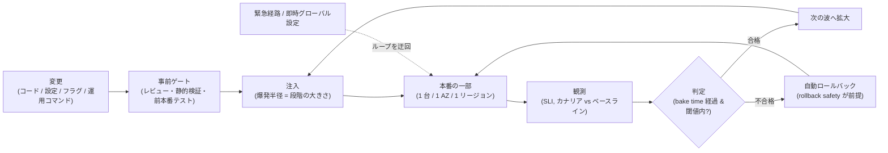
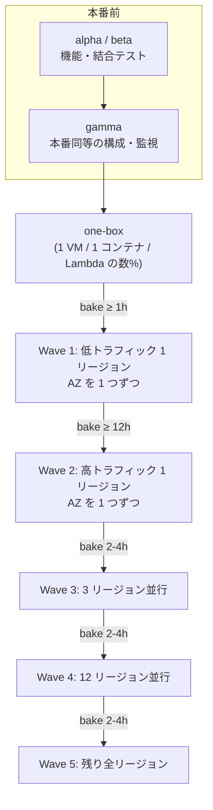
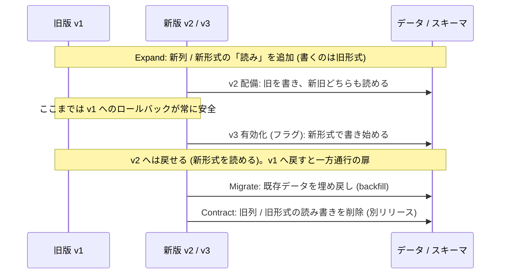

# デプロイと変更の安全性 (Deployment Safety & Progressive Delivery: Staged Rollouts, Canary Analysis, Rollback Safety & Config Push)

## 概要 (Overview)

大規模障害の多くは、ハードウェアの故障や想定外の負荷ではなく、**人間が意図して加えた変更**から始まる。Google の SRE 本は「障害のおよそ 70% は稼働中のシステムへの変更に起因する」と述べ、対策としてわずか 3 つの実践を挙げる。段階的なロールアウト、問題の迅速かつ正確な検出、安全なロールバックである。2017 年の Amazon S3、2019 年の Cloudflare、2021 年の Facebook (Meta)、2024 年の CrowdStrike、2025 年の Google Cloud という近年の代表的な大規模障害は、いずれも公式のポストモーテムで、コードの配備、設定の投入、運用コマンドの実行という「変更」が起点だったと認めている。

本ドキュメントの中心テーゼは、**変更パイプライン (change pipeline) はそれ自体が安全上重要な制御系 (safety-critical control system) である**、ということである。デプロイとは「本番に新しい状態を注入し、観測し、閾値を超えたら元に戻す」という閉ループ制御であり、その設計変数は 3 つしかない。1 回の注入で影響を受ける範囲 (爆発半径, blast radius)、観測から判断までの時間 (bake time と検出力)、元に戻せることの保証 (rollback safety) である。段階的デリバリー (progressive delivery)、自動カナリア分析 (automated canary analysis)、expand/contract 型マイグレーション、フィーチャーフラグ (feature flag) は、この 3 変数のどれかを制御する道具として整理できる。そして最も危険なのは、この制御ループを丸ごと迂回する経路、つまり**数秒で全世界へ伝搬する設定変更**である。分析深度は Level 3。版と数値は 2026-10-07 時点で確認した。

## 方法論 (Methodology)

- 障害事例は、事業者自身が公開した公式ポストモーテム (AWS、Cloudflare、Meta、CrowdStrike、Google Cloud) と規制当局の命令書 (米 SEC の Knight Capital 事案) に限って採用した。報道やまとめ記事は事実の発見にのみ使い、数値は一次資料の記述に合わせた。各事例を「変更の種類 (コード / 設定 / 運用コマンド)」「段階適用の有無」「拡大要因」「公式の是正策」の 4 軸で分解し、共通する構造を抽出する。
- デプロイ段階設計の一次資料は Amazon Builders' Library の 2 本 (自動デプロイ、ロールバック安全性) と Google SRE 本 / SRE Workbook である。これらはベンダー自身による設計解説なので**ベンダー提示 (vendor-presented)** と明示する。異なる 2 社が独立に同型の結論 (段階化・自動検出・自動ロールバック) に達している点を相互検証として扱う。
- 統計的なカナリア判定は Spinnaker / Kayenta の公式文書を一次資料とし、標本数の議論は二標本比率検定の標準的な近似式から筆者が導出した (導出であって測定ではないことを明記する)。
- Kubernetes の機構は公式文書 (Deployment, Disruptions) と Argo Rollouts / Flagger の OSS 文書で確認した。設定管理は Facebook の査読付き論文 (SOSP '15)、デリバリー性能指標は DORA の公開ガイドと書籍 *Accelerate* に依拠する。
- 爆発半径・セル・静的安定性・リトライの一般論は [`cloud-control-planes.md`](cloud-control-planes.md) に、宣言的な調停と GitOps の適用範囲は [`infrastructure-as-code.md`](infrastructure-as-code.md) に委ね、再導出しない。

## 発見事項 (Findings)

1. **変更は障害の主因であり、しかも事業者の公式記録がそれを裏づけている。** Google SRE 本の「約 70%」は社内経験に基づく概数であり、業界横断の測定値ではない。しかし公開ポストモーテムを並べると、同じ構図が繰り返し現れる。S3 (2017-02-28) は手順書に沿った容量削除コマンドの入力誤り、Cloudflare (2019-07-02) は WAF ルール 1 本の正規表現、Meta (2021-10-04) はバックボーン容量を評価する保守コマンド、CrowdStrike (2024-07-19) はセンサーの設定ファイル (Channel File 291)、Google Cloud (2025-06-12) は空欄を含むクォータポリシーの投入が起点だった。5 件のうち、通常のコード配備が直接の原因だったものは 1 件もない。**運用コマンドと設定が、コード配備の安全機構の外側を通った**という点が共通している。

2. **最も危険な変更は「コード経路はすでに配備済みで、設定が引き金を引く」型である。** Google Cloud の事例では、新機能のコードは 2025-05-29 にリージョンごとの段階ロールアウトを経て配備されていた。しかし障害を起こすコード経路は、特定のポリシー変更が入るまで一度も実行されなかったため、段階ロールアウトは何も検出できなかった。その後、空欄を含むポリシーが投入され、数秒で全世界に複製されて、全リージョンの Service Control が null ポインタで同時に落ちた。公式の是正策の筆頭は「重要な変更はすべてフィーチャーフラグで守る」ことだった。段階化はコードと設定の**両方**に、しかも**新しいコード経路が実際に実行される時点で**かかっていなければ意味がない。

3. **設定の伝搬速度は、それ自体が爆発半径を決める変数である。** Cloudflare の設定配布基盤 Quicksilver は、変更が全世界のマシンに届くまで p99 で 2.29 秒だった。Facebook の Configerator 論文 (SOSP '15) も、コミットから数十万台への到達を秒単位で設計している。速い伝搬は、攻撃への即応や負荷の付け替えには必要である。しかし検証されていない変更にとっては、全世界へ一斉に注入する経路になる。Cloudflare の WAF ルールは「脅威への迅速な対応」のために段階ロールアウトの対象外とされ、CrowdStrike のチャネルファイルも段階配信されていなかった (同社 RCA が「Template Instance は段階配信すべき」と是正策に挙げている)。**伝搬の速さと適用の広さを切り離せていない**ことが、設定起因の大規模障害に共通する構造的欠陥である。

4. **段階化の単位は障害ドメイン (fault domain) に合わせ、各段階に「待つ時間」を置く。** AWS の公開パイプラインは、本番前の alpha / beta / gamma を経て、1 台 (one-box) → 低トラフィックの 1 リージョンを AZ ごとに → 高トラフィックの 1 リージョン → 3 リージョン → 12 リージョン → 残り、という波 (wave) で広がる。one-box の後に少なくとも 1 時間、最初のリージョン波の後に少なくとも 12 時間、以降の各波の後に 2〜4 時間の bake time を置く (ベンダー提示)。段階の境界を AZ とリージョンに合わせるのは、[`cloud-control-planes.md`](cloud-control-planes.md) のセルや AZ と同じく、悪い変更の影響を**既存の障害隔離境界の内側に閉じ込める**ためである。bake time は、時間がたってから効く欠陥 (メモリリーク、日次バッチ、証明書期限、低頻度のコード経路) を検出するための時間軸の防壁であり、短縮すると速度は上がるが検出力が落ちる。

5. **自動カナリア分析は統計的検定であり、低トラフィックでは原理的に見えない。** Kayenta の判定器は、カナリアと**同時に起動した同規模のベースライン**を Mann-Whitney U 検定で比べる (98% の信頼度)。比較相手を既存の本番群にしない理由は、キャッシュの温まり具合やヒープの状態といった交絡要因を消すためである (Spinnaker 公式文書)。比較対象を前後比較 (before/after) にしないのは、Google SRE Workbook が言うとおり「時間こそ観測値を変える最大の要因」だからである。ただし検出力は標本数で決まる。エラー率 0.1% が 0.2% へ倍増する欠陥を有意水準 5%・検出力 80% で検出するには、各群で約 2.3 万リクエストが必要になる (技術詳細 3 の導出)。毎秒 10 リクエストしか受けないカナリアなら約 40 分かかる。少量トラフィックのサービスや、低頻度のコード経路を持つ変更では、カナリアは**偽陰性を出すことが前提の道具**になる。

6. **ロールバックは自動的には安全にならない。安全性は変更の分割によって作るものである。** AWS は、シリアライズ形式の変更 (例: XML → JSON) を 2 段階に分ける。準備段階 (prepare) では「新旧両方を読めるが、書くのは旧形式だけ」にし、有効化段階 (activate) で初めて新形式を書く。準備段階の後なら、どの時点でロールバックしても、まだ動いているどの版も全データを読める (ベンダー提示)。データベースの expand/contract (並行変更, parallel change) も同じ構造をとる。逆に、新形式のデータを書いた後に旧版へ戻すと、旧版が読めないデータが残る。これが「一方通行の扉 (one-way door)」であり、そこでは前方修正 (roll forward) しか選べない。ロールバックの可否は、デプロイ時ではなく**設計時**に決まる。

7. **フィーチャーフラグは、デプロイ (配備) とリリース (有効化) を分離する強力な道具だが、それ自体が無審査の本番変更経路になりうる。** フラグを使えば、コードを無効状態で全台に配備し、有効化を 1% → 10% → 100% と段階化でき、kill switch で即座に止められる。Facebook の Gatekeeper はこの形を制度化している。しかしフラグの切り替えは設定変更であり、発見事項 3 の伝搬速度の問題をそのまま継承する。さらに、古いフラグの再利用は致命的になりうる。Knight Capital (2012) では、2003 年から使われていなかった機能 "Power Peg" のコードがサーバに残ったまま、そのフラグが新機能のために転用された。8 台中 1 台に新コードが配備されていなかったため、そのサーバで旧機能が起動し、約 45 分で約 4.6 億ドルの損失を出した (SEC 命令書。Hodgson の解説も同事例をフラグ管理の教訓として引く)。フラグの負債 (flag debt) は、組合せ状態の爆発と死んだコード経路の温存という形で、安全性を直接蝕む。

8. **速度と安定性はトレードオフではない、というのが DORA の一貫した観測である。** DORA は現在、変更リードタイム・デプロイ頻度・失敗デプロイからの回復時間 (スループット) と、変更失敗率・デプロイ手戻り率 (rework rate, 不安定性) の 5 指標を使う。公式ガイドは「多くのチームでこれらの指標は相関しており、上位層は 5 指標すべてで良く、下位層はすべてで悪い」と述べる。因果の解釈としては、頻繁なデプロイは 1 回あたりの差分を小さくし、検出とロールバックを容易にするため安定性を上げる、というものが自然である。ただし DORA は調査ベースの相関研究であり、「頻度を上げれば安定する」という介入効果を直接示したものではない。安全機構 (発見事項 4〜6) を伴わずに頻度だけを上げても、同じ効果は期待できない。

## アーキテクチャ (Architecture)

### 変更パイプラインを閉ループ制御として見る



制御工学の言葉で言えば、段階の大きさは**ループ利得**、bake time と検出力は**観測器の帯域と雑音**、ロールバック安全性は**操作量を戻せること**に対応する。図の点線は、本ドキュメントで扱う障害事例の大半が通った経路である。

### 障害ドメインに沿った波 (wave) の構成



構成と待ち時間は Amazon Builders' Library の記述による (ベンダー提示)。同じ文書は、夜間・休日・週末・金曜・夕方のデプロイを避けるデプロイ時間帯の制限も挙げている。これは、対応できる人がいる時間に爆発を起こさせる、という人間側の静的安定性である。

### 段階的デリバリーのパターン比較

| パターン | 機構 | 主に防ぐもの | 防げないもの | 費用・前提 |
|---|---|---|---|---|
| ローリング (rolling) | インスタンスを順に置換 | 全台同時停止 | 新旧混在時の非互換、全台に広がった後に出る欠陥 | 新旧版の共存可能性 |
| ブルー/グリーン (blue/green) | 2 系統を用意して入口を一括切替 | 切替の速さ、即時の切り戻し | 切替後に全トラフィックが新版に乗る (段階性はない) | 容量 2 倍、状態 (DB) は共有のまま |
| カナリア (canary) | 一部トラフィックを新版へ、比較して拡大 | 広範囲への欠陥の波及 | 低トラフィック・低頻度経路の欠陥 (発見事項 5) | 版別の観測、統計判定 |
| フィーチャーフラグ | コードは配備済み、有効化を実行時に制御 | リリース判断とデプロイの結合 | フラグ切替そのものの全域伝搬 (発見事項 7) | フラグ基盤、フラグの棚卸し |
| ダークローンチ / シャドートラフィック | 本番リクエストを複製して新版に流し、応答は捨てる | 機能的な不一致、性能劣化 | 副作用のある処理 (書き込みの二重化)、共有資源の枯渇 | 複製の帯域、副作用の遮断 |

ダークローンチが「安全」とは限らない点は、Cloudflare の事例が示している。問題の WAF ルールは、何も遮断しない「simulate」モードで投入された。しかし正規表現は実トラフィックに対して評価されるので、バックトラッキングによる CPU 枯渇はそのまま起きた。応答を捨てても、**計算資源は共有されている**。

### 公式ポストモーテムに見る変更起因障害の構造

| 事象 | 変更の種類 | 段階適用 | 拡大要因 | 公式の是正策 (抜粋) |
|---|---|---|---|---|
| AWS S3, 2017-02-28, us-east-1 | 手順書に沿った運用コマンドの入力誤り | なし (1 コマンドで大量削除) | index / placement サブシステムの再起動に長時間 | 削除速度の制限、最小容量を割り込む削除の禁止、index のセル分割の前倒し |
| Cloudflare, 2019-07-02 | WAF マネージドルール (正規表現) | なし (WAF ルールは即時全域が既定) | 数週間前のリファクタリングで CPU 保護が誤って外れていた。社内認証も落ちて対応が遅れた | 他ソフトウェアと同様の段階ロールアウト (緊急時の全域配信能力は維持)、正規表現エンジンの交換 |
| Meta, 2021-10-04 | バックボーン容量を評価する保守コマンド | なし | 監査ツールのバグでコマンドを止められず。DNS サーバが自ら BGP 広告を撤回し、物理セキュリティが復旧を遅らせた | 試験手順の改善と耐障害性の強化 (平時の storm drill が安全な再起動に役立ったと記述) |
| CrowdStrike, 2024-07-19 04:09 UTC | センサーの設定 (Channel File 291) | なし | 入力フィールド 21 個に対しセンサーは 20 個を想定し、配列境界検査が欠落。カーネル内で発生 | Template Instance の段階配信、顧客による配信時期の制御、境界検査、検証器の修正 |
| Google Cloud, 2025-06-12 | クォータポリシー (設定) が配備済みコードの未実行経路を起動 | コードはあり、設定はなし | 設定が数秒で全世界に複製され、再起動時の群発 (herd) で us-central1 の回復が遅延 | 全重要変更のフラグ化、全域複製データの監査、ジッタ付き指数バックオフ |

Microsoft は CrowdStrike 事案の影響を約 850 万台の Windows 端末 (Windows 全体の 1% 未満) と推計している。CrowdStrike は 05:27 UTC に当該ファイルを差し戻した。しかし影響を受けた端末は起動途中でクラッシュしており、自動では回復できなかった。**差し戻しが届かない場所で起きた障害には、ロールバックが存在しない**ということである。

## 技術詳細 (Technical Details)

### 1. 波の進行判定 — 擬似コード

**擬似コード (言語非依存)**。目的は、波ごとの bake とアラームによる自動ロールバックの骨格を示すことである。前提として、各波は障害ドメイン (AZ / リージョン / セル) の集合であること、アラームは版ごとに分離して観測できること、`rollback` は発見事項 6 の意味で安全であることを仮定する。計算量は波の数 W、各波の対象数 n_w に対して、デプロイ操作が O(Σ n_w)、監視が O(W × bake 時間 / 評価周期) である。

```text
for wave in waves:                      # one-box, AZ-1, AZ-2, ..., region groups
    if not in_deploy_window(now): wait_until_window()
    for target in wave.targets:         # 1 波の中も AZ 単位で直列化
        deploy(target, new_version)
        if not wait_healthy(target, timeout): return rollback_all()
    t_end = now + wave.bake_time
    while now < t_end:
        if alarms_firing(scope=deployed_so_far, version=new_version)
           or canary_score(new_version, baseline) < wave.pass_threshold:
            return rollback_all()       # 人間の判断を待たない
        sleep(eval_period)
    if wave.min_traffic and observed_requests(wave) < wave.min_traffic:
        extend_bake()                   # 標本不足は「合格」ではなく「未判定」
```

最後の分岐が重要である。標本不足を合格と見なす実装は、低トラフィック時間帯に検出力ゼロのまま全域へ進む。AWS の記述でも、bake time には時間だけでなく「Create API へのリクエストが少なくとも 100 件」といったデータ点数の条件が含まれる。新しいコードが十分に実行されたことを確かめるためである (ベンダー提示)。

### 2. 設定は「コード」として扱い、しかもコードより慎重に流す

Configerator 論文は「真に configuration-as-code のアプローチ」をとると述べる。設定を高水準のソースからコンパイルして生成し、版管理・コードレビュー・自動検証・カナリアを通す。カナリアは、第 1 段階で 20 台、第 2 段階で数千台規模のクラスタ全体、という形で行い、その後に Zeus (ZooKeeper の派生) の配布木で全サーバへ配る。Gatekeeper は、制約 (restraint) によって機能の公開を 1% → 10% → 100% と段階化する。この構成から読み取れる原則は 3 つある。(a) 設定にも型と検証器を持たせる。CrowdStrike の欠陥は、検証器 (Content Validator) のロジック誤りと、実行時の境界検査の欠落の二重の失敗だった。(b) 配布基盤の速さと、適用の段階化を別の層に分ける。配布は速くてよいが、**有効化**は波に従わせる。(c) 消費側は不正な設定に対して fail-static にする。読めない設定、検証に失敗した設定は棄却し、最後の既知の正常値 (last known good) で動き続ける。Google Cloud の事例で空欄のポリシーが null ポインタにつながったのは、(c) の欠如である。fail-static と fail-closed の緊張については [`cloud-control-planes.md`](cloud-control-planes.md) のセキュリティ考察を参照。

### 3. カナリア判定の統計 — 検定・標本数・誤判定

Kayenta (Netflix と Google が 2018 年に共同で公開。Spinnaker に統合) の NetflixACAJudge は、メトリクスごとにカナリアとベースラインの時系列を Mann-Whitney U 検定で比べ、High / Low / Pass / Nodata に分類する。統計的に有意であることを確かめた**後に**、許容増減幅 (`allowedIncrease` / `allowedDecrease`) という効果量の門を通す。グループごとに Pass の比率を出し、その重み付き平均を総合スコアとする。`critical` 指定のメトリクスが閾値を外れた場合や、全メトリクスの 50% 以上が Nodata の場合は即失格になる。Spinnaker の推奨初期値は、カナリア期間 3 時間、合格 95、境界 75、メトリクスあたり少なくとも 50 データ点である (OSS 文書)。

標本数の目安は、二標本の比率検定の近似式 n ≈ (z_{α/2} + z_β)² · [p₀(1−p₀) + p₁(1−p₁)] / (p₁ − p₀)² から得られる。p₀ = 0.1%、p₁ = 0.2%、α = 0.05 (両側)、検出力 0.8 とすると、n ≈ 7.84 × 0.002995 / 10⁻⁶ ≈ 2.35 万 (各群) になる (筆者による導出。リクエストが独立であると仮定)。ここから実務上の帰結が 3 つ出てくる。第一に、カナリア比率を上げると検出は速くなるが、欠陥時の被害も比例して増える。これは爆発半径と検出力の直接のトレードオフである。第二に、時系列のデータ点は自己相関を持つので、Mann-Whitney の独立性の仮定は近似にすぎない。名目の 98% よりも偽陽性は多く出うる。第三に、メトリクスを増やすと多重比較で偽陽性が増える。SRE Workbook は、利用者が知覚する問題に対応するメトリクスを優先順位づけし、多くても十数個に絞るよう勧めている。偽陽性が多いとカナリアは「いつも落ちるので無視される」状態になる。偽陰性が多いと、段階化は安心感だけを与える儀式になる。どちらに倒すかは、変更の頻度と、障害 1 回のコストで決めるしかない。

SRE Workbook は、カナリアの効果をエラーバジェットの言葉で示している。5% のカナリアが 20% のリクエストを失敗させても、全体のエラー率は 1% にしか見えない。だから版別の内訳を見なければ検出できない。逆に言えば、全体の SLI だけで判定するカナリアは、自らの小ささのせいで検出力を失う。

### 4. ロールバック安全性 — 2 段階デプロイと expand/contract



要点は、互換性の窓を常に「隣り合う 2 版」で保つことである。ローリング更新の途中では新旧が必ず共存するので、**前方互換 (旧版が新データを壊さず扱える) と後方互換 (新版が旧データを読める) の両方**が必要になる。AWS は、この性質を upgrade-downgrade テストで確かめている。テスト環境は単一サーバではなく複数 AZ の複数台で構成し、部分配備 → 全配備 → ロールバックの 3 段階でトラフィックをかけて観察する (ベンダー提示)。前方修正 (roll forward) が正解になるのは、(a) すでに一方通行の扉を通った場合、(b) ロールバック自体が未検証で、前方修正の方が差分が小さい場合、(c) 障害の原因が新版ではなく、外部の変化 (証明書期限、依存先の仕様変更) である場合、の 3 つである。ただし (b) は「ロールバック経路を普段から鍛えていない」ことの裏返しであり、常態化させてはいけない。不可逆な変更 (データ削除、暗号鍵の破棄、外部への送信) は、段階化と多者承認の対象として別扱いにする。

### 5. Kubernetes の機構 — 何が保証され、何が保証されないか

| 機構 | 既定値 | 意味 | 注意点 |
|---|---|---|---|
| `maxSurge` | 25% (切り上げ) | 希望数を超えて同時に存在してよい Pod 数 | replicas=10 なら最大 13 Pod |
| `maxUnavailable` | 25% (切り捨て) | 更新中に利用不能でよい Pod 数 | replicas=10 なら最低 8 Pod は利用可能 |
| readiness probe | (なし) | Ready でない Pod は Service の宛先から外れ、ロールアウトの「利用可能」にも数えられない | プローブが浅い (プロセスが生きているだけ) と、壊れた版でも進行する |
| `minReadySeconds` | 0 | Ready のままこの秒数を保って初めて「利用可能」 | 0 では起動直後に落ちる欠陥を見逃す。ミニ bake time として使う |
| `progressDeadlineSeconds` | 600 | 進行が止まったら `Progressing=False` (`ProgressDeadlineExceeded`) を付ける | **自動ロールバックはしない**。対処は上位の仕組みの役目 |
| `revisionHistoryLimit` | 10 | ロールバック用に保持する旧 ReplicaSet 数 | 0 にすると `rollout undo` できない |
| PodDisruptionBudget | — | Eviction API 経由の自発的中断 (drain 等) を制限 | Deployment のローリング更新は PDB に**制限されない** |

標準の Deployment は「新版の Pod が Ready になるか」しか見ないローリング更新であり、カナリア分析も bake も持たない。これを補うのが Argo Rollouts と Flagger である。Argo Rollouts の `canary` 戦略は、`setWeight` と `pause` のステップで進行を宣言する。トラフィックルーティング (サービスメッシュや Ingress) がなければ、重みをレプリカ数で近似する (10 レプリカで 10% なら新 1 : 旧 9)。分析 (AnalysisTemplate) が失敗すればロールアウトを中断する。Flagger は primary / canary の 2 つの Deployment を作り、一定間隔 (既定 60 秒) ごとに成功率とレイテンシを測る。`stepWeight` ずつ `maxWeight` まで重みを上げ、失敗回数が `threshold` に達するとロールバックする。いずれも、正確な重み制御には L7 のトラフィック分割が要る ([`../networking/service-mesh.md`](../networking/service-mesh.md))。GitOps (Argo CD / Flux) は Git を望ましい状態の唯一の置き場にするので、ロールバックは `git revert` になり、変更の監査証跡も得られる。ただし、調停ループが Git の内容を数分で全クラスタに反映する構成では、Git へのマージ自体が「全域即時の設定変更」になる。クラスタ群ごとに参照するブランチやパスを分け、波を Git の構造で表現しない限り、段階化は失われる ([`infrastructure-as-code.md`](infrastructure-as-code.md) 発見事項 4)。

### 6. セル単位のデプロイと、運用ツールのガードレール

セルベースアーキテクチャ ([`cloud-control-planes.md`](cloud-control-planes.md)) は、デプロイの波の自然な単位にもなる。1 セルずつ配備すれば、悪い変更の爆発半径は「1 セルの顧客」に限られる。最初のセルを社内用や低リスク顧客のセルにすれば、one-box をセル規模に拡張できる。S3 の是正策がまさに「index サブシステムのセル分割の前倒し」だった。もう一つの教訓は、運用ツールそのものに安全機構を組み込むことである。S3 では、ツールが容量を速く削除しすぎること、そしてサブシステムの最小容量を割り込む削除を許していたことが問題とされ、削除速度の制限と下限の不変条件が加えられた。Meta の事例でも、コマンドを止めるはずの監査ツールにバグがあった。**人間の入力を検証するガードレールは、それ自体が本番システムと同等にテストされるべき安全装置**である。

## セキュリティ考察 (Security Considerations)

- **デプロイパイプラインは最高権限のサプライチェーン攻撃面である**: 本番へ任意のコードを入れられる経路は、攻撃者にとって全サーバへの書き込み権限に等しい。成果物の署名と来歴 (provenance) の検証、ビルドの隔離、依存の固定は [`../security/software-supply-chain-security.md`](../security/software-supply-chain-security.md) の枠組みで扱う。段階化は可用性のための仕組みだが、改竄された成果物の影響を最初の波に限定する、検出の機会も与える。
- **デプロイ用の資格情報**: パイプラインが持つ長期の強権限キーは、最も価値の高い窃取対象である。ワークロード ID 連携による短命トークン、環境ごとの権限分離 (本番への配備権限を本番パイプラインだけに与える)、そして人間の本番書き込み権限を原則読み取り専用に落とすことが基本になる ([`cloud-iam-authorization.md`](cloud-iam-authorization.md))。秘密情報はログや成果物に残さず、記載が必要な場合は `█████████` と伏せる。
- **二者承認 (two-person rule) と変更承認**: Knight Capital の SEC 命令書は、配備を第二の技術者が確認していなかったことを指摘している。コードレビューと同じ考え方で、設定変更・フラグ切替・運用コマンドにも二者確認をかける。ただし承認は検出力の低い人間のゲートであり、自動検証と段階化の代わりにはならない。
- **緊急経路 (break-glass) の二面性**: 攻撃に即応するための全域即時配信 (Cloudflare の WAF、CrowdStrike の迅速対応コンテンツ) は、セキュリティ上の正当な要求から生まれた、制御ループの迂回路である。Cloudflare は段階ロールアウトを導入した後も、攻撃対応のための全域緊急配信の能力を残した。緊急経路は「存在するが、使うたびに記録・事後審査され、日常の変更には使えない」ように設計する必要がある。
- **セキュリティ機構が復旧を妨げる**: Meta では、データセンターの物理・システムセキュリティが現地での復旧を遅らせた。Cloudflare では、障害で社内認証が落ち、セキュリティ機能が一部の技術者の資格情報を無効にしていたため、管理画面に入れなかった。障害時に使う認証経路と破棄手順は、本番の依存から切り離して定期的に訓練すべきである。復旧経路がセキュリティ機構に依存すること自体が、[`cloud-control-planes.md`](cloud-control-planes.md) の言う「回復経路上の依存」である。
- **カーネル内・特権コンポーネントへの配信**: CrowdStrike の事例は、特権の高いコンポーネントほど 1 つの不正入力の影響が大きく、しかも差し戻しが届かなくなることを示した。特権コンポーネントへの設定配信には、実行時の入力検証 (境界検査) と、顧客側で配信時期を制御できる段階化の両方が要る。

## 結論 (Conclusions)

- 大規模障害の主因は変更である。したがって、変更パイプラインは開発効率の道具ではなく、本番の可用性を左右する安全上重要な制御系として設計・監査すべきである。その制御変数は、爆発半径 (段階の大きさ)、観測 (bake time と統計的な検出力)、可逆性 (ロールバック安全性) の 3 つに集約される。
- 公式ポストモーテムが示す共通の欠陥は、コード配備の安全機構を、運用コマンドと設定変更が迂回していたことである。速い配布基盤と段階的な有効化を別の層に分け、設定にも型・検証器・カナリア・波を適用し、消費側を fail-static にすることが、最も費用対効果の高い対策である。
- 自動カナリア分析は統計的な道具であり、検出力は標本数で決まる。低トラフィックや低頻度のコード経路では偽陰性を前提にし、「標本不足は未判定」と扱うこと、版別に観測すること、メトリクスを絞ることが要る。
- ロールバックの安全性はデプロイ時ではなく設計時に決まる。2 段階デプロイと expand/contract で互換性の窓を常に隣接 2 版に保ち、一方通行の扉は明示的に識別して別扱いにする。
- DORA が示すとおり、速度と安定性は両立する。ただしそれは、小さな差分・自動検出・安全なロールバックという機構が揃っている場合に限られる。

### 次の接続先 (Related Topics)

- [`cloud-control-planes.md`](cloud-control-planes.md) — 爆発半径、セル、静的安定性、リトライとジッタ (Google Cloud 事例の herd effect の背景)。
- [`infrastructure-as-code.md`](infrastructure-as-code.md) — GitOps の常時調停と、インフラ変更の計画・置換・drift。
- [`container-orchestration-kubernetes.md`](container-orchestration-kubernetes.md) — Deployment コントローラの調停ループそのもの。
- [`cloud-observability.md`](cloud-observability.md) / [`../observability/observability-performance-engineering.md`](../observability/observability-performance-engineering.md) — カナリア判定の入力となる SLI、アラーム、SLO バーンレート。
- [`../networking/service-mesh.md`](../networking/service-mesh.md) — カナリアの重み制御を担う L7 トラフィック分割。
- [`../networking/ip-routing-bgp.md`](../networking/ip-routing-bgp.md) — Meta 事例の BGP 広告撤回の機構。
- [`../distributed-systems/failure-models.md`](../distributed-systems/failure-models.md) — 変更起因障害を相関故障として位置づけるための故障モデル。
- [`multi-region-global-architecture.md`](multi-region-global-architecture.md) — リージョン波の前提となる地理的な障害ドメイン。
- [`multi-tenant-saas-architecture.md`](multi-tenant-saas-architecture.md) / [`autoscaling-capacity-control.md`](autoscaling-capacity-control.md) — テナント単位・セル単位のデプロイと、ロールアウト中の容量 (surge) の確保。
- [`../security/software-supply-chain-security.md`](../security/software-supply-chain-security.md) — 成果物の署名・来歴とパイプラインの保護。

## 参考文献 (References)

**一次資料 (Primary — 公式ポストモーテム・規制当局文書)**

- [Summary of the Amazon S3 Service Disruption in the Northern Virginia (US-EAST-1) Region](https://aws.amazon.com/message/41926/) — Accessed: 2026-10-07。2017-02-28 09:37 PST、入力誤り、削除速度制限と最小容量の保護、セル分割。
- [Details of the Cloudflare outage on July 2, 2019](https://blog.cloudflare.com/details-of-the-cloudflare-outage-on-july-2-2019/) — Accessed: 2026-10-07。正規表現、simulate モード、Quicksilver の p99 2.29 秒、トラフィックの 80% 喪失、段階ロールアウトの導入。
- Janardhan, S. [More details about the October 4 outage (Engineering at Meta)](https://engineering.fb.com/2021/10/05/networking-traffic/outage-details/) — Accessed: 2026-10-07。保守コマンド、監査ツールのバグ、DNS サーバによる BGP 広告撤回、物理セキュリティと復旧。
- [CrowdStrike: Channel File 291 Incident Root Cause Analysis (2024-08-06)](https://www.crowdstrike.com/wp-content/uploads/2024/08/Channel-File-291-Incident-Root-Cause-Analysis-08.06.2024.pdf) — Accessed: 2026-10-07。21 対 20 の入力フィールド、Content Validator の誤り、境界検査の欠落、段階配信の是正策。
- [CrowdStrike: Technical Details on Today's Outage](https://www.crowdstrike.com/blog/technical-details-on-todays-outage/) — Accessed: 2026-10-07。2024-07-19 04:09 UTC の配信と 05:27 UTC の差し戻し。
- [Microsoft: Helping our customers through the CrowdStrike outage (2024-07-20)](https://blogs.microsoft.com/blog/2024/07/20/helping-our-customers-through-the-crowdstrike-outage/) — Accessed: 2026-10-07。約 850 万台 (Windows 全体の 1% 未満) という推計。
- [Google Cloud Service Health: Multiple GCP products are experiencing Service issues (incident report, 2025-06-12)](https://status.cloud.google.com/incidents/ow5i3PPK96RduMcb1SsW) — Accessed: 2026-10-07。2025-05-29 の機能追加、フラグの欠如、全域複製、red-button、us-central1 の herd effect、是正策。
- [U.S. SEC: In the Matter of Knight Capital Americas LLC, Release No. 34-70694 (2013-10-16)](https://www.sec.gov/litigation/admin/2013/34-70694.pdf) — Accessed: 2026-10-07。Power Peg フラグの転用、8 台中 1 台への未配備、二者確認の欠如。

**一次資料 (Primary — 公式文書・査読付き論文)**

- [Kubernetes Documentation: Deployments](https://kubernetes.io/docs/concepts/workloads/controllers/deployment/) — Accessed: 2026-10-07。maxSurge / maxUnavailable の既定と丸め、minReadySeconds、progressDeadlineSeconds (自動ロールバックなし)、revisionHistoryLimit。
- [Kubernetes Documentation: Disruptions](https://kubernetes.io/docs/concepts/workloads/pods/disruptions/) — Accessed: 2026-10-07。PDB の適用範囲、ローリング更新が PDB に制限されないこと。
- Tang, C., Kooburat, T., Venkatachalam, P., Chander, A., Wen, Z., Narayanan, A., Dowell, P., & Karl, R. (2015). Holistic Configuration Management at Facebook. *Proceedings of the 25th Symposium on Operating Systems Principles (SOSP '15)*, 328–343. DOI: 10.1145/2815400.2815401
- Forsgren, N., Humble, J., & Kim, G. (2018). *Accelerate: The Science of Lean Software and DevOps*. IT Revolution Press. — DORA 指標とスループット・安定性の相関の原典。
- [DORA: DORA's software delivery performance metrics](https://dora.dev/guides/dora-metrics/) — Accessed: 2026-10-07。5 指標の定義、スループット / 不安定性の区分、速度と安定性は相関するという記述。
- [DORA: A history of DORA's software delivery metrics](https://dora.dev/guides/dora-metrics/history/) — Accessed: 2026-10-07。2023 年の回復時間指標の改称、2024 年の rework rate 追加。

**ベンダー提示 (Vendor-presented — 設計解説)**

- Beyer, B., Jones, C., Petoff, J., & Murphy, N. R. (Eds.). (2016). *Site Reliability Engineering*. O'Reilly. [Chapter 1: Introduction](https://sre.google/sre-book/introduction/) — Accessed: 2026-10-07。「障害の約 70% は稼働中システムへの変更による」、変更管理の 3 実践。
- Beyer, B., Murphy, N. R., Rensin, D. K., Kawahara, K., & Thorne, S. (Eds.). (2018). *The Site Reliability Workbook*. O'Reilly. [Chapter 16: Canarying Releases](https://sre.google/workbook/canarying-releases/) — Accessed: 2026-10-07。前後比較の危険、メトリクス選択、5% カナリアとエラーバジェット。
- Liguori, C. [Automating safe, hands-off deployments (Amazon Builders' Library)](https://builder.aws.com/content/3ErTKQOTKc5NIw031UePBPxTQ6I/automating-safe-hands-off-deployments) — Accessed: 2026-10-07。alpha/beta/gamma、one-box、波の構成、bake time、デプロイ時間帯。
- Pokkunuri, S. [Ensuring rollback safety during deployments (Amazon Builders' Library)](https://builder.aws.com/content/3F04j2yRAAMBuPSPs50xwXZqg01/ensuring-rollback-safety-during-deployments) — Accessed: 2026-10-07。2 段階デプロイ、upgrade-downgrade テスト、一方通行の扉。
- [Introducing Kayenta: An open automated canary analysis tool from Google and Netflix (Google Cloud Blog, 2018-04)](https://cloud.google.com/blog/products/gcp/introducing-kayenta-an-open-automated-canary-analysis-tool-from-google-and-netflix) — Accessed: 2026-10-07。

**OSS 文書 (Primary — OSS プロジェクト)**

- [Spinnaker: How canary judgment works](https://spinnaker.io/docs/guides/user/canary/judge/) — Accessed: 2026-10-07。Mann-Whitney U 検定、98% 信頼度、効果量の門、Nodata 50% で失格。
- [Spinnaker: Canary best practices](https://spinnaker.io/docs/guides/user/canary/best-practices/) — Accessed: 2026-10-07。同時起動のベースライン、50 データ点、推奨初期値。
- [Argo Rollouts: Canary Deployment Strategy](https://argo-rollouts.readthedocs.io/en/stable/features/canary/) — Accessed: 2026-10-07。
- [Flagger: How it works](https://docs.flagger.app/usage/how-it-works) — Accessed: 2026-10-07。

**二次資料 (Secondary — 専門家による解説)**

- Sato, D. (2014-05-13). [ParallelChange](https://martinfowler.com/bliki/ParallelChange.html) — Accessed: 2026-10-07。expand / migrate / contract。
- Hodgson, P. (2017-10-09). [Feature Toggles (aka Feature Flags)](https://martinfowler.com/articles/feature-toggles.html) — Accessed: 2026-10-07。フラグの分類と保有コスト。
